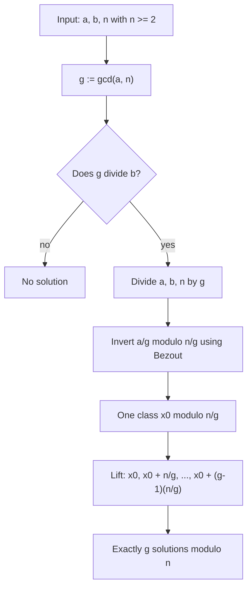
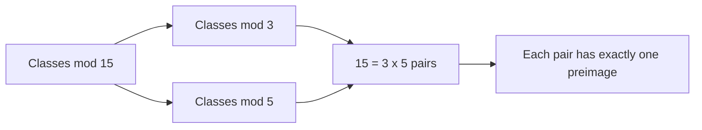

# Congruences

> [Mathematics](../../README.md) › [Number Theory](../README.md) › Congruences · Level: Intermediate · Prerequisites: [Divisibility and Primes](../01-divisibility-and-primes/README.md), [Proof Techniques](../../00-foundations/04-proof-techniques/README.md), [Integers](../../01-arithmetic/02-integers/README.md), [Mathematical Induction](../../09-discrete-mathematics/01-mathematical-induction/README.md) · Estimated time: 600 min

## 1. Introduction

A clock is a machine for forgetting. At three o'clock in the afternoon and three o'clock in the morning the hands are in the same place, and for the purpose of catching a train the two are interchangeable. Formally, the clock identifies integers that differ by a multiple of $12$; it works in $\mathbb{Z}/12\mathbb{Z}$. Every calendar, every weekly schedule, every rotating shift and every hash table does the same thing with a different modulus.

Gauss, in the *Disquisitiones Arithmeticae* of 1801, turned this observation into a notation and a theory. He wrote $a \equiv b \pmod n$ for "$n$ divides $a - b$" and called it a **congruence**. The notation is deliberately chosen to look like equality, because congruence behaves like equality in almost every respect: you may add, subtract and multiply congruent numbers, you may substitute them into polynomials, and you may divide by a number that is coprime to the modulus. That resemblance is not an accident; it is the statement that the residue classes form a *ring*, and the ring is the beginning of modern algebra.

The gain is enormous, because the division algorithm of the [previous topic](../01-divisibility-and-primes/README.md) lets us replace an arbitrary integer by a small remainder, and congruence statements survive that replacement. A question about divisibility of astronomically large numbers becomes a question about arithmetic on finitely many small symbols.

Four theorems carry almost all the weight.

* **The Chinese remainder theorem.** Congruences modulo pairwise coprime moduli can be solved independently and recombined. It is the theorem behind fast arithmetic on large integers, behind secret-sharing schemes, and behind the design of calendars.
* **Fermat's little theorem.** If $p$ is prime and $p \nmid a$ then $a^{p-1} \equiv 1 \pmod p$. It reduces the computation of huge powers to computations with exponents below $p$, and it is the classical primality test.
* **Euler's theorem.** The same statement with $p$ replaced by an arbitrary modulus $n$ and $p-1$ replaced by $\varphi(n)$, the count of integers coprime to $n$. Its proof is the prototype of a group-theoretic argument: multiply all the units together, permute them, cancel.
* **Wilson's theorem.** $(p-1)! \equiv -1 \pmod p$, with a converse that characterises primes. It is elegant and useless in practice — $99$ factorial is not computable — which makes it a good reminder that a theorem's importance is not measured by its computational value.

The applications are concrete: divisibility tests, ISBN and bank-card check digits, hashing, and RSA, whose decryption step is Euler's theorem in disguise. By the end of the tutorial the reader should be able to solve a system of congruences by hand, decide in one line whether a linear congruence is solvable, compute a modular inverse, and explain why $a^{100} \equiv 1$ whenever $\varphi(n) \mid 100$ and $\gcd(a,n)=1$.

## 2. Prerequisites

This tutorial depends on the previous one, more than on anything else.

* **Divisibility.** $a \mid b$ means $b = ak$; the elementary properties (transitivity, linear combinations, the size bound, cancellation). Taught in [Divisibility and Primes](../01-divisibility-and-primes/README.md), Section 7.4.
* **The division algorithm and remainders.** $a = qb + r$ with $0 \le r < b$, uniquely. Taught in [Divisibility and Primes](../01-divisibility-and-primes/README.md), Section 7.3. Everything about residue classes is a consequence of this theorem.
* **The Euclidean algorithm and Bézout's identity.** Computing gcds and producing $x, y$ with $ax + by = \gcd(a,b)$; the extended algorithm. Taught in [Divisibility and Primes](../01-divisibility-and-primes/README.md), Sections 7.6 and 7.7. Bézout's identity is the *only* tool used to solve linear congruences.
* **Euclid's lemma and the fundamental theorem of arithmetic.** A prime dividing a product divides a factor; unique factorisation. Taught in [Divisibility and Primes](../01-divisibility-and-primes/README.md), Sections 7.8 and 7.9.
* **Equivalence relations.** Reflexive, symmetric, transitive; equivalence classes; the quotient of a set by an equivalence relation. Taught in [Relations and Functions](../../00-foundations/05-relations-and-functions/README.md).
* **Proof techniques and induction.** Direct proof, contradiction, uniqueness proofs, induction for statements of the form "for all $n$". Taught in [Proof Techniques](../../00-foundations/04-proof-techniques/README.md) and [Mathematical Induction](../../09-discrete-mathematics/01-mathematical-induction/README.md).
* **Binomial theorem.** $(x+y)^n = \sum_k \binom nk x^k y^{n-k}$, used in the second proof of Fermat's little theorem. Taught in [Advanced Algebra](../../03-algebra/14-advanced-algebra/README.md).

Conventions, matching [MATHEMATICAL_NOTATION.md](../../MATHEMATICAL_NOTATION.md):

* The modulus is a positive integer, and in most statements $n \ge 2$. The case $n = 1$ collapses everything (all integers are congruent modulo $1$), and the case $n = 0$ is not allowed — congruence modulo $0$ would mean equality, and the notation is never used that way.
* $\mathbb{Z}/n\mathbb{Z}$ denotes the set of residue classes modulo $n$. It is the same object as $\mathbb{Z}_n$ in older books; this repository uses the quotient notation.
* $\varphi$ is Euler's totient function; it is defined in Section 7.5, not assumed.

## 3. Learning Objectives

By the end of this tutorial you will be able to:

1. State the definition of congruence and prove that it is an equivalence relation.
2. Describe the residue classes modulo $n$, prove that there are exactly $n$ of them, and identify the unique representative of each in $\{0, 1, \dots, n-1\}$.
3. Prove that addition, subtraction and multiplication are well defined on residue classes, and use this to substitute congruent values into polynomial expressions.
4. State and prove the cancellation theorem $ac \equiv bc \pmod n \iff a \equiv b \pmod{n/\gcd(c,n)}$, and explain why the naive cancellation is wrong.
5. Prove that $a$ is invertible modulo $n$ if and only if $\gcd(a,n) = 1$, and compute inverses with the extended Euclidean algorithm.
6. State and prove the criterion $\gcd(a,n) \mid b$ for solvability of $ax \equiv b \pmod n$, determine the number of solutions, and exhibit them all.
7. State, prove and apply the Chinese remainder theorem, including the general pairwise-coprime form and the non-coprime two-modulus case.
8. Prove Fermat's little theorem in two ways, and explain the group-theoretic proof as well.
9. Define Euler's totient $\varphi$, prove that $\varphi(p^k) = p^k - p^{k-1}$, prove multiplicativity from the Chinese remainder theorem, and derive $\varphi(n) = n\prod_{p\mid n}(1 - 1/p)$.
10. Prove Euler's theorem and Wilson's theorem.
11. Compute $b^e \bmod m$ by square-and-multiply, prove the algorithm correct, and state its cost.
12. Derive the standard divisibility tests and check-digit schemes from congruence statements.
13. Explain the RSA algorithm and prove its correctness using Euler's theorem and the Chinese remainder theorem.

## 4. Intuition

### 4.1 Clock arithmetic

On a $12$-hour clock, $10 + 4 = 2$: ten o'clock plus four hours is two o'clock. Nobody finds this confusing, because the mental model is a circle rather than a line. The same model works with any number of positions.

Imagine a clock with $n$ positions, numbered $0$ to $n-1$. To add two numbers, start at the first and count forward the second number of positions, wrapping around. To multiply, count in steps. Every integer lands somewhere on the dial, and two integers that land on the same position are *congruent*.

Two properties of this picture are worth extracting.

* The dial is **finite**, so there are only $n$ distinguishable states. Checking a congruence is therefore a finite computation, even when the integers involved have a thousand digits.
* The dial has **structure**: addition and multiplication of positions are well defined, but division often is not. On a $12$-hour dial, you cannot solve $4x \equiv 2$ by dividing by $4$, because $4$ has no inverse — multiplying by $4$ maps the dial onto only three positions. The obstruction is $\gcd(4, 12) = 4 \ne 1$.

### 4.2 What congruence buys you

Congruence is a *filter*: it discards the information that a divisibility question does not need. To decide whether $7$ divides $2^{100}$, you never compute $2^{100} = 1267650600228229401496703205376$. You compute $2^3 \equiv 1 \pmod 7$, hence $2^{100} = 2^{3 \cdot 33 + 1} = (2^3)^{33} \cdot 2 \equiv 2 \pmod 7$. Two lines instead of thirty digits.

The filter is legitimate exactly because the operations are well defined: if you replace a number by a congruent one in a polynomial expression with integer coefficients, the result changes by a multiple of $n$. That is the content of Section 7.3, and it is the reason congruence is such a useful computational tool.

### 4.3 Why primes are special

Modulo a prime $p$, every nonzero residue is invertible: for $1 \le a \le p-1$ the only common divisor of $a$ and $p$ is $1$, so Bézout produces an inverse. Modulo a composite $n$ this fails badly: the residue $2$ has no inverse modulo $4$, and in general there are only $\varphi(n)$ invertible residues among $n$.

The difference is qualitative. $\mathbb{Z}/p\mathbb{Z}$ is a **field** — the same axioms as $\mathbb{Q}$ and $\mathbb{R}$ — while $\mathbb{Z}/n\mathbb{Z}$ for composite $n$ is only a ring, with zero divisors. This is why so much number theory is about primes, and why Fermat's little theorem (prime modulus) is not a special case of Euler's theorem but a sharper statement with a sharper proof.

## 5. Formal Definition

### 5.1 Congruence

**Definition 5.1.1 (Congruence).** Let $n \in \mathbb{N}$ with $n \ge 2$ and let $a, b \in \mathbb{Z}$. We say that $a$ is **congruent** to $b$ modulo $n$, written
$$a \equiv b \pmod n,$$
when $n \mid (a - b)$; that is, when there exists $k \in \mathbb{Z}$ with $a - b = kn$. We write $a \not\equiv b \pmod n$ for the negation.

Three comments on the definition.

* It is a statement about the *difference*, not about the numbers. $100 \equiv 3 \pmod{97}$ even though $100$ and $3$ look nothing alike.
* The sign is irrelevant: $n \mid (a-b)$ holds if and only if $n \mid (b-a)$, so congruence is symmetric by construction (Section 7.1 makes this formal).
* $a \equiv 0 \pmod n$ is a restatement of $n \mid a$. Congruence is a generalisation of divisibility, and the two are used interchangeably in what follows.

### 5.2 Residue classes

**Definition 5.2.1 (Residue class).** The **residue class** of $a$ modulo $n$ is
$$[a]_n = \{\, b \in \mathbb{Z} : b \equiv a \pmod n \,\} = \{\, a + kn : k \in \mathbb{Z} \,\}.$$
The integer $a$ is a **representative** of the class. The set of all residue classes is denoted $\mathbb{Z}/n\mathbb{Z}$:
$$\mathbb{Z}/n\mathbb{Z} = \{\, [0]_n, [1]_n, \dots, [n-1]_n \,\}.$$

**Proposition 5.2.2.** Every integer is congruent modulo $n$ to exactly one element of $\{0, 1, \dots, n-1\}$, namely its remainder on division by $n$. Consequently $\mathbb{Z}/n\mathbb{Z}$ has exactly $n$ elements, and $[a]_n = [b]_n \iff a \equiv b \pmod n$.

*Proof.* Existence and uniqueness of the remainder are Theorem 7.2.1 of [Divisibility and Primes](../01-divisibility-and-primes/README.md): $a = qn + r$ with $0 \le r < n$, so $a - r = qn$ is divisible by $n$ and $a \equiv r$. If $0 \le r, r' < n$ and $r \equiv r' \pmod n$ then $n \mid (r - r')$ with $\lvert r - r'\rvert < n$, which forces $r = r'$. Finally $[a]_n = [b]_n$ means each class contains the other, i.e. $a \equiv b$. $\square$

The remainder $a \bmod n$ is thus the *canonical representative* of the class, and "reducing modulo $n$" means replacing a number by this representative.

### 5.3 Complete residue systems

**Definition 5.3.1 (Complete residue system).** A set $S$ of $n$ integers is a **complete residue system** modulo $n$ when no two elements of $S$ are congruent modulo $n$.

Equivalently (Proposition 5.2.2), $S$ contains exactly one representative of each residue class. The standard example is $\{0, 1, \dots, n-1\}$; for moduli that are odd, $\{-\frac{n-1}{2}, \dots, \frac{n-1}{2}\}$ is another, often more convenient.

Complete residue systems are used as follows: if $S$ is a complete residue system and $P$ is a statement about residue classes, proving $P$ for every element of $S$ proves it for every integer. This is the finite-verification trick behind Fermat's little theorem.

### 5.4 Units

**Definition 5.4.1 (Unit, inverse).** A residue class $[a]_n$ is a **unit** modulo $n$ when there exists $[x]_n$ with $[a]_n[x]_n = [1]_n$, that is, when
$$ax \equiv 1 \pmod n .$$
The class $[x]_n$ is then the **inverse** of $[a]_n$, written $a^{-1} \bmod n$. Its uniqueness modulo $n$ is proved in Proposition 7.5.3.

Section 7.5 proves the criterion: $[a]_n$ is a unit if and only if $\gcd(a,n) = 1$. Modulo a prime $p$, every nonzero class is a unit — this is the field property of $\mathbb{Z}/p\mathbb{Z}$.

## 6. Mathematical Notation

| Symbol | Read as | Meaning |
|---|---|---|
| $a \equiv b \pmod n$ | $a$ is congruent to $b$ modulo $n$ | $n \mid (a-b)$ |
| $a \not\equiv b \pmod n$ | not congruent | $n \nmid (a-b)$ |
| $a \bmod n$ | $a$ modulo $n$ | the remainder in $\{0, \dots, n-1\}$ |
| $[a]_n$ | the class of $a$ modulo $n$ | $\{a + kn : k \in \mathbb{Z}\}$ |
| $\mathbb{Z}/n\mathbb{Z}$ | zed mod $n$ zed | the ring of residue classes modulo $n$ |
| $\mathbb{Z}/p\mathbb{Z} = \mathbb{F}_p$ | the field with $p$ elements | valid when $p$ is prime |
| $a^{-1} \bmod n$ | the inverse of $a$ modulo $n$ | the class $x$ with $ax \equiv 1 \pmod n$ |
| $\varphi(n)$ | Euler's totient of $n$ | the number of $k \in \{1,\dots,n\}$ with $\gcd(k,n)=1$ |
| $\gcd(a,n) \mid b$ | gcd of $a$ and $n$ divides $b$ | the solvability criterion for $ax \equiv b$ |
| $\operatorname{ord}_n(a)$ | the order of $a$ modulo $n$ | least $d \ge 1$ with $a^d \equiv 1 \pmod n$ |
| $\equiv$ | is congruent to | never means "equals" |
| $\mathrm{O}(\log e)$ | big-O of log $e$ | cost of fast exponentiation |

Reading aloud: "$a \equiv b \pmod n$" is "a is congruent to b modulo n" or "a is congruent to b mod n". The modulus belongs to the relation, not to either side, which is why the parentheses are always written. A common shorthand in computation is `a % n`, and in code `pow(b, e, m)` computes $b^e \bmod m$ in $O(\log e)$ multiplications — precisely the algorithm of Section 7.11.

## 7. Core Concepts

### 7.1 Congruence is an equivalence relation

**Theorem 7.1.1.** For fixed $n \ge 2$, congruence modulo $n$ is an equivalence relation on $\mathbb{Z}$: for all $a, b, c \in \mathbb{Z}$,

1. $a \equiv a \pmod n$  (reflexive);
2. if $a \equiv b \pmod n$ then $b \equiv a \pmod n$  (symmetric);
3. if $a \equiv b \pmod n$ and $b \equiv c \pmod n$ then $a \equiv c \pmod n$  (transitive).

*Proof.* (1) $a - a = 0 = 0 \cdot n$, so $n \mid 0$.

(2) If $a - b = kn$ then $b - a = (-k)n$ with $-k \in \mathbb{Z}$.

(3) If $a - b = k_1 n$ and $b - c = k_2 n$ then
$$a - c = (a - b) + (b - c) = (k_1 + k_2)n,$$
and $k_1 + k_2 \in \mathbb{Z}$. $\blacksquare$

The three properties are the definition of an equivalence relation, and they have a consequence that is easy to overlook: congruence *partitions* $\mathbb{Z}$ into disjoint classes whose union is everything. Two classes are either identical or disjoint, never partially overlapping, and Proposition 5.2.2 identifies them concretely.

The converse of (3) is false and is a common error: $a \equiv c$ does not follow from, nor imply, $a \equiv b$ and $b \equiv c$ for a *particular* $b$. Transitivity is a one-way implication.

### 7.2 Arithmetic on residue classes

The point of congruence is that it can be *computed with*. That requires the following theorem, which says the result of an operation depends only on the classes of the operands, not on which representatives are chosen. This property is called **well-definedness**, and it is the only thing that needs checking before the algebra can begin.

**Theorem 7.2.1 (Congruence is a congruence relation).** Let $n \ge 2$ and suppose
$$a \equiv a' \pmod n \qquad \text{and} \qquad b \equiv b' \pmod n .$$
Then

1. $a + b \equiv a' + b' \pmod n$;
2. $a - b \equiv a' - b' \pmod n$;
3. $ab \equiv a'b' \pmod n$;
4. $a^k \equiv (a')^k \pmod n$ for every $k \ge 1$;
5. $P(a) \equiv P(a') \pmod n$ for every polynomial $P$ with integer coefficients.

*Proof.* Write $a - a' = k_1 n$ and $b - b' = k_2 n$.

(1) $(a + b) - (a' + b') = (a - a') + (b - b') = (k_1 + k_2)n$.

(2) $(a - b) - (a' - b') = (a - a') - (b - b') = (k_1 - k_2)n$.

(3) The key algebraic identity is
$$ab - a'b' = a(b - b') + b'(a - a') = a k_2 n + b' k_1 n = (ak_2 + b'k_1)n .$$
(Note that splitting it as $a(b-b') + b'(a-a')$ avoids any cancellation and works for arbitrary signs.)

(4) Induction on $k$: the case $k = 1$ is the hypothesis $a \equiv a'$, and the step multiplies two congruences using (3): $a^{k+1} = a^k \cdot a \equiv (a')^k \cdot a' = (a')^{k+1}$.

(5) A polynomial $P(x) = \sum_{j=0}^{d} c_j x^j$ with $c_j \in \mathbb{Z}$ is evaluated by additions and multiplications of the $c_j$ and $x$; by (1), (3) and (4) each monomial satisfies $c_j a^j \equiv c_j (a')^j$, and a repeated application of (1) sums them. More formally, induction on the degree using (1) and (3). $\blacksquare$

The practical content of part (5) is: **you may replace any number inside an integer polynomial by any congruent number**, and the result is congruent. That is the licence for all the reductions in this tutorial. What is *not* licensed is replacing a number inside an exponent or inside a factorial; those operations are not polynomial, and Sections 7.8 and 7.9 explain what replaces the missing rule.

**Corollary 7.2.2 (Substitution in identities).** If $a \equiv b \pmod n$ then $f(a) \equiv f(b) \pmod n$ for every function $f$ defined by an integer polynomial expression — including $f(x) = x^3 + 5x - 2$ and $f(x) = (x+1)(x-3)^{10}$.

**Example 7.2.3.** Compute $7^{100} \bmod 5$. Since $7 \equiv 2 \pmod 5$, part (4) gives $7^{100} \equiv 2^{100} \pmod 5$. Now $2^4 = 16 \equiv 1 \pmod 5$, and $100 = 4 \cdot 25$, so $2^{100} = (2^4)^{25} \equiv 1^{25} = 1 \pmod 5$. Hence $7^{100} \equiv 1 \pmod 5$. (Check the last digit: $7^{100}$ ends in $1$, and a number ending in $1$ is $\equiv 1 \pmod 5$ ✓.)

### 7.3 Reduction to canonical representatives

Because each class has a unique representative in $\{0, \dots, n-1\}$, every computation modulo $n$ can be organised as follows: reduce every input, perform the operation on representatives, reduce the result. The theorem that this is legitimate is Theorem 7.2.1; the theorem that the intermediate results can be chosen small is trivial (the representatives are bounded by $n$), and it is why modular arithmetic is used inside computers — all intermediate values stay below $n^2$, no matter how large the original numbers were.

The one operation that does not automatically survive is division. Section 7.4 gives the exact criterion.

**Proposition 7.3.1 (Reduction is a ring homomorphism).** The map $\mathbb{Z} \to \mathbb{Z}/n\mathbb{Z}$, $a \mapsto [a]_n$, satisfies
$$[a + b]_n = [a]_n + [b]_n, \qquad [ab]_n = [a]_n[b]_n, \qquad [0]_n = 0, \quad [1]_n = 1,$$
so $\mathbb{Z}/n\mathbb{Z}$ is a commutative ring with identity under the operations defined on representatives.

*Proof.* The first two equalities are exactly Theorem 7.2.1(1) and (3), read as statements about classes. Associativity, commutativity and distributivity are inherited from $\mathbb{Z}$: if an identity holds for all integers, it holds for all classes, because both sides can be computed from representatives and the results agree. $\square$

### 7.4 Cancellation: the theorem everyone gets wrong

Modulo a prime you may divide by any nonzero residue. Modulo a composite you may not. The exact statement is the following.

**Theorem 7.4.1 (Cancellation with the correct modulus).** Let $n \ge 2$, $c \in \mathbb{Z}$, and $g = \gcd(c,n)$. For all $a, b \in \mathbb{Z}$,
$$ac \equiv bc \pmod n \iff a \equiv b \pmod{\frac{n}{g}} .$$

*Proof.* The congruence $ac \equiv bc \pmod n$ says $n \mid c(a-b)$. Write $n = g n'$ and $c = g c'$, so that $\gcd(n', c') = 1$ (Corollary 7.5.4 of [Divisibility and Primes](../01-divisibility-and-primes/README.md)). Then
$$n \mid c(a-b) \iff g n' \mid g c' (a-b) \iff n' \mid c'(a-b) \iff n' \mid (a-b),$$
where the middle equivalence is cancellation of the nonzero factor $g$ (property D7 of the previous topic) and the last uses $\gcd(n',c') = 1$ together with property D8. Since $n' = n/g$, this is exactly $a \equiv b \pmod{n/g}$. $\blacksquare$

**Corollary 7.4.2 (Cancellation with a unit).** If $\gcd(c,n) = 1$ then
$$ac \equiv bc \pmod n \iff a \equiv b \pmod n .$$
In this case one writes $a \equiv b \cdot c^{-1} \pmod n$.

*Proof.* Here $g = 1$ and $n/g = n$. $\square$

**Corollary 7.4.3 (Divisibility by a factor of the modulus).** If $ac \equiv bc \pmod n$ and $\gcd(c,n) = 1$, then $a \equiv b \pmod n$; but if $\gcd(c,n) = g > 1$, the most one may conclude is $a \equiv b \pmod{n/g}$.

**Example 7.4.4.** $6 \cdot 2 = 12$ and $6 \cdot 5 = 30$, and $30 - 12 = 18$ is divisible by $9$, so
$$6 \cdot 2 \equiv 6 \cdot 5 \pmod 9 .$$
Here $g = \gcd(6,9) = 3$ and $n/g = 3$, so the valid cancellation is $2 \equiv 5 \pmod 3$ — which is true ($5 - 2 = 3$). The invalid conclusion $2 \equiv 5 \pmod 9$ is false. This is the single most common error in modular arithmetic, and the reason the hypothesis must be checked every time.

**Corollary 7.4.5 (Cancelling the modulus itself).** If $\gcd(c,n)=1$ and $ac \equiv bc \pmod n$ then $a \equiv b \pmod n$. In particular, for a prime $p$ and $p \nmid c$ the cancellation is always permitted: this is used in the proof of Fermat's little theorem, where $c = (p-1)!$ is a product of integers all smaller than $p$, hence coprime to $p$.

### 7.5 Units and the totient function

**Proposition 7.5.1 (Invertibility criterion).** For $n \ge 2$ and $a \in \mathbb{Z}$,
$$[a]_n \text{ is a unit} \iff \gcd(a,n) = 1 .$$

*Proof.* ($\Rightarrow$) Suppose $ab \equiv 1 \pmod n$. Then $n \mid (ab - 1)$, say $ab - 1 = kn$, so $ab - kn = 1$. Any common divisor of $a$ and $n$ divides the left side by D3 of the previous topic, so it divides $1$; hence $\gcd(a,n) = 1$.

($\Leftarrow$) Suppose $\gcd(a,n) = 1$. By Bézout's identity there are $x, y$ with $ax + ny = 1$. Reducing modulo $n$ gives $ax \equiv 1 \pmod n$, so $[x]_n$ is an inverse of $[a]_n$. $\square$

**Proposition 7.5.2 (Units form a group).** The units modulo $n$ form a set $(\mathbb{Z}/n\mathbb{Z})^{\times}$ closed under multiplication, containing $1$, with an inverse for each element. Multiplication is associative and commutative.

*Proof.* If $a, b$ are units with inverses $a^{-1}, b^{-1}$ then $(ab)(b^{-1}a^{-1}) = 1$, so $ab$ is a unit; $1 \cdot 1 = 1$ shows that $1$ is a unit; inverses exist by definition; and associativity and commutativity are inherited from $\mathbb{Z}$. $\square$

**Definition 7.5.3 (Euler's totient).** For $n \ge 1$, $\varphi(n)$ is the number of integers $k$ with $1 \le k \le n$ and $\gcd(k,n) = 1$. Equivalently, $\varphi(n)$ is the number of units modulo $n$, i.e. the cardinality of $(\mathbb{Z}/n\mathbb{Z})^{\times}$.

The equivalence of the two descriptions is Proposition 7.5.1 together with the fact that each class has exactly one representative in $\{1, \dots, n\}$. Values: $\varphi(1) = 1$, $\varphi(2) = 1$, $\varphi(3) = 2$, $\varphi(4) = 2$, $\varphi(5) = 4$, $\varphi(6) = 2$, $\varphi(7) = 6$, $\varphi(8) = 4$, $\varphi(9) = 6$, $\varphi(10) = 4$, $\varphi(12) = 4$, $\varphi(100) = 40$.

**Proposition 7.5.4 (Uniqueness of the inverse).** If $a$ is a unit modulo $n$, its inverse is unique modulo $n$.

*Proof.* If $ax \equiv ax' \equiv 1 \pmod n$ then $a(x - x') \equiv 0 \pmod n$; since $\gcd(a,n)=1$, Corollary 7.4.2 gives $x \equiv x' \pmod n$. $\square$

### 7.6 Linear congruences

A **linear congruence** is an equation of the form
$$ax \equiv b \pmod n$$
in the unknown $x$. Unlike a linear equation over $\mathbb{Q}$, it may have no solution, and when it has one it usually has several — but the possibilities are completely classified.

**Theorem 7.6.1 (Solvability criterion and solution count).** Let $n \ge 2$, $a, b \in \mathbb{Z}$, and $g = \gcd(a,n)$. Then:

1. $ax \equiv b \pmod n$ has a solution if and only if $g \mid b$;
2. if $g \mid b$, the congruence has exactly $g$ solutions modulo $n$;
3. those solutions are $x \equiv x_0 + k \cdot \dfrac{n}{g} \pmod n$ for $k = 0, 1, \dots, g-1$, where $x_0$ is any one solution.

*Proof.* (1) Suppose $x$ is a solution. Then $n \mid (ax - b)$, say $ax - b = kn$, so $b = ax - kn$. Since $g \mid a$ and $g \mid n$, D3 gives $g \mid b$. Conversely suppose $g \mid b$ and write
$$a = ga', \qquad n = gn', \qquad b = gb',$$
so that $\gcd(a', n') = 1$ by Corollary 7.5.4 of [Divisibility and Primes](../01-divisibility-and-primes/README.md). Then
$$ax \equiv b \pmod n \iff gn' \mid g(a'x - b') \iff n' \mid (a'x - b') \iff a'x \equiv b' \pmod{n'} .$$
Since $\gcd(a',n')=1$, the class $a'$ is a unit modulo $n'$ (Proposition 7.5.1), so multiplying by its inverse $u$ gives the equivalent condition
$$x \equiv u b' \pmod{n'} .$$
That congruence certainly has solutions — take $x = ub'$ — so the original one does too.

(2)–(3) The solutions in $\mathbb{Z}$ are exactly $\{x_0 + t n' : t \in \mathbb{Z}\}$, where $x_0 = ub'$. Two of them are congruent modulo $n = gn'$ exactly when $gn' \mid (t - t')n'$, i.e. when $g \mid (t - t')$, i.e. when $t \equiv t' \pmod g$. So as $t$ runs over $0, 1, \dots, g-1$ one obtains exactly $g$ distinct classes modulo $n$, and every solution is one of them. $\blacksquare$

**Example 7.6.2.** Solve $12x \equiv 8 \pmod{20}$.

Here $g = \gcd(12,20) = 4$ and $4 \mid 8$, so there are exactly four solutions. Divide the congruence, the modulus and the right side by $g$:
$$3x \equiv 2 \pmod 5 .$$
Since $3 \cdot 2 = 6 \equiv 1 \pmod 5$, the inverse of $3$ is $2$, so $x \equiv 2 \cdot 2 = 4 \pmod 5$. The four classes modulo $20$ reducing to $4$ modulo $5$ are
$$x \in \{4,\ 9,\ 14,\ 19\}.$$
*Check, all four:* $12 \cdot 4 = 48 = 2 \cdot 20 + 8$ ✓; $12 \cdot 9 = 108 = 5 \cdot 20 + 8$ ✓; $12 \cdot 14 = 168 = 8 \cdot 20 + 8$ ✓; $12 \cdot 19 = 228 = 11 \cdot 20 + 8$ ✓.

**Example 7.6.3 (No solution).** Solve $6x \equiv 5 \pmod 9$. Here $g = 3$ and $3 \nmid 5$, so there is no solution. Direct check of all nine residues: $6x \bmod 9 \in \{0, 6, 3\}$ as $x$ runs through $0,1,2, \dots$ — the image is $\{0, 3, 6\}$, never $5$.

**Corollary 7.6.4 (The unit case).** If $\gcd(a,n) = 1$ the congruence $ax \equiv b \pmod n$ has exactly one solution modulo $n$, namely $x \equiv a^{-1}b \pmod n$.

### 7.7 The Chinese remainder theorem

The Chinese remainder theorem, known in China by the third century CE (the *Sunzi Suanjing* poses the problem in the form "find a number that leaves remainders $2, 3, 2$ on division by $3, 5, 7$"), lets one solve several congruences at once.

**Theorem 7.7.1 (Two moduli).** Let $m, n \ge 2$ with $\gcd(m,n) = 1$, and let $a, b \in \mathbb{Z}$. Then the system
$$x \equiv a \pmod m, \qquad x \equiv b \pmod n$$
has a solution, and that solution is unique modulo $mn$.

*Proof.* *Existence.* By Bézout's identity there are $u, v \in \mathbb{Z}$ with $um + vn = 1$. Put
$$x = a\,vn + b\,um .$$
Then modulo $m$: the term $b\,um$ is divisible by $m$, and $vn = 1 - um \equiv 1 \pmod m$, so
$$x \equiv a \cdot 1 + 0 = a \pmod m .$$
Modulo $n$: the term $a\,vn$ is divisible by $n$, and $um = 1 - vn \equiv 1 \pmod n$, so $x \equiv b \pmod n$. Hence $x$ is a solution.

*Uniqueness.* If $x$ and $x'$ are both solutions then $m \mid (x - x')$ and $n \mid (x - x')$. Since $\gcd(m,n) = 1$, Corollary 7.13.4 of [Divisibility and Primes](../01-divisibility-and-primes/README.md) gives $mn \mid (x - x')$, i.e. $x \equiv x' \pmod{mn}$. $\blacksquare$

Note where coprimality is used twice: to produce an inverse modulo $m$ and modulo $n$ in the existence step, and to combine the two divisibilities in the uniqueness step. Without it the theorem fails: $x \equiv 0 \pmod 2$ and $x \equiv 1 \pmod 4$ have no common solution, and $x \equiv 0 \pmod 2$, $x \equiv 0 \pmod 4$ have the two solutions $0, 4$ modulo $8$, not one.

**Theorem 7.7.2 (General form).** Let $m_1, \dots, m_k \ge 2$ be **pairwise coprime** (that is, $\gcd(m_i, m_j) = 1$ whenever $i \ne j$), let $M = m_1m_2\cdots m_k$, and let $a_1, \dots, a_k \in \mathbb{Z}$. Then the system
$$x \equiv a_1 \pmod{m_1}, \quad x \equiv a_2 \pmod{m_2}, \quad \dots, \quad x \equiv a_k \pmod{m_k}$$
has a solution, unique modulo $M$.

*Proof.* For each $i$ put $M_i = M/m_i$. Since $\gcd(M_i, m_i) = 1$ (the primes of $M_i$ come from the other moduli, which are coprime to $m_i$), there is an inverse $y_i$ of $M_i$ modulo $m_i$. Define
$$e_i = M_i\,y_i .$$
Then
$$e_i \equiv 1 \pmod{m_i} \qquad \text{and} \qquad e_i \equiv 0 \pmod{m_j} \text{ for } j \ne i,$$
the second because $m_j \mid M_i$ when $j \ne i$. Now set
$$x = a_1e_1 + a_2e_2 + \cdots + a_ke_k .$$
Reducing modulo $m_i$, all terms with $j \ne i$ vanish and the $i$-th term contributes $a_i \cdot 1$, so $x \equiv a_i \pmod{m_i}$ for every $i$.

Uniqueness: if $x \equiv x'$ modulo each $m_i$, then each $m_i \mid (x - x')$; since the moduli are pairwise coprime, their product divides $x - x'$ (Corollary 7.13.4 extended to $k$ factors by induction). $\blacksquare$

The elements $e_i$ are called **idempotents**: they satisfy $e_i^2 \equiv e_i$ and $e_ie_j \equiv 0$ for $i \ne j$.

**Example 7.7.3 (Worked system, three moduli).** Solve
$$x \equiv 1 \pmod 4, \qquad x \equiv 2 \pmod 5, \qquad x \equiv 3 \pmod 7 .$$

*Step 1: $M = 4 \cdot 5 \cdot 7 = 140$, and $M_1 = 35$, $M_2 = 28$, $M_3 = 20$.*

*Step 2: find the inverses.*
* $35 \equiv 3 \pmod 4$ and $3 \cdot 3 = 9 \equiv 1 \pmod 4$, so $y_1 = 3$ and $e_1 = 105$.
* $28 \equiv 3 \pmod 5$ and $3 \cdot 2 = 6 \equiv 1 \pmod 5$, so $y_2 = 2$ and $e_2 = 56$.
* $20 \equiv 6 \pmod 7$ and $6 \cdot 6 = 36 \equiv 1 \pmod 7$, so $y_3 = 6$ and $e_3 = 120$.

*Step 3: combine.*
$$x = 1 \cdot 105 + 2 \cdot 56 + 3 \cdot 120 = 105 + 112 + 360 = 577 .$$
Reduce modulo $140$: $\;577 = 4 \cdot 140 + 17$, so
$$x \equiv 17 \pmod{140} .$$

*Check:* $17 = 4\cdot4 + 1$ ✓; $17 = 3 \cdot 5 + 2$ ✓; $17 = 2\cdot7 + 3$ ✓.

**Theorem 7.7.4 (Non-coprime two-modulus system).** Let $g = \gcd(m,n)$. The system
$$x \equiv a \pmod m, \qquad x \equiv b \pmod n$$
has a solution if and only if $a \equiv b \pmod g$; when solvable, the solution is unique modulo $\operatorname{lcm}(m,n)$.

*Proof.* *Necessity.* A solution satisfies $m \mid (x-a)$ and $n \mid (x-b)$; since $g$ divides both $m$ and $n$, we get $g \mid (x - a)$ and $g \mid (x - b)$, hence $g \mid (b - a)$.

*Sufficiency.* Suppose $g \mid (b - a)$ and write $m = gm'$, $n = gn'$ with $\gcd(m',n')=1$. We must solve $a + mt \equiv b \pmod n$, i.e.
$$mt \equiv b - a \pmod n .$$
Divide by $g$: with $b - a = gd$, this is equivalent (by the same argument as in the proof of Theorem 7.6.1) to
$$m't \equiv d \pmod{n'} .$$
Since $\gcd(m',n')=1$, this has the unique solution $t \equiv (m')^{-1}d \pmod{n'}$, and substituting back gives $x = a + mt$ uniquely determined modulo $m n' = gm'n' = \operatorname{lcm}(m,n)$. $\blacksquare$

**Example 7.7.5.** Solve $x \equiv 1 \pmod 6$, $x \equiv 4 \pmod 9$. Here $g = 3$ and $4 - 1 = 3$ is divisible by $3$, so the system is solvable and the solution is unique modulo $\operatorname{lcm}(6,9) = 18$. From $x \equiv 4 \pmod 9$: $x \in \{4, 13, 22, \dots\}$; checking modulo $6$, $\;4 \equiv 4$ and $13 \equiv 1$ ✓. So
$$x \equiv 13 \pmod{18} .$$
By contrast $x \equiv 1 \pmod 6$, $x \equiv 3 \pmod 9$ has no solution, since $3 - 1 = 2$ is not divisible by $3$.

### 7.8 Fermat's little theorem

**Theorem 7.8.1 (Fermat's little theorem).** Let $p$ be prime and $a \in \mathbb{Z}$ with $p \nmid a$. Then
$$a^{p-1} \equiv 1 \pmod p .$$
Equivalently, $a^p \equiv a \pmod p$ for **every** integer $a$ (including $a \equiv 0$).

*Proof 1 (complete residue systems).* Consider the $p - 1$ integers
$$a,\ 2a,\ 3a,\ \dots,\ (p-1)a .$$
*None is divisible by $p$*: if $p \mid ka$ with $1 \le k \le p-1$, then Euclid's lemma and $p \nmid a$ give $p \mid k$, impossible.

*No two are congruent modulo $p$*: if $ka \equiv \ell a \pmod p$ with $1 \le k, \ell \le p-1$, then $p \mid (k - \ell)a$, so $p \mid (k-\ell)$; but $\lvert k - \ell\rvert < p$, so $k = \ell$.

Hence $a, 2a, \dots, (p-1)a$ represent $p-1$ distinct nonzero residue classes modulo $p$. There are exactly $p-1$ nonzero classes, so these are all of them, and therefore
$$\{a, 2a, \dots, (p-1)a\} \equiv \{1, 2, \dots, p-1\} \pmod p \quad \text{(as sets)} .$$
Multiplying the elements of each set,
$$a^{p-1} \cdot (p-1)! \equiv (p-1)! \pmod p .$$
Finally $\gcd((p-1)!, p) = 1$: every factor of $(p-1)!$ lies between $1$ and $p-1$, hence is not divisible by the prime $p$, so by Euclid's lemma no prime $p$ divides the product. Corollary 7.4.2 therefore permits cancellation of $(p-1)!$, giving $a^{p-1} \equiv 1 \pmod p$. $\blacksquare$

Every hypothesis is used: $p$ prime enters through Euclid's lemma (twice: to exclude $p \mid k$ and to see that $p \nmid (p-1)!$), and $p \nmid a$ enters at the first bullet.

*Proof 2 (binomial theorem and induction).* First, $p \mid \binom pk$ for $1 \le k \le p-1$ (this is Problem 32 of the [previous topic's exercises](../01-divisibility-and-primes/exercises.md)). Hence, by the binomial theorem,
$$(a+1)^p = \sum_{k=0}^{p}\binom pk a^k \equiv a^p + 1 \pmod p .$$
Now prove $a^p \equiv a \pmod p$ by induction on $a \ge 0$. For $a = 0$ both sides are $0$. If $a^p \equiv a$ then
$$(a+1)^p \equiv a^p + 1 \equiv a + 1 \pmod p .$$
For negative $a$, write $a = -b$ with $b > 0$; if $p$ is odd then $(-b)^p = -b^p \equiv -b \pmod p$; if $p = 2$ then $a^2 \equiv a \pmod 2$ for every $a$ by direct check of the two residues. Finally, if $p \nmid a$ then $a$ is a unit modulo $p$, so from $a^p \equiv a$ we may cancel $a$ and obtain $a^{p-1} \equiv 1$. $\blacksquare$

**Remark 7.8.2 (The group-theoretic proof, in one line).** The nonzero residue classes modulo $p$ form a group under multiplication: the set $(\mathbb{Z}/p\mathbb{Z})^{\times}$ has $p - 1$ elements, contains $1$, is closed under multiplication, and every element has an inverse by Proposition 7.5.1. **Lagrange's theorem** — the order of an element of a finite group divides the order of the group — applied to the element $a$ says $a^{p-1} = 1$. That is the whole proof.

The group-theoretic viewpoint explains why the theorem is true and where it generalises: replace $(\mathbb{Z}/p\mathbb{Z})^{\times}$ by any finite group, and Lagrange's theorem gives $g^{\lvert G\rvert} = 1$ for every element $g$. Euler's theorem is the same statement for the unit group modulo $n$, whose order is $\varphi(n)$.

**Corollary 7.8.3 (Exponents reduce modulo $p-1$).** If $p \nmid a$ and $e \equiv f \pmod{p-1}$, then $a^e \equiv a^f \pmod p$.

*Proof.* Write $e = f + k(p-1)$ with $k \ge 0$ (after possibly swapping). Then $a^e = a^f (a^{p-1})^k \equiv a^f \cdot 1^k = a^f$. $\square$

**Corollary 7.8.4 (A compositeness test).** If there exist $a$ with $a^{n-1} \not\equiv 1 \pmod n$ and $\gcd(a,n)=1$, then $n$ is composite. This is the Fermat test; it is fast (Section 7.11) and gives a *proof* of compositeness when it fails, but it can never prove primality, because the converse of Theorem 7.8.1 is false: $2^{340} \equiv 1 \pmod{341}$ although $341 = 11 \cdot 31$. Numbers like $341$ are called **pseudoprimes** to base $2$.

### 7.9 Euler's theorem and the totient function

**Theorem 7.9.1 (Euler's theorem).** Let $n \ge 2$ and $\gcd(a,n) = 1$. Then
$$a^{\varphi(n)} \equiv 1 \pmod n .$$

*Proof.* Let $U = \{u_1, u_2, \dots, u_{\varphi(n)}\}$ be the set of units modulo $n$, listed once each; by Definition 7.5.3 the set has $\varphi(n)$ elements.

*Claim: multiplication by $a$ permutes $U$.* If $u$ is a unit then $au$ is a unit (its inverse is $a^{-1}u^{-1}$, using Proposition 7.5.2). The map $u \mapsto au$ is injective on $U$: if $au \equiv au'$ then cancelling the unit $a$ (Corollary 7.4.2) gives $u \equiv u'$. An injective map from a finite set to itself is bijective, so $\{au_1, \dots, au_{\varphi(n)}\}$ is again a listing of $U$.

*Multiply.*
$$\prod_{i=1}^{\varphi(n)} (au_i) \equiv \prod_{i=1}^{\varphi(n)} u_i \pmod n, \qquad \text{that is} \qquad a^{\varphi(n)} \cdot \prod_{i=1}^{\varphi(n)} u_i \equiv \prod_{i=1}^{\varphi(n)} u_i .$$
The product $P = \prod u_i$ is a unit, being a product of units, so it has an inverse modulo $n$; multiplying both sides by $P^{-1}$ gives $a^{\varphi(n)} \equiv 1 \pmod n$. $\blacksquare$

**Corollary 7.9.2.** If $\gcd(a,n)=1$ and $e \equiv f \pmod{\varphi(n)}$ then $a^e \equiv a^f \pmod n$; and $a^e \bmod n$ depends only on $e \bmod \varphi(n)$.

The hypothesis $\gcd(a,n)=1$ cannot be dropped. Modulo $6$ we have $\varphi(6) = 2$, but $2^2 = 4 \not\equiv 1 \pmod 6$ and $3^2 = 9 \equiv 3 \pmod 6$. What *is* true without coprimality is a weaker statement: for $e \ge \log_2 n$, the value $a^e \bmod n$ stabilises in the sense that $a^{e + \varphi(n)} \equiv a^e \pmod n$; this is needed in the correct treatment of RSA when the message is not coprime to $n$.

**Theorem 7.9.3 (Multiplicativity of $\varphi$).** If $\gcd(m,n) = 1$ then
$$\varphi(mn) = \varphi(m)\,\varphi(n) .$$

*Proof.* By the Chinese remainder theorem (Theorem 7.7.1), the map
$$\Phi : \mathbb{Z}/mn\mathbb{Z} \to \mathbb{Z}/m\mathbb{Z} \times \mathbb{Z}/n\mathbb{Z}, \qquad [x]_{mn} \mapsto ([x]_m, [x]_n)$$
is a bijection: injectivity is the uniqueness clause, and surjectivity is the existence clause.

*Claim: $x$ is a unit modulo $mn$ if and only if $x$ is a unit modulo $m$ and modulo $n$.*

($\Rightarrow$) If $\gcd(x,mn)=1$ then any common divisor of $x$ and $m$ would divide $mn$ as well, so it is $1$; similarly for $n$.

($\Leftarrow$) Suppose $\gcd(x,m)=1$ and $\gcd(x,n)=1$, and let $d = \gcd(x,mn) > 1$. Then $d$ has a prime divisor $p$ (Lemma 7.8.1 of the previous topic), and $p \mid x$ and $p \mid mn$. By Euclid's lemma, $p \mid m$ or $p \mid n$; in the first case $p$ is a common divisor of $x$ and $m$, contradicting $\gcd(x,m)=1$, and the second case is symmetric.

So $\Phi$ restricts to a bijection between the units modulo $mn$ and the pairs (unit mod $m$, unit mod $n$). Counting both sides,
$$\varphi(mn) = \#\{x : x \text{ unit mod } mn\} = \varphi(m)\cdot\varphi(n) . \ \blacksquare$$

The coprimality of $m$ and $n$ is essential, and it enters in the ($\Leftarrow$) direction through Euclid's lemma. Without it the formula fails: $\varphi(4) = 2$ while $\varphi(2)\varphi(2) = 1$.

**Theorem 7.9.4 (Values of $\varphi$).**

1. $\varphi(p) = p - 1$ and more generally $\varphi(p^k) = p^k - p^{k-1} = p^k\bigl(1 - \tfrac1p\bigr)$ for a prime $p$ and $k \ge 1$;
2. if $n = p_1^{e_1}\cdots p_r^{e_r}$ is the canonical form of $n \ge 2$, then
$$\varphi(n) = \prod_{i=1}^{r} p_i^{e_i-1}(p_i - 1) = n \prod_{i=1}^{r}\Bigl(1 - \frac{1}{p_i}\Bigr) .$$

*Proof.* (1) Among $1, 2, \dots, p^k$ the integers not coprime to $p^k$ are exactly the multiples of $p$, namely $p, 2p, \dots, p^{k-1}\cdot p$ — there are $p^{k-1}$ of them. Hence $\varphi(p^k) = p^k - p^{k-1}$.

(2) The prime powers $p_i^{e_i}$ are pairwise coprime, so Theorem 7.9.3 applied $r-1$ times gives
$$\varphi(n) = \prod_i \varphi(p_i^{e_i}) = \prod_i p_i^{e_i-1}(p_i-1) = \prod_i p_i^{e_i}\Bigl(1 - \frac1{p_i}\Bigr) = n\prod_i\Bigl(1 - \frac1{p_i}\Bigr) . \ \blacksquare$$

**Example 7.9.5.** $\varphi(360) = \varphi(2^3)\varphi(3^2)\varphi(5) = 4 \cdot 6 \cdot 4 = 96$. Check with the product formula: $360(1 - 1/2)(1 - 1/3)(1 - 1/5) = 360 \cdot \tfrac12 \cdot \tfrac23 \cdot \tfrac45 = 360 \cdot \tfrac{8}{30} = 96$ ✓.

### 7.10 Wilson's theorem

**Theorem 7.10.1 (Wilson's theorem, forward direction).** Let $p$ be prime. Then
$$(p-1)! \equiv -1 \pmod p .$$

*Proof.* For $p = 2$: $(p-1)! = 1 \equiv -1 \pmod 2$ ✓. Assume $p \ge 3$.

Every $a \in \{1, \dots, p-1\}$ is a unit modulo $p$ (Proposition 7.5.1, since $p$ is prime), so it has a unique inverse in the same set (Proposition 7.5.4). Pair each element with its inverse. A pair $\{a, a^{-1}\}$ contributes $a \cdot a^{-1} \equiv 1$ to the product, so everything cancels except the elements that are their own inverse.

*Which elements satisfy $a \equiv a^{-1}$?* Exactly those with $a^2 \equiv 1$, i.e. $p \mid (a-1)(a+1)$. By Euclid's lemma $p \mid (a-1)$ or $p \mid (a+1)$, so $a \equiv 1$ or $a \equiv -1 \pmod p$. Within $\{1, \dots, p-1\}$ the only such elements are $a = 1$ and $a = p-1$ (note $p - 1 \equiv -1$).

Therefore
$$(p-1)! \equiv 1 \cdot (p-1) \equiv -1 \pmod p . \ \blacksquare$$

**Theorem 7.10.2 (Wilson's theorem, converse).** Let $n \ge 2$. If $(n-1)! \equiv -1 \pmod n$ then $n$ is prime.

*Proof.* We prove the contrapositive: if $n$ is composite then $(n-1)! \not\equiv -1 \pmod n$.

The case $n = 4$ is checked directly: $3! = 6 \equiv 2 \pmod 4$, and $2 \not\equiv -1 \equiv 3 \pmod 4$.

Now let $n$ be composite with $n > 4$, and let $d$ be the smallest divisor of $n$ with $1 < d < n$ (it exists because $n$ is composite, and $d$ is prime by Lemma 7.8.1 of the previous topic). Then $d \le \sqrt n$, because $n = de$ with $e \ge d$.

*Case 1: $d < n/d$.* Then $d$ and $n/d$ are two distinct integers in $\{2, \dots, n-1\}$, so both occur as factors of $(n-1)!$, and their product $n$ divides $(n-1)!$. Hence $(n-1)! \equiv 0 \pmod n$, which differs from $-1$ modulo $n$ because $n \ge 2$ does not divide $1$.

*Case 2: $d = n/d$, so $n = d^2$.* As noted, $d$ is prime; and $d \ge 3$ because $n = d^2 > 4$. Then $d$ and $2d$ are distinct integers with
$$2 \le d < 2d < d^2 = n,$$
so both are factors of $(n-1)!$ and their product $2d^2 = 2n$ is divisible by $n$. Hence $(n-1)! \equiv 0 \pmod n \not\equiv -1$.

In both cases $(n-1)! \not\equiv -1$, so the congruence can hold only for prime $n$. $\blacksquare$

*Check of the exceptional case:* for $n = 4$ the general argument would need $d = 2$ and $2d = 4 \nless 4$; that is why $n = 4$ is separated, and it is indeed the only composite for which the "$d$ and $2d$" trick fails.

**Remark 7.10.3.** Wilson's theorem gives a *characterisation* of primes, but it is not a usable primality test: computing $(n-1)!$ takes about $n$ multiplications, whereas trial division takes about $\sqrt n$ and the sieve up to $\sqrt n$. For a $100$-digit $n$ the factorial route is inconceivable, and even the fastest known tests (Miller–Rabin, AKS) use entirely different ideas.

### 7.11 Modular exponentiation by squaring

Computing $b^e \bmod m$ by multiplying $e$ times is hopeless when $e$ has hundreds of digits. The following algorithm uses $O(\log e)$ multiplications.

**Algorithm 7.11.1 (Square-and-multiply).**

```
result ← 1
base   ← b mod m
while e > 0:
    if e is odd:  result ← (result · base) mod m
    base ← (base · base) mod m
    e ← ⌊e / 2⌋
return result
```

**Theorem 7.11.2 (Correctness).** For $b \in \mathbb{Z}$, $e \in \mathbb{N}_0$ and $m \ge 2$, the algorithm returns $b^e \bmod m$.

*Proof.* Let $e_0$ be the initial value of the exponent. We claim that at the start of every iteration the invariant
$$\text{result} \cdot \text{base}^{e} \equiv b^{e_0} \pmod m$$
holds, where $e$ denotes the current value of the exponent.

*Initialisation:* $\text{result} \cdot \text{base}^{e_0} = 1 \cdot (b \bmod m)^{e_0} \equiv b^{e_0} \pmod m$ ✓.

*Maintenance:* if $e = 2t + 1$ is odd, the new values are $\text{result}' = \text{result}\cdot\text{base}$, $\text{base}' = \text{base}^2$, $e' = t$, and
$$\text{result}' \cdot (\text{base}')^{e'} = \text{result}\cdot\text{base}\cdot(\text{base}^2)^{t} = \text{result}\cdot \text{base}^{2t+1} = \text{result}\cdot\text{base}^{e} \equiv b^{e_0} .$$
If $e = 2t$ is even, the new values are $\text{result}' = \text{result}$, $\text{base}' = \text{base}^2$, $e' = t$, and
$$\text{result}'\cdot(\text{base}')^{e'} = \text{result}\cdot \text{base}^{2t} = \text{result}\cdot\text{base}^{e} \equiv b^{e_0} .$$
Either way the invariant is preserved.

*Termination:* $e$ is a non-negative integer that strictly decreases at every iteration, so after finitely many steps $e = 0$.

*Conclusion:* at that point the invariant reads $\text{result} \cdot \text{base}^0 = \text{result} \equiv b^{e_0} \pmod m$, and `result` lies in $\{0, \dots, m-1\}$ because every assignment reduces modulo $m$. Hence the returned value is the canonical representative of $b^{e_0}$. $\blacksquare$

**Theorem 7.11.3 (Cost).** The algorithm performs at most $\lfloor \log_2 e\rfloor + 1$ squarings and at most as many multiplications, each on numbers smaller than $m$. The total is $O(\log e)$ modular multiplications.

### 7.12 Applications

**Divisibility tests.** Since $10 \equiv 1 \pmod 9$, a decimal number $N = \sum_i d_i 10^i$ satisfies $N \equiv \sum_i d_i \pmod 9$; the same holds modulo $3$ because $3 \mid 9$. Since $10 \equiv -1 \pmod{11}$, $N \equiv \sum_i (-1)^i d_i \pmod{11}$. Since $1000 = 10^3 \equiv -1 \pmod{1001}$ and $1001 = 7 \cdot 11 \cdot 13$, grouping digits in blocks of three and taking an alternating sum tests divisibility by $7$, $11$ and $13$ simultaneously.

*Example.* $N = 1234567$. Blocks from the right: $567$, $234$, $1$, so the alternating sum is $567 - 234 + 1 = 334$. Now $334 = 7 \cdot 47 + 5$, so $7 \nmid N$; and $334 \equiv 4 \pmod{11}$, so $11 \nmid N$ either. Direct check: $7 \cdot 176366 = 1234562$, remainder $5$ ✓.

**Check digits.** A check digit is a residue condition on the digits of an identifier, chosen so that common errors break it.

*ISBN-10:* digits $d_1,\dots,d_{10}$ with $d_{10} \in \{0,\dots,9,X\}$, where $X = 10$; the condition is $\sum_{i=1}^{10} i\,d_i \equiv 0 \pmod{11}$. A single-digit error changes the sum by $i(d_i - d_i')$ with $1 \le i \le 10$ and $d_i \ne d_i'$, and this is nonzero modulo $11$ because $11$ is prime and $11 \nmid i$. A transposition of positions $i \ne j$ changes the sum by $(i-j)(d_j - d_i)$, again nonzero modulo $11$. So the scheme detects both kinds of error — the reason for choosing the prime modulus $11$ and the ten distinct weights.
*ISBN-13 and EAN:* digits $d_1, \dots, d_{13}$ with $\sum_{i \text{ odd}} d_i + 3\sum_{i \text{ even}} d_i \equiv 0 \pmod{10}$.
*Luhn (bank cards):* double every second digit counting from the right, replace each result greater than $9$ by its digit sum (equivalently subtract $9$), and require the total to be $\equiv 0 \pmod{10}$.

**RSA.** Section 7.14 of [Divisibility and Primes](../01-divisibility-and-primes/README.md) describes key generation. With public key $(n,e)$ and private key $d$ satisfying $ed \equiv 1 \pmod{\varphi(n)}$, encryption is $c = m^e \bmod n$ and decryption is $m' = c^d \bmod n$. To see that $m' = m$:

*If $\gcd(m,n) = 1$:* by Euler's theorem $m^{\varphi(n)} \equiv 1$, and $ed = 1 + k\varphi(n)$ for some $k \ge 0$, so
$$c^d = m^{ed} = m \cdot (m^{\varphi(n)})^k \equiv m \cdot 1^k = m \pmod n .$$

*If $\gcd(m,n) \ne 1$:* then $m$ is divisible by $p$ or by $q$ (it cannot be divisible by both, since $m < n$). Say $p \mid m$. Then $m^{ed} \equiv 0 \equiv m \pmod p$; and modulo $q$, Fermat's little theorem gives $m^{q-1} \equiv 1$ if $q \nmid m$, so with $ed \equiv 1 \pmod{q-1}$ (which holds because $q - 1 \mid \varphi(n)$) we get $m^{ed} \equiv m \pmod q$. The two congruences modulo $p$ and $q$ combine by the Chinese remainder theorem to $m^{ed} \equiv m \pmod{pq} = \pmod n$.

So decryption inverts encryption for every message. This is a rare and valuable property: most public-key schemes require padding and restrict the message space.

## 8. Formulas and Properties

| Statement | Hypotheses | Why it is true |
|---|---|---|
| $a \equiv b \pmod n \iff n \mid (a-b)$ | $n \ge 2$ | definition |
| congruence is an equivalence relation | $n \ge 2$ | $n \mid 0$; sign change; add the two differences |
| $\lvert \mathbb{Z}/n\mathbb{Z}\rvert = n$ | $n \ge 2$ | division algorithm gives a unique representative in $\{0,\dots,n-1\}$ |
| $a \equiv b \pmod n \iff a \bmod n = b \bmod n$ | $n \ge 2$ | uniqueness in the division algorithm |
| $a \equiv a', b \equiv b' \Rightarrow a+b \equiv a'+b'$, $ab \equiv a'b'$ | $n \ge 2$ | $ab - a'b' = a(b-b') + b'(a-a')$ |
| $a \equiv a' \Rightarrow P(a) \equiv P(a')$ | $P \in \mathbb{Z}[x]$ | sums and products of congruences |
| $ac \equiv bc \pmod n \iff a \equiv b \pmod{n/\gcd(c,n)}$ | $n \ge 2$ | divide $n$ and $c$ by $g$, then use D8 |
| $ac \equiv bc \Rightarrow a \equiv b$ | $\gcd(c,n)=1$ | special case $g = 1$ |
| $a$ invertible mod $n \iff \gcd(a,n)=1$ | $n \ge 2$ | Bézout one way; any common divisor divides $1$ the other |
| inverse is unique modulo $n$ | $\gcd(a,n)=1$ | cancel the unit |
| number of units $=\varphi(n)$ | $n \ge 1$ | definition of $\varphi$ |
| $ax \equiv b \pmod n$ solvable $\iff \gcd(a,n) \mid b$ | $n \ge 2$ | necessity: gcd divides $ax - kn$; sufficiency: divide through, invert |
| $g = \gcd(a,n)$ solutions modulo $n$ | $g \mid b$ | solutions form one class modulo $n/g$ |
| CRT: unique solution mod $mn$ | $\gcd(m,n)=1$ | Bézout for existence, coprime divisibility for uniqueness |
| CRT: unique solution mod $\prod m_i$ | pairwise coprime $m_i$ | idempotents $e_i = M_i y_i$ |
| CRT solvable $\iff a \equiv b \pmod{\gcd(m,n)}$ | two moduli | reduce to the coprime case |
| $a^{p-1} \equiv 1 \pmod p$ | $p$ prime, $p \nmid a$ | multiply the permuted nonzero classes; cancel $(p-1)!$ |
| $a^p \equiv a \pmod p$ | $p$ prime, any $a$ | multiply by $a$; or binomial induction |
| $a^{\varphi(n)} \equiv 1 \pmod n$ | $\gcd(a,n)=1$ | multiply the permuted units; cancel their product |
| $a^{e} \equiv a^{f}$ if $e \equiv f \pmod{\varphi(n)}$ | $\gcd(a,n)=1$ | factor out powers of $a^{\varphi(n)}$ |
| $\varphi(mn) = \varphi(m)\varphi(n)$ | $\gcd(m,n)=1$ | CRT identifies units mod $mn$ with pairs of units |
| $\varphi(p^k) = p^k - p^{k-1}$ | $p$ prime, $k \ge 1$ | remove the $p^{k-1}$ multiples of $p$ |
| $\varphi(n) = n\prod_{p\mid n}(1-1/p)$ | $n \ge 2$ | multiply the prime-power values |
| $(p-1)! \equiv -1 \pmod p$ | $p$ prime | self-inverse elements are only $\pm 1$ |
| $(n-1)! \equiv -1 \pmod n \Rightarrow n$ prime | $n \ge 2$ | contrapositive by exhibiting two factors |
| $b^e \bmod m$ in $O(\log e)$ multiplications | $m \ge 2$ | square-and-multiply invariant |
| $N \equiv$ digit sum $\pmod 9$ | decimal $N$ | $10 \equiv 1 \pmod 9$ |
| $N \equiv$ alternating digit sum $\pmod{11}$ | decimal $N$ | $10 \equiv -1 \pmod{11}$ |

## 9. Step-by-Step Examples

### Example 1 (Easy): reducing a large power

Compute $3^{100} \bmod 7$.

*Strategy: find a small exponent $d$ with $3^d \equiv 1$, then reduce the exponent modulo $d$.*

$3^2 = 9 \equiv 2$, $3^3 \equiv 6 \equiv -1$, and $3^6 \equiv (-1)^2 = 1 \pmod 7$. So the powers of $3$ repeat with period $6$ (this is Fermat's little theorem with $p - 1 = 6$, and $6$ is the actual order). Since $100 = 6 \cdot 16 + 4$,
$$3^{100} = (3^6)^{16}\cdot 3^4 \equiv 1^{16} \cdot 81 \equiv 81 - 77 = 4 \pmod 7 .$$
*Check by direct powers:* $3^4 = 81 = 11 \cdot 7 + 4$ ✓; and $3^6 = 729 = 104 \cdot 7 + 1$ ✓.

### Example 2 (Easy): a linear congruence with a unit coefficient

Solve $5x \equiv 3 \pmod 7$.

*Strategy: the coefficient $5$ is coprime to $7$, so multiply by its inverse.*

$5 \cdot 3 = 15 = 2\cdot7 + 1$, so $5^{-1} \equiv 3 \pmod 7$. Multiplying both sides by $3$,
$$x \equiv 3 \cdot 3 = 9 \equiv 2 \pmod 7 .$$
*Check:* $5 \cdot 2 = 10 \equiv 3 \pmod 7$ ✓. By Corollary 7.6.4 the solution is unique modulo $7$: the full solution set is $x = 2 + 7t$.

### Example 3 (Medium): a linear congruence with several solutions

Solve $24x \equiv 18 \pmod{33}$.

*Strategy: apply Theorem 7.6.1 — compute $g = \gcd(a,n)$, test $g \mid b$, then divide.*

$g = \gcd(24,33) = 3$, and $3 \mid 18$ ✓, so there are exactly three solutions. Divide $a$, $b$ and $n$ by $3$:
$$8x \equiv 6 \pmod{11} .$$
Now $8 \cdot 7 = 56 = 5 \cdot 11 + 1$, so $8^{-1} \equiv 7 \pmod{11}$ and
$$x \equiv 7 \cdot 6 = 42 \equiv 9 \pmod{11} .$$
The three solutions modulo $33$ are those residues congruent to $9$ modulo $11$, stepping by $n/g = 11$:
$$x \in \{9,\ 20,\ 31\} .$$
*Check all three:* $24 \cdot 9 = 216 = 6\cdot 33 + 18$ ✓; $24 \cdot 20 = 480 = 14 \cdot 33 + 18$ ✓; $24 \cdot 31 = 744 = 22 \cdot 33 + 18$ ✓.

**Warning about the division step.** It is tempting to divide $24x \equiv 18$ by $6$ and write $4x \equiv 3 \pmod{33}$. That is wrong: the correct modulus after cancelling $6$ is $33/\gcd(6,33) = 11$, not $33$. Indeed $4x \equiv 3 \pmod{33}$ has the single solution $x \equiv 9 \pmod{33}$ (since $4^{-1} \equiv 25$ and $25 \cdot 3 = 75 \equiv 9$), losing the solutions $20$ and $31$. Full cancellation in two steps ($\div 3$ then $\div 2$ with the modulus becoming $33/3 = 11$ and then unchanged because $\gcd(2,11)=1$) gives $4x \equiv 3 \pmod{11}$, whose solutions modulo $33$ are again $9, 20, 31$.

### Example 4 (Medium): a non-coprime system

Solve
$$x \equiv 5 \pmod{12}, \qquad x \equiv 2 \pmod 9 .$$

*Strategy: Theorem 7.7.4. First test compatibility modulo $\gcd(12,9) = 3$.*

$5 - 2 = 3$ is divisible by $3$, so the system is solvable and the solution is unique modulo $\operatorname{lcm}(12,9) = 36$.

List the numbers congruent to $5$ modulo $12$ and reduce each modulo $9$:
$$5 \mapsto 5, \qquad 17 \mapsto 8, \qquad 29 \mapsto 2 \ \checkmark$$
(three steps suffice because the period modulo $9$ of the progression $5 + 12t$ is $9/\gcd(12,9) = 3$). Hence
$$x \equiv 29 \pmod{36} .$$
*Check:* $29 = 2 \cdot 12 + 5$ ✓ and $29 = 3 \cdot 9 + 2$ ✓.

### Example 5 (Medium): Fermat's little theorem with a huge exponent

Compute $2^{10^6} \bmod 17$.

*Strategy: reduce the base's order modulo $17$, then the exponent modulo that order.*

$2^4 = 16 \equiv -1 \pmod{17}$, so $2^8 \equiv 1 \pmod{17}$. Also $2^{16} \equiv 1$ by Fermat's little theorem, consistent with $16 = 2 \cdot 8$. Since $10^6 = 8 \cdot 125000$ — check: $8 \cdot 125000 = 1000000$ ✓ — we get
$$2^{10^6} = (2^8)^{125000} \equiv 1^{125000} = 1 \pmod{17} .$$

*Independent check.* By Fermat, $2^{16} \equiv 1$; and $10^6 = 16 \cdot 62500$ ✓, so $2^{10^6} \equiv 1 \pmod{17}$ as well. Both reductions agree because $8 \mid 16$.

### Example 6 (Harder): the last two digits of a huge power

Find the last two digits of $3^{2024}$.

*Strategy: "last two digits" means modulo $100$. Since $100 = 4 \cdot 25$ and $\gcd(4,25)=1$, compute modulo $4$ and modulo $25$ separately and recombine by the Chinese remainder theorem.*

*Modulo $4$:* $3 \equiv -1$, so $3^{2024} \equiv (-1)^{2024} = 1 \pmod 4$.

*Modulo $25$:* $\gcd(3,25)=1$ and $\varphi(25) = 20$, so $3^{20} \equiv 1 \pmod{25}$. Since $2024 = 20 \cdot 101 + 4$ (check: $20 \cdot 101 = 2020$ ✓),
$$3^{2024} \equiv 3^4 = 81 \equiv 6 \pmod{25} .$$

*Recombine.* We need $x \equiv 1 \pmod 4$ and $x \equiv 6 \pmod{25}$. From $x = 6 + 25t$: modulo $4$, $\;6 + 25t \equiv 2 + t$, so $t \equiv -1 \equiv 3 \pmod 4$. Taking $t = 3$ gives $x = 6 + 75 = 81$.

So the last two digits are $81$. *Verification of the two congruences:* $81 = 4 \cdot 20 + 1$ ✓ and $81 = 3 \cdot 25 + 6$ ✓. By uniqueness modulo $100 = 4 \cdot 25$ in the Chinese remainder theorem, $81$ is the only possible answer. (A quick sanity check that does *not* work: "a number ending in $81$ has powers ending in $81$" is false — $81^2 = 6561$ ends in $61$ — which is exactly why the CRT computation is the reliable route.)

### Example 7 (Hard): Wilson's theorem

Compute $100! \bmod 101$.

*Strategy: apply Wilson's theorem with $p = 101$; primality of $101$ must be checked first.*

$101$ is prime: $\sqrt{101} \approx 10.05$, and none of $2, 3, 5, 7$ divides $101$ ($101$ is odd; digit sum $2$; not ending in $0$ or $5$; $101 = 7\cdot14 + 3$).

By Theorem 7.10.1,
$$100! \equiv -1 \equiv 100 \pmod{101} .$$
So $100! + 1$ is divisible by $101$. *Check the analogous small case:* $p = 7$, $\;6! = 720 = 102 \cdot 7 + 6$, and $6 \equiv -1 \pmod 7$ ✓.

### Example 8 (Hard): a divisibility theorem by congruences

Prove that $30 \mid n^5 - n$ for every integer $n$.

*Strategy: factor, then prove divisibility by $2$, $3$ and $5$ separately; combine using coprimality.*

$$n^5 - n = n(n^4 - 1) = n(n-1)(n+1)(n^2+1) .$$

*Divisibility by $2$:* among the factors $n - 1$, $n$, $n+1$ one is even, so $2 \mid n^5 - n$.

*Divisibility by $3$:* $n-1$, $n$, $n+1$ are three consecutive integers, so one of them is divisible by $3$; hence $3 \mid n^5-n$. (Equivalently, $n^3 \equiv n \pmod 3$.)

*Divisibility by $5$:* by Fermat's little theorem with $p = 5$, $\;n^5 \equiv n \pmod 5$ for every $n$ — including $n \equiv 0$, where both sides vanish. Hence $5 \mid n^5-n$.

Now $2, 3, 5$ are pairwise coprime and each divides $n^5-n$, so their product divides it (Corollary 7.13.4 of the previous topic). Hence $30 \mid n^5-n$. $\blacksquare$

*Check at $n = 2$:* $32 - 2 = 30$ ✓. $n = 3$: $243 - 3 = 240 = 8 \cdot 30$ ✓. $n = 4$: $1024 - 4 = 1020 = 34 \cdot 30$ ✓.

*Why the coprimality step matters:* divisibility by $2$ and by $4$ does **not** give divisibility by $8$. Here $2$, $3$, $5$ are pairwise coprime, which is what licenses multiplying the moduli.

### Example 9 (Hard): no square root of $-1$ modulo a prime $\equiv 3 \pmod 4$

Prove that if $p$ is a prime with $p \equiv 3 \pmod 4$, the congruence $x^2 \equiv -1 \pmod p$ has no solution.

*Strategy: assume a solution and derive a contradiction with Fermat's little theorem by computing $x^{p-1}$ two ways.*

Suppose $x^2 \equiv -1 \pmod p$. Then $p \nmid x$ (otherwise $p \mid 1$). Since $p$ is odd, write $p = 4k+3$, so $(p-1)/2 = 2k+1$ is odd. Then
$$x^{p-1} = (x^2)^{(p-1)/2} \equiv (-1)^{2k+1} = -1 \pmod p .$$
But Fermat's little theorem (Theorem 7.8.1) gives $x^{p-1} \equiv 1 \pmod p$ because $p \nmid x$. Hence $1 \equiv -1 \pmod p$, so $p \mid 2$, contradicting $p \ge 3$. $\blacksquare$

*Checks:* for $p = 3$: squares mod $3$ are $0, 1$; $-1 \equiv 2$ is not a square ✓. For $p = 7$: squares mod $7$ are $0,1,4,2,2,4,1$ — that is $\{0,1,2,4\}$; $-1 \equiv 6 \notin \{0,1,2,4\}$ ✓. For $p = 5\equiv 1 \pmod 4$ the conclusion fails, and indeed $2^2 = 4 \equiv -1 \pmod 5$ ✓. So the hypothesis $p \equiv 3 \pmod 4$ is exactly what is used — at the step where $(p-1)/2$ is odd.

### Example 10 (Hard): square-and-multiply by hand

Compute $3^{13} \bmod 17$ with Algorithm 7.11.1, and verify the answer by reducing the exponent.

| Step | $e$ | `result` | `base` |
|---|---|---|---|
| start | $13$ | $1$ | $3$ |
| $e$ odd | $13$ | $1\cdot 3 = 3$ | $3^2 = 9$ |
| halve | $6$ | $3$ | $9$ |
| $e$ even | $6$ | $3$ | $81 \equiv 13$ |
| halve | $3$ | $3$ | $13$ |
| $e$ odd | $3$ | $3 \cdot 13 = 39 \equiv 5$ | $13^2 = 169 \equiv 16$ |
| halve | $1$ | $5$ | $16$ |
| $e$ odd | $1$ | $5 \cdot 16 = 80 \equiv 12$ | $16^2 = 256 \equiv 1$ |
| halve | $0$ | $12$ | $1$ |

So $3^{13} \equiv 12 \pmod{17}$. There were four modular multiplications and four squarings.

*Check by direct computation:* $3^{13} = 1594323$; and $17 \cdot 93783 = 1594311$, so $1594323 - 1594311 = 12$ ✓.

*Check by the other route:* $13 = 8 + 4 + 1$, and $3^4 \equiv 13$, $3^8 \equiv 13^2 = 169 \equiv 16$. So $3^{13} \equiv 16 \cdot 13 \cdot 3 = 624$; and $624 = 36 \cdot 17 + 12$ ✓ ($36 \cdot 17 = 612$).

## 10. Visual Explanations

### 10.1 Decision procedure for a linear congruence



The two branches are exhaustive and the algorithm terminates in one gcd computation plus one inverse computation — both logarithmic in $n$.

### 10.2 Units and zero divisors modulo $6$

Multiplication modulo $6$:

| $\cdot$ | $0$ | $1$ | $2$ | $3$ | $4$ | $5$ |
|---|---|---|---|---|---|---|
| $0$ | $0$ | $0$ | $0$ | $0$ | $0$ | $0$ |
| $1$ | $0$ | $1$ | $2$ | $3$ | $4$ | $5$ |
| $2$ | $0$ | $2$ | $4$ | $0$ | $2$ | $4$ |
| $3$ | $0$ | $3$ | $0$ | $3$ | $0$ | $3$ |
| $4$ | $0$ | $4$ | $2$ | $0$ | $4$ | $2$ |
| $5$ | $0$ | $5$ | $4$ | $3$ | $2$ | $1$ |

Read the row of $1$: it is the identity. Read the row of $5$: it contains $1$ in column $5$, so $5$ is its own inverse — the only nontrivial unit, consistent with $\varphi(6) = 2$. The rows of $2$, $3$, $4$ never contain $1$: these are the **zero divisors**, and they are exactly the classes not coprime to $6$. The table shows concretely why division is unavailable modulo a composite modulus.

### 10.3 The cycle of powers modulo $7$

| $k$ | $0$ | $1$ | $2$ | $3$ | $4$ | $5$ | $6$ | $7$ |
|---|---|---|---|---|---|---|---|---|
| $2^k \bmod 7$ | $1$ | $2$ | $4$ | $1$ | $2$ | $4$ | $1$ | $2$ |
| $3^k \bmod 7$ | $1$ | $3$ | $2$ | $6$ | $4$ | $5$ | $1$ | $3$ |

The powers of $2$ repeat with period $3$; the powers of $3$ run through all six nonzero residues before returning to $1$, period $6$. Both periods divide $6 = \varphi(7)$, which is Euler's theorem, and the second row shows that the period can be as large as $\varphi(p)$.

### 10.4 The Chinese remainder theorem as a bijection



For $n = 15 = 3\cdot5$, the $15$ classes modulo $15$ correspond one-to-one to the $3 \cdot 5 = 15$ pairs of residues. The correspondence is what makes it legitimate to specify a number modulo $15$ by specifying it modulo $3$ and modulo $5$ — and it is why $\varphi(15) = \varphi(3)\varphi(5) = 2 \cdot 4 = 8$.

### 10.5 Euler's totient for small $n$

| $n$ | $1$ | $2$ | $3$ | $4$ | $5$ | $6$ | $7$ | $8$ | $9$ | $10$ | $11$ | $12$ |
|---|---|---|---|---|---|---|---|---|---|---|---|---|
| $\varphi(n)$ | $1$ | $1$ | $2$ | $2$ | $4$ | $2$ | $6$ | $4$ | $6$ | $4$ | $10$ | $4$ |

The values are erratic — $\varphi(11) = 10$ but $\varphi(12) = 4$ — which is a first hint that $\varphi$ is governed by the *prime factorisation* of $n$ rather than by its size. The formula $\varphi(n) = n\prod_{p \mid n}(1 - 1/p)$ makes the dependence explicit.

## 11. Common Mistakes

**1. Cancelling without checking coprimality.** From $6 \cdot 2 \equiv 6 \cdot 5 \pmod 9$ it does **not** follow that $2 \equiv 5 \pmod 9$. Theorem 7.4.1 says the correct conclusion is $2 \equiv 5 \pmod 3$. Every cancellation needs the hypothesis $\gcd(c,n)=1$, or the modulus must be divided by $\gcd(c,n)$.

**2. Applying Euler's theorem to a non-unit.** $a^{\varphi(n)} \equiv 1 \pmod n$ requires $\gcd(a,n)=1$. With $n = 8$ and $a = 2$: $\varphi(8) = 4$ but $2^4 = 16 \equiv 0 \pmod 8$, not $1$.

**3. Using Fermat's little theorem with a composite modulus.** The hypothesis "$p$ prime" is not decorative. Modulo $15$ one has $\varphi(15) = 8$ and $2^8 = 256 \equiv 1$, as Euler's theorem guarantees, but $2^{14} \equiv 4 \pmod{15}$, not $1$. Fermat's congruence $a^{n-1} \equiv 1 \pmod n$ is simply false for composite $n$ in general. Only Euler's theorem, with exponent $\varphi(n)$ and the hypothesis $\gcd(a,n)=1$, survives.

**4. Forgetting that the CRT needs coprimality.** $x \equiv 0 \pmod 2$, $x \equiv 1 \pmod 4$ has no solution, although $2$ and $4$ are both moduli. The simple form of the theorem requires $\gcd(m,n)=1$; Theorem 7.7.4 gives the compatibility test for the general case.

**5. Reporting one solution when the theorem promises several.** $12x \equiv 8 \pmod{20}$ has four solutions, not one. Whenever $\gcd(a,n) > 1$ and the congruence is solvable, a whole class modulo $n/g$ is lifted to $g$ classes modulo $n$.

**6. Dividing the modulus by the wrong number.** In $24x \equiv 18 \pmod{33}$, dividing all three numbers by $3$ is legitimate because $3 = \gcd(24,33)$ divides $18$; dividing by $6$ is not, and doing it "partially" (dividing $24$ and $18$ but not $33$) produces a congruence with the wrong solution set.

**7. Treating a congruence as an equality.** $a \equiv b \pmod n$ does not mean $a = b$, and $[a]_n$ is a set, not a number. Writing $3 = 10$ modulo $7$ is at best shorthand for $3 \equiv 10 \pmod 7$; in a proof it is an error.

**8. Reducing the exponent modulo $n$ instead of modulo $\varphi(n)$.** To compute $3^{100} \bmod 7$ one reduces the exponent modulo $6 = \varphi(7)$, not modulo $7$. The two give different answers here: reducing modulo $6$ gives $3^4 \equiv 4$, while reducing modulo $7$ gives $3^2 \equiv 2$. The base lives modulo $n$; the exponent lives modulo $\varphi(n)$ (and only when the base is a unit).

**9. Believing Wilson's theorem is a practical test.** It is a characterisation, not an algorithm. Also, the converse genuinely needs the case $n = 4$ handled separately: $3! = 6 \equiv 2 \pmod 4$, and the general "two factors" argument fails because $2 \cdot 2 = 4$ uses the same factor twice.

**10. Losing track of signs in residue classes.** $-3 \bmod 7 = 4$, not $-3$. The canonical representative always lies in $\{0, \dots, n-1\}$, which is what makes Proposition 5.2.2 true and what `%` implements in most languages.

## 12. Applications

**Divisibility tests.** Section 7.12 derives the classical tests for $3$, $9$, $11$, $4$, $8$, $7$, $13$ from a single principle: replace $10$ by its residue. The same method produces a test for any modulus by computing the powers of $10$ modulo it.

**Check digits.** ISBN-10 uses modulus $11$ with weights $1,\dots,10$; ISBN-13 and EAN use modulus $10$ with alternating weights $1,3$; bank cards use the Luhn formula modulo $10$. The design criterion is that the map from the digits to the check value has no small "collisions", so that a single wrong digit or a swapped pair is detected with probability $1$. Modulus $11$ is preferred where a prime is affordable precisely because $\mathbb{Z}/11\mathbb{Z}$ has no zero divisors.

**Hashing.** A hash table with $m$ buckets maps a key $k$ to bucket $k \bmod m$. Choosing $m$ prime reduces clustering when the keys have arithmetic structure — for instance, if all keys are multiples of $4$, a table size $16$ uses only four buckets, while a prime size spreads them.

**Cryptography.** RSA (Section 7.12), Diffie–Hellman key exchange (which works in $(\mathbb{Z}/p\mathbb{Z})^{\times}$ and in elliptic-curve groups), ElGamal and digital signatures all compute in $\mathbb{Z}/n\mathbb{Z}$ and rely on the difficulty of inverting exponentiation. The correctness of RSA is exactly Euler's theorem plus the Chinese remainder theorem, and its efficiency is exactly square-and-multiply.

**Fast arithmetic in computers.** Big-integer libraries split a large modulus into several coprime small ones, do arithmetic on each, and recombine by the Chinese remainder theorem — the "residue number system". The recombination step is the explicit construction of Theorem 7.7.2. RSA implementations use the same idea internally (computing modulo $p$ and modulo $q$ separately and recombining) for a fourfold speedup.

**Calendars.** Days of the week are computed modulo $7$; the Gregorian leap-year rule is a congruence condition on the year modulo $4$, $100$ and $400$. The fact that $400$ years contain exactly $146097 = 20871 \cdot 7$ days means the calendar repeats with period $400$ years.

**Music and scheduling.** Equal temperament divides the octave into $12$ semitones, so interval arithmetic is arithmetic modulo $12$; chord progressions, transpositions and canons are studied with congruences. Round-robin tournament scheduling and rotating shift patterns are congruence constructions modulo the number of teams or shifts.

## 13. Exercises

The problem set is [exercises.md](exercises.md): thirty-six problems graded from beginner to challenge, covering the equivalence-relation properties, solvability of linear congruences, the Chinese remainder theorem in both forms, Fermat, Euler, Wilson, fast exponentiation, and the standard applications.

## 14. Solutions

Complete solutions with every step shown are in [solutions.md](solutions.md).

## 15. Summary

* **Congruence** $a \equiv b \pmod n$ means $n \mid (a-b)$. It is an equivalence relation, and the classes are exactly the $n$ remainders $0, \dots, n-1$.
* **Arithmetic is well defined** on classes: sums, differences, products, powers and integer polynomials can be computed from any representatives. This is what makes modular computation possible.
* **Cancellation needs care**: $ac \equiv bc \pmod n \iff a \equiv b \pmod{n/\gcd(c,n)}$. Only when $\gcd(c,n)=1$ may the modulus be kept.
* **Units** are the classes coprime to $n$; there are $\varphi(n)$ of them, and each has a unique inverse computed by the extended Euclidean algorithm.
* **Linear congruences** $ax \equiv b \pmod n$ are solvable exactly when $\gcd(a,n) \mid b$, and then there are exactly $\gcd(a,n)$ solutions modulo $n$.
* **The Chinese remainder theorem** solves a system of congruences modulo pairwise coprime moduli uniquely modulo the product; the non-coprime case is solvable exactly when the data agree modulo the gcd of the moduli.
* **Fermat's little theorem**: for $p$ prime and $p \nmid a$, $a^{p-1} \equiv 1 \pmod p$. It follows from the fact that multiplication by $a$ permutes the nonzero classes, and it is the statement $\lvert(\mathbb{Z}/p\mathbb{Z})^{\times}\rvert = p-1$ in group language.
* **Euler's theorem**: for $\gcd(a,n)=1$, $a^{\varphi(n)} \equiv 1 \pmod n$. It is the same permutation argument applied to the group of units.
* **The totient function** satisfies $\varphi(p^k) = p^k - p^{k-1}$, is multiplicative on coprime arguments (a Chinese-remainder-theorem fact), and equals $n\prod_{p\mid n}(1-1/p)$.
* **Wilson's theorem**: $(p-1)! \equiv -1 \pmod p$ for prime $p$, and conversely; the proof pairs each residue with its inverse.
* **Fast exponentiation** computes $b^e \bmod m$ in $O(\log e)$ multiplications by repeated squaring, with the invariant $\text{result}\cdot\text{base}^e \equiv b^{e_0}$.
* **Applications** — divisibility tests, check digits, hashing, RSA — are all immediate consequences of these five theorems.

## 16. Further Learning

**Earlier in this discipline.** [Divisibility and Primes](../01-divisibility-and-primes/README.md) supplies everything used here: the division algorithm, Bézout's identity, Euclid's lemma, the fundamental theorem of arithmetic, and the totient's multiplicative structure. A reader who found Section 7.6 of this tutorial hard should revisit Section 7.7 of that one.

**Later in this discipline.** The discipline index [Number Theory](../README.md) lists the planned successors: arithmetic functions (where $\varphi$ is studied alongside the divisor functions and Möbius inversion), Diophantine equations (where congruences decide solvability by infinite descent and by local-global principles), and quadratic reciprocity (where Legendre symbols are defined modulo $p$).

**Elsewhere in the repository.** [Abstract Algebra](../../13-abstract-algebra/README.md) develops groups, rings and fields abstractly; $\mathbb{Z}/n\mathbb{Z}$ is the standard first example of a quotient ring, and the multiplicative group of units is the standard first example of a finite abelian group. [Combinatorics](../../20-combinatorics/README.md) uses congruences for counting arguments modulo a prime. [Cryptography-flavoured applications](../../24-advanced-topics/README.md) build on the RSA material.

**Standard references.**

* C. F. Gauss, *Disquisitiones Arithmeticae* (1801) — the origin of the notation and of the systematic theory.
* G. H. Hardy and E. M. Wright, *An Introduction to the Theory of Numbers* — Chapters 5–7 cover congruences, Fermat, Wilson and the totient.
* K. Ireland and M. Rosen, *A Classical Introduction to Modern Number Theory* — for the algebraic and reciprocity-theoretic continuation.
* I. Niven, H. Zuckerman and H. Montgomery, *An Introduction to the Theory of Numbers* — careful proofs with many exercises.
* D. E. Knuth, *The Art of Computer Programming*, Volume 2 — for modular exponentiation, the analysis of the Euclidean algorithm, and residue number systems.
* N. Koblitz, *A Course in Number Theory and Cryptography* — the bridge from congruences to RSA and beyond.


