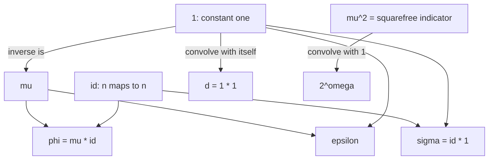

# Arithmetic Functions

> [Mathematics](../../README.md) › [Number Theory](../README.md) › Arithmetic Functions · Level: Advanced · Prerequisites: [Divisibility and Primes](../01-divisibility-and-primes/README.md), [Congruences](../02-congruences/README.md), [Proof Techniques](../../00-foundations/04-proof-techniques/README.md), [Mathematical Induction](../../09-discrete-mathematics/01-mathematical-induction/README.md), [Integers](../../01-arithmetic/02-integers/README.md) · Estimated time: 480 min

## 1. Introduction

An **arithmetic function** is a function whose domain is $\mathbb{N}$ and whose values are numbers — for us usually integers or complex numbers. The subject begins with a deliberately modest question: *what can be said about a number by looking only at the way it factorises?* Almost everything interesting in this chapter answers that question.

Three examples show what "looking at the factorisation" means.

* The number of divisors $d(n)$ depends on the exponents in $n = 2^{a}3^{b}5^{c}\cdots$ and on nothing else: $d(720) = 30$, $d(1024) = 11$.
* The sum of divisors $\sigma(n)$ decides which numbers are *perfect* — equal to the sum of their proper divisors: $6$, $28$, $496$, $8128$, $\dots$
* Euler's totient $\varphi(n)$ counts the integers below $n$ that are coprime to it, and it is the exponent in Euler's theorem $a^{\varphi(n)} \equiv 1 \pmod n$, already met in [Congruences](../02-congruences/README.md).

What these three have in common is that they are **multiplicative**: their value at a product of coprime arguments is the product of the values. That single property converts a question about $n$ into a product of questions about the prime powers dividing $n$, and prime powers are easy.

The chapter has an algebraic heart. Dirichlet observed in 1837 that the operation

$$(f * g)(n) = \sum_{d \mid n} f(d)\,g\!\left(\frac{n}{d}\right)$$

turns the set of arithmetic functions into a **commutative ring** — the *Dirichlet ring* — in which multiplication by the constant function $1$ is the operation "sum over divisors". The ring has an identity, it has no zero divisors, and its units are exactly the functions with $f(1) \neq 0$. In this language Möbius inversion is not a trick: it is the statement that $\mu$ is the multiplicative inverse of $1$, so that $g = f * 1$ can be solved as $f = g * \mu$.

The chapter ends with three destinations.

1. **Average order.** The individual values of $d(n)$ are wildly irregular, but $\sum_{n \le N} d(n)$ is predictable: it equals $N\log N + (2\gamma - 1)N + O(\sqrt N)$. We prove this by counting lattice points under a hyperbola.
2. **Perfect numbers.** Euclid proved that $2^{p-1}(2^p-1)$ is perfect whenever $2^p - 1$ is prime; Euler proved the converse for even perfect numbers. The two halves make one theorem, proved here in full. Whether an *odd* perfect number exists is still open.
3. **The Riemann zeta function.** Attaching to $f$ the Dirichlet series $\sum f(n)n^{-s}$ converts Dirichlet convolution into ordinary multiplication of functions, and the constant function $1$ into $\zeta(s) = \sum n^{-s} = \prod_p (1 - p^{-s})^{-1}$. The Riemann hypothesis is a statement about where this series vanishes.

Throughout, the reader should keep one principle in mind: **an arithmetic function is a function of the divisor lattice of $n$, not of the size of $n$.** A number with many small prime factors has a rich divisor structure; a prime power of the same size has almost none.

## 2. Prerequisites

* **Divisibility and the divisor lattice.** $a \mid b$; the divisors of $n$; $\gcd$ and $\operatorname{lcm}$. Taught in [Divisibility and Primes](../01-divisibility-and-primes/README.md), Sections 7.4 and 7.13.
* **The fundamental theorem of arithmetic.** Every $n \ge 1$ has a unique factorisation $n = p_1^{a_1}\cdots p_r^{a_r}$ into primes. Taught in [Divisibility and Primes](../01-divisibility-and-primes/README.md), Section 7.9. This theorem is used constantly and is never reproved here.
* **The Chinese remainder theorem.** For coprime $m, n$, the map $x \bmod mn \mapsto (x \bmod m, x \bmod n)$ is a bijection, and it respects multiplication. Taught in [Congruences](../02-congruences/README.md), Section 7.7.
* **Euler's theorem and the totient.** $a^{\varphi(n)} \equiv 1 \pmod n$ when $\gcd(a,n) = 1$. Taught in [Congruences](../02-congruences/README.md), Sections 7.5 and 7.9. That chapter *used* $\varphi$; this one studies it.
* **Proof techniques.** Direct proof, proof by contradiction, proof of uniqueness, and the well-ordering principle. Taught in [Proof Techniques](../../00-foundations/04-proof-techniques/README.md).
* **Induction.** Used for statements of the form "for every $r$, every product of $r$ pairwise coprime factors satisfies …", and for the recursive definition of Dirichlet inverses. Taught in [Mathematical Induction](../../09-discrete-mathematics/01-mathematical-induction/README.md).
* **Series and convergence.** Geometric series, absolute convergence, and $\sum 1/n^2 = \pi^2/6$. The last is quoted from analysis (Euler's solution of the Basel problem) and is not reproved; everything else is proved or elementary.
* **Groups and rings (helpful, not required).** The phrases "commutative ring", "unit" and "group of units" are used in Section 7.7. A reader who has not met rings can read "ring" as "a set with addition, multiplication, a zero and a one, obeying the usual laws", which is exactly what is verified there. For the formal definitions see [Abstract Algebra](../../13-abstract-algebra/README.md).

**Conventions.**

* $\mathbb{N} = \{1, 2, 3, \dots\}$, so every arithmetic function is defined at $1$ and nowhere at $0$. This matters: $\mu(0)$ and $\varphi(0)$ are not defined in this chapter.
* A sum $\sum_{d \mid n}$ runs over the **positive** divisors of $n$; a product $\prod_{p \mid n}$ runs over the **distinct prime** divisors of $n$.
* $[P]$ denotes the indicator of a statement: $1$ if $P$ is true, $0$ if false. Thus $[n = 1]$ is $1$ at $n=1$ and $0$ elsewhere.
* $p$ always denotes a prime; $p^{a} \parallel n$ means $p^{a} \mid n$ and $p^{a+1} \nmid n$.
* $\omega(n)$ is the number of distinct prime factors of $n$; $\Omega(n)$ is the number counted with multiplicity.

## 3. Learning Objectives

By the end of this tutorial you will be able to:

1. Define arithmetic function, multiplicative function and completely multiplicative function, and give examples that separate the three classes.
2. Prove that a multiplicative function is determined by its values on prime powers, and compute $f(n)$ from the factorisation of $n$.
3. Prove that $F(n) = \sum_{d \mid n} f(d)$ is multiplicative whenever $f$ is, and derive $d(n) = \prod (a_i+1)$ and $\sigma(n) = \prod \frac{p_i^{a_i+1}-1}{p_i-1}$ from it.
4. Derive $\varphi(n) = n\prod_{p\mid n}\left(1 - \frac1p\right)$ twice — once by inclusion–exclusion over the primes dividing $n$, once from $\varphi(p^a) = p^a - p^{a-1}$ plus multiplicativity — and prove multiplicativity of $\varphi$ in two ways.
5. Define the Möbius function, prove $\sum_{d\mid n}\mu(d) = [n=1]$, and prove Möbius inversion in both directions.
6. State and prove that Dirichlet convolution makes the arithmetic functions a commutative ring with identity, identify its units, prove it has no zero divisors, and compute Dirichlet inverses by the recursion.
7. Prove that the multiplicative functions form a subgroup of the group of units.
8. Derive the exact divisor-summatory formula $\sum_{n\le N} d(n) = 2\sum_{k \le \sqrt N}\lfloor N/k\rfloor - \lfloor\sqrt N\rfloor^2$ and the asymptotic $\sum_{n \le N} d(n) = N\log N + (2\gamma-1)N + O(\sqrt N)$.
9. Prove that the average of $\sigma$ is $\frac{\pi^2}{12}n$ and the average of $\varphi$ is $\frac{3}{\pi^2}n$, in the precise sense of partial sums.
10. Prove the Euclid–Euler theorem characterising even perfect numbers, and state what is and is not known about odd perfect numbers.
11. Prove the Euler product $\zeta(s) = \prod_p (1-p^{-s})^{-1}$ and interpret $\mu$, $d$, $\sigma$, $\varphi$ as Dirichlet series built from $\zeta$.
12. Recognise the standard mistakes — assuming a multiplicative function is completely multiplicative, confusing $\omega$ with $\Omega$, and conjugating a convolution with a pointwise product.

## 4. Intuition

### 4.1 The divisor box

Write $n = p_1^{a_1}p_2^{a_2}\cdots p_r^{a_r}$. Every divisor of $n$ is $p_1^{e_1}\cdots p_r^{e_r}$ with $0 \le e_i \le a_i$, and the choice of the exponent vector $(e_1,\dots,e_r)$ determines the divisor and is determined by it. So the divisors of $n$ are in bijection with the integer points of a **rectangular box**

$$\{0,1,\dots,a_1\} \times \{0,1,\dots,a_2\} \times \cdots \times \{0,1,\dots,a_r\}.$$

Two immediate consequences, and they are the whole content of the formula section:

* the number of divisors is the number of points in the box, namely $(a_1+1)(a_2+1)\cdots(a_r+1)$;
* the sum of divisors is the sum of the numbers $p_1^{e_1}\cdots p_r^{e_r}$ over the box, and because the summand factorises, the total sum factorises into $\prod_i \left(1 + p_i + \dots + p_i^{a_i}\right)$.

For $n = 360 = 2^3\cdot3^2\cdot5$ the box is $4 \times 3 \times 2$, drawn in Section 10.1. Its $24$ points are the $24$ divisors.

### 4.2 Multiplicativity is independence of primes

Two coprime numbers use disjoint sets of primes, so their boxes are disjoint coordinate blocks. A function that is a product over the coordinates — like $d$ or $\sigma$ — therefore splits: $d(mn) = d(m)d(n)$ for coprime $m,n$. This is *not* a property of size but of the shape of the factorisation. It fails when the primes overlap: $d(2\cdot 2) = 3 \ne 2\cdot 2$.

The mental picture is a spreadsheet. Each prime is a column; each choice of exponent is a cell in that column; the value of a multiplicative function is the product of a per-column contribution. A **completely** multiplicative function is even simpler: each column contributes $\text{(base value)}^{\text{exponent}}$.

### 4.3 Convolution as "multiplication of boxes"

Adding two polynomials multiplies coefficients by $x^a\cdot x^b = x^{a+b}$. Dirichlet convolution does the same with $n^a\cdot n^b = n^{ab}$: the "monomials" are the functions $n \mapsto n^{s}$, and convolution is multiplication of exponents. This is why Dirichlet series turn convolution into ordinary multiplication, and it is the reason the ring of arithmetic functions behaves so much like a ring of power series.

## 5. Formal Definition

### 5.1 Arithmetic functions

**Definition 5.1.1.** An **arithmetic function** is a function $f : \mathbb{N} \to \mathbb{C}$. The set of all arithmetic functions is denoted $\mathcal{A}$.

In this chapter the values are usually integers, but allowing complex values costs nothing and is needed for the zeta function in Section 7.10.

Addition and scalar multiplication are defined pointwise: $(f+g)(n) = f(n)+g(n)$, $(\lambda f)(n) = \lambda f(n)$.

**Definition 5.1.2.** The **summatory function** of $f$ is $A_f(x) = \sum_{n \le x} f(n)$, defined for real $x \ge 1$. The **average order** of $f$, when it exists in the sense of Section 7.8, is a simple function $g$ with $A_f(x) \sim \sum_{n\le x} g(n)$.

### 5.2 Multiplicativity

**Definition 5.2.1.** An arithmetic function $f$ is **multiplicative** if

$$f(mn) = f(m)\,f(n) \quad \text{whenever } \gcd(m,n) = 1,$$

and $f$ is **completely multiplicative** if the same holds for **all** $m, n \in \mathbb{N}$.

**Definition 5.2.2.** $f$ is **additive** if $f(mn) = f(m)+f(n)$ for coprime $m,n$, and **completely additive** if this holds for all $m,n$.

The additive examples $\omega$ and $\Omega$ are the "logarithms" of the multiplicative ones — literally so: $d(n) = 2^{\omega(n)}$ only for squarefree $n$, while $\Omega(n)$ and $\omega(n)$ are the exponents in the factorisations $n = \prod p^{\Omega}$ counted with and without multiplicity.

**Lemma 5.2.3.** If $f$ is multiplicative and $f$ is not identically zero, then $f(1) = 1$.

*Proof.* There is some $n$ with $f(n) \ne 0$. Since $\gcd(n,1) = 1$, multiplicativity gives $f(n) = f(n\cdot 1) = f(n)f(1)$, and cancelling the nonzero number $f(n)$ gives $f(1) = 1$. $\square$

The zero function satisfies the equation in Definition 5.2.1 and has $f(1) = 0$; it is the one exception, and from now on "multiplicative" means "multiplicative and not identically zero", so $f(1)=1$ always.

### 5.3 The standard functions

| Name | Definition | Value at $n=1$ | Multiplicative | Completely multiplicative |
|---|---|---|---|---|
| $1$ (constant one) | $1(n) = 1$ | $1$ | yes | yes |
| $\operatorname{id}$ | $\operatorname{id}(n) = n$ | $1$ | yes | yes |
| $\operatorname{id}_k$ | $\operatorname{id}_k(n) = n^{k}$ | $1$ | yes | yes |
| $d$ (or $\tau$) | $d(n) = \#\{d : d \mid n\}$ | $1$ | yes | no |
| $\sigma_k$ | $\sigma_k(n) = \sum_{d\mid n} d^{k}$ | $1$ | yes | no |
| $\sigma$ | $\sigma_1$ | $1$ | yes | no |
| $\varphi$ | $\varphi(n) = \#\{k \le n : \gcd(k,n)=1\}$ | $1$ | yes | no |
| $\mu$ | Möbius function, Definition 7.5.1 | $1$ | yes | no |
| $\varepsilon$ | $\varepsilon(n) = [n=1]$ | $1$ | yes | no |
| $\omega$ | number of distinct primes | $0$ | **additive** | no |
| $\Omega$ | number of primes with multiplicity | $0$ | **additive** | yes |

Two conventions deserve a comment. First, $\sigma_k$ with $k \ge 1$ is the sum of the $k$-th powers of the divisors; $\sigma_0 = d$; and $\sigma_1 = \sigma$. Second, $\varepsilon$ is the identity element for the convolution defined next, and it is multiplicative but not completely multiplicative, since $\varepsilon(2\cdot2) = 0 \ne \varepsilon(2)\varepsilon(2) = 1$.

### 5.4 Dirichlet convolution

**Definition 5.4.1.** The **Dirichlet convolution** of $f$ and $g$ is

$$(f * g)(n) = \sum_{d \mid n} f(d)\, g\!\left(\frac{n}{d}\right).$$

Equivalently, writing $n = ab$ over all ordered pairs of positive integers with $ab = n$,

$$(f*g)(n) = \sum_{ab = n} f(a)\,g(b).$$

The two forms are the same because $d$ runs over the divisors of $n$ and $b = n/d$ runs over them too, in the opposite order; the second form makes both commutativity and associativity transparent.

**Definition 5.4.2.** The **Dirichlet inverse** of $f$ is a function $f^{-1}$ with $f * f^{-1} = \varepsilon$, if such a function exists.

The notation $f^{-1}$ is used for the Dirichlet inverse; it is never the reciprocal $1/f(n)$. Section 7.7 shows that the inverse exists exactly when $f(1) \ne 0$.

### 5.5 Perfect, abundant, deficient

**Definition 5.5.1.** Let $s(n) = \sigma(n) - n$ be the sum of the **proper** divisors of $n$. Then $n$ is **perfect** if $s(n) = n$, **abundant** if $s(n) > n$, and **deficient** if $s(n) < n$.

Equivalently: perfect means $\sigma(n) = 2n$, abundant $\sigma(n) > 2n$, deficient $\sigma(n) < 2n$. The ratio $\sigma(n)/n$ is called the **abundancy index**.

## 6. Mathematical Notation

| Symbol | Read as | Meaning |
|---|---|---|
| $f, g, h$ | eff, gee, aitch | arithmetic functions $\mathbb{N} \to \mathbb{C}$ |
| $\mathcal{A}$ | script A | the set of all arithmetic functions |
| $\sum_{d\mid n} f(d)$ | sum over $d$ dividing $n$ of $f(d)$ | $d$ runs over positive divisors |
| $\prod_{p\mid n}$ | product over primes $p$ dividing $n$ | distinct primes only |
| $p^{a} \parallel n$ | $p^a$ exactly divides $n$ | $p^a \mid n$, $p^{a+1}\nmid n$ |
| $(f*g)(n)$ | $f$ convolved with $g$ at $n$ | $\sum_{d\mid n} f(d)g(n/d)$ |
| $f^{-1}$ | Dirichlet inverse of $f$ | the $g$ with $f*g=\varepsilon$ |
| $\varepsilon$ | epsilon | $\varepsilon(1)=1$, $\varepsilon(n)=0$ for $n>1$ |
| $[P]$ | indicator of $P$ | $1$ if $P$ true, else $0$ |
| $\mu(n)$ | Möbius mu of $n$ | $0$ if $n$ has a square factor, else $(-1)^{\omega(n)}$ |
| $\varphi(n)$ | Euler's phi of $n$ | count of $k \le n$ coprime to $n$ |
| $\sigma_k(n)$ | sigma sub $k$ | $\sum_{d\mid n} d^k$ |
| $d(n)$, $\tau(n)$ | $d$ of $n$, tau of $n$ | number of divisors; the same function |
| $\omega(n)$, $\Omega(n)$ | omega, big omega | distinct / total prime factors |
| $s(n)$ | $s$ of $n$ | $\sigma(n)-n$, sum of proper divisors |
| $\zeta(s)$ | zeta of $s$ | $\sum_{n\ge1} n^{-s}$ for $\operatorname{Re}s>1$ |
| $D_f(s)$ | Dirichlet series of $f$ | $\sum_{n\ge1} f(n)n^{-s}$ |
| $A_f(x)$ | summatory function | $\sum_{n\le x} f(n)$ |
| $\gamma$ | Euler–Mascheroni constant | $0.57721\ldots$ |
| $\sim$ | asymptotically equal | ratio tends to $1$ |
| $O(\cdot)$ | big-O | bounded by a constant multiple |

Reading aloud: "$(f*g)(n) = \sum_{d\mid n} f(d)g(n/d)$" is "eff convolved with gee at $n$ equals the sum over $d$ dividing $n$ of eff of $d$ times gee of $n$ over $d$".

## 7. Core Concepts

### 7.1 A multiplicative function is determined by its prime powers

**Theorem 7.1.1.** Let $f$ be multiplicative and let $n = p_1^{a_1}p_2^{a_2}\cdots p_r^{a_r}$ with the $p_i$ distinct primes. Then

$$f(n) = f(p_1^{a_1})\,f(p_2^{a_2})\cdots f(p_r^{a_r}).$$

*Proof.* Induction on $r$. For $r = 1$ there is nothing to prove. Suppose the statement holds for $r-1$ factors and write $n = p_1^{a_1}\cdots p_{r-1}^{a_{r-1}} \cdot p_r^{a_r} = m\,p_r^{a_r}$. Since the primes are distinct, $\gcd(m, p_r^{a_r}) = 1$, so multiplicativity gives $f(n) = f(m)f(p_r^{a_r})$, and the induction hypothesis computes $f(m)$. $\blacksquare$

**Corollary 7.1.2.** Two multiplicative functions that agree on every prime power agree everywhere.

*Proof.* Immediate from Theorem 7.1.1: both sides are the same product. $\blacksquare$

This corollary is the workhorse of the chapter. It means that to *define* a multiplicative function it suffices to say what it does at $1$ and at each $p^a$; and to *identify* one it suffices to check prime powers. Several proofs below consist of nothing but this observation plus a computation at $p^a$.

Note carefully what Theorem 7.1.1 does **not** say: it does not give $f(p^a)$ in terms of $f(p)$. For a completely multiplicative $f$ one has $f(p^a) = f(p)^a$; for a merely multiplicative $f$, the values at different powers of the same prime are independent.

### 7.2 Summing over divisors preserves multiplicativity

**Theorem 7.2.1.** Let $f$ be multiplicative and define $F(n) = \sum_{d \mid n} f(d)$, with $F(1) = 1$. Then $F$ is multiplicative, and for every prime power,

$$F(p^a) = 1 + f(p) + f(p^2) + \cdots + f(p^a).$$

*Proof.* Let $\gcd(m,n) = 1$. Every divisor $d$ of $mn$ can be written uniquely as $d = d_1d_2$ with $d_1 \mid m$ and $d_2 \mid n$: existence comes from $d_1 = \gcd(d,m)$ and $d_2 = \gcd(d,n)$, and uniqueness from the fact that a divisor of $mn$ is determined by its $p$-adic valuations and each prime divides exactly one of $m,n$. Moreover $\gcd(d_1,d_2)=1$, so $f(d_1d_2) = f(d_1)f(d_2)$. Hence

$$F(mn) = \sum_{d\mid mn} f(d) = \sum_{d_1\mid m}\ \sum_{d_2\mid n} f(d_1)f(d_2) = \left(\sum_{d_1\mid m} f(d_1)\right)\left(\sum_{d_2\mid n} f(d_2)\right) = F(m)F(n).$$

The displayed description of $F(p^a)$ is the definition of $F$ at the prime power, since the divisors of $p^a$ are exactly $1,p,\dots,p^a$. $\blacksquare$

Read in the language of Section 5.4, Theorem 7.2.1 says: **the convolution of two multiplicative functions is multiplicative.** Indeed $F = f * 1$, and the same proof with $f(d)g(n/d)$ in place of $f(d)$ gives:

**Corollary 7.2.2.** If $f$ and $g$ are multiplicative then so is $f*g$. $\blacksquare$

### 7.3 The divisor functions $d$ and $\sigma_k$

**Theorem 7.3.1.** For $n = p_1^{a_1}\cdots p_r^{a_r}$,

$$d(n) = \prod_{i=1}^{r}(a_i+1).$$

*Proof.* By the divisor-box bijection of Section 4.1, divisors correspond to exponent vectors $(e_1,\dots,e_r)$ with $0 \le e_i \le a_i$. There are $a_i+1$ choices for $e_i$, independently for each $i$, so the number of vectors is $\prod(a_i+1)$. $\blacksquare$

**Theorem 7.3.2.** For $n = p_1^{a_1}\cdots p_r^{a_r}$ and $k \ge 0$,

$$\sigma_k(n) = \prod_{i=1}^{r}\left(1 + p_i^{k} + p_i^{2k} + \cdots + p_i^{a_ik}\right) = \prod_{i=1}^{r}\frac{p_i^{k(a_i+1)} - 1}{p_i^{k}-1},$$

with the second form valid for $k \ge 1$, and for $k = 0$ the product $\prod (a_i+1)$ recovered as the limit — that is, $\sigma_0 = d$.

*Proof.* The function $\operatorname{id}_k(n) = n^k$ is completely multiplicative, hence multiplicative, so $\sigma_k = \operatorname{id}_k * 1$ is multiplicative by Corollary 7.2.2 (or directly by Theorem 7.2.1 with $f = \operatorname{id}_k$). At a prime power, $\sigma_k(p^a) = \sum_{j=0}^{a} p^{jk}$, a finite geometric series with ratio $p^k$. For $k \ge 1$ the ratio differs from $1$, so the sum equals $\frac{p^{k(a+1)}-1}{p^k-1}$. Theorem 7.1.1 then gives the product. $\blacksquare$

**Example 7.3.3.** $720 = 2^4\cdot3^2\cdot5$, so $d(720) = 5\cdot3\cdot2 = 30$ and

$$\sigma(720) = \frac{2^5-1}{2-1}\cdot\frac{3^3-1}{3-1}\cdot\frac{5^2-1}{5-1} = 31\cdot13\cdot6 = 2418.$$

Both values are re-derived by a different route in Exercise 4.

**Corollary 7.3.4.** $d(n)$ is odd if and only if $n$ is a perfect square.

*Proof.* $\prod(a_i+1)$ is odd iff every factor $a_i+1$ is odd, i.e. every $a_i$ is even, i.e. $n$ is a square. $\blacksquare$

**Corollary 7.3.5.** $\sigma(n)$ is odd if and only if $n$ is a square or twice a square.

*Proof.* $\sigma$ is multiplicative, so $\sigma(n)$ is odd iff each $\sigma(p^a)$ is odd. For odd $p$, $\sigma(p^a) = 1+p+\dots+p^a$ has $a+1$ odd terms, hence is odd iff $a$ is even. For $p = 2$, $\sigma(2^a) = 2^{a+1}-1$ is always odd. So $\sigma(n)$ is odd iff every odd prime occurs to an even power, i.e. $n = 2^{a}m^{2}$ with $m$ odd; that is $n = (2^{a/2}m)^2$ when $a$ is even, and $n = 2\,(2^{(a-1)/2}m)^2$ when $a$ is odd. $\blacksquare$

Neither $d$ nor $\sigma$ is completely multiplicative: $d(2\cdot2) = 3 \ne 4 = d(2)d(2)$, and $\sigma(2\cdot 2) = 7 \ne 9 = 3\cdot3$. Multiplicativity genuinely requires coprime arguments.

### 7.4 Euler's totient

**Definition 7.4.1.** Euler's **totient** is $\varphi(n) = \#\{k \in \{1,\dots,n\} : \gcd(k,n) = 1\}$.

This function already appeared in [Congruences](../02-congruences/README.md), where it was proved to be the order of the group of units modulo $n$. Here we derive its closed form twice, from two different starting points, and prove multiplicativity twice.

**Lemma 7.4.2.** For a prime $p$ and $a \ge 1$, $\varphi(p^a) = p^a - p^{a-1} = p^{a}\left(1 - \frac1p\right)$.

*Proof.* Among $1, 2, \dots, p^a$ the numbers not coprime to $p^a$ are exactly the multiples of $p$, and there are $p^{a-1}$ of them. Hence $\varphi(p^a) = p^a - p^{a-1}$. $\blacksquare$

#### First derivation: inclusion–exclusion

Let $n = p_1^{a_1}\cdots p_r^{a_r}$ and let $A_i = \{k \le n : p_i \mid k\}$. Then $\{k \le n : \gcd(k,n) > 1\} = A_1 \cup \cdots \cup A_r$, because a number $k \le n$ shares a factor $>1$ with $n$ exactly when it is divisible by some prime dividing $n$. For a set $S \subseteq \{1,\dots,r\}$ the intersection $\bigcap_{i\in S} A_i$ consists of the multiples of $\prod_{i\in S}p_i$ up to $n$, so it has $n/\prod_{i\in S}p_i$ elements. Inclusion–exclusion gives

$$\varphi(n) = n - \sum_i \frac{n}{p_i} + \sum_{i<j}\frac{n}{p_ip_j} - \cdots = n\sum_{S\subseteq\{1,\dots,r\}}(-1)^{|S|}\frac{1}{\prod_{i\in S}p_i} = n\prod_{i=1}^{r}\left(1 - \frac{1}{p_i}\right),$$

the last step by expanding the product. This is a complete proof of the product formula, and it used nothing but counting.

#### Second derivation: prime powers and multiplicativity

**Theorem 7.4.3.** $\varphi$ is multiplicative, and consequently

$$\varphi(n) = n\prod_{p\mid n}\left(1 - \frac1p\right)$$

for every $n \ge 1$ (the empty product being $1$ at $n=1$).

*Proof 1 (Chinese remainder theorem).* For coprime $m,n$ consider the map $\Phi : \mathbb{Z}/mn\mathbb{Z} \to \mathbb{Z}/m\mathbb{Z} \times \mathbb{Z}/n\mathbb{Z}$, $\Phi(x \bmod mn) = (x\bmod m, x \bmod n)$. By the Chinese remainder theorem ([Congruences](../02-congruences/README.md), Theorem 7.7.2) $\Phi$ is a bijection, and it respects multiplication: $\Phi(xy) = \Phi(x)\Phi(y)$. A residue class is a unit (has a multiplicative inverse) iff it is coprime to the modulus. Since $\Phi$ is a multiplicative bijection, $x$ is a unit modulo $mn$ iff both components are units, so $\Phi$ restricts to a bijection between the $\varphi(mn)$ units modulo $mn$ and the $\varphi(m)\varphi(n)$ pairs of units. Hence $\varphi(mn) = \varphi(m)\varphi(n)$.

Now Theorem 7.1.1 applies: $\varphi(n) = \prod_i \varphi(p_i^{a_i}) = \prod_i p_i^{a_i}\left(1-\frac{1}{p_i}\right) = n\prod_{p\mid n}\left(1 - \frac1p\right)$. $\blacksquare$

*Proof 2 (algebraic, from the product formula).* Suppose first that $m,n$ are coprime. Then the set of primes dividing $mn$ is the disjoint union of the primes dividing $m$ and those dividing $n$, so

$$\varphi(mn) = mn\prod_{p\mid mn}\left(1-\frac1p\right) = \left[m\prod_{p\mid m}\left(1-\frac1p\right)\right]\left[n\prod_{p\mid n}\left(1-\frac1p\right)\right] = \varphi(m)\varphi(n),$$

where the middle equality only uses that a product over a disjoint union is a product of products, and the first and last equalities use the inclusion–exclusion derivation. This proof is shorter but depends on the previous one; Proof 1 is the structural explanation. $\blacksquare$

**Corollary 7.4.4.** $\sum_{d\mid n}\varphi(d) = n$.

*Proof.* Both sides are multiplicative in $n$: the left side by Theorem 7.2.1 applied to $f = \varphi$, the right side because $\operatorname{id}$ is completely multiplicative. By Corollary 7.1.2 it suffices to check prime powers:

$$\sum_{j=0}^{a}\varphi(p^{j}) = 1 + \sum_{j=1}^{a}\left(p^{j}-p^{j-1}\right) = 1 + (p^{a}-1) = p^{a},$$

the middle sum telescoping. $\blacksquare$

Corollary 7.4.4 has a bijective proof worth knowing: the $n$ fractions $\frac{1}{n}, \frac{2}{n}, \dots, \frac{n}{n}$, written in lowest terms, have denominators running over the divisors $d$ of $n$, and exactly $\varphi(d)$ of them have denominator $d$.

**Proposition 7.4.5.** For $n \ge 3$, $\varphi(n)$ is even; and $\varphi(n) = n-1$ exactly when $n$ is prime.

*Proof.* If $k$ is coprime to $n$ then so is $n-k$, and $k \ne n-k$ unless $n = 2k$, which would force $\gcd(k,2k) = k = 1$ and $n = 2$. So for $n \ge 3$ the coprimes pair up, giving an even count. For the second claim, $\varphi(n) \le n-1$ always because $n$ itself is not coprime to $n$ (for $n \ge 2$), with equality iff no $k \in \{2,\dots,n-1\}$ shares a factor with $n$, i.e. iff $n$ has no divisor in that range, i.e. iff $n$ is prime. $\blacksquare$

### 7.5 The Möbius function and Möbius inversion

**Definition 7.5.1.** The **Möbius function** is

$$\mu(n) = \begin{cases} 1 & n = 1,\\ 0 & p^2 \mid n \text{ for some prime } p,\\ (-1)^{r} & n = p_1p_2\cdots p_r \text{ with distinct primes}.\end{cases}$$

Equivalently $\mu(n) = 0$ unless $n$ is squarefree, and $\mu(n) = (-1)^{\omega(n)}$ for squarefree $n$.

**Lemma 7.5.2.** $\mu$ is multiplicative, and

$$\sum_{d\mid n}\mu(d) = [n = 1] = \varepsilon(n).$$

*Proof.* Multiplicativity: if $\gcd(m,n)=1$ then $mn$ is squarefree iff both are, and $\omega(mn) = \omega(m)+\omega(n)$; the three cases of the definition then multiply correctly (a zero on either side forces a zero on the other).

For the sum, let $n = p_1^{a_1}\cdots p_r^{a_r}$ and note that $\mu(d) \ne 0$ only for squarefree divisors, which are the $2^r$ products of subsets of $\{p_1,\dots,p_r\}$. Grouping by size,

$$\sum_{d\mid n}\mu(d) = \sum_{j=0}^{r}\binom{r}{j}(-1)^{j} = (1-1)^{r}.$$

This is $0$ when $r \ge 1$ and $1$ when $r = 0$, i.e. when $n=1$. $\blacksquare$

**Theorem 7.5.3 (Möbius inversion).** Let $f,g$ be arithmetic functions. Then

$$g(n) = \sum_{d\mid n} f(d) \quad \text{for all } n \iff f(n) = \sum_{d\mid n}\mu(d)\,g\!\left(\frac{n}{d}\right) \quad \text{for all } n.$$

In convolution notation: $g = f*1 \iff f = g*\mu$.

*Proof 1 (convolution algebra).* By Lemma 7.5.2, $1 * \mu = \varepsilon$. If $g = f*1$ then

$$g*\mu = (f*1)*\mu = f*(1*\mu) = f*\varepsilon = f,$$

using associativity and the identity property (both proved in Section 7.6, and provable directly from the definition by rearranging a double sum). Conversely if $f = g*\mu$ then $f*1 = (g*\mu)*1 = g*(\mu*1) = g*\varepsilon = g$. $\blacksquare$

*Proof 2 (double sum, no algebra).* Suppose $g(n) = \sum_{d\mid n}f(d)$. Then

$$\sum_{d\mid n}\mu(d)\,g\!\left(\frac nd\right) = \sum_{d\mid n}\mu(d)\sum_{e\mid n/d} f(e) = \sum_{de\mid n}\mu(d)f(e).$$

Now collect the terms by $e$. For a fixed divisor $e$ of $n$, $d$ runs over the divisors of $n/e$, so the total is

$$\sum_{e\mid n} f(e)\sum_{d\mid n/e}\mu(d) = \sum_{e\mid n} f(e)\,\varepsilon\!\left(\frac ne\right) = f(n),$$

because $\varepsilon(n/e)$ is $1$ only when $e = n$. The converse direction is the same computation read backwards. $\blacksquare$

**Example 7.5.4.** Take $g(n) = n$ and $f = \varphi$. Corollary 7.4.4 says $g = f*1$, so inversion gives

$$\varphi(n) = \sum_{d\mid n}\mu(d)\cdot\frac{n}{d} = n\sum_{d\mid n}\frac{\mu(d)}{d} = n\prod_{p\mid n}\left(1-\frac1p\right),$$

recovering the product formula a third time. The last equality uses multiplicativity of $n \mapsto \mu(n)/n$ and the value $\frac{\mu(p^a)}{p^a}$, which is $-\frac1p$ for $a=1$ and $0$ afterwards.

### 7.6 Dirichlet convolution: the ring of arithmetic functions

**Theorem 7.6.1.** $(\mathcal{A}, +, *)$ is a commutative ring with identity $\varepsilon$. That is, for all $f,g,h \in \mathcal{A}$:

1. $+$ is associative and commutative, with zero function $0$, and $-f$ exists (pointwise operations).
2. $*$ is commutative: $f*g = g*f$.
3. $*$ is associative: $(f*g)*h = f*(g*h)$.
4. $\varepsilon$ is a two-sided identity: $f*\varepsilon = \varepsilon*f = f$.
5. $*$ distributes over $+$: $f*(g+h) = f*g + f*h$.

*Proof.* (1) is pointwise and immediate.

(2) Substituting $d \mapsto n/d$ in the defining sum runs through the same divisors in reverse:

$$(f*g)(n) = \sum_{d\mid n}f(d)g\!\left(\frac nd\right) = \sum_{e\mid n} f\!\left(\frac ne\right)g(e) = (g*f)(n).$$

(3) Both sides equal $\sum_{abc = n} f(a)g(b)h(c)$. Indeed

$$((f*g)*h)(n) = \sum_{de=n}\left(\sum_{ab=d}f(a)g(b)\right)h(e) = \sum_{abe=n}f(a)g(b)h(e),$$

and the same computation gives the other grouping. Reordering is legitimate because the sum has finitely many terms and is absolutely convergent.

(4) $(f*\varepsilon)(n) = \sum_{d\mid n}f(d)\varepsilon(n/d)$; the only nonzero term has $n/d = 1$, i.e. $d = n$, giving $f(n)$.

(5) $\sum_{d\mid n}f(d)\left(g(n/d)+h(n/d)\right) = \sum f(d)g(n/d) + \sum f(d)h(n/d)$. $\blacksquare$

**Theorem 7.6.2 (units).** $f$ has a Dirichlet inverse if and only if $f(1) \ne 0$. When it exists the inverse is unique and is computed by

$$f^{-1}(1) = \frac{1}{f(1)}, \qquad f^{-1}(n) = -\frac{1}{f(1)}\sum_{\substack{d\mid n \\ d < n}} f\!\left(\frac nd\right) f^{-1}(d) \quad (n > 1).$$

*Proof.* If $f*g = \varepsilon$ then evaluating at $n=1$ gives $f(1)g(1) = \varepsilon(1) = 1$, so $f(1)\ne 0$ and $g(1) = 1/f(1)$.

Conversely suppose $f(1)\ne0$. Define $g$ by the displayed recursion — the right-hand side involves only values $g(d)$ with $d<n$, so it is well defined by strong induction on $n$. We claim $f*g = \varepsilon$. At $n = 1$: $(f*g)(1) = f(1)g(1) = 1$. At $n>1$:

$$(f*g)(n) = f(1)g(n) + \sum_{\substack{d\mid n\\ d<n}} f\!\left(\frac nd\right)g(d) = f(1)\cdot\left(-\frac{1}{f(1)}\sum_{d\mid n, d<n} f\!\left(\frac nd\right)g(d)\right) + \sum_{d\mid n,d<n}f\!\left(\frac nd\right)g(d) = 0.$$

So $g$ is a right inverse. Since $*$ is associative and commutative, a right inverse is also a left inverse, and inverses in a commutative monoid are unique: if $f*g = f*h = \varepsilon$ then $g = g*\varepsilon = g*(f*h) = (g*f)*h = \varepsilon*h = h$. $\blacksquare$

**Example 7.6.3.** The inverse of the constant function $1$ is $\mu$ (Lemma 7.5.2). The inverse of $\varepsilon$ is $\varepsilon$. The inverse of $\operatorname{id}$ is $n \mapsto \mu(n)n$: indeed

$$\sum_{d\mid n}\mu(d)\,d\cdot\frac nd = n\sum_{d\mid n}\mu(d) = n\,\varepsilon(n) = \varepsilon(n)\cdot n,$$

so $(\mu\cdot\operatorname{id})*\operatorname{id} = \varepsilon$. This is a neat illustration of the general principle: multiplying by a completely multiplicative function behaves well under convolution (see the boxed identity at the end of this section).

**Theorem 7.6.4 (no zero divisors).** If $f \ne 0$ and $g \ne 0$ then $f*g \ne 0$. Hence $\mathcal{A}$ is an integral domain.

*Proof.* Let $m$ be the least $n$ with $f(n)\ne0$ and $l$ the least $n$ with $g(n)\ne0$. In the sum

$$(f*g)(ml) = \sum_{d\mid ml} f(d)\,g\!\left(\frac{ml}{d}\right)$$

every term with $d \ne m$ has either $d < m$ (so $f(d) = 0$) or $d > m$, in which case $ml/d < l$ (so $g(ml/d) = 0$). Hence only the term $d = m$ survives, and $(f*g)(ml) = f(m)g(l) \ne 0$. $\blacksquare$

**Theorem 7.6.5 (multiplicative functions form a group).** The set $\mathcal{M}$ of multiplicative functions is a subgroup of the group of units of $\mathcal{A}$.

*Proof.* $\varepsilon \in \mathcal{M}$, and Corollary 7.2.2 shows $\mathcal{M}$ is closed under $*$. It remains to prove that the inverse of a multiplicative function is multiplicative. The argument has five steps and is worth following closely, because the naive version is circular.

*Step 1.* Let $f \in \mathcal{M}$, so $f(1)=1$, and let $g = f^{-1}$ (which exists by Theorem 7.6.2). Define $h$ to be the **multiplicative** function specified on prime powers by $h(1)=1$ and, for $a\ge1$,

$$h(p^a) = -\frac{1}{f(1)}\sum_{\substack{d \mid p^a\\ d<p^a}} f\!\left(\frac{p^a}{d}\right)h(d).$$

*Step 2: $h$ and $g$ agree on prime powers.* The recursion of Theorem 7.6.2 for $g$ at $n = p^a$ involves only the divisors $d$ of $p^a$ — all of them powers $p^{j}$ with $j\le a$ — and the values $f(p^{a-j})$ and $g(p^{j})$. Hence the recursion for $g$ at $p^{a}$ is literally the recursion for $h$ at $p^{a}$; induction on $a$ gives $h(p^{a}) = g(p^{a})$ for every prime $p$ and every $a\ge0$.

*Step 3: $f*h$ is multiplicative.* Both factors are multiplicative, so Corollary 7.2.2 applies.

*Step 4: $f*h$ vanishes away from $1$.* For a prime power, using Step 2,

$$(f*h)(p^{a}) = \sum_{j=0}^{a}f\!\left(p^{a-j}\right)h(p^{j}) = \sum_{j=0}^{a}f\!\left(p^{a-j}\right)g(p^{j}) = (f*g)(p^{a}) = \varepsilon(p^{a}).$$

A multiplicative function is determined by its prime-power values (Theorem 7.1.1), and $\varepsilon$ is multiplicative with $\varepsilon(p^{a}) = 0$ for $a\ge1$; hence $f*h = \varepsilon$.

*Step 5.* So $h$ is an inverse of $f$, and by uniqueness (Theorem 7.6.2) $h = g$. Since $h$ was defined to be multiplicative, $g = f^{-1}$ is multiplicative. $\blacksquare$

A cleaner way to say the same thing: the Dirichlet inverse of a multiplicative function is multiplicative, because the recursion only ever looks at one prime at a time.

**Completely multiplicative factors.** The following two identities are used repeatedly, in this chapter and in the exercises. Let $f$ be completely multiplicative and nowhere zero. Then

$$f\cdot(g*h) = (f\cdot g)*(f\cdot h), \qquad\text{and}\qquad (f*g)(n) = f(n)\sum_{e\mid n}\frac{g(e)}{f(e)}.$$

The first identity is the important one; it says that multiplying by a nowhere-zero completely multiplicative function is a ring automorphism of $\mathcal{A}$. *Proof.* For the first,

$$\big((f g)*(f h)\big)(n) = \sum_{d\mid n} f(d)g(d)\,f\!\left(\frac nd\right)h\!\left(\frac nd\right) = f(n)\sum_{d\mid n} g(d)h\!\left(\frac nd\right) = f(n)(g*h)(n),$$

using $f(d)f(n/d) = f(n)$, which is exactly complete multiplicativity (for merely multiplicative $f$ this step fails). For the second identity, divide the defining sum by $f(n)$ and substitute $f(d) = f(n)/f(n/d)$:

$$(f*g)(n) = \sum_{d\mid n}f(d)g\!\left(\frac nd\right) = f(n)\sum_{d\mid n}\frac{g(n/d)}{f(n/d)} = f(n)\sum_{e\mid n}\frac{g(e)}{f(e)},$$

with $e = n/d$. $\blacksquare$

A particularly useful special case is $f = \operatorname{id}$, giving the **weighted Möbius inversion**: if $g(n) = \sum_{d\mid n} d\,f(n/d)$, i.e. $g = \operatorname{id}*f$, then

$$f(n) = \sum_{d\mid n}\mu(d)\,d\;g\!\left(\frac nd\right),$$

because $\operatorname{id}^{-1} = \mu\cdot\operatorname{id}$ (Example 7.6.3). With $f = 1$ this recovers $\sum_{d\mid n}\mu(d)\,d\,\sigma(n/d) = 1$, a useful identity for the exercises.

### 7.7 Summatory functions, averages, and the divisor problem

Individual values of $d$ and $\sigma$ jump about: $d(1023) = 8$ but $d(1024) = 11$; $d$ of a prime is $2$ while $d$ of $2^{10}$ is $11$. Yet the *partial sums* are extremely regular. This section proves the regularity in three cases.

**Theorem 7.7.1 (exact divisor-summatory formula).** For every integer $N \ge 1$,

$$\sum_{n\le N} d(n) = 2\sum_{k\le\sqrt N}\left\lfloor\frac Nk\right\rfloor - \left\lfloor\sqrt N\right\rfloor^{2}.$$

*Proof.* Both sides count the lattice points $(d,m)\in\mathbb{N}^2$ with $dm \le N$: the left side groups them by $n = dm$, and $\sum_{k\le N}\lfloor N/k\rfloor$ counts them by $d$. Let

$$A = \{(d,m) : dm\le N,\ d \le \sqrt N\}, \qquad B = \{(d,m) : dm \le N,\ m \le \sqrt N\}.$$

Then $A\cup B$ is the whole set, because if $d > \sqrt N$ and $m > \sqrt N$ then $dm > N$. Also $|A| = \sum_{d\le\sqrt N}\lfloor N/d\rfloor$, and $|B| = |A|$ by the symmetry $(d,m)\mapsto(m,d)$. Finally $A\cap B = \{(d,m): d\le\sqrt N,\ m\le\sqrt N\}$, which has $\lfloor\sqrt N\rfloor^2$ points. Inclusion–exclusion gives the formula. $\blacksquare$

**Example.** For $N = 100$: $\lfloor\sqrt{100}\rfloor=10$ and $\sum_{k=1}^{10}\lfloor 100/k\rfloor = 100+50+33+25+20+16+14+12+11+10 = 291$, so the sum is $2\cdot291 - 100 = 482$. Enumerating $d(n)$ for $n \le 100$ gives $482$ as well.

**Lemma 7.7.2 (harmonic numbers).** $H_n = \sum_{k=1}^{n}\frac1k = \log n + \gamma + O\!\left(\frac1n\right)$, where $\gamma = 0.5772156649\ldots$ is the Euler–Mascheroni constant.

This is the standard comparison of the sum with $\int_1^n \frac{dx}{x}$; it is proved in analysis courses and quoted here. The constant $\gamma$ is defined by the statement itself.

**Theorem 7.7.3 (average order of $d$).**

$$\sum_{n\le N} d(n) = N\log N + (2\gamma - 1)N + O(\sqrt N).$$

*Proof.* Start from Theorem 7.7.1 and split:

$$\sum_{k\le\sqrt N}\left\lfloor\frac Nk\right\rfloor = N\sum_{k\le\sqrt N}\frac1k - \sum_{k\le\sqrt N}\left\{\frac Nk\right\},$$

where $\{x\} = x - \lfloor x\rfloor \in [0,1)$. By Lemma 7.7.2, $N\sum_{k\le\sqrt N}\frac1k = N\left(\log\sqrt N + \gamma + O(N^{-1/2})\right) = \frac N2\log N + \gamma N + O(\sqrt N)$, and the fractional-part sum is $O(\sqrt N)$ because each of the $\lfloor\sqrt N\rfloor$ terms is below $1$. Therefore

$$2\sum_{k\le\sqrt N}\left\lfloor\frac Nk\right\rfloor - \lfloor\sqrt N\rfloor^2 = N\log N + 2\gamma N + O(\sqrt N) - N + O(\sqrt N),$$

since $\lfloor\sqrt N\rfloor^2 = N + O(\sqrt N)$. Collecting terms gives the claim. $\blacksquare$

Numerically, at $N=1000$ the formula's main term is $1000\log 1000 + 0.154431\cdot1000 = 6907.755 + 154.431 = 7062.19$, while the true sum is $7069$; the error is $6.8$, comfortably inside the $O(\sqrt N)$ bound.

So the *average* of $d(n)$ up to $N$ is about $\log N$, even though most numbers have far fewer divisors: the mean is dominated by the highly divisible numbers such as $840$, and it grows without bound while the median stays tiny.

**Theorem 7.7.4 (average order of $\sigma$ and $\varphi$).**

$$\sum_{n\le x}\sigma(n) = \frac{\pi^2}{12}x^{2} + O(x\log x), \qquad \sum_{n\le x}\varphi(n) = \frac{3}{\pi^{2}}x^{2} + O(x\log x).$$

*Proof.* Write $T(y) = \frac{y(y+1)}{2} = 1 + 2 + \cdots + y$ for the triangular numbers, and note that $\sum_{m\le y} m = T(\lfloor y\rfloor)$.

For $\sigma$: since $\sigma(n) = \sum_{d\mid n}d = \sum_{dm = n} m$,

$$\sum_{n\le x}\sigma(n) = \sum_{dm\le x} m = \sum_{d\le x}\sum_{m\le x/d} m = \sum_{d\le x}T\!\left(\left\lfloor\frac xd\right\rfloor\right).$$

Splitting the range at $\sqrt x$ and using $T(y) = \frac{y^2}{2} + O(y)$,

$$\sum_{d\le x}T\!\left(\left\lfloor\frac xd\right\rfloor\right) = \frac{x^{2}}{2}\sum_{d\le x}\frac{1}{d^{2}} + O\!\left(x\sum_{d\le x}\frac1d\right) = \frac{x^{2}}{2}\cdot\frac{\pi^{2}}{6} + O(x\log x),$$

using $\sum_{d\ge1}1/d^{2} = \pi^{2}/6$ and $\sum_{d\le x}1/d = O(\log x)$; the tail $\sum_{d>x}1/d^{2}$ is $O(1/x)$, absorbed in the error term.

For $\varphi$: by Example 7.5.4, $\varphi = \mu * \operatorname{id}$, so

$$\sum_{n\le x}\varphi(n) = \sum_{d\le x}\mu(d)\,T\!\left(\left\lfloor\frac xd\right\rfloor\right) = \frac{x^{2}}{2}\sum_{d\le x}\frac{\mu(d)}{d^{2}} + O(x\log x).$$

Now $\sum_{d\ge1}\mu(d)/d^{2} = 1/\zeta(2) = 6/\pi^{2}$: this is the Euler product computed at $s=2$, since $\prod_p(1-p^{-2}) = 1/\prod_p(1-p^{-2})^{-1} = 1/\zeta(2)$. Hence the main term is $\frac{x^{2}}{2}\cdot\frac{6}{\pi^{2}} = \frac{3x^{2}}{\pi^{2}}$. $\blacksquare$

The constants are the interesting part. $\frac{\pi^{2}}{12} \approx 0.822$ and $\frac{3}{\pi^{2}} \approx 0.304$. Verified for $x = 100$: $\sum_{n\le100}\sigma(n) = 8299$ against $0.822467\cdot10^{4} = 8224.7$, and $\sum_{n\le100}\varphi(n) = 3044$ against $3039.6$. Both errors are well inside $O(x\log x)$.

**Remark 7.7.5 (Dirichlet's divisor problem).** The true error in Theorem 7.7.3 is much smaller than $O(\sqrt N)$: Dirichlet showed $O(N^{1/3}\log N)$, and the conjecture is $O(N^{1/4+\epsilon})$. This is a famous open problem — one of the places where a very elementary statement hides a very deep question.

### 7.8 Perfect numbers and the Euclid–Euler theorem

Recall Definition 5.5.1: $n$ is perfect when $\sigma(n) = 2n$.

**Theorem 7.8.1 (Euclid–Euler).** An even number $N$ is perfect if and only if

$$N = 2^{p-1}\left(2^{p}-1\right)$$

for some prime $p$ with $2^{p}-1$ prime.

*Proof of "if".* Suppose $p$ is prime and $M = 2^{p}-1$ is prime. Then $\gcd(2^{p-1}, M) = 1$, so by multiplicativity and Theorem 7.3.2,

$$\sigma(N) = \sigma(2^{p-1})\,\sigma(M) = \left(2^{p}-1\right)\left(1 + M\right) = \left(2^{p}-1\right)\cdot 2^{p} = 2\cdot 2^{p-1}\left(2^{p}-1\right) = 2N.$$

So $N$ is perfect. (This is Euclid's half, *Elements* IX.36.)

*Proof of "only if".* Let $N$ be even and perfect. Write $N = 2^{k-1}m$ with $k \ge 2$ and $m$ odd; this is possible and unique because $N$ is even. Then $\gcd(2^{k-1},m)=1$, so

$$2^{k}m = 2N = \sigma(N) = \sigma(2^{k-1})\sigma(m) = \left(2^{k}-1\right)\sigma(m). \tag{$*$}$$

Since $\gcd(2^{k}-1,\,2^{k}) = 1$, equation $(*)$ shows $2^{k}-1 \mid m$. Write

$$m = \left(2^{k}-1\right)M, \qquad M \ge 1.$$

Substituting into $(*)$ and cancelling the common factor $2^{k}-1$ gives $\sigma(m) = 2^{k}M$.

Now $M$ divides $m$. If $M > 1$, then $1$, $M$ and $m$ are three **distinct** divisors of $m$, so

$$\sigma(m) \ge 1 + M + m = 1 + M + \left(2^{k}-1\right)M = 1 + 2^{k}M > 2^{k}M = \sigma(m),$$

a contradiction. Hence $M = 1$, so $m = 2^{k}-1$ and $\sigma(m) = 2^{k} = m+1$. The divisors of $m$ are then just $1$ and $m$ itself, so $m$ is prime.

It remains to see that $k$ is prime. If $k = ab$ with $a,b \ge 2$, then $2^{a}-1$ divides $2^{k}-1 = m$ and satisfies $1 < 2^{a}-1 < 2^{k}-1 = m$, contradicting primality of $m$. Hence $k$ has no nontrivial factorisation, so $k$ is prime. Putting $p = k$ gives $N = 2^{p-1}(2^{p}-1)$ with $2^{p}-1 = m$ prime. $\blacksquare$

**Corollary 7.8.2.** The even perfect numbers begin

$$6,\quad 28,\quad 496,\quad 8128,\quad 33\,550\,336,\quad 8\,589\,869\,056,\quad \dots$$

*Proof.* Take $p = 2,3,5,7,13,17$: $2^{p}-1 = 3, 7, 31, 127, 8191, 131071$ are all prime, and $2^{p-1}(2^{p}-1) = 6, 28, 496, 8128, 33550336, 8589869056$. (For $p = 11$, $2^{11}-1 = 2047 = 23\cdot89$ is not prime, and indeed $2^{10}\cdot2047$ is not perfect: $\sigma = 3\cdot23\cdot89 \ne 2^{11}\cdot2047$.) $\blacksquare$

**Remark 7.8.3 (odd perfect numbers).** It is unknown whether an odd perfect number exists. Euler proved that any odd perfect number must have the form $p^{a}m^{2}$ where $p$ is an odd prime, $p \nmid m$, and $p \equiv a \equiv 1 \pmod 4$ — the *Euler form*. Computers have checked that no odd perfect number is below $10^{1500}$, but no proof of nonexistence is known. Note that the "if" direction of Theorem 7.8.1 produces only even numbers, so the theorem says nothing about the odd case.

**Remark 7.8.4 (related notions).** Two numbers are **amicable** if each is the sum of the proper divisors of the other: $220$ and $284$ are the classical pair, since $\sigma(220) = 504 = 220+284 = \sigma(284)$. Perfect numbers are the fixed points of $s(n) = \sigma(n)-n$; amicable pairs are its $2$-cycles; longer cycles are called **sociable**. Whether infinitely many perfect numbers exist is equivalent to whether infinitely many Mersenne primes exist, which is also open.

### 7.9 The Riemann zeta function and Euler products

**Definition 7.9.1.** For a complex $s$ with $\operatorname{Re}s > 1$ the **Riemann zeta function** is $\zeta(s) = \sum_{n\ge1}n^{-s}$, and for an arithmetic function $f$ its **Dirichlet series** is $D_f(s) = \sum_{n\ge1}f(n)n^{-s}$, whenever this converges.

The convergence for $\operatorname{Re}s>1$ follows from comparison with $\sum n^{-\sigma}$ for $\sigma = \operatorname{Re}s > 1$; the series is then absolutely convergent, so all rearrangements below are legitimate.

**Theorem 7.9.2 (Euler product).** For $\operatorname{Re}s>1$,

$$\zeta(s) = \prod_{p}\frac{1}{1-p^{-s}},$$

the product running over all primes and converging absolutely.

*Proof.* For each prime $p$, expand the geometric series $\frac{1}{1-p^{-s}} = 1 + p^{-s} + p^{-2s} + \cdots$, absolutely convergent since $|p^{-s}| < 1$. The product of finitely many such series over primes $p \le y$, multiplied out, equals $\sum_{n \in S_y} n^{-s}$ where $S_y$ is the set of integers all of whose prime factors are $\le y$ (each coefficient is $1$, by uniqueness of factorisation). Hence

$$\zeta(s) - \prod_{p\le y}\frac{1}{1-p^{-s}} = \sum_{n \notin S_y} n^{-s},$$

and every $n \notin S_y$ is either $1$ or has a prime factor $> y$, so $n > y$. Therefore the absolute value of the difference is at most $\sum_{n>y}|n^{-s}| \le \int_{y-1}^{\infty}t^{-\sigma}\,dt \to 0$ as $y\to\infty$. $\blacksquare$

**Theorem 7.9.3 (convolution = multiplication).** Whenever $D_f$ and $D_g$ converge absolutely,

$$D_{f*g}(s) = D_f(s)\,D_g(s).$$

*Proof.* Expanding the product of the two absolutely convergent series and grouping by the value of $n = ab$,

$$D_f(s)D_g(s) = \sum_{a,b\ge1}f(a)a^{-s}g(b)b^{-s} = \sum_{n\ge1}\left(\sum_{ab=n}f(a)g(b)\right)n^{-s} = D_{f*g}(s).$$

$\blacksquare$

Thus $f \mapsto D_f$ is an injective ring homomorphism from $(\mathcal{A},+,*)$ into the ring of formal Dirichlet series (injectivity: the coefficient of $n^{-s}$ is $f(n)$). Dirichlet series are to arithmetic functions what generating functions are to sequences.

**Table of Dirichlet series.** All four follow from Theorem 7.9.3 and the identities of Sections 7.4–7.6:

| Arithmetic function | Identity | Dirichlet series |
|---|---|---|
| $1$ | — | $\zeta(s)$ |
| $\operatorname{id}$ | — | $\zeta(s-1)$ |
| $\mu$ | $\mu * 1 = \varepsilon$ | $1/\zeta(s)$ |
| $d$ | $d = 1*1$ | $\zeta(s)^{2}$ |
| $\sigma$ | $\sigma = \operatorname{id}*1$ | $\zeta(s)\zeta(s-1)$ |
| $\varphi$ | $\varphi = \mu*\operatorname{id}$ | $\zeta(s-1)/\zeta(s)$ |
| $\mu^{2}$ (squarefree indicator) | $\mu^{2}(n) = \sum_{d^{2}\mid n}\mu(d)$ | $\zeta(s)/\zeta(2s)$ |

Only the last row needs comment: the indicator of squarefree numbers satisfies $\mu^{2}(n) = \sum_{d^{2}\mid n}\mu(d)$, so its series is $\zeta(s)\sum_d \mu(d)d^{-2s} = \zeta(s)/\zeta(2s)$.

**Theorem 7.9.4 (Euler, 1735).** $\zeta(2) = \dfrac{\pi^{2}}{6}$.

This is the Basel problem. It is proved in analysis (from the product formula for $\sin$, or from a Fourier series); the value is quoted here because it produces the constant $\frac{3}{\pi^{2}}$ in Theorem 7.7.4. Numerically $\zeta(2) = 1.644934\ldots$ and $\pi^{2}/6 = 1.644934\ldots$.

**Remark 7.9.5 (the Riemann hypothesis).** $\zeta$ continues meromorphically to $\mathbb{C}$ with a simple pole at $s=1$, and satisfies a functional equation relating $\zeta(s)$ to $\zeta(1-s)$. Its **trivial zeros** are at $s = -2,-4,-6,\dots$; all other zeros lie in the strip $0 < \operatorname{Re}s < 1$. The **Riemann hypothesis** asserts that every nontrivial zero has $\operatorname{Re}s = \frac12$. It is equivalent to the estimate $\psi(x) = x + O(x^{1/2}\log^{2}x)$ for the Chebyshev function $\psi(x) = \sum_{p^{k}\le x}\log p$, and hence to a sharp form of the prime number theorem. It remains unproved.

## 8. Formulas and Properties

Every entry has its hypotheses stated and a one-line reason. "Multiplicative" in the hypotheses column refers to the function displayed.

| # | Statement | Hypotheses | Why |
|---|---|---|---|
| 1 | $f(p_1^{a_1}\cdots p_r^{a_r}) = \prod_i f(p_i^{a_i})$ | $f$ multiplicative | Theorem 7.1.1 |
| 2 | $F(n)=\sum_{d\mid n}f(d)$ is multiplicative | $f$ multiplicative | Theorem 7.2.1 |
| 3 | $d(n) = \prod_i (a_i+1)$ | $n=\prod p_i^{a_i}$ | Theorem 7.3.1 (divisor box) |
| 4 | $\sigma_k(n) = \prod_i \frac{p_i^{k(a_i+1)}-1}{p_i^{k}-1}$ | $k\ge1$, $n=\prod p_i^{a_i}$ | geometric series + multiplicativity |
| 5 | $d(n)$ odd $\iff$ $n$ a square | — | Corollary 7.3.4 |
| 6 | $\sigma(n)$ odd $\iff$ $n$ a square or twice a square | — | Corollary 7.3.5 |
| 7 | $\varphi(p^a) = p^a - p^{a-1}$ | $p$ prime, $a\ge1$ | Lemma 7.4.2 |
| 8 | $\varphi(n) = n\prod_{p\mid n}\left(1-\frac1p\right)$ | $n\ge1$ | Theorem 7.4.3 (two proofs) |
| 9 | $\varphi(mn)=\varphi(m)\varphi(n)$ | $\gcd(m,n)=1$ | Theorem 7.4.3 |
| 10 | $\varphi(n)$ even | $n\ge3$ | Proposition 7.4.5 |
| 11 | $\sum_{d\mid n}\varphi(d) = n$ | $n\ge1$ | Corollary 7.4.4 (telescoping) |
| 12 | $\varphi = \mu * \operatorname{id}$ | — | Möbius inversion of #11 |
| 13 | $\sum_{d\mid n}\mu(d) = [n=1]$ | — | Lemma 7.5.2 (binomial theorem) |
| 14 | $g=f*1 \iff f = g*\mu$ | — | Theorem 7.5.3 |
| 15 | $(\mathcal{A},+,*)$ is a commutative ring with $1=\varepsilon$ | — | Theorem 7.6.1 |
| 16 | $f$ invertible $\iff f(1)\ne0$ | — | Theorem 7.6.2 |
| 17 | $\mathcal{A}$ has no zero divisors | — | Theorem 7.6.4 |
| 18 | $f,g$ multiplicative $\Rightarrow f*g$ multiplicative | — | Corollary 7.2.2 |
| 19 | $f$ completely multiplicative $\Rightarrow f\cdot(g*h) = (fg)*(fh)$ | — | §7.6, boxed identity |
| 20 | $\sum_{n\le N}d(n) = 2\sum_{k\le\sqrt N}\lfloor N/k\rfloor - \lfloor\sqrt N\rfloor^2$ | $N\ge1$ | Theorem 7.7.1 (hyperbola) |
| 21 | $\sum_{n\le N}d(n) = N\log N + (2\gamma-1)N + O(\sqrt N)$ | $N\to\infty$ | Theorem 7.7.3 |
| 22 | $\sum_{n\le x}\sigma(n) = \frac{\pi^2}{12}x^2 + O(x\log x)$ | $x\to\infty$ | Theorem 7.7.4 |
| 23 | $\sum_{n\le x}\varphi(n) = \frac{3}{\pi^2}x^2 + O(x\log x)$ | $x\to\infty$ | Theorem 7.7.4 |
| 24 | $N$ even perfect $\iff$ $N=2^{p-1}(2^p-1)$, $2^p-1$ prime | $N$ even | Theorem 7.8.1 |
| 25 | $\zeta(s) = \prod_p(1-p^{-s})^{-1}$ | $\operatorname{Re}s>1$ | Theorem 7.9.2 |
| 26 | $D_{f*g} = D_f D_g$ | absolute convergence | Theorem 7.9.3 |

Two entries deserve a warning, because both are frequently misquoted.

* Row 9 has the hypothesis $\gcd(m,n)=1$. Without it the statement is false: $\varphi(4) = 2$ but $\varphi(2)\varphi(2) = 1$.
* Row 24 characterises **even** perfect numbers only. It says nothing about odd ones, and the "if" direction produces only even numbers.

## 9. Step-by-Step Examples

### Example 1 (Easy): $d$, $\sigma$ and $\varphi$ of $360$

**Problem.** Compute $d(360)$, $\sigma(360)$, $\varphi(360)$ and $\varphi(720)$.

**Solution.** Factor: $360 = 2^{3}\cdot 3^{2}\cdot 5$ and $720 = 2^{4}\cdot 3^{2}\cdot 5$. The divisor box is $4\times3\times2$.

$$d(360) = (3+1)(2+1)(1+1) = 4\cdot3\cdot2 = 24.$$

$$\sigma(360) = \frac{2^{4}-1}{2-1}\cdot\frac{3^{3}-1}{3-1}\cdot\frac{5^{2}-1}{5-1} = 15\cdot 13\cdot 6 = 1170.$$

$$\varphi(360) = 360\left(1-\frac12\right)\left(1-\frac13\right)\left(1-\frac15\right) = 360\cdot\frac12\cdot\frac23\cdot\frac45 = 360\cdot\frac{8}{30} = 96.$$

$$\varphi(720) = 720\cdot\frac12\cdot\frac23\cdot\frac45 = 720\cdot\frac{8}{30} = 192.$$

*Check.* $360 = 2^3\cdot3^2\cdot5$ so the divisors come in $24$ pairs; $1170 = 1+2+3+4+5+6+8+9+10+12+15+18+20+24+30+36+40+45+60+72+90+120+180+360$, which sums to $1170$. For $\varphi$, count the numbers below $360$ coprime to it: among $1..30$ exactly $8$ are coprime to $30$ and coprime to $12$ simultaneously, and $360/30 = 12$ blocks give $12\cdot8 = 96$. ✓

### Example 2 (Easy): the Möbius function on divisors of $360$

**Problem.** Tabulate $\mu(d)$ for $d \mid 360$ and verify $\sum_{d\mid360}\mu(d)=0$.

**Solution.** Only squarefree divisors contribute. The squarefree divisors of $360$ are the $2^{3}=8$ products of subsets of $\{2,3,5\}$:

| $d$ | $1$ | $2$ | $3$ | $5$ | $6$ | $10$ | $15$ | $30$ |
|---|---|---|---|---|---|---|---|---|
| $\mu(d)$ | $1$ | $-1$ | $-1$ | $-1$ | $1$ | $1$ | $1$ | $-1$ |

All other divisors ($4,8,9,12,\dots$) contain a square and have $\mu=0$. The sum is $1-1-1-1+1+1+1-1 = 0$, as Lemma 7.5.2 requires since $360 > 1$. Note that $4$ of the values are $+1$ and $4$ are $-1$, matching $\binom{3}{0}+\binom{3}{2} = 4$ and $\binom31+\binom33 = 4$.

### Example 3 (Medium): verifying $\sigma = \varphi * d$ at $n = 12$

**Problem.** Compute $(\varphi*d)(12)$ from the definition and compare with $\sigma(12)$.

**Solution.** List the divisors of $12$ and evaluate both factors:

| $d$ | $\varphi(d)$ | $12/d$ | $d(12/d)$ | $\varphi(d)\,d(12/d)$ |
|---|---|---|---|---|
| $1$ | $1$ | $12$ | $6$ | $6$ |
| $2$ | $1$ | $6$ | $4$ | $4$ |
| $3$ | $2$ | $4$ | $3$ | $6$ |
| $4$ | $2$ | $3$ | $2$ | $4$ |
| $6$ | $2$ | $2$ | $2$ | $4$ |
| $12$ | $4$ | $1$ | $1$ | $4$ |

Sum: $6+4+6+4+4+4 = 28$. And $\sigma(12) = 1+2+3+4+6+12 = 28$. ✓

**Why this had to work.** $\sigma = \operatorname{id}*1$ and $\operatorname{id} = \varphi*1$ (Corollary 7.4.4), so $\sigma = (\varphi*1)*1 = \varphi*(1*1) = \varphi*d$ by associativity and commutativity. The identity is a one-line consequence of the ring axioms — which is the point of Section 7.6.

### Example 4 (Medium): inverting $\Phi(n) = n^{2}$ by Möbius inversion

**Problem.** Suppose $g(n) = \sum_{d\mid n}f(d)$ and $g(n)=n^{2}$. Find $f$, and compute $f(12)$.

**Solution.** By Theorem 7.5.3, $f = g*\mu$, so

$$f(n) = \sum_{d\mid n}\mu(d)\left(\frac nd\right)^{2} = n^{2}\sum_{d\mid n}\frac{\mu(d)}{d^{2}} = n^{2}\prod_{p\mid n}\left(1-\frac{1}{p^{2}}\right).$$

This is the **Jordan totient** $J_2$. At $n=12$: $12^{2}\left(1-\frac14\right)\left(1-\frac19\right) = 144\cdot\frac34\cdot\frac89 = 144\cdot\frac{2}{3} = 96$.

*Check by the divisor sum.* $f(1) = 1$, $f(2) = 4-1 = 3$, $f(3) = 9-1 = 8$, $f(4) = 16-4 = 12$, $f(6) = 36-9-4+1 = 24$, $f(12) = 144-36-16+4 = 96$. Now verify $g(12) = \sum_{d\mid12}f(d) = 1+3+8+12+24+96 = 144 = 12^{2}$ ✓.

### Example 5 (Medium): proving $\sum_{d\mid n}\mu(d)\lfloor n/d\rfloor = \varphi(n)$

**Problem.** Prove the identity, and check it at $n = 10$.

**Solution.** Let $g(n) = \sum_{d\mid n}\varphi(d) = n$ by Corollary 7.4.4. Möbius inversion gives

$$\varphi(n) = \sum_{d\mid n}\mu(d)\,g\!\left(\frac nd\right) = \sum_{d\mid n}\mu(d)\left\lfloor\frac nd\right\rfloor,$$

the floor being harmless because $n/d$ is an integer for every divisor $d$. At $n=10$ the nonzero terms are $d = 1,2,5,10$:

$$\mu(1)\cdot10 + \mu(2)\cdot5 + \mu(5)\cdot2 + \mu(10)\cdot1 = 10 - 5 - 2 + 1 = 4 = \varphi(10). ✓$$

This identity is the starting point of the proof that the average of $\varphi$ is $\frac{3}{\pi^2}n$ (Theorem 7.7.4): replace $\lfloor n/d\rfloor$ by the triangular number and sum over $n$.

### Example 6 (Medium): the Dirichlet inverse of $\varphi$

**Problem.** Compute $\varphi^{-1}(12)$, first from the recursion of Theorem 7.6.2, then from the identity $\varphi^{-1} = \mu * (\mu\cdot\operatorname{id})$.

**Solution.** Since $\varphi(1)=1$, the recursion is $g(n) = -\sum_{d\mid n,\,d<n}\varphi(n/d)g(d)$ with $g(1)=1$.

| $n$ | divisors $d<n$ | $g(n)$ |
|---|---|---|
| $1$ | — | $1$ |
| $2$ | $1$ | $-\varphi(2)g(1) = -1$ |
| $3$ | $1$ | $-\varphi(3)g(1) = -2$ |
| $4$ | $1,2$ | $-[\varphi(4)g(1)+\varphi(2)g(2)] = -[2 + 1\cdot(-1)] = -1$ |
| $6$ | $1,2,3$ | $-[\varphi(6)\cdot1 + \varphi(3)(-1)+\varphi(2)(-2)] = -[2-2-2] = 2$ |
| $12$ | $1,2,3,4,6$ | $-[\,\varphi(12)\cdot1+\varphi(6)(-1)+\varphi(4)(-2)+\varphi(3)(-1)+\varphi(2)\cdot2\,] = -[4-2-4-2+2] = 2$ |

So $\varphi^{-1}(12) = 2$. Now the structural route: $\varphi = \mu*\operatorname{id}$ (Example 7.5.4) and $\operatorname{id}^{-1} = \mu\cdot\operatorname{id}$ (Example 7.6.3), so

$$\varphi^{-1} = (\mu*\operatorname{id})^{-1} = \mu^{-1}*\operatorname{id}^{-1} = 1*(\mu\cdot\operatorname{id}),$$

i.e. $\varphi^{-1}(n) = \sum_{d\mid n}\mu(d)\,d$. At $n=12$: $1 - 2 - 3 + 0 + 6 + 0 = 2$ ✓ (the zeros are $d=4$ and $d=12$, where $\mu=0$).

*Check.* $(\varphi * \varphi^{-1})(12) = \sum_{d\mid12}\varphi(d)\varphi^{-1}(12/d) = 1\cdot\varphi^{-1}(12) + 1\cdot\varphi^{-1}(6) + 2\cdot\varphi^{-1}(4) + 2\cdot\varphi^{-1}(3) + 2\cdot\varphi^{-1}(2) + 4\cdot\varphi^{-1}(1) = 2+2-2-4-2+4 = 0 = \varepsilon(12)$ ✓.

### Example 7 (Medium): $2^{\omega}$ and its Möbius transform

**Problem.** Show that $\sum_{d\mid n}\mu^{2}(d) = 2^{\omega(n)}$ and deduce $\sum_{d\mid n}\mu(d)\,2^{\omega(n/d)} = \mu^{2}(n)$.

**Solution.** A divisor $d$ of $n$ is squarefree iff it is a product of some subset of the $\omega(n)$ distinct primes dividing $n$; there are $2^{\omega(n)}$ such subsets, each giving one squarefree divisor. Hence $\sum_{d\mid n}\mu^{2}(d) = 2^{\omega(n)}$.

In convolution language, $2^{\omega} = \mu^{2}*1$. Multiplying both sides by $\mu$, i.e. convolving with $\mu$ and using $\mu*1=\varepsilon$, gives $2^{\omega}*\mu = \mu^{2}$. At $n=12$ ($\omega=2$, so $2^{\omega}=4$) the left side is $4 - 4 - 2 + 0 + 2 + 0 = 0 = \mu^{2}(12)$, since $12$ is divisible by $4$. The function $2^{\omega}$ is multiplicative (a product over the primes dividing $n$) but not completely multiplicative: $2^{\omega(4)} = 2 \ne 4 = 2^{\omega(2)}2^{\omega(2)}$.

### Example 8 (Hard): the divisor sum at $N = 1000$

**Problem.** Compute $\sum_{n\le1000}d(n)$ with the hyperbola formula and compare with the asymptotic main term.

**Solution.** $\lfloor\sqrt{1000}\rfloor = 31$, and $\sum_{k=1}^{31}\lfloor1000/k\rfloor$ is computed in five blocks of five plus a remainder:

| $k$ | $1$ | $2$ | $3$ | $4$ | $5$ | sum |
|---|---|---|---|---|---|---|
| $\lfloor1000/k\rfloor$ | $1000$ | $500$ | $333$ | $250$ | $200$ | $2283$ |

| $k$ | $6$ | $7$ | $8$ | $9$ | $10$ | sum |
|---|---|---|---|---|---|---|
| $\lfloor1000/k\rfloor$ | $166$ | $142$ | $125$ | $111$ | $100$ | $644$ |

| $k$ | $11$ | $12$ | $13$ | $14$ | $15$ | sum |
|---|---|---|---|---|---|---|
| $\lfloor1000/k\rfloor$ | $90$ | $83$ | $76$ | $71$ | $66$ | $386$ |

| $k$ | $16$ | $17$ | $18$ | $19$ | $20$ | sum |
|---|---|---|---|---|---|---|
| $\lfloor1000/k\rfloor$ | $62$ | $58$ | $55$ | $52$ | $50$ | $277$ |

| $k$ | $21$ | $22$ | $23$ | $24$ | $25$ | sum |
|---|---|---|---|---|---|---|
| $\lfloor1000/k\rfloor$ | $47$ | $45$ | $43$ | $41$ | $40$ | $216$ |

| $k$ | $26$ | $27$ | $28$ | $29$ | $30$ | $31$ | sum |
|---|---|---|---|---|---|---|---|
| $\lfloor1000/k\rfloor$ | $38$ | $37$ | $35$ | $34$ | $33$ | $32$ | $209$ |

Total: $2283+644+386+277+216+209 = 4015$. Therefore

$$\sum_{n\le1000}d(n) = 2\cdot4015 - 31^{2} = 8030-961 = 7069,$$

which agrees with direct enumeration of $d(n)$ for $n \le 1000$. The asymptotic main term is

$$1000\log1000 + (2\gamma-1)\cdot1000 = 6907.755 + 154.431 = 7062.19,$$

so the error is $6.81$, comfortably inside the $O(\sqrt N)$ bound of Theorem 7.7.3 (here $\sqrt{1000} = 31.6$). Note that the *exact* formula is an identity: a mismatch between the two computations signals an arithmetic slip, never a mathematical one. Cross-checking against a second method is the cheapest possible verification.

### Example 9 (Hard): $8128$ is perfect, and $2^{10}\cdot 2047$ is not

**Problem.** (a) Verify that $8128$ is perfect. (b) Show that $2^{10}\cdot 2047$ is not perfect, and explain which hypothesis of Theorem 7.8.1 fails.

**Solution.** (a) $8128 = 2^{6}\cdot127$ and $127 = 2^{7}-1$ is prime. By the "if" direction with $p=7$:

$$\sigma(8128) = (2^{7}-1)(1+127) = 127\cdot128 = 16256 = 2\cdot8128. ✓$$

(b) $2047 = 23\cdot89$, so $2047$ is not prime and the hypothesis of Theorem 7.8.1 fails. Directly:

$$\sigma(2^{10}\cdot2047) = (2^{11}-1)\,\sigma(2047) = 2047\cdot(1+23)(1+89) = 2047\cdot2160 = 4\,421\,520,$$

whereas $2N = 2\cdot1024\cdot2047 = 4\,192\,256$. Since these differ, $N$ is not perfect — in fact it is *abundant*, since $\sigma(N) > 2N$. The failure is instructive: the proof of the "if" direction cancelled $\sigma(2^{p}-1)$ as $1+(2^p-1)$, which requires $2^{p}-1$ to be prime.

*Why $p$ must be prime.* If $p = ab$ with $a,b>1$ then $2^{a}-1$ is a proper divisor of $2^{p}-1$, so $2^{p}-1$ is composite. Hence Mersenne primes $2^{p}-1$ can only occur at prime exponents — but not at every prime exponent, as $p=11$ shows.

### Example 10 (Hard): $d(n) \le 2\sqrt n$ and a cheap bound on the divisor sum

**Problem.** Prove that $d(n) \le 2\sqrt n$ for $n \ge 2$, and deduce $\sum_{n\le x}d(n) \le 2x^{3/2}$.

**Solution.** Pair each divisor $d < \sqrt n$ with $n/d > \sqrt n$. The pairs are disjoint, cover all divisors except possibly $\sqrt n$ itself, and the smaller element of each pair is at most $\lfloor\sqrt n\rfloor$. Hence the number of divisors is at most $2\lfloor\sqrt n\rfloor + 1$, and since $n$ is not a square when the last term occurs,

$$d(n) \le 2\lfloor\sqrt n\rfloor \le 2\sqrt n.$$

Summing: $\sum_{n\le x}d(n) \le \sum_{n\le x}2\sqrt n \le 2\int_0^{x}t^{1/2}\,dt + O(\sqrt x) = \frac{4}{3}x^{3/2}+O(\sqrt x) \le 2x^{3/2}$ for $x$ large. This is much weaker than Theorem 7.7.3 ($N\log N$ versus $N^{3/2}$) but it needs no lemma about harmonic numbers, and it is the standard first bound in analytic number theory.

## 10. Visual Explanations

### 10.1 The divisor box of $360$

The divisors of $360 = 2^{3}3^{2}5$ correspond to the $4\times3\times2$ exponent box. Rows are the exponent of $2$, columns the exponent of $3$, and the two layers are the exponent of $5$.

| $e_2 \backslash e_3$ | $0$ | $1$ | $2$ |
|---|---|---|---|
| $0$ | $1$ | $3$ | $9$ |
| $1$ | $2$ | $6$ | $18$ |
| $2$ | $4$ | $12$ | $36$ |
| $3$ | $8$ | $24$ | $72$ |

Multiplying every entry by $5$ gives the second layer ($5, 15, 45, 10, 30, 90, 20, 60, 180, 40, 120, 360$). The $12+12 = 24$ entries are exactly the divisors, each once — the box picture makes both counting and summing obvious, and it is the content of Theorems 7.3.1 and 7.3.2.

### 10.2 How the standard functions depend on each other

Every arrow is an identity proved in this chapter: $\mu*1=\varepsilon$, $d = 1*1$, $\sigma=\operatorname{id}*1$, $\varphi=\mu*\operatorname{id}$, and $\mu^{2}*1 = 2^{\omega}$. Reading the diagram as a dependency graph explains why $\varphi$ needs $\mu$ while $d$ does not.

### 10.3 Values of the four functions

| $n$ | $1$ | $2$ | $3$ | $4$ | $5$ | $6$ | $7$ | $8$ | $9$ | $10$ | $11$ | $12$ | $13$ | $14$ | $15$ | $16$ | $17$ | $18$ | $19$ | $20$ |
|---|---|---|---|---|---|---|---|---|---|---|---|---|---|---|---|---|---|---|---|---|
| $d(n)$ | $1$ | $2$ | $2$ | $3$ | $2$ | $4$ | $2$ | $4$ | $3$ | $4$ | $2$ | $6$ | $2$ | $4$ | $4$ | $5$ | $2$ | $6$ | $2$ | $6$ |
| $\sigma(n)$ | $1$ | $3$ | $4$ | $7$ | $6$ | $12$ | $8$ | $15$ | $13$ | $18$ | $12$ | $28$ | $14$ | $24$ | $24$ | $31$ | $18$ | $39$ | $20$ | $42$ |
| $\varphi(n)$ | $1$ | $1$ | $2$ | $2$ | $4$ | $2$ | $6$ | $4$ | $6$ | $4$ | $10$ | $4$ | $12$ | $6$ | $8$ | $8$ | $16$ | $6$ | $18$ | $8$ |
| $\mu(n)$ | $1$ | $-1$ | $-1$ | $0$ | $-1$ | $1$ | $-1$ | $0$ | $0$ | $1$ | $-1$ | $0$ | $-1$ | $1$ | $1$ | $0$ | $-1$ | $0$ | $-1$ | $0$ |

Three readings. $d(n)$ is $2$ exactly at the primes. $\sigma(n)=2n$ exactly at $n=6$ in this range (the next is $28$). $\mu(n)=0$ exactly at the non-squarefree numbers $4,8,9,12,16,18,20,\dots$ — and the $\mu=0$ entries show that "$\mu(n)=0$" says nothing about primality.

### 10.4 Why the average is not the typical value

| $N$ | $\sum_{n\le N}d(n)$ | $N\log N+(2\gamma-1)N$ | ratio to $N$ |
|---|---|---|---|
| $10$ | $27$ | $23.0+1.5 = 24.5$ | $2.70$ |
| $100$ | $482$ | $460.5+15.4 = 475.9$ | $4.82$ |
| $1000$ | $7069$ | $6907.8+154.4 = 7062.2$ | $7.07$ |

The ratio grows like $\log N$, slowly. Yet most individual values are small: among $n \le 1000$ about $47\%$ satisfy $d(n)\le 4$ and the median of $d(n)$ is $6$, because primes and semiprimes are numerous. The mean is dragged up by numbers such as $840 = 2^3\cdot3\cdot5\cdot7$ with $d = 32$ and $720$ with $d = 30$. This gap between mean and median is exactly why Theorem 7.7.3 is a statement about sums and not about "typical" values.

## 11. Common Mistakes

**1. Assuming multiplicative means completely multiplicative.** $d$ and $\sigma$ are multiplicative; $d(4) = 3 \ne d(2)^2 = 4$. The product formula $\prod(a_i+1)$ already shows the dependence on the exponent is not exponential. Whenever you use $f(ab)=f(a)f(b)$, check $\gcd(a,b)=1$ or complete multiplicativity.

**2. Believing $\sigma(n) \le 2n$.** It fails at $n = 12$: $\sigma(12) = 28 > 24$. The inequality $\sigma(n) \le 2n$ holds exactly for the deficient and perfect numbers, and abundance begins at $12$; the smallest odd abundant number is $945$.

**3. Writing $\varphi(n) = n\prod(1-1/p)$ with the wrong primes.** The product is over the **distinct** primes dividing $n$, not over all primes up to $n$ and not with multiplicities. $\varphi(12) = 12\cdot\frac12\cdot\frac23 = 4$, not $12\cdot\frac12\cdot\frac12\cdot\frac23$.

**4. Conflating $\omega$ and $\Omega$.** $\omega(12) = 2$ (primes $2,3$) but $\Omega(12) = 3$ ($2\cdot2\cdot3$). Consequently $2^{\omega(12)} = 4$ while $d(12) = 6$; the formula $d(n) = 2^{\omega(n)}$ holds only for squarefree $n$.

**5. Thinking $\mu(n) = 0$ characterises composites.** $\mu(6) = 1$ and $6$ is composite; $\mu(30) = -1$. The vanishing of $\mu$ detects a **square factor**, nothing else.

**6. Convolving pointwise.** $(f*g)(n)$ is not $f(n)g(n)$, and it is not $f(n)g(1)+f(1)g(n)$ either (that is only the two extreme terms). For $n = 12$ the convolution has six terms.

**7. Using $f^{-1}$ for the reciprocal.** In this chapter $f^{-1}$ is the **Dirichlet** inverse, so $f*f^{-1} = \varepsilon$; e.g. $1^{-1} = \mu$, not the constant function $1$. If you need the pointwise reciprocal, write $1/f$.

**8. Forgetting $f(1)\ne0$ when inverting.** The function with $f(1)=0$, $f(2)=1$, $f(n)=0$ otherwise, has no Dirichlet inverse: evaluating $f*g=\varepsilon$ at $n=1$ would give $0=1$.

**9. Applying Möbius inversion in the wrong direction.** From $g = f*1$ one gets $f = g*\mu$; from $f = g*\mu$ one gets $g = f*1$. Mixing them up gives $\sum_{d\mid n}\mu(d)g(d)$ instead of $\sum_{d\mid n}\mu(d)g(n/d)$ — a different, generally wrong, expression.

**10. Quoting Euclid–Euler as a characterisation of all perfect numbers.** The theorem characterises **even** perfect numbers. The odd case is open, and no proof exists; asserting that all perfect numbers are of the form $2^{p-1}(2^p-1)$ is asserting the nonexistence of odd perfect numbers.

**11. Believing that multiplicativity of $f$ makes $\sum_{d\mid n}f(d)$ multiplicative in a trivial way.** It is true (Theorem 7.2.1) but it needs the bijection between divisors of $mn$ and pairs of divisors, and it uses $\gcd(m,n)=1$ twice. Writing $F(mn) = \sum_{d\mid mn}f(d) = \sum_{d\mid m}f(d)\sum_{d\mid n}f(d)$ without justification is a non-sequitur, because the divisors of $mn$ are not the union of the divisors of $m$ and of $n$.

**12. Treating the Euler product at $s=1$.** $\zeta(s) = \prod(1-p^{-s})^{-1}$ converges only for $\operatorname{Re}s>1$; at $s=1$ both sides diverge (the harmonic series and the divergence of $\prod(1-1/p)^{-1}$ are the same fact). Statements about $\zeta$ at $1$ need the pole, not the product.

## 12. Applications

**Cryptography.** RSA needs $\varphi(n)$ for $n = pq$, which is exactly why the factorisation of $n$ is the secret: $\varphi(n) = (p-1)(q-1)$ is easy to compute from $p,q$ and (believed to be) as hard to find as $p,q$ themselves. Euler's theorem, with the totient as exponent, is the decryption identity. Algorithms for computing orders and discrete logarithms work with $\varphi$ as the group order; see [Congruences](../02-congruences/README.md), Section 7.12.

**Divisor sums in number-theoretic algorithms.** The divisor function controls the running time of sieve-based algorithms: the total number of divisor pairs up to $N$ is $\sum_{n\le N}d(n) \approx N\log N$, which is the cost of enumerating all multiples in a sieve. The hyperbola formula of Theorem 7.7.1 computes $\sum d(n)$ in $O(\sqrt N)$ time without factoring anything — the standard trick in competitive programming.

**Möbius inversion in combinatorics.** Every "count by exact structure from counts by divisible structure" argument is Möbius inversion. Counting primitive objects (aperiodic necklaces, primitive polynomials over $\mathbb{F}_q$, irreducible polynomials) from counts of all objects uses exactly Theorem 7.5.3 with the divisor lattice. Counting **squarefree** numbers uses $\sum_{d^{2}\mid n}\mu(d)$, and the density of squarefree integers is $\sum\mu(d)/d^{2} = 6/\pi^{2} \approx 0.6079$, the same constant that appears in the average of $\varphi$. See [Counting Principles](../../20-combinatorics/01-counting-principles/README.md) for the inclusion–exclusion machinery.

**Perfect numbers and Mersenne primes.** The Great Internet Mersenne Prime Search (GIMPS) searches for primes $2^{p}-1$; each success yields a new even perfect number by Theorem 7.8.1, and the known ones have tens of millions of digits. Abundancy indices $\sigma(n)/n$ are used in the study of aliquot sequences, whose behaviour (do they all terminate, cycle, or diverge?) is another open problem.

**Statistical mechanics and the zeta function.** Euler products are the mathematical form of "independent degrees of freedom": $\prod_p(1-p^{-s})^{-1}$ is a product over primes of independent local factors, and the same structure produces the partition functions of ideal gases and of free fermions. The Riemann hypothesis appears in physics as a spectral statement about a hypothetical Hamiltonian whose eigenvalues are the imaginary parts of the zeros.

**Signal processing and modular forms.** Ramanujan's $\tau$ function (the coefficient of $q^n$ in $\Delta(q) = q\prod(1-q^n)^{24}$) is multiplicative, satisfies a convolution-like identity for $\tau(mn)$, and its generating Dirichlet series has an Euler product. This is the historical route from arithmetic functions to modular forms and the Langlands programme.

## 13. Exercises

The problem set is [exercises.md](exercises.md): thirty-six problems graded from beginner to challenge, covering the multiplicativity tests, the divisor and totient formulas, Möbius inversion, Dirichlet inverses, the ring axioms, the divisor summatory estimate, and the Euclid–Euler theorem.

## 14. Solutions

Complete worked solutions, with every algebraic step and a check for each numerical answer, are in [solutions.md](solutions.md). Attempt the problems first: several of them are proofs whose statement is more instructive than the answer.

## 15. Summary

* An **arithmetic function** is any $f:\mathbb{N}\to\mathbb{C}$. **Multiplicative** means $f(mn)=f(m)f(n)$ for coprime $m,n$; **completely multiplicative** means it for all $m,n$.
* A multiplicative function is **determined by its values on prime powers**, $f(n) = \prod f(p_i^{a_i})$ — the divisor box.
* $\sum_{d\mid n}f(d)$ is multiplicative whenever $f$ is, because divisors of a product of coprime numbers correspond to pairs of divisors.
* $d(n) = \prod(a_i+1)$; $\sigma(n) = \prod\frac{p_i^{a_i+1}-1}{p_i-1}$; both are multiplicative and neither is completely multiplicative.
* $\varphi(n) = n\prod_{p\mid n}(1-1/p)$, derived by inclusion–exclusion and again from $\varphi(p^a)=p^a-p^{a-1}$ plus multiplicativity; $\sum_{d\mid n}\varphi(d) = n$ and $\varphi = \mu*\operatorname{id}$.
* $\sum_{d\mid n}\mu(d) = [n=1]$, and **Möbius inversion** $g = f*1 \iff f = g*\mu$ is the algebraic statement $1^{-1} = \mu$.
* Dirichlet convolution makes $\mathcal{A}$ a **commutative ring** with identity $\varepsilon$; its units are the functions with $f(1)\ne0$; it has no zero divisors; the multiplicative functions form a subgroup of the units.
* A completely multiplicative factor can be pulled out of a convolution: $f(g*h) = (fg)*(fh)$.
* $\sum_{n\le N}d(n) = 2\sum_{k\le\sqrt N}\lfloor N/k\rfloor-\lfloor\sqrt N\rfloor^2 = N\log N+(2\gamma-1)N+O(\sqrt N)$; the average of $\sigma$ is $\frac{\pi^2}{12}n$ and the average of $\varphi$ is $\frac{3}{\pi^2}n$.
* **Euclid–Euler**: $N$ even is perfect iff $N = 2^{p-1}(2^p-1)$ with $2^p-1$ prime. Odd perfect numbers are not known to exist.
* $\zeta(s) = \prod_p(1-p^{-s})^{-1}$ and $D_{f*g} = D_fD_g$; the table $\zeta, 1/\zeta, \zeta^2, \zeta(s)\zeta(s-1), \zeta(s-1)/\zeta(s)$ codes the functions $1,\mu,d,\sigma,\varphi$.

## 16. Further Learning

**Earlier in this discipline.** [Divisibility and Primes](../01-divisibility-and-primes/README.md) supplies the fundamental theorem of arithmetic and the divisor-language this chapter builds on; [Congruences](../02-congruences/README.md) supplies the group of units and the first appearance of $\varphi$.

**Next in this discipline.** [Diophantine Equations](../04-diophantine-equations/README.md) uses divisors of $n$ (via $d(n)$ and $\sigma(n)$) and Pell's equation; several classical Diophantine problems, such as the classification of perfect numbers or of sums of two squares, are arithmetic-function statements in disguise. The discipline index [Number Theory](../README.md) lists the further topics: quadratic reciprocity and analytic number theory, where the Euler product of Section 7.9 becomes the main tool.

**Elsewhere in the repository.** [Abstract Algebra](../../13-abstract-algebra/README.md) formalises what Section 7.6 verified: $\mathcal{A}$ is an integral domain, and $\mathcal{A}$ is even a unique factorisation domain in a suitable sense (unique factorisation of arithmetic functions into "primes" is a theorem of Cashwell–Everett). [Counting Principles](../../20-combinatorics/01-counting-principles/README.md) uses Möbius inversion for necklaces and posets. [Real Analysis](../../14-real-analysis/README.md) proves $\zeta(2)=\pi^{2}/6$ and the convergence of Dirichlet series.

**Standard references.**

* G. H. Hardy and E. M. Wright, *An Introduction to the Theory of Numbers* — Chapters 16–18 are the classical treatment of $d$, $\sigma$, $\varphi$ and $\mu$; the average orders are in Chapter 18.
* T. M. Apostol, *Introduction to Analytic Number Theory* — the standard modern text; Chapters 2–3 cover the Dirichlet ring and averages with full rigour.
* K. Chandrasekharan, *Arithmetical Functions* — encyclopaedic.
* P. J. McCarthy, *Introduction to Arithmetical Functions* — the algebraic viewpoint, including the Cashwell–Everett theorem.
* H. Iwaniec and E. Kowalski, *Analytic Number Theory* — for the divisor problem, the zeta function and the Riemann hypothesis.
* G. Tenenbaum, *Introduction to Analytic and Probabilistic Number Theory* — for the normal order of $d(n)$ and the Erdős–Kac theorem.

