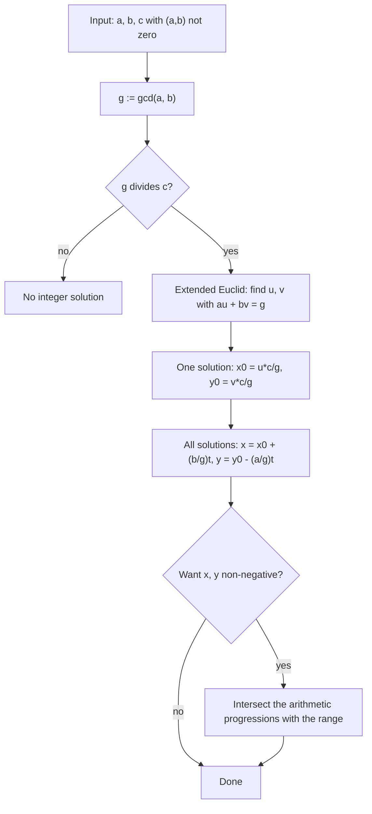

# Diophantine Equations

> [Mathematics](../../README.md) › [Number Theory](../README.md) › Diophantine Equations · Level: Advanced · Prerequisites: [Divisibility and Primes](../01-divisibility-and-primes/README.md), [Congruences](../02-congruences/README.md), [Arithmetic Functions](../03-arithmetic-functions/README.md), [Proof Techniques](../../00-foundations/04-proof-techniques/README.md), [Mathematical Induction](../../09-discrete-mathematics/01-mathematical-induction/README.md), [Integers](../../01-arithmetic/02-integers/README.md) · Estimated time: 540 min

## 1. Introduction

A **Diophantine equation** is a polynomial equation whose solutions are required to be integers (or rationals). The name honours Diophantus of Alexandria, whose *Arithmetica* (3rd century CE) posed and solved dozens of such problems — "find three numbers such that their sum is a square and the sum of any two is a square" — without ever writing a general method, because no general method exists.

Three questions organise the subject:

1. **Decidability.** Is there an algorithm that, given a Diophantine equation, decides whether it has a solution? Hilbert asked exactly this in 1900, as the tenth of his famous problems. In 1970 Yuri Matiyasevich, completing work of Davis, Putnam and Robinson, proved the answer is **no**. Section 7.9 states the theorem precisely.
2. **Description.** For a *particular* family — linear equations, $x^{2}+y^{2}=z^{2}$, $x^{2}-Dy^{2}=1$ — what do all solutions look like? In the happy cases the solution set is a finite union of parametric families, and the parameterisation is the theorem.
3. **Nonexistence.** For $x^{4}+y^{4}=z^{2}$, for $x^{2}+y^{2}=3z^{2}$, for $y^{2}=x^{3}-2$ off the known points, there are no solutions, and the proof is usually a **descent**: from one solution build a smaller one, contradicting well-ordering. Fermat made this method famous and used it, around 1637, to claim that $x^{n}+y^{n}=z^{n}$ has no positive solutions for $n\ge3$ — the marginal note that took 357 years to justify.

The chapter is a tour of the three questions in their most accessible forms.

* **Linear equations** $ax+by=c$ are completely understood: solvable iff $\gcd(a,b)\mid c$, and the solutions form a single arithmetic progression in the plane. This is Bézout's identity in geometric dress.
* **The coin problem** asks which amounts can be paid with coins of two denominations. For coprime $a,b$ the largest unpayable amount is $ab-a-b$ — one of the few exact formulas in the subject, and a model of the "Frobenius problem", which is unsolved in general for three denominations.
* **Pythagorean triples** are classified completely: every primitive triple is $(m^{2}-n^{2},\,2mn,\,m^{2}+n^{2})$. The proof is a two-line congruence argument plus unique factorisation.
* **Sums of two squares** have a criterion of surprising simplicity: every prime $\equiv 3 \pmod 4$ must occur to an even power. Lagrange's four-square theorem says the analogous problem for four squares has no obstruction at all.
* **Pell's equation** $x^{2}-Dy^{2}=1$ always has infinitely many solutions, generated by one fundamental solution; the continued fraction of $\sqrt D$ finds it. For $D=61$ the smallest solution is $x = 1\,766\,319\,049$, which is why the problem is a classic trap for search-based reasoning.
* **Descent** gives Fermat's proof for $n=4$, included here in full, and it also disposes of $x^{2}+y^{2}=3z^{2}$.
* **Mordell-type equations** $y^{2}=x^{3}+k$ show the boundary of elementary methods: some yield to unique factorisation in a quadratic ring, others to congruences, and the general finiteness theorem (Thue, Siegel, Faltings) is deep, while a *uniform algorithm* is impossible by Hilbert's tenth problem.

Throughout, the reader should notice a pattern. When a Diophantine equation has few solutions, the reason is usually a **local obstruction** (a congruence) or a **descent**; when it has infinitely many, the solution set usually carries a **group structure** (the solutions of Pell form a cyclic group, the rational points of a conic form a group).

## 2. Prerequisites

* **Divisibility, gcd, Bézout's identity, the extended Euclidean algorithm.** The engine of Section 7.1. Taught in [Divisibility and Primes](../01-divisibility-and-primes/README.md), Sections 7.4–7.7.
* **The fundamental theorem of arithmetic and Euclid's lemma.** Used in the triple classification, in the two-square theorem, and in every "coprime factors with square product" step. Taught in [Divisibility and Primes](../01-divisibility-and-primes/README.md), Sections 7.8–7.9.
* **Congruences and Fermat's little theorem.** The source of local obstructions, and the tool in the two-square theorem. Taught in [Congruences](../02-congruences/README.md), Sections 7.8–7.9.
* **Euler's totient and the divisor functions.** Used in Section 7.4 to count representations. Taught in [Arithmetic Functions](../03-arithmetic-functions/README.md), Sections 7.3–7.4.
* **The well-ordering principle and strong induction.** The logical form of "minimal counterexample" and of infinite descent. Taught in [Proof Techniques](../../00-foundations/04-proof-techniques/README.md) and [Mathematical Induction](../../09-discrete-mathematics/01-mathematical-induction/README.md).
* **The Pythagorean theorem.** The geometric origin of $x^{2}+y^{2}=z^{2}$.
* **Quadratic irrationals.** The fact that $\sqrt D$ is irrational for non-square $D$, and that numbers $a+b\sqrt D$ form a ring closed under multiplication with $N(a+b\sqrt D) = a^{2}-Db^{2}$ multiplicative. Section 7.5 develops everything about continued fractions that is needed, from scratch.

**Conventions.**

* $a \mid b$ means $b = ak$ for an integer $k$; $\gcd(a,b)$ is always taken non-negative.
* A solution of an equation in two variables is an ordered pair $(x,y)\in\mathbb{Z}^{2}$ unless "non-negative", "positive" or "rational" is stated.
* $D$ is always a positive integer that is **not a perfect square** when Pell's equation is discussed.
* $(x,y,z)$ is **primitive** when $\gcd(x,y,z)=1$.
* $[a_0; a_1, a_2, \dots]$ denotes a continued fraction; convergents are written $p_k/q_k$.
* $\operatorname{rad}(n)$ and $\omega(n)$ keep the meanings given in [Arithmetic Functions](../03-arithmetic-functions/README.md).

## 3. Learning Objectives

By the end of this tutorial you will be able to:

1. Decide whether $ax+by=c$ has integer solutions, find one by the extended Euclidean algorithm, and write the complete solution set as a one-parameter family.
2. Count the non-negative solutions of a linear equation in a given range.
3. Prove that the largest integer not representable as $ax+by$ with $x,y\ge0$ and $\gcd(a,b)=1$ is $ab-a-b$, and that exactly $\frac{(a-1)(b-1)}{2}$ integers are not representable.
4. Prove the classification of primitive Pythagorean triples, both directions, and enumerate them by hypotenuse.
5. State and prove the two-square theorem, including the lemma that a prime $\equiv3\pmod4$ dividing $a^{2}+b^{2}$ divides both $a$ and $b$, and the construction of a representation of $p\equiv1\pmod4$.
6. State the four-square theorem and the three-square theorem, and explain which numbers obstruct three squares.
7. Expand $\sqrt D$ as a periodic continued fraction, compute its convergents by the standard recursion, and prove the error bound $\lvert\alpha - p_k/q_k\rvert < 1/q_k^{2}$.
8. Prove that Pell's equation has a non-trivial solution, find the fundamental one from the continued fraction, and prove that all solutions are its powers.
9. Use infinite descent to prove that $x^{4}+y^{4}=z^{2}$ has no positive solutions, and deduce Fermat's theorem for $n=4$.
10. Recognise congruence obstructions, prove that $x^{2}+y^{2}=3z^{2}$ has only the trivial solution, and explain the limits of elementary methods.
11. State Hilbert's tenth problem and the MRDP theorem, and explain why they do not make individual Diophantine problems hopeless.
12. Avoid the standard errors: dividing an equation by a common factor without carrying the condition, forgetting the coprimality hypothesis in the triple classification, and assuming that a solution of the negative Pell equation always exists.

## 4. Intuition

### 4.1 Integer points on curves

A Diophantine equation in two variables defines a curve in the plane, and the problem is to find the points of that curve with integer coordinates. For a **line** there is either no such point or infinitely many, evenly spaced: the integer points are a one-dimensional lattice along the line. For a **conic** (a circle, an ellipse, a hyperbola) the situation is subtler but still manageable: from one rational point, drawing lines of rational slope through it produces all the others.

For a **cubic or higher** curve the picture changes character. The integer points can be finite but hard to find, and the rational points can be finitely generated (Mordell–Weil) but not parametrised by a single formula. This is why the same equation can be elementary for degree $2$ and intractable for degree $3$: the geometry of the curve, not the size of the numbers, is what controls the difficulty.

### 4.2 Two kinds of obstruction

Consider $x^{2}+y^{2}=3z^{2}$. Modulo $3$ a square is $0$ or $1$, so $x^{2}+y^{2}\equiv 0\pmod 3$ forces $x\equiv y\equiv 0$, hence $9 \mid 3z^{2}$, hence $3 \mid z$. Dividing by $9$ produces a smaller solution — and repeating gives infinite descent. This is a **local** obstruction: the equation fails modulo $3$.

Consider instead $y^{2}=x^{3}-2$. Modulo small numbers it looks solvable ($(3,5)$ is a solution), and indeed the single solution exists; the difficulty is to prove there is *no other*. That needs **global** information — here, unique factorisation in $\mathbb{Z}[\sqrt{-2}]$ — not a congruence.

The two kinds of obstruction are conceptually different, and a large part of the modern theory is about when a local obstruction is the only one. For conics it always is (Hasse–Minkowski); for cubics it is not: Selmer's curve $3x^{3}+4y^{3}+5z^{3}=0$ has non-trivial solutions in every completion of $\mathbb{Q}$ and no non-trivial rational solution.

### 4.3 Descent

Suppose a solution exists. Pick the "smallest" one in some well-ordered measure (the height, or one of the coordinates). Show that the equations force the existence of a solution with a strictly smaller measure. The measure cannot decrease forever, so no solution exists.

Descent is not a trick but the contrapositive of induction, and it is the only known way to prove many nonexistence results. It is worth seeing once in full detail; Section 7.6 does exactly that for $x^{4}+y^{4}=z^{2}$.

### 4.4 The coin problem picture

With coins of $3$ and $5$ you can pay $8 = 3+5$, $9 = 3+3+3$, $10 = 5+5$, and every larger amount (add a $3$-coin to the payments of $n-3$). The amounts you cannot pay are $1,2,4,7$ — four of them, and the largest is $7 = 3\cdot5-3-5$. The naive bound $ab$ is a factor of two too pessimistic; the exact answer is a "complementary" count, $\frac{(a-1)(b-1)}{2}$ unpayable amounts out of the $(a-1)(b-1)$ integers below $ab-a-b$.

## 5. Formal Definition

**Definition 5.1.1.** A **Diophantine equation** is an equation $F(x_1,\dots,x_n)=0$ where $F\in\mathbb{Z}[x_1,\dots,x_n]$ is a polynomial with integer coefficients. A **solution** is a tuple $(a_1,\dots,a_n)\in\mathbb{Z}^{n}$ with $F(a_1,\dots,a_n)=0$. If rational, non-negative or positive solutions are meant, this is stated.

**Definition 5.1.2.** The equation is **homogeneous** of degree $d$ if every monomial of $F$ has total degree $d$; then $(ta_1,\dots,ta_n)$ is a solution for every $t\in\mathbb{Z}$ whenever $(a_1,\dots,a_n)$ is, and the interesting question becomes whether a *non-trivial* solution ($a_i$ not all zero) exists.

**Definition 5.1.3.** A set $S\subseteq\mathbb{Z}^{n}$ is **Diophantine** if there is a polynomial $F(x_1,\dots,x_n,y_1,\dots,y_m)$ such that $S = \{(a_1,\dots,a_n) : \exists (b_1,\dots,b_m)\in\mathbb{Z}^{m},\ F(a,b)=0\}$.

**Definition 5.1.4.** A set $S\subseteq\mathbb{Z}^{n}$ is **computably enumerable** (or listable) if there is an algorithm that lists exactly the elements of $S$, possibly running forever. It is **decidable** if there is an algorithm that, given $(a_1,\dots,a_n)$, decides in finite time whether the tuple lies in $S$.

**Definition 5.1.5.** Let $D\ge 2$ be a non-square. **Pell's equation** is $x^{2}-Dy^{2}=1$; the **negative Pell equation** is $x^{2}-Dy^{2}=-1$.

**Definition 5.1.6.** A solution $(x,y)$ of Pell's equation with $x,y\in\mathbb{N}$ is **fundamental** if $x+y\sqrt D$ is the smallest such number greater than $1$.

## 6. Mathematical Notation

| Symbol | Read as | Meaning |
|---|---|---|
| $F(x_1,\dots,x_n)=0$ | eff of the variables equals zero | a Diophantine equation |
| $(x,y,z)$ | the triple | an ordered integer solution |
| $\gcd(a,b)$ | gcd of $a$ and $b$ | greatest common divisor, taken $\ge0$ |
| $\mid$, $\nmid$ | divides, does not divide | $b = ak$ |
| $a \equiv b \pmod m$ | congruent modulo $m$ | $m \mid (a-b)$ |
| $[a_0;a_1,a_2,\dots]$ | continued fraction | $a_0 + \cfrac{1}{a_1 + \cfrac{1}{a_2+\cdots}}$ |
| $p_k/q_k$ | the $k$-th convergent | $p_k = a_kp_{k-1}+p_{k-2}$, $q_k = a_kq_{k-1}+q_{k-2}$ |
| $\lfloor x\rfloor$ | floor | greatest integer $\le x$ |
| $\{x\}$ | fractional part | $x-\lfloor x\rfloor$ |
| $N(\alpha)$ | norm of $\alpha$ | $a^{2}-Db^{2}$ for $\alpha = a+b\sqrt D$ |
| $\mathbb{Z}[\sqrt D]$ | zed adjoin root D | $\{a+b\sqrt D : a,b\in\mathbb{Z}\}$ |
| $\operatorname{rad}(n)$ | radical | product of the distinct primes dividing $n$ |
| $r_2(n)$ | $r$ sub two of $n$ | number of ordered pairs $(a,b)\in\mathbb{Z}^{2}$ with $a^{2}+b^{2}=n$ |
| $\mathcal{P}$ | script P | the set of primes |
| $ab-a-b$ | the Frobenius number | largest amount not payable with coins $a,b$ |
| $\Rightarrow$ | implies | logical implication |
| $\Longleftrightarrow$ | iff | logical equivalence |
| $\blacksquare$ | end of proof | — |

Reading aloud: "$[1;\overline{2}]$" is "one semicolon two repeating"; "$x^{2}-Dy^{2}=1$" is "ex squared minus dee why squared equals one".

## 7. Core Concepts

### 7.1 Linear equations $ax+by=c$

**Theorem 7.1.1 (solvability).** Let $a,b,c\in\mathbb{Z}$ with $(a,b)\ne(0,0)$ and let $g = \gcd(a,b)$. The equation $ax+by=c$ has a solution in integers if and only if $g \mid c$.

*Proof.* (⇒) If $ax+by=c$ then $g \mid a$ and $g \mid b$, so $g \mid ax+by = c$.

(⇐) Suppose $g \mid c$, say $c = gc'$. By Bézout's identity, proved in [Divisibility and Primes](../01-divisibility-and-primes/README.md) §7.5, there exist $u,v\in\mathbb{Z}$ with $au+bv = g$. Setting $x_0 = uc'$ and $y_0 = vc'$ gives

$$ax_0+by_0 = c'(au+bv) = c'g = c. \qquad \blacksquare$$

The proof is constructive: the extended Euclidean algorithm produces $u,v$, hence one solution. Note the degenerate cases: if $a=0$ the equation is $by=c$, solvable iff $b\mid c$, and then every $x$ works; Theorem 7.1.1 covers this with $g = \lvert b\rvert$. If $c=0$ and $g \mid 0$ (always), the equation is homogeneous and $(0,0)$ is a solution.

**Theorem 7.1.2 (complete solution set).** Suppose $g = \gcd(a,b) \mid c$ and $(x_0,y_0)$ is one solution of $ax+by=c$. Then the solutions are exactly

$$\left\{(x_0,y_0) + t\left(\frac bg,\, -\frac ag\right) : t\in\mathbb{Z}\right\},$$

i.e. $x = x_0 + \frac bg t$ and $y = y_0 - \frac ag t$.

*Proof.* *Every such pair is a solution:*

$$a\left(x_0+\frac bg t\right) + b\left(y_0-\frac ag t\right) = ax_0+by_0 + \frac{ab}{g}t - \frac{ab}{g}t = c.$$

*Every solution has this form.* Let $(x,y)$ be a solution. Subtracting the equation satisfied by $(x_0,y_0)$,

$$a(x-x_0) + b(y-y_0) = 0.$$

Divide by $g$: $\frac ag (x-x_0) = -\frac bg(y-y_0)$. Since $\gcd\!\left(\frac ag,\frac bg\right)=1$, Euclid's lemma gives $\frac bg \mid (x-x_0)$: there is $t\in\mathbb{Z}$ with $x - x_0 = \frac bg t$. Substituting back, $\frac ag\cdot\frac bg t = -\frac bg (y-y_0)$, and since $\frac bg\ne0$ (as $b\ne0$; if $b=0$ the argument is symmetric with the roles of $a$ and $b$), $y-y_0 = -\frac ag t$. $\blacksquare$

Geometrically: the integer solutions of a linear equation form an arithmetic progression along the line, with step vector $\left(\frac bg,-\frac ag\right)$, which is the *primitive* direction vector of the line.

**Corollary 7.1.3 (non-negative solutions are finite in number).** If $a,b>0$ and $c>0$, then $ax+by=c$ has only finitely many solutions with $x,y\ge0$, and their number is at most $\frac{c}{\max(a,b)}+1$.

*Proof.* Any such solution has $0\le x\le c/a$ and $0\le y\le c/b$, and the solutions are the members of the progression of Theorem 7.1.2, so there are at most $\frac{c}{ab/g}+1$ of them; since $ab/g = \operatorname{lcm}(a,b)\ge\max(a,b)$, the bound follows. $\blacksquare$

**Example 7.1.4.** Solve $17x+25y=100$.

First find one solution of $17x+25y=1$: the Euclidean algorithm gives $25 = 17+8$, $17 = 2\cdot8+1$, so $1 = 17-2\cdot8 = 17-2(25-17) = 3\cdot17-2\cdot25$. Hence $(3,-2)$ solves $17x+25y=1$ and $(300,-200)$ solves $17x+25y=100$.

The general solution is therefore $x = 300+25t$, $y = -200-17t$. For a solution with both coordinates non-negative we need $t \ge -12$ and $t \le -11.76$, so $t = -12$: $(x,y) = (0,-200+204) = (0,4)$. Check: $25\cdot4 = 100$ ✓. It is the only non-negative solution, because $x = 300+25t \le 100/17$ forces $t\le-11$ and $y = -200-17t \le 100/25 = 4$ forces $t \ge -12$.

### 7.2 The Frobenius coin problem for two denominations

Fix coprime $a,b\ge2$. Call $n$ **representable** if $n = ax+by$ for some $x,y\ge0$.

**Theorem 7.2.1 (Frobenius, two coins).** If $\gcd(a,b)=1$ and $a,b\ge2$, then

$$ab-a-b$$

is not representable, and every integer $n > ab-a-b$ is representable.

*Proof.* Write $N = ab-a-b$.

*$N$ is not representable.* Suppose $N = ax+by$ with $x,y\ge0$. Then

$$ab = a(x+1) + b(y+1).$$

Reducing modulo $a$ gives $b(y+1)\equiv0\pmod a$; since $\gcd(a,b)=1$, $a \mid (y+1)$. As $y+1\ge1$, this forces $y+1\ge a$, hence $b(y+1)\ge ab$. Then $a(x+1) = ab - b(y+1)\le0$, so $x+1\le0$, contradicting $x\ge0$.

*Every $n>N$ is representable.* Let $n > N$. Choose $y\in\{0,1,\dots,a-1\}$ with $by\equiv n \pmod a$; such a $y$ exists because $b$ is invertible modulo $a$, and it is unique in that range. Then $a \mid (n-by)$, so there is $x\in\mathbb{Z}$ with $n = ax+by$. If $x<0$ then $x\le-1$, so

$$n = ax+by \le -a + b(a-1) = ab-a-b = N,$$

contradicting $n>N$. Hence $x\ge0$, and $(x,y)$ is a representation. $\blacksquare$

The proof also shows *why* the two ranges behave differently: the canonical representation with $0\le y<a$ is unique, and $N$ is exactly the largest number whose canonical $x$ is negative.

**Theorem 7.2.2 (the count).** With $\gcd(a,b)=1$ and $a,b\ge2$, exactly

$$\frac{(a-1)(b-1)}{2}$$

positive integers are not representable. Equivalently, exactly one of $n$ and $N-n$ is representable, for every integer $n$.

*Proof.* Write every integer $n$ uniquely as $n = aq+br$ with $q\in\mathbb{Z}$ and $0\le r\le a-1$: the residue $r$ is determined by $br\equiv n\pmod a$, and then $q$ is determined. Since $x,y\ge0$ can always be adjusted by the transformation $(x,y)\mapsto(x+b,y-a)$ (which preserves $ax+by$), $n$ is representable iff $q\ge0$: if $n$ has any representation, repeatedly apply the adjustment to make the $b$-coefficient lie in $[0,a-1]$, producing exactly the canonical $(q,r)$; and conversely $q\ge0$ gives the representation $n = aq+br$.

So $n\ge0$ fails to be representable iff its canonical $q$ is negative, i.e. $q\le-1$. For fixed $r$, the values $n = aq+br\ge0$ with $q\le-1$ are $q = -1,-2,\dots,-\left\lfloor \frac{br}{a}\right\rfloor$, so there are $\left\lfloor \frac{br}{a}\right\rfloor$ of them. Hence the number of non-representable non-negative integers is

$$\sum_{r=0}^{a-1}\left\lfloor\frac{br}{a}\right\rfloor = \frac{b(a-1)}{2} - \frac{a-1}{2} = \frac{(a-1)(b-1)}{2},$$

where the middle equality uses the permutation property of residues: since $\gcd(a,b)=1$, the residues $br \bmod a$ for $r = 0,\dots,a-1$ run through $0,1,\dots,a-1$, so $\sum_r \{br/a\} = \sum_r r/a = \frac{a-1}{2}$ and $\sum_r br/a = \frac{b(a-1)}{2}$.

Finally, here is a cleaner way to see the "one of each pair" statement. The map $n\mapsto N-n$ is an involution of $\{0,1,\dots,N\}$ without fixed point ($N$ is odd: if $a,b$ are both odd then $ab$ is odd and $a+b$ even; if one of them is $2$ then the other is odd and $N = b-2$ is odd). So the interval splits into $\frac{N+1}{2} = \frac{(a-1)(b-1)}{2}$ pairs $\{n, N-n\}$. The count just proved says that exactly $\frac{(a-1)(b-1)}{2}$ of the $(a-1)(b-1)$ integers in the interval are non-representable, i.e. exactly $\frac{(a-1)(b-1)}{2}$ are representable. A pair cannot contain two representable numbers, since adding the two representations would exhibit $N$ as representable and contradict Theorem 7.2.1. With $\frac{(a-1)(b-1)}{2}$ representable numbers distributed over $\frac{(a-1)(b-1)}{2}$ pairs, each pair contains exactly one. $\blacksquare$

**Remark 7.2.3.** The problem for three or more denominations has no closed formula and is known to be computationally hard in general; bounds such as $g(a,b,c) \le \sqrt{3abc}$ (Davison) are known, but the exact value is not known in general. This is a good example of a question that is completely solved for $k=2$ and open-ended for $k\ge3$.

### 7.3 Pythagorean triples

A **Pythagorean triple** is a solution of $x^{2}+y^{2}=z^{2}$ with $x,y,z\in\mathbb{N}$; it is **primitive** if $\gcd(x,y,z)=1$.

**Theorem 7.3.1 (classification of primitive triples).** The primitive Pythagorean triples with $x,y,z>0$ are exactly

$$(x,y,z) = \left(m^{2}-n^{2},\;2mn,\;m^{2}+n^{2}\right) \quad\text{and}\quad \left(2mn,\;m^{2}-n^{2},\;m^{2}+n^{2}\right),$$

where $m>n\ge1$ are integers with $\gcd(m,n)=1$ and $m+n$ odd.

*Proof of sufficiency.* If $m,n$ are as stated, then

$$(m^{2}-n^{2})^{2} + (2mn)^{2} = m^{4}-2m^{2}n^{2}+n^{4}+4m^{2}n^{2} = (m^{2}+n^{2})^{2},$$

so $(m^{2}-n^{2},2mn,m^{2}+n^{2})$ is a triple. It is primitive: let $p$ be a prime dividing all three entries. If $p$ is odd, then $p \mid (m^{2}-n^{2})+(m^{2}+n^{2}) = 2m^{2}$ and $p\mid (m^{2}+n^{2})-(m^{2}-n^{2}) = 2n^{2}$, so $p \mid m$ and $p\mid n$, contradicting $\gcd(m,n)=1$. If $p = 2$, then $2 \mid 2mn$ and $2\mid m^{2}+n^{2}$ force $m,n$ of the same parity, contradicting $m+n$ odd. So no prime divides all three entries: the triple is primitive.

*Proof of necessity.* Let $(x,y,z)$ be primitive with $x,y,z>0$.

*Step 1: exactly one leg is even, and $z$ is odd.* If $x,y$ are both even then $2\mid z$, contradicting primitivity. If $x,y$ are both odd then $x^{2}+y^{2}\equiv1+1 = 2\pmod 4$, but a square is $\equiv0$ or $1\pmod 4$ — impossible. So exactly one leg is even. Then $z^{2} = x^{2}+y^{2}$ is odd (odd + even), so $z$ is odd.

*Step 2: reduce to the case $y$ even.* Interchanging $x$ and $y$ if necessary, assume $y$ is even and $x,z$ odd.

*Step 3: factor.* From $y^{2} = z^{2}-x^{2} = (z-x)(z+x)$ and the fact that $x,z$ are odd, both $z-x$ and $z+x$ are even. Put

$$u = \frac{z+x}{2}, \qquad v = \frac{z-x}{2},$$

so that $u,v\in\mathbb{N}$, $u>v>0$, $u+v = z$, $u-v = x$, and

$$uv = \frac{z^{2}-x^{2}}{4} = \frac{y^{2}}{4} = \left(\frac y2\right)^{2}.$$

*Step 4: $\gcd(u,v)=1$.* Let $d = \gcd(u,v)$. Then $d \mid (u+v) = z$ and $d \mid (u-v) = x$, so $d \mid \gcd(x,z)$. But $\gcd(x,z)=1$: any prime $p$ dividing both $x$ and $z$ divides $z^{2}-x^{2} = y^{2}$, hence divides $y$, contradicting primitivity (and $p\ne2$ because $x,z$ are odd). Hence $d = 1$.

*Step 5: coprime factors with square product.* Since $uv$ is a square and $\gcd(u,v)=1$, each of $u,v$ is a perfect square. (For each prime $p$, the exponent of $p$ in $uv$ is even, and $p$ divides at most one of $u,v$, so the exponent in that one is even.) Write

$$u = m^{2}, \qquad v = n^{2}, \qquad m>n\ge1, \quad \gcd(m,n)=1.$$

Then

$$z = u+v = m^{2}+n^{2}, \qquad x = u-v = m^{2}-n^{2}, \qquad y = 2\sqrt{uv} = 2mn.$$

Finally $m+n$ is odd: $x = m^{2}-n^{2}$ is odd, so $m^{2}$ and $n^{2}$ have opposite parity, so $m$ and $n$ do. $\blacksquare$

**Corollary 7.3.2.** All triples (not necessarily primitive) with $x,y,z>0$ are obtained from the primitive ones by multiplying by a positive integer $k$: $(x,y,z) = (ka_0,kb_0,kc_0)$ with $(a_0,b_0,c_0)$ primitive.

*Proof.* Dividing a triple by $k = \gcd(x,y,z)$ gives a primitive triple, since $\gcd(x/k,y/k,z/k)=1$; conversely a multiple of a triple is a triple. $\blacksquare$

**Corollary 7.3.3.** The area $\frac{xy}{2}$ of a primitive Pythagorean triangle is divisible by $6$.

*Proof.* With $x = m^{2}-n^{2}$, $y = 2mn$, $z = m^{2}+n^{2}$, the area is $mn(m^{2}-n^{2})$. Divisibility by $2$: $m+n$ is odd, so one of $m,n$ is even. Divisibility by $3$: if neither $m$ nor $n$ is divisible by $3$, then $m^{2}\equiv n^{2}\equiv1\pmod 3$, so $3 \mid (m^{2}-n^{2})$. In every case $6 \mid mn(m^{2}-n^{2})$. $\blacksquare$

### 7.4 Sums of two squares

**Theorem 7.4.1 (two-square theorem, Fermat).** A positive integer $n$ is a sum of two integer squares if and only if every prime $p\equiv3\pmod4$ occurs in $n$ with an even exponent.

The proof splits into a hard direction (necessity) and a constructive direction (sufficiency).

**Lemma 7.4.2 (the key local fact).** Let $p\equiv3\pmod4$ be prime. If $p \mid a^{2}+b^{2}$ with $a,b\in\mathbb{Z}$, then $p\mid a$ and $p\mid b$.

*Proof.* Suppose $p \nmid a$. Then $a$ is invertible modulo $p$, and from $a^{2}\equiv-b^{2}$ we get $(ba^{-1})^{2}\equiv-1\pmod p$. Raising to the power $(p-1)/2$ and using Fermat's little theorem $c^{p-1}\equiv1$ for $c\not\equiv0$:

$$1 \equiv (ba^{-1})^{p-1} = \left((ba^{-1})^{2}\right)^{(p-1)/2} \equiv (-1)^{(p-1)/2} = -1 \pmod p,$$

because $(p-1)/2$ is odd when $p\equiv3\pmod4$. So $1\equiv-1\pmod p$, which forces $p = 2$, a contradiction. Hence $p\mid a$, and then $p\mid b^{2}$ gives $p\mid b$. $\blacksquare$

*Proof of necessity in Theorem 7.4.1.* Suppose $n = a^{2}+b^{2}$ and let $p\equiv3\pmod4$ be a prime divisor of $n$. By Lemma 7.4.2, $p\mid a$ and $p\mid b$, so $p^{2}\mid a^{2}+b^{2} = n$ and $n/p^{2} = (a/p)^{2}+(b/p)^{2}$ is again a sum of two squares. Repeating, the exponent of $p$ in $n$ is even. $\blacksquare$

**Lemma 7.4.3 (Brahmagupta–Fibonacci identity).** For all integers $a,b,c,d$,

$$(a^{2}+b^{2})(c^{2}+d^{2}) = (ac-bd)^{2} + (ad+bc)^{2} = (ac+bd)^{2}+(ad-bc)^{2}.$$

*Proof.* Expand both sides: the left side is $a^{2}c^{2}+a^{2}d^{2}+b^{2}c^{2}+b^{2}d^{2}$, and the right side is $(a^{2}c^{2}-2abcd+b^{2}d^{2})+(a^{2}d^{2}+2abcd+b^{2}c^{2})$, which is the same. The second form is identical with $d\mapsto-d$. $\blacksquare$

**Lemma 7.4.4 (Thue).** If $p\equiv1\pmod4$ is prime, then there exist integers $a,b$ with $p = a^{2}+b^{2}$.

*Proof.*

*Step 1: $-1$ is a square modulo $p$.* By Wilson's theorem, $(p-1)!\equiv-1\pmod p$. Pair the factors $k$ and $p-k$ for $k=1,\dots,(p-1)/2$:

$$(p-1)! = \prod_{k=1}^{(p-1)/2}k(p-k) \equiv (-1)^{(p-1)/2}\left(\frac{p-1}{2}!\right)^{2} \pmod p.$$

Since $p\equiv1\pmod4$, the number $(p-1)/2$ is even, so $(-1)^{(p-1)/2}=1$ and, writing $u = \frac{p-1}{2}!$,

$$u^{2}\equiv-1\pmod p.$$

*Step 2: two lattice points in the same class.* Let $M = \lfloor\sqrt p\rfloor$, so $M < \sqrt p < M+1$ and $(M+1)^{2} > p$. Consider the $(M+1)^{2}$ numbers $a+ub$ with $0\le a,b\le M$. There are more of them than residue classes modulo $p$, so two distinct pairs give the same residue:

$$a_1+ub_1 \equiv a_2+ub_2 \pmod p.$$

Put $c = a_1-a_2$ and $d = b_1-b_2$, not both zero. Then $\lvert c\rvert \le M < \sqrt p$ and $\lvert d\rvert\le M<\sqrt p$, and $c\equiv-ud\pmod p$.

*Step 3: $p = c^{2}+d^{2}$.* Squaring the congruence and using $u^{2}\equiv-1$:

$$c^{2}\equiv u^{2}d^{2}\equiv-d^{2}\pmod p,$$

so $p \mid c^{2}+d^{2}$. But $0 < c^{2}+d^{2} < 2p$ (strict, since each of $c^{2},d^{2}$ is $<p$ and they are not both zero), and the only positive multiple of $p$ below $2p$ is $p$ itself. Hence $c^{2}+d^{2} = p$, and $a = \lvert c\rvert$, $b = \lvert d\rvert$ give the required representation. $\blacksquare$

*Proof of sufficiency in Theorem 7.4.1.* Write $n = 2^{e}\prod p_i^{a_i}\prod q_j^{b_j}$ where $p_i\equiv1\pmod4$ and $q_j\equiv3\pmod4$, and suppose every $b_j$ is even. Then

* $2 = 1^{2}+1^{2}$, and $2^{e}$ is a product of $e$ copies of $2$, hence a sum of two squares by Lemma 7.4.3;
* $p_i^{a_i}$ is a product of $a_i$ copies of $p_i$, each a sum of two squares by Lemma 7.4.4, hence a sum of two squares;
* $q_j^{b_j} = (q_j^{b_j/2})^{2}+0^{2}$ is a square.

Lemma 7.4.3 says the product of two sums of two squares is a sum of two squares; multiplying all these representations gives a representation of $n$. $\blacksquare$

**Corollary 7.4.5.** If $n$ is a sum of two squares then so is $nk^{2}$ for every $k\in\mathbb{Z}$; indeed $nk^{2} = (ak)^{2}+(bk)^{2}$ whenever $n = a^{2}+b^{2}$. Together with Lemma 7.4.3 this shows that the sums of two squares form a multiplicative monoid closed under multiplication by squares — which is exactly the shape of the criterion in Theorem 7.4.1.

**Theorem 7.4.6 (four-square theorem, Lagrange 1770).** Every $n\in\mathbb{N}$ is a sum of four integer squares: $n = a^{2}+b^{2}+c^{2}+d^{2}$.

We state this without proof; it rests on the four-square identity

$$(a_1^{2}+a_2^{2}+a_3^{2}+a_4^{2})(b_1^{2}+b_2^{2}+b_3^{2}+b_4^{2}) = c_1^{2}+c_2^{2}+c_3^{2}+c_4^{2},$$

with $c$ given by the quaternion product, which reduces the theorem to the case of primes, and then to a pigeonhole argument like that of Lemma 7.4.4. Four squares are necessary in general: $7 = 4+1+1+1$ needs four, and no number $\equiv7\pmod8$ is a sum of three squares (Section 7.7).

**Theorem 7.4.7 (three-square theorem, Legendre 1798).** $n$ is a sum of three integer squares if and only if $n$ is **not** of the form $4^{a}(8b+7)$ with $a,b\ge0$.

The easy half — that $4^{a}(8b+7)$ is never a sum of three squares — is proved in the exercises; the hard half is quoted.

### 7.5 Pell's equation and continued fractions

#### 7.5.1 Continued fractions

A **finite continued fraction** is

$$[a_0;a_1,\dots,a_n] = a_0 + \cfrac{1}{a_1+\cfrac{1}{a_2+\cdots+\cfrac{1}{a_n}}},$$

with $a_0\in\mathbb{Z}$ and $a_1,\dots,a_n\in\mathbb{N}$. Its **convergents** are the numbers $p_k/q_k = [a_0;a_1,\dots,a_k]$ for $0\le k\le n$, computed by the recursion

$$p_k = a_kp_{k-1}+p_{k-2}, \qquad q_k = a_kq_{k-1}+q_{k-2},$$

with initial values $p_{-1} = 1$, $p_{-2} = 0$, $q_{-1} = 0$, $q_{-2} = 1$. The recursion is proved by induction on $k$ from the definition of the convergents; the first few are $p_0/q_0 = a_0/1$, $p_1/q_1 = (a_1a_0+1)/a_1$.

**Lemma 7.5.1 (determinant identity).** For all $k\ge0$,

$$p_kq_{k-1}-p_{k-1}q_k = (-1)^{k-1}, \qquad\text{hence}\qquad \gcd(p_k,q_k)=1.$$

*Proof.* For $k=0$: $p_0q_{-1}-p_{-1}q_0 = a_0\cdot0-1\cdot1 = -1 = (-1)^{-1}$. For $k\ge1$,

$$p_kq_{k-1}-p_{k-1}q_k = (a_kp_{k-1}+p_{k-2})q_{k-1}-p_{k-1}(a_kq_{k-1}+q_{k-2}) = p_{k-2}q_{k-1}-p_{k-1}q_{k-2},$$

which is the negative of the expression at $k-1$; induction gives $(-1)^{k-1}$. A common divisor of $p_k$ and $q_k$ divides the left side, hence divides $\pm1$. $\blacksquare$

**Lemma 7.5.2 (error bound).** Let $\alpha$ be irrational with convergents $p_k/q_k$. Then for every $k\ge0$,

$$\left\lvert\alpha-\frac{p_k}{q_k}\right\rvert < \frac{1}{q_kq_{k+1}} < \frac{1}{q_k^{2}}.$$

*Proof.* The convergents straddle $\alpha$: $\alpha$ lies strictly between $p_k/q_k$ and $p_{k+1}/q_{k+1}$ for every $k$ (this follows from $\alpha = [a_0;\dots,a_k,t]$ with $t>1$ and the recursion, or geometrically from the alternation forced by the determinant identity). Hence

$$\left\lvert\alpha-\frac{p_k}{q_k}\right\rvert < \left\lvert\frac{p_{k+1}}{q_{k+1}}-\frac{p_k}{q_k}\right\rvert = \frac{\lvert p_{k+1}q_k-p_kq_{k+1}\rvert}{q_kq_{k+1}} = \frac{1}{q_kq_{k+1}},$$

by Lemma 7.5.1. Since $q_{k+1}>q_k\ge1$ for $k\ge1$, this is less than $1/q_k^{2}$. $\blacksquare$

#### 7.5.2 The continued fraction of $\sqrt D$

**Algorithm.** With $a_0 = \lfloor\sqrt D\rfloor$, set $m_0 = 0$, $d_0 = 1$, and iterate

$$m_{k+1} = d_ka_k-m_k, \qquad d_{k+1} = \frac{D-m_{k+1}^{2}}{d_k}, \qquad a_{k+1} = \left\lfloor\frac{a_0+m_{k+1}}{d_{k+1}}\right\rfloor.$$

The numbers $m_k,d_k$ are integers with $d_k \mid (D-m_k^{2})$, and $\sqrt D = [a_0;a_1,a_2,\dots]$.

**Theorem 7.5.3 (Lagrange).** If $D$ is a positive non-square integer, the continued fraction of $\sqrt D$ is periodic and has the form

$$\sqrt D = [a_0;\overline{a_1,a_2,\dots,a_\ell}],$$

where the bar marks the repeating block and the last term of the block satisfies $a_\ell = 2a_0$.

*Idea of the proof.* The pair $(m_k,d_k)$ determines the whole future of the algorithm, and one shows $\lvert d_k\rvert < 2\sqrt D$ and $0\le m_k<\sqrt D$, so only finitely many pairs occur; hence the sequence is eventually periodic. For $\sqrt D$ one checks that the state at the start of a period is $(m,d) = (0,1)$, which gives pure periodicity and $a_\ell = 2a_0$. For a complete proof see the references in Section 16.

**Lemma 7.5.4.** For the convergents of $\sqrt D$,

$$p_k^{2}-Dq_k^{2} = (-1)^{k+1}d_{k+1}.$$

*Proof.* This is a standard induction on $k$ relating the convergents to the algorithm. For $k=0$ the identity reads $a_0^{2}-D = -d_1$, which is exactly the first step of the algorithm: $m_1 = a_0$ and $d_1 = (D-m_1^{2})/d_0 = D-a_0^{2}$. The induction step is a direct computation substituting the convergent recursion $p_k = a_kp_{k-1}+p_{k-2}$, $q_k = a_kq_{k-1}+q_{k-2}$ and the defining relations $m_{k+1} = d_ka_k-m_k$, $d_{k+1}d_k = D-m_{k+1}^{2}$; it is tedious but purely mechanical. (Check on $\sqrt3$: the states give $d_1 = 2$, $d_2 = 1$, $d_3 = 2$, and the convergents $1/1, 2/1, 5/3$ satisfy $p^{2}-3q^{2} = -2, +1, -2$ ✓.) $\blacksquare$

**Corollary 7.5.5.** At the end of the first period, $d_\ell = 1$ (the state returns to $(0,1)$), so

$$p_{\ell-1}^{2}-Dq_{\ell-1}^{2} = (-1)^{\ell}.$$

Hence

* if $\ell$ is even, $(p_{\ell-1},q_{\ell-1})$ solves $x^{2}-Dy^{2}=1$;
* if $\ell$ is odd, then $(p_{\ell-1},q_{\ell-1})$ solves the **negative** Pell equation $x^{2}-Dy^{2}=-1$, and $(p_{2\ell-1},q_{2\ell-1})$ solves $x^{2}-Dy^{2}=1$.

This gives an algorithm: expand $\sqrt D$, compute the convergents until the first one with $p^{2}-Dq^{2} = 1$.

#### 7.5.3 Existence of a non-trivial solution

The continued fraction produces a solution, but the following argument shows existence without any continued-fraction theory, and it is worth knowing because the same pigeonhole idea recurs throughout number theory.

**Theorem 7.5.6.** If $D\ge2$ is not a perfect square, then $x^{2}-Dy^{2}=1$ has a solution with $x,y\in\mathbb{N}$.

*Proof.* *Step 1: many good approximations.* Fix $M\ge1$ and consider the $M+1$ fractional parts $\{k\sqrt D\}$ for $k = 0,1,\dots,M$. Splitting $[0,1)$ into $M$ intervals of length $1/M$, two of them lie in the same interval, so there are $0\le i<j\le M$ with $\lvert\{i\sqrt D\}-\{j\sqrt D\}\rvert < 1/M$. Put $q = j-i\in[1,M]$. Then $q\sqrt D$ differs from an integer $p$ by less than $1/M$, i.e.

$$\lvert q\sqrt D-p\rvert < \frac1M\le\frac1q.$$

*Step 2: bounded values of the norm form.* For such a pair,

$$\lvert p^{2}-Dq^{2}\rvert = \lvert p-q\sqrt D\rvert\cdot\lvert p+q\sqrt D\rvert < \frac1q\left(2q\sqrt D+1\right) = 2\sqrt D + \frac1q \le 2\sqrt D+1.$$

Also $p^{2}-Dq^{2}\ne0$, since $D$ is not a square and $q\ge1$. So the integers $k$ of the form $p^{2}-Dq^{2}$, for the infinitely many pairs produced as $M$ varies, lie in the finite set $\{-2\sqrt D-1,\dots,2\sqrt D+1\}\setminus\{0\}$.

*Step 3: two pairs with the same value and the same residues.* Some value $k\ne0$ occurs for infinitely many pairs $(p_1,q_1),(p_2,q_2),\dots$. Reduce these pairs modulo $\lvert k\rvert$; only finitely many residue pairs occur, so two pairs satisfy $p_1\equiv p_2$ and $q_1\equiv q_2\pmod{\lvert k\rvert}$ and also $p_1/q_1\ne p_2/q_2$.

*Step 4: compose.* Using the multiplicativity of $N(a+b\sqrt D) = a^{2}-Db^{2}$ (Lemma 7.5.7 below),

$$(p_1+q_1\sqrt D)(p_2-q_2\sqrt D) = (p_1p_2-Dq_1q_2) + (q_1p_2-p_1q_2)\sqrt D,$$

whose norm is $k\cdot k = k^{2}$ on one hand and $x^{2}-Dy^{2}$ for

$$x = \frac{p_1p_2-Dq_1q_2}{\lvert k\rvert}, \qquad y = \frac{q_1p_2-p_1q_2}{\lvert k\rvert}$$

on the other. Both are integers by the congruence choice of Step 3, and $y\ne0$ because $p_1/q_1\ne p_2/q_2$. Then $x^{2}-Dy^{2} = k^{2}/k^{2} = 1$, and $x\ge1$ since $x^{2} = 1+Dy^{2}>0$. $\blacksquare$

#### 7.5.4 All solutions are powers of the fundamental one

**Lemma 7.5.7 (norm is multiplicative).** For $D\in\mathbb{Z}$ and $\alpha = a+b\sqrt D$, $\beta = c+d\sqrt D$ with integers $a,b,c,d$, define $N(\alpha) = a^{2}-Db^{2}$. Then $N(\alpha\beta) = N(\alpha)N(\beta)$.

*Proof.* By direct expansion,

$$(a+b\sqrt D)(c+d\sqrt D) = (ac+bdD) + (ad+bc)\sqrt D,$$

so $N(\alpha\beta) = (ac+bdD)^{2} - D(ad+bc)^{2} = a^{2}c^{2}+2abcdD+b^{2}d^{2}D^{2} - Da^{2}d^{2}-2abcdD-Db^{2}c^{2}$, which simplifies to $(a^{2}-Db^{2})(c^{2}-Dd^{2})$. $\blacksquare$

Consequently, if $N(\alpha)=N(\beta)=1$ then $N(\alpha\beta)=1$: **the solutions of Pell's equation are closed under multiplication** of $x+y\sqrt D$. This is the group structure alluded to in Section 1.

**Theorem 7.5.8.** Let $(x_1,y_1)$ be the fundamental solution of $x^{2}-Dy^{2}=1$, i.e. $\varepsilon = x_1+y_1\sqrt D>1$ is minimal among all such numbers. Then the solutions with $x,y\in\mathbb{N}$ are exactly

$$\left\{\left(x_n,y_n\right) : \varepsilon^{n} = x_n+y_n\sqrt D,\ n\ge1\right\}.$$

Moreover every integer solution $(x,y)\ne(\pm1,0)$ is $\pm\varepsilon^{n}$ or $\pm\varepsilon^{-n}$ for a unique $n\ge1$.

*Proof.* Given a solution $\alpha = x+y\sqrt D > 1$ with $N(\alpha)=1$, choose $n\ge1$ with $\varepsilon^{n}\le\alpha<\varepsilon^{n+1}$; such $n$ exists because $\varepsilon>1$ and $\varepsilon^{n}\to\infty$. Put $\beta = \alpha\varepsilon^{-n}$. Then $1\le\beta<\varepsilon$.

We show $\beta=1$. First, $\varepsilon^{-1} = x_1-y_1\sqrt D = 1/\varepsilon\in(0,1]$, and $\varepsilon^{-n} = (x_1-y_1\sqrt D)^{n}$, which by the binomial theorem is of the form $u+v\sqrt D$ with $u,v\in\mathbb{Z}$. Hence $\beta = \alpha\varepsilon^{-n}$ is also of the form $u+v\sqrt D$. Its conjugate is the product of the conjugate $1/\alpha$ of $\alpha$ with the conjugate $\varepsilon^{n}$ of $\varepsilon^{-n}$, so $\bar\beta = \varepsilon^{n}/\alpha = 1/\beta$; therefore

$$u = \frac{\beta+\beta^{-1}}{2}\ge1 \quad\text{(AM–GM)}, \qquad v = \frac{\beta-\beta^{-1}}{2\sqrt D}.$$

If $v\ne0$ then $\lvert v\rvert\ge1$. Also $v>0$: if $v<0$ then $\beta = u+v\sqrt D<u = \frac{\beta+\beta^{-1}}{2}$, which forces $\beta<1$, contradicting $\beta\ge1$. Hence $v\ge1$ and $\lvert v\rvert\sqrt D\ge\sqrt D$, so $\beta = u+v\sqrt D\ge u + \sqrt D\ge 1+\sqrt D$. On the other hand $\varepsilon = x_1+y_1\sqrt D\ge 1+\sqrt D$ (as $x_1,y_1\ge1$), so $\beta\ge\varepsilon$, contradicting $\beta<\varepsilon$. Therefore $v=0$, $\beta = u$, and $u^{2} = 1$, so $\beta=1$.

Hence $\alpha = \varepsilon^{n}$. Conversely every $\varepsilon^{n}$ is a solution by Lemma 7.5.7, with positive coordinates because $\varepsilon^{n} = x_n+y_n\sqrt D$ and $\varepsilon^{-n} = x_n-y_n\sqrt D>0$ give $x_n>y_n\sqrt D>0$. Uniqueness of $n$ follows from strict monotonicity of $n\mapsto\varepsilon^{n}$. Finally, an arbitrary integer solution has $x\pm y\sqrt D = \pm\varepsilon^{\pm n}$: if $x>0$ apply the above to whichever of $x+y\sqrt D$ and $x-y\sqrt D = 1/(x+y\sqrt D)$ exceeds $1$; if $x<0$ multiply by $-1$. $\blacksquare$

**Remark 7.5.9 (negative Pell).** The equation $x^{2}-Dy^{2}=-1$ does *not* always have a solution: if $D\equiv3\pmod4$ then $x^{2}+1 = Dy^{2}$ would give $x^{2}\equiv-1\pmod 4$, impossible. When it does have a solution, its fundamental solution $\eta$ satisfies $\varepsilon = \eta^{2}$, which is why the period length of $\sqrt D$ is odd exactly in that case.

### 7.6 Infinite descent and Fermat's method

**The method.** To prove that a Diophantine equation has no solution in positive integers:

1. Assume a solution exists and choose one minimising some positive integer measure (here: $z$).
2. Derive from it another solution whose measure is strictly smaller.
3. Conclude by well-ordering that no solution exists.

The name "infinite descent" comes from the equivalent formulation: a solution produces an infinite strictly decreasing sequence of positive integers, which cannot exist.

**Lemma 7.6.1 (coprime factors with a square product).** If $u_1,\dots,u_r$ are pairwise coprime positive integers and $u_1u_2\cdots u_r$ is a perfect square, then each $u_i$ is a perfect square.

*Proof.* Let $p$ be a prime. Since the $u_i$ are pairwise coprime, $p$ divides at most one of them; so its exponent in the product — which is even — equals its exponent in that single $u_i$. Hence every prime has even exponent in every $u_i$. $\blacksquare$

**Theorem 7.6.2 (Fermat).** The equation

$$x^{4}+y^{4} = z^{2}$$

has no solution in positive integers. Consequently $x^{4}+y^{4}=z^{4}$ has no solution with $xyz\ne0$.

*Proof.* Suppose a solution exists; choose one with $z$ minimal (well-ordering).

*Step 1: $\gcd(x,y)=1$.* If a prime $p$ divides $x$ and $y$, then $p^{4}$ divides $x^{4}+y^{4} = z^{2}$, so $p^{2}\mid z$, and $(x/p,\,y/p,\,z/p^{2})$ is a solution with smaller third coordinate, contradicting minimality. So $\gcd(x,y)=1$.

*Step 2: $x,y$ are not both odd.* If both were odd, then $x^{4}\equiv y^{4}\equiv1\pmod{16}$, so $z^{2}\equiv2\pmod{16}$; but squares modulo $16$ are $0,1,4,9$. Impossible. So one of $x,y$ is even; interchanging them if necessary, assume **$y$ is even** and $x$ odd.

*Step 3: a primitive Pythagorean triple.* Then $(x^{2})^{2}+(y^{2})^{2} = z^{2}$ with $\gcd(x^{2},y^{2}) = 1$, so the triple $(x^{2},y^{2},z)$ is primitive, $z$ is odd, and the even leg is $y^{2}$. By Theorem 7.3.1 there are integers $m>n\ge1$ with

$$\gcd(m,n)=1, \qquad m+n \text{ odd}, \qquad x^{2} = m^{2}-n^{2}, \qquad y^{2} = 2mn, \qquad z = m^{2}+n^{2}.$$

Since $x^{2} = m^{2}-n^{2}$ is odd, $m$ and $n$ have opposite parity — which is the same statement as $m+n$ odd.

*Step 4: a second primitive triple.* From $x^{2}+n^{2} = m^{2}$ with $\gcd(n,m)=1$, the triple $(x,n,m)$ is primitive, and $n$ is its even leg: $n^{2} = m^{2}-x^{2}$ with $m,x$ both odd gives $n^{2}\equiv1-1\equiv0\pmod 8$, so $n$ is even. So there are integers $u>v\ge1$ with

$$\gcd(u,v)=1, \qquad u+v \text{ odd}, \qquad n = 2uv, \qquad x = u^{2}-v^{2}, \qquad m = u^{2}+v^{2}.$$

*Step 5: a smaller solution.* Substituting,

$$y^{2} = 2mn = 2\left(u^{2}+v^{2}\right)(2uv) = 4uv\left(u^{2}+v^{2}\right),$$

so $(y/2)^{2} = uv(u^{2}+v^{2})$ — note $y$ is even, as $y^{2} = 4uv(u^{2}+v^{2})$ shows. The three factors are pairwise coprime:

$$\gcd(u,v)=1,\qquad \gcd(u,u^{2}+v^{2}) = \gcd(u,v^{2}) = 1,\qquad \gcd(v,u^{2}+v^{2}) = \gcd(v,u^{2})=1.$$

By Lemma 7.6.1 each is a square: there are positive integers $r,s,t$ with

$$u = r^{2}, \qquad v = s^{2}, \qquad u^{2}+v^{2} = t^{2}.$$

Then

$$r^{4}+s^{4} = u^{2}+v^{2} = t^{2},$$

so $(r,s,t)$ is a solution of $x^{4}+y^{4}=z^{2}$. But

$$t^{2} = u^{2}+v^{2} = m < m^{2}+n^{2} = z,$$

since $m\ge2$ and $n\ge1$ give $m < m^{2}+n^{2}$; and $m\ge2$ gives $t = \sqrt m < m < z$. This contradicts the minimality of $z$. Hence no solution exists.

For the last claim: if $x^{4}+y^{4}=z^{4}$ with $xyz\ne0$, then $(x,y,z^{2})$ solves $x^{4}+y^{4}=w^{2}$ with $w = z^{2}>0$, contradicting what was proved. $\blacksquare$

This is Fermat's own proof (letter to Frénicle de Bessy, 1640), and it is the only case of Fermat's Last Theorem that he proved in full. It gives more than asked: not merely $x^{4}+y^{4}\ne z^{4}$ but the impossibility of two fourth powers summing to a square.

**Corollary 7.6.3.** The equation $x^{4}-y^{4} = z^{2}$ has no solution with $xyz\ne0$.

*Proof.* If $x^{4} = y^{4}+z^{2}$ with $xyz\ne0$, then $(y,z,x^{2})$ solves $u^{4}+v^{4}=w^{2}$ with all coordinates positive, contradicting Theorem 7.6.2. $\blacksquare$

Note that the hypothesis $z\ne0$ is essential: $x^{4}-x^{4} = 0^{2}$, so $y = x$, $z = 0$ is a family of solutions, and it is the only one when $z = 0$.

### 7.7 Mordell-type equations and the limits of elementary methods

A **Mordell equation** is $y^{2} = x^{3}+k$ for an integer $k$. Three techniques cover the examples below: congruence obstructions, unique factorisation in a quadratic ring, and descent. None of them is general.

#### 7.7.1 Congruence obstructions

**Proposition 7.7.2.** (a) $3x^{2}+2 = y^{2}$ has no integer solutions. (b) $x^{2}+y^{2}=3z^{2}$ has only the trivial solution $x=y=z=0$.

*Proof.* (a) Modulo $3$: $y^{2}\equiv2\pmod 3$, but squares modulo $3$ are $0,1$.

(b) Suppose a non-trivial solution exists and choose one with $z>0$ minimal. If $3 \mid z$ then $3 \mid x^{2}+y^{2}$, so by Lemma 7.4.2 (with $p=3$) $3\mid x$ and $3 \mid y$; dividing by $9$ gives a solution with $z/3<z$, contradicting minimality. So $3\nmid z$. But then $x^{2}+y^{2}\equiv0\pmod 3$ forces $3\mid x$ and $3\mid y$ again, whence $9 \mid x^{2}+y^{2} = 3z^{2}$, so $3\mid z^{2}$ and $3\mid z$, a contradiction. Hence no non-trivial solution exists. $\blacksquare$

#### 7.7.2 A complete example by unique factorisation: $y^{2}=x^{3}-2$

**Lemma 7.7.3.** $\mathbb{Z}[\sqrt{-2}] = \{a+b\sqrt{-2} : a,b\in\mathbb{Z}\}$ is Euclidean for the norm $N(a+b\sqrt{-2}) = a^{2}+2b^{2}$, hence a unique factorisation domain.

*Proof.* Let $\alpha,\beta\ne0$ be in $\mathbb{Z}[\sqrt{-2}]$. Then $\alpha/\beta = r+s\sqrt{-2}$ with $r,s\in\mathbb{Q}$. Choose integers $u,v$ with $\lvert r-u\rvert\le\frac12$ and $\lvert s-v\rvert\le\frac12$, and set $\rho = \alpha-\beta(u+v\sqrt{-2})$. Then

$$N(\rho) = N(\beta)\,N\!\left((r-u)+(s-v)\sqrt{-2}\right) \le N(\beta)\left(\tfrac14 + 2\cdot\tfrac14\right) = \tfrac34N(\beta) < N(\beta),$$

so division with remainder works, and the Euclidean algorithm terminates; a Euclidean domain is a unique factorisation domain. $\blacksquare$

**Theorem 7.7.4 (Fermat).** The only integer solutions of $y^{2} = x^{3}-2$ are $(x,y) = (3,5)$ and $(3,-5)$.

*Proof.* The equation is $y^{2}+2 = x^{3}$.

*Step 1: $y$ is odd and $x$ is odd.* If $y$ were even then $y^{2}+2\equiv2\pmod 4$, so $x^{3}\equiv2\pmod4$, which forces $x$ even and $x^{3}\equiv0\pmod 8$ — contradiction with $2\pmod 4$. So $y$ is odd, and then $y^{2}+2\equiv3\pmod 8$, so $x^{3}\equiv3\pmod 8$, which forces $x$ odd.

*Step 2: factor in $\mathbb{Z}[\sqrt{-2}]$.*

$$\left(y+\sqrt{-2}\right)\left(y-\sqrt{-2}\right) = y^{2}+2 = x^{3}.$$

*Step 3: the two factors are coprime.* Let $\pi$ be a common divisor. Then $\pi \mid 2\sqrt{-2}$ and $\pi \mid 2y$, so $N(\pi) \mid N(2\sqrt{-2}) = 8$ and $N(\pi)\mid N(2y) = 4y^{2}$; since $y$ is odd, $\gcd(8,4y^{2}) = 4$, so $N(\pi)\in\{1,2,4\}$. If $N(\pi)=2$, then $\pi$ is associate to $\sqrt{-2}$, so $\sqrt{-2}\mid y+\sqrt{-2}$, hence $\sqrt{-2}\mid y$, i.e. $2\mid y$ — impossible. If $N(\pi)=4$, then $\pi$ is associate to $2 = -(\sqrt{-2})^{2}$, so again $\sqrt{-2}\mid\pi\mid y+\sqrt{-2}$ and $2\mid y$ — impossible. So $N(\pi)=1$ and $\pi$ is a unit.

*Step 4: each factor is a cube.* In the unique factorisation domain $\mathbb{Z}[\sqrt{-2}]$ the units are $\pm1$, and $-1 = (-1)^{3}$ is a cube. Since the two coprime factors have product a cube, the exponent of every irreducible in each of them is divisible by $3$; hence there are integers $a,b$ with

$$y+\sqrt{-2} = \left(a+b\sqrt{-2}\right)^{3}.$$

*Step 5: compare coefficients.* Expanding,

$$\left(a+b\sqrt{-2}\right)^{3} = a^{3}+3a^{2}b\sqrt{-2}+3ab^{2}(-2)+b^{3}(-2\sqrt{-2}) = \left(a^{3}-6ab^{2}\right) + \left(3a^{2}b-2b^{3}\right)\sqrt{-2}.$$

So

$$1 = b\left(3a^{2}-2b^{2}\right), \qquad y = a^{3}-6ab^{2} = a\left(a^{2}-6b^{2}\right).$$

The first equation forces $b = \pm1$ and $3a^{2}-2b^{2} = \pm1$ with matching signs: if $b=1$ then $3a^{2}-2 = 1$, so $a^{2}=1$ and $a = \pm1$; if $b=-1$ then $3a^{2}-2 = -1$, so $3a^{2}=1$, impossible.

*Step 6: read off the solutions.* With $b=1$ and $a = 1$: $y = 1\cdot(1-6) = -5$ and $x^{3} = N(a+b\sqrt{-2}) = a^{2}+2b^{2} = 3$, so $x=3$: the solution $(3,-5)$. With $a=-1$: $y = -1\cdot(1-6) = 5$, $x=3$: the solution $(3,5)$. These are the only possibilities. $\blacksquare$

#### 7.7.3 What elementary methods cannot do

Three barriers.

1. **Congruences only exclude.** A congruence obstruction proves nonexistence. It can never prove that a solution is missing when all small moduli are permissive, nor that a known solution is the only one.
2. **Unique factorisation can fail.** The argument of Theorem 7.7.4 needs $\mathbb{Z}[\sqrt{-2}]$ to be a UFD. For $y^{2} = x^{3}-k$ with other $k$ one must work in $\mathbb{Z}[\sqrt{-k}]$ or in the ring of integers of $\mathbb{Q}(\sqrt{-k})$, which may have nontrivial class group; then "coprime factors with a cube product" only forces each factor to be a cube times an ideal from a finite class group, and one must analyse ideal classes.
3. **Local-global fails for cubics.** For conics, Hasse–Minkowski says that a rational point exists iff one exists in every completion $\mathbb{Q}_p$ and in $\mathbb{R}$. For cubics this is false: Selmer's curve
$$3x^{3}+4y^{3}+5z^{3}=0$$
has non-trivial solutions in $\mathbb{R}$ and in every $\mathbb{Q}_p$, but no non-trivial rational solution. So checking congruences modulo every prime — even all of them — cannot settle a cubic.

**Theorem 7.7.5 (Thue, 1909).** Let $F(x,y)\in\mathbb{Z}[x,y]$ be an irreducible homogeneous polynomial of degree $d\ge3$. Then $F(x,y) = m$ has only finitely many integer solutions.

**Theorem 7.7.6 (Siegel, 1929; Baker, 1968).** The integer points on a curve of genus $\ge1$ are finite in number; Baker's method makes the bound effective, hence in principle computable.

**Theorem 7.7.7 (Faltings, 1983).** A curve of genus $\ge2$ defined over a number field has only finitely many rational points.

Applied to $y^{2} = x^{3}+k$ (an elliptic curve, genus $1$), Siegel's theorem gives finiteness of the *integer* solutions for each $k$, while the rational points form a finitely generated group by Mordell–Weil. There is, however, no uniform bound: the number of solutions can be arbitrarily large as $k$ varies.

#### 7.7.4 Hilbert's tenth problem

**Theorem 7.7.8 (Matiyasevich 1970; Davis–Putnam–Robinson 1961).** There is no algorithm which, given a polynomial $F(x_1,\dots,x_n)$ with integer coefficients, decides whether $F = 0$ has a solution in integers.

Equivalently (the **MRDP theorem**): a set $S\subseteq\mathbb{Z}^{n}$ is Diophantine (Definition 5.1.3) if and only if it is computably enumerable.

The equivalence is remarkable: it says that *every* listable set — including sets encoding the halting problem — is the projection of the zero set of a polynomial. The proof is a 40-page construction; the philosophical content is that "solving Diophantine equations" is as hard as computation itself.

What this does and does not say:

* It says there is **no single algorithm** that handles all equations. It does **not** say that any particular equation is undecidable; individual equations such as $x^{2}+y^{2}=z^{2}$ or $x^{2}-61y^{2}=1$ are completely solved.
* It says that deciding solvability is not merely hard but *impossible in principle*, so any general method must fail on some inputs. The failure is not a lack of cleverness.
* For restricted classes the question can be decidable: linear equations (Section 7.1) are decidable by the Euclidean algorithm, and so are quadratic equations in two variables (by the theory of binary quadratic forms). The boundary lies somewhere between degree $2$ and degree $9$; even for degree $4$ the answer is not known in general.

## 8. Formulas and Properties

| # | Statement | Hypotheses | Why |
|---|---|---|---|
| 1 | $ax+by=c$ solvable in $\mathbb{Z}$ $\iff$ $\gcd(a,b)\mid c$ | $(a,b)\ne(0,0)$ | Theorem 7.1.1 (Bézout) |
| 2 | Solutions: $x = x_0+\frac bg t$, $y = y_0-\frac ag t$ | $(x_0,y_0)$ a solution, $g=\gcd(a,b)$ | Theorem 7.1.2 |
| 3 | Largest non-representable $=ab-a-b$ | $\gcd(a,b)=1$, $a,b\ge2$ | Theorem 7.2.1 |
| 4 | $\#\{\text{non-representable}\} = \frac{(a-1)(b-1)}{2}$ | $\gcd(a,b)=1$ | Theorem 7.2.2 |
| 5 | Primitive triples: $(m^{2}-n^{2},2mn,m^{2}+n^{2})$ | $m>n$, $\gcd=1$, $m+n$ odd | Theorem 7.3.1 |
| 6 | Area of a primitive triple is divisible by $6$ | primitive | Corollary 7.3.3 |
| 7 | $n=a^{2}+b^{2}$ $\iff$ every $p\equiv3\ (4)$ has even exponent | $n\ge1$ | Theorem 7.4.1 |
| 8 | $p\equiv1\ (4)$ $\Rightarrow$ $p=a^{2}+b^{2}$ | $p$ prime | Lemma 7.4.4 (Wilson + pigeonhole) |
| 9 | $(a^{2}+b^{2})(c^{2}+d^{2}) = (ac-bd)^{2}+(ad+bc)^{2}$ | — | Lemma 7.4.3 |
| 10 | Every $n$ is a sum of four squares | — | Theorem 7.4.6 (quoted) |
| 11 | $n$ is three squares $\iff$ $n\ne4^{a}(8b+7)$ | — | Theorem 7.4.7 (quoted) |
| 12 | $\lvert\alpha - p_k/q_k\rvert < 1/(q_kq_{k+1}) < 1/q_k^{2}$ | $\alpha$ irrational | Lemma 7.5.2 |
| 13 | $p_kq_{k-1}-p_{k-1}q_k = (-1)^{k-1}$ | — | Lemma 7.5.1 |
| 14 | $p_k^{2}-Dq_k^{2} = (-1)^{k+1}d_{k+1}$ | convergents of $\sqrt D$ | Lemma 7.5.4 |
| 15 | $p_{\ell-1}^{2}-Dq_{\ell-1}^{2} = (-1)^{\ell}$ | $\ell$ = period length | Corollary 7.5.5 |
| 16 | $x^{2}-Dy^{2}=1$ has a solution, $D$ non-square | $D\ge2$ | Theorem 7.5.6 / Corollary 7.5.5 |
| 17 | All solutions are $\pm\varepsilon^{n}$ | $\varepsilon$ fundamental | Theorem 7.5.8 |
| 18 | $N(\alpha\beta)=N(\alpha)N(\beta)$ | $N(a+b\sqrt D)=a^{2}-Db^{2}$ | Lemma 7.5.7 |
| 19 | $x^{4}+y^{4}=z^{2}$ has no positive solution | — | Theorem 7.6.2 (descent) |
| 20 | $x^{4}+y^{4}=z^{4}$ has no solution with $xyz\ne0$ | — | Theorem 7.6.2 |
| 21 | $x^{2}-Dy^{2}=-1$ unsolvable | $D\equiv3\pmod4$ | Remark 7.5.9 |
| 22 | $y^{2}=x^{3}-2$ has only $(3,\pm5)$ | — | Theorem 7.7.4 |
| 23 | $x^{2}+y^{2}=3z^{2}$ has only $(0,0,0)$ | — | Proposition 7.7.2 |
| 24 | No algorithm decides solvability of all Diophantine equations | — | Theorem 7.7.8 (MRDP) |

Three entries carry hypotheses that are easy to lose: row 3 needs $\gcd(a,b)=1$ (with $a=4$, $b=6$ no integer is non-representable above $1$, and $ab-a-b = 14$ is representable), row 5 needs "primitive" (the triple $(6,8,10)$ is not of the displayed shape for coprime $m,n$), and row 21 is an *obstruction*, not a criterion: for $D\equiv1\pmod4$ negative Pell may or may not be solvable — $D=5,13,17$ and $41$ are solvable (with $(2,1)$, $(18,5)$, $(4,1)$, $(32,5)$), but $D=21$ and $D=33$ are not. The period length of $\sqrt D$ decides, as Corollary 7.5.5 shows.

## 9. Step-by-Step Examples

### Example 1 (Easy): solving $23x+37y=1$

**Problem.** Find one solution and the complete solution set.

**Solution.** Run the Euclidean algorithm on $37$ and $23$:

$$37 = 1\cdot23+14,\quad 23 = 1\cdot14+9,\quad 14 = 1\cdot9+5,\quad 9 = 1\cdot5+4,\quad 5 = 1\cdot4+1.$$

Back-substitute:

$$1 = 5-4 = 5-(9-5) = 2\cdot5-9 = 2(14-9)-9 = 2\cdot14-3\cdot9$$
$$= 2\cdot14-3(23-14) = 5\cdot14-3\cdot23 = 5(37-23)-3\cdot23 = 5\cdot37-8\cdot23.$$

So $23\cdot(-8)+37\cdot5 = -184+185 = 1$, i.e. $(x_0,y_0) = (-8,5)$.

By Theorem 7.1.2 with $g = 1$: all solutions are

$$x = -8+37t, \qquad y = 5-23t, \qquad t\in\mathbb{Z}.$$

*Check.* $23(-8+37t)+37(5-23t) = 1 + (23\cdot37-37\cdot23)t = 1$ ✓. The solution with the smallest positive $x$ is $t=1$: $(29,-18)$; check $23\cdot29 = 667$ and $37\cdot18 = 666$, difference $1$ ✓.

### Example 2 (Easy): non-negative solutions of $5x+7y = 100$

**Solution.** We need $5x = 100-7y$, so $y \equiv 0 \pmod 5$ (from $100-7y\equiv0\pmod5$ and $7\equiv2$, $100\equiv0$: $2y\equiv0$, $y\equiv0$). So $y = 5s$ and

$$5x = 100-35s \implies x = 20-7s.$$

Non-negativity requires $s\ge0$ and $s\le 2$ (since $20-7s\ge0$ gives $s\le 2.857$). So $s = 0,1,2$ and the solutions are

$$(x,y) = (20,0),\quad (13,5),\quad (6,10).$$

*Check:* $5\cdot20 = 100$ ✓; $65+35 = 100$ ✓; $30+70 = 100$ ✓. Three solutions, consistent with the bound of Corollary 7.1.3: at most $\frac{100}{7}+1 = 15$.

### Example 3 (Medium): the coin problem for $5$ and $7$

**Problem.** List the amounts not payable with $5$- and $7$-coins, and verify Theorems 7.2.1 and 7.2.2.

**Solution.** By Theorem 7.2.1 the largest unpayable amount is $5\cdot7-5-7 = 23$, and by Theorem 7.2.2 there are $\frac{4\cdot6}{2} = 12$ of them. Checking $1\le n\le23$ directly:

| verdict | amounts |
|---|---|
| payable | $5,\,7,\,10,\,12,\,14,\,15,\,17,\,19,\,20,\,21,\,22$ |
| not payable | $1,\,2,\,3,\,4,\,6,\,8,\,9,\,11,\,13,\,16,\,18,\,23$ |

Eleven payable and twelve not payable. Every $n\ge24$ is payable: $24 = 5\cdot2+7\cdot2$, $25 = 5\cdot5$, $26 = 5+7\cdot3$, $27 = 5\cdot4+7$, $28 = 7\cdot4$, and from then on add $5$-coins.

*Independent count by the canonical form.* By Theorem 7.2.2 every $n$ is uniquely $5q+7r$ with $0\le r\le4$, and $n$ is payable iff $q\ge0$; for each $r$ the number of admissible negative $q$ is $\lfloor 7r/5\rfloor$:

| $r$ | $\lfloor 7r/5\rfloor$ | unpayable $n = 7r-5,\,7r-10,\,\dots$ |
|---|---|---|
| $0$ | $0$ | — |
| $1$ | $1$ | $2$ |
| $2$ | $2$ | $9,\,4$ |
| $3$ | $4$ | $16,\,11,\,6,\,1$ |
| $4$ | $5$ | $23,\,18,\,13,\,8,\,3$ |

Total $0+1+2+4+5 = 12$ ✓, and the values are exactly the twelve listed above. Note that the last row has five entries, not four: the floor is easy to miscount by hand, so always cross-check against a direct listing.

### Example 4 (Medium): all primitive triples with hypotenuse below $50$

**Problem.** Enumerate them using Theorem 7.3.1.

**Solution.** We need $m^{2}+n^{2}<50$ with $m>n\ge1$, $\gcd(m,n)=1$, $m+n$ odd. Since $m^{2}<50$, $m\le7$.

| $m$ | admissible $n$ | triples with $z<50$ |
|---|---|---|
| $2$ | $1$ | $(3,4,5)$ |
| $3$ | $2$ | $(5,12,13)$ |
| $4$ | $1,\,3$ | $(15,8,17)$, $(7,24,25)$ |
| $5$ | $2,\,4$ | $(21,20,29)$, $(9,40,41)$ |
| $6$ | $1$ | $(35,12,37)$; the case $n=5$ gives $(11,60,61)$, excluded |
| $7$ | none | $n=2,4,6$ give $z = 53, 65, 85$, all $\ge50$ |

So the primitive triples with $z<50$ are

$$(3,4,5),\ (5,12,13),\ (8,15,17),\ (7,24,25),\ (20,21,29),\ (12,35,37),\ (9,40,41),$$

seven of them. The non-primitive triples with $z<50$ are the multiples $k\cdot(a,b,c)$ with $k\ge2$ and $kc<50$: eight multiples of $(3,4,5)$ for $k=2,\dots,9$, two of $(5,12,13)$ for $k=2,3$, and one of $(8,15,17)$ for $k=2$ — eleven in all. Note that $2\cdot(7,24,25) = (14,48,50)$ is *not* included, because its hypotenuse is exactly $50$.

*Check.* For $(20,21,29)$: $m=5$, $n=2$ give $25-4 = 21$, $2\cdot5\cdot2 = 20$, $25+4 = 29$, and $400+441 = 841 = 29^{2}$ ✓.

### Example 5 (Medium): $1105$ as a sum of two squares

**Problem.** Find all representations of $1105$ as $a^{2}+b^{2}$ with $0\le a\le b$.

**Solution.** $1105 = 5\cdot13\cdot17$, and all three primes are $\equiv1\pmod4$, so the criterion of Theorem 7.4.1 is satisfied. Start from

$$5 = 1^{2}+2^{2},\qquad 13 = 2^{2}+3^{2},\qquad 17 = 1^{2}+4^{2}.$$

Multiply $5\cdot13$ with Lemma 7.4.3 in both forms:

$$(1^{2}+2^{2})(2^{2}+3^{2}) = (1\cdot2-2\cdot3)^{2}+(1\cdot3+2\cdot2)^{2} = (-4)^{2}+7^{2} = 16+49 = 65,$$
$$(1^{2}+2^{2})(2^{2}+3^{2}) = (1\cdot2+2\cdot3)^{2}+(1\cdot3-2\cdot2)^{2} = 8^{2}+(-1)^{2} = 64+1 = 65.$$

So $65 = 4^{2}+7^{2} = 1^{2}+8^{2}$. Now multiply by $17 = 1^{2}+4^{2}$, each time in both forms:

* $65 = 4^{2}+7^{2}$: $(4\cdot1-7\cdot4)^{2}+(4\cdot4+7\cdot1)^{2} = 24^{2}+23^{2} = 576+529 = 1105$; and $(4\cdot1+7\cdot4)^{2}+(4\cdot4-7\cdot1)^{2} = 32^{2}+9^{2} = 1024+81 = 1105$.
* $65 = 1^{2}+8^{2}$: $(1-32)^{2}+(4+8)^{2} = 31^{2}+12^{2} = 961+144 = 1105$; and $(1+32)^{2}+(4-8)^{2} = 33^{2}+4^{2} = 1089+16 = 1105$.

So

$$1105 = 4^{2}+33^{2} = 9^{2}+32^{2} = 12^{2}+31^{2} = 23^{2}+24^{2},$$

four representations, and there are no others: the formula $r_2(n) = 4(d_1(n)-d_3(n))$ (Jacobi) gives $r_2(1105) = 4\cdot8 = 32$ since all eight divisors $1,5,13,17,65,85,221,1105$ are $\equiv1\pmod4$; each unordered pair $\{a,b\}$ with $a\ne b$ both nonzero accounts for $8$ of the $32$, so there are $4$ pairs ✓.

### Example 6 (Medium): Pell for $D=7$

**Problem.** Expand $\sqrt7$ as a continued fraction and find the fundamental solution of $x^{2}-7y^{2}=1$.

**Solution.** $a_0 = 2$. Run the algorithm:

| $k$ | $m_k$ | $d_k$ | $a_k$ |
|---|---|---|---|
| $0$ | $0$ | $1$ | $2$ |
| $1$ | $2$ | $3$ | $1$ |
| $2$ | $1$ | $2$ | $1$ |
| $3$ | $1$ | $3$ | $1$ |
| $4$ | $2$ | $1$ | $4$ |

So $\sqrt7 = [2;\overline{1,1,1,4}]$, with period length $\ell = 4$, and the period ends with $2a_0 = 4$ ✓.

Convergents:

| $k$ | $a_k$ | $p_k$ | $q_k$ | $p_k^{2}-7q_k^{2}$ |
|---|---|---|---|---|
| $0$ | $2$ | $2$ | $1$ | $-3$ |
| $1$ | $1$ | $3$ | $1$ | $2$ |
| $2$ | $1$ | $5$ | $2$ | $-3$ |
| $3$ | $1$ | $8$ | $3$ | $1$ |

Since $\ell = 4$ is even, the convergent $p_3/q_3 = 8/3$ gives the fundamental solution: $8^{2}-7\cdot3^{2} = 64-63 = 1$ ✓. The later solutions are the powers: $(8+3\sqrt7)^{2} = 64+63+48\sqrt7 = 127+48\sqrt7$, so the next solution is $(127,48)$; check $127^{2}-7\cdot48^{2} = 16129 - 16128 = 1$ ✓. And $(8+3\sqrt7)^{3} = (127+48\sqrt7)(8+3\sqrt7) = 1016+381\sqrt7+384\sqrt7+1008 = 2024+765\sqrt7$; check $2024^{2} = 4,096,576$ and $7\cdot765^{2} = 7\cdot585225 = 4,096,575$ ✓.

### Example 7 (Medium): Pell for $D=13$, an odd period

**Problem.** Expand $\sqrt{13}$ and solve both $x^{2}-13y^{2}=-1$ and $x^{2}-13y^{2}=1$.

**Solution.** $\sqrt{13} = [3;\overline{1,1,1,1,6}]$, period length $\ell = 5$, odd. The convergents are $3/1$, $4/1$, $7/2$, $11/3$, $18/5$, $119/33$, with values $p^{2}-13q^{2} = -4, 3, -3, 4, -1, 4$.

At $k = \ell-1 = 4$ we get $18^{2}-13\cdot5^{2} = 324-325 = -1$: the **negative** Pell equation is solvable, with fundamental solution $(18,5)$. Squaring:

$$(18+5\sqrt{13})^{2} = 324+325+180\sqrt{13} = 649+180\sqrt{13},$$

so $649^{2}-13\cdot180^{2} = 421201-421200 = 1$ ✓ is the fundamental solution of $x^{2}-13y^{2}=1$. This is exactly the phenomenon of Corollary 7.5.5: with odd period, $\varepsilon = \eta^{2}$.

*Remark.* The pair $(18,5)$ is *not* a solution of $x^{2}-13y^{2}=1$, and a careless reading of "the last convergent of the period" would wrongly report it as one.

### Example 8 (Hard): Pell for $D=61$

**Problem.** Find the fundamental solution of $x^{2}-61y^{2}=1$.

**Solution.** $\sqrt{61} = [7;\overline{1,4,3,1,2,2,1,3,4,1,14}]$, period length $\ell = 11$, odd. Convergents:

| $k$ | $a_k$ | $p_k$ | $q_k$ | $p_k^{2}-61q_k^{2}$ |
|---|---|---|---|---|
| $0$ | $7$ | $7$ | $1$ | $-12$ |
| $1$ | $1$ | $8$ | $1$ | $3$ |
| $2$ | $4$ | $39$ | $5$ | $-4$ |
| $3$ | $3$ | $125$ | $16$ | $9$ |
| $4$ | $1$ | $164$ | $21$ | $-5$ |
| $5$ | $2$ | $453$ | $58$ | $5$ |
| $6$ | $2$ | $1070$ | $137$ | $-9$ |
| $7$ | $1$ | $1523$ | $195$ | $4$ |
| $8$ | $3$ | $5639$ | $722$ | $-3$ |
| $9$ | $4$ | $24079$ | $3083$ | $12$ |
| $10$ | $1$ | $29718$ | $3805$ | $-1$ |

At $k=10 = \ell-1$ the value is $-1$, so the negative Pell equation is solvable with fundamental solution $(29718,3805)$. Squaring gives

$$(29718+3805\sqrt{61})^{2} = \left(29718^{2}+61\cdot3805^{2}\right) + 2\cdot29718\cdot3805\sqrt{61} = 1\,766\,319\,049 + 226\,153\,980\sqrt{61},$$

using $29718^{2} = 883\,159\,524$ and $61\cdot3805^{2} = 883\,159\,525$. So the fundamental solution of $x^{2}-61y^{2}=1$ is

$$(x_1,y_1) = (1\,766\,319\,049,\ 226\,153\,980).$$

*Check.* $1766319049^{2} = 3\,119\,882\,982\,860\,264\,401$ and $61\cdot226153980^{2} = 61\cdot51145609344840400 = 3\,119\,882\,982\,860\,264\,400$; the difference is $1$ ✓.

This is the classic warning against brute-force search: the answer has ten digits, and it is the *smallest* solution.

### Example 9 (Hard): no right triangle with integer sides has square area

**Problem.** Prove: there do not exist positive integers $a,b,c$ with $a^{2}+b^{2}=c^{2}$ and $\frac{ab}{2}$ a perfect square.

**Solution (Fermat).** Suppose such a triangle exists. Divide by the common factor $k = \gcd(a,b,c)$: if $(a,b,c) = k(a_0,b_0,c_0)$ then the area is $k^{2}\cdot\frac{a_0b_0}{2}$, so a square area for the triangle implies a square area for the primitive one. So assume $(a,b,c)$ primitive.

By Theorem 7.3.1 there are $m>n\ge1$ with $\gcd(m,n)=1$, $m+n$ odd, and (after possibly swapping $a,b$)

$$a = m^{2}-n^{2}, \qquad b = 2mn, \qquad c = m^{2}+n^{2}.$$

The area is

$$\frac{ab}{2} = mn\left(m^{2}-n^{2}\right) = (m-n)\cdot m\cdot n\cdot(m+n) = s^{2}$$

for some $s$. The four factors $m-n$, $m$, $n$, $m+n$ are pairwise coprime:

* $\gcd(m,n)=1$;
* $\gcd(m, m\pm n) = \gcd(m,\pm n) = 1$;
* $\gcd(m-n, m+n) = \gcd(m-n, 2n)$; both $m-n$ and $m+n$ are odd (since $m,n$ have opposite parity), so this odd gcd divides $\gcd(m-n,n) = \gcd(m,n) = 1$.

By Lemma 7.6.1 each factor is a square: there are positive integers $u,v,z,w$ with

$$n = u^{2},\quad m = v^{2},\quad m-n = z^{2},\quad m+n = w^{2}.$$

Then

$$v^{4}-u^{4} = (v^{2}-u^{2})(v^{2}+u^{2}) = (m-n)(m+n) = z^{2}w^{2} = (zw)^{2},$$

with $u,v>0$ (since $n\ge1$) and $zw>0$. But Corollary 7.6.3 says $x^{4}-y^{4} = (\text{square})$ has no solution with $xyz\ne0$. Contradiction. $\blacksquare$

The conclusion is usually phrased: **no square is a congruent number**. The smallest congruent number (a number that *is* the area of a right triangle with rational sides) is $5$: the $3$-$4$-$5$ triangle scaled by $\sqrt{5/6}$ has area $6\cdot\frac56 = 5$. The next ones are $6$ (the unscaled $3$-$4$-$5$ triangle) and $7$.

### Example 10 (Hard): the obstruction analysis of $y^{2}=x^{3}+7$

**Problem.** Show that $y^{2}=x^{3}+7$ has no solution with $x$ even, and determine which residues $x \bmod 8$ remain possible.

**Solution.** Modulo $8$, squares are $0,1,4$ and cubes are $0,1,3,5,7$ depending on $x \bmod 8$:

| $x \bmod 8$ | $0$ | $1$ | $2$ | $3$ | $4$ | $5$ | $6$ | $7$ |
|---|---|---|---|---|---|---|---|---|
| $x^{3} \bmod 8$ | $0$ | $1$ | $0$ | $3$ | $0$ | $5$ | $0$ | $7$ |
| $x^{3}+7 \bmod 8$ | $7$ | $0$ | $7$ | $2$ | $7$ | $4$ | $7$ | $6$ |
| a square mod $8$? | no | yes | no | no | no | yes | no | no |

So $x$ must be $\equiv1$ or $\equiv5\pmod8$; in particular $x$ is odd. This rules out three quarters of all integers but says nothing about the surviving residue classes.

A second modulus helps a little: modulo $9$, cubes are $0,1,8$ and squares are $0,1,4,7$, so $x^{3}+7$ is $7$, $8$ or $6$ according to $x^{3}\equiv0,1,8$; only $7$ is a square modulo $9$. Hence $x^{3}\equiv0\pmod 9$, i.e. $3\mid x$. Combined with $x\equiv1$ or $5\pmod 8$, the surviving classes modulo $72$ are

$$x \equiv 9,\ 33,\ 57 \pmod{72} \quad(\text{from } x\equiv1\pmod 8) \qquad\text{and}\qquad x \equiv 21,\ 45,\ 69\pmod{72}\quad(\text{from } x\equiv5\pmod 8),$$

six classes out of seventy-two, and no contradiction emerges.

This is the honest picture: congruence obstructions are powerful at excluding entire residue classes, and hopeless at proving that a specific infinite family has no solution. Finite checking confirms that no solution exists for $\lvert x\rvert\le 1000$, but that is not a proof. The general Mordell equation needs the deeper tools of Section 7.7.3.

*Remark.* The same analysis applied to $y^{2}=x^{3}-2$ leaves many classes open, and yet that equation has the single solution $(3,\pm5)$, proved in Theorem 7.7.4 by unique factorisation. That is the clearest illustration of the difference between a local argument and a global one.

## 10. Visual Explanations

### 10.1 Decision procedure for a linear equation

Every branch terminates, and the work is one gcd plus one linear solve.

### 10.2 The coin landscape for $5$ and $7$

An amount $n$ is payable exactly when the line $5x+7y = n$ meets $\mathbb{N}_0^{2}$. As $n$ grows the line sweeps outward, and the amounts missed are $1,2,3,4,6,8,9,11,13,16,18,23$ — after which the family of parallel lines hits a lattice point every time. The last miss, $23 = ab-a-b$, is the content of Theorem 7.2.1; Exercise 6 tabulates the same picture.

### 10.3 Convergents: two continued fractions side by side

| $k$ | $0$ | $1$ | $2$ | $3$ | $4$ | $5$ |
|---|---|---|---|---|---|---|
| $a_k$ for $\sqrt2$ | $1$ | $2$ | $2$ | $2$ | $2$ | $2$ |
| $p_k/q_k$ | $1/1$ | $3/2$ | $7/5$ | $17/12$ | $41/29$ | $99/70$ |
| $p_k^{2}-2q_k^{2}$ | $-1$ | $1$ | $-1$ | $1$ | $-1$ | $1$ |

| $k$ | $0$ | $1$ | $2$ | $3$ | $4$ | $5$ | $6$ | $7$ | $8$ | $9$ | $10$ |
|---|---|---|---|---|---|---|---|---|---|---|---|
| $p_k^{2}-61q_k^{2}$ | $-12$ | $3$ | $-4$ | $9$ | $-5$ | $5$ | $-9$ | $4$ | $-3$ | $12$ | $-1$ |

For $\sqrt2$ the value alternates $-1,1,-1,1,\dots$ and the solution of $x^{2}-2y^{2}=1$ is immediate. For $\sqrt{61}$ the values wander over $\{-12,\dots,12\}$ and only at $k=10$, the end of the period, does $-1$ appear — a vivid picture of why small search finds nothing.

### 10.4 Sums of two squares up to $50$

Representable numbers $\le50$ with $0\le a\le b$:

$$1=1+0,\ 2=1+1,\ 4=4+0,\ 5=1+4,\ 8=4+4,\ 9=9+0,\ 10=1+9,\ 13=4+9,\ 16=16+0,\ 17=1+16,$$
$$18=9+9,\ 20=4+16,\ 25=9+16,\ 26=1+25,\ 29=4+25,\ 32=16+16,\ 34=9+25,\ 36=36+0,$$
$$37=1+36,\ 40=4+36,\ 41=16+25,\ 45=9+36,\ 49=49+0,\ 50=1+49=25+25.$$

The twenty-five missing numbers are $3,6,7,11,12,14,15,19,21,22,23,24,27,28,30,31,33,35,38,39,42,43,44,46,47$ — precisely those with a prime $\equiv3\pmod4$ to an odd power. For instance $45 = 3^{2}\cdot5$ is present (the exponent of $3$ is $2$) while $21 = 3\cdot7$ is absent.

## 11. Common Mistakes

**1. Cancelling a common factor without normalising.** From $6x+9y = 21$ it is legitimate to divide by $3$ to get $2x+3y = 7$ — but only because $3$ divides **all three** coefficients. Dividing $6x+9y=21$ "by 3" partially, to $2x+9y=7$, changes the solution set completely. Always check $g \mid c$ before dividing.

**2. Forgetting that the step vector uses $b/g$, not $b$.** The general solution of $6x+9y=21$ is $x = x_0 + 3t$, $y = y_0-2t$ (step $b/g = 3$, $a/g = 2$), not $x = x_0+9t$, $y = y_0-6t$. The larger step misses solutions.

**3. Believing the Frobenius formula for non-coprime coins.** With coins $4$ and $6$ every payable amount is even, so infinitely many amounts are unpayable and no largest one exists. The formula $ab-a-b$ requires $\gcd(a,b)=1$.

**4. Using $ab-a-b$ for three coins.** The formula is specific to two denominations. For $(3,5,7)$ the largest unpayable amount is $4$, not $3\cdot5\cdot7-3-5-7 = 90$.

**5. Dropping "primitive" from the triple classification.** $(6,8,10)$ is a triple but is not of the form $(m^{2}-n^{2},2mn,m^{2}+n^{2})$ with coprime $m,n$ of opposite parity: the formula with $m,n$ coprime always gives a primitive triple. Conversely, the formula with $m,n$ *not* coprime gives non-primitive triples (e.g. $m=4,n=2$ gives $(12,16,20) = 4\cdot(3,4,5)$).

**6. Forgetting $m+n$ odd.** With $m=3$, $n=1$ (both odd) the formula gives $(8,6,10)$, which is not primitive: $m+n = 4$ even produces a common factor $2$.

**7. Assuming a representation when the local condition is only necessary.** For the two-square theorem the condition is necessary **and** sufficient, but for three squares it is not the same kind of statement: $n\equiv7\pmod 8$ obstructs, but so do the numbers $4^{a}(8b+7)$, and no simpler condition exists. Check the exact statement before using a criterion.

**8. Confusing the negative and positive Pell equations.** $x^{2}-13y^{2}=-1$ is solved by $(18,5)$, but $(18,5)$ does **not** solve $x^{2}-13y^{2}=1$. With even period, the last convergent of the period solves $+1$; with odd period it solves $-1$ and one must square.

**9. Expecting the negative Pell equation to be solvable.** For $D\equiv3\pmod4$ it never is. For $D\equiv1\pmod4$ it sometimes is and sometimes is not; the period length of $\sqrt D$ decides.

**10. Reporting the *first* convergent with $\lvert p^{2}-Dq^{2}\rvert = 1$ that comes to hand.** It may give $-1$. The fundamental solution of $+1$ is the first convergent with value $+1$, or the square of the fundamental solution of $-1$.

**11. Concluding nonexistence from a finite search.** Checking $\lvert x\rvert\le10^{6}$ for $y^{2}=x^{3}-2$ would have found $(3,\pm5)$ and nothing else, and searching further finds nothing, yet a proof is required. Conversely, $x^{2}-61y^{2}=1$ has a ten-digit smallest solution, so a search up to $10^{6}$ would wrongly suggest no solution at all.

**12. Believing Hilbert's tenth problem says "no Diophantine equation can be solved".** It says there is no single algorithm for all equations. Every individual equation in this chapter has been decided.

**13. Treating descent as a proof by contradiction only.** Descent also *constructs*: the "smaller solution" must be produced explicitly from the given one by formulas, and the proof is incomplete until those formulas are written out. A vague appeal to "and so on, descending forever" is not a proof.

## 12. Applications

**Cryptography.** Elliptic curves are the group law on the rational points of $y^{2}=x^{3}+ax+b$ — the same curves that appear as Mordell equations. Elliptic-curve cryptography and the elliptic-curve method of factoring rely on the group structure of Mordell–Weil. The Pell equation appears in the key-exchange scheme based on real quadratic fields (`pell`-style constructions) and in the solution of the discrete logarithm problem in class groups of quadratic orders.

**Coding theory, geometry and signal processing.** The parametrisation of Pythagorean triples generates all rational points on the unit circle, which is the basis of the CORDIC algorithm for computing sines and cosines with shifts and additions only, and of rational approximations used in digital filter design. Sums of four squares underlie the design of space–time block codes for multiple-antenna transmission (the Alamouti and orthogonal designs are exactly the four-square identity). Pythagorean triples also produce exact right angles for surveying and construction (the $3$-$4$-$5$ rope), and lattice polygons of prescribed area appear in computer graphics and numerical integration (Pick's theorem is another Diophantine result).

**Integer programming and operations research.** A linear Diophantine equation is the simplest integer program. Cutting-plane methods and the theory of totally unimodular matrices decide when the integer optimum equals the linear-programming optimum, and the Frobenius problem is the "one-row" case of the general integer knapsack feasibility question, which is NP-hard in the number of denominations.

**Physics.** The continued fraction of $\sqrt D$ and the Pell equation describe the periodic orbits in a two-dimensional harmonic oscillator with commensurable frequencies, the "small divisor" problem in celestial mechanics, and the structure of rational points on tori. The Markov equation $x^{2}+y^{2}+z^{2}=3xyz$, solved by descent in the same style as Section 7.6, governs the lengths of simple closed geodesics on the modular surface.

**Logic and computability.** Hilbert's tenth problem connects number theory to computability: the MRDP theorem makes "Diophantine" synonymous with "computably enumerable", so Diophantine equations can encode the halting problem. This is the reason there is no decision procedure for the general case, and the reason "solving" a class of equations is a mathematical achievement rather than an algorithmic one.

## 13. Exercises

The problem set is [exercises.md](exercises.md): thirty-six problems graded from beginner to challenge, covering linear equations, the Frobenius problem, Pythagorean triples, sums of two and three squares, continued fractions and Pell's equation, descent, and the Mordell-type examples.

## 14. Solutions

Complete worked solutions, with every algebraic step and a verification of each numerical answer, are in [solutions.md](solutions.md).

## 15. Summary

* **Linear equations.** $ax+by=c$ is solvable iff $\gcd(a,b)\mid c$; the solutions form the arithmetic progression $(x_0,y_0)+t\left(\frac bg,-\frac ag\right)$.
* **Frobenius, two coins.** For coprime $a,b\ge2$ the largest unpayable amount is $ab-a-b$ and exactly $\frac{(a-1)(b-1)}{2}$ amounts are unpayable.
* **Pythagorean triples.** Primitive triples are exactly $(m^{2}-n^{2},2mn,m^{2}+n^{2})$ with $m>n$, $\gcd(m,n)=1$, $m+n$ odd; every triple is a multiple of a primitive one, and its area is divisible by $6$.
* **Two squares.** $n$ is a sum of two squares iff every prime $\equiv3\pmod4$ occurs to an even power. The key lemma: such a prime dividing $a^{2}+b^{2}$ divides both $a$ and $b$. Sufficiency uses $(a^{2}+b^{2})(c^{2}+d^{2}) = (ac-bd)^{2}+(ad+bc)^{2}$ and the existence of a representation for each prime $\equiv1\pmod4$ (Wilson plus pigeonhole).
* **Four and three squares.** Every $n$ is a sum of four squares; $n$ is a sum of three squares iff $n\ne4^{a}(8b+7)$.
* **Continued fractions.** Convergents satisfy $p_kq_{k-1}-p_{k-1}q_k = (-1)^{k-1}$ and $\lvert\alpha-p_k/q_k\rvert<1/q_k^{2}$; the continued fraction of $\sqrt D$ is periodic with last term $2a_0$.
* **Pell.** $x^{2}-Dy^{2}=1$ always has solutions; the convergents at the end of the period give $\pm1$; all solutions are powers of the fundamental one, $\pm\varepsilon^{n}$.
* **Descent.** $x^{4}+y^{4}=z^{2}$ has no positive solutions, so Fermat's Last Theorem holds for $n=4$; consequently no square is the area of a right triangle with integer sides.
* **Limits.** Congruences exclude residue classes but cannot prove that an infinite family has no solutions; unique factorisation in $\mathbb{Z}[\sqrt{-2}]$ settles $y^{2}=x^{3}-2$ but is not always available; local-global principles fail for cubics (Selmer); finiteness theorems (Thue, Siegel, Faltings) are deep and not effective in general.
* **Hilbert's tenth problem.** No algorithm decides solvability of all Diophantine equations (Matiyasevich 1970); the Diophantine sets are exactly the computably enumerable ones.

## 16. Further Learning

**Earlier in this discipline.** [Divisibility and Primes](../01-divisibility-and-primes/README.md) supplies Bézout's identity and unique factorisation, the two engines of Sections 7.1 and 7.7. [Congruences](../02-congruences/README.md) supplies the local methods of Section 7.7.1. [Arithmetic Functions](../03-arithmetic-functions/README.md) supplies the divisor sums used in the two-square counting and the totient that counts primitive lattice points.

**Next in this discipline.** The discipline index [Number Theory](../README.md) lists the later topics: quadratic residues and reciprocity, where the solvability of $x^{2}\equiv a\pmod p$ is settled — the local question behind the two-square theorem — and analytic number theory, where the distribution of the values of Diophantine equations is studied statistically.

**Elsewhere in the repository.** [Abstract Algebra](../../13-abstract-algebra/README.md) develops rings, ideals and unique factorisation domains, which is exactly the language of §7.7.2; the ring $\mathbb{Z}[\sqrt{-2}]$ is the standard worked example of a Euclidean domain that is not $\mathbb{Z}$. [Algorithms and Complexity](../../09-discrete-mathematics/03-algorithms-and-complexity/README.md) supplies the notions of decidability and computable enumerability used in §7.7.4.

**Standard references.**

* H. Davenport, *The Higher Arithmetic* — the most readable account of everything in this chapter except the last section.
* G. H. Hardy and E. M. Wright, *An Introduction to the Theory of Numbers* — Chapters 6, 13, 14 and 20 for the linear case, Pell, the triple classification and sums of squares.
* K. Ireland and M. Rosen, *A Classical Introduction to Modern Number Theory* — the algebraic-number-theoretic treatment of Pell and of Mordell equations.
* N. P. Smart, *The Algorithmic Resolution of Diophantine Equations* — the modern computational viewpoint, including Thue equations and elliptic logarithms.
* T. N. Shorey and R. Tijdeman, *Exponential Diophantine Equations* — for the neighbouring subject of $x^{a}-y^{b}=c$.
* Yu. V. Matiyasevich, *Hilbert's Tenth Problem* — the proof of the MRDP theorem.
* M. B. Nathanson, *Elementary Methods in Number Theory* — a careful treatment of continued fractions and Pell with all details.

