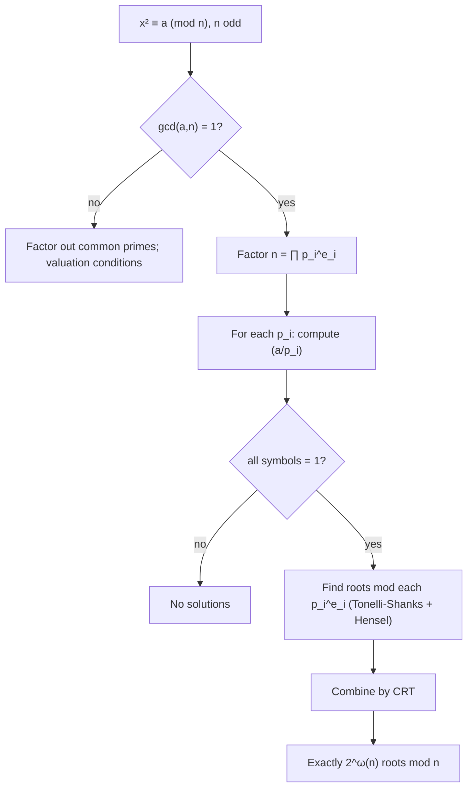

# Quadratic Residues and Reciprocity
> [Mathematics](../../README.md) › [Number Theory](../README.md) › Quadratic Residues and Reciprocity · Level: Advanced · Prerequisites: [Divisibility and Primes](../01-divisibility-and-primes/README.md), [Congruences](../02-congruences/README.md), [Proof Techniques](../../00-foundations/04-proof-techniques/README.md), [Mathematical Induction](../../09-discrete-mathematics/01-mathematical-induction/README.md) · Estimated time: 600 min

## 1. Introduction

Which integers are squares modulo a prime? For $p=7$ the nonzero squares are $1,2,4$; for $p=11$ they
are $1,3,4,5,9$. Exactly half of the nonzero residues are squares, but which half depends on $p$ in a
way that is far from obvious. The question "is $a$ a square modulo $p$?" is answered by the Legendre
symbol $\left(\frac{a}{p}\right)$, and the rules for computing that symbol form one of the most
beautiful and useful chapters of elementary number theory.

The central result is the law of quadratic reciprocity. For distinct odd primes $p$ and $q$,

$$ \left(\frac{p}{q}\right)\left(\frac{q}{p}\right) =(-1)^{\frac{p-1}{2}\cdot\frac{q-1}{2}}. $$

The two symbols ask questions about squares modulo different primes, yet their answers are locked
together by a simple sign depending only on the residues of $p$ and $q$ modulo $4$. Euler conjectured
the law, Legendre gave a conditional proof, and Gauss gave the first complete proof in 1796; he
returned to it repeatedly and produced several more. It is the first deep reciprocity law in number
theory and the model for the higher reciprocity laws of the nineteenth and twentieth centuries.

The applications are not merely historical. Quadratic reciprocity gives a fast algorithm for deciding
whether a congruence $x^2\equiv a\pmod p$ is solvable, and it underlies probabilistic primality tests,
the construction of finite fields of order $p^2$, and cryptographic systems whose security is tied to
the difficulty of deciding quadratic residuosity or extracting square roots.

This tutorial develops the theory from the definition of a quadratic residue through Euler's
criterion, Gauss's lemma, a complete proof of reciprocity using Eisenstein's lattice-point argument,
the supplementary laws, the Jacobi symbol, algorithms for solving quadratic congruences, and
applications. Every theorem is stated with its hypotheses: most results require an odd prime, and
several require coprimality.

## 2. Prerequisites

You should know the following material.

* **Divisibility and primes.** The division algorithm, greatest common divisors, Bézout's identity,
  Euclid's lemma, and unique factorisation. See
  [Divisibility and Primes](../01-divisibility-and-primes/README.md).
* **Congruences.** Modular arithmetic, residue classes, the Chinese remainder theorem, Fermat's little
  theorem, Euler's theorem, and the group of units modulo $n$. See [Congruences](../02-congruences/README.md).
* **Polynomials over fields.** A nonzero polynomial of degree $d$ over a field has at most $d$ roots.
  This is used in the proof of Euler's criterion.
* **Proof techniques.** Direct proof, contrapositive, contradiction, the pigeonhole principle, and
  induction. See [Proof Techniques](../../00-foundations/04-proof-techniques/README.md) and
  [Mathematical Induction](../../09-discrete-mathematics/01-mathematical-induction/README.md).
* **Counting.** Counting lattice points in a rectangle and counting residues in a reduced residue
  system.

No prior knowledge of algebraic number theory or character theory is assumed. The tutorial mentions
Dirichlet characters only in passing, in §12.

## 3. Learning Objectives

After working through this tutorial and the exercises you will be able to:

1. List the quadratic residues modulo a prime and count them.
2. Compute Legendre symbols using Euler's criterion, multiplicativity, and quadratic reciprocity.
3. State and prove Euler's criterion, Gauss's lemma, and the two supplementary laws.
4. Prove the law of quadratic reciprocity using Eisenstein's lemma and a lattice-point count.
5. Define the Jacobi symbol, compute it efficiently, and explain why $\left(\frac{a}{n}\right)=1$ does
   not imply that $a$ is a square modulo a composite $n$.
6. Decide whether $x^2\equiv a\pmod p$ is solvable and find the solutions using Tonelli-Shanks, Hensel
   lifting, and the Chinese remainder theorem.
7. Explain the use of quadratic residues in primality testing, finite-field construction, and
   cryptography.

## 4. Intuition

Squaring modulo $p$ folds the nonzero residues in half. The map $x\mapsto x^2$ sends $x$ and $-x$ to the
same value, and no other pair collides, because $x^2\equiv y^2$ means $(x-y)(x+y)\equiv0\pmod p$, so
$y\equiv x$ or $y\equiv -x$. Thus the $p-1$ nonzero residues are paired, and there are exactly
$(p-1)/2$ squares and $(p-1)/2$ nonsquares.

The hard question is not how many squares there are but which ones. For small primes one can list
them, but the list looks erratic. Quadratic reciprocity says that the answer for $a$ modulo $p$ is
controlled by the answer for $p$ modulo $a$, up to a sign that depends only on $p\bmod4$ and
$a\bmod4$. It is a surprising symmetry between two different moduli.

A useful analogy is a two-way mirror: to decide whether $p$ is a square modulo $q$, one may instead
decide whether $q$ is a square modulo $p$. The mirror flips the sign when both primes are $3$ modulo
$4$. This is why the symbol is often computed by a Euclidean algorithm that repeatedly flips and
reduces, much like the Euclidean algorithm for greatest common divisors.

The supplementary laws handle the two special bases $-1$ and $2$. The symbol $\left(\frac{-1}{p}\right)$
is $1$ exactly when $p\equiv1\pmod4$, and $\left(\frac{2}{p}\right)$ is $1$ exactly when
$p\equiv\pm1\pmod8$. These are the two cases where the general reciprocity law does not apply directly,
because $-1$ and $2$ are not odd primes.

## 5. Formal Definition

### 5.1 Quadratic residues modulo an integer
Let $n\ge1$ and let $a$ be an integer with $\gcd(a,n)=1$. We say that $a$ is a *quadratic residue
modulo $n$* if the congruence

$$ x^2\equiv a\pmod n $$

has a solution $x\in\mathbb{Z}$. If it has no solution, $a$ is a *quadratic non-residue modulo $n$*.
When $\gcd(a,n)>1$, the term is not used; the congruence may have solutions (for example $x^2\equiv0 \pmod p$ has $x\equiv0$) but the theory of the Legendre symbol assumes coprimality.

For a prime $p$, the nonzero quadratic residues are the elements of the subgroup of squares in the
multiplicative group $\mathbb{F}_p^\times$.

### 5.2 The Legendre symbol
Let $p$ be an odd prime and $a\in\mathbb{Z}$. The *Legendre symbol* is

$$ \left(\frac{a}{p}\right)= \begin{cases} 1, & \text{if }p\nmid a\text{ and }a\text{ is a quadratic residue modulo }p,\\ -1, & \text{if }p\nmid a\text{ and }a\text{ is a quadratic non-residue modulo }p,\\ 0, & \text{if }p\mid a. \end{cases} $$

The symbol is read "the Legendre symbol of $a$ over $p$". It takes only the values $-1,0,1$. The
notation resembles a fraction, but it is not a fraction; $a$ is the *numerator* and $p$ the
*denominator*.

### 5.3 The Jacobi symbol
Let $n\ge1$ be odd and let $n=\prod_{i=1}^{r}p_i^{e_i}$ be its prime factorisation. For any integer
$a$, the *Jacobi symbol* is

$$ \left(\frac{a}{n}\right)=\prod_{i=1}^{r}\left(\frac{a}{p_i}\right)^{e_i}, $$

with the convention $\left(\frac{a}{1}\right)=1$. When $n$ is prime, the Jacobi symbol equals the
Legendre symbol. When $n$ is composite, it is a product of Legendre symbols; it is not, in general, a
test for whether $a$ is a square modulo $n$.

### 5.4 Finite fields
For a prime $p$, $\mathbb{F}_p=\mathbb{Z}/p\mathbb{Z}$ is a field with $p$ elements. If $a$ is a
quadratic non-residue modulo $p$, the polynomial $T^2-a$ has no root in $\mathbb{F}_p$ and is
therefore irreducible of degree $2$. The quotient

$$ \mathbb{F}_{p^2}=\mathbb{F}_p[T]/(T^2-a) $$

is then a field with $p^2$ elements. This construction is developed in §7.9.

## 6. Mathematical Notation

| Symbol | Read as | Meaning |
|---|---|---|
| $a\equiv b\pmod n$ | $a$ is congruent to $b$ modulo $n$ | $n\mid(a-b)$ |
| $\gcd(a,b)$ | greatest common divisor | largest positive integer dividing both |
| $\mathbb{F}_p$ | the field with $p$ elements | $\mathbb{Z}/p\mathbb{Z}$ for prime $p$ |
| $\mathbb{F}_p^\times$ | the multiplicative group | nonzero elements of $\mathbb{F}_p$ |
| $\left(\frac{a}{p}\right)$ | Legendre symbol | $1$, $-1$, or $0$ as defined in §5.2 |
| $\left(\frac{a}{n}\right)$ | Jacobi symbol | product of Legendre symbols over prime factors |
| $p,q$ | odd primes | primes different from $2$ |
| $\lfloor x\rfloor$ | floor of $x$ | greatest integer $\le x$ |
| $\left(\frac{a}{p}\right)=1$ | $a$ is a square mod $p$ | solvable with $p\nmid a$ |
| $\left(\frac{a}{p}\right)=-1$ | $a$ is a nonsquare mod $p$ | not solvable, $p\nmid a$ |
| $\left(\frac{a}{p}\right)=0$ | $a$ is divisible by $p$ | degenerate case |
| $\operatorname{QR}_p$ | set of nonzero quadratic residues | $\{x^2\bmod p:x\not\equiv0\}$ |
| $\operatorname{QNR}_p$ | set of quadratic non-residues | $\mathbb{F}_p^\times\setminus\operatorname{QR}_p$ |
| $v_p(n)$ | $p$-adic valuation | exponent of $p$ in the prime factorisation of $n$ |
| $\omega(n)$ | number of distinct prime factors | used for counting roots modulo $n$ |

## 7. Core Concepts

### 7.1 Squares modulo a prime and their count
Let $p$ be an odd prime. The map

$$ \sigma:\mathbb{F}_p^\times\to\mathbb{F}_p^\times,\qquad \sigma(x)=x^2, $$

is a group homomorphism. Its kernel is $\{1,-1\}$, which has two elements because $p$ is odd: $-1\ne1$
in $\mathbb{F}_p$. By the first isomorphism theorem for finite groups, the image $\operatorname{QR}_p$
has size

$$ \lvert\operatorname{QR}_p\rvert =\frac{\lvert\mathbb{F}_p^\times\rvert}{\lvert\ker\sigma\rvert} =\frac{p-1}{2}. $$

Equivalently, every nonzero quadratic residue has exactly two square roots, $x$ and $-x$, and the
$(p-1)/2$ pairs partition the $p-1$ nonzero residues. If $0$ is included, there are $(p+1)/2$ squares
modulo $p$ counting $0$.

**Example.** For $p=11$ the squares of $1,\dots,10$ are

$$ 1,\ 4,\ 9,\ 16\equiv5,\ 25\equiv3,\ 36\equiv3,\ 49\equiv5,\ 64\equiv9,\ 81\equiv4,\ 100\equiv1, $$

so $\operatorname{QR}_{11}=\{1,3,4,5,9\}$ and
$\operatorname{QNR}_{11}=\{2,6,7,8,10\}$. Each residue in $\operatorname{QR}_{11}$ appears twice.

The product of two residues is a residue, the product of two non-residues is a residue, and the
product of a residue and a non-residue is a non-residue. These facts are the multiplicativity of the
Legendre symbol, proved in §7.3.

### 7.2 Euler's criterion
**Theorem 7.2.1 (Euler's criterion).** Let $p$ be an odd prime and let $a$ be an integer with
$p\nmid a$. Then

$$ a^{(p-1)/2}\equiv\left(\frac{a}{p}\right)\pmod p. $$

**Proof.** First suppose that $a$ is a quadratic residue, so $a\equiv x^2\pmod p$ for some $x$ with
$p\nmid x$. Fermat's little theorem gives $x^{p-1}\equiv1\pmod p$, hence

$$ a^{(p-1)/2}\equiv x^{p-1}\equiv1\pmod p. $$

Now suppose that $a$ is a non-residue. Fermat's little theorem gives $a^{p-1}\equiv1$, so

$$ \left(a^{(p-1)/2}\right)^2\equiv1\pmod p. $$

The polynomial $T^2-1=(T-1)(T+1)$ has only the roots $1$ and $-1$ in the field $\mathbb{F}_p$;
therefore $a^{(p-1)/2}\equiv1$ or $-1\pmod p$.

We must rule out the value $1$. Consider the polynomial $f(T)=T^{(p-1)/2}-1$ over $\mathbb{F}_p$. It
has degree $(p-1)/2$, so it has at most $(p-1)/2$ roots in the field. Every nonzero quadratic residue
is a root, because if $a\equiv x^2$ then $a^{(p-1)/2}\equiv x^{p-1}\equiv1$. There are exactly
$(p-1)/2$ nonzero residues, so they are *all* the roots of $f$. A non-residue is not among them, so
$a^{(p-1)/2}\not\equiv1$. Hence $a^{(p-1)/2}\equiv-1$.

In both cases the integer $a^{(p-1)/2}$ is congruent modulo $p$ to the Legendre symbol, which is $1$
or $-1$. Since $p$ is odd, the congruence determines the sign. $\blacksquare$

Euler's criterion converts a question about squares into an exponentiation. It is theoretically
important but computationally inefficient for large $p$ if done by repeated multiplication without
fast exponentiation; with binary exponentiation it takes $O(\log p)$ multiplications modulo $p$.

### 7.3 Properties of the Legendre symbol
**Theorem 7.3.1 (Multiplicativity).** Let $p$ be an odd prime and let $a,b\in\mathbb{Z}$. Then

$$ \left(\frac{ab}{p}\right)=\left(\frac{a}{p}\right)\left(\frac{b}{p}\right). $$

**Proof.** If $p\mid a$ or $p\mid b$, both sides are $0$. Otherwise Euler's criterion gives

$$ \left(\frac{ab}{p}\right) \equiv(ab)^{(p-1)/2} =a^{(p-1)/2}b^{(p-1)/2} \equiv\left(\frac{a}{p}\right)\left(\frac{b}{p}\right)\pmod p. $$

Both sides are in $\{-1,1\}$ and $p$ is odd, so congruence implies equality. $\blacksquare$

Consequences, all for an odd prime $p$ and integers $a,b$:

1. $\left(\frac{a}{p}\right)$ depends only on $a\bmod p$.
2. $\left(\frac{a^2}{p}\right)=1$ whenever $p\nmid a$.
3. $\left(\frac{1}{p}\right)=1$.
4. If $a\equiv b\pmod p$, then $\left(\frac{a}{p}\right)=\left(\frac{b}{p}\right)$.
5. $\left(\frac{ab^2}{p}\right)=\left(\frac{a}{p}\right)$ whenever $p\nmid b$.
6. Exactly half of the nonzero residue classes are quadratic residues, so

$$ \sum_{a=1}^{p-1}\left(\frac{a}{p}\right)=0. $$

The first supplementary law is a special case of Euler's criterion.

**Theorem 7.3.2 (First supplementary law).** For an odd prime $p$,

$$ \left(\frac{-1}{p}\right)=(-1)^{(p-1)/2}= \begin{cases} 1, & p\equiv1\pmod4,\\ -1, & p\equiv3\pmod4. \end{cases} $$

**Proof.** By Euler's criterion, $\left(\frac{-1}{p}\right)\equiv(-1)^{(p-1)/2}\pmod p$. Both sides are
$\pm1$ and $p$ is odd, so they are equal. The exponent $(p-1)/2$ is even exactly when $p\equiv1\pmod4$.
$\blacksquare$

Thus $-1$ is a square modulo $p$ exactly for primes congruent to $1$ modulo $4$. For example,
$5^2=25\equiv-1\pmod{13}$, while no square modulo $7$ equals $6$.

### 7.4 Gauss's lemma
**Theorem 7.4.1 (Gauss's lemma).** Let $p$ be an odd prime and let $a$ be an integer with $p\nmid a$.
For $i=1,2,\dots,(p-1)/2$, let $r_i$ be the least positive residue of $ai$ modulo $p$. Let

$$ m=\#\left\{i:1\le i\le\frac{p-1}{2},\ r_i>\frac p2\right\}. $$

Then

$$ \left(\frac{a}{p}\right)=(-1)^m. $$

**Proof.** For each $i$, set $s_i=\min(r_i,p-r_i)$. Thus $s_i\in\{1,\dots,(p-1)/2\}$, and
$s_i=r_i$ when $r_i<p/2$, while $s_i=p-r_i$ when $r_i>p/2$. The value $r_i=p/2$ is impossible because
$p$ is odd and $r_i$ is an integer.

The $s_i$ are pairwise distinct. Indeed, if $s_i=s_j$, then $r_i\equiv r_j$ or $r_i\equiv-r_j\pmod p$,
so $ai\equiv aj$ or $ai\equiv-aj\pmod p$. In the first case $i\equiv j\pmod p$, and since
$1\le i,j\le(p-1)/2<p$, this gives $i=j$. In the second case $a(i+j)\equiv0\pmod p$, and since
$p\nmid a$, we get $p\mid(i+j)$. But $2\le i+j\le p-1$, a contradiction. Hence the $s_i$ are
$(p-1)/2$ distinct integers in a set of size $(p-1)/2$, so they are a permutation of
$\{1,\dots,(p-1)/2\}$.

Taking products,

$$ \prod_{i=1}^{(p-1)/2}r_i \equiv a^{(p-1)/2}\left(\frac{p-1}{2}\right)!\pmod p. $$

On the other hand, each sign change $r_i\mapsto p-r_i$ contributes a factor $(-1)$, so

$$ \prod_{i=1}^{(p-1)/2}r_i =(-1)^m\prod_{i=1}^{(p-1)/2}s_i =(-1)^m\left(\frac{p-1}{2}\right)!\pmod p. $$

The factorial $\left(\frac{p-1}{2}\right)!$ is not divisible by $p$, so it is invertible modulo $p$.
Cancelling it gives

$$ a^{(p-1)/2}\equiv(-1)^m\pmod p. $$

Euler's criterion identifies $a^{(p-1)/2}$ with $\left(\frac{a}{p}\right)$, so
$\left(\frac{a}{p}\right)=(-1)^m$. $\blacksquare$

**Example.** For $p=13$ and $a=3$, the least positive residues of $3,6,9,12,15,18$ are
$3,6,9,12,2,5$. The values exceeding $13/2=6.5$ are $9$ and $12$, so $m=2$ and
$\left(\frac{3}{13}\right)=1$. Indeed $4^2=16\equiv3\pmod{13}$.

### 7.5 Eisenstein's lemma
The following refinement of Gauss's lemma replaces the count of large residues by a sum of floors. It
is the key to the lattice-point proof of quadratic reciprocity.

**Lemma 7.5.1 (Eisenstein's lemma).** Let $p$ be an odd prime and let $a$ be an odd integer with
$p\nmid a$. For $i=1,\dots,(p-1)/2$, write $ai=pq_i+r_i$ with $1\le r_i\le p-1$, so
$q_i=\lfloor ai/p\rfloor$. Then

$$ \left(\frac{a}{p}\right)=(-1)^{\sum_{i=1}^{(p-1)/2}q_i}. $$

**Proof.** Let $m$ be the number of $i$ with $r_i>p/2$, so that Gauss's lemma gives
$\left(\frac{a}{p}\right)=(-1)^m$. We show that $\sum_i q_i\equiv m\pmod2$.

Let $s_i=\min(r_i,p-r_i)$ and let $\varepsilon_i=1$ if $r_i>p/2$, and $\varepsilon_i=0$ otherwise.
From the proof of Gauss's lemma, the $s_i$ are a permutation of $\{1,\dots,(p-1)/2\}$. Since $a$ and
$p$ are odd,

$$ r_i=ai-pq_i\equiv i-q_i\equiv i+q_i\pmod2. $$

If $r_i<p/2$, then $r_i=s_i$. If $r_i>p/2$, then $r_i=p-s_i\equiv1-s_i\equiv1+s_i\pmod2$. In both
cases,

$$ r_i\equiv s_i+\varepsilon_i\pmod2. $$

Summing over $i$ and using that the $s_i$ are a permutation of $1,\dots,(p-1)/2$,

$$ \sum_i r_i\equiv\sum_i s_i+\sum_i\varepsilon_i \equiv\sum_i i+m\pmod2. $$

On the other hand, summing $ai=pq_i+r_i$ gives

$$ p\sum_i q_i=a\sum_i i-\sum_i r_i. $$

Reducing modulo $2$ (where $p\equiv a\equiv1$) yields

$$ \sum_i q_i\equiv\sum_i i-\sum_i r_i \equiv\sum_i i-\left(\sum_i i+m\right) \equiv-m\equiv m\pmod2. $$

Therefore $(-1)^{\sum_i q_i}=(-1)^m=\left(\frac{a}{p}\right)$. $\blacksquare$

### 7.6 The law of quadratic reciprocity
**Theorem 7.6.1 (Law of quadratic reciprocity).** Let $p$ and $q$ be distinct odd primes. Then

$$ \left(\frac{p}{q}\right)\left(\frac{q}{p}\right) =(-1)^{\frac{p-1}{2}\cdot\frac{q-1}{2}}. $$

Equivalently,

$$ \left(\frac{p}{q}\right)= \begin{cases} \left(\frac{q}{p}\right), & \text{if }p\equiv1\pmod4\text{ or }q\equiv1\pmod4,\\[4pt] -\left(\frac{q}{p}\right), & \text{if }p\equiv q\equiv3\pmod4. \end{cases} $$

**Proof.** Consider the rectangle

$$ R=\left\{(x,y)\in\mathbb{Z}^2: 1\le x\le\frac{p-1}{2},\ 1\le y\le\frac{q-1}{2}\right\}. $$

It contains $\frac{p-1}{2}\cdot\frac{q-1}{2}$ lattice points. No point of $R$ lies on the line
$q x=p y$: if $p\mid qx$, then $p\mid x$, but $1\le x\le(p-1)/2<p$.

Count the points below the line $q x>p y$. For a fixed $x$, the available $y$ satisfy
$1\le y< qx/p$, so the number is $\lfloor qx/p\rfloor$; this is at most $(q-1)/2$ because
$qx/p<q/2$. Hence the number of points below the line is

$$ S(q,p)=\sum_{x=1}^{(p-1)/2}\left\lfloor\frac{qx}{p}\right\rfloor. $$

Similarly, the number of points above the line is

$$ S(p,q)=\sum_{y=1}^{(q-1)/2}\left\lfloor\frac{py}{q}\right\rfloor. $$

Since every point is either above or below the line and none is on it,

$$ S(q,p)+S(p,q)=\frac{p-1}{2}\cdot\frac{q-1}{2}. $$

Now apply Eisenstein's lemma twice. Because $p$ and $q$ are odd,

$$ \left(\frac{q}{p}\right)=(-1)^{S(q,p)}, \qquad \left(\frac{p}{q}\right)=(-1)^{S(p,q)}. $$

Multiplying,

$$ \left(\frac{p}{q}\right)\left(\frac{q}{p}\right) =(-1)^{S(q,p)+S(p,q)} =(-1)^{\frac{p-1}{2}\cdot\frac{q-1}{2}}. $$

This is the law. $\blacksquare$

The exponent $\frac{p-1}{2}\cdot\frac{q-1}{2}$ is odd exactly when both $(p-1)/2$ and $(q-1)/2$ are
odd, that is, exactly when $p\equiv q\equiv3\pmod4$. In all other cases the symbols agree.

**Example.** $\left(\frac{17}{23}\right)=\left(\frac{23}{17}\right)$ because $17\equiv1\pmod4$.
Since $23\equiv6\pmod{17}$,
$\left(\frac{17}{23}\right)=\left(\frac{6}{17}\right) =\left(\frac{2}{17}\right)\left(\frac{3}{17}\right)=1\cdot(-1)=-1$.
The last two values follow from the supplementary law for $2$ and from direct listing of the squares
modulo $17$.

### 7.7 The supplementary law for 2
**Theorem 7.7.1 (Second supplementary law).** For an odd prime $p$,

$$ \left(\frac{2}{p}\right)=(-1)^{(p^2-1)/8}= \begin{cases} 1, & p\equiv1\text{ or }7\pmod8,\\ -1, & p\equiv3\text{ or }5\pmod8. \end{cases} $$

**Proof.** Apply Gauss's lemma with $a=2$. For $1\le j\le(p-1)/2$, the least positive residue of $2j$
is $2j$ itself, because $2j\le p-1<p$. Thus $m$ is the number of $j$ with $2j>p/2$, that is,
$j>p/4$. Hence

$$ m=\left\lfloor\frac{p-1}{2}\right\rfloor-\left\lfloor\frac p4\right\rfloor. $$

Write $p=8k+r$ with $r\in\{1,3,5,7\}$. The four cases are:

| $p$ | $\lfloor(p-1)/2\rfloor$ | $\lfloor p/4\rfloor$ | $m$ | parity |
|---|---|---|---|---|
| $8k+1$ | $4k$ | $2k$ | $2k$ | even |
| $8k+3$ | $4k+1$ | $2k$ | $2k+1$ | odd |
| $8k+5$ | $4k+2$ | $2k+1$ | $2k+1$ | odd |
| $8k+7$ | $4k+3$ | $2k+1$ | $2k+2$ | even |

Therefore $\left(\frac{2}{p}\right)=(-1)^m$ is $1$ exactly for $p\equiv1,7\pmod8$. The identity
$(-1)^{(p^2-1)/8}$ gives the same sign, since $(p^2-1)/8$ is even exactly in those two cases.
$\blacksquare$

For example, $\left(\frac{2}{17}\right)=1$ because $17\equiv1\pmod8$, and indeed $6^2=36\equiv2 \pmod{17}$. Also $\left(\frac{2}{7}\right)=1$ because $7\equiv7\pmod8$, and $3^2=9\equiv2\pmod7$.

### 7.8 The Jacobi symbol
The Jacobi symbol extends the Legendre symbol to odd composite denominators. It is computable by the
same reciprocity algorithm and is indispensable in primality testing, but its interpretation is
weaker.

**Definition 7.8.1.** Let $n\ge1$ be odd, with prime factorisation $n=\prod_{i=1}^{r}p_i^{e_i}$, and
let $a\in\mathbb{Z}$. Then

$$ \left(\frac{a}{n}\right)=\prod_{i=1}^{r}\left(\frac{a}{p_i}\right)^{e_i}, \qquad \left(\frac{a}{1}\right)=1. $$

**Theorem 7.8.2 (Properties).** Let $m,n$ be positive odd integers and let $a,b\in\mathbb{Z}$. Then:

1. $\left(\frac{ab}{n}\right)=\left(\frac{a}{n}\right)\left(\frac{b}{n}\right)$.
2. $\left(\frac{a}{mn}\right)=\left(\frac{a}{m}\right)\left(\frac{a}{n}\right)$.
3. $\left(\frac{a}{n}\right)$ depends only on $a\bmod n$.
4. If $\gcd(a,n)>1$, then $\left(\frac{a}{n}\right)=0$.
5. If $\gcd(a,n)=1$, then $\left(\frac{a^2}{n}\right)=1$.
6. $\left(\frac{-1}{n}\right)=(-1)^{(n-1)/2}$ and
   $\left(\frac{2}{n}\right)=(-1)^{(n^2-1)/8}$.
7. If $\gcd(m,n)=1$, then
$$ \left(\frac{m}{n}\right)\left(\frac{n}{m}\right) =(-1)^{\frac{m-1}{2}\cdot\frac{n-1}{2}}. $$

**Proof.** Parts 1–3 and 5 follow immediately from the definition and the corresponding properties of
the Legendre symbol. Part 4 follows because if a prime $p_i\mid n$ also divides $a$, the factor
$\left(\frac{a}{p_i}\right)$ is $0$. Part 6 follows by applying the Legendre supplementary laws to
each prime factor and using the identities

$$ \frac{n-1}{2}\equiv\sum_i e_i\frac{p_i-1}{2}\pmod2, \qquad \frac{n^2-1}{8}\equiv\sum_i e_i\frac{p_i^2-1}{8}\pmod2, $$

which hold for odd $n=\prod_i p_i^{e_i}$.

For part 7, write $m=\prod_i p_i^{a_i}$ and $n=\prod_j q_j^{b_j}$. Multiplicativity gives

$$ \left(\frac{m}{n}\right)\left(\frac{n}{m}\right) =\prod_{i,j}\left[\left(\frac{p_i}{q_j}\right)\left(\frac{q_j}{p_i}\right)\right]^{a_i b_j}. $$

By quadratic reciprocity for primes, the bracket is
$(-1)^{((p_i-1)/2)((q_j-1)/2)}$. Therefore

$$ \left(\frac{m}{n}\right)\left(\frac{n}{m}\right) =(-1)^{\left(\sum_i a_i\frac{p_i-1}{2}\right)\left(\sum_j b_j\frac{q_j-1}{2}\right)} =(-1)^{\frac{m-1}{2}\cdot\frac{n-1}{2}}, $$

using the parity identity above for $m$ and $n$. $\blacksquare$

**Euler's criterion fails for composite denominators.** For $n=9$ and $a=2$,
$\left(\frac{2}{9}\right)=\left(\frac{2}{3}\right)^2=1$, but

$$ 2^{(9-1)/2}=2^4=16\equiv7\not\equiv1\pmod9. $$

So the Jacobi symbol is not generally equal to $a^{(n-1)/2}$ modulo $n$.

**A Jacobi symbol of $1$ does not imply a square.** For $n=15$,

$$ \left(\frac{2}{15}\right)=\left(\frac{2}{3}\right)\left(\frac{2}{5}\right)=(-1)(-1)=1. $$

But the squares modulo $15$ are $0,1,4,6,9,10$, so $2$ is not a square modulo $15$. The implication
that does hold is one-directional: if $\left(\frac{a}{n}\right)=-1$, then $a$ is certainly not a
square modulo $n$, because a square would have Legendre symbol $1$ at every prime factor. If
$\left(\frac{a}{n}\right)=1$, further work is needed.

### 7.9 Solving quadratic congruences
#### Prime modulus
Let $p$ be an odd prime and $a$ an integer.

* If $p\mid a$, then $x^2\equiv a\pmod p$ is $x^2\equiv0$, whose only solution is $x\equiv0\pmod p$.
* If $p\nmid a$, the congruence is solvable exactly when $\left(\frac{a}{p}\right)=1$. In that case
  there are exactly two solutions, $x$ and $-x$ modulo $p$.

For small $p$, trial squaring finds the roots. For large $p$, Tonelli-Shanks is the standard
algorithm.

**Algorithm 7.9.1 (Tonelli-Shanks).** Input: an odd prime $p$ and a quadratic residue $a$ modulo $p$.
Write $p-1=Q2^S$ with $Q$ odd. Find $z$ with $\left(\frac{z}{p}\right)=-1$. Set

$$ M=S,\qquad c=z^Q,\qquad t=a^Q,\qquad R=a^{(Q+1)/2}\pmod p. $$

While $t\not\equiv1\pmod p$:

1. Find the least $i$ with $1\le i<M$ and $t^{2^i}\equiv1\pmod p$.
2. Set $b=c^{2^{M-i-1}}$, $M=i$, $c=b^2$, $t=tc$, $R=Rb$ modulo $p$.

Return $R$ and $-R$. The invariants are $R^2\equiv at$, $t^{2^M}\equiv1$, and $c$ has order $2^M$;
they imply termination with $t=1$ and $R^2\equiv a$. The loop runs at most $S$ times, and each step
uses fast exponentiation, so the algorithm is polynomial in $\log p$.

**Example.** For $p=29$ and $a=5$, $p-1=28=7\cdot2^2$, so $Q=7$ and $S=2$. The element $z=2$ is a
non-residue because $29\equiv5\pmod8$. Then $c=2^7\equiv12$, $t=5^7\equiv-1$, and $R=5^4\equiv16$.
The loop produces $i=1$, $b=12$, $M=1$, $c\equiv-1$, $t\equiv1$, $R\equiv18$. The roots are
$\pm18\equiv11,18\pmod{29}$. Check: $18^2=324=11\cdot29+5$.

#### Prime-power modulus
**Lemma 7.9.2 (Hensel lifting).** Let $p$ be an odd prime, let $k\ge1$, and suppose $\gcd(a,p)=1$.
If $r^2\equiv a\pmod{p^k}$, then there is a unique $t\pmod p$ such that

$$ r'=r+tp^k $$

satisfies $(r')^2\equiv a\pmod{p^{k+1}}$. It is given by

$$ t\equiv\frac{a-r^2}{p^k}\cdot(2r)^{-1}\pmod p. $$

**Proof.** Expand:

$$ (r+tp^k)^2=r^2+2rtp^k+t^2p^{2k}\equiv r^2+2rtp^k\pmod{p^{k+1}}. $$

We need $2rtp^k\equiv a-r^2\pmod{p^{k+1}}$. Divide by $p^k$:

$$ 2rt\equiv\frac{a-r^2}{p^k}\pmod p. $$

Since $p$ is odd and $p\nmid r$, the factor $2r$ is invertible modulo $p$, so $t$ exists and is unique
modulo $p$. $\blacksquare$

Starting from the two roots modulo $p$, Hensel lifting produces exactly two roots modulo $p^k$ for
every $k\ge1$ when $p\nmid a$. If $p\mid a$, write $a=p^e u$ with $p\nmid u$. If $e\ge k$, then
$a\equiv0\pmod{p^k}$ and the solutions are the multiples of $p^{\lceil k/2\rceil}$. If $e<k$ and $e$
is odd, there are no solutions, because the valuation of a square is even. If $e<k$ and $e$ is even,
write $x=p^{e/2}y$; then the congruence is equivalent to $y^2\equiv u\pmod{p^{k-e}}$ with
$\gcd(y,p)=1$.

#### Composite modulus
Let $n=\prod_{i=1}^{r}p_i^{e_i}$ be odd. By the Chinese remainder theorem, solving
$x^2\equiv a\pmod n$ is equivalent to solving $x^2\equiv a\pmod{p_i^{e_i}}$ simultaneously. If any
local congruence has no solution, the global one has none. If all are solvable and $\gcd(a,n)=1$,
each prime power contributes exactly two roots, so there are exactly

$$ 2^{r}=2^{\omega(n)} $$

solutions modulo $n$. They are recovered by combining the local roots with the Chinese remainder
theorem.

For even $n$, the factor $2^k$ must be handled separately; when $a$ is odd, the number of roots
modulo $2^k$ is $0,1,2$, or $4$, depending on $k$ and on $a$ modulo $8$ (Exercise 36).

**Example.** For $n=35=5\cdot7$ and $a=16$, the local congruences are $x^2\equiv1\pmod5$ and
$x^2\equiv2\pmod7$. Their roots are $x\equiv\pm1\pmod5$ and $x\equiv\pm3\pmod7$. Combining gives four
roots modulo $35$:

$$ x\equiv4,\ 11,\ 24,\ 31\pmod{35}. $$

Indeed $4^2=16$, $11^2=121\equiv16$, $24^2=576\equiv16$, and $31^2=961\equiv16$ modulo $35$. Note that
$\left(\frac{16}{35}\right)=1$ and a square genuinely exists; the Jacobi symbol alone would not have
proved this.

### 7.10 Applications
**Primality testing.** The Solovay-Strassen test uses Euler's criterion in the form

$$ a^{(n-1)/2}\equiv\left(\frac{a}{n}\right)\pmod n. $$

If $n$ is prime and $\gcd(a,n)=1$, the congruence holds by Euler's criterion. If $n$ is composite and
the congruence fails for some $a$, then $n$ is certainly composite. If it holds, $n$ is called an
*Euler pseudoprime to base $a$*; the test repeats for random bases. The Miller-Rabin test is a
stronger variant that avoids some of the weaknesses of Euler pseudoprimes. These tests are
probabilistic, not proofs of primality.

**Construction of finite fields.** If $a$ is a quadratic non-residue modulo an odd prime $p$, then
$T^2-a$ is irreducible over $\mathbb{F}_p$, and
$\mathbb{F}_{p^2}=\mathbb{F}_p[T]/(T^2-a)$ is a field with $p^2$ elements. Every element has a unique
representation $u+v\sqrt a$ with $u,v\in\mathbb{F}_p$, and multiplication uses
$\sqrt a^{\,2}=a$. For $p\equiv3\pmod4$, $-1$ is a non-residue, so $T^2+1$ is irreducible and
$\mathbb{F}_{p^2}=\mathbb{F}_p[i]$. Quadratic reciprocity tells us which $a$ work: exactly the
non-residues, which are half of the nonzero classes.

**Cryptography.** The Rabin cryptosystem encrypts a message $m$ as $c\equiv m^2\pmod n$ with
$n=pq$. Decryption requires square roots modulo $n$, which is equivalent to factoring $n$ for
suitable primes. The quadratic residuosity assumption — distinguishing squares from nonsquares modulo
a composite $n$ is hard — underlies the Goldwasser-Micali encryption scheme and other cryptographic
constructions. Tonelli-Shanks and Hensel lifting are used to extract roots when the factorisation is
known, and the Jacobi symbol is used in primality testing and in the generation of Blum integers.

**Quadratic forms and character sums.** The Legendre symbol is the simplest nontrivial Dirichlet
character modulo $p$. Sums such as $\sum_{a=1}^{p-1}\left(\frac{a}{p}\right)e^{2\pi i a/p}$ are
quadratic Gauss sums; their evaluation is a gateway to the analytic theory of $L$-functions and to
the representation of integers by quadratic forms.

**Factoring.** The quadratic sieve and the number field sieve look for congruences $x^2\equiv y^2 \pmod n$ with $x\not\equiv\pm y$; then $\gcd(x-y,n)$ has a chance of revealing a factor. Quadratic
residues are the language in which these algorithms are described.

## 8. Formulas and Properties

All statements below assume $p$ and $q$ are odd primes, and coprimality where indicated.

### 8.1 The Legendre symbol
$$ \left(\frac{a}{p}\right)= \begin{cases} 1, & a\text{ is a nonzero square mod }p,\\ -1, & a\text{ is a nonsquare mod }p,\\ 0, & p\mid a. \end{cases} $$

Euler's criterion (for $p\nmid a$): $a^{(p-1)/2}\equiv\left(\frac{a}{p}\right)\pmod p$.

### 8.2 Multiplicativity and reduction
$$ \left(\frac{ab}{p}\right)=\left(\frac{a}{p}\right)\left(\frac{b}{p}\right), \qquad \left(\frac{a+p}{p}\right)=\left(\frac{a}{p}\right), \qquad \left(\frac{a^2}{p}\right)=1\quad(p\nmid a). $$

### 8.3 Supplementary laws
$$ \left(\frac{-1}{p}\right)=(-1)^{(p-1)/2}, \qquad \left(\frac{2}{p}\right)=(-1)^{(p^2-1)/8}. $$

The first is $1$ exactly for $p\equiv1\pmod4$; the second is $1$ exactly for $p\equiv\pm1\pmod8$.

### 8.4 Quadratic reciprocity
For distinct odd primes $p,q$,

$$ \left(\frac{p}{q}\right)\left(\frac{q}{p}\right) =(-1)^{\frac{p-1}{2}\cdot\frac{q-1}{2}}. $$

The sign is $-1$ exactly when $p\equiv q\equiv3\pmod4$.

### 8.5 Gauss and Eisenstein
Gauss's lemma: with $m$ the number of least positive residues of $a,2a,\dots,\frac{p-1}{2}a$ that
exceed $p/2$, $\left(\frac{a}{p}\right)=(-1)^m$.

Eisenstein's lemma: for odd $a$ with $p\nmid a$,

$$ \left(\frac{a}{p}\right)=(-1)^{\sum_{i=1}^{(p-1)/2}\lfloor ai/p\rfloor}. $$

### 8.6 Jacobi symbol
For odd positive $m,n$:

$$ \left(\frac{ab}{n}\right)=\left(\frac{a}{n}\right)\left(\frac{b}{n}\right), \qquad \left(\frac{a}{mn}\right)=\left(\frac{a}{m}\right)\left(\frac{a}{n}\right), $$

$$ \left(\frac{-1}{n}\right)=(-1)^{(n-1)/2}, \qquad \left(\frac{2}{n}\right)=(-1)^{(n^2-1)/8}, $$

and, if $\gcd(m,n)=1$,

$$ \left(\frac{m}{n}\right)\left(\frac{n}{m}\right) =(-1)^{\frac{m-1}{2}\cdot\frac{n-1}{2}}. $$

### 8.7 Solvability and counting
For odd $n=\prod p_i^{e_i}$ and $\gcd(a,n)=1$, the congruence $x^2\equiv a\pmod n$ is solvable if and
only if $\left(\frac{a}{p_i}\right)=1$ for every $i$. When solvable, it has exactly $2^{\omega(n)}$
solutions modulo $n$. For an odd prime power $p^k$ with $p\nmid a$, the number is exactly $2$ when
solvable.

## 9. Step-by-Step Examples

### Example 9.1: Listing residues modulo 19
List the nonzero quadratic residues modulo $19$, count them, and identify the non-residues.

**Solution.** Square $1,\dots,9$ (the pairs $x$ and $19-x$ give the same square):

$$ 1^2=1,\quad 2^2=4,\quad 3^2=9,\quad 4^2=16,\quad 5^2=25\equiv6, $$
$$ 6^2=36\equiv17,\quad 7^2=49\equiv11,\quad 8^2=64\equiv7,\quad 9^2=81\equiv5. $$

Thus

$$ \operatorname{QR}_{19}=\{1,4,5,6,7,9,11,16,17\}, $$

which has $9=(19-1)/2$ elements. The non-residues are

$$ \operatorname{QNR}_{19}=\{2,3,8,10,12,13,14,15,18\}. $$

Each residue has two roots, $x$ and $19-x$; for example, $5$ has roots $9$ and $10$, since
$9^2=81\equiv5$ and $10^2=100\equiv5$.

### Example 9.2: Euler's criterion for $\left(\frac{5}{17}\right)$
Compute $\left(\frac{5}{17}\right)$ using Euler's criterion, and check the answer by listing squares.

**Solution.** Since $(17-1)/2=8$,

$$ 5^2=25\equiv8,\qquad 5^4\equiv8^2=64\equiv13,\qquad 5^8\equiv13^2=169\equiv16\equiv-1. $$

By Euler's criterion, $\left(\frac{5}{17}\right)=-1$. The squares modulo $17$ are

$$ 1,4,9,16,8,2,15,13, $$

and $5$ is not among them, confirming the result.

### Example 9.3: Gauss's lemma for $\left(\frac{6}{17}\right)$
Use Gauss's lemma to compute $\left(\frac{6}{17}\right)$.

**Solution.** The least positive residues of $6j$ for $j=1,\dots,8$ are

$$ 6,\ 12,\ 18\equiv1,\ 24\equiv7,\ 30\equiv13,\ 36\equiv2,\ 42\equiv8,\ 48\equiv14. $$

The values exceeding $17/2=8.5$ are $12,13,14$, so $m=3$. By Gauss's lemma,
$\left(\frac{6}{17}\right)=(-1)^3=-1$. This agrees with multiplicativity:
$\left(\frac{6}{17}\right)=\left(\frac{2}{17}\right)\left(\frac{3}{17}\right)=1\cdot(-1)=-1$,
because $17\equiv1\pmod8$ and $3$ is not a square modulo $17$.

### Example 9.4: Reciprocity for $\left(\frac{17}{23}\right)$
Compute $\left(\frac{17}{23}\right)$ using quadratic reciprocity and the supplementary laws.

**Solution.** Since $17\equiv1\pmod4$, reciprocity gives

$$ \left(\frac{17}{23}\right)=\left(\frac{23}{17}\right) =\left(\frac{6}{17}\right). $$

By multiplicativity,

$$ \left(\frac{6}{17}\right)=\left(\frac{2}{17}\right)\left(\frac{3}{17}\right). $$

Now $17\equiv1\pmod8$, so $\left(\frac{2}{17}\right)=1$. For $3$, use reciprocity again:
$3\equiv3\pmod4$ and $17\equiv1\pmod4$, so

$$ \left(\frac{3}{17}\right)=\left(\frac{17}{3}\right)=\left(\frac{2}{3}\right)=-1. $$

Therefore $\left(\frac{17}{23}\right)=1\cdot(-1)=-1$. A direct check is possible but tedious:
the squares modulo $23$ are $1,4,9,16,2,13,3,18,12,8,6$, and $17$ is not among them.

### Example 9.5: Solving $x^2\equiv5\pmod{29}$ by Tonelli-Shanks
Solve $x^2\equiv5\pmod{29}$.

**Solution.** First check solvability. Since $29\equiv5\pmod8$, $\left(\frac{2}{29}\right)=-1$, so
$2$ is a non-residue. By Euler's criterion,

$$ 5^{14}\equiv1\pmod{29} $$

(one can verify $5^2\equiv-4$, $5^4\equiv16$, $5^7\equiv-1$, $5^{14}\equiv1$), so $5$ is a residue.

Write $p-1=28=7\cdot2^2$, so $Q=7$, $S=2$. Take $z=2$. Then

$$ c=z^Q=2^7=128\equiv12,\qquad t=a^Q=5^7\equiv-1,\qquad R=a^{(Q+1)/2}=5^4=625\equiv16. $$

Since $t\not\equiv1$, find the least $i$ with $t^{2^i}\equiv1$. We have $t=-1$, so $i=1$. Then

$$ b=c^{2^{M-i-1}}=c^{2^{0}}=12, \qquad M=1,\quad c=b^2=144\equiv-1,\quad t=tc\equiv1,\quad R=Rb=16\cdot12=192\equiv18. $$

The roots are $R$ and $-R$, that is, $18$ and $11$ modulo $29$. Check:
$18^2=324=11\cdot29+5$, and $11^2=121=4\cdot29+5$.

### Example 9.6: A Jacobi symbol computation
Compute $\left(\frac{1001}{9907}\right)$, where $1001=7\cdot11\cdot13$.

**Solution.** By multiplicativity in the numerator,

$$ \left(\frac{1001}{9907}\right) =\left(\frac{7}{9907}\right)\left(\frac{11}{9907}\right)\left(\frac{13}{9907}\right). $$

For $7$: both $7$ and $9907$ are $3$ modulo $4$, so reciprocity introduces a minus sign:

$$ \left(\frac{7}{9907}\right) =-\left(\frac{9907}{7}\right) =-\left(\frac{2}{7}\right)=-1, $$

because $9907\equiv2\pmod7$ and $2$ is a square modulo $7$ ($3^2=9\equiv2$).

For $11$: both are $3$ modulo $4$, so

$$ \left(\frac{11}{9907}\right) =-\left(\frac{9907}{11}\right) =-\left(\frac{7}{11}\right)=-(-1)=1, $$

because $9907=11\cdot900+7$ and $7$ is not a square modulo $11$.

For $13$: $13\equiv1\pmod4$, so

$$ \left(\frac{13}{9907}\right) =\left(\frac{9907}{13}\right) =\left(\frac{1}{13}\right)=1, $$

because $9907=13\cdot762+1$. Therefore

$$ \left(\frac{1001}{9907}\right)=(-1)(1)(1)=-1. $$

The Jacobi symbol is $-1$, so $1001$ is certainly not a square modulo $9907$ (whether or not $9907$ is
prime).

### Example 9.7: Solving $x^2\equiv16\pmod{35}$
Solve $x^2\equiv16\pmod{35}$.

**Solution.** Since $35=5\cdot7$ and $\gcd(16,35)=1$, solve modulo $5$ and modulo $7$. Modulo $5$,
$x^2\equiv1$, so $x\equiv\pm1\pmod5$. Modulo $7$, $x^2\equiv2$, and the squares modulo $7$ are
$1,4,2$, so $x\equiv\pm3\pmod7$ (since $3^2=9\equiv2$ and $4^2=16\equiv2$).

Now combine the four pairs with the Chinese remainder theorem:

* $x\equiv1\pmod5$, $x\equiv3\pmod7$: $x=1+5k$, so $1+5k\equiv3\pmod7$, $5k\equiv2\pmod7$,
  $k\equiv6\pmod7$, giving $x\equiv31\pmod{35}$.
* $x\equiv1\pmod5$, $x\equiv4\pmod7$: similarly $k\equiv2\pmod7$, giving $x\equiv11\pmod{35}$.
* $x\equiv4\pmod5$, $x\equiv3\pmod7$: $4+5k\equiv3\pmod7$, $5k\equiv6\pmod7$, $k\equiv4\pmod7$,
  giving $x\equiv24\pmod{35}$.
* $x\equiv4\pmod5$, $x\equiv4\pmod7$: $k\equiv0\pmod7$, giving $x\equiv4\pmod{35}$.

The four roots are $4,11,24,31$ modulo $35$. They pair as $\pm4$ and $\pm11$:
$-4\equiv31$ and $-11\equiv24$. This is exactly $2^{\omega(35)}=2^2=4$ roots.

## 10. Visual Explanations

The following decision tree summarises the solution of $x^2\equiv a\pmod n$ for odd $n$.

The supplementary laws are best remembered as tables.

| $p\bmod8$ | $1$ | $3$ | $5$ | $7$ |
|---|---|---|---|---|
| $\left(\frac{2}{p}\right)$ | $1$ | $-1$ | $-1$ | $1$ |
| $\left(\frac{-1}{p}\right)$ | $1$ | $-1$ | $1$ | $-1$ |

The second row depends only on $p\bmod4$: it is $1$ for $1,5$ and $-1$ for $3,7$.

The reciprocity sign can be read from a $2\times2$ table of residues modulo $4$.

| $p\bmod4$ \ $q\bmod4$ | $1$ | $3$ |
|---|---|---|
| $1$ | $+$ | $+$ |
| $3$ | $+$ | $-$ |

The minus sign occurs only in the bottom-right corner, where both primes are $3$ modulo $4$.

## 11. Common Mistakes

1. **Applying reciprocity to $p=q$.** The law requires distinct primes. If $p=q$, then
   $\left(\frac{p}{q}\right)=0$, and the formula does not apply.

2. **Forgetting the sign.** Writing $\left(\frac{p}{q}\right)=\left(\frac{q}{p}\right)$ is correct only
   when at least one prime is $1$ modulo $4$. If both are $3$ modulo $4$, the sign is negative.

3. **Using Euler's criterion for composite modulus.** The congruence
   $a^{(n-1)/2}\equiv\left(\frac{a}{n}\right)\pmod n$ can fail for composite $n$, even when
   $\gcd(a,n)=1$. It is a primality test, not an identity.

4. **Believing that $\left(\frac{a}{n}\right)=1$ proves solvability.** For composite $n$ it does not.
   The example $\left(\frac{2}{15}\right)=1$ with no square root of $2$ modulo $15$ is the standard
   counterexample.

5. **Counting $0$ as a quadratic residue.** The Legendre symbol is defined to be $0$ when $p\mid a$.
   The count $(p-1)/2$ refers to nonzero residues; including $0$ gives $(p+1)/2$ squares.

6. **Forgetting the two roots.** For an odd prime and a nonzero residue, there are exactly two roots,
   $x$ and $-x$. Reporting only the positive representative is incomplete.

7. **Cancelling a non-square factor.** From $\left(\frac{ab}{p}\right)=1$ one cannot conclude
   $\left(\frac{a}{p}\right)=1$; the two symbols could both be $-1$. Use multiplicativity explicitly.

8. **Treating the Jacobi symbol as a Legendre symbol.** The Jacobi symbol is multiplicative and
   computable by reciprocity, but it does not detect squares modulo composite $n$ by itself.

9. **Using Hensel lifting when $p\mid a$.** The simple two-root lifting lemma assumes $p\nmid a$.
   When $p\mid a$, valuations must be analysed separately.

10. **Mixing up the supplementary laws.** $\left(\frac{-1}{p}\right)$ depends on $p\bmod4$, while
    $\left(\frac{2}{p}\right)$ depends on $p\bmod8$. They are not interchangeable.

11. **Forgetting the CRT count.** For odd $n$ with $\omega(n)$ distinct prime factors, a solvable
    congruence has $2^{\omega(n)}$ roots, not $2$. Each prime power contributes an independent sign.

12. **Assuming a square root is unique modulo $p^k$.** For $p\nmid a$ there are exactly two roots, not
    one; Hensel lifting produces both from the two roots modulo $p$.

## 12. Applications

* **Primality testing.** Solovay-Strassen uses Euler's criterion with the Jacobi symbol; Miller-Rabin
  uses a stronger criterion based on square roots of $1$. Both are used in cryptographic key
  generation and in computer algebra systems.

* **Finite fields.** Quadratic non-residues produce irreducible quadratic polynomials $T^2-a$ over
  $\mathbb{F}_p$, yielding fields $\mathbb{F}_{p^2}$. This is the first case of the general
  construction of $\mathbb{F}_{p^n}$ via irreducible polynomials, which is used in coding theory,
  cryptography, and finite-geometry.

* **Public-key cryptography.** Rabin encryption relies on the difficulty of extracting square roots
  modulo a composite $n=pq$, which is equivalent to factoring $n$. Goldwasser-Micali relies on the
  quadratic residuosity assumption. The Jacobi symbol appears in the Solovay-Strassen test and in
  algorithms for generating Blum integers.

* **Computational number theory.** Quadratic reciprocity gives an $O(\log p)$ algorithm for Legendre
  and Jacobi symbols, avoiding trial squaring. It is a basic subroutine in factoring algorithms
  (quadratic sieve, number field sieve) and in primality proving.

* **Quadratic forms.** The theory of representation of integers by binary quadratic forms uses
  Legendre symbols to decide local solvability. The class number and the composition of forms are
  deeper developments of the same circle of ideas.

* **Character sums and analytic number theory.** The Legendre symbol is a quadratic Dirichlet
  character. Quadratic Gauss sums, which evaluate sums of the form
  $\sum_{a=1}^{p-1}\left(\frac{a}{p}\right)e^{2\pi i a/p}$, are used in the proof of the prime number
  theorem in arithmetic progressions and in the study of $L$-functions.

* **Cryptographic protocols.** Quadratic residuosity is the basis of zero-knowledge proofs,
  commitment schemes, and pseudorandom generators. The assumed hardness of deciding whether a given
  $a$ is a square modulo a composite $n$ is a standard computational assumption.

## 13. Exercises

The problem set is in [exercises.md](exercises.md). It contains 36 problems in four levels, from
listing residues and computing symbols to complete proofs of Euler's criterion, Gauss's lemma,
reciprocity, Zolotarev's lemma, and the 2-adic root count. Attempt each problem in writing before
consulting [solutions.md](solutions.md).

## 14. Solutions

Complete solutions, with the strategy and every significant step, are in [solutions.md](solutions.md).
Each solution names the theorem or section used.

## 15. Summary

* Exactly $(p-1)/2$ nonzero residues modulo an odd prime $p$ are squares; each nonzero square has
  exactly two roots, $x$ and $-x$.
* Euler's criterion: $a^{(p-1)/2}\equiv\left(\frac{a}{p}\right)\pmod p$ for $p\nmid a$.
* The Legendre symbol is multiplicative, depends only on $a\bmod p$, and satisfies
  $\left(\frac{-1}{p}\right)=(-1)^{(p-1)/2}$ and $\left(\frac{2}{p}\right)=(-1)^{(p^2-1)/8}$.
* Gauss's lemma converts the symbol into the parity of the number of least positive residues
  exceeding $p/2$.
* Eisenstein's lemma converts that parity into a sum of floors. Counting lattice points in a
  rectangle then gives the law of quadratic reciprocity.
* The Jacobi symbol extends the Legendre symbol to odd composite denominators. It is multiplicative
  and satisfies reciprocity, but $\left(\frac{a}{n}\right)=1$ does not imply that $a$ is a square
  modulo $n$.
* For odd $n$, quadratic congruences are solved prime power by prime power and combined by the
  Chinese remainder theorem. For $p\nmid a$, Hensel lifting gives exactly two roots modulo $p^k$;
  for a solvable congruence modulo odd $n$, there are $2^{\omega(n)}$ roots.
* Quadratic residues are used in primality testing, finite-field construction, factoring, and
  cryptography.

## 16. Further Learning

Within this repository:

* [Divisibility and Primes](../01-divisibility-and-primes/README.md) for the Euclidean algorithm and
  unique factorisation.
* [Congruences](../02-congruences/README.md) for Fermat's little theorem, Euler's theorem, and the
  Chinese remainder theorem.
* [Arithmetic Functions](../03-arithmetic-functions/README.md) for multiplicative functions and
  Dirichlet convolution, which provide a model for the multiplicativity of the Legendre symbol.
* [Diophantine Equations](../04-diophantine-equations/README.md) for Pell's equation and other
  quadratic problems where squareness modulo primes is relevant.
* [Groups](../../13-abstract-algebra/01-groups/README.md) for the group-theoretic language of
  $\mathbb{F}_p^\times$ and homomorphisms used in §7.1.
* [Fields](../../13-abstract-algebra/03-fields/README.md) for the construction of finite fields via
  irreducible polynomials.

Standard texts for further study:

* G. H. Hardy and E. M. Wright, *An Introduction to the Theory of Numbers*. Chapters on quadratic
  residues and reciprocity give the classical treatment.
* K. Ireland and M. Rosen, *A Classical Introduction to Modern Number Theory*. A modern algebraic
  treatment, including Gauss sums and higher reciprocity laws.
* J.-P. Serre, *A Course in Arithmetic*. A concise and elegant account of quadratic forms and
  reciprocity.
* F. Lemmermeyer, *Reciprocity Laws: From Euler to Eisenstein*. A historical and mathematical survey
  of the many proofs of quadratic reciprocity.
* H. Cohen, *A Course in Computational Algebraic Number Theory*. Algorithms for Legendre and Jacobi
  symbols, Tonelli-Shanks, and Hensel lifting.
