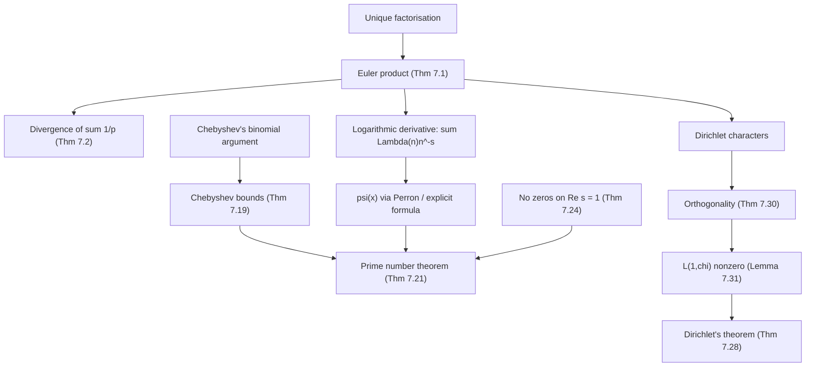

# Analytic Number Theory

> [Mathematics](../../README.md) › [Number Theory](../README.md) · Level: Advanced · Prerequisites: [Logic](../../00-foundations/02-logic/README.md), [Proof Techniques](../../00-foundations/04-proof-techniques/README.md), [Divisibility and Primes](../01-divisibility-and-primes/README.md), [Congruences](../02-congruences/README.md), [Arithmetic Functions](../03-arithmetic-functions/README.md), [Sequences and Series](../../14-real-analysis/02-sequences-and-series/README.md), [Improper Integrals](../../07-calculus/10-improper-integrals/README.md), [Analytic Functions](../../15-complex-analysis/02-analytic-functions/README.md) · Estimated time: 840 min

## 1. Introduction

Arithmetic is discrete: you can list integers, factor them, count them. Analysis is continuous: it speaks of limits, derivatives, integrals, and functions of a complex variable. **Analytic number theory** is the discipline that answers arithmetic questions with analytic tools, and it exists because that transfer of method is astonishingly effective. Questions that resist every elementary attack — how many primes are below $x$? how are they distributed among residue classes? how large is $\tau(n)$ on average? — become consequences of the behaviour of a single complex function near a single point.

Three theorems mark the road this chapter follows.

1. **Euler, 1737.** The series $\sum_p 1/p$, taken over the primes, diverges. Consequently there are infinitely many primes — but the conclusion is far stronger than Euclid's: it says the primes are dense enough that their reciprocals alone cannot sum to a finite number. The proof passes through the identity
   $$
   \zeta(s) = \prod_p \left(1 - p^{-s}\right)^{-1},
   $$
   which converts a statement about individual integers into a statement about all primes simultaneously. This is the **Euler product**, the founding identity of the subject.

2. **Riemann, 1859.** Euler's $\zeta$ was a function of a real variable $s>1$. Riemann regarded it as a function of a complex variable, discovered that it continues meromorphically to the whole plane with a single simple pole at $s=1$, and observed that the exact error in the prime counting function is governed by the *zeros* of $\zeta$ in the strip $0<\operatorname{Re}s<1$. That observation turned the study of primes into the study of a meromorphic function, and it is why the **Riemann hypothesis** — the assertion that all those zeros lie on the line $\operatorname{Re}s=\tfrac12$ — is the central open problem of the subject.

3. **Dirichlet, 1837.** For coprime $a$ and $q$, there are infinitely many primes $p\equiv a \pmod q$. The proof invents **Dirichlet characters** $\chi$ and their $L$-functions $L(s,\chi)=\sum_n \chi(n)n^{-s}$, which are Euler products of the same shape as $\zeta$ but with the local factors weighted by characters. The key point is that $L(1,\chi)\neq 0$ for every non-principal $\chi$; the pole of $\zeta$ at $s=1$ then survives in exactly one of the twisted products, and the primes must therefore spread evenly over residue classes.

Around these three theorems an entire architecture has grown: the **circle method** for additive problems, **sieve methods**, **exponential sums**, the theory of **$L$-functions** and automorphic forms, and **probabilistic number theory**, in which the values $\omega(n)$ behave like sums of independent random variables. This chapter builds the analytic core: the Euler product, the divergence of $\sum 1/p$, the arithmetic functions and their average orders, Dirichlet series and their abscissae, the zeta function and its continuation, Chebyshev's bounds, the strategy behind the prime number theorem, zero-free regions, Dirichlet's theorem, and the circle method. Along the way we prove what can be proved in a chapter and clearly label what must be quoted.

A word about honesty, because it shapes the whole presentation. Two facts sit beyond the scope of a single chapter: the full prime number theorem (which needs a Tauberian theorem or a contour integration that we state but do not prove) and the existence of a zero-free region of the classical shape (which needs estimates on $\zeta'/\zeta$). Both are stated with their precise hypotheses, both are accompanied by the complete proof *strategy*, and the parts that are elementary — Chebyshev's bounds, the non-vanishing on $\operatorname{Re}s=1$, the divergence of $\sum 1/p$, the $L(1,\chi)\neq0$ lemma for real characters, the average order estimates — are proved in full. A reader who wants every detail of the omitted steps will find them in the references of §16.

## 2. Prerequisites

**Divisibility and unique factorisation.** Every proof in this chapter begins by writing an integer as a product of primes, and the Euler product is nothing but unique factorisation read backwards. You need the fundamental theorem of arithmetic, the infinitude of the primes, and the standard results on $\gcd$, $\operatorname{lcm}$ and prime powers. See [Divisibility and Primes](../01-divisibility-and-primes/README.md).

**Congruences and residue classes.** Dirichlet's theorem counts primes in a residue class $a \bmod q$, and the characters that detect these classes are functions on $(\mathbb{Z}/q\mathbb{Z})^\times$. You need the ring $\mathbb{Z}/q\mathbb{Z}$, its group of units, and the Chinese remainder theorem. See [Congruences](../02-congruences/README.md).

**Arithmetic functions.** The functions $\tau$, $\sigma$, $\varphi$, $\mu$ and $\Lambda$ appear constantly, and the Dirichlet convolution is the algebraic structure underneath. See [Arithmetic Functions](../03-arithmetic-functions/README.md), which introduces multiplicativity and Möbius inversion; this chapter revisits them with the analytic questions in mind.

**Sequences, series and convergence tests.** Absolute versus conditional convergence, the comparison test, Dirichlet's test for $\sum a_n b_n$, uniform convergence on compact sets, and the fact that a power series is holomorphic inside its disc of convergence. See [Sequences and Series](../../14-real-analysis/02-sequences-and-series/README.md) and [Sequences and Series in Calculus](../../07-calculus/11-sequences-and-series-in-calculus/README.md).

**Improper integrals and integral comparison.** The estimates $\sum_{n\le x} 1/n = \log x + O(1)$ and $\sum_{n>x} n^{-\sigma} \ll x^{1-\sigma}$ are used dozens of times; they come from comparing a sum with $\int_1^\infty t^{-\sigma}\,dt$. See [Improper Integrals](../../07-calculus/10-improper-integrals/README.md).

**Complex analysis: holomorphic functions, poles, zeros, analytic continuation.** The zeta function is a meromorphic function; "$\zeta$ has a simple pole at $s=1$ with residue $1$" and "$\zeta$ has no zeros on $\operatorname{Re}s=1$" are statements about a complex function. See [Analytic Functions](../../15-complex-analysis/02-analytic-functions/README.md) and, for the functional equation's proof via theta functions and Poisson summation, [Power Series and Residues](../../15-complex-analysis/04-power-series-and-residues/README.md).

**Asymptotic notation.** $f=O(g)$, $f=o(g)$, $f\sim g$, $f\ll g$, $f\asymp g$ are used in every paragraph. Formal definitions are in §5 and in [Sequences and Series](../../14-real-analysis/02-sequences-and-series/README.md).

**Elementary probability (for §7.9 and §12).** Expectation, variance, Chebyshev's inequality and convergence in distribution are needed for the Erdős–Kac theorem. See [Random Variables](../../10-probability/03-random-variables/README.md) and [Law of Large Numbers and Central Limit Theorem](../../10-probability/06-law-of-large-numbers-and-central-limit-theorem/README.md).

## 3. Learning Objectives

After working through this chapter and its exercises you will be able to:

* state and prove the Euler product for $\zeta(s)$, including the convergence justification that textbooks often omit;
* prove that $\sum_p 1/p$ diverges, both by Euler's analytic argument and by Erdős's elementary counting argument, and explain why divergence is strictly stronger than infinitude;
* define the Dirichlet convolution, prove that it makes the set of arithmetic functions into an integral domain, and state and use Möbius inversion;
* determine the average order of $\tau$, $\sigma$ and $\varphi$ by the hyperbola method and by Möbius inversion, and explain the difference between average order and normal order;
* define Dirichlet series, distinguish the abscissa of convergence from the abscissa of absolute convergence, and give examples where they differ;
* state the analytic continuation of $\zeta$, the functional equation in both its asymmetric and symmetric forms, and compute $\zeta(0)$ and $\zeta(-1)$ from it;
* prove Chebyshev's bounds $c_1 x \le \psi(x) \le c_2 x$ and derive from them bounds for $\pi(x)$;
* state the prime number theorem in its three equivalent forms and describe the three-step strategy that proves it;
* prove that $\zeta(s)\neq 0$ when $\operatorname{Re}s=1$, state the classical zero-free region, and state the Riemann hypothesis with two of its equivalent formulations;
* define Dirichlet characters, state the orthogonality relations, prove $L(1,\chi)\neq0$ for real non-principal $\chi$, and explain how these ingredients give Dirichlet's theorem;
* describe what the circle method does and name two theorems it proves;
* compute the summatory function of $2^{\omega(n)}$ and explain the Hardy–Ramanujan and Erdős–Kac theorems.

## 4. Intuition

### 4.1 A dictionary, not a trick

Suppose you want to know how many integers below one million have exactly three prime factors. You could sieve. Suppose instead you want to know how many *primes* are below one million. Sieving is exactly what the prime number theorem replaces by a formula. The replacement works because of a change of viewpoint: instead of examining each integer, we attach to the whole sequence of integers a single function and ask where that function has singularities.

The device is the **Euler product**. Write down the sum of $n^{-s}$ over all $n$. Unique factorisation says every $n$ is a product of primes, and the sum of $n^{-s}$ over all products of primes factors as a product over primes of geometric series. One identity, valid for $s>1$, packages the entire multiplicative structure of the integers. It is a dictionary: statements about the left-hand side (analysis) translate into statements about the right-hand side (primes), and conversely.

The dictionary has a direction that matters. Analytic statements are *easy* on the left and *hard* on the right; arithmetic statements are *easy* on the right and *hard* on the left. Every theorem in this chapter is one translation.

### 4.2 Why divergence of reciprocal primes is the right question

Euclid proves that the list of primes never ends. His proof says nothing about *how many* primes there are, and in fact the primes become scarce: below $x$ there are about $x/\log x$ of them, a proportion that tends to zero. So in what sense are they "many"?

The answer is logarithmic. The sum of $1/p$ over primes up to $x$ grows like $\log\log x$: slowly, without bound. Compare this with the sum of $1/n$ over *all* integers up to $x$, which grows like $\log x$. The primes are thinner than the integers, but only by one logarithm. This is the precise sense in which the primes are "dense enough": the reciprocal sum still diverges, and every argument that shows this must use the multiplicative structure of the integers in an essential way, because a merely counting argument cannot distinguish a sparse set from a dense one.

Think of a bookshelf. Euclid tells you the shelf never ends. Divergence of the reciprocal sum tells you that the books, though spaced further and further apart, are heavy enough that the total weight of the shelf is infinite.

### 4.3 Why complex numbers enter

The variable $s$ in $\zeta(s)$ is a bookkeeping device: it lets us weight $n^{-s}$ so that convergence is controlled. For real $s>1$ the series converges; as $s\downarrow 1$ it blows up, and the rate of blow-up records the density of the integers. That already suffices for Euler's theorem.

But the interesting information sits *inside* the half-plane of convergence and *beyond* it. Riemann's insight was that the function defined by the series for $s>1$ has a unique extension to a meromorphic function on $\mathbb{C}$, and that this extension is determined by, and determines, the primes. Two features of the extension carry all the arithmetic:

* the **pole at $s=1$**, which is the analytic shadow of the fact that there are infinitely many integers;
* the **zeros** in the strip $0<\operatorname{Re}s<1$, which are the analytic shadow of the *fluctuations* in the distribution of primes.

The explicit formula of §7.5 makes this literal: it writes the prime-counting weight $\psi(x)$ as $x$ minus a sum over zeros plus a bounded term. Each zero contributes an oscillating term $x^\rho/\rho$. If the zeros sit on the line $\operatorname{Re}s=\tfrac12$ the oscillations are as small as possible, and the primes are as evenly distributed as they can be. That is the Riemann hypothesis.

### 4.4 The analogy to keep in mind

Analytic number theory behaves like **spectroscopy**. A physical object (the integers) is not directly observable, but it emits a spectrum (the zeros of $\zeta$ and of $L$-functions). From the spectrum one reconstructs the object (the explicit formula). Different questions about the object become different questions about the spectrum: infinitude of primes becomes existence of a pole, distribution in residue classes becomes non-vanishing of $L$-functions at a point, and the finest possible error term becomes a statement about the real parts of the spectral lines.

The analogy is not decorative. It is the historical origin of the Hilbert–Pólya conjecture, of the Montgomery–Odlyzko pair correlation, and of the modern theory of automorphic $L$-functions, where arithmetic objects are studied entirely through their spectral data.

## 5. Formal Definition

Throughout, $\mathbb{N}=\{1,2,3,\dots\}$, $\mathbb{N}_0=\{0,1,2,\dots\}$, and $s=\sigma+it$ denotes a complex variable with real part $\sigma$ and imaginary part $t$. A **prime** is always a positive rational prime.

**Definition 5.1** (Arithmetic function). An *arithmetic function* is a function $f:\mathbb{N}\to\mathbb{C}$. The set of all arithmetic functions is denoted $\mathcal{A}$.

**Definition 5.2** (Multiplicativity). An arithmetic function $f$ is *multiplicative* if $f(1)=1$ and $f(mn)=f(m)f(n)$ whenever $\gcd(m,n)=1$. It is *completely multiplicative* if $f(1)=1$ and $f(mn)=f(m)f(n)$ for all $m,n$. It is *additive* (respectively *completely additive*) if the corresponding statement holds for $f(mn)=f(m)+f(n)$.

**Definition 5.3** (Dirichlet convolution). For $f,g\in\mathcal{A}$ the *Dirichlet convolution* is
$$
(f*g)(n) := \sum_{d\mid n} f(d)\,g\!\left(\frac{n}{d}\right), \qquad n\ge 1 .
$$
The sum is finite for every $n$. The function $\varepsilon$ defined by $\varepsilon(1)=1$ and $\varepsilon(n)=0$ for $n>1$ is the identity element: $f*\varepsilon=f$. The function $\mathbf{1}$ is the constant function $\mathbf{1}(n)=1$, and $\operatorname{id}$ is $\operatorname{id}(n)=n$.

**Definition 5.4** (Möbius function). $\mu(1):=1$; $\mu(n):=0$ if $n$ is divisible by the square of a prime; and $\mu(n):=(-1)^{k}$ if $n$ is a product of $k$ distinct primes.

**Definition 5.5** (The functions $\tau$, $\sigma$, $\varphi$, $\omega$, $\Omega$, $\Lambda$). For $n\ge1$:
$$
\tau(n):=\sum_{d\mid n}1,\quad \sigma(n):=\sum_{d\mid n}d,\quad \varphi(n):=\#\{1\le a\le n : \gcd(a,n)=1\},
$$
$$
\omega(n):=\#\{p : p\mid n\},\qquad \Omega(n):=\sum_{p^k\parallel n} k ,
$$
and the **von Mangoldt function**
$$
\Lambda(n):=\begin{cases}\log p, & n=p^{k}\text{ for some prime }p\text{ and }k\ge1,\\ 0,&\text{otherwise.}\end{cases}
$$
Here $p^{k}\parallel n$ means that $p^{k}\mid n$ but $p^{k+1}\nmid n$.

**Definition 5.6** (Summatory function and average order). The *summatory function* of $f$ is $S_f(x):=\sum_{n\le x} f(n)$, defined for real $x\ge1$ with the sum over integers $n\le x$. An arithmetic function $g$ is an *average order* of $f$ if
$$
\sum_{n\le x} f(n) \sim \sum_{n\le x} g(n) \qquad (x\to\infty).
$$
A function $h$ is a *normal order* of $f$ if for every $\varepsilon>0$, the set of $n$ with $|f(n)-h(n)|>\varepsilon\, h(n)$ has asymptotic density $0$. (Average order describes a mean; normal order describes almost every value. They can differ, as $\omega$ shows: its average order is $\log\log n$, and so is its normal order, but the reason is different in each case.)

**Definition 5.7** (Asymptotic notation). For functions defined on a set tending to infinity, $f=O(g)$ means there are constants $C>0$ and $x_0$ with $|f(x)|\le C|g(x)|$ for all $x\ge x_0$; $f\ll g$ means the same; $f=o(g)$ means $f(x)/g(x)\to0$; $f\sim g$ means $f(x)/g(x)\to1$; $f\asymp g$ means both $f\ll g$ and $g\ll f$.

**Definition 5.8** (Dirichlet series). A *Dirichlet series* is a series of the form
$$
D(s) = \sum_{n\ge1} a_n n^{-s}, \qquad s\in\mathbb{C},
$$
with complex coefficients $a_n$. Its *abscissa of convergence* is
$$
\sigma_c := \inf\left\{\sigma\in\mathbb{R} : \sum_n a_n n^{-\sigma}\ \text{converges}\right\},
$$
and its *abscissa of absolute convergence* is
$$
\sigma_a := \inf\left\{\sigma\in\mathbb{R} : \sum_n |a_n| n^{-\sigma}\ \text{converges}\right\}.
$$
Both are taken in $\overline{\mathbb{R}}=\mathbb{R}\cup\{\pm\infty\}$; the series converges (absolutely) for $\operatorname{Re}s>\sigma_c$ (respectively $\operatorname{Re}s>\sigma_a$) and diverges for $\operatorname{Re}s<\sigma_c$.

**Definition 5.9** (Riemann zeta function). For $\operatorname{Re}s>1$,
$$
\zeta(s) := \sum_{n\ge1} n^{-s}.
$$

**Definition 5.10** (Chebyshev functions). For $x\ge1$,
$$
\theta(x):=\sum_{p\le x}\log p, \qquad \psi(x):=\sum_{p^{k}\le x}\log p=\sum_{n\le x}\Lambda(n),
$$
where the first sum runs over primes $p\le x$ and the second over prime powers $p^{k}\le x$ with $k\ge1$. Also $\pi(x):=\sum_{p\le x}1$.

**Definition 5.11** (Dirichlet character). Let $q\ge1$. A *Dirichlet character modulo $q$* is a function $\chi:\mathbb{Z}\to\mathbb{C}$ such that:

(i) $\chi(n)=0$ if and only if $\gcd(n,q)>1$;
(ii) $\chi(mn)=\chi(m)\chi(n)$ for all $m,n\in\mathbb{Z}$;
(iii) $\chi(n+q)=\chi(n)$ for all $n$.

The *principal character* $\chi_0$ modulo $q$ is defined by $\chi_0(n)=1$ when $\gcd(n,q)=1$ and $\chi_0(n)=0$ otherwise. A character is *real* if its values lie in $\mathbb{R}$; since values on units are roots of unity, real characters take values in $\{0,\pm1\}$. The set of characters modulo $q$ forms a group under pointwise multiplication, isomorphic to $(\mathbb{Z}/q\mathbb{Z})^{\times}$.

**Definition 5.12** (Dirichlet $L$-function). For a character $\chi$ modulo $q$,
$$
L(s,\chi):=\sum_{n\ge1}\chi(n)n^{-s}, \qquad \operatorname{Re}s>1 .
$$

**Definition 5.13** (Euler product). An *Euler product* for a Dirichlet series $\sum a_n n^{-s}$ with $a_1=1$ and $a_n$ multiplicative is the identity
$$
\sum_{n\ge1} a_n n^{-s} = \prod_p \left(\sum_{k\ge0} a_{p^{k}} p^{-ks}\right),
$$
valid in the half-plane where the left side converges absolutely and the right side converges.

**Definition 5.14** (Zero-free region). A *zero-free region* for $\zeta$ is a subset $R$ of the critical strip on which $\zeta$ is known to be non-zero. The *critical strip* is $\{s : 0<\operatorname{Re}s<1\}$ and the *critical line* is $\{\operatorname{Re}s=\tfrac12\}$. A *non-trivial zero* is a zero of $\zeta$ in the critical strip; a *trivial zero* is one of $s=-2,-4,-6,\dots$.

**Definition 5.15** (Riemann hypothesis). The *Riemann hypothesis* (RH) is the assertion that every non-trivial zero $\rho$ of $\zeta$ satisfies $\operatorname{Re}\rho=\tfrac12$.

**Definition 5.16** (Logarithmic integral). For $x>1$,
$$
\operatorname{li}(x):=\int_2^x \frac{dt}{\log t},
$$
the integral being understood as a Cauchy principal value at $t=1$ when the lower limit is below $1$. It satisfies $\operatorname{li}(x)\sim x/\log x$.

**Definition 5.17** (Smooth numbers). An integer $n$ is *$y$-smooth* if every prime factor of $n$ is at most $y$. The notation $P(n)$ denotes the largest prime factor of $n$ for $n\ge2$.

**Definition 5.18** (Density). A set $A\subseteq\mathbb{N}$ has *asymptotic density* $d(A):=\lim_{x\to\infty}\#\{n\le x : n\in A\}/x$, when the limit exists.

## 6. Mathematical Notation

| Symbol | Read as | Meaning |
|---|---|---|
| $s=\sigma+it$ | ess equals sigma plus i t | complex variable, real part $\sigma$, imaginary part $t$ |
| $\zeta(s)$ | zeta of ess | Riemann zeta function, Definition 5.9 |
| $\prod_p$ | product over primes p | product over all primes, in increasing order |
| $p^{k}\parallel n$ | p to the k exactly divides n | $p^k\mid n$ but $p^{k+1}\nmid n$ |
| $f*g$ | f star g | Dirichlet convolution, Definition 5.3 |
| $\mathbf{1}$ | the constant-one function | $\mathbf{1}(n)=1$ for all $n$ |
| $\varepsilon$ | epsilon (identity) | $\varepsilon(1)=1$, $\varepsilon(n)=0$ for $n>1$ |
| $\operatorname{id}$ | the identity function | $\operatorname{id}(n)=n$ |
| $\mu(n)$ | mu of n | Möbius function, Definition 5.4 |
| $\Lambda(n)$ | Lambda of n | von Mangoldt function, Definition 5.5 |
| $\tau(n)$, $\sigma(n)$ | tau, sigma | number of divisors, sum of divisors |
| $\varphi(n)$ | phi of n | Euler totient |
| $\omega(n)$, $\Omega(n)$ | omega, Omega | number of distinct prime factors, counted with multiplicity |
| $\theta(x)$, $\psi(x)$ | theta, psi | Chebyshev functions, Definition 5.10 |
| $\pi(x)$ | pi of x | number of primes $\le x$ |
| $\operatorname{li}(x)$ | ell-eye of x | logarithmic integral, Definition 5.16 |
| $\sigma_c$, $\sigma_a$ | sigma see, sigma ay | abscissae of convergence, of absolute convergence |
| $\chi$ | khi | a Dirichlet character |
| $\chi_0$ | khi zero | the principal character |
| $L(s,\chi)$ | ell of ess, khi | Dirichlet $L$-function |
| $a_n\ll b_n$ | a is much less than b | $a_n=O(b_n)$ |
| $f\sim g$ | f is asymptotic to g | $f/g\to1$ |
| $\rho$ | rho | a non-trivial zero of $\zeta$ |
| $\gamma$ | gamma | Euler's constant $0.57721\dots$; also, in §7.5, the imaginary part of a zero |
| $\Gamma(s)$ | Gamma of ess | the gamma function |
| $B_n$ | B sub n | Bernoulli numbers |
| $d(n)$ | d of n | synonym for $\tau(n)$ used in the divisor problem |

Two conventions deserve a warning. First, $\log$ in this chapter always means the natural logarithm $\ln$; this is universal practice in analytic number theory, and the base-$10$ convention of elementary chapters is abandoned here. Second, $\sum_p$ always means a sum over primes, never over a variable called $p$ that might be something else; when a sum over an index is meant, the index is written explicitly as in $\sum_{k\ge1}$.

## 7. Core Concepts

### 7.1 The Infinitude of the Primes, Quantified: Divergence of $\sum 1/p$

The Euler product is the bridge between the additive world (sums over all integers) and the multiplicative world (products over primes).

**Theorem 7.1** (Euler product). Let $s\in\mathbb{C}$ with $\sigma=\operatorname{Re}s>1$. Then $\sum_p |p^{-s}|<\infty$, the product $\prod_p (1-p^{-s})^{-1}$ converges absolutely, and
$$
\zeta(s)=\prod_{p}\left(1-p^{-s}\right)^{-1}.
$$

*Proof.* Since $|p^{-s}|=p^{-\sigma}$ and $\sum_p p^{-\sigma}\le\sum_{n\ge2}n^{-\sigma}<\infty$, the series $\sum_p p^{-s}$ converges absolutely. For each prime $p$, the geometric series $\sum_{k\ge0}p^{-ks}=(1-p^{-s})^{-1}$ converges absolutely. A product of absolutely convergent series over an index set with $\sum|a_p|<\infty$ converges absolutely and may be multiplied out in any order. Fix $y\ge2$ and expand the finite product:
$$
\prod_{p\le y}\sum_{k\ge0}p^{-ks}=\sum_{n\ge1,\ P(n)\le y} n^{-s},
$$
because unique factorisation matches each tuple $(k_p)_{p\le y}$ with exactly one integer $n=\prod p^{k_p}$ whose prime factors are all at most $y$. (The empty tuple gives $n=1$.) Therefore
$$
\left|\zeta(s)-\prod_{p\le y}(1-p^{-s})^{-1}\right|\le\sum_{\substack{n\ge1\\ P(n)>y}}n^{-\sigma}\le\sum_{n>y}n^{-\sigma}\longrightarrow0
$$
as $y\to\infty$, since $P(n)>y$ forces $n>y$ and the tail of an absolutely convergent series tends to $0$. Hence the finite products converge to $\zeta(s)$, so the infinite product converges (absolutely) and equals $\zeta(s)$. $\blacksquare$

Two remarks. First, the absolute convergence is essential: it is what licenses the rearrangement of the double sum into a product. For $\sigma\le1$ the product still converges for $\sigma>0$ but no longer to $\zeta(s)$ in the same direct sense; the identity then requires analytic continuation. Second, the same argument with the local factor $\sum_k a_{p^k}p^{-ks}$ gives the general Euler product of Definition 5.13 for any multiplicative $a_n$ with $a_n\ll n^{\varepsilon}$.

**Theorem 7.2** (Euler, 1737). $\displaystyle\sum_p \frac1p$ diverges.

*Proof.* Let $s>1$ be real. Taking logarithms of the absolutely convergent product of Theorem 7.1 and using the power series $-\log(1-z)=\sum_{k\ge1}z^k/k$ for $|z|<1$ gives
$$
\log\zeta(s)=-\sum_p\log\left(1-p^{-s}\right)=\sum_p\sum_{k\ge1}\frac{1}{k\,p^{ks}} .
$$
Split off the $k=1$ terms and bound the rest. For $k\ge2$,
$$
\sum_{k\ge2}\frac{1}{k\,p^{ks}}\le\frac12\sum_{k\ge2}p^{-ks}=\frac{1}{2}\cdot\frac{p^{-2s}}{1-p^{-s}}\le p^{-2s},
$$
where the last inequality uses $1-p^{-s}\ge1-\tfrac12=\tfrac12$ for $p\ge2$, $s\ge1$. Hence
$$
0\le R(s):=\sum_p\sum_{k\ge2}\frac{1}{k\,p^{ks}}\le\sum_p p^{-2s}\le\sum_{n=2}^{\infty}n^{-2}=\zeta(2)-1<1 .
$$
So for $1<s\le2$,
$$
\sum_p\frac{1}{p^{s}}=\log\zeta(s)-R(s)\ge\log\zeta(s)-1 .
$$
Now $\zeta$ is bounded below by an integral: for $s>1$,
$$
\zeta(s)=\sum_{n\ge1}n^{-s}\ge\int_1^\infty x^{-s}\,dx=\frac{1}{s-1},
$$
because $x\mapsto x^{-s}$ is decreasing and the sum is a left Riemann sum for the integral. Therefore
$$
\sum_p\frac{1}{p^{s}}\ \ge\ \log\frac{1}{s-1}-1\ \longrightarrow\ \infty\qquad(s\downarrow1).
$$
If $\sum_p 1/p$ converged, then for every $s\ge1$ we would have $\sum_p p^{-s}\le\sum_p p^{-1}<\infty$, a fixed bound contradicting the displayed divergence. Hence $\sum_p 1/p=\infty$. $\blacksquare$

**Corollary.** There are infinitely many primes. Indeed, a finite sum of positive terms is finite.

The corollary is weaker than the theorem, and the gap between them is the whole point. Euclid's argument shows that the set of primes is infinite but is compatible with a set as sparse as $\{2^{2^n}\}$, whose reciprocal sum converges. Euler's argument shows that the primes are much denser than that: their reciprocal sum diverges, and in fact (Mertens) it diverges like $\log\log x$.

**Theorem 7.3** (Erdős's elementary proof). $\sum_p 1/p$ diverges.

*Proof.* Suppose, for contradiction, that $\sum_p 1/p=C<\infty$. Choose $N$ such that $\sum_{p>N}1/p<\tfrac12$, and let $p_1<\dots<p_k$ be the primes at most $N$. Take an integer $x\ge1$ and split the integers $1\le n\le x$ into
$$
A=\{n\le x:\text{every prime factor of }n\text{ is }\le N\},\qquad B=\{1,\dots,\lfloor x\rfloor\}\setminus A .
$$
Every $n\in B$ is divisible by some prime $q>N$, so
$$
\#B\le\sum_{\substack{q>N\\ q\le x}}\left\lfloor\frac xq\right\rfloor\le x\sum_{q>N}\frac1q<\frac{x}{2}.
$$
For $n\in A$, write $n=ab^2$ with $a$ squarefree: $a=\prod_{p\le N}p^{\,e_p\bmod 2}$ is determined by the parities of the exponents in $n$, so there are at most $2^k$ possibilities for $a$, and $b\le\sqrt n\le\sqrt x$. Thus $\#A\le 2^k\sqrt x$. Choosing the integer $x\ge 4\cdot 4^k$ gives $\#A\le x/2$, hence altogether
$$
x=\#A+\#B<\frac x2+\frac x2=x,
$$
which is absurd. Therefore $\sum_p1/p$ diverges. $\blacksquare$

The two proofs are complementary. Euler's is analytic and quantitative, and it generalises to Dirichlet's theorem and to the prime number theorem; Erdős's is elementary and combinatorial, and it isolates the precise combinatorial content of divergence. Neither proof, however, gives the true rate of divergence.

**Theorem 7.4** (Mertens, stated). As $x\to\infty$,
$$
\sum_{p\le x}\frac{\log p}{p}=\log x+O(1),\qquad
\sum_{p\le x}\frac1p=\log\log x+M+O\!\left(\frac{1}{\log x}\right),
$$
$$
\prod_{p\le x}\left(1-\frac1p\right)=\frac{e^{-\gamma}}{\log x}\left(1+O\!\left(\frac1{\log x}\right)\right),
$$
where $M=0.2614972128\dots$ is the *Meissel–Mertens constant* and $\gamma=0.5772156649\dots$ is Euler's constant.

We quote this theorem: its proof requires the prime number theorem in the form $\theta(x)\sim x$ together with partial summation, and it belongs to the same circle of ideas as §7.5. The middle formula is the sharp form of Theorem 7.2: the divergence of $\sum 1/p$ is exactly logarithmic in $\log x$.

### 7.2 Arithmetic Functions and Average Orders

**Theorem 7.5** (The ring of arithmetic functions). Equipped with pointwise addition and the convolution $*$, the set $\mathcal{A}$ is a commutative ring with identity $\varepsilon$. It is an integral domain. An element $f$ is a unit if and only if $f(1)\neq0$; its inverse $g$ is determined recursively by
$$
g(1)=\frac{1}{f(1)},\qquad g(n)=-\frac{1}{f(1)}\sum_{\substack{d\mid n\\ d<n}}f\!\left(\frac nd\right)g(d)\quad(n>1).
$$

*Proof.* Commutativity and associativity follow from rewriting $(f*g)(n)=\sum_{de=n}f(d)g(e)$ and $(f*g*h)(n)=\sum_{def=n}f(d)g(e)h(f)$, sums over factorisations of $n$ into ordered triples; addition is pointwise. The identity is $\varepsilon$ because the only term in $\sum_{d\mid n}\varepsilon(d)g(n/d)$ with $d=1$ survives. For the domain property, let $f,g\neq0$ and let $m$ be the least integer with $f(m)\neq0$, $n$ the least with $g(n)\neq0$. In $(f*g)(mn)=\sum_{d\mid mn}f(d)g(mn/d)$, a term with $f(d)\neq0$ has $d\ge m$, and a term with $g(mn/d)\neq0$ has $mn/d\ge n$, i.e. $d\le m$. So only $d=m$ contributes, with value $f(m)g(n)\neq0$. The recursion for the inverse is forced by $(f*g)(1)=f(1)g(1)=1$ and, for $n>1$, by $0=(f*g)(n)=f(1)g(n)+\sum_{d\mid n,d<n}f(n/d)g(d)$. $\blacksquare$

**Theorem 7.6** (Möbius inversion). $\mu*\mathbf{1}=\varepsilon$. Consequently, for arithmetic functions $f,g$,
$$
g=f*\mathbf{1}\iff f=g*\mu .
$$

*Proof.* For $n=\prod_{i=1}^{k}p_i^{e_i}$ with $e_i\ge1$,
$$
(\mu*\mathbf{1})(n)=\sum_{d\mid n}\mu(d)=\sum_{S\subseteq\{1,\dots,k\}}(-1)^{|S|}=(1-1)^k,
$$
which is $1$ for $k=0$ (that is, $n=1$) and $0$ otherwise; here $\mu(d)=0$ unless $d$ is a product of distinct primes, which is why only squarefree divisors appear. Since $*$ is associative and commutative, $f*\mathbf{1}=g$ implies $g*\mu=f*\mathbf{1}*\mu=f*\varepsilon=f$, and conversely. $\blacksquare$

The most important instance is $\varphi=\mu*\operatorname{id}$, which yields the identity $\sum_{d\mid n}\varphi(d)=n$ when convolved with $\mathbf{1}$.

**Theorem 7.7** (Dirichlet's hyperbola identity). For $x\ge1$,
$$
\sum_{n\le x}\tau(n)=2\sum_{d\le\sqrt x}\left\lfloor\frac xd\right\rfloor-\left\lfloor\sqrt x\right\rfloor^{2}.
$$

*Proof.* Both sides count the set $H=\{(d,e)\in\mathbb{N}^2: de\le x\}$: the left side groups pairs by $n=de$, and $\tau(n)$ is the number of such factorisations. On the right, $\sum_{d\le\sqrt x}\lfloor x/d\rfloor$ counts pairs with $d\le\sqrt x$, and the same sum counts pairs with $e\le\sqrt x$; every pair has $d\le\sqrt x$ or $e\le\sqrt x$ (otherwise $de>x$), and pairs with both coordinates $\le\sqrt x$ are counted twice, there being $\lfloor\sqrt x\rfloor^2$ of them. $\blacksquare$

**Theorem 7.8** (Average order of $\tau$). As $x\to\infty$,
$$
\sum_{n\le x}\tau(n)=x\log x+(2\gamma-1)x+O\!\left(\sqrt x\right).
$$

*Proof.* By Theorem 7.7,
$$
\sum_{n\le x}\tau(n)=2\sum_{d\le\sqrt x}\left(\frac xd+O(1)\right)-x+O(\sqrt x)
=2x\sum_{d\le\sqrt x}\frac1d-x+O(\sqrt x).
$$
The harmonic sum is $\sum_{d\le y}1/d=\log y+\gamma+O(1/y)$ (compare with $\int_1^y dt/t$ and use that the error is a telescoping sum of the form $\sum_{d\le y}\int_d^{d+1}(1/d-1/t)\,dt=O(1/y)$). With $y=\sqrt x$,
$$
\sum_{n\le x}\tau(n)=2x\left(\tfrac12\log x+\gamma+O(x^{-1/2})\right)-x+O(\sqrt x)=x\log x+(2\gamma-1)x+O(\sqrt x).\ \blacksquare
$$

**Theorem 7.9** (Average order of $\varphi$). As $x\to\infty$,
$$
\sum_{n\le x}\varphi(n)=\frac{3}{\pi^{2}}x^{2}+O(x\log x).
$$

*Proof.* From $\varphi=\mu*\operatorname{id}$,
$$
\sum_{n\le x}\varphi(n)=\sum_{n\le x}\sum_{d\mid n}\mu(d)\frac nd=\sum_{d\le x}\mu(d)\sum_{m\le x/d}m .
$$
Since $\sum_{m\le y}m=\tfrac12\lfloor y\rfloor(\lfloor y\rfloor+1)=\tfrac12y^{2}+O(y)$,
$$
\sum_{n\le x}\varphi(n)=\frac{x^{2}}{2}\sum_{d\le x}\frac{\mu(d)}{d^{2}}+O\!\left(x\sum_{d\le x}\frac1d\right)
=\frac{x^{2}}{2}\cdot\frac{6}{\pi^{2}}+O\!\left(x^{2}\sum_{d>x}\frac1{d^{2}}\right)+O(x\log x).
$$
We used $\sum_{d\ge1}\mu(d)/d^{2}=1/\zeta(2)=6/\pi^{2}$, which follows from the Euler product of Theorem 7.1 applied to $\prod_p(1-p^{-2})=1/\zeta(2)$, and $|\mu(d)|\le1$ to bound the tail by $\sum_{d>x}d^{-2}=O(1/x)$. Hence the result. $\blacksquare$

The same method gives $\sum_{n\le x}\sigma(n)=\frac{\pi^{2}}{12}x^{2}+O(x\log x)$: write $\sigma=\operatorname{id}*\mathbf{1}$ and interchange the order of summation. The pattern is worth naming: **convolution turns a summatory function into a lattice-point count**, and a lattice-point count is estimated by splitting the region — the hyperbola method.

Average order and normal order answer different questions. The average order of $\tau$ is $\log n$: the *mean* number of divisors up to $x$ is about $\log x$. But almost every $n$ has about $(\log 2)\log\log n$ divisors, exponentially fewer than the mean, because the mean is dominated by the rare integers with very many divisors. This is the content of the Hardy–Ramanujan theorem discussed in §7.9.

### 7.3 Dirichlet Series and the Abscissa of Convergence

A Dirichlet series is a generating function for a sequence in which $n^{-s}$ replaces $z^n$. Its convergence theory is cleaner than that of power series because $n^{-s}=e^{-s\log n}$ decreases monotonically in $n$ for real $s$.

**Theorem 7.10** (Half-plane of convergence). Let $D(s)=\sum_n a_n n^{-s}$ and suppose $D(s_0)$ converges. Then $D(s)$ converges uniformly on every compact subset of $\{\operatorname{Re}s>\operatorname{Re}s_0\}$, and defines there a holomorphic function whose derivative is $\sum_n -a_n(\log n)n^{-s}$, the latter converging uniformly on compact subsets of the same half-plane.

*Proof.* Let $A(u)=\sum_{n\le u}a_n n^{-s_0}$, so $A(u)$ is bounded, say $|A(u)|\le M$, because $D(s_0)$ converges. Abel summation (partial summation, Theorem 8.1) over $N<n\le N'$ gives
$$
\sum_{N<n\le N'} a_n n^{-s}=\sum_{N<n\le N'}a_n n^{-s_0}\,n^{-(s-s_0)}
=A(N')N'^{-(s-s_0)}-A(N)N^{-(s-s_0)}+\int_N^{N'}A(u)\,(s-s_0)u^{-(s-s_0)-1}\,du ,
$$
using that $u\mapsto u^{-(s-s_0)}$ is continuously differentiable. Bounding $|A|\le M$ and writing $\sigma=\operatorname{Re}s>\sigma_0=\operatorname{Re}s_0$,
$$
\left|\sum_{N<n\le N'}a_n n^{-s}\right|\le 2MN^{-\sigma+\sigma_0}+M|s-s_0|\int_N^\infty u^{\sigma_0-\sigma-1}\,du\le MN^{-\sigma+\sigma_0}\left(2+\frac{|s-s_0|}{\sigma-\sigma_0}\right).
$$
On a compact set $K$ inside $\{\sigma>\sigma_0\}$ the factor in parentheses is bounded, so the tail tends to $0$ uniformly on $K$: the series converges uniformly there. Uniform convergence of holomorphic functions gives a holomorphic limit (Weierstrass); the statement about the derivative follows by applying the same argument to $\sum a_n\log n\,n^{-s}$, which converges absolutely and uniformly for $\sigma>\sigma_0+\varepsilon$. $\blacksquare$

**Theorem 7.11** (The two abscissae). For any Dirichlet series, $\sigma_c\le\sigma_a\le\sigma_c+1$. Both inequalities can be strict, and examples show that $\sigma_c$ and $\sigma_a$ can differ by exactly $1$.

*Proof.* Absolute convergence at $\sigma$ implies convergence at $\sigma$, so $\sigma_c\le\sigma_a$. If the series converges at $\sigma$, the terms $a_nn^{-\sigma}$ are bounded, say $|a_n|\le Cn^{\sigma}$; then $\sum|a_n|n^{-\sigma-1-\varepsilon}\le C\sum n^{-1-\varepsilon}<\infty$, so $\sigma_a\le\sigma+1+\varepsilon$ for every $\varepsilon>0$, whence $\sigma_a\le\sigma_c+1$. $\blacksquare$

**Example 7.12.** Each entry below is worth checking against Theorem 7.11.

| Series | $\sigma_c$ | $\sigma_a$ | Reason |
|---|---|---|---|
| $\zeta(s)=\sum n^{-s}$ | $1$ | $1$ | divergence of the harmonic series at $\sigma=1$ |
| $\sum (-1)^{n}n^{-s}=-(1-2^{1-s})\zeta(s)$ | $0$ | $1$ | alternating series converges for $\sigma>0$; terms do not tend to $0$ at $\sigma=0$ |
| $\sum_{m\ge1}(m^{2})^{-s}=\zeta(2s)$ | $\tfrac12$ | $\tfrac12$ | substitution $n=m^2$ |
| $\sum \mu(n)n^{-s}=1/\zeta(s)$ | $1$ | $1$ | $|\mu|\le1$; the Dirichlet series vanishes nowhere in $\sigma>1$ |
| $\sum \Lambda(n)n^{-s}=-\zeta'/\zeta(s)$ | $1$ | $1$ | $\Lambda(n)\le\log n$ |

The identity $\sum\Lambda(n)n^{-s}=-\zeta'/\zeta(s)$ is obtained by logarithmically differentiating the Euler product: $\log\zeta(s)=\sum_p\sum_k \frac1k p^{-ks}$, hence
$$
\frac{\zeta'}{\zeta}(s)=-\sum_p\sum_{k\ge1}(\log p)\,p^{-ks}=-\sum_{n\ge1}\Lambda(n)n^{-s}.
$$
It is the analytic statement of unique factorisation in its sharpest form: the left side is built from the *zeros and pole* of $\zeta$, and the right side from the primes.

**Theorem 7.13** (Landau's theorem). Suppose $a_n\ge0$ and $D(s)=\sum a_nn^{-s}$ converges for $\operatorname{Re}s>\sigma_c$. If $D$ extends holomorphically to a neighbourhood of a real point $\sigma$, then the series converges at $\sigma$ (and hence, by Theorem 7.10, on the whole half-plane $\operatorname{Re}s>\sigma$).

*Proof.* For $s>\max(\sigma,\sigma_c)$ and $N\ge1$, each partial sum satisfies $\sum_{n\le N}a_nn^{-s}\le D(s)$, since all terms are non-negative. Letting $s\downarrow\sigma$ through values larger than $\max(\sigma,\sigma_c)$ and using monotone convergence for the left side,
$$
\sum_{n\le N}a_nn^{-\sigma}=\lim_{s\downarrow\sigma}\sum_{n\le N}a_nn^{-s}\le\lim_{s\downarrow\sigma}D(s)=D(\sigma)<\infty,
$$
the last equality by continuity of the holomorphic extension at $\sigma$. Since $N$ is arbitrary, $\sum_na_nn^{-\sigma}\le D(\sigma)<\infty$. $\blacksquare$

Thus a Dirichlet series with non-negative coefficients has a singularity at its abscissa of convergence: it cannot be continued holomorphically past the first real point where it fails to converge.

**Proposition 7.14** (Perron's formula, stated). Let $D(s)=\sum_n a_nn^{-s}$ have finite $\sigma_a$ and let $c>\sigma_a$. Then for $x>0$,
$$
\frac{1}{2\pi i}\int_{c-i\infty}^{c+i\infty}D(s)\,\frac{x^{s}}{s}\,ds=\sum_{n\le x}{}'a_n,
$$
where the prime on the sum means that when $x$ is an integer the term $a_x$ is counted with weight $\tfrac12$.

Perron's formula is the tool that converts contour information about $D$ into information about the partial sums $\sum_{n\le x}a_n$. Shifting the contour to the left picks up the poles of $D(s)x^s/s$: the pole at $s=0$ contributes the main term, and the poles at zeros or other singularities of $D$ contribute the secondary terms. This is precisely the mechanism behind the explicit formula of §7.5.

### 7.4 The Riemann Zeta Function

Beyond the half-plane of absolute convergence, $\zeta$ is defined by analytic continuation.

**Theorem 7.15** (Analytic continuation of $\zeta$). For $\operatorname{Re}s>1$,
$$
\zeta(s)=\frac{s}{s-1}-s\int_1^\infty \{x\}\,x^{-s-1}\,dx .
$$
The integral converges absolutely and uniformly on compact subsets of $\{\operatorname{Re}s>0\}$; hence $\zeta$ extends to a meromorphic function on $\operatorname{Re}s>0$ whose only pole is a simple pole at $s=1$ with residue $1$. Using the functional equation below, it extends further to a meromorphic function on $\mathbb{C}$ whose only pole is that same simple pole.

*Proof.* For $\sigma>1$ and $N\ge2$, on each interval $[n,n+1)$ the function $\lfloor x\rfloor$ equals $n$, so
$$
s\int_1^N\lfloor x\rfloor x^{-s-1}\,dx=\sum_{n=1}^{N-1}n\int_n^{n+1}sx^{-s-1}\,dx=\sum_{n=1}^{N-1}n\left(n^{-s}-(n+1)^{-s}\right).
$$
The sum telescopes:
$$
\sum_{n=1}^{N-1}n\left(n^{-s}-(n+1)^{-s}\right)=\sum_{n=1}^{N-1}n^{1-s}-\sum_{n=2}^{N}(n-1)n^{-s}=\sum_{n=1}^{N-1}n^{-s}-(N-1)N^{-s},
$$
hence $s\int_1^N\lfloor x\rfloor x^{-s-1}dx=\sum_{n\le N-1}n^{-s}+O(N^{1-\sigma})$. Letting $N\to\infty$ gives $\zeta(s)=s\int_1^\infty\lfloor x\rfloor x^{-s-1}dx$. Writing $\lfloor x\rfloor=x-\{x\}$,
$$
\zeta(s)=s\int_1^\infty x^{-s}\,dx-s\int_1^\infty\{x\}x^{-s-1}\,dx=\frac{s}{s-1}-s\int_1^\infty\{x\}x^{-s-1}\,dx .
$$
Since $0\le\{x\}<1$, the integral is dominated by $\int_1^\infty x^{-\sigma-1}dx=1/\sigma$, which is locally bounded for $\sigma>0$; by the Weierstrass test, the integral defines a holomorphic function of $s$ on $\operatorname{Re}s>0$. The term $s/(s-1)=1+1/(s-1)$ has a simple pole at $s=1$ with residue $1$, and $s\int(\cdots)$ is holomorphic at $s=1$, so the pole is simple with residue $1$. $\blacksquare$

**Theorem 7.16** (Functional equation). For every $s\in\mathbb{C}$,
$$
\zeta(s)=2^{s}\pi^{s-1}\sin\!\left(\frac{\pi s}{2}\right)\Gamma(1-s)\,\zeta(1-s),
$$
understood by continuation at the poles of $\Gamma$ and at $s=1$. Equivalently, the completed zeta function
$$
\Lambda(s):=\pi^{-s/2}\Gamma\!\left(\frac s2\right)\zeta(s)
$$
satisfies $\Lambda(s)=\Lambda(1-s)$, and $\xi(s):=\tfrac12s(s-1)\Lambda(s)$ is an entire function with $\xi(s)=\xi(1-s)$.

*Sketch of proof.* The theta function $\theta(t):=\sum_{n\in\mathbb{Z}}e^{-\pi n^{2}t}$ converges for $t>0$ and satisfies the modular identity $\theta(t)=t^{-1/2}\theta(1/t)$, proved by Poisson summation. For $\operatorname{Re}s>1$,
$$
\pi^{-s/2}\Gamma\!\left(\frac s2\right)\zeta(s)=\int_0^\infty\frac{\theta(t)-1}{2}\,t^{s/2-1}\,dt,
$$
by termwise integration of $\Gamma(s/2)=\int_0^\infty u^{s/2-1}e^{-u}du$ with $u=\pi n^2t$. Splitting the integral at $t=1$ and applying the modular identity to the part over $(0,1)$ turns it into an integral over $(1,\infty)$ of an expression symmetric under $s\mapsto1-s$, which yields $\Lambda(s)=\Lambda(1-s)$. The asymmetric form follows from Legendre's duplication formula and Euler's reflection formula for $\Gamma$. $\blacksquare$

**Proposition 7.17** (Values and zeros). The functional equation gives, in order:

* $\zeta(0)=-\tfrac12$ and $\zeta(-1)=-\tfrac{1}{12}$. Indeed $\zeta(-1)=2^{-1}\pi^{-2}\sin(-\pi/2)\Gamma(2)\zeta(2)=-\frac{1}{2\pi^{2}}\cdot\frac{\pi^{2}}{6}=-\frac1{12}$.
* $\zeta(-2n)=0$ for every $n\ge1$, because $\sin(\pi s/2)$ vanishes at $s=-2n$ while $\zeta(1+2n)$ is finite. These are the *trivial zeros*.
* $\zeta(2n)=(-1)^{n+1}\dfrac{B_{2n}(2\pi)^{2n}}{2(2n)!}$, so $\zeta(2)=\pi^{2}/6$, $\zeta(4)=\pi^{4}/90$, $\zeta(6)=\pi^{6}/945$.
* $\zeta(s)\neq0$ for $\operatorname{Re}s>1$, since the Euler product converges there and no factor vanishes.
* If $\zeta(\rho)=0$ with $\operatorname{Re}\rho<0$, then $\rho=-2n$: the right side of the functional equation vanishes only at the poles of $\Gamma(1-s)$, which are $s=1,2,3,\dots$, at the zeros of $\sin(\pi s/2)$, which are $s=-2,-4,\dots$, and at the zeros of $\zeta(1-s)$, which for $\operatorname{Re}(1-s)>1$ do not exist. Hence all remaining zeros lie in the *critical strip* $0<\operatorname{Re}s<1$.

The functional equation also shows that the pole at $s=1$ and the zero structure are not independent: the product $\xi$ is entire and symmetric, so information at $s$ is information at $1-s$. This is the technical reason why the critical line $\operatorname{Re}s=\tfrac12$ is distinguished: it is the fixed set of the symmetry $s\mapsto1-s$.

### 7.5 The Prime Number Theorem and Chebyshev's Bounds

The prime number theorem is the statement that $\pi(x)\sim x/\log x$. Chebyshev's bounds are the weaker statement $\pi(x)\asymp x/\log x$, proved by elementary means; they show that the *order of magnitude* of $\pi(x)$ is correct but say nothing about the constant. The passage from order of magnitude to asymptotic truth is exactly where complex analysis enters.

**Lemma 7.18.** For $x\ge1$, $\psi(x)=\sum_{k\ge1}\theta(x^{1/k})$, the sum being finite, and $\psi(x)=\theta(x)+O(\sqrt x\log x)$.

*Proof.* Grouping prime powers by their exponent,
$$
\psi(x)=\sum_{k\ge1}\sum_{p:\ p^{k}\le x}\log p=\sum_{k\ge1}\theta(x^{1/k}).
$$
The terms with $k\ge2$ satisfy $\theta(x^{1/k})\le 3\log 2\cdot x^{1/k}$ by the upper bound of Theorem 7.19 below, and there are at most $\log_2 x$ of them, each at most $\sqrt x$; hence their total is $O(\sqrt x\log x)$. $\blacksquare$

**Theorem 7.19** (Chebyshev's bounds). There are constants $0<c_1<c_2$ such that
$$
c_1x\le\psi(x)\le c_2x\qquad(x\ge2).
$$
Explicitly, $c_1=\tfrac14\log2$ and $c_2=6$ are admissible, and consequently $\pi(x)\asymp x/\log x$.

*Proof.* **(a) Upper bound for $\theta$.** Let $n\ge1$. Every prime $p$ with $n<p\le2n$ divides $(2n)!$ but not $(n!)^{2}$, hence divides the binomial coefficient $\binom{2n}{n}$. Therefore
$$
\theta(2n)-\theta(n)\le\log\binom{2n}{n}\le\log 2^{2n}=2n\log2 .
$$
For $x\ge2$ put $n=\lfloor x/2\rfloor$, so that $x<2n+2$ and $\theta(x)\le\theta(2n)+\log x$. Then
$$
\theta(x)\le\theta(n)+2n\log2+\log x\le\theta\!\left(\tfrac x2\right)+x\log2+\log x .
$$
Iterating until the argument drops below $2$, the sum of the geometric series $\sum_j x2^{-j}\log 2$ is at most $2x\log2$, and the accumulated logarithms contribute at most $(\log_2 x)(\log x)=(\log x)^{2}/\log2\le x\log2$ for $x\ge16$. Hence $\theta(x)\le3x\log2$ for $x\ge16$; for $2\le x<16$ one checks the inequality at the finitely many jump points $x=2,3,5,7,11,13$ of $\theta$, where it reads $\theta(x)\le3x\log2$ with the largest value $\theta(13)=\log30030\approx10.31$ at $x=13$, and $3\cdot13\cdot\log2\approx27.03$. So $\theta(x)\le3x\log2$ for all $x\ge2$.

**(b) Upper bound for $\psi$.** By Lemma 7.18 and (a), with $K=\lfloor\log_2x\rfloor$,
$$
\psi(x)\le3\log2\sum_{k=1}^{K}x^{1/k}\le3\log2\left(x+K\sqrt x\right).
$$
For $x\ge16$ we have $K\le\log_2x\le\sqrt x$, so $K\sqrt x\le x$ and $\psi(x)\le6x\log2\le6x$. For $2\le x<16$, $\psi(x)\le\psi(15)=\theta(15)\approx10.31\le6\cdot2\le6x$. Hence $c_2=6$ works.

**(c) Lower bound.** For $n\ge1$, the sum of the $2n+1$ binomial coefficients $\binom{2n}{k}$ equals $2^{2n}$, so the largest of them satisfies
$$
\binom{2n}{n}\ \ge\ \frac{2^{2n}}{2n+1},\qquad\text{hence}\qquad \log\binom{2n}{n}\ge2n\log2-\log(2n+1).
$$
On the other hand, by Legendre's formula, writing $v_p$ for the exponent of $p$,
$$
\log\binom{2n}{n}=\sum_{p^{k}\le2n}\left(\left\lfloor\frac{2n}{p^{k}}\right\rfloor-2\left\lfloor\frac{n}{p^{k}}\right\rfloor\right)\log p\le\sum_{p^{k}\le2n}\log p=\psi(2n),
$$
because $\lfloor2y\rfloor-2\lfloor y\rfloor\in\{0,1\}$ for every real $y$. Combining,
$$
\psi(2n)\ge2n\log2-\log(2n+1)\ge n\log2\qquad(n\ge3),
$$
the last inequality being checked at $n=3$ ($6\log2-\log7\approx2.213\ge2.079=3\log2$) and preserved because $n\log2-\log(2n+1)$ is increasing for $n\ge3$. Hence $\psi(x)\ge\frac{\log2}{2}x$ for even $x\ge6$.

Now let $x\ge7$. If $x$ is even, $\psi(x)\ge\frac{\log2}{2}x\ge\frac{\log2}{4}x$. If $x$ is odd, $\psi(x)=\psi(x-1)\ge\frac{\log2}{2}(x-1)\ge\frac{\log2}{4}x$, since $x-1\ge x/2$. It remains to check $2\le x<7$: for $2\le x<4$ we have $\psi(x)\ge\log2>\frac{\log2}{4}x$, and for $4\le x<7$ we have $\psi(x)\ge\psi(4)=\log12\approx2.48>\frac{\log2}{4}\cdot7\approx1.21\ge\frac{\log2}{4}x$. Thus $c_1=\frac{\log2}{4}$ works.

**(d) Transfer to $\pi$.** Since $\theta(x)=\sum_{p\le x}\log p\le\pi(x)\log x$, part (a) gives $\pi(x)\ge\theta(x)/\log x\ge c_1x/\log x$. Conversely, restricting the sum defining $\theta$ to primes $\sqrt x<p\le x$,
$$
\theta(x)\ \ge\ \left(\pi(x)-\pi(\sqrt x)\right)\cdot\tfrac12\log x\ \ge\ \left(\pi(x)-\sqrt x\right)\tfrac12\log x,
$$
so $\pi(x)\le2\theta(x)/\log x+\sqrt x\le(2c_2+1)x/\log x$ for $x\ge4$. Hence $\pi(x)\asymp x/\log x$. $\blacksquare$

**Theorem 7.20** (Prime number theorem). The following are equivalent as $x\to\infty$:
$$
\pi(x)\sim\frac{x}{\log x},\qquad \theta(x)\sim x,\qquad \psi(x)\sim x .
$$
Moreover each is equivalent to $\operatorname{li}(x)\sim\pi(x)$, and to $p_n\sim n\log n$ for the $n$-th prime $p_n$.

*Proof of the equivalences.* Lemma 7.18 gives $\psi(x)=\theta(x)+O(\sqrt x\log x)$, so $\theta(x)\sim x\iff\psi(x)\sim x$.

For the passage between $\theta$ and $\pi$, Abel summation (Theorem 8.1) with $f(t)=1/\log t$ gives
$$
\pi(x)=\sum_{p\le x}\frac{1}{\log p}\log p=\frac{\theta(x)}{\log x}+\int_2^x\frac{\theta(t)}{t(\log t)^{2}}\,dt .
$$
If $\theta(t)\sim t$, then $\theta(x)/\log x\sim x/\log x$ and the integral is $\sim\int_2^x dt/(\log t)^2\sim x/(\log x)^2=o(x/\log x)$, so $\pi(x)\sim x/\log x$. Conversely, if $\pi(t)\sim t/\log t$, then Abel summation in the other direction, $\theta(x)=\pi(x)\log x-\int_2^x\pi(t)/t\,dt$, gives $\theta(x)\sim x\log x/\log x-\operatorname{li}(x)=x-o(x)$, since $\operatorname{li}(x)=o(x)$.

Finally $\pi(x)\sim x/\log x$ is equivalent to $\pi(x)\sim\operatorname{li}(x)$ because $\operatorname{li}(x)=x/\log x+O(x/(\log x)^{2})$ (integrate by parts), and to $p_n\sim n\log n$ because the two statements are inverse functions of one another. $\blacksquare$

**Theorem 7.21** (Prime number theorem; PNT). $\pi(x)\sim x/\log x$, and equivalently $\psi(x)\sim x$.

The theorem is true (Hadamard and de la Vallée Poussin, independently, 1896). Its proof is not part of this chapter, but its *strategy* is short enough to state completely, and every ingredient except one is proved here.

**The three-step proof strategy.**

*Step 1: analytic continuation with a controlled pole.* By Theorem 7.15, $\zeta(s)-1/(s-1)$ is holomorphic on $\operatorname{Re}s>0$. So the only singularity of $\zeta$ on the line $\operatorname{Re}s=1$ is the simple pole at $s=1$, with residue $1$.

*Step 2: no zeros on the line $\operatorname{Re}s=1$.* This is Theorem 7.24. It is what makes the logarithmic derivative $\zeta'/\zeta$ have no poles on $\operatorname{Re}s=1$ other than the simple pole at $s=1$, with residue $-1$.

*Step 3: a Tauberian theorem.* Since
$$
-\frac{\zeta'}{\zeta}(s)=\sum_{n\ge1}\Lambda(n)n^{-s},\qquad \Lambda(n)\ge0,\qquad \operatorname{Re}s>1,
$$
and the left side has a simple pole at $s=1$ with residue $1$, a Tauberian theorem converts the analytic behaviour into the asymptotic behaviour of the partial sums $\psi(x)=\sum_{n\le x}\Lambda(n)$.

**Theorem 7.22** (Wiener–Ikehara, stated). Let $a_n\ge0$ and suppose $F(s)=\sum_na_nn^{-s}$ converges for $\operatorname{Re}s>1$. If there is a constant $R$ such that
$$
F(s)-\frac{R}{s-1}
$$
extends to a function that is continuous on the closed half-plane $\operatorname{Re}s\ge1$, then $\sum_{n\le x}a_n\sim Rx$.

Applying Theorem 7.22 with $F=-\zeta'/\zeta$ and $R=1$ yields $\psi(x)\sim x$, hence the prime number theorem. The proof of the Wiener–Ikehara theorem is genuinely analytic (it uses Wiener's theory of Fourier transforms, or a contour-shifting argument with a kernel); it is where the depth of the prime number theorem resides.

**Theorem 7.23** (Explicit formula; von Mangoldt, stated). For $x>1$ that is not a prime power,
$$
\psi(x)=x-\sum_{\rho}\frac{x^{\rho}}{\rho}-\log(2\pi)-\frac12\log\!\left(1-x^{-2}\right),
$$
where $\rho$ runs over the non-trivial zeros of $\zeta$, the sum being taken in the symmetric sense $\lim_{T\to\infty}\sum_{|\operatorname{Im}\rho|\le T}$. In truncated form, for $x\ge2$ and $T\ge2$,
$$
\psi(x)=x-\sum_{|\operatorname{Im}\rho|\le T}\frac{x^{\rho}}{\rho}+O\!\left(\frac{x\log^{2}(xT)}{T}\right).
$$

The explicit formula is the exact statement of the dictionary of §4.4: the count of prime powers is $x$, corrected by one oscillating term per zero. Since $x^{\rho}=x^{\sigma}e^{i\gamma\log x}$ with $\rho=\sigma+i\gamma$, the size of the correction is governed by $\sigma=\operatorname{Re}\rho$: zeros with real part close to $1$ produce large oscillations, and zeros on the critical line $\sigma=\tfrac12$ produce the smallest possible ones. Every known error term in the prime number theorem is a statement about how far to the left the zeros are known to lie.

Two further remarks. First, the same circle of ideas with $\sum_n\chi(n)\Lambda(n)n^{-s}=-L'/L(s,\chi)$ gives the prime number theorem in arithmetic progressions, and the explicit formula for $\psi(x;\chi)=\sum_{n\le x}\chi(n)\Lambda(n)$ runs over the zeros of $L(s,\chi)$. Second, in 1949 Erdős and Selberg found an *elementary* proof of the prime number theorem — one that uses no complex analysis and no Tauberian theorem. It is elementary in the sense of avoiding complex function theory, not in the sense of being simple: the arguments are long and delicate, and the complex-analytic proof remains the conceptual one.

### 7.6 Zero-Free Regions and the Riemann Hypothesis

**Theorem 7.24** (No zeros on the line $\operatorname{Re}s=1$). $\zeta(s)\neq0$ for every $s$ with $\operatorname{Re}s\ge1$.

*Proof.* For $\sigma>1$ the Euler product shows $\zeta(s)\neq0$. For $\sigma>1$ we may take logarithms:
$$
\log\zeta(s)=\sum_{p}\sum_{k\ge1}\frac{1}{k\,p^{ks}},\qquad
\log|\zeta(s)|=\sum_{p}\sum_{k\ge1}\frac{1}{k\,p^{k\sigma}}\cos\!\left(kt\log p\right),
$$
the second identity following from $\operatorname{Re}\log\zeta(s)=\log|\zeta(s)|$, which holds because $\zeta$ is holomorphic and non-zero on $\operatorname{Re}s>1$.

For real $\theta$,
$$
3+4\cos\theta+\cos2\theta=2+4\cos\theta+2\cos^{2}\theta=2(1+\cos\theta)^{2}\ge0 .
$$
Applying this with $\theta=kt\log p$ and summing with weights $(k p^{k\sigma})^{-1}>0$,
$$
3\log|\zeta(\sigma)|+4\log|\zeta(\sigma+it)|+\log|\zeta(\sigma+2it)|\ \ge\ 0,
$$
that is,
$$
\left|\zeta(\sigma)\right|^{3}\left|\zeta(\sigma+it)\right|^{4}\left|\zeta(\sigma+2it)\right|\ \ge\ 1
$$
for all $\sigma>1$ and all real $t$.

Suppose now that $\zeta(1+it_0)=0$ with $t_0\neq0$. As $\sigma\downarrow1$, the pole at $s=1$ gives $|\zeta(\sigma)|\sim(\sigma-1)^{-1}$, so $|\zeta(\sigma)|^{3}\sim(\sigma-1)^{-3}$. Since $\zeta$ is holomorphic at $1+it_0$ with a zero there, $|\zeta(\sigma+it_0)|^{4}=O((\sigma-1)^{4})$. Finally $\zeta$ is holomorphic at $1+2it_0$ (which is not $1$ because $t_0\neq0$), so $|\zeta(\sigma+2it_0)|=O(1)$. Multiplying,
$$
\left|\zeta(\sigma)\right|^{3}\left|\zeta(\sigma+it_0)\right|^{4}\left|\zeta(\sigma+2it_0)\right|=O\!\left((\sigma-1)^{-3}\cdot(\sigma-1)^{4}\right)=O(\sigma-1)\longrightarrow0,
$$
contradicting the bound $\ge1$. Hence no zero can lie on $\operatorname{Re}s=1$, and since there are no zeros with $\operatorname{Re}s>1$ either, none lies in $\operatorname{Re}s\ge1$. $\blacksquare$

The trigonometric inequality $3+4\cos\theta+\cos2\theta\ge0$ is the entire content of the proof; different choices of non-negative trigonometric polynomials yield different zero-free regions. Using $3+4\cos\theta+\cos2\theta$ together with estimates for $\zeta'/\zeta$ gives the classical region:

**Theorem 7.25** (Classical zero-free region; de la Vallée Poussin, stated). There is an absolute constant $c>0$ such that
$$
\zeta(s)\neq0\quad\text{whenever}\quad \sigma\ \ge\ 1-\frac{c}{\log\left(|t|+2\right)} .
$$
Consequently there is $c'>0$ with
$$
\psi(x)=x+O\!\left(x\,e^{-c'\sqrt{\log x}}\right),\qquad
\pi(x)=\operatorname{li}(x)+O\!\left(x\,e^{-c'\sqrt{\log x}}\right).
$$

The region is a narrow neighbourhood of the line $\operatorname{Re}s=1$ that widens as $|t|$ grows; it excludes zeros only in a region that shrinks like $1/\log|t|$. The best known zero-free region (Vinogradov–Korobov) has the shape $\sigma\ge1-c/(\log|t|)^{2/3}(\log\log|t|)^{1/3}$, with correspondingly better error terms. No zero-free region reaching the line $\operatorname{Re}s=\tfrac12$ is known.

**Definition 7.26** (Riemann hypothesis). Every non-trivial zero $\rho$ satisfies $\operatorname{Re}\rho=\tfrac12$.

**Theorem 7.27** (Equivalent formulations of RH). The following are equivalent:

(i) $\zeta(s)\neq0$ for $\operatorname{Re}s>\tfrac12$;
(ii) $\psi(x)=x+O\!\left(x^{1/2}(\log x)^{2}\right)$;
(iii) $\pi(x)=\operatorname{li}(x)+O\!\left(\sqrt x\log x\right)$;
(iv) for every $\varepsilon>0$, $|\pi(x)-\operatorname{li}(x)|\le x^{1/2+\varepsilon}$ for all sufficiently large $x$.

*Sketch.* By the explicit formula of Theorem 7.23, the error $\psi(x)-x$ is a sum of terms $x^{\rho}/\rho$ over zeros. If every $\rho$ has $\operatorname{Re}\rho=\tfrac12$ then each term is $O(x^{1/2}/|\rho|)$, and the density of zeros (about $(\log T)/2\pi$ of them with $|\operatorname{Im}\rho|\le T$) turns the sum into $O(x^{1/2}(\log x)^{2})$ — this is (ii). Conversely, a zero with $\operatorname{Re}\rho>1/2$ produces a term of size $x^{\operatorname{Re}\rho}$ that cannot be cancelled by the others, so (ii) forces (i). The equivalence of (ii), (iii) and (iv) is the same Abel-summation argument as in Theorem 7.20, with the error terms carried through. $\blacksquare$

What is actually known is striking in both directions. RH has been verified numerically for all zeros with $|\operatorname{Im}\rho|\le3\cdot10^{12}$ (Platt and Trudgian, 2021), and more than two fifths of the zeros are known to lie on the critical line (Conrey, 1989). Yet not a single zero is known to be *off* the line, and no proof of RH exists. The number of zeros with $0<\operatorname{Im}\rho\le T$ is $\frac{T}{2\pi}\log\frac{T}{2\pi e}+O(\log T)$ (von Mangoldt), so the zeros are infinite in number and their counting function is known precisely; the difficulty is entirely in their horizontal placement.

The Riemann hypothesis matters far beyond aesthetics. It is equivalent to the sharpest possible error term in the prime number theorem, it controls the size of prime gaps ($p_{n+1}-p_n=O(\sqrt{p_n}\log p_n)$), it is a hypothesis in hundreds of conditional theorems in number theory, and it has been generalised to $L$-functions (the *generalised* and *grand Riemann hypotheses*) where it likewise governs the distribution of primes in arithmetic progressions and of arithmetic objects. Its failure would not destroy the prime number theorem, whose proof needs only Theorem 7.24, but it would destroy essentially every error term in the subject.

### 7.7 Dirichlet's Theorem on Primes in Arithmetic Progressions

**Theorem 7.28** (Dirichlet, 1837). Let $q\ge2$ and let $a$ be an integer with $\gcd(a,q)=1$. Then there are infinitely many primes $p\equiv a\pmod q$. Moreover
$$
\sum_{\substack{p\equiv a\ (\mathrm{mod}\ q)}}\frac1p=\infty .
$$

The proof needs three ingredients: characters, orthogonality, and the non-vanishing of $L(1,\chi)$.

**Definition 7.29** (Character group). Let $G=(\mathbb{Z}/q\mathbb{Z})^{\times}$, of order $\varphi(q)$. A Dirichlet character modulo $q$ restricts to a homomorphism $G\to\mathbb{C}^{\times}$ and is extended by $0$ off the units; conversely every homomorphism $G\to\mathbb{C}^{\times}$ extends uniquely to a Dirichlet character. The set of characters modulo $q$, written $\widehat{G}$, is a group under pointwise multiplication, and $\chi\mapsto\chi|_G$ is an isomorphism $\widehat{G}\cong G$ (a finite abelian group is isomorphic to its dual).

**Theorem 7.30** (Orthogonality relations). For units $a,b$ modulo $q$,
$$
\frac{1}{\varphi(q)}\sum_{\chi\in\widehat{G}}\chi(a)\overline{\chi(b)}
=\begin{cases}1,&a\equiv b\pmod q,\\ 0,&\text{otherwise,}\end{cases}
$$
and for characters $\chi,\psi$,
$$
\frac{1}{\varphi(q)}\sum_{a\in G}\chi(a)\overline{\psi(a)}
=\begin{cases}1,&\chi=\psi,\\ 0,&\text{otherwise.}\end{cases}
$$

*Proof.* For the first identity, $\chi(a)\overline{\chi(b)}=\chi(ab^{-1})$ because $\chi(b^{-1})=\overline{\chi(b)}$ (the values are roots of unity). If $c=ab^{-1}=1$ the sum is $\#\widehat{G}=\varphi(q)$. If $c\neq1$, choose $\psi\in\widehat{G}$ with $\psi(c)\neq1$ — such a $\psi$ exists because the dual group separates points: $G$ is a product of cyclic groups, and on a cyclic factor of order $m$ the character $x\mapsto e^{2\pi i k/m}$ is non-trivial for $k\not\equiv0$. Then
$$
\sum_{\chi}\chi(c)=\sum_{\chi}(\psi\chi)(c)=\psi(c)\sum_{\chi}\chi(c),
$$
since multiplication by $\psi$ permutes $\widehat{G}$; as $\psi(c)\neq1$ we get $\sum_\chi\chi(c)=0$. The second identity is the same argument applied to the function $a\mapsto\chi(a)\overline{\psi(a)}=(\chi\overline{\psi})(a)$, which is a character, and a non-trivial character has sum zero over $G$. $\blacksquare$

**Sketch of the proof of Theorem 7.28.** For $\operatorname{Re}s>1$ and $\gcd(a,q)=1$, orthogonality gives the indicator of the class $a$:
$$
\mathbf{1}_{n\equiv a\,(q)}=\frac{1}{\varphi(q)}\sum_{\chi\in\widehat{G}}\overline{\chi(a)}\,\chi(n)\qquad(\gcd(n,q)=1),
$$
and both sides vanish when $\gcd(n,q)>1$ because every $\chi$ vanishes there. Hence
$$
\sum_{p\equiv a\,(q)}\frac{1}{p^{s}}=\frac{1}{\varphi(q)}\sum_{\chi\in\widehat{G}}\overline{\chi(a)}\sum_{p}\frac{\chi(p)}{p^{s}} .
$$
Each inner sum is analysed through the Euler product $L(s,\chi)=\prod_p(1-\chi(p)p^{-s})^{-1}$:
$$
\log L(s,\chi)=\sum_{p}\sum_{k\ge1}\frac{\chi(p)^{k}}{k\,p^{ks}}
=\sum_{p}\frac{\chi(p)}{p^{s}}+O(1)\qquad(s\downarrow1),
$$
because the terms with $k\ge2$ are dominated by $\sum_p\sum_{k\ge2}p^{-k\sigma}\le\sum_n n^{-2}=O(1)$ uniformly for $s\ge1$.

*The principal character.* $L(s,\chi_0)=\zeta(s)\prod_{p\mid q}(1-p^{-s})$, so $\log L(s,\chi_0)=\log\frac{1}{s-1}+O(1)$ and therefore
$$
\sum_p\frac{\chi_0(p)}{p^{s}}=\log\frac{1}{s-1}+O(1)\longrightarrow\infty .
$$

*The non-principal characters.* By Lemma 7.31 below, $L(1,\chi)\neq0$. Since $L(s,\chi)$ is holomorphic and non-zero at $s=1$, $\log L(s,\chi)=O(1)$ as $s\downarrow1$, and therefore
$$
\sum_p\frac{\chi(p)}{p^{s}}=O(1)\qquad(\chi\neq\chi_0).
$$

Substituting,
$$
\sum_{p\equiv a\,(q)}\frac{1}{p^{s}}
=\frac{1}{\varphi(q)}\log\frac{1}{s-1}+O(1)\longrightarrow\infty\qquad(s\downarrow1),
$$
which proves both assertions: the sum over primes in the class diverges, so there are infinitely many of them. $\blacksquare$

Two remarks complete the picture. First, the argument is quantitative: it shows that each of the $\varphi(q)$ classes receives asymptotically the same share $1/\varphi(q)$ of the divergence, which is the shape of the prime number theorem in arithmetic progressions,
$$
\pi(x;q,a):=\#\{p\le x: p\equiv a\ (\mathrm{mod}\ q)\}\ \sim\ \frac{\operatorname{li}(x)}{\varphi(q)}\qquad(x\to\infty,\ q\ \text{fixed}).
$$
Second, the only analytic input is $L(1,\chi)\neq0$; everything else is finite group theory.

**Lemma 7.31** ($L(1,\chi)\neq0$). If $\chi$ is a non-principal character modulo $q$, then $L(1,\chi)\neq0$.

*Proof (real $\chi$).* Suppose $\chi=\overline{\chi}$. Define
$$
a_n:=\sum_{d\mid n}\chi(d),
$$
so that $\zeta(s)L(s,\chi)=\sum_{n\ge1}a_nn^{-s}$ for $\operatorname{Re}s>1$. Because $\chi$ is multiplicative, $a_n=\prod_{p^{e}\parallel n}\left(1+\chi(p)+\dots+\chi(p)^{e}\right)$, and every local factor is non-negative: it equals $e+1$ when $\chi(p)=1$, equals $1$ or $0$ when $\chi(p)=-1$ (the alternating sum $1-1+\dots$), and equals $1$ when $\chi(p)=0$. Hence $a_n\ge0$, and $a_{m^{2}}\ge1$ for every $m$, since for $n=m^{2}$ every exponent $e$ is even and the local factor is then $e+1$ or $1$.

Assume $L(1,\chi)=0$. Then $\zeta(s)L(s,\chi)$ is holomorphic at $s=1$ (the zero cancels the simple pole), and since $\zeta$ has no other pole and $L(s,\chi)$ is entire, it is entire. By Theorem 7.13, the series $\sum a_nn^{-s}$, which converges for $\operatorname{Re}s>1$ and whose sum extends holomorphically to every real point, converges at every real point; take $\sigma=-1$. Convergence at $s=-1$ means $\sum a_n n<\infty$, so $a_nn\to0$ and hence $a_n=0$ for all large $n$. This contradicts $a_{m^{2}}\ge1$. Therefore $L(1,\chi)\neq0$.

*Proof (general $\chi$).* Let $d$ be the order of $\chi$ and consider
$$
G(s):=\prod_{j=0}^{d-1}L(s,\chi^{j}).
$$
The product has non-negative Dirichlet coefficients. Indeed, at a prime $p$ with $\chi(p)\neq0$ the local factor of $G$ is $\prod_{j=0}^{d-1}(1-\chi(p)^{j}p^{-s})^{-1}$; writing $\chi(p)=\zeta^{m}$ for a primitive $d$-th root of unity $\zeta$, the multiset $\{\zeta^{mj}:0\le j<d\}$ consists of the $(d/g)$-th roots of unity, each repeated $g=\gcd(m,d)$ times, so the local factor equals $(1-p^{-(d/g)s})^{-g}$, whose coefficients are non-negative. If $\chi(p)=0$ the local factor is $1$. Hence $G(s)=\sum c_nn^{-s}$ with $c_n\ge0$. Since $\chi^{0}=\chi_0$ contributes a simple pole at $s=1$ and no other factor has a pole there, $G$ has a simple pole at $s=1$. If some $L(1,\chi^{j})$ vanished for $j\ge1$, then $G$ would be holomorphic at $s=1$ and entire, so by Theorem 7.13 the series would converge at $s=-1$; then $c_nn\to0$, forcing $c_n=0$ for all large $n$, which contradicts the presence of the pole. Hence $L(1,\chi)\neq0$. $\blacksquare$

The lemma is the deepest point of the proof of Dirichlet's theorem, and it is exactly where a real character could — but does not — imitate the pole of $\zeta$: a real character with $L(1,\chi)=0$ would make $\zeta L(\chi)$ entire, which the non-negativity argument forbids. For non-real characters the product $G$ plays the role of $\zeta L(\chi)$.

### 7.8 The Circle Method

The circle method, invented by Hardy and Littlewood around 1920 and refined by Vinogradov and others, is the main technique for *additive* problems: how many ways can $n$ be written as a sum of $s$ terms of a prescribed kind?

**The setup.** Let $k\ge2$, $s\ge1$, and let
$$
f(\alpha):=\sum_{1\le x\le N}e\!\left(\alpha x^{k}\right),\qquad e(z):=e^{2\pi iz}.
$$
Then
$$
f(\alpha)^{s}=\sum_{n}r_{s,N}(n)\,e(\alpha n),\qquad r_{s,N}(n)=\#\{(x_1,\dots,x_s)\in\{1,\dots,N\}^{s}:x_1^{k}+\dots+x_s^{k}=n\},
$$
and orthogonality of the functions $e(\alpha n)$ on $[0,1]$ gives the exact formula
$$
r_{s,N}(n)=\int_0^{1}f(\alpha)^{s}e(-n\alpha)\,d\alpha .
$$
The problem is thus reduced to estimating an integral of a highly oscillatory function.

**The partition into arcs.** By Dirichlet's approximation theorem, every $\alpha\in[0,1]$ is close to a rational $a/q$ with $1\le q\le Q$. The **major arcs** are the neighbourhoods of rationals with small denominator $q\le Q$; there $f(\alpha)$ is well approximated by a product of a Gauss sum (encoding arithmetic modulo $q$) and an archimedean integral (encoding the size of $N$). The **minor arcs** are everything else; there $f(\alpha)$ is small on average, and Weyl's inequality converts the oscillation of $\alpha x^{k}$ into a bound.

**The result.** On the major arcs one finds a main term
$$
\mathfrak{S}(n)\,\frac{\Gamma\!\left(1+\frac1k\right)^{s}}{\Gamma\!\left(\frac sk\right)}\,n^{\frac sk-1},
$$
where $\mathfrak{S}(n)\ge0$ is the **singular series**, a product over primes measuring the number of local solutions; on the minor arcs one finds an error term of smaller order when $s$ is large enough relative to $k$. The singular series carries the arithmetic obstructions (for example, for $k=2$ and $s=2$ it vanishes for $n$ whose prime factors are all $1$ modulo $4$), and its positivity is often the hardest part of the argument.

**What the method proves.** Three classical theorems indicate its range.

* **Waring's problem.** For every $k\ge2$ there is an $s$ such that every positive integer is a sum of at most $s$ $k$-th powers; the circle method gives an asymptotic formula for the number of representations once $s$ is large, and hence shows that the corresponding $G(k)$ is finite. (Hilbert had proved finiteness in 1909 by different means; the circle method supplies the asymptotics.)
* **Vinogradov's three primes theorem (1937).** Every sufficiently large odd integer is a sum of three primes. This is the circle method with $k=1$ and $s=3$, with the primes produced by a sieve weight.
* **Partition asymptotics.** With $f(\alpha)=\sum_{n\le N}p(n)e(\alpha n)$ replaced by the generating function $\prod_{m\ge1}(1-e(\alpha m))^{-1}$, the same machinery gives the Hardy–Ramanujan formula $p(n)\sim\frac{1}{4n\sqrt3}e^{\pi\sqrt{2n/3}}$, later made exact by Rademacher's convergent series.

The method is included here as an orientation, not as a proof: the actual estimates (Weyl's inequality, the treatment of the singular series, the choice of $Q$) occupy a book. Its conceptual point is that the analytic study of primes is not confined to multiplicative questions; the same generating functions answer additive ones.

### 7.9 Applications: Divisor Sums and Probabilistic Number Theory

**The divisor problem.** Theorem 7.8 gives
$$
\Delta(x):=\sum_{n\le x}\tau(n)-x\log x-(2\gamma-1)x=O\!\left(\sqrt x\right).
$$
The true size of $\Delta$ is a famous open problem. Writing $\Delta(x)=O(x^{\theta+\varepsilon})$, the classical exponent is $\theta=\tfrac12$ (Dirichlet); the current record is $\theta=\tfrac{131}{416}\approx0.3149$ (Huxley, 2003), and Hardy proved $\Delta(x)=\Omega(x^{1/4})$, so $\theta\ge\tfrac14$. The conjecture $\Delta(x)=O(x^{1/4+\varepsilon})$ — the *Dirichlet divisor problem* — is open. The same circle of ideas governs the *Gauss circle problem*, the error in counting lattice points in a disc.

The method generalises: for any $k\ge2$, the summatory function of $\tau_k(n)$ (the number of ways to write $n$ as an ordered product of $k$ factors) satisfies
$$
\sum_{n\le x}\tau_k(n)=\frac{x(\log x)^{k-1}}{(k-1)!}+O\!\left(x(\log x)^{k-2}\right),
$$
by induction on $k$ with the hyperbola method; only the second-order term is difficult.

**Hardy–Ramanujan and Erdős–Kac.** Let $\omega(n)$ be the number of distinct prime factors of $n$. Its average order is $\log\log n$, since
$$
\sum_{n\le x}\omega(n)=\sum_{p\le x}\left\lfloor\frac xp\right\rfloor=x\log\log x+O(x),
$$
using Mertens' estimate of Theorem 7.4. But far more is true: almost every $n$ has about $\log\log n$ prime factors, not merely on average.

**Theorem 7.32** (Hardy–Ramanujan, 1917). For every $\varepsilon>0$,
$$
\#\left\{n\le x:\ |\omega(n)-\log\log x|>\varepsilon\log\log x\right\}=o(x).
$$
Thus $\log\log n$ is the normal order of $\omega(n)$ as well as its average order.

**Theorem 7.33** (Erdős–Kac, 1940). For every real $y$,
$$
\frac{1}{x}\#\left\{n\le x:\ \omega(n)\le\log\log x+y\sqrt{\log\log x}\right\}\ \longrightarrow\ \frac{1}{\sqrt{2\pi}}\int_{-\infty}^{y}e^{-t^{2}/2}\,dt
$$
as $x\to\infty$.

The Erdős–Kac theorem is a central limit theorem for the arithmetic function $\omega$. The heuristic is that $\omega(n)$ is a sum of "almost independent" indicator variables, one for each prime $p\le x$, the variable for $p$ recording whether $p\mid n$; each has probability about $1/p$, and the sum of $1/p$ over $p\le x$ is $\log\log x$, so the mean and the variance both grow like $\log\log x$. Making this rigorous requires controlling the dependencies, since divisibility by $p$ and by $q$ are not independent.

**Turán's proof of Theorem 7.32.** The second moment is easy to compute. From $\omega(n)=\sum_{p\mid n}1$,
$$
\sum_{n\le x}\omega(n)^{2}=\sum_{p,q\le x}\left\lfloor\frac{x}{pq}\right\rfloor
=x\left(\sum_{p\le x}\frac1p\right)^{2}+O\!\left(x\log\log x\right)
=x(\log\log x)^{2}+O(x\log\log x),
$$
where the error accounts for the diagonal terms $p=q$ and the difference between $\lfloor x/pq\rfloor$ and $x/pq$. Hence the variance of $\omega(n)$ over $n\le x$ is $O(x\log\log x)$. Chebyshev's inequality then gives, for fixed $\varepsilon>0$,
$$
\#\left\{n\le x:|\omega(n)-\log\log x|>\varepsilon\log\log x\right\}
\le\frac{O(x\log\log x)}{\varepsilon^{2}(\log\log x)^{2}}=O\!\left(\frac{x}{\varepsilon^{2}\log\log x}\right)=o(x).
$$
$\blacksquare$

The same second-moment method, with the variance normalised, is the engine behind Theorem 7.33; the missing input is a central limit theorem for the dependent sum, which Erdős and Kac obtained by a moment computation in 1940.

These theorems are the beginning of **probabilistic number theory**, in which arithmetic functions are studied as random variables on the finite probability space $\{1,\dots,x\}$ with the uniform measure. The subject has produced the Erdős–Kac theorem, the distribution of $\Omega(n)$, the theory of additive and multiplicative functions (Erdős–Wintner), and the large-deviation theory of $\omega(n)$.

## 8. Formulas and Properties

**Theorem 8.1** (Abel summation). Let $(a_n)_{n\ge1}$ be a sequence of complex numbers, $A(x)=\sum_{n\le x}a_n$, and let $f:[1,\infty)\to\mathbb{C}$ be continuously differentiable. Then for $x\ge1$,
$$
\sum_{n\le x}a_nf(n)=A(x)f(x)-\int_1^xA(t)f'(t)\,dt .
$$

*Proof.* Let $N=\lfloor x\rfloor$. Summation by parts over the finite range gives
$$
\sum_{n=1}^{N}a_nf(n)=\sum_{n=1}^{N}\left(A(n)-A(n-1)\right)f(n)=A(N)f(N)+\sum_{n=1}^{N-1}A(n)\left(f(n)-f(n+1)\right),
$$
and $f(n)-f(n+1)=-\int_n^{n+1}f'(t)\,dt$ while $A(t)=A(n)$ on $[n,n+1)$. Hence the sum equals $A(N)f(N)-\int_1^NA(t)f'(t)dt$. Since $A(N)=A(x)$ and $A$ is constant on $[N,x]$, we have
$$
A(x)f(x)-\int_1^xA(t)f'(t)dt=A(x)f(x)-\int_1^NA(t)f'(t)dt-A(x)\left(f(x)-f(N)\right)=A(N)f(N)-\int_1^NAf',
$$
which is the same quantity. $\blacksquare$

Each entry of the table below states its hypotheses; without them the formula is generally false.

| Formula | Hypotheses | Why it holds |
|---|---|---|
| $\zeta(s)=\prod_p(1-p^{-s})^{-1}$ | $\operatorname{Re}s>1$ | unique factorisation, absolute convergence (Theorem 7.1) |
| $\sum_p 1/p=\infty$ | — | logarithm of the Euler product plus $\zeta(s)\ge1/(s-1)$ (Theorem 7.2) |
| $\sum_p 1/p^s=\log\frac{1}{s-1}+O(1)$ | $1<s\le2$ | Theorem 7.2, with the prime-power tail $O(1)$ |
| $\mu*\mathbf{1}=\varepsilon$ | — | $\sum_{d\mid n}\mu(d)=(1-1)^{k}$ |
| $g=f*\mathbf{1}\iff f=g*\mu$ | — | associativity and $\mu*\mathbf{1}=\varepsilon$ |
| $\varphi=\mu*\operatorname{id}$, $\tau=\mathbf{1}*\mathbf{1}$, $\sigma=\operatorname{id}*\mathbf{1}$ | — | expand the definitions |
| $\sum_{n\le x}\tau(n)=x\log x+(2\gamma-1)x+O(\sqrt x)$ | $x\ge1$ | hyperbola method plus harmonic estimate (Theorem 7.8) |
| $\sum_{n\le x}\varphi(n)=\frac{3}{\pi^2}x^2+O(x\log x)$ | $x\ge1$ | Möbius inversion plus $\sum\mu(d)/d^2=6/\pi^2$ (Theorem 7.9) |
| $\sum_{n\le x}\sigma(n)=\frac{\pi^2}{12}x^2+O(x\log x)$ | $x\ge1$ | interchange summations; same method |
| $\sum_{n\le x}\frac1n=\log x+\gamma+O\!\left(\frac1x\right)$ | $x\ge1$ | compare with $\int_1^x dt/t$ |
| $\sum_{n\le x}\log n=x\log x-x+O(\log x)$ | $x\ge1$ | Stirling's formula, or integral comparison |
| $\sum_{n\le x}a_nf(n)=A(x)f(x)-\int_1^xf'(t)A(t)\,dt$ | $f\in C^1$, $A(x)=\sum_{n\le x}a_n$ | Abel summation (Theorem 8.1) |
| $\psi(x)=\sum_{k\ge1}\theta(x^{1/k})=\theta(x)+O(\sqrt x\log x)$ | $x\ge2$ | grouping prime powers by exponent (Lemma 7.18) |
| $c_1x\le\psi(x)\le c_2x$ | $x\ge2$ | Chebyshev's binomial argument (Theorem 7.19) |
| $\zeta(s)=\frac{s}{s-1}-s\int_1^\infty\{x\}x^{-s-1}dx$ | $\operatorname{Re}s>1$ (and by continuation $\operatorname{Re}s>0$) | split $\lfloor x\rfloor=x-\{x\}$ (Theorem 7.15) |
| $\zeta(s)=2^s\pi^{s-1}\sin(\pi s/2)\Gamma(1-s)\zeta(1-s)$ | all $s$, by continuation | theta-function modularity (Theorem 7.16) |
| $\zeta(0)=-\frac12$, $\zeta(-1)=-\frac{1}{12}$, $\zeta(2)=\frac{\pi^2}{6}$ | — | functional equation and Bernoulli numbers |
| $\zeta(s)\neq0$ for $\operatorname{Re}s\ge1$ | — | $3+4\cos\theta+\cos2\theta\ge0$ (Theorem 7.24) |
| $\pi(x)\sim x/\log x\iff\psi(x)\sim x$ | $x\to\infty$ | Abel summation (Theorem 7.20) |
| $\psi(x)=x-\sum_\rho x^\rho/\rho+O(\log x)$ | $x$ not a prime power | explicit formula (Theorem 7.23) |
| $\frac{1}{\varphi(q)}\sum_\chi\chi(a)\overline{\chi(b)}=\mathbf{1}_{a\equiv b}$ | $\gcd(ab,q)=1$ | orthogonality (Theorem 7.30) |
| $L(1,\chi)\neq0$ | $\chi$ non-principal | non-negative coefficients plus Theorem 7.13 |
| $\sum_{n\le x}2^{\omega(n)}=\frac{6}{\pi^2}x\log x+O(x)$ | $x\ge1$ | $\sum_{d\mid n}\mu^2(d)=2^{\omega(n)}$ and squarefree counting |
| $\sum_{n\le x}\mu^2(n)=\frac{6}{\pi^2}x+O(\sqrt x)$ | $x\ge1$ | $\mu^2(n)=\sum_{k^2\mid n}\mu(k)$ |

## 9. Step-by-Step Examples

### Example 9.1 — The harmonic sum and Euler's constant

**Problem.** Prove that $\sum_{n\le x}\frac1n=\log x+\gamma+O\!\left(\frac1x\right)$, and check the formula at $x=10$.

**Solution.** For $n\ge1$,
$$
\frac1n=\int_n^{n+1}\frac{dt}{t}+\int_n^{n+1}\left(\frac1n-\frac1t\right)dt .
$$
The first integral is $\log(n+1)-\log n$, so summing over $n\le N$ telescopes:
$$
\sum_{n=1}^{N}\frac1n=\log(N+1)+\sum_{n=1}^{N}\varepsilon_n,\qquad
\varepsilon_n:=\int_n^{n+1}\left(\frac1n-\frac1t\right)dt .
$$
On $[n,n+1]$ we have $0\le\frac1n-\frac1t\le\frac1n-\frac1{n+1}=\frac{1}{n(n+1)}$, so $0\le\varepsilon_n\le\frac{1}{n(n+1)}$ and $\sum_n\varepsilon_n$ converges; its sum is $\gamma=0.5772156649\dots$. Moreover
$$
\sum_{n>N}\varepsilon_n\le\sum_{n>N}\frac{1}{n(n+1)}=\frac{1}{N+1},
$$
so $\sum_{n\le N}\frac1n=\log(N+1)+\gamma+O(1/N)=\log N+\gamma+O(1/N)$, which is the claim (for general $x$ replace $N$ by $\lfloor x\rfloor$).

At $x=10$: $\sum_{n=1}^{10}\frac1n=2.928968\dots$ and $\log10+\gamma=2.302585+0.577216=2.879801$, a discrepancy of $0.049167$, comfortably inside the bound $1/10$. The discrepancy is positive, as it must be, since each $\varepsilon_n>0$. $\square$

The example illustrates the general pattern: an integral comparison gives the main term and the constant, and the error is controlled by the size of the last interval. It also explains why $\gamma$ appears in Theorem 7.8: the average order of $\tau$ inherits it from the harmonic sum.

### Example 9.2 — The Euler product at $s=2$

**Problem.** Compute $\prod_{p\le5}(1-p^{-2})^{-1}$ exactly, compare with $\zeta(2)$, and explain the direction of the inequality.

**Solution.** The product is
$$
\left(1-\tfrac14\right)^{-1}\left(1-\tfrac19\right)^{-1}\left(1-\tfrac1{25}\right)^{-1}
=\frac43\cdot\frac98\cdot\frac{25}{24}=\frac{4\cdot9\cdot25}{3\cdot8\cdot24}=\frac{900}{576}=\frac{25}{16}=1.5625 .
$$
And $\zeta(2)=\pi^{2}/6=1.644934\dots$. The partial product is smaller.

That is forced: by the proof of Theorem 7.1, the finite product equals $\sum_{n:P(n)\le5}n^{-2}$, the sum over $5$-smooth integers, and this is a sub-sum of the positive series $\zeta(2)$. The gap is $0.082434\dots$, which is the total weight of the integers having a prime factor exceeding $5$; it begins $1/49+1/121+1/169+\dots$. Since every such weight is positive, the partial products increase with $y$ and converge to $\zeta(2)$ from below.

The exact value $25/16$ is a useful check on the algebra: the denominators $3$, $8$, $24$ and the numerators $4$, $9$, $25$ are $p^{2}-1$ and $p^{2}$ respectively, so the product telescopes only in the sense that each factor is $\frac{p^2}{p^{2}-1}$. $\square$

### Example 9.3 — Summatory divisor function at $x=100$

**Problem.** Compute $\sum_{n\le100}\tau(n)$ by the hyperbola method and compare it with the asymptotic formula.

**Solution.** Here $\sqrt{100}=10$, so Theorem 7.7 gives
$$
\sum_{n\le100}\tau(n)=2\sum_{d=1}^{10}\left\lfloor\frac{100}{d}\right\rfloor-10^{2}.
$$
The ten floors are $100,50,33,25,20,16,14,12,11,10$, with sum $291$. Hence
$$
\sum_{n\le100}\tau(n)=2\cdot291-100=482 .
$$
The asymptotic formula predicts $x\log x+(2\gamma-1)x=460.517+15.443=475.960$, so the error is $6.040$, within the allowed $O(\sqrt x)=10$. $\square$

A useful sanity check: the average value $482/100=4.82$ should be near $\log100+2\gamma-1=4.605+0.155=4.760$, and it is.

### Example 9.4 — Euler's proof with numbers

**Problem.** (a) Verify the identity $\log\zeta(2)=\sum_p1/p^{2}+R(2)$ with $0\le R(2)\le1$ numerically, using $\sum_p p^{-2}=0.452247\dots$. (b) Evaluate the lower bound of Theorem 7.2 at $s=1.01$.

**Solution.** (a) $\zeta(2)=\pi^{2}/6=1.644934$, so $\log\zeta(2)=\log1.644934=0.497700$. The prime sum is $0.452247$, hence
$$
R(2)=0.497700-0.452247=0.045453,
$$
which lies in $[0,\zeta(2)-1]=[0,0.6449]$ as the proof of Theorem 7.2 requires. The explicit description of $R$ is $\sum_p\sum_{k\ge2}\frac{1}{kp^{2k}}$; its largest contributions come from $p=2$ ($k=2$: $1/(2\cdot16)=0.03125$; $k=3$: $1/(3\cdot64)=0.00521$) and $p=3$ ($1/(2\cdot81)=0.00617$), which already account for $0.0426$ of the total.

(b) With $s=1.01$ the proof gives
$$
\sum_p\frac{1}{p^{1.01}}\ \ge\ \log\frac{1}{0.01}-1=\log100-1=4.605170-1=3.605170 .
$$
The true value is $\log\zeta(1.01)-R(1.01)\approx\log(100.577)-R\approx4.6109-R$ with $0\le R\le1$, so the bound is off by at most the size of $R$, as claimed. $\square$

Part (b) is the quantitative heart of the theorem: as $s\downarrow1$ the lower bound grows like $\log\frac{1}{s-1}$, which is the shadow of the divergence of $\sum1/p$.

### Example 9.5 — $\psi(100)$ against Chebyshev's bounds

**Problem.** Compute $\psi(100)$ and verify $c_1\cdot100\le\psi(100)\le c_2\cdot100$ for $c_1=\frac{\log2}{4}$, $c_2=6$.

**Solution.** By definition $\psi(100)=\sum_{p^{k}\le100}\log p$. Take the primes first: $\sum_{p\le100}\log p=\log(2\cdot3\cdot5\cdots97)=\log(97\#)=83.7284\dots$ Then add the prime powers with exponent $k\ge2$:
$$
\begin{array}{c|c|c}
\text{prime} & \text{powers}\le100 & \text{contribution}\\ \hline
2 & 4,8,16,32,64 & 5\log2=3.4657\\
3 & 9,27,81 & 3\log3=3.2958\\
5 & 25 & \log5=1.6094\\
7 & 49 & \log7=1.9459
\end{array}
$$
The contributions sum to $10.3168$, so
$$
\psi(100)=83.7284+10.3168=94.0452\dots
$$
and $\psi(100)/100=0.9405$, inside $[0.1733,\,6]$. $\square$

Two structural remarks. First, $\psi(100)=\log\operatorname{lcm}(1,2,\dots,100)$, since the least common multiple is exactly the product of the prime powers at most $100$; this identity holds for every $x$ and is one reason $\psi$ is the natural counting function for the prime number theorem. Second, the ratio $0.94$ is already close to $1$ at $x=100$; convergence is slow but visible.

### Example 9.6 — Turning Chebyshev's bound for $\theta$ into one for $\pi$

**Problem.** Using $\theta(x)\le3x\log2$, derive an explicit bound $\pi(x)\le Cx/\log x$ and evaluate $C$.

**Solution.** Restrict the sum $\theta(x)=\sum_{p\le x}\log p$ to primes in $(\sqrt x,x]$: every such prime contributes more than $\frac12\log x$, and there are $\pi(x)-\pi(\sqrt x)$ of them. Hence
$$
\theta(x)\ \ge\ \left(\pi(x)-\pi(\sqrt x)\right)\frac{\log x}{2}\ \ge\ \left(\pi(x)-\sqrt x\right)\frac{\log x}{2},
$$
where $\pi(\sqrt x)\le\sqrt x$ was used. Rearranging,
$$
\pi(x)\ \le\ \frac{2\theta(x)}{\log x}+\sqrt x\ \le\ \frac{6\log2}{\log x}\,x+\sqrt x .
$$
Since $\sqrt x\le x/\log x$ for $x\ge4$, the constant $C=6\log2+1=5.1589\dots$ is admissible. At $x=100$ the bound reads $\pi(100)\le90.3+10=100.3$, true but very weak — Chebyshev's bound has the right order of magnitude and nothing more. $\square$

### Example 9.7 — The character modulo $4$, and primes in the two classes

**Problem.** (a) Show that $\chi_4(n)=0$ for even $n$, $\chi_4(n)=1$ for $n\equiv1$, $\chi_4(n)=-1$ for $n\equiv3\pmod4$ defines a character. (b) Evaluate $L(1,\chi_4)$. (c) Deduce that $\sum_{p\equiv1(4)}1/p$ and $\sum_{p\equiv3(4)}1/p$ both diverge.

**Solution.** (a) Multiplicativity is the statement that the sign of an odd integer modulo $4$ is multiplicative: $(n\bmod4)(m\bmod4)\bmod4$ determines the sign, and $\chi_4(nm)=\chi_4(n)\chi_4(m)$ for odd $n,m$. Periodicity modulo $4$ is evident, and $\chi_4(n)=0$ exactly when $\gcd(n,4)>1$.

(b) By definition
$$
L(1,\chi_4)=\sum_{n\ge1}\frac{\chi_4(n)}{n}=1-\frac13+\frac15-\frac17+\cdots=\frac{\pi}{4},
$$
the Leibniz series for $\arctan1$. Numerically the partial sums oscillate around $0.785398$: after eight terms one has $0.7542\dots$, and the error is bounded by the next term $\frac19=0.1111$.

(c) Since $\chi_4$ is non-principal and real, Lemma 7.31 gives $L(1,\chi_4)=\frac{\pi}{4}\neq0$; the computation in (b) confirms this independently. For $s>1$,
$$
\log L(s,\chi_4)=\sum_p\sum_{k\ge1}\frac{\chi_4(p)^{k}}{k\,p^{ks}}=\sum_p\frac{\chi_4(p)}{p^{s}}+O(1),
$$
so $\sum_p\chi_4(p)/p^{s}\to\log\frac{\pi}{4}$ as $s\downarrow1$. Now for odd $n$, the indicator of $n\equiv1\pmod4$ is $\frac{1+\chi_4(n)}{2}$, hence
$$
\sum_{p\equiv1(4)}\frac{1}{p^{s}}=\frac12\sum_{p>2}\frac{1}{p^{s}}+\frac12\sum_{p>2}\frac{\chi_4(p)}{p^{s}}
=\frac12\log\frac{1}{s-1}+O(1)\longrightarrow\infty .
$$
The same computation with $\frac{1-\chi_4(n)}{2}$ gives the same divergence for the class $3\pmod4$. $\square$

This is Dirichlet's theorem in miniature: the principal character supplies the divergence, the non-principal one only a bounded correction, and the two classes divide the divergence equally. The value $L(1,\chi_4)=\pi/4$ is not needed for the divergence — only its non-vanishing is — but its positivity makes the mechanism transparent.

## 10. Visual Explanations

**Figure 10.1 — The dependency structure of the chapter.** Everything descends from the Euler product; the two branches are the arithmetic branch (Chebyshev, prime number theorem) and the character branch (Dirichlet).

**Figure 10.2 — The dictionary.**

| Analytic object | Arithmetic meaning |
|---|---|
| pole of $\zeta$ at $s=1$, residue $1$ | there are infinitely many integers; $\sum_{n\le x}1\sim x$ |
| Euler product | unique factorisation |
| $\zeta(s)\neq0$ for $\operatorname{Re}s>1$ | no arithmetic content; a consequence of the product |
| no zeros on $\operatorname{Re}s=1$ | the prime number theorem |
| zeros in the critical strip | oscillations in the error term $\psi(x)-x$ |
| zeros on $\operatorname{Re}s=\tfrac12$ | the smallest possible oscillations (RH) |
| simple pole of $L(s,\chi_0)$ at $1$ | infinitely many primes in each reduced class mod $q$ |
| $L(1,\chi)\neq0$ | the primes do not conspire to avoid a class |
| $\sigma_c$ of $\sum a_nn^{-s}$ | the growth rate of $\sum_{n\le x}a_n$ |
| singularity at the abscissa (Landau) | non-negative coefficients cannot oscillate to cancel it |

**Figure 10.3 — The critical strip.** The diagram below is a table rather than a figure; each row is a region of the $s$-plane and its arithmetic meaning.

| Region | Behaviour of $\zeta$ | Consequence |
|---|---|---|
| $\operatorname{Re}s>1$ | given by the Euler product, no zeros | $\sum n^{-s}$ converges; $\pi(x)$ bounded by Chebyshev |
| $\operatorname{Re}s=1$ | holomorphic except for the simple pole at $s=1$; no zeros | prime number theorem |
| $1-\frac{c}{\log(|t|+2)}<\operatorname{Re}s<1$ | no zeros (Theorem 7.25) | explicit error term in the PNT |
| $0<\operatorname{Re}s<1$ | non-trivial zeros; their real parts control the error | RH predicts all real parts $=\frac12$ |
| $\operatorname{Re}s<0$ | zeros only at $-2,-4,-6,\dots$ | functional equation |

## 11. Common Mistakes

**1. Confusing $\sum 1/p$ with $\sum 1/p^{2}$.** The first diverges; the second converges (to $0.452247\dots$). The divergence of $\sum1/p$ is a statement about the *rate* at which primes thin out, not a statement that they are dense in any counting sense. In particular, the density of the primes is $0$, and the divergence of $\sum1/p$ is compatible with that.

**2. Thinking the Euler product proves the prime number theorem.** The Euler product is valid only for $\operatorname{Re}s>1$, and on that half-plane it contains no information about the distribution of primes beyond unique factorisation. The PNT needs the behaviour of $\zeta$ *on and to the left of* the line $\operatorname{Re}s=1$, which requires analytic continuation and a zero-free region.

**3. Interchanging a limit and an infinite product without justification.** In the proof of Theorem 7.1, the step from finite products to $\zeta(s)$ requires absolute convergence. Writing $\prod_p(1-p^{-1})^{-1}=\zeta(1)$ is meaningless: both sides are infinite, and the identity is not a statement about limits of partial products at $s=1$.

**4. Believing $\sigma_c=\sigma_a$ for every Dirichlet series.** The series $\sum(-1)^{n}n^{-s}$ has $\sigma_c=0$ but $\sigma_a=1$ (Example 7.12). The gap is at most $1$ (Theorem 7.11) and is exactly the gap between conditional and absolute convergence.

**5. Reversing Landau's theorem.** The theorem says that for a Dirichlet series with *non-negative* coefficients the abscissa of convergence is a singularity. It does not say that every singularity is an abscissa, nor that the statement holds without non-negativity. Applying it to $\zeta$ itself is a category error: $\zeta$ has negative coefficients in its Dirichlet series expansion only after analytic continuation, which is precisely what the theorem is about.

**6. Saying "$\zeta(1)=\infty$".** The zeta function has a pole at $s=1$; it takes no value there. Likewise $\zeta(0)=-\frac12$ is *not* obtained by substituting $s=0$ into the Dirichlet series (which diverges), but by the functional equation.

**7. Substituting $s=0$ or $s=1$ into the asymmetric functional equation.** At $s=0$ the right side is $1\cdot\pi^{-1}\cdot0\cdot\Gamma(1)\zeta(1)$, a product of $0$ and a divergent factor; at $s=1$ the formula relates $\zeta(1)$ to $\zeta(0)$ through a simple pole. Both cases require a limit, and the correct limits give $\zeta(0)=-\frac12$ and the pole at $s=1$.

**8. Confusing $\theta$ and $\psi$.** $\theta(x)=\sum_{p\le x}\log p$ counts primes; $\psi(x)=\sum_{p^{k}\le x}\log p$ counts prime powers with weight $\log p$, and equals $\sum_{n\le x}\Lambda(n)=\log\operatorname{lcm}(1,\dots,\lfloor x\rfloor)$. They differ by $O(\sqrt x\log x)$, so they are asymptotically equivalent, but numerical values differ substantially: $\theta(100)=83.73$, $\psi(100)=94.05$.

**9. Thinking Chebyshev's bounds are the PNT.** Chebyshev's theorem gives $c_1x\le\psi(x)\le c_2x$ with $c_1\ne c_2$; the PNT is the sharp statement $\psi(x)/x\to1$. No amount of elementary manipulation of the binomial coefficient argument produces the limit; that is why the PNT needed a new idea in 1896.

**10. Using conditional error terms unconditionally.** Writing $\pi(x)=\operatorname{li}(x)+O(\sqrt x\log x)$ is a consequence of RH and is not known. The unconditional statement is $\pi(x)=\operatorname{li}(x)+O(xe^{-c\sqrt{\log x}})$ (Theorem 7.25).

**11. Forgetting that $\chi(n)=0$ when $\gcd(n,q)>1$.** A Dirichlet character is not a homomorphism on $\mathbb{Z}/q\mathbb{Z}$; it is a homomorphism on the unit group, extended by zero. Conflating the two breaks the orthogonality relations: $\sum_{a\bmod q}\chi(a)=0$ holds for non-principal $\chi$ only when the sum is taken over all residue classes, and the values at non-units are zero by definition.

**12. Assuming $L(1,\chi)=0$ is possible because the series converges only conditionally.** The series $\sum\chi(n)/n$ does converge conditionally for non-principal $\chi$, but its sum is never zero (Lemma 7.31). The distinction between convergence and non-vanishing is exactly the subtle point of Dirichlet's proof.

**13. Confusing normal order with average order.** The average order of $\tau$ is $\log n$; the normal order is $(\log2)\log\log n$. Both concepts are useful and they answer different questions: "what is the mean?" versus "what happens for almost every $n$?"

**14. Reading $\sum_{n\le x}\tau(n)\sim x\log x$ as "most $n$ have about $\log n$ divisors".** The asymptotic is driven by a sparse set of integers with abnormally many divisors. This is the same phenomenon as in the previous point and is the standard illustration of why averages can mislead.

**15. Treating the constant in $\sum_{n\le x}1/n$ as exact.** The formula is $\log x+\gamma+O(1/x)$; at $x=10$ the error is $0.049$, not zero. Constants in asymptotics are limits, not identities.

**16. Believing that a zero-free region reaching $\operatorname{Re}s=\frac12$ is known.** The classical region stops at distance $\asymp1/\log|t|$ from the line $\operatorname{Re}s=1$. Nothing beyond that is known unconditionally, and RH remains open.

## 12. Applications

**Cryptography and the density of primes.** RSA key generation picks random odd integers of a prescribed size and tests them for primality until one passes. The expected number of trials is governed by the prime density: by the PNT, the number of $n$-bit primes is $\pi(2^{n})-\pi(2^{n-1})\approx2^{n-1}/(n\log2)$, so a random $n$-bit odd integer is prime with probability about $2/(n\log 2)$. For $n=2048$ that is about $1/710$. The estimate is not a convenience: it is what makes key generation fast, and the error terms in the PNT translate into certified bounds used in implementations that need deterministic guarantees.

**Analysis of algorithms.** The average number of divisors of an integer is $\sim\log n$ (Theorem 7.8). This is why trial division and divisor-sieve algorithms are fast *on average*, even though the worst case is $\tau(n)=n^{o(1)}$ but can be large. Sieve algorithms that loop over multiples cost $\sum_{d\le x}x/d=x\log x+O(x)$, the same sum that appears in Theorem 7.8; the analysis of the sieve of Eratosthenes and of divisor-sum algorithms is the hyperbola method in disguise.

**Primality testing and pseudorandomness.** Bounds for $\pi(x)$ in short intervals, and estimates for the least prime in an arithmetic progression, are used to justify the density of witnesses in randomised primality tests and the choice of parameters in cryptographic hash functions and pseudorandom generators. The primes behave, for these purposes, like a pseudorandom set with density $1/\log x$.

**Additive problems.** Waring's problem and Vinogradov's three primes theorem (§7.8) are applications of the circle method. The same Fourier-analytic technique underlies modern results on arithmetic progressions in the primes (Green–Tao) and on the structure of sumsets.

**Physics: spectra and zeros.** The explicit formula of Theorem 7.23 exhibits the zeros of $\zeta$ as the frequencies of an oscillating correction to the count of primes. Montgomery's pair-correlation conjecture (1973) and Odlyzko's numerical work showed that the local statistics of these zeros match those of eigenvalues of random Hermitian matrices (the Gaussian unitary ensemble). This is the empirical foundation of the Hilbert–Pólya programme, which seeks a self-adjoint operator whose spectrum is the set of zeros and which would prove RH. The connection is heuristic — no operator is known — but it has shaped both number theory and the study of quantum chaos.

**Probabilistic number theory and statistics.** The Erdős–Kac theorem is a central limit theorem for a deterministic sequence, and it is used as a model case in the theory of dependent random variables. It also gives practical heuristics: the number of distinct prime factors of a large integer behaves like a normal random variable with mean and variance $\log\log n$, which is why factoring algorithms encounter integers with surprisingly uniform factorisation patterns.

**Exact numerics.** Chebyshev-type bounds and explicit estimates for $\theta,\psi,\pi$ are used in computer algebra to certify prime counts, to bound the $n$-th prime in algorithms that sieve up to a guessed limit, and to verify instances of the Riemann hypothesis for bounded height.

**Connections inside mathematics.** The analytic machinery of this chapter is the entry point to algebraic number theory (Dirichlet $L$-functions are the abelian case of Artin $L$-functions, and the factorisation $\zeta_{K}(s)=\prod L(s,\chi)$ links the two subjects), to the theory of automorphic forms (where Euler products are the defining property), and to harmonic analysis on adelic groups. Measure theory and Fourier analysis, developed in [Measure Theory](../../24-advanced-topics/01-measure-theory/README.md), supply the language in which these connections are stated.

## 13. Exercises

The problem set is in [exercises.md](exercises.md). It contains 36 problems in four bands — Beginner, Intermediate, Advanced and Challenge — numbered continuously. The Beginner problems fix fluency with the definitions and the elementary estimates; the Intermediate ones combine two or three techniques; the Advanced ones are proofs in the style of §7; the Challenge problems include Erdős's elementary proof, the general $L(1,\chi)\neq0$ lemma, and the second-moment computation behind the Erdős–Kac theorem. Problems marked with a section reference may be attempted immediately after reading that section.

## 14. Solutions

Complete solutions, with the strategy stated first and every step justified, are in [solutions.md](solutions.md). Each solution references the theorem it uses; where a second approach exists it is given as a remark. Attempt the problems before reading them.

## 15. Summary

* The **Euler product** $\zeta(s)=\prod_p(1-p^{-s})^{-1}$ holds for $\operatorname{Re}s>1$ and encodes unique factorisation.
* **Euler's theorem**: $\sum_p1/p$ diverges, because $\log\zeta(s)=\sum_p p^{-s}+O(1)$ and $\zeta(s)\ge1/(s-1)\to\infty$ as $s\downarrow1$. This is strictly stronger than the infinitude of the primes; Erdős gave an elementary counting proof.
* The **arithmetic functions** form an integral domain under Dirichlet convolution, with identity $\varepsilon$ and units exactly the functions with $f(1)\neq0$. Möbius inversion is the statement $\mu*\mathbf{1}=\varepsilon$.
* **Average orders**: $\sum_{n\le x}\tau(n)=x\log x+(2\gamma-1)x+O(\sqrt x)$ by the hyperbola method; $\sum_{n\le x}\varphi(n)=\frac{3}{\pi^2}x^2+O(x\log x)$ by Möbius inversion. Average order and normal order answer different questions.
* **Dirichlet series** converge on half-planes; $\sigma_c\le\sigma_a\le\sigma_c+1$, and both inequalities are sharp. Landau's theorem: non-negative coefficients force a singularity at the abscissa of convergence.
* **$\zeta$** continues meromorphically to $\mathbb{C}$ with a single simple pole at $s=1$ of residue $1$, satisfies the functional equation $\zeta(s)=2^s\pi^{s-1}\sin(\pi s/2)\Gamma(1-s)\zeta(1-s)$, has trivial zeros at $-2,-4,\dots$, and all other zeros lie in $0<\operatorname{Re}s<1$.
* **Chebyshev bounds** $c_1x\le\psi(x)\le c_2x$ follow from the prime factorisation of $\binom{2n}{n}$ and give $\pi(x)\asymp x/\log x$; they do not give the PNT.
* **Prime number theorem strategy**: analytic continuation, no zeros on $\operatorname{Re}s=1$, and a Tauberian theorem applied to $-\zeta'/\zeta=\sum\Lambda(n)n^{-s}$. The explicit formula $\psi(x)=x-\sum_\rho x^\rho/\rho-\log2\pi-\frac12\log(1-x^{-2})$ shows that the zeros control the error.
* **Zero-free regions**: $\zeta\neq0$ on $\operatorname{Re}s\ge1$ (proved via $3+4\cos\theta+\cos2\theta\ge0$); the classical region $\sigma\ge1-c/\log(|t|+2)$ gives $\psi(x)=x+O(xe^{-c'\sqrt{\log x}})$. **RH** asserts all non-trivial zeros have real part $\frac12$ and is equivalent to $\psi(x)=x+O(x^{1/2}\log^2x)$.
* **Dirichlet's theorem**: characters, orthogonality, $L(1,\chi)\neq0$, and the divergence of $\sum_{p\equiv a(q)}1/p$. The prime number theorem in arithmetic progressions sharpens this to $\pi(x;q,a)\sim\operatorname{li}(x)/\varphi(q)$.
* The **circle method** turns additive representation counts into integrals of exponential sums and proves Waring-type and Vinogradov-type theorems.
* **Applications** include divisor-sum estimates, the divisor problem, and probabilistic number theory (Hardy–Ramanujan, Erdős–Kac).

## 16. Further Learning

**Within this repository.** Continue with [Diophantine Equations](../04-diophantine-equations/README.md) for the older, algebraic side of the subject, and with [Arithmetic Functions](../03-arithmetic-functions/README.md) if the convolution algebra needs more practice. For the analytic prerequisites used here, [Sequences and Series](../../14-real-analysis/02-sequences-and-series/README.md), [Improper Integrals](../../07-calculus/10-improper-integrals/README.md) and [Power Series and Residues](../../15-complex-analysis/04-power-series-and-residues/README.md) cover everything quoted. The measure-theoretic and Fourier-analytic background behind the explicit formula and the circle method is in [Measure Theory](../../24-advanced-topics/01-measure-theory/README.md). For the algebraic side of the same circle of ideas, [Fields](../../13-abstract-algebra/03-fields/README.md) introduces the extensions in which Dirichlet characters become Galois characters.

**Standard texts.** The classical account is E. C. Titchmarsh, *The Theory of the Riemann Zeta-Function*, revised by D. R. Heath-Brown (Oxford, 1986), for everything about $\zeta$; H. Davenport, *Multiplicative Number Theory* (3rd ed., Springer, 2000), for Dirichlet's theorem, the PNT and $L$-functions, written with exceptional economy; T. M. Apostol, *Introduction to Analytic Number Theory* (Springer, 1976), for a gentle first course covering exactly the material of §§7.1–7.5; G. Tenenbaum, *Introduction to Analytic and Probabilistic Number Theory* (3rd ed., AMS, 2015), for the divisor problem and probabilistic number theory; H. Iwaniec and E. Kowalski, *Analytic Number Theory* (AMS, 2004), for the modern research level; H. L. Montgomery and R. C. Vaughan, *Multiplicative Number Theory I: Classical Theory* (Cambridge, 2007), for a careful treatment of the explicit formula and zero-free regions; H. M. Edwards, *Riemann's Zeta Function* (Dover, 2001), for the historical development from Riemann's memoir.

**What to study next.** Four directions open from here. (i) *Algebraic and automorphic $L$-functions*: replace $\mathbb{Q}$ by a number field and characters by Galois representations, and the Euler product becomes the definition of an $L$-function; the factorisation $\zeta_K(s)=\prod_{\chi}L(s,\chi)$ for abelian extensions is the entry point. (ii) *Sieve methods*: the large sieve, the Selberg sieve and the parity problem, which govern what can be said about primes in sparse sets. (iii) *Exponential sums*: Weyl's inequality, the Vinogradov mean value theorem, and the modern decoupling methods. (iv) *Probabilistic and combinatorial number theory*: the Erdős–Kac theorem's descendants, the distribution of additive functions, and the interface with additive combinatorics. Each of these begins with the Euler product and the explicit formula, which is why this chapter stops where it does.

<!--END-->

