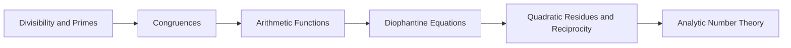

<!-- Generated by tools/build_indexes.py from tools/curriculum.json. Do not edit by hand. -->

# Number Theory

*The integers and their hidden structure*

[Mathematics](../README.md) › Number Theory

Divisibility, primes, congruences and Diophantine equations. Elementary to state, deep to prove, and the historical engine of algebraic abstraction.

## At a glance

| | |
|---|---|
| Topics | 6 (1 complete, 1 draft, 4 planned) |
| Estimated study time | ~58 hours |
| Prerequisites | [00-foundations](../00-foundations/README.md), [01-arithmetic](../01-arithmetic/README.md) |

## Study order

The numbers are the recommended order. Study a topic only after the ones before it —
the dependency chain below is the shortest safe route through the discipline.

## Topic inventory

| # | Topic | Level | Est. time | Status | Materials |
|---|---|---|---|---|---|
| 1 | [Divisibility and Primes](01-divisibility-and-primes/README.md) | Intermediate | 9 h | Complete | [Tutorial](01-divisibility-and-primes/README.md) · [Exercises](01-divisibility-and-primes/exercises.md) · [Solutions](01-divisibility-and-primes/solutions.md) |
| 2 | [Congruences](02-congruences/README.md) | Intermediate | 10 h | Draft | [Tutorial](02-congruences/README.md) |
| 3 | Arithmetic Functions | Advanced | 8 h | Planned | — |
| 4 | Diophantine Equations | Advanced | 9 h | Planned | — |
| 5 | Quadratic Residues and Reciprocity | Advanced | 10 h | Planned | — |
| 6 | Analytic Number Theory | Advanced | 12 h | Planned | — |

### What each topic covers

- **Divisibility and Primes** — The division algorithm, the Euclidean algorithm, uniqueness of factorisation.
- **Congruences** — Modular arithmetic, the Chinese remainder theorem, Euler and Fermat.
- **Arithmetic Functions** — Divisor functions, Möbius inversion, Euler's totient and multiplicativity.
- **Diophantine Equations** — Linear equations, Pell's equation, Pythagorean triples and Fermat's method.
- **Quadratic Residues and Reciprocity** — Legendre symbols, Gauss's lemma and the law of quadratic reciprocity.
- **Analytic Number Theory** — The prime number theorem, Dirichlet series, the zeta function and primes.

## Related disciplines

- [13-abstract-algebra](../13-abstract-algebra/README.md)
- [24-advanced-topics](../24-advanced-topics/README.md)

## Status key

- **Complete** — tutorial, exercises and full solutions exist and the tutorial meets the
  [authoring standard](../CONTRIBUTING.md).
- **Draft** — some material exists but the topic is not finished.
- **Planned** — identified in the curriculum, not written yet.

Overall progress and the full topic inventory live in [ROADMAP.md](../ROADMAP.md).
