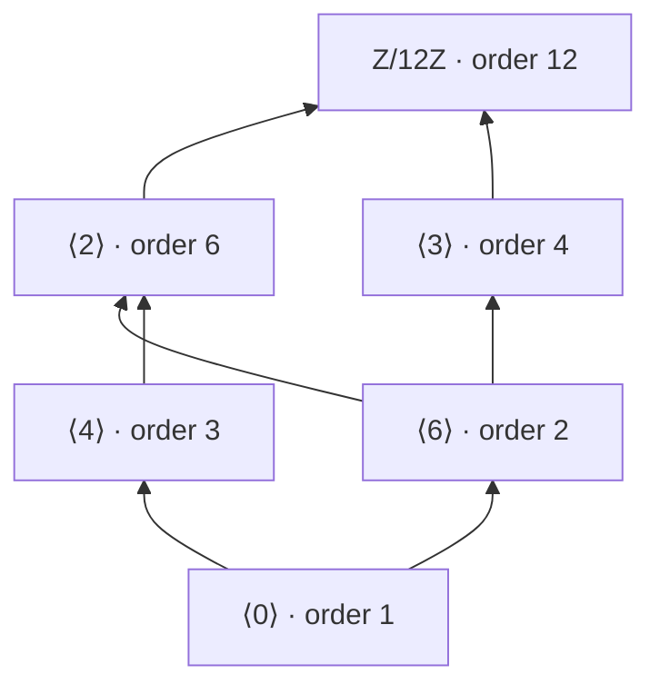
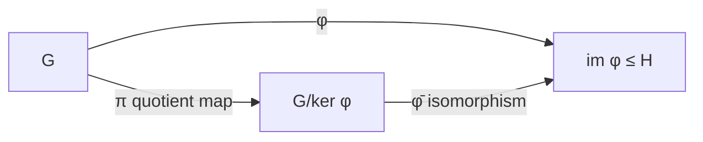
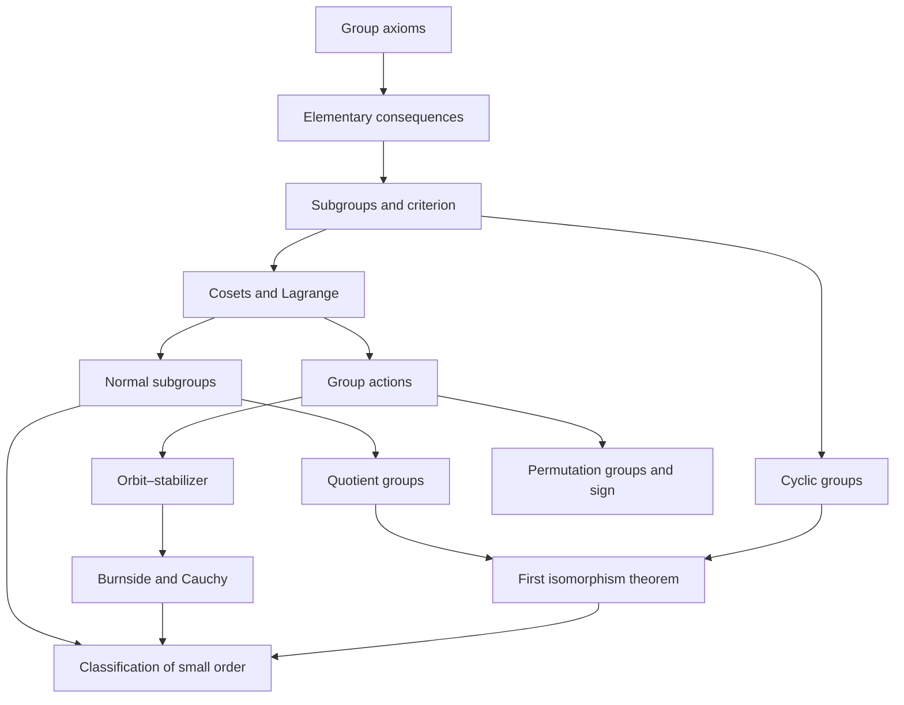

# Groups

> [Mathematics](../../README.md) › [Abstract Algebra](../README.md) › Groups · Level: Advanced · Prerequisites: [Set Theory](../../00-foundations/03-set-theory/README.md), [Relations and Functions](../../00-foundations/05-relations-and-functions/README.md), [Proof Techniques](../../00-foundations/04-proof-techniques/README.md), [Linear Algebra](../../08-linear-algebra/README.md), [Complex Numbers](../../03-algebra/13-complex-numbers/README.md) · Estimated time: 14 h

## 1. Introduction

Take a square. Rotate it by a quarter turn. It looks exactly as it did before. Reflect it in a diagonal; again nothing has visibly changed. Now do one of these motions after another — a rotation, then a reflection. The result is again a motion that leaves the square looking unchanged. Every such motion can be undone by another such motion. And there is a do-nothing motion. Three sentences, one object, and already we have closure, invertibility and an identity.

That is the whole idea of a group: **a group is the algebra of reversible actions.** The integers under addition are also a group, and so are the invertible $n \times n$ matrices under multiplication, and so are the residue classes modulo $n$ that are coprime to $n$. What these have in common is not what they are made of but how their elements combine. A group is that common behaviour, stripped of everything else.

The abstraction is not decoration. Any theorem proved from the axioms alone holds simultaneously for symmetries of a square, for integers, for matrices, for clock arithmetic, and for the permutations of a deck of cards. One proof, many theorems. This is why abstract algebra exists: it finds the *smallest* set of hypotheses that makes a body of arguments work, proves the arguments once, and then lets every example inherit them for free.

Historically the concept emerged from equations. Lagrange (1770) studied permutations of the roots of a polynomial; Ruffini and Abel showed that the general quintic cannot be solved by radicals; Galois (1832) explained exactly when it can, by attaching to each equation a collection of permutations closed under composition and inversion. Cauchy, Cayley and Sylvester worked with concrete groups of permutations and matrices; Kronecker and Weber, in the 1880s and 1890s, isolated the abstract axioms, and Burnside's *Theory of Groups of Finite Order* (1897) made the abstract viewpoint standard. The definition below has not changed since.

This tutorial develops the theory from the axioms to the point where the main structural theorems are available: Lagrange's theorem, the quotient construction, the first isomorphism theorem, group actions with orbit–stabilizer and Burnside's counting lemma, permutation groups with the sign homomorphism, direct products, and a first classification of groups of small order. Every theorem is proved; nothing is quoted without a citation.

## 2. Prerequisites

This tutorial is written for a reader who has completed the foundations of the repository. Specifically:

* **Sets, subsets, set-builder notation, cardinality of finite sets.** Taught in [Set Theory](../../00-foundations/03-set-theory/README.md). We constantly write $\{x \in G : x^2 = e\}$ and count elements.
* **Functions, injectivity, surjectivity, bijectivity, composition, inverse functions.** Taught in [Relations and Functions](../../00-foundations/05-relations-and-functions/README.md). A group action is a function $G \times X \to X$; a homomorphism is a function preserving structure; the isomorphism theorems are statements about bijections.
* **Equivalence relations and partitions.** Taught in [Relations and Functions](../../00-foundations/05-relations-and-functions/README.md). Cosets are the equivalence classes of a relation, and "the cosets partition the group" is the statement that equivalence classes partition a set.
* **Direct proof, proof by contradiction, proof by contrapositive, induction.** Taught in [Proof Techniques](../../00-foundations/04-proof-techniques/README.md) and [Mathematical Induction](../../09-discrete-mathematics/01-mathematical-induction/README.md). Almost every proof below is a direct verification with one or two quantifier manipulations; several need induction on the length of a product.
* **Integers, divisibility, the division algorithm, greatest common divisors, Bézout's identity.** Taught in [Integers](../../01-arithmetic/02-integers/README.md) and surveyed in [Number Theory](../../12-number-theory/README.md). The classification of cyclic groups uses the division algorithm, and the order of $a^k$ uses $\gcd$.
* **Congruences modulo $n$ and the ring $\mathbb{Z}/n\mathbb{Z}$.** Taught in [Integers](../../01-arithmetic/02-integers/README.md); the group-theoretic treatment of $\mathbb{Z}/n\mathbb{Z}$ appears in Section 7.4.
* **Matrices, matrix multiplication, determinants, invertibility.** Taught in [Linear Algebra](../../08-linear-algebra/README.md) and [Systems of Linear Equations](../../08-linear-algebra/03-systems-of-linear-equations/README.md). The general linear group $GL_n(\mathbb{R})$ is one of our running examples; we use only that matrix multiplication is associative, that $\det(AB) = \det A \det B$, and that $A$ is invertible iff $\det A \ne 0$.
* **Complex numbers, polar form, roots of unity, de Moivre's formula.** Taught in [Complex Numbers](../../03-algebra/13-complex-numbers/README.md). The group $\mu_n$ of $n$-th roots of unity is the cleanest example of a finite cyclic group.

Two conventions, matching [MATHEMATICAL_NOTATION.md](../../MATHEMATICAL_NOTATION.md): $\mathbb{N} = \{1,2,3,\dots\}$ and $\mathbb{N}_0 = \{0,1,2,\dots\}$; and $a \mid b$ means $b = ak$ for some $k \in \mathbb{Z}$.

## 3. Learning Objectives

By the end of this tutorial you will be able to:

1. State the group axioms and explain, with examples, which concrete structures they are abstracted from.
2. Verify the axioms for the standard examples: symmetry groups of figures, $(\mathbb{Z},+)$, $(\mathbb{Z}/n\mathbb{Z},+)$, $GL_n(\mathbb{R})$, $S_n$, the roots of unity, the quaternions.
3. Prove the elementary consequences: uniqueness of the identity and of inverses, the cancellation laws, $(ab)^{-1} = b^{-1}a^{-1}$, and the independence of the axiom system from its one-sided weakenings.
4. Compute the order of an element, use the identity $\operatorname{ord}(a^k) = \operatorname{ord}(a)/\gcd(\operatorname{ord}(a),k)$, and explain the difference between the order of an element and the order of a group.
5. Apply the subgroup criterion to decide whether a subset is a subgroup, and prove that intersections of subgroups are subgroups.
6. Prove that every subgroup of a cyclic group is cyclic, and classify cyclic groups up to isomorphism.
7. State and prove Lagrange's theorem, and derive the corollaries: the order of an element divides $|G|$, Fermat's little theorem, Euler's theorem, and the cyclicity of groups of prime order.
8. Prove that coset multiplication is well defined exactly when the subgroup is normal, and construct quotient groups.
9. Prove the first isomorphism theorem and use it to identify quotients in concrete situations.
10. Use group actions, the orbit–stabilizer theorem and Burnside's lemma to count objects up to symmetry.
11. Compute with permutations in cycle notation, determine the sign of a permutation two different ways, and work with $A_n$.
12. Classify the groups of order $1$ through $7$, and of order $10$ and $15$, up to isomorphism.

## 4. Intuition

### 4.1 Symmetry as a verb

A symmetry of a figure is a motion that puts the figure back on top of itself. The *set* of such motions is not interesting by itself; what is interesting is that motions can be **composed** and **undone**. Compose two symmetries and you get a symmetry; undo one and you get a symmetry; do nothing and you have a symmetry. Those are exactly the three requirements in the definition of a group, plus one bookkeeping requirement, associativity, which says that "do $f$, then $g$, then $h$" is unambiguous.

So a group is a set of *verbs*, not a set of nouns: transformations, with a rule for stringing them together and a rule for reversing them.

### 4.2 The multiplication table is the whole group

Suppose a group has four elements. Write them as row and column headings of a $4\times 4$ table and fill each cell with the product. That table — the **Cayley table** — determines the group completely: it tells you every product, hence every property that can be expressed using the operation. Two groups with the same table up to relabelling are "the same group" (isomorphic, Definition 7.7.4).

This is worth pausing on. It means that the identity of the elements is irrelevant. The group of rotations of a square by $0°, 90°, 180°, 270°$ and the group $\{0,1,2,3\}$ under addition modulo $4$ have the same table. They are the same group wearing different costumes. Abstraction is the act of noticing this.

### 4.3 Undo is what makes it work

Think of a game whose moves are operations on a Rubik's cube. Every move is reversible, and doing a move twice is another move. Now imagine a game where moves are *not* reversible: you may paint a square red, but not unpaint it. Composition is still there, but there is no inverse, and almost nothing can be proved: you cannot argue that two sequences of moves are equivalent by "cancelling" a common prefix, because cancellation is inverse in disguise.

The inverse axiom is precisely the licence to cancel, and cancellation is the workhorse of every proof in this tutorial.

### 4.4 Where the axioms come from

Look at three very different examples.

* The symmetries of a square: composition of functions, the identity function, the inverse function.
* $(\mathbb{Z}, +)$: addition of integers, the number $0$, the number $-a$.
* $GL_n(\mathbb{R})$: multiplication of matrices, the identity matrix, the inverse matrix.

In each case the axioms hold *for a reason*: composition of bijections is associative and invertible (Section 5.5 proves this once), addition of integers is associative and has additive inverses (an ordered ring), and matrix multiplication is associative with inverses for nonzero determinant. The abstract axioms are the intersection of these reasons. The payoff is that a proof from the axioms proves the statement in all three worlds at once — and in every world discovered tomorrow.

## 5. Formal Definition

### 5.1 Binary operations

**Definition 5.1.1.** A **binary operation** on a set $G$ is a function $\ast : G \times G \to G$. We write $a \ast b$ for the value at $(a,b)$ and say that $\ast$ is **closed** — the point of the definition is that $a \ast b$ must again be an element of $G$, not of some larger set.

Two operations on the same set can behave very differently: $a \ast b = a+b$ and $a \ast b = a-b$ are both binary operations on $\mathbb{Z}$, but only the first is associative (Section 5.7). Everything that follows is about the *behaviour* of $\ast$, never about the nature of the elements of $G$.

### 5.2 The group axioms

**Definition 5.2.1 (Group).** A **group** is a pair $(G, \ast)$ consisting of a set $G$ and a binary operation $\ast$ on $G$ such that:

* **(G1) Associativity.** For all $a, b, c \in G$, $\;(a \ast b) \ast c = a \ast (b \ast c)$.
* **(G2) Identity.** There exists $e \in G$ such that for all $a \in G$, $\;e \ast a = a \ast e = a$.
* **(G3) Inverses.** For every $a \in G$ there exists $b \in G$ with $\;a \ast b = b \ast a = e$.

A group is **abelian** (or **commutative**) if in addition

* **(G4) Commutativity.** For all $a,b \in G$, $\;a \ast b = b \ast a$.

The element $e$ is called the **identity** (or **neutral element**) and $b$ in (G3) is called **an inverse of** $a$. The **order** of $G$, written $|G|$, is the number of elements of $G$; it may be infinite. A group is **finite** if $|G|$ is finite.

Note carefully what (G2) and (G3) say: the identity must work on *both* sides, and an inverse must invert on *both* sides. Section 5.8 shows that one-sided versions of both axioms already force the two-sided versions, so the apparent strength costs nothing — but the definition as stated is the one every proof below uses.

### 5.3 Multiplicative and additive notation

For a general group we write the operation as multiplication: $ab$ means $a \ast b$, $e$ (or $1$) is the identity, $a^{-1}$ is the inverse, and $a^n$ is the $n$-fold product (Section 7.2 defines this for negative $n$ too). We call this **multiplicative notation**.

When the group is abelian, and especially when the operation is addition of numbers, we use **additive notation**: $a + b$, identity $0$, inverse $-a$, and $na$ instead of $a^n$.

| Concept | Multiplicative | Additive |
|---|---|---|
| operation | $ab$ | $a + b$ |
| identity | $e$ or $1$ | $0$ |
| inverse of $a$ | $a^{-1}$ | $-a$ |
| $n$-fold repeated operation | $a^n$ | $na$ |
| order of $a$ | least $n \ge 1$ with $a^n = e$ | least $n \ge 1$ with $na = 0$ |

Never mix the two in one computation. Writing $a^{-1}$ in an additive abelian group is a notation error even though the underlying idea is the same.

### 5.4 The order of a group

We write $|G|$ for the cardinality of the underlying set. For finite groups, $|G|$ is the number of rows of the Cayley table. The trivial group $\{e\}$ has order $1$. The order of a *group* is not the same as the order of an *element* (Definition 7.2.3), and confusing them is one of the common errors collected in Section 11.

### 5.5 The mother of all examples

**Definition 5.5.1.** For a set $X$, let $\operatorname{Sym}(X)$ be the set of all bijections $X \to X$, with the operation of composition: $(f \circ g)(x) = f(g(x))$.

**Theorem 5.5.2.** $(\operatorname{Sym}(X), \circ)$ is a group. Its identity is the identity map $\operatorname{id}_X$, and the inverse of $f$ is the inverse function $f^{-1}$.

*Proof.* **Closure.** If $f$ and $g$ are bijections $X \to X$, then $f \circ g$ is a bijection $X \to X$: it has inverse $g^{-1} \circ f^{-1}$, because
$$(f \circ g) \circ (g^{-1} \circ f^{-1}) = f \circ (g \circ g^{-1}) \circ f^{-1} = f \circ \operatorname{id}_X \circ f^{-1} = \operatorname{id}_X,$$
and similarly $(g^{-1} \circ f^{-1}) \circ (f \circ g) = \operatorname{id}_X$. So $\circ$ is a binary operation on $\operatorname{Sym}(X)$.

**(G1).** For $x \in X$,
$$\big((f \circ g) \circ h\big)(x) = (f \circ g)\big(h(x)\big) = f\big(g(h(x))\big) = f\big((g \circ h)(x)\big) = \big(f \circ (g \circ h)\big)(x),$$
so $(f \circ g) \circ h = f \circ (g \circ h)$; two functions with the same value at every point are equal.

**(G2).** $f \circ \operatorname{id}_X = f = \operatorname{id}_X \circ f$ by the definition of the identity map.

**(G3).** A bijection $f$ has an inverse function $f^{-1}$ with $f \circ f^{-1} = \operatorname{id}_X = f^{-1} \circ f$.

Hence all four requirements hold. $\blacksquare$

**Corollary 5.5.3.** The symmetries of any figure in the plane or in space form a group under composition.

*Proof.* A symmetry is a bijection of the ambient space that carries the figure onto itself. The composition of two such bijections is again one, the identity map is one, and the inverse of one is one; by Theorem 5.5.2 the axioms hold. $\blacksquare$

This corollary is the historical source of the word *group*: a group of symmetries. It also explains why every axiom in Definition 5.2.1 is exactly what it is. Associativity is the associativity of composition, the identity is "do nothing", and the inverse is "undo".

### 5.6 The standard examples

Each row of the following table is a group; the reader should be able to name the identity and the inverse from the definition, and Section 9 verifies several of them in detail.

| Group | Operation | Identity | Inverse of $a$ | Order |
|---|---|---|---|---|
| $(\mathbb{Z},+)$ | addition | $0$ | $-a$ | infinite |
| $(\mathbb{Q},+)$, $(\mathbb{R},+)$, $(\mathbb{C},+)$ | addition | $0$ | $-a$ | infinite |
| $(\mathbb{Q}^\times,\cdot)$, $(\mathbb{R}^\times,\cdot)$, $(\mathbb{C}^\times,\cdot)$ | multiplication | $1$ | $1/a$ | infinite |
| $(\mathbb{Z}/n\mathbb{Z},+)$ | addition mod $n$ | $\bar 0$ | $-\bar a$ | $n$ |
| $((\mathbb{Z}/n\mathbb{Z})^\times,\cdot)$ | multiplication mod $n$ | $\bar 1$ | Bézout inverse | $\varphi(n)$ |
| $\mu_n = \{z \in \mathbb{C} : z^n = 1\}$ | multiplication | $1$ | $\bar z = z^{-1}$ | $n$ |
| $S_n = \operatorname{Sym}(\{1,\dots,n\})$ | composition | $\operatorname{id}$ | $\sigma^{-1}$ | $n!$ |
| $GL_n(\mathbb{R})$ | matrix multiplication | $I_n$ | $A^{-1}$ | infinite |
| $SL_n(\mathbb{R}) = \{A : \det A = 1\}$ | matrix multiplication | $I_n$ | $A^{-1}$ | infinite |
| $D_n$ (symmetries of a regular $n$-gon) | composition | $\operatorname{id}$ | see Section 7.9 | $2n$ |
| $Q_8 = \{\pm 1, \pm i, \pm j, \pm k\}$ | quaternion multiplication | $1$ | $-i = i^{-1}$, etc. | $8$ |
| $\{e\}$ | trivial | $e$ | $e$ | $1$ |

Three entries deserve a comment.

* $\mathbb{Z}/n\mathbb{Z}$ is the set of residue classes modulo $n$ with addition defined by $\bar a + \bar b = \overline{a+b}$. This is well defined because $a \equiv a'$ and $b \equiv b'$ modulo $n$ imply $a+b \equiv a'+b'$ modulo $n$. Associativity is inherited from $\mathbb{Z}$; the identity is $\bar 0$ and the inverse of $\bar a$ is $\overline{-a}$. See [Integers](../../01-arithmetic/02-integers/README.md) for congruence arithmetic.
* $(\mathbb{Z}/n\mathbb{Z})^\times$ is the subset of classes $\bar a$ with $\gcd(a,n) = 1$. It is closed under multiplication, and $\bar a$ has an inverse by Bézout's identity: $\gcd(a,n)=1$ gives $ax + ny = 1$, so $\bar a \bar x = \bar 1$. Its order is $\varphi(n)$ by the definition of Euler's totient function.
* $Q_8$ is best defined as a subgroup of $GL_2(\mathbb{C})$: take
$$i \mapsto \begin{pmatrix} i & 0 \\ 0 & -i \end{pmatrix}, \qquad j \mapsto \begin{pmatrix} 0 & 1 \\ -1 & 0 \end{pmatrix}, \qquad k \mapsto \begin{pmatrix} 0 & i \\ i & 0 \end{pmatrix}.$$
The eight matrices $\pm I, \pm i, \pm j, \pm k$ are closed under multiplication and inversion (verify: the three generators square to $-I$ and satisfy $ij = k = -ji$), so by the subgroup criterion (Theorem 7.3.2) they form a group. This avoids checking $8 \times 8$ products by hand.

Convention: $D_n$ denotes the symmetry group of a regular $n$-gon and has order $2n$; some texts write $D_{2n}$ for the same group. This repository uses $D_n$.

### 5.7 Non-examples, and what each axiom is for

Knowing what fails is as instructive as knowing what holds.

| Structure | Why it is not a group |
|---|---|
| $(\mathbb{N}_0, +)$ | (G3) fails: $1$ has no inverse in $\mathbb{N}_0$ |
| $(\mathbb{Z}, \cdot)$ | (G3) fails: $2$ has no inverse in $\mathbb{Z}$ |
| $(\mathbb{Q}, \cdot)$ | (G3) fails: $0$ has no inverse |
| $(\mathbb{Z}, -)$ | (G1) fails: $(5-3)-1 = 1 \ne 3 = 5-(3-1)$; also (G2) fails |
| $(2\mathbb{Z}, \cdot)$ | (G2) fails: an identity would have to satisfy $e \cdot 2 = 2$, so $e = 1 \notin 2\mathbb{Z}$ |
| $(M_n(\mathbb{R}), \cdot)$ | (G3) fails: singular matrices have no inverse |
| $(\{z \in \mathbb{C} : |z| \le 1\}, \cdot)$ | (G3) fails: $0$ has no inverse, and $\tfrac12$ has inverse $2$ outside the set |

Each axiom earns its place by the theorems it makes possible.

* Without **(G1)**, the product $abc$ has no meaning, so no argument about products of three or more elements survives. Subtraction on $\mathbb{Z}$ shows that associativity is a genuine restriction, not a formality.
* Without **(G3)**, cancellation fails: in the monoid $(\mathbb{Z}, \cdot)$ we have $0 \cdot 1 = 0 \cdot 2$ with $1 \ne 2$. Proposition 7.1.3 shows that a group never behaves like this.
* Without **(G2)**, we cannot even state (G3), and the element $a^0$ has no meaning.

### 5.8 How weak can the axioms be?

The definition demands a two-sided identity and two-sided inverses; half of each suffices.

**Theorem 5.8.1 (one-sided axioms).** Let $G$ have an associative operation, a left identity $e$ (so $ea = a$ for all $a$) and left inverses (for each $a$ there is $b$ with $ba = e$). Then $G$ is a group, and $e$ is a two-sided identity while $b$ is a two-sided inverse of $a$.

*Proof.* Fix $a$ and $b$ with $ba = e$, and let $c$ satisfy $c(ab) = e$. Then
$$(ab)(ab) = a(ba)b = aeb = ab,$$
and therefore
$$ab = e(ab) = \big(c(ab)\big)(ab) = c\big((ab)(ab)\big) = c(ab) = e.$$
So every left inverse is also a right inverse. For the identity,
$$a = ea = (ba)a = a(ba) = (ab)a = ae,$$
so $e$ is two-sided. Hence (G2) and (G3) hold and $G$ is a group. $\blacksquare$

We keep the symmetric axioms because the examples satisfy them and because they are self-dual, but the redundancy shows that the axiom system is a choice, not a minimal set. Associativity was used in both displays; for non-associative "loops" the analogous statement fails.

## 6. Mathematical Notation

| Symbol | Read as | Meaning |
|---|---|---|
| $(G, \ast)$, or just $G$ | the group $G$ under $\ast$ | a set with a group operation |
| $ab$ | $a$ times $b$ | the product $a \ast b$ in multiplicative notation |
| $e$, $1$ | the identity | the neutral element of $G$ |
| $a^{-1}$ | $a$ inverse | the unique element with $aa^{-1} = a^{-1}a = e$ |
| $a^n$ | $a$ to the $n$ | $n$-fold product; defined for $n \in \mathbb{Z}$ in Section 7.2 |
| $|G|$ | order of $G$ | the number of elements of $G$ |
| $\operatorname{ord}(a)$ | order of $a$ | least $n \ge 1$ with $a^n = e$ |
| $a \equiv b \pmod n$ | $a$ congruent to $b$ mod $n$ | $n \mid (a-b)$ |
| $\mathbb{Z}/n\mathbb{Z}$ | $\mathbb{Z}$ mod $n$ | the additive group of residue classes |
| $(\mathbb{Z}/n\mathbb{Z})^\times$ | units mod $n$ | classes coprime to $n$, a group under multiplication |
| $\varphi(n)$ | Euler's totient | number of $k \in \{1,\dots,n\}$ with $\gcd(k,n)=1$ |
| $\mu_n$ | the $n$-th roots of unity | $\{z \in \mathbb{C} : z^n = 1\}$ |
| $H \le G$ | $H$ is a subgroup of $G$ | $H \subseteq G$ and $H$ is a group under the restricted operation |
| $H < G$ | $H$ is a proper subgroup | $H \le G$ and $H \ne G$ |
| $\langle a \rangle$ | the subgroup generated by $a$ | $\{a^n : n \in \mathbb{Z}\}$ |
| $\langle S \rangle$ | the subgroup generated by $S$ | smallest subgroup containing $S$ |
| $aH$, $Ha$ | left coset, right coset | $\{ah : h \in H\}$ and $\{ha : h \in H\}$ |
| $[G:H]$ | index of $H$ in $G$ | the number of distinct left cosets |
| $H \trianglelefteq G$ | $H$ is normal in $G$ | $gHg^{-1} = H$ for all $g \in G$ |
| $G/H$ | $G$ modulo $H$ | the quotient group, defined when $H \trianglelefteq G$ |
| $\varphi : G \to H$ | homomorphism phi | a map with $\varphi(ab) = \varphi(a)\varphi(b)$ |
| $\ker \varphi$ | kernel of $\varphi$ | $\{g \in G : \varphi(g) = e_H\}$ |
| $\operatorname{im} \varphi$ | image of $\varphi$ | $\{\varphi(g) : g \in G\}$ |
| $G \cong H$ | $G$ is isomorphic to $H$ | there is a bijective homomorphism $G \to H$ |
| $\operatorname{Aut}(G)$ | automorphism group | isomorphisms $G \to G$ |
| $\operatorname{Inn}(G)$ | inner automorphisms | conjugations $x \mapsto gxg^{-1}$ |
| $Z(G)$ | centre of $G$ | $\{z \in G : zg = gz \text{ for all } g\}$ |
| $C_G(a)$ | centraliser of $a$ | $\{g \in G : ga = ag\}$ |
| $N_G(H)$ | normaliser of $H$ | $\{g \in G : gHg^{-1} = H\}$ |
| $G'$ | commutator subgroup | subgroup generated by all $aba^{-1}b^{-1}$ |
| $S_n$ | symmetric group | all permutations of $\{1,\dots,n\}$ |
| $A_n$ | alternating group | the even permutations, $\ker(\operatorname{sgn})$ |
| $\operatorname{sgn}(\sigma)$ | sign of $\sigma$ | $+1$ for even, $-1$ for odd |
| $(a_1\,a_2\,\cdots\,a_k)$ | a $k$-cycle | $a_1 \mapsto a_2 \mapsto \cdots \mapsto a_k \mapsto a_1$ |
| $D_n$ | dihedral group | symmetries of a regular $n$-gon, $|D_n| = 2n$ |
| $GL_n(\mathbb{R})$, $SL_n(\mathbb{R})$ | general, special linear group | invertible matrices; those with determinant $1$ |
| $Q_8$ | quaternion group | $\{\pm1, \pm i, \pm j, \pm k\}$ |
| $G \times H$ | direct product | pairs $(g,h)$ with componentwise operation |
| $G \cdot x$, $G_x$ | orbit, stabiliser of $x$ | $\{gx : g \in G\}$ and $\{g \in G : gx = x\}$ |
| $\operatorname{Fix}(g)$ | fixed-point set | $\{x \in X : gx = x\}$ |
| $\operatorname{Sym}(X)$ | symmetric group on $X$ | all bijections $X \to X$ |
| $K \le G$, $K \trianglelefteq G$ | — | read "$K$ subgroup of $G$", "$K$ normal in $G$" |

## 7. Core Concepts

### 7.1 Elementary consequences of the axioms

Everything in this subsection is proved from (G1)–(G3) alone, so it holds in every group. Each proof is short; read them until the moves become automatic, because they are the moves used for the rest of the subject.

**Proposition 7.1.1 (the identity is unique).** A group has exactly one identity element.

*Proof.* Suppose $e$ and $e'$ both satisfy (G2). Applying (G2) to $e$ with identity $e'$ gives $e = e e'$, and applying (G2) to $e'$ with identity $e$ gives $e e' = e'$. Hence $e = e e' = e'$. $\blacksquare$

**Proposition 7.1.2 (inverses are unique).** Let $a \in G$. If $ab = ba = e$ and $ac = ca = e$, then $b = c$. Hence $a$ has exactly one inverse, written $a^{-1}$.

*Proof.*
$$b = be = b(ac) = (ba)c = ec = c,$$
where the middle equality is associativity and the outer equalities use the two hypotheses. $\blacksquare$

**Proposition 7.1.3 (cancellation laws).** In a group, $ab = ac \Rightarrow b = c$ and $ba = ca \Rightarrow b = c$.

*Proof.* Multiply $ab = ac$ on the left by $a^{-1}$ and use associativity:
$$b = eb = (a^{-1}a)b = a^{-1}(ab) = a^{-1}(ac) = (a^{-1}a)c = ec = c.$$
The right-hand law is proved by multiplying on the right by $a^{-1}$. $\blacksquare$

Cancellation is what makes the Cayley table of a group a **Latin square**: no element repeats in a row or in a column. Compare Section 5.7, where $0\cdot 1 = 0 \cdot 2$ in the monoid $(\mathbb{Z},\cdot)$.

**Proposition 7.1.4 (socks and shoes).** For all $a, b \in G$: $(a^{-1})^{-1} = a$ and $(ab)^{-1} = b^{-1}a^{-1}$. More generally, for $n \ge 1$,
$$(a_1 a_2 \cdots a_n)^{-1} = a_n^{-1} \cdots a_2^{-1} a_1^{-1}.$$

*Proof.* Since $aa^{-1} = e = a^{-1}a$, the element $a$ satisfies the defining equations for an inverse of $a^{-1}$; by uniqueness (Proposition 7.1.2), $(a^{-1})^{-1} = a$.

For the product, compute
$$(ab)(b^{-1}a^{-1}) = a(bb^{-1})a^{-1} = aea^{-1} = aa^{-1} = e,$$
and similarly $(b^{-1}a^{-1})(ab) = e$. By uniqueness of inverses, $(ab)^{-1} = b^{-1}a^{-1}$. The general formula follows by induction on $n$: the case $n = 1$ is trivial, and
$$(a_1 \cdots a_n a_{n+1})^{-1} = \big((a_1\cdots a_n)a_{n+1}\big)^{-1} = a_{n+1}^{-1}(a_1\cdots a_n)^{-1} = a_{n+1}^{-1} a_n^{-1} \cdots a_1^{-1}. \qquad \blacksquare$$

The mnemonic is *socks and shoes*: to undo "put on socks, then shoes" you must "remove shoes, then socks". The order reverses. Note that $(ab)^{-1} = a^{-1}b^{-1}$ is **false** in a non-abelian group: in $S_3$, $((1\,2)(1\,3))^{-1} = (1\,3)(1\,2) \ne (1\,2)(1\,3)$.

**Proposition 7.1.5 (a one-sided inverse is an inverse).** If $ab = e$ then $b = a^{-1}$. Consequently $a^2 = e$ if and only if $a = a^{-1}$.

*Proof.* If $ab = e$, then
$$b = eb = (a^{-1}a)b = a^{-1}(ab) = a^{-1}e = a^{-1}.$$
For the second claim: if $a^2 = e$ then $a a = e$, so $a = a^{-1}$ by the first part. Conversely if $a = a^{-1}$ then $a^2 = a a^{-1} = e$. $\blacksquare$

**Proposition 7.1.6 (the inverse of a product in abelian groups).** If $G$ is abelian then $(ab)^n = a^n b^n$ for all $n \in \mathbb{Z}$.

*Proof.* For $n \ge 0$ this is induction using $ab = ba$ (Section 7.2, Proposition 7.2.2); for $n < 0$ apply the positive case to $a^{-1}, b^{-1}$, which also commute. $\blacksquare$

In a non-abelian group, $(ab)^2 = abab$, and this equals $a^2b^2$ only when $ab = ba$. This distinction is the source of a large fraction of student errors; see Section 11.

### 7.2 Powers of an element and the order of an element

**Definition 7.2.1 (integer powers).** For $a \in G$ define
$$a^0 = e, \qquad a^{n+1} = a^n a \ \ (n \ge 0), \qquad a^{-n} = (a^{-1})^{n} \ \ (n \ge 1).$$

**Proposition 7.2.2 (laws of exponents).** For all $a \in G$ and all $m, n \in \mathbb{Z}$:
$$a^{m+n} = a^m a^n, \qquad (a^m)^n = a^{mn}, \qquad a^{-n} = (a^n)^{-1}.$$
If $ab = ba$ then also $(ab)^n = a^n b^n$.

*Proof.* **First law, $m, n \ge 0$.** Fix $m \ge 0$ and induct on $n$: for $n = 0$ both sides are $a^m$; if $a^{m+n} = a^m a^n$ then
$$a^{m+(n+1)} = a^{(m+n)+1} = a^{m+n}a = (a^m a^n)a = a^m(a^n a) = a^m a^{n+1}.$$
**Extension to negative exponents.** First, $(a^{-1})^n a^n = e$ for $n \ge 0$, by induction: for $n=0$ clear, and if $(a^{-1})^n a^n = e$ then
$$(a^{-1})^{n+1}a^{n+1} = a^{-1}\big((a^{-1})^n a^n\big)a = a^{-1}ea = e.$$
So $(a^{-1})^n = (a^n)^{-1}$, which proves the third law. Then, for $m \in \mathbb{Z}$ arbitrary and $n \ge 0$,
$$a^{m+n} = a^m a^n$$
follows by writing $m = m' - k$ with $m' \ge 0$ and reducing to the positive case; the details are a routine case check. The second law follows from the first by induction on $n \ge 0$: $(a^m)^{n+1} = (a^m)^n a^m = a^{mn}a^m = a^{mn+m}$. For $n < 0$, use the third law.

**The abelian case.** If $ab = ba$, induction gives $(ab)^n = a^n b^n$ for $n \ge 0$: the step is
$$(ab)^{n+1} = (ab)^n (ab) = a^n b^n a b = a^n a\, b^n b = a^{n+1}b^{n+1},$$
where $b^n a = a b^n$ is itself proved by induction from $ba = ab$. Negative $n$ follows from the positive case applied to $a^{-1},b^{-1}$. $\blacksquare$

**Definition 7.2.3 (order of an element).** The **order** of $a \in G$, written $\operatorname{ord}(a)$, is the least $n \in \mathbb{N}$ such that $a^n = e$, if such an $n$ exists; otherwise $\operatorname{ord}(a) = \infty$.

So $\operatorname{ord}(a) = 1$ iff $a = e$, and $\operatorname{ord}(a) = 2$ iff $a \ne e$ but $a^2 = e$.

**Proposition 7.2.4 (arithmetic of the order).** Let $a \in G$ have finite order $n$. Then:

1. $a^k = e$ if and only if $n \mid k$;
2. $a^i = a^j$ if and only if $i \equiv j \pmod n$;
3. $\langle a \rangle = \{e, a, a^2, \dots, a^{n-1}\}$ has exactly $n$ elements;
4. $\operatorname{ord}(a) = |\langle a \rangle|$.

*Proof.* (1) Write $k = qn + r$ with $q \in \mathbb{Z}$ and $0 \le r < n$ (division algorithm). Then $a^k = (a^n)^q a^r = a^r$. If $r > 0$ then $0 < r < n$ and $a^r \ne e$ by minimality of $n$; hence $a^k = e$ forces $r = 0$, i.e. $n \mid k$. Conversely if $n \mid k$ then $a^k = (a^n)^{k/n} = e$.

(2) $a^i = a^j \iff a^{i-j} = e \iff n \mid (i-j)$, using (1) and the multiplication law.

(3) By definition $\langle a \rangle = \{a^k : k \in \mathbb{Z}\}$, and by (1) every $a^k$ equals some $a^r$ with $0 \le r < n$. The $n$ elements $e, a, \dots, a^{n-1}$ are distinct by (2), since $0 \le i < j < n$ gives $0 < j - i < n$, which is not divisible by $n$.

(4) is immediate from (3). $\blacksquare$

**Proposition 7.2.5.** Let $a \in G$ with $\operatorname{ord}(a) = n < \infty$, and let $k \in \mathbb{Z}$. Then
$$\operatorname{ord}(a^k) = \frac{n}{\gcd(n,k)}.$$

*Proof.* Let $d = \gcd(n,k)$, $n = d n_1$, $k = d k_1$ with $\gcd(n_1,k_1)=1$. Then $(a^k)^{n_1} = a^{k n_1} = a^{d k_1 n_1} = (a^n)^{k_1} = e$, so $\operatorname{ord}(a^k) \mid n_1$ by Proposition 7.2.4(1). Conversely, if $(a^k)^m = e$ then $n \mid km$, so $n_1 \mid k_1 m$; since $\gcd(n_1,k_1)=1$, $n_1 \mid m$. Hence $n_1$ is the least positive $m$ with $(a^k)^m = e$. $\blacksquare$

**Proposition 7.2.6.** For all $a,b \in G$: $\operatorname{ord}(a) = \operatorname{ord}(a^{-1})$ and $\operatorname{ord}(ab) = \operatorname{ord}(ba)$.

*Proof.* $(a^{-1})^n = (a^n)^{-1}$ by Proposition 7.2.2, and this is $e$ iff $a^n = e$; so the two orders have the same set of positive exponents and hence are equal.

For the second, note that for $n \ge 1$,
$$(ab)^n = a(ba)^{n-1}b,$$
which is proved by induction: for $n=1$ both sides are $ab$; the step multiplies by $ab$ on the right and regroups as $a(ba)^{n-1}(ba)b$. Hence
$$(ab)^n = e \iff a(ba)^{n-1}b = e \iff (ba)^{n-1} = a^{-1}b^{-1} = (ba)^{-1} \iff (ba)^n = e,$$
using cancellation and Proposition 7.1.5. So $(ab)^n = e$ and $(ba)^n = e$ hold for exactly the same $n$, giving equal orders (including the case $\infty$). $\blacksquare$

**Warning.** $\operatorname{ord}(ab) = \operatorname{ord}(a)\operatorname{ord}(b)$ is false in general. In $S_3$, with $a = (1\,2)$ of order $2$ and $b = (1\,2\,3)$ of order $3$, the product $ab = (2\,3)$ has order $2$, not $6$. Sufficient conditions for multiplicativity are given in Exercise 14.

### 7.3 Subgroups and the subgroup criterion

**Definition 7.3.1 (subgroup).** A subset $H \subseteq G$ is a **subgroup** of $G$, written $H \le G$, if $H$ is nonempty and $H$ is a group under the restriction of the operation of $G$. If $H \ne G$ we write $H < G$. The trivial subgroup is $\{e\}$.

Since the operation is inherited, (G1) is automatic; what must be checked is that $H$ is closed under the operation, contains $e$, and contains inverses. The following criterion packages the last two into one condition.

**Theorem 7.3.2 (subgroup criterion).** A nonempty subset $H \subseteq G$ is a subgroup if and only if
$$\text{for all } a, b \in H: \quad ab^{-1} \in H.$$

*Proof.* ($\Rightarrow$) If $H \le G$ and $a, b \in H$, then $b^{-1} \in H$ and $ab^{-1} \in H$ by closure.

($\Leftarrow$) Assume the condition. Since $H \ne \varnothing$, choose $a \in H$. Then $e = aa^{-1} \in H$. Now let $a \in H$; applying the condition to the pair $(e, a)$, which both lie in $H$, gives $ea^{-1} = a^{-1} \in H$. Finally, if $a, b \in H$ then $b^{-1} \in H$, so applying the condition to $(a, b^{-1})$ gives $a(b^{-1})^{-1} = ab \in H$. Hence $H$ contains $e$, is closed under multiplication and under inverses, and is a subgroup. $\blacksquare$

**Theorem 7.3.3 (two-step test).** A subset $H \subseteq G$ is a subgroup if and only if $e \in H$, $H$ is closed under multiplication, and $H$ is closed under inverses.

*Proof.* Necessity is clear. For sufficiency, the three conditions make $H$ a group: (G1) is inherited, (G2) holds because $e \in H$ and $e$ is the identity of $G$, and (G3) holds by closure under inverses. $\blacksquare$

**Theorem 7.3.4 (finite subgroup test).** Let $G$ be a group and $H \subseteq G$ a nonempty **finite** subset closed under multiplication. Then $H \le G$.

*Proof.* Fix $a \in H$ and consider the map $f : H \to H$, $f(x) = ax$. It takes values in $H$ because $H$ is closed under multiplication, and it is injective because $ax = ay$ implies $x = y$ by cancellation. A injective map from a finite set to itself is surjective, so $a$ is in the image: there is $x \in H$ with $ax = a$. Cancelling $a$ gives $x = e$, so $e \in H$. Applying surjectivity again, there is $y \in H$ with $ay = e$, so $y = a^{-1} \in H$. By Theorem 7.3.3, $H \le G$. $\blacksquare$

The finiteness hypothesis cannot be dropped: $\mathbb{N}_0 \subseteq \mathbb{Z}$ is closed under addition but is not a subgroup of $(\mathbb{Z},+)$.

**Example 7.3.5 (standard subgroups).**

* $n\mathbb{Z} = \{nk : k \in \mathbb{Z}\} \le \mathbb{Z}$ for every $n \ge 0$. (Criterion: $nk - nm = n(k-m)$.)
* $\mu_n = \{z \in \mathbb{C} : z^n = 1\} \le \mathbb{C}^\times$, and the unit circle $S^1 = \{z : |z| = 1\} \le \mathbb{C}^\times$. ($z^n = w^n = 1 \Rightarrow (z w^{-1})^n = 1$; and $|z| = |w| = 1 \Rightarrow |zw^{-1}| = 1$.)
* $SL_n(\mathbb{R}) = \{A \in GL_n(\mathbb{R}) : \det A = 1\} \le GL_n(\mathbb{R})$, because $\det(AB^{-1}) = \det A \det B^{-1} = 1 \cdot 1 = 1$.
* The **centre** $Z(G) = \{z \in G : zg = gz \text{ for all } g \in G\}$ is a subgroup. ($z_1, z_2$ central $\Rightarrow$ $z_1z_2^{-1}$ central, since $z_1z_2^{-1}g = z_1 g z_2^{-1} = g z_1 z_2^{-1}$.)
* The **centraliser** $C_G(a) = \{g \in G : ga = ag\}$ is a subgroup for each $a \in G$, by the same computation.
* $\langle a \rangle = \{a^k : k \in \mathbb{Z}\} \le G$; by Proposition 7.2.4 its order is $\operatorname{ord}(a)$.

**Theorem 7.3.6.** The intersection of any nonempty family of subgroups of $G$ is a subgroup of $G$.

*Proof.* Let $(H_i)_{i \in I}$ be subgroups and $H = \bigcap_i H_i$. Each $H_i$ contains $e$, so $e \in H$ and $H \ne \varnothing$. If $a, b \in H$ then $ab^{-1} \in H_i$ for every $i$, hence $ab^{-1} \in H$. By Theorem 7.3.2, $H \le G$. $\blacksquare$

A **union** of subgroups need not be a subgroup: in $S_3$, $\langle (1\,2)\rangle \cup \langle (1\,3)\rangle = \{e, (1\,2), (1\,3)\}$ is not closed, since $(1\,2)(1\,3) = (1\,3\,2)$ is missing.

**Definition 7.3.7 (generated subgroup).** For $S \subseteq G$, the subgroup **generated** by $S$ is
$$\langle S \rangle = \bigcap \{H : S \subseteq H \le G\},$$
the intersection of all subgroups containing $S$; it is a subgroup by Theorem 7.3.6 and is the smallest subgroup containing $S$. For $S = \{a\}$ this agrees with $\{a^k : k \in \mathbb{Z}\}$.

**Proposition 7.3.8.** $\langle S \rangle$ is the set of all finite products $s_1 s_2 \cdots s_k$ with $k \ge 0$ and each $s_i$ either in $S$ or the inverse of an element of $S$. (For $k=0$ the empty product is $e$.)

*Proof.* Let $T$ be the set of such products. It is nonempty (contains $e$), closed under multiplication, and closed under inverses because the inverse of $s_1\cdots s_k$ is $s_k^{-1}\cdots s_1^{-1}$, again a product of the allowed form (Proposition 7.1.4). So $T \le G$ by Theorem 7.3.3, and $S \subseteq T$. Since $\langle S\rangle$ is the smallest subgroup containing $S$, $\langle S \rangle \subseteq T$. Conversely every subgroup containing $S$ contains all such products, so $T \subseteq \langle S\rangle$. Hence $T = \langle S\rangle$. $\blacksquare$

### 7.4 Cyclic groups and their classification

**Definition 7.4.1.** A group $G$ is **cyclic** if $G = \langle g \rangle$ for some $g \in G$; then $g$ is a **generator**.

Examples: $(\mathbb{Z},+) = \langle 1\rangle$; $(\mathbb{Z}/n\mathbb{Z},+) = \langle \bar 1\rangle$; $\mu_n = \langle e^{2\pi i/n}\rangle$; $((\mathbb{Z}/7\mathbb{Z})^\times,\cdot) = \langle \bar 3\rangle$ since the powers of $3$ are $3,2,6,4,5,1$ modulo $7$. Not every group is cyclic: $S_3$ is not, because it has no element of order $6$.

**Theorem 7.4.2 (subgroups of cyclic groups are cyclic).** Every subgroup of a cyclic group is cyclic. In particular every subgroup of $\mathbb{Z}$ is $n\mathbb{Z}$ for some $n \ge 0$.

*Proof.* Let $G = \langle g\rangle$ and let $H \le G$. If $H = \{e\}$ then $H = \langle e \rangle$. Otherwise $H$ contains some $g^m$ with $m \ne 0$, hence some $g^{|m|}$ with $|m| \ge 1$ (inverses are in $H$). Let
$$n = \min\{k \ge 1 : g^k \in H\},$$
which exists by well-ordering. We claim $H = \langle g^n \rangle$. One inclusion is clear. For the other, take $h \in H$; write $h = g^m$ and divide $m = qn + r$ with $0 \le r < n$. Then
$$g^r = g^{m - qn} = g^m (g^n)^{-q} \in H$$
because $g^m \in H$ and $g^n \in H$. By the minimality of $n$, $r = 0$. Hence $h = (g^n)^q \in \langle g^n\rangle$. $\blacksquare$

**Theorem 7.4.3 (classification of cyclic groups).** Let $G = \langle g\rangle$.

1. If $\operatorname{ord}(g) = \infty$, then $G \cong (\mathbb{Z},+)$ via $k \mapsto g^k$.
2. If $\operatorname{ord}(g) = n$, then $G \cong (\mathbb{Z}/n\mathbb{Z},+)$ via $k + n\mathbb{Z} \mapsto g^k$.

*Proof.* In both cases the map $\psi$ is well defined: in case 2, if $k \equiv k' \pmod n$ then $n \mid (k-k')$, so $g^{k-k'} = e$ by Proposition 7.2.4(1), hence $g^k = g^{k'}$. It is a homomorphism by the law of exponents: $\psi(k + k') = g^{k+k'} = g^k g^{k'}$. It is injective: if $g^k = g^{k'}$ then $g^{k-k'} = e$, which forces $k = k'$ when the order is infinite and $n \mid (k-k')$ when the order is $n$. It is surjective because every element of $G$ is a power of $g$. Hence $\psi$ is an isomorphism. $\blacksquare$

Thus **up to isomorphism there is exactly one cyclic group of each finite order $n$, and exactly one infinite cyclic group.** The finite one is written $C_n$ or $\mathbb{Z}/n\mathbb{Z}$; the infinite one is $\mathbb{Z}$.

**Lemma 7.4.4.** Let $g$ have order $n$, and let $k \in \mathbb{Z}$ with $d = \gcd(n,k)$. Then $\langle g^k \rangle = \langle g^d \rangle$.

*Proof.* Since $d \mid k$, $g^k = (g^d)^{k/d} \in \langle g^d\rangle$, so $\langle g^k\rangle \subseteq \langle g^d\rangle$. By Bézout's identity there are $x, y \in \mathbb{Z}$ with $d = xk + yn$, so
$$g^d = g^{xk+yn} = (g^k)^x (g^n)^y = (g^k)^x \in \langle g^k\rangle,$$
giving the reverse inclusion. $\blacksquare$

**Theorem 7.4.5 (subgroup structure of a cyclic group).** Let $G = \langle g\rangle$ have order $n < \infty$. For every divisor $d$ of $n$ there is exactly one subgroup of order $d$, namely $\langle g^{n/d}\rangle$, and these are all the subgroups of $G$.

*Proof.* By Theorem 7.4.2 every subgroup has the form $\langle g^k\rangle$. By Proposition 7.2.5 and Lemma 7.4.4,
$$\big|\langle g^k\rangle\big| = \operatorname{ord}(g^k) = \frac{n}{\gcd(n,k)},$$
so a subgroup of order $d$ requires $\gcd(n,k) = n/d$, and then $\langle g^k\rangle = \langle g^{n/d}\rangle$. This both exhibits a subgroup of order $d$ (namely $\langle g^{n/d}\rangle$, whose elements have order $n/(n/d) = d$) and shows it is unique. $\blacksquare$

**Corollary 7.4.6 (number of generators).** A cyclic group of order $n$ has exactly $\varphi(n)$ generators: $g^k$ generates if and only if $\gcd(k,n)=1$.

*Proof.* By Proposition 7.2.5, $\operatorname{ord}(g^k) = n/\gcd(n,k)$, which equals $n$ exactly when $\gcd(n,k)=1$. The number of $k \in \{0,1,\dots,n-1\}$ with $\gcd(k,n)=1$ is the definition of $\varphi(n)$. $\blacksquare$

**Corollary 7.4.7.** $(\mathbb{Z},+)$ has exactly the subgroups $n\mathbb{Z}$ ($n \ge 0$), and $\mathbb{Z}/n\mathbb{Z}$ has exactly one subgroup of each order $d \mid n$.

Both statements follow from Theorems 7.4.2 and 7.4.5 with $\mathbb{Z} = \langle 1\rangle$ and $\mathbb{Z}/n\mathbb{Z} = \langle \bar 1\rangle$.

**Example 7.4.8.** The subgroups of $\mathbb{Z}/12\mathbb{Z}$ correspond to the six divisors of $12$:

| Order | Subgroup | Elements |
|---|---|---|
| $1$ | $\langle \overline{0}\rangle$ | $\{\bar 0\}$ |
| $2$ | $\langle \overline{6}\rangle$ | $\{\bar 0, \bar 6\}$ |
| $3$ | $\langle \overline{4}\rangle$ | $\{\bar 0, \bar 4, \bar 8\}$ |
| $4$ | $\langle \overline{3}\rangle$ | $\{\bar 0, \bar 3, \bar 6, \bar 9\}$ |
| $6$ | $\langle \overline{2}\rangle$ | $\{\bar 0,\bar 2,\bar 4,\bar 6,\bar 8,\overline{10}\}$ |
| $12$ | $\langle \overline{1}\rangle$ | all of $\mathbb{Z}/12\mathbb{Z}$ |

There are $\varphi(12) = 4$ generators, namely $\bar 1, \bar 5, \bar 7, \overline{11}$.

### 7.5 Cosets and Lagrange's theorem

**Definition 7.5.1 (cosets).** Let $H \le G$ and $a \in G$. The **left coset** of $H$ through $a$ is $aH = \{ah : h \in H\}$; the **right coset** is $Ha = \{ha : h \in H\}$.

**Lemma 7.5.2 (cosets are the classes of an equivalence relation).** Define $a \sim b$ iff $a^{-1}b \in H$. Then $\sim$ is an equivalence relation on $G$, and the equivalence class of $a$ is exactly $aH$.

*Proof.* **Reflexive:** $a^{-1}a = e \in H$. **Symmetric:** if $a^{-1}b \in H$ then $(a^{-1}b)^{-1} = b^{-1}a \in H$ because $H$ is closed under inverses. **Transitive:** if $a^{-1}b \in H$ and $b^{-1}c \in H$ then $a^{-1}c = (a^{-1}b)(b^{-1}c) \in H$ by closure.

For the class: $b \in [a] \iff a^{-1}b \in H \iff a^{-1}b = h$ for some $h \in H$ $\iff b = ah \in aH$. $\blacksquare$

**Corollary 7.5.3.** The left cosets of $H$ form a partition of $G$: distinct cosets are disjoint and their union is $G$. Moreover, for $a, b \in G$,
$$aH = bH \iff a^{-1}b \in H \iff b \in aH.$$

This is the standard correspondence between equivalence relations and partitions (see [Relations and Functions](../../00-foundations/05-relations-and-functions/README.md)).

**Lemma 7.5.4 (cosets have the same size as $H$).** The map $h \mapsto ah$ is a bijection $H \to aH$; hence $|aH| = |H|$ for every $a$, and $a \in aH$ (take $h = e$).

*Proof.* The map is surjective by the definition of $aH$ and injective by left cancellation (Proposition 7.1.3). $\blacksquare$

**Theorem 7.5.5 (Lagrange).** Let $G$ be a finite group and $H \le G$. Then
$$|G| = [G:H] \cdot |H|,$$
where $[G:H]$ denotes the number of distinct left cosets of $H$ in $G$. In particular $|H|$ divides $|G|$.

*Proof.* By Corollary 7.5.3 the distinct left cosets $a_1H, \dots, a_kH$ partition $G$, so they are pairwise disjoint with union $G$. Therefore
$$|G| = \sum_{i=1}^{k} |a_iH| = \sum_{i=1}^{k} |H| = k\,|H| = [G:H]\cdot|H|,$$
where the second equality is Lemma 7.5.4 and $k = [G:H]$. $\blacksquare$

The number of right cosets equals the number of left cosets, since $aH \mapsto Ha^{-1}$ is a bijection between the two families; so $[G:H]$ can be computed either way.

**Corollary 7.5.6.** Let $G$ be finite and $a \in G$. Then $\operatorname{ord}(a)$ divides $|G|$, and $a^{|G|} = e$.

*Proof.* $\langle a\rangle$ is a subgroup of order $\operatorname{ord}(a)$ by Proposition 7.2.4(4); Lagrange gives $\operatorname{ord}(a) \mid |G|$. Write $|G| = m \operatorname{ord}(a)$; then $a^{|G|} = (a^{\operatorname{ord}(a)})^m = e^m = e$. $\blacksquare$

**Corollary 7.5.7 (Fermat's little theorem).** If $p$ is prime and $p \nmid a$, then
$$a^{p-1} \equiv 1 \pmod p.$$

*Proof.* The classes $\bar 1, \bar 2, \dots, \overline{p-1}$ are exactly the residue classes coprime to $p$, and they form a group $(\mathbb{Z}/p\mathbb{Z})^\times$ of order $p-1$ under multiplication modulo $p$ (Section 5.6). Since $p \nmid a$, the class $\bar a$ is an element of this group, so by Corollary 7.5.6, $\bar a^{p-1} = \bar 1$, which is the congruence claimed. $\blacksquare$

**Corollary 7.5.8 (Euler's theorem).** If $\gcd(a,n) = 1$ then $a^{\varphi(n)} \equiv 1 \pmod n$.

*Proof.* Same argument with the group $(\mathbb{Z}/n\mathbb{Z})^\times$ of order $\varphi(n)$. $\blacksquare$

**Corollary 7.5.9.** Every group of prime order is cyclic, and every group of order $p$ is isomorphic to $\mathbb{Z}/p\mathbb{Z}$.

*Proof.* Let $|G| = p$ prime and $a \ne e$. Then $\operatorname{ord}(a) > 1$ and $\operatorname{ord}(a) \mid p$, so $\operatorname{ord}(a) = p$ and $\langle a\rangle = G$. By Theorem 7.4.3, $G \cong \mathbb{Z}/p\mathbb{Z}$. $\blacksquare$

**Corollary 7.5.10 (index tower).** If $K \le H \le G$ with $[G:K]$ finite, then
$$[G:K] = [G:H]\,[H:K].$$
In particular, in a finite group every subgroup of a subgroup has index dividing the larger index.

*Proof.* Write $G$ as the disjoint union of $[G:H]$ cosets of $H$, and each coset $aH$ as the disjoint union of $[H:K]$ cosets $ahK$ of $K$ (as $h$ ranges over coset representatives of $K$ in $H$). These $[G:H][H:K]$ cosets of $K$ are disjoint and cover $G$, so they are all the cosets of $K$ in $G$. $\blacksquare$

**Theorem 7.5.11 (the converse of Lagrange fails).** $A_4$ has order $12$ but no subgroup of order $6$.

*Proof.* Suppose $H \le A_4$ with $|H| = 6$. Then $[A_4:H] = 2$, so $A_4 = H \cup gH$ for any $g \notin H$, and therefore $g^2 \in H$ for every $g \notin H$: indeed $g^2 \in H \cup gH$, and $g^2 \in gH$ would give $g^2 = gh$, hence $g = h \in H$, a contradiction.

Now $A_4$ consists of $e$, the three double transpositions and the eight $3$-cycles (Section 7.9 counts them). If $g$ is a $3$-cycle not in $H$, then $g^2$ is also a $3$-cycle (the inverse of $g$), and $g^2 \notin H$ contradicts $g^2 \in H$. Hence **every** $3$-cycle lies in $H$, so $H$ contains $e$ and eight $3$-cycles, giving $|H| \ge 9 > 6$, a contradiction. $\blacksquare$

So the divisibility condition $|H| \mid |G|$ is necessary but not sufficient. Finding sufficient conditions is one of the themes of the rest of the subject (Section 7.11 and Exercise 36).

### 7.6 Normal subgroups and quotient groups

A subgroup $H$ slices $G$ into cosets. Can the cosets themselves be multiplied, by $aH\cdot bH = abH$? The rule mentions the representatives $a,b$, so it is usable only if the answer does not depend on them. This subsection shows that it works exactly for the **normal** subgroups — which is where normality comes from.

**Definition 7.6.1 (normal subgroup).** A subgroup $H \le G$ is **normal**, written $H \trianglelefteq G$, if $gHg^{-1} = H$ for every $g \in G$, where $gHg^{-1} = \{ghg^{-1} : h \in H\}$.

**Lemma 7.6.2 (equivalent forms of normality).** For $H \le G$ the following are equivalent: (1) $gHg^{-1} \subseteq H$ for all $g$; (2) $gHg^{-1} = H$ for all $g$; (3) $gH = Hg$ for all $g$; (4) every left coset of $H$ is also a right coset.

*Proof.* (1)$\Rightarrow$(2): applying (1) to $g^{-1}$ gives $g^{-1}Hg \subseteq H$, and multiplying on the left by $g$ and on the right by $g^{-1}$ gives $H \subseteq gHg^{-1}$. (2)$\Rightarrow$(3): multiply $gHg^{-1}=H$ on the right by $g$. (3)$\Rightarrow$(4) is immediate. (4)$\Rightarrow$(3): $gH$ and $Hg$ both contain $g$, and two right cosets containing $g$ coincide. (3)$\Rightarrow$(1): for $h \in H$ there is $h' \in H$ with $gh = h'g$, so $ghg^{-1} = h' \in H$. $\blacksquare$

**Example 7.6.3.** Every subgroup of an abelian group is normal ($ghg^{-1}=h$); the centre $Z(G)$ is normal ($gzg^{-1}=z$); $n\mathbb{Z} \trianglelefteq \mathbb{Z}$. Every subgroup of index $2$ is normal: if $[G:H]=2$ then $gH = H = Hg$ for $g \in H$, while for $g \notin H$ both $gH$ and $Hg$ equal $G\setminus H$. By contrast $\langle(1\,2)\rangle \le S_3$ is not normal, since $(1\,3)(1\,2)(1\,3)^{-1} = (2\,3) \notin \langle(1\,2)\rangle$.

**Theorem 7.6.4 (the quotient group).** Let $H \trianglelefteq G$. Then the set of left cosets $G/H = \{aH : a \in G\}$ with the operation $aH\cdot bH = abH$ is a group of order $[G:H]$, with identity $H$ and inverse $a^{-1}H$ of $aH$.

*Proof.* **Well defined:** if $aH = a'H$ and $bH = b'H$, write $a' = ah_1$ and $b' = bh_2$ with $h_1,h_2 \in H$. Normality gives $h_1b = bh_3$ with $h_3 \in H$ (Lemma 7.6.2(3)), so $a'b' = ab\,h_3h_2 \in abH$, i.e. $a'b'H = abH$. **Associativity** is inherited from $G$: $(ab)cH = a(bc)H$. **Identity:** $eH\cdot aH = aH = aH\cdot eH$. **Inverses:** $aH\cdot a^{-1}H = H = a^{-1}H\cdot aH$. The elements are the cosets, so $|G/H| = [G:H]$. $\blacksquare$

**Theorem 7.6.5 (normality is exactly the condition).** Suppose the rule $aH\cdot bH = abH$ is well defined on the left cosets of $H$. Then $H \trianglelefteq G$.

*Proof.* Let $g \in G$ and $h \in H$. Since $hH = eH = H$, well-definedness gives
$$hgH = hH\cdot gH = eH\cdot gH = gH,$$
so $hg = gh'$ for some $h' \in H$, whence $g^{-1}hg = h' \in H$. Thus $g^{-1}Hg \subseteq H$, and $H$ is normal by Lemma 7.6.2. $\blacksquare$

So the cosets of $H$ form a group under the natural multiplication **if and only if** $H$ is normal: normality is the exact hypothesis that makes the quotient exist.

**Definition 7.6.6.** For $H \trianglelefteq G$ the group $G/H$ is the **quotient group** (or factor group) and $\pi : G \to G/H$, $\pi(a) = aH$, is the **quotient map**. Note that $G/G$ is trivial and $G/\{e\} \cong G$.

**Example 7.6.7.** $\mathbb{Z}/n\mathbb{Z}$ is the quotient of $(\mathbb{Z},+)$ by $n\mathbb{Z}$ and has order $n$: the residue-class group of Section 5.6, now seen as an instance of a general construction. In $G = \mathbb{Z}/12\mathbb{Z}$ with $H = \langle\bar 4\rangle = \{\bar 0,\bar 4,\bar 8\}$ the cosets are $H$, $\bar 1+H$, $\bar 2+H$, $\bar 3+H$, and $G/H$ is cyclic of order $4$ generated by $\bar 1+H$, so $G/H \cong \mathbb{Z}/4\mathbb{Z}$.

**Proposition 7.6.9 (when is a quotient abelian?).** For $H \trianglelefteq G$, the quotient $G/H$ is abelian if and only if $aba^{-1}b^{-1} \in H$ for all $a,b \in G$.

*Proof.* $aH\cdot bH = bH\cdot aH \iff abH = baH \iff (ba)^{-1}ab \in H \iff a^{-1}b^{-1}ab \in H$ (Corollary 7.5.3); replacing $a,b$ by $a^{-1},b^{-1}$ turns the last condition into $aba^{-1}b^{-1} \in H$. $\blacksquare$

The elements $[a,b] = aba^{-1}b^{-1}$ are the **commutators** and $G' = \langle [a,b]\rangle$ is the **commutator subgroup**; the proposition says that $G/H$ is abelian iff $G' \le H$.

**Theorem 7.6.10 (normality is not transitive).** Let $V_4 = \{e,(1\,2)(3\,4),(1\,3)(2\,4),(1\,4)(2\,3)\}$. Then $V_4 \trianglelefteq A_4$ and $A_4 \trianglelefteq S_4$, but $K = \{e,(1\,2)(3\,4)\}$ is not normal in $S_4$.

*Proof.* $V_4$ is a subgroup: the product of two distinct double transpositions is the third and each double transposition is its own inverse. Conjugation preserves cycle type (Proposition 7.9.11), so $gV_4g^{-1} \subseteq V_4$ for all $g \in S_4$; conjugation is injective and $V_4$ is finite, so equality holds. Hence $V_4 \trianglelefteq S_4$ and therefore $V_4 \trianglelefteq A_4$. Also $A_4 \trianglelefteq S_4$ because $[S_4:A_4] = 2$. Finally, using Proposition 7.9.11,
$$(1\,2\,3)(1\,2)(3\,4)(1\,2\,3)^{-1} = (2\,3)(1\,4) = (1\,4)(2\,3) \notin K,$$
so $K$ is not normal in $S_4$ (nor in $A_4$). $\blacksquare$

### 7.7 Homomorphisms and the first isomorphism theorem

**Definition 7.7.1 (homomorphism).** Let $(G,\cdot)$ and $(H,\ast)$ be groups. A map $\varphi : G \to H$ is a **homomorphism** if $\varphi(ab) = \varphi(a)\ast\varphi(b)$ for all $a,b \in G$. It is a **monomorphism** if injective, an **epimorphism** if surjective, an **isomorphism** if bijective, an **endomorphism** if $G = H$, and an **automorphism** if it is a bijective endomorphism. We write $G \cong H$ if an isomorphism $G \to H$ exists.

Isomorphic groups have identical group-theoretic properties: an isomorphism relabels the elements while preserving every product. This is the precise sense in which "the rotations of the square" and "$\mathbb{Z}/4\mathbb{Z}$" are the same group.

**Proposition 7.7.2 (elementary properties).** Let $\varphi : G \to H$ be a homomorphism with identity $e_H$. Then $\varphi(e_G) = e_H$; $\varphi(a^{-1}) = \varphi(a)^{-1}$; $\varphi(a^n) = \varphi(a)^n$ for all $n \in \mathbb{Z}$; and if $\operatorname{ord}(a) < \infty$ then $\operatorname{ord}(\varphi(a))$ divides $\operatorname{ord}(a)$.

*Proof.* From $\varphi(e)\varphi(e) = \varphi(e)$ we get $\varphi(e) = e_H$ by cancellation. Then $\varphi(a)\varphi(a^{-1}) = \varphi(e) = e_H$ shows that $\varphi(a^{-1})$ is the inverse of $\varphi(a)$. The third claim is induction on $n \ge 0$ together with the second for $n<0$. For the fourth, $\varphi(a)^{\operatorname{ord}(a)} = \varphi(a^{\operatorname{ord}(a)}) = e_H$, so $\operatorname{ord}(\varphi(a))$ divides $\operatorname{ord}(a)$ by Proposition 7.2.4(1). $\blacksquare$

**Proposition 7.7.3 (kernel and image).** $\operatorname{im}\varphi \le H$ and $\ker\varphi \trianglelefteq G$; moreover $\varphi$ is injective if and only if $\ker\varphi = \{e_G\}$.

*Proof.* The image is nonempty and $\varphi(a)\varphi(b)^{-1} = \varphi(ab^{-1}) \in \operatorname{im}\varphi$. The kernel contains $e_G$, and $a,b \in \ker\varphi$ gives $\varphi(ab^{-1}) = e_He_H^{-1} = e_H$. It is normal because $\varphi(gkg^{-1}) = \varphi(g)e_H\varphi(g)^{-1} = e_H$. For injectivity, $\varphi(a) = \varphi(b) \iff \varphi(ab^{-1}) = e_H \iff ab^{-1} \in \ker\varphi$, and this forces $a = b$ for all $a,b$ exactly when $\ker\varphi = \{e_G\}$. $\blacksquare$

**Theorem 7.7.4 (first isomorphism theorem).** Let $\varphi : G \to H$ be a homomorphism with $K = \ker\varphi$. Then the map
$$\bar\varphi : G/K \to \operatorname{im}\varphi, \qquad \bar\varphi(aK) = \varphi(a)$$
is an isomorphism. In symbols, $G/\ker\varphi \cong \operatorname{im}\varphi$.

*Proof.* $K \trianglelefteq G$ by Proposition 7.7.3, so $G/K$ is a group. **Well defined:** if $aK = bK$ then $a^{-1}b \in K$, so $e_H = \varphi(a^{-1}b) = \varphi(a)^{-1}\varphi(b)$ and $\varphi(a) = \varphi(b)$. **Homomorphism:** $\bar\varphi(aK\cdot bK) = \varphi(ab) = \varphi(a)\varphi(b)$. **Injective:** if $\bar\varphi(aK) = e_H$ then $a \in K$, so $aK = K$ is the identity of $G/K$; by Proposition 7.7.3 applied to $\bar\varphi$, it is injective. **Surjective:** every element of $\operatorname{im}\varphi$ is $\varphi(a) = \bar\varphi(aK)$. $\blacksquare$

The theorem says that every homomorphism factors through the quotient by its kernel and loses exactly the information in the kernel: $G \to G/\ker\varphi \xrightarrow{\ \cong\ } \operatorname{im}\varphi \hookrightarrow H$.

**Corollary 7.7.5 (order formula).** If $G$ is finite and $\varphi : G \to H$ is a homomorphism, then
$$|G| = |\ker\varphi| \cdot |\operatorname{im}\varphi|.$$

*Proof.* $|G/\ker\varphi| = |G|/|\ker\varphi|$ by Theorem 7.6.4 and Lagrange, and this equals $|\operatorname{im}\varphi|$ by Theorem 7.7.4. $\blacksquare$

**Example 7.7.6 (the determinant).** Since $\det(AB) = \det A\det B$ and $\det A \ne 0$ for invertible $A$, the determinant is a homomorphism $GL_n(\mathbb{R}) \to (\mathbb{R}^\times,\cdot)$, onto because every nonzero scalar is the determinant of a diagonal matrix. Its kernel is $SL_n(\mathbb{R})$, so
$$GL_n(\mathbb{R})/SL_n(\mathbb{R}) \cong \mathbb{R}^\times.$$
Two matrices lie in the same coset of $SL_n$ exactly when they have the same determinant, i.e. induce the same volume scaling.

**Example 7.7.7 (the circle).** The map $\varphi : (\mathbb{R},+) \to S^1$, $\varphi(t) = e^{2\pi i t}$, is a homomorphism onto the unit circle, and $\varphi(t) = 1$ exactly when $t \in \mathbb{Z}$. Hence $\ker\varphi = \mathbb{Z}$ and
$$\mathbb{R}/\mathbb{Z} \cong S^1:$$
the quotient wraps the real line around the circle, identifying all integers with one point.

**Example 7.7.8 (normal subgroups are kernels).** The quotient map $\pi : G \to G/H$ has kernel exactly $H$, since $\pi(a) = aH = H$ iff $a \in H$. With Proposition 7.7.3 this shows that the normal subgroups are precisely the kernels of homomorphisms.

**Proposition 7.7.10 (inner automorphisms).** For $g \in G$ define $\gamma_g(x) = gxg^{-1}$. Then $\gamma_g \in \operatorname{Aut}(G)$; the map $\gamma : G \to \operatorname{Aut}(G)$, $g \mapsto \gamma_g$, is a homomorphism with kernel $Z(G)$; hence $\operatorname{Inn}(G) := \operatorname{im}\gamma \cong G/Z(G)$.

*Proof.* $\gamma_g(xy) = gxyg^{-1} = (gxg^{-1})(gyg^{-1})$, so $\gamma_g$ is a homomorphism, and $\gamma_{g^{-1}}$ is a two-sided inverse, so it is bijective. Next, $\gamma_{gh}(x) = g(hxh^{-1})g^{-1} = (\gamma_g \circ \gamma_h)(x)$, so $\gamma$ is a homomorphism; and $\gamma_g = \operatorname{id}$ iff $gxg^{-1} = x$ for all $x$, i.e. iff $g \in Z(G)$. Apply the first isomorphism theorem. $\blacksquare$

**Proposition 7.7.11.** If $G/Z(G)$ is cyclic, then $G$ is abelian.

*Proof.* If $G/Z(G) = \langle gZ(G)\rangle$, every element has the form $g^kz$ with $k \in \mathbb{Z}$ and $z \in Z(G)$ (Corollary 7.5.3). Then
$$(g^kz)(g^\ell w) = g^{k+\ell}zw = g^{\ell+k}wz = (g^\ell w)(g^k z),$$
because $z,w$ are central and powers of $g$ commute; so $G$ is abelian. $\blacksquare$

### 7.8 Group actions, orbits, and counting

**Definition 7.8.1 (group action).** An **action** of a group $G$ on a set $X$ is a map $G\times X \to X$, written $(g,x)\mapsto g\cdot x$, such that **(A1)** $e\cdot x = x$ and **(A2)** $(gh)\cdot x = g\cdot(h\cdot x)$ for all $g,h\in G$ and $x\in X$.

**Theorem 7.8.2 (actions are homomorphisms).** Giving an action of $G$ on $X$ is the same thing as giving a homomorphism $\rho : G \to \operatorname{Sym}(X)$; the two are related by $\rho(g)(x) = g\cdot x$.

*Proof.* Given an action, $\rho(g)$ has two-sided inverse $\rho(g^{-1})$ because $\rho(g^{-1})\rho(g)(x) = (g^{-1}g)\cdot x = x$, and $\rho(gh)(x) = (gh)\cdot x = g\cdot(h\cdot x) = \rho(g)\rho(h)(x)$. Conversely, given $\rho$, put $g\cdot x = \rho(g)(x)$; then $e\cdot x = \operatorname{id}(x) = x$ and $(gh)\cdot x = \rho(g)\rho(h)(x) = g\cdot(h\cdot x)$. $\blacksquare$

**Example 7.8.3 (the standard actions).** $S_n$ acts on $\{1,\dots,n\}$ by $\sigma\cdot i = \sigma(i)$. $D_n$ acts on the vertices, edges and diagonals of a regular $n$-gon. $G$ acts on itself by **left multiplication** ($g\cdot x = gx$; this is the regular action of Exercise 26) and by **conjugation** ($g\cdot x = gxg^{-1}$), whose orbits are the conjugacy classes. For $H \le G$, $G$ acts on the coset space $G/H$ by $g\cdot(aH) = gaH$, which is well defined because $aH = bH$ implies $gaH = gbH$. Finally $GL_n(\mathbb{R})$ acts on $\mathbb{R}^n$ by $A\cdot v = Av$.

**Definition 7.8.4.** The **orbit** of $x$ is $G\cdot x = \{g\cdot x : g \in G\}$ and the **stabiliser** of $x$ is $G_x = \{g \in G : g\cdot x = x\}$.

**Lemma 7.8.5.** The orbits form a partition of $X$.

*Proof.* The relation $y = g\cdot x$ is reflexive by (A1), symmetric because $y = g\cdot x$ gives $x = g^{-1}\cdot y$, and transitive by (A2); its class of $x$ is $G\cdot x$. $\blacksquare$

**Proposition 7.8.6.** $G_x \le G$ for every $x \in X$.

*Proof.* $e \in G_x$, and if $g,h \in G_x$ then $(gh^{-1})\cdot x = g\cdot(h^{-1}\cdot x) = g\cdot x = x$, since $h^{-1}\cdot x = h^{-1}\cdot(h\cdot x) = x$. Apply Theorem 7.3.2. $\blacksquare$

**Theorem 7.8.7 (orbit–stabiliser).** Let $G$ be finite and act on $X$. Then for every $x \in X$,
$$|G\cdot x| = [G:G_x] = \frac{|G|}{|G_x|},$$
so in particular every orbit size divides $|G|$.

*Proof.* The map $f : G/G_x \to G\cdot x$, $f(gG_x) = g\cdot x$, is surjective, and for $g,h \in G$,
$$g\cdot x = h\cdot x \iff h^{-1}g\cdot x = x \iff h^{-1}g \in G_x \iff gG_x = hG_x,$$
so $f$ is well defined and injective. Hence $|G\cdot x| = |G/G_x| = [G:G_x]$. $\blacksquare$

**Corollary 7.8.8 (class equation).** For a finite group $G$ acting on itself by conjugation,
$$|G| = |Z(G)| + \sum_i [G:C_G(a_i)],$$
where the $a_i$ represent the conjugacy classes with more than one element.

*Proof.* $G$ is the disjoint union of its conjugacy classes (Lemma 7.8.5). A class has one element exactly when that element is central; the others have size $[G:G_a]$ by orbit–stabiliser, and the stabiliser of $a$ under conjugation is $C_G(a)$. Summing the class sizes gives the formula. $\blacksquare$

**Theorem 7.8.9 (Burnside's lemma; Cauchy–Frobenius).** Let a finite group $G$ act on a finite set $X$ and let $\operatorname{Fix}(g) = \{x \in X : g\cdot x = x\}$. Then the number of orbits equals
$$\frac{1}{|G|}\sum_{g\in G}|\operatorname{Fix}(g)|.$$

*Proof.* Count $\Omega = \{(g,x) : g\cdot x = x\}$ in two ways. Summing over $g$ gives $\sum_g |\operatorname{Fix}(g)|$. Summing over $x$ gives $\sum_x |G_x| = \sum_x |G|/|G\cdot x|$ by orbit–stabiliser; an orbit $O$ contributes $|O|\cdot|G|/|O| = |G|$, so the total is $|G|$ times the number of orbits. $\blacksquare$

**Application 7.8.10 (colourings of a square).** Let $X$ be the set of $k^4$ colourings of the vertices of a square, on which $D_4$ acts; two colourings are the same up to symmetry exactly when they lie in one orbit. A colouring is fixed by an element iff it is constant on each cycle of that element:

| Element of $D_4$ | Cycles on the vertices | Fixed colourings |
|---|---|---|
| $e$ | $1^4$ | $k^4$ |
| $r, r^3$ | $4^1$ | $k$ each |
| $r^2$ | $2^2$ | $k^2$ |
| $s, s'$ (diagonal reflections) | $1^2 2^1$ | $k^3$ each |
| $t, t'$ (edge reflections) | $2^2$ | $k^2$ each |

Burnside's lemma therefore gives
$$N(k) = \frac{1}{8}\Big(k^4 + 2k^3 + 3k^2 + 2k\Big),$$
which is $48/8 = 6$ for $k = 2$ and $168/8 = 21$ for $k = 3$. Example 9.8 performs the same count for the cube, and Exercise 29 for the tetrahedron.

**Theorem 7.8.11 (Cauchy's theorem).** If a prime $p$ divides $|G|$, then $G$ has an element of order $p$.

*Proof.* Let $X = \{(x_1,\dots,x_p)\in G^p : x_1x_2\cdots x_p = e\}$. Choosing $x_1,\dots,x_{p-1}$ freely determines $x_p$, so $|X| = |G|^{p-1}$ is divisible by $p$. The group $\mathbb{Z}/p\mathbb{Z}$ acts on $X$ by cyclic shift of the entries, which preserves the defining condition because
$$x_{1+k}\cdots x_p x_1\cdots x_k = (x_1\cdots x_k)^{-1}(x_1\cdots x_p)(x_1\cdots x_k) = e.$$
Every orbit has size $1$ or $p$, so $|X| \equiv \#\{\text{fixed points}\} \pmod p$. The fixed points are the constant tuples $(x,\dots,x)$ with $x^p = e$; the tuple $(e,\dots,e)$ is one of them, so there are at least $p$, and some fixed point has $x \ne e$. Then $\operatorname{ord}(x)$ divides $p$ and exceeds $1$, hence equals $p$. $\blacksquare$

Cauchy's theorem is the standard tool for the classification in Section 7.11, and a good illustration of the power of actions: a statement about elements is proved by counting tuples.

### 7.9 Permutation groups, cycle notation and the sign

By Theorem 5.5.2, $\operatorname{Sym}(X)$ is a group for every set $X$. For $X = \{1,\dots,n\}$ we write $S_n = \operatorname{Sym}(\{1,\dots,n\})$ and $|S_n| = n!$; a bijection of a finite set is a **permutation**. Cayley's theorem (Exercise 26) shows that every finite group embeds in some $S_n$.

**Convention.** Products of permutations are composed right to left: $(\sigma\tau)(i) = \sigma(\tau(i))$.

**Definition 7.9.1 (cycle notation).** For distinct $a_1,\dots,a_k$, the symbol $(a_1\,a_2\,\cdots\,a_k)$ denotes the permutation with $a_1\mapsto a_2\mapsto\cdots\mapsto a_k\mapsto a_1$ and all other elements fixed. It is a **$k$-cycle**; a $2$-cycle is a **transposition** and a $1$-cycle is the identity. For example $(1\,2)(1\,3)$ means "first $(1\,3)$, then $(1\,2)$" and sends $1\mapsto3$, $3\mapsto2$, $2\mapsto1$, so it equals $(1\,3\,2)$.

**Theorem 7.9.2 (cycle decomposition).** Every $\sigma \in S_n$ is a product of pairwise disjoint cycles, uniquely up to the order of the factors.

*Proof.* Let $\langle\sigma\rangle$ act on $X$; by Lemma 7.8.5 the orbits partition $X$. On the orbit of $a$, which is $\{a,\sigma(a),\dots,\sigma^{k-1}(a)\}$ with $k$ minimal, $\sigma$ acts exactly as $(a\ \sigma(a)\ \cdots\ \sigma^{k-1}(a))$, and it fixes the other orbits pointwise. The product of these cycles, which commute because they act on disjoint sets, is $\sigma$. Uniqueness: the cycle through $a$ must be $a,\sigma(a),\dots$, so every factor is determined by $\sigma$. $\blacksquare$

**Lemma 7.9.3.** Disjoint cycles commute.

*Proof.* At each point at most one of them differs from the identity. $\blacksquare$

**Proposition 7.9.4 (order of a permutation).** If $\sigma$ has cycle lengths $k_1,\dots,k_r$, counting the $1$-cycles, then $\operatorname{ord}(\sigma) = \operatorname{lcm}(k_1,\dots,k_r)$.

*Proof.* Disjoint cycles commute, so $\sigma^m = e$ iff every $k_i$ divides $m$; the least such $m$ is the least common multiple. $\blacksquare$

**Proposition 7.9.5 (generation by transpositions).** Every $\sigma \in S_n$ is a product of transpositions; precisely,
$$(a_1\,a_2\,\cdots\,a_k) = (a_1\,a_k)(a_1\,a_{k-1})\cdots(a_1\,a_2),$$
so $\sigma$ is a product of $n - c(\sigma)$ transpositions, where $c(\sigma)$ is the number of cycles.

*Proof.* Evaluate the right-hand side on each $a_i$, applying factors from right to left: the rightmost factor sends $a_1\mapsto a_2$ and no later factor moves $a_2$; for $2\le i\le k-1$ the factors with $j<i$ fix $a_i$, then $(a_1\,a_i)$ sends $a_i\mapsto a_1$, and the next factor $(a_1\,a_{i+1})$ sends $a_1\mapsto a_{i+1}$, which all remaining factors fix; and $a_k\mapsto a_1$ via the leftmost factor. All other points are fixed. Summing $k-1$ over all cycles gives $n-c(\sigma)$. $\blacksquare$

**Definition 7.9.6 (sign).** For $\sigma \in S_n$ define $\varepsilon(\sigma) = \prod_{1\le i<j\le n}\dfrac{\sigma(j)-\sigma(i)}{j-i}$.

**Theorem 7.9.7 (the sign is a homomorphism).** For all $\sigma,\tau\in S_n$: (1) $\varepsilon(\sigma)\in\{\pm1\}$; (2) $\varepsilon(\sigma\tau) = \varepsilon(\sigma)\varepsilon(\tau)$; (3) $\varepsilon(t) = -1$ for every transposition $t$, hence $\varepsilon(\sigma) = (-1)^{N(\sigma)}$ where $N(\sigma)$ counts the pairs $i<j$ with $\sigma(i)>\sigma(j)$; (4) the parity of the number of transpositions in any expression of $\sigma$ is well defined and equals $\varepsilon(\sigma)$.

*Proof.* (1) Since $\sigma$ permutes the indices, the multiset $\{|\sigma(j)-\sigma(i)| : i<j\}$ equals $\{|j-i| : i<j\}$, so $|\varepsilon(\sigma)| = 1$. (2) Expanding,
$$\varepsilon(\sigma\tau) = \left(\prod_{i<j}\frac{\sigma(\tau(j))-\sigma(\tau(i))}{\tau(j)-\tau(i)}\right)\left(\prod_{i<j}\frac{\tau(j)-\tau(i)}{j-i}\right).$$
The second factor is $\varepsilon(\tau)$; in the first, the pairs $\{\tau(i),\tau(j)\}$ run over all unordered pairs, and each ratio $(\sigma(q)-\sigma(p))/(q-p)$ is unchanged when $p$ and $q$ are exchanged, since numerator and denominator both change sign. (3) A transposition inverts exactly one pair, which contributes $(a-b)/(b-a) = -1$; every other pair contributes a positive ratio. (4) If $\sigma = t_1\cdots t_k$ with $t_i$ transpositions, then $\varepsilon(\sigma) = (-1)^k$ by (2) and (3), so all such expressions have the same parity. $\blacksquare$

The **sign** of $\sigma$ is $\operatorname{sgn}(\sigma) := \varepsilon(\sigma)$; $\sigma$ is **even** if $\operatorname{sgn}(\sigma) = +1$ and **odd** otherwise.

**Corollary 7.9.8.** $\operatorname{sgn}(\sigma) = (-1)^{n-c(\sigma)}$.

*Proof.* Combine Proposition 7.9.5 with Theorem 7.9.7(4). $\blacksquare$

**Definition 7.9.9 (alternating group).** $A_n = \ker(\operatorname{sgn}) = \{\sigma \in S_n : \operatorname{sgn}(\sigma) = +1\}$.

**Theorem 7.9.10.** $A_n \trianglelefteq S_n$ and $|A_n| = n!/2$ for $n \ge 2$.

*Proof.* $\operatorname{sgn} : S_n \to \{+1,-1\}$ is a homomorphism onto the two-element group, so its kernel is normal by Proposition 7.7.3 and $|S_n| = |A_n|\cdot 2$ by Corollary 7.7.5. $\blacksquare$

**Proposition 7.9.11 (conjugation preserves cycle type).** For $\sigma\in S_n$ and a cycle $(a_1\cdots a_k)$,
$$\sigma(a_1\,\cdots\,a_k)\sigma^{-1} = (\sigma(a_1)\,\cdots\,\sigma(a_k)).$$
Consequently two permutations are conjugate in $S_n$ exactly when they have the same cycle type.

*Proof.* Both sides send $\sigma(a_i)$ to $\sigma(a_{i+1})$ and fix the points outside $\{\sigma(a_1),\dots,\sigma(a_k)\}$. Conversely, if two permutations have the same cycle type, the $\sigma$ matching their cycles conjugates one to the other. $\blacksquare$

**Theorem 7.9.12 ($A_n$ is generated by $3$-cycles).** For $n\ge3$, $A_n = \langle 3\text{-cycles}\rangle$.

*Proof.* Every $3$-cycle is even, since $(a\,b\,c) = (a\,c)(a\,b)$. Conversely, an even permutation is a product of an even number of transpositions, and a product of two transpositions is one of
$$(a\,b)(a\,b) = e, \qquad (a\,b)(a\,c) = (a\,c\,b), \qquad (a\,b)(c\,d) = (a\,c\,b)(a\,c\,d)$$
for distinct $a,b,c,d$ in the last case (verify by tracking the four letters). So every even permutation is a product of $3$-cycles. $\blacksquare$

For $n \ge 5$, $A_n$ is **simple**, that is, it has no normal subgroups other than $\{e\}$ and $A_n$. The proof is long and may be found in Dummit & Foote §4.3 or Artin, Chapter 7; it is not used below.

### 7.10 Direct products

**Definition 7.10.1.** For groups $G$ and $H$, the **direct product** $G \times H$ is the set of ordered pairs $(g,h)$ with componentwise operation
$$(g,h)(g',h') = (gg', hh').$$
It is a group: the identity is $(e_G,e_H)$, the inverse of $(g,h)$ is $(g^{-1},h^{-1})$, and associativity is inherited componentwise. If $G$ and $H$ are finite, $|G\times H| = |G||H|$.

The **projections** $\pi_G : G\times H \to G$, $\pi_G(g,h) = g$, and $\pi_H$ likewise, are homomorphisms onto $G$ and $H$, with kernels $\{e_G\}\times H$ and $G\times\{e_H\}$.

**Theorem 7.10.2 (Chinese remainder theorem for groups).** If $\gcd(m,n) = 1$, then
$$\mathbb{Z}/m\mathbb{Z} \times \mathbb{Z}/n\mathbb{Z} \cong \mathbb{Z}/mn\mathbb{Z}.$$

*Proof.* Define $\varphi : \mathbb{Z} \to \mathbb{Z}/m\mathbb{Z} \times \mathbb{Z}/n\mathbb{Z}$ by $\varphi(k) = (k + m\mathbb{Z},\, k + n\mathbb{Z})$. It is a homomorphism because addition is componentwise. Its kernel is
$$\{k : m \mid k \text{ and } n \mid k\} = \{k : mn \mid k\} = mn\mathbb{Z},$$
using $\gcd(m,n)=1$ (if $m \mid k$ and $n\mid k$ with $\gcd(m,n)=1$, then $mn \mid k$). By the first isomorphism theorem,
$$\mathbb{Z}/mn\mathbb{Z} \cong \operatorname{im}\varphi \le \mathbb{Z}/m\mathbb{Z}\times\mathbb{Z}/n\mathbb{Z}.$$
Both sides have $mn$ elements, so $\varphi$ is surjective and the two groups are isomorphic. $\blacksquare$

**Example 7.10.3.** $\mathbb{Z}/6\mathbb{Z} \cong \mathbb{Z}/2\mathbb{Z}\times\mathbb{Z}/3\mathbb{Z}$ by the theorem. By contrast $\mathbb{Z}/4\mathbb{Z} \not\cong \mathbb{Z}/2\mathbb{Z}\times\mathbb{Z}/2\mathbb{Z}$: the first has an element of order $4$ and the second does not. Both have order $4$, so order alone does not determine a group.

**Definition 7.10.4 (internal direct product).** We say $G$ is the **internal direct product** of subgroups $H, K \le G$ if $H \trianglelefteq G$, $K \trianglelefteq G$, $H \cap K = \{e\}$ and $HK = G$.

**Theorem 7.10.5.** If $G$ is the internal direct product of $H$ and $K$, then $G \cong H\times K$. Conversely, if $G = H\times K$ with the obvious copies of $H$ and $K$, then $G$ is their internal direct product.

*Proof.* Let $\varphi : H\times K \to G$, $\varphi(h,k) = hk$. It is surjective because $HK = G$.

*Elements of $H$ commute with elements of $K$.* For $h \in H$, $k\in K$, the commutator $hkh^{-1}k^{-1}$ lies in $H$ (since $kh^{-1}k^{-1} \in H$ by normality of $H$) and in $K$ (since $hkh^{-1} \in K$ by normality of $K$), hence is in $H\cap K = \{e\}$. So $hk = kh$.

*$\varphi$ is a homomorphism:* $\varphi\big((h,k)(h',k')\big) = hh'kk' = hkh'k' = \varphi(h,k)\varphi(h',k')$ using the commutation just proved.

*$\varphi$ is injective:* if $hk = e$ then $h = k^{-1} \in H\cap K = \{e\}$, so $h = k = e$.

Hence $\varphi$ is an isomorphism. The converse is immediate from Definition 7.10.1 and the description of the projections' kernels. $\blacksquare$

### 7.11 Classification of groups of small order

The classification problem asks: for each $n$, list all groups of order $n$ up to isomorphism. For general $n$ this is deep, but for small $n$ Lagrange, Cauchy and a little bookkeeping settle the matter. This subsection is a running worked example of the whole theory.

**Lemma 7.11.1.** Let $Q = \langle a\rangle$ be cyclic of order $q$. Then $|\operatorname{Aut}(Q)| = q - 1$; explicitly every automorphism is $a^i \mapsto a^{ik}$ for a unique $k \in \{1,\dots,q-1\}$ with $\gcd(k,q)=1$.

*Proof.* A homomorphism $f : Q \to Q$ is determined by $f(a) = a^k$, and then $f(a^i) = a^{ik}$. Such a rule is well defined by Proposition 7.2.4(2) (if $a^i = a^j$ then $q \mid i-j$, hence $q \mid k(i-j)$). It is bijective iff $a^k$ generates $Q$, iff $\gcd(k,q) = 1$ (Corollary 7.4.6). Distinct $k$ modulo $q$ give distinct maps. $\blacksquare$

**Lemma 7.11.2.** Let $|G| = pq$ with $p < q$ primes and $p \nmid (q-1)$. Then $G$ is cyclic.

*Proof.* By Cauchy's theorem (Theorem 7.8.11) choose $a$ of order $q$ and $b$ of order $p$. Let $Q = \langle a\rangle$ and $P = \langle b \rangle$.

**Step 1: $Q \trianglelefteq G$.** The group $G$ acts on the set $G/Q$ of $p$ left cosets by left multiplication, giving a homomorphism $\rho : G \to S_p$ whose kernel $K$ is contained in $Q$ (if $\rho(g)$ fixes the coset $Q$, then $gQ = Q$, i.e. $g \in Q$). Now $|G/K| = pq/|K|$ divides $|S_p| = p!$, and since $K \le Q$ with $|Q| = q$ prime, $|K| \in \{1,q\}$. If $|K| = 1$, then $pq \mid p!$, so the prime $q > p$ divides $(p-1)!$, which is impossible because every prime factor of $(p-1)!$ is at most $p-1 < q$. Hence $|K| = q$, so $K = Q$ and $Q \trianglelefteq G$.

**Step 2: $b$ commutes with $a$.** Conjugation by elements of $P$ gives a homomorphism
$$\theta : P \to \operatorname{Aut}(Q), \qquad b \mapsto (x \mapsto bxb^{-1}),$$
well defined because $Q$ is normal. Its image has order dividing $|P| = p$ and, by Lemma 7.11.1, dividing $|\operatorname{Aut}(Q)| = q-1$. Since $p \nmid (q-1)$, the image is trivial: $bab^{-1} = a$, i.e. $ab = ba$.

**Step 3: $G$ is cyclic.** Since $a$ and $b$ commute, $(ab)^{pq} = a^{pq}b^{pq} = e$. If $(ab)^k = e$ then $a^k = b^{-k} \in \langle a\rangle \cap \langle b\rangle$, whose order divides both $p$ and $q$ and is therefore $1$; so $a^k = b^k = e$, giving $q \mid k$ and $p \mid k$, hence $pq \mid k$. Therefore $\operatorname{ord}(ab) = pq = |G|$ and $G = \langle ab\rangle$ is cyclic. $\blacksquare$

**Order 1.** The only group is $\{e\}$.

**Orders 2, 3, 5, 7.** Prime order; by Corollary 7.5.9 each is cyclic: $\mathbb{Z}/2$, $\mathbb{Z}/3$, $\mathbb{Z}/5$, $\mathbb{Z}/7$.

**Order 4.** Either $G$ has an element of order $4$ (then $G \cong \mathbb{Z}/4\mathbb{Z}$), or every non-identity element has order $2$. In the second case pick distinct $a, b \ne e$; then $ab \notin \{e,a,b\}$, so $\{e,a,b,ab\}$ has four elements and equals $G$. Since every element is its own inverse (Proposition 7.1.5), $ab = (ab)^{-1} = b^{-1}a^{-1} = ba$. Hence $G \cong \mathbb{Z}/2\mathbb{Z}\times\mathbb{Z}/2\mathbb{Z}$, the **Klein four-group** $V_4$.

**Order 6.** By Cauchy there are $a$ of order $3$ and $b$ of order $2$. Let $H = \langle a\rangle$; then $[G:H] = 2$, so $H \trianglelefteq G$ and $G = H \cup bH$ with $b \notin H$ (because $b$ has order $2$ and $a$ has order $3$, so $b \notin \langle a\rangle$). Thus
$$G = \{e, a, a^2, b, ab, a^2b\}.$$
Since $H$ is normal, $bab^{-1} = a^j$ for some $j$, and $a^j$ must have order $3$, so $j \in \{1,2\}$.

If $j = 1$ then $ab = ba$, so $(ab)^k = a^kb^k$ has order $6$; $G$ is cyclic. If $j = 2$ then $ba = a^{-1}b$, so
$$(a^i b^j)(a^{i'}b^{j'}) = a^{i + (-1)^j i'}\, b^{j+j'}, \qquad i \in \{0,1,2\},\ j \in \{0,1\}.$$
In $S_3$ the elements $A = (1\,2\,3)$ and $B = (1\,2)$ satisfy $A^3 = B^2 = e$ and $BAB^{-1} = A^{-1}$, so the same formula holds; the map $a^ib^j \mapsto A^iB^j$ is therefore a well-defined homomorphism, and it is bijective because the six elements $A^iB^j$ are distinct (they have the distinct parities and powers). Hence when $j=2$, $G \cong S_3$.

So there are exactly two groups of order $6$: $\mathbb{Z}/6\mathbb{Z}$ and $S_3$.

**Order 8.** Five groups: $\mathbb{Z}/8$, $\mathbb{Z}/4\times\mathbb{Z}/2$, $(\mathbb{Z}/2)^3$, $D_4$ and $Q_8$. The proof is a longer case analysis; Exercise 33 carries it out completely. (The result is also in Dummit & Foote, §5.5.)

**Order 9.** Every group of order $p^2$ is abelian. Indeed, by the class equation $|G| = |Z(G)| + \sum_i [G:C_G(a_i)]$ where each index is a nontrivial power of $p$, so $p \mid |Z(G)|$ and the centre is nontrivial. Then $|G/Z(G)|$ is $1$ or $p$, hence cyclic, and Proposition 7.7.11 gives that $G$ is abelian. So $G$ is abelian of order $9$: either it has an element of order $9$ and $G \cong \mathbb{Z}/9\mathbb{Z}$, or every non-identity element has order $3$, in which case choosing $a \ne e$ and $b \notin \langle a\rangle$ gives $\langle a\rangle \cap \langle b\rangle = \{e\}$ and $| \langle a\rangle\langle b\rangle| = 9$, so $G \cong \mathbb{Z}/3\mathbb{Z}\times\mathbb{Z}/3\mathbb{Z}$.

**Order 10.** By Cauchy take $a$ of order $5$ and $b$ of order $2$; $\langle a\rangle$ has index $2$, hence is normal and $bab^{-1} = a^j$ with $j^2 \equiv 1 \pmod 5$ (conjugating twice by $b$ gives back $a$). So $j \in \{1,4\}$. For $j=1$, $ab = ba$ and $G \cong \mathbb{Z}/10\mathbb{Z}$; for $j=4$, $bab^{-1} = a^{-1}$ and the same normal-form computation as for order $6$ shows $G \cong D_5$, the symmetry group of the regular pentagon.

**Order 15.** Lemma 7.11.2 with $p = 3$, $q = 5$: since $3 \nmid 4$, every group of order $15$ is cyclic, so $G \cong \mathbb{Z}/15\mathbb{Z}$.

| $n$ | Number of groups | The groups |
|---|---|---|
| $1$ | $1$ | trivial |
| $2,3,5,7$ | $1$ each | $\mathbb{Z}/n$ |
| $4$ | $2$ | $\mathbb{Z}/4$, $V_4$ |
| $6$ | $2$ | $\mathbb{Z}/6$, $S_3$ |
| $8$ | $5$ | $\mathbb{Z}/8$, $\mathbb{Z}/4\times\mathbb{Z}/2$, $(\mathbb{Z}/2)^3$, $D_4$, $Q_8$ |
| $9$ | $2$ | $\mathbb{Z}/9$, $\mathbb{Z}/3\times\mathbb{Z}/3$ |
| $10$ | $2$ | $\mathbb{Z}/10$, $D_5$ |
| $15$ | $1$ | $\mathbb{Z}/15$ |

The pattern shows both the power and the limits of the elementary tools. Orders with few prime factors are settled by Cauchy plus normality of index-$2$ subgroups. Orders such as $8$ and $12$ require detailed case analysis, and general $n$ requires Sylow theory, which belongs to the next stage of the subject.

## 8. Formulas and Properties

The table collects the working formulas with their hypotheses and the reason each is true; the sections named contain the full statements and proofs.

| Result | Hypotheses | Statement | Why it holds |
|---|---|---|---|
| Lagrange | $G$ finite, $H \le G$ | $|G| = [G:H]\,|H|$ | the cosets partition $G$ into blocks of size $|H|$ (§7.5) |
| Element order | $G$ finite, $a \in G$ | $\operatorname{ord}(a)$ divides $|G|$ | $\operatorname{ord}(a) = |\langle a\rangle|$ and Lagrange (§7.2, §7.5) |
| Index tower | $K \le H \le G$ | $[G:K] = [G:H]\,[H:K]$ | count cosets of $K$ inside each coset of $H$ (§7.5) |
| Quotient order | $H \trianglelefteq G$, $G$ finite | $|G/H| = |G|/|H|$ | the elements of $G/H$ are the cosets (§7.6) |
| Order of a power | $\operatorname{ord}(g) = n$, $k \in \mathbb{Z}$ | $\operatorname{ord}(g^k) = n/\gcd(n,k)$ | Bézout plus minimality of $n$ (§7.2) |
| Number of generators | $G$ cyclic of order $n$ | $\varphi(n)$ | $g^k$ generates iff $\gcd(k,n)=1$ (§7.4) |
| Order of a permutation | $\sigma \in S_n$ | $\operatorname{lcm}$ of the cycle lengths | disjoint cycles have their own orders (§7.9) |
| Sign | $\sigma \in S_n$ | $\operatorname{sgn}(\sigma) = (-1)^{N(\sigma)} = (-1)^{n-c(\sigma)}$ | parity of the transposition count (§7.9) |
| Orbit–stabiliser | $G$ finite acting on $X$ | $|G\cdot x| = [G:G_x]$ | $gG_x \mapsto g\cdot x$ is a bijection (§7.8) |
| Burnside | $G$ finite acting on finite $X$ | $\#\text{orbits} = \frac{1}{|G|}\sum_{g}|\operatorname{Fix}(g)|$ | double count the pairs $(g,x)$ with $gx = x$ (§7.8) |
| Class equation | $G$ finite | $|G| = |Z(G)| + \sum_i [G:C_G(a_i)]$ | the orbits of conjugation (§7.8) |
| Product of subgroups | $H, K$ finite subgroups | $|HK| = |H||K|/|H\cap K|$ | every fibre of $H\times K \to HK$ has size $|H\cap K|$ (below) |
| Homomorphism order | $G$ finite, $\varphi : G \to H$ | $|G| = |\ker\varphi|\,|\operatorname{im}\varphi|$ | the first isomorphism theorem (§7.7) |

**The product formula.** The map $H\times K \to HK$, $(h,k)\mapsto hk$, is onto. The fibre over $hk$ consists of the pairs $(hu^{-1}, uk)$ with $u \in H\cap K$: from $h'k' = hk$ we get $h^{-1}h' = kk'^{-1} \in H\cap K$, and each such $u$ gives a pair. So every fibre has $|H\cap K|$ elements and $|H||K| = |HK|\,|H\cap K|$.

**Criteria.** $H \le G$ iff $H \ne \varnothing$ and $ab^{-1} \in H$ for all $a,b \in H$; for finite $H$ it suffices that $H \ne \varnothing$ and $H$ is closed under multiplication (§7.3). $H \trianglelefteq G$ iff $gHg^{-1} \subseteq H$ for all $g$, iff $gH = Hg$ for all $g$ (§7.6); subgroups of index $2$, and all subgroups of abelian groups, are normal. A homomorphism is injective iff its kernel is trivial (§7.7). $G/H$ is a group exactly when $H \trianglelefteq G$, and then $G/H$ is abelian iff $aba^{-1}b^{-1} \in H$ for all $a,b$ (§7.6).

## 9. Step-by-Step Examples

Eight examples follow, in increasing order of difficulty. The first four are computations intended to build fluency; the last four require choosing the right theorem.

### Example 9.1 (Easy): all orders and subgroups in $\mathbb{Z}/8\mathbb{Z}$

**Problem.** List the order of every element of $G = \mathbb{Z}/8\mathbb{Z}$, find all generators, and draw the subgroup lattice.

**Solution.** $G$ is cyclic of order $8$ generated by $\bar 1$, so by Proposition 7.2.5, $\operatorname{ord}(\bar k) = 8/\gcd(8,k)$.

| $k$ | $0$ | $1$ | $2$ | $3$ | $4$ | $5$ | $6$ | $7$ |
|---|---|---|---|---|---|---|---|---|
| $\gcd(8,k)$ | $8$ | $1$ | $2$ | $1$ | $4$ | $1$ | $2$ | $1$ |
| $\operatorname{ord}(\bar k)$ | $1$ | $8$ | $4$ | $8$ | $2$ | $8$ | $4$ | $8$ |

The generators are $\bar 1, \bar 3, \bar 5, \bar 7$, four of them, matching $\varphi(8) = 4$ (Corollary 7.4.6). The subgroups correspond to the divisors $1,2,4,8$ of $8$:
$$\{\bar 0\} \subset \{\bar 0,\bar 4\} \subset \{\bar 0,\bar 2,\bar 4,\bar 6\} \subset G,$$
and this chain is the whole lattice: by Theorem 7.4.5 there is exactly one subgroup of each order, so there is nothing else. Note the shape: a chain, because $8 = 2^3$ is a prime power.

### Example 9.2 (Easy): the Cayley table of $S_3$

**Problem.** Write the Cayley table of $S_3$ and read off from it (a) that $S_3$ is not abelian, (b) all subgroups, (c) the centre.

**Solution.** Write $a = (1\,2)$, $b = (1\,3)$, $c = (2\,3)$, $r = (1\,2\,3)$, $r^2 = (1\,3\,2)$. Products are composed right to left.

| $\cdot$ | $e$ | $a$ | $b$ | $c$ | $r$ | $r^2$ |
|---|---|---|---|---|---|---|
| $e$ | $e$ | $a$ | $b$ | $c$ | $r$ | $r^2$ |
| $a$ | $a$ | $e$ | $r^2$ | $r$ | $c$ | $b$ |
| $b$ | $b$ | $r$ | $e$ | $r^2$ | $a$ | $c$ |
| $c$ | $c$ | $r^2$ | $r$ | $e$ | $b$ | $a$ |
| $r$ | $r$ | $b$ | $c$ | $a$ | $r^2$ | $e$ |
| $r^2$ | $r^2$ | $c$ | $a$ | $b$ | $e$ | $r$ |

Check one entry in detail: $ab = (1\,2)(1\,3)$ means apply $(1\,3)$ first, then $(1\,2)$. Then $1 \mapsto 3 \mapsto 3$, $3 \mapsto 1 \mapsto 2$, $2 \mapsto 2 \mapsto 1$, so $ab = (1\,3\,2) = r^2$.

(a) The table is not symmetric: $ab = r^2$ but $ba = r$. So $S_3$ is non-abelian.

(b) Subgroups: $\{e\}$; $\langle a\rangle = \{e,a\}$, $\langle b\rangle$, $\langle c\rangle$ of order $2$; $\langle r\rangle = \{e,r,r^2\}$ of order $3$; and $S_3$. Lagrange says the possible orders are $1,2,3,6$, and we have found $1 + 3 + 1 + 1 = 6$ subgroups. By Example 7.6.3, $\langle a\rangle$ is not normal, while $\langle r\rangle$ has index $2$ and is normal.

(c) An element is central iff its row equals its column. Comparing rows and columns, only $e$ has this property, so $Z(S_3) = \{e\}$.

### Example 9.3 (Medium): the dihedral group $D_4$

**Problem.** Label the vertices of a square $1,2,3,4$ clockwise. Let $r = (1\,2\,3\,4)$ be the quarter turn and $s = (2\,4)$ the reflection in the diagonal through $1$ and $3$. List all eight elements, their orders, the centre, and decide which subgroups of order $2$ are normal.

**Solution.** The eight elements are $e, r, r^2, r^3, s, rs, r^2s, r^3s$, and as permutations of the vertices:

| Element | Permutation | Order | Geometric meaning |
|---|---|---|---|
| $e$ | identity | $1$ | do nothing |
| $r$ | $(1\,2\,3\,4)$ | $4$ | rotation $90°$ |
| $r^2$ | $(1\,3)(2\,4)$ | $2$ | rotation $180°$ |
| $r^3$ | $(1\,4\,3\,2)$ | $4$ | rotation $270°$ |
| $s$ | $(2\,4)$ | $2$ | reflection in diagonal $13$ |
| $rs$ | $(1\,2)(3\,4)$ | $2$ | reflection in the axis joining the midpoints of edges $12$ and $34$ |
| $r^2s$ | $(1\,3)$ | $2$ | reflection in diagonal $24$ |
| $r^3s$ | $(1\,4)(2\,3)$ | $2$ | reflection in the axis joining the midpoints of edges $14$ and $23$ |

To compute $rs$, apply $s$ first and then $r$: $1 \mapsto 1 \mapsto 2$, $2 \mapsto 4 \mapsto 1$, $3 \mapsto 3 \mapsto 4$, $4 \mapsto 2 \mapsto 3$, so $rs = (1\,2)(3\,4)$. The other products are computed the same way. Proposition 7.9.11 gives a check: $r s r^{-1} = (r(2)\ r(4)) = (3\,1) = (1\,3) = r^2s$, and directly $srs = r^{-1}$, the standard relation of the dihedral group. The eight products $r^is^j$ ($0 \le i \le 3$, $0 \le j \le 1$) are distinct because $s \notin \langle r\rangle$, so this list is all of $D_4$.

**Centre.** $r^2$ commutes with $r$ (powers commute) and with $s$, because $s r^2 s = (srs)^2 = (r^{-1})^2 = r^{-2} = r^2$. An element $r$ is not central: $rs = (1\,2)(3\,4)$ while $sr = r^3 s = (1\,4)(2\,3)$, and these differ. Hence neither $r$ nor $r^3 = r^{-1}$ is central. If $r^i s$ were central, then $(r^i s) r = r (r^i s)$, i.e. $r^i (sr) = r^{i+1}s$, i.e. $sr = rs$, which we just saw to be false. So $Z(D_4) = \{e, r^2\}$.

**Subgroups of order $2$.** There are five: $\langle r^2\rangle$, $\langle s\rangle$, $\langle rs\rangle$, $\langle r^2s\rangle$, $\langle r^3s\rangle$. Of these, $\langle r^2\rangle$ is normal (it is the centre, or: it is the unique subgroup of order $2$ of the cyclic normal subgroup $\langle r\rangle$... more simply, $r^2$ is central). The four reflection subgroups are not normal: conjugating $s$ by $r$ gives $r s r^{-1} = (1\,3) = r^2s \notin \langle s\rangle$. All four are conjugate to each other.

### Example 9.4 (Medium): testing subsets of $GL_2(\mathbb{R})$ with the subgroup criterion

**Problem.** Decide whether each of the following is a subgroup of $GL_2(\mathbb{R})$: (a) $H_1 = \{A : \det A = 1\}$; (b) $H_2 = \{A : \det A = \pm 1\}$; (c) $H_3 = \{A : A^2 = I\}$.

**Solution.** (a) $H_1 \ne \varnothing$ since $I \in H_1$. For $A, B \in H_1$,
$$\det(AB^{-1}) = \det A \cdot \det(B^{-1}) = 1 \cdot \frac{1}{\det B} = 1,$$
so $AB^{-1} \in H_1$ and $H_1 \le GL_2(\mathbb{R})$ by Theorem 7.3.2. (Indeed $H_1 = SL_2(\mathbb{R})$.)

(b) The same computation with determinants in $\{\pm1\}$ shows $\det(AB^{-1}) \in \{\pm 1\}$, so $H_2 \le GL_2(\mathbb{R})$.

(c) $H_3$ is **not** a subgroup. Take
$$A = \begin{pmatrix} 1 & 1 \\ 0 & -1\end{pmatrix}, \qquad B = \begin{pmatrix} 1 & 0 \\ 1 & -1 \end{pmatrix}.$$
Then $A^2 = I$ and $B^2 = I$, but
$$AB = \begin{pmatrix} 2 & -1 \\ -1 & 1\end{pmatrix}, \qquad (AB)^2 = \begin{pmatrix} 5 & -3 \\ -3 & 2\end{pmatrix} \ne I,$$
so $H_3$ is not closed under multiplication. The failure is instructive: the condition $A^2 = I$ is not preserved by products because $A$ and $B$ need not commute.

### Example 9.5 (Medium): orders and signs in $S_7$

**Problem.** For $\sigma = (1\,2\,3\,4)(5\,6\,7)$ and $\tau = (1\,2)(3\,4)(5\,6\,7)$ in $S_7$, compute the order, the sign, and the inverse; and decide whether $A_7$ contains an element of order $12$.

**Solution.** **Orders.** By Proposition 7.9.4, $\operatorname{ord}(\sigma) = \operatorname{lcm}(4,3) = 12$ and $\operatorname{ord}(\tau) = \operatorname{lcm}(2,2,3) = 6$.

**Signs.** $\sigma$ has $c(\sigma) = 2$ cycles on $n = 7$ letters, so $\operatorname{sgn}(\sigma) = (-1)^{7-2} = -1$; $\tau$ has $c(\tau) = 3$, so $\operatorname{sgn}(\tau) = (-1)^{7-3} = +1$. Equivalently, $(1\,2\,3\,4)$ is a $4$-cycle, hence odd, and $(5\,6\,7)$ is even.

**Inverses.** Inverting a cycle reverses it, and disjoint cycles commute (Lemma 7.9.3):
$$\sigma^{-1} = (1\,4\,3\,2)(5\,7\,6), \qquad \tau^{-1} = \tau.$$
Check: $\tau$ is a product of three disjoint transpositions, each its own inverse.

**An element of order $12$ in $A_7$?** An element of order $12$ needs cycle lengths with least common multiple $12$, so a $4$-cycle and a $3$-cycle are necessary (a $12$-cycle would need $12$ letters). On seven letters the only shape is $(4,3)$, which has $c = 2$ and sign $(-1)^{7-2} = -1$. So every element of order $12$ in $S_7$ is odd, and $A_7$ has none. (In $S_8$ the shape $(4,3,1)$ has sign $(-1)^{8-3}=+1$, so $A_8$ does contain one, e.g. $(1\,2\,3\,4)(5\,6\,7)$.)

### Example 9.6 (Medium–hard): identifying quotients of $\mathbb{Z}/12\mathbb{Z}$ with the first isomorphism theorem

**Problem.** Show that $(\mathbb{Z}/12\mathbb{Z})/\langle \bar 4\rangle \cong \mathbb{Z}/4\mathbb{Z}$ and $(\mathbb{Z}/12\mathbb{Z})/\langle \bar 6\rangle \cong \mathbb{Z}/6\mathbb{Z}$.

**Solution.** For the first, define
$$\varphi : \mathbb{Z}/12\mathbb{Z} \to \mathbb{Z}/4\mathbb{Z}, \qquad \varphi(\bar k) = \overline{k \bmod 4}.$$
**Well defined:** if $\bar k = \bar k'$ then $12 \mid (k-k')$, hence $4 \mid (k-k')$ and the reductions agree. **Homomorphism:** $\varphi(\bar k + \bar k') = \overline{k+k'} = \bar k + \bar k' = \varphi(\bar k) + \varphi(\bar k')$. **Surjective:** every class mod $4$ is the image of some $k$. **Kernel:** $\varphi(\bar k) = \bar 0$ iff $4 \mid k$ iff $k \in \{0,4,8\}$ iff $\bar k \in \langle \bar 4\rangle$. By Theorem 7.7.4,
$$(\mathbb{Z}/12\mathbb{Z})/\langle\bar 4\rangle \cong \operatorname{im}\varphi = \mathbb{Z}/4\mathbb{Z}.$$

For the second, take $\psi(\bar k) = \overline{k \bmod 6}$; then $\ker\psi = \{\bar 0, \bar 6\} = \langle \bar 6\rangle$ and $\psi$ is onto, so the quotient is $\mathbb{Z}/6\mathbb{Z}$.

The general lesson: to identify a quotient $G/H$, look for a homomorphism defined on $G$ whose kernel is $H$. This is usually easier than computing coset products.

### Example 9.7 (Hard): $S_4/V_4 \cong S_3$ from an action on three objects

**Problem.** Let
$$P_1 = \{\{1,2\},\{3,4\}\}, \quad P_2 = \{\{1,3\},\{2,4\}\}, \quad P_3 = \{\{1,4\},\{2,3\}\}$$
be the three ways of splitting $\{1,2,3,4\}$ into two pairs. Show that $S_4$ acts on $\{P_1,P_2,P_3\}$, that the resulting homomorphism $\rho : S_4 \to S_3$ is surjective, and that $\ker\rho = V_4$. Conclude $S_4/V_4 \cong S_3$.

**Solution.** A permutation $\sigma$ sends a partition $P = \{A, B\}$ to $\sigma P = \{\sigma A, \sigma B\}$, which is again a partition into two pairs. The rules $eP = P$ and $(\sigma\tau)P = \sigma(\tau P)$ hold because they hold for the action on subsets. So we have an action and, by Theorem 7.8.2, a homomorphism $\rho$.

**Kernel.** An element of the kernel fixes all three partitions. The three double transpositions do: $(1\,2)(3\,4)$ preserves $P_1$ (it swaps the two pairs) and swaps $P_2 \leftrightarrow P_3$... let us check carefully. Applying $(1\,2)(3\,4)$ to $P_2 = \{\{1,3\},\{2,4\}\}$ gives $\{\{2,4\},\{1,3\}\} = P_2$, so $P_2$ is fixed; applying it to $P_3 = \{\{1,4\},\{2,3\}\}$ gives $\{\{2,3\},\{1,4\}\} = P_3$. So $(1\,2)(3\,4)$ fixes all three partitions. The same computation for $(1\,3)(2\,4)$ and $(1\,4)(2\,3)$ shows they too lie in the kernel. Conversely, an element fixing all three partitions must preserve each pair $\{1,2\}, \{3,4\}$ as a set (from $P_1$), and also the pairs of $P_2$ and $P_3$; the only permutations with this property are $e$ and the three double transpositions. Hence $\ker\rho = V_4$, of order $4$.

**Surjectivity.** $\rho(1\,2)$ sends $P_1 \mapsto P_1$, $P_2 \mapsto P_3$, $P_3 \mapsto P_2$, so it acts as the transposition $(P_2\,P_3)$ on the three partitions. Similarly $\rho(1\,3)$ swaps $P_1 \leftrightarrow P_3$, and $\rho(2\,3)$ swaps $P_1 \leftrightarrow P_2$; these three transpositions generate $S_3$. Hence $\rho$ is onto.

By the first isomorphism theorem, $S_4/\ker\rho \cong \operatorname{im}\rho = S_3$. As a check of orders: $|S_4|/|V_4| = 24/4 = 6 = |S_3|$. Restricting to $A_4$ gives $A_4/V_4 \cong \mathbb{Z}/3\mathbb{Z}$, since every element of $A_4$ maps to an even permutation of three objects.

### Example 9.8 (Hard): colouring the faces of a cube

**Problem.** In how many ways can the six faces of a cube be coloured black or white, if two colourings that differ by a rotation of the cube count as the same?

**Solution.** Let $X$ be the $2^6 = 64$ colourings; the rotation group $G$ of the cube has order $24$ and acts on $X$. The answer is the number of orbits, so Burnside's lemma applies. The $24$ rotations fall into five conjugacy types; for each we count the cycles in its action on the six faces, since a colouring is fixed iff it is constant on each cycle.

| Type of rotation | Number of such rotations | Cycle structure on faces | Fixed colourings |
|---|---|---|---|
| identity | $1$ | $1^6$ | $2^6 = 64$ |
| $90°$ about a face axis | $6$ | $1^2\,4^1$ | $2^3 = 8$ |
| $180°$ about a face axis | $3$ | $1^2\,2^2$ | $2^4 = 16$ |
| $120°$ about a body diagonal | $8$ | $3^2$ | $2^2 = 4$ |
| $180°$ about an edge axis | $6$ | $1^0\,2^3$ | $2^3 = 8$ |

The counts in the second column: a face axis is determined by a pair of opposite faces ($3$ ways), giving $2$ rotations of $90°$ and $1$ of $180°$; a body diagonal is determined by a pair of opposite vertices ($4$ ways) with $2$ rotations each; an edge axis is determined by a pair of opposite edges ($6$ pairs) with one $180°$ rotation each. Total $1 + 6 + 3 + 8 + 6 = 24$, as required.

Burnside's lemma gives
$$N = \frac{1}{24}\Big(64 + 6\cdot 8 + 3\cdot 16 + 8 \cdot 4 + 6 \cdot 8\Big) = \frac{64 + 48 + 48 + 32 + 48}{24} = \frac{240}{24} = 10.$$
So there are exactly **10** distinct cubes. A useful check: this is small enough to draw on paper, and the ten are usually classified by the number of black faces ($0$ or $6$: one each; $1$ or $5$: one each; $2$ or $4$: two each — adjacent or opposite; $3$: two — three meeting at a vertex, or two opposite and one adjacent).

## 10. Visual Explanations

### 10.1 The subgroup lattice of $\mathbb{Z}/12\mathbb{Z}$

By Theorem 7.4.5 the subgroups of a cyclic group correspond to the divisors of its order. Reading upwards means "is contained in"; for instance $\langle\bar 6\rangle \le \langle\bar 2\rangle$ because $\bar 6 = 3\cdot\bar 2$.

### 10.2 The first isomorphism theorem as a commuting triangle

Every homomorphism factors as a surjection (the quotient map) followed by a bijection (the map induced on the image). The kernel measures exactly what is collapsed.

The two routes from $G$ to $\operatorname{im}\varphi$ agree: $\bar\varphi \circ \pi = \varphi$ (Theorem 7.7.4).

### 10.3 The dependency structure of the theory

## 11. Common Mistakes

**1. Assuming $ab = ba$.** The single most common error. Every computation in a non-abelian group must keep the order of factors. Test yourself: in $S_3$, $(1\,2)(1\,3) = (1\,3\,2)$ but $(1\,3)(1\,2) = (1\,2\,3)$.

**2. Writing $(ab)^{-1} = a^{-1}b^{-1}$.** The correct formula is $b^{-1}a^{-1}$ (Proposition 7.1.4). It happens to be the same in an abelian group, which is why the error survives in elementary courses.

**3. Cancelling on the wrong side, or cancelling sums.** In a group, $ab = ac$ gives $b = c$; but $ab = ca$ gives nothing. And in $(\mathbb{Z},+)$ one cancels additively: $a + b = a + c$ gives $b = c$, which is $b$ and $c$ subtracted, not divided.

**4. Confusing $\operatorname{ord}(a)$ with $|G|$.** The order of an element divides $|G|$; it is not equal to it unless the element generates the group. In $S_3$, $|S_3| = 6$ but the elements have orders $1,2,2,2,3,3$.

**5. Believing the converse of Lagrange.** $|H| \mid |G|$ does not guarantee a subgroup of that order; $A_4$ has order $12$ and no subgroup of order $6$ (Theorem 7.5.11).

**6. Treating "normal" as automatic.** Subgroups of index $2$ are normal, and subgroups of abelian groups are normal, but in general normality must be checked. $\langle(1\,2)\rangle$ is not normal in $S_3$.

**7. Assuming normality is transitive.** $V_4 \trianglelefteq A_4$ and $A_4 \trianglelefteq S_4$, yet $V_4$'s subgroup of order $2$ is not normal in $S_4$ (Theorem 7.6.10).

**8. Forming $G/H$ for a non-normal $H$.** The set of cosets exists, but the multiplication is not well defined and the result is not a group (Theorem 7.6.5). For example, the cosets of $\langle(1\,2)\rangle$ in $S_3$ do not multiply consistently.

**9. Reading $aH = Ha$ as $ah = ha$ for each $h$.** Equality of the two *sets* does not mean each element commutes with $a$; it means that for each $h$ there is some $h'$ with $ah = h'a$. In $S_3$ with $H = A_3$ and $a = (1\,2)$, indeed $(1\,2)H = H(1\,2)$, but $(1\,2)(1\,2\,3) = (2\,3)$ while $(1\,2\,3)(1\,2) = (1\,3)$.

**10. Thinking the sign of a permutation depends on the factorization.** A permutation can be written as a product of transpositions in many ways, but the parity is invariant (Theorem 7.9.7(4)).

**11. Forgetting that $A_n$ has index $2$ but is not abelian for $n \ge 4$.** $A_4$ is non-abelian of order $12$; index $2$ gives normality, not commutativity.

**12. Confusing a group with a set of numbers.** $(\mathbb{Z},+)$ and $(\mathbb{Z},\cdot)$ are different groups with the same underlying set, and only the first is a group at all. Always name the operation.

## 12. Applications

**Symmetry and crystallography.** Symmetry groups classify crystal structures (230 space groups, 32 point groups in three dimensions), and molecular point groups determine which vibrational modes are infrared or Raman active. A molecule is chiral exactly when its symmetry group contains no orientation-reversing element.

**Physics.** Noether's theorem attaches a conserved quantity to every continuous symmetry: translations give momentum, rotations give angular momentum, time translations give energy. Quantum states carry representations of the symmetry group, elementary particles are classified by representations of groups such as $SU(3)\times SU(2)\times U(1)$, spin is the representation theory of $SU(2)$, and the Pauli principle is the sign homomorphism of $S_n$ acting on $n$-particle wavefunctions.

**Cryptography.** RSA works in $(\mathbb{Z}/n\mathbb{Z})^\times$, of order $\varphi(n)$; its correctness is Euler's theorem (Corollary 7.5.8). Diffie–Hellman and ElGamal work in a cyclic group — classically $(\mathbb{Z}/p\mathbb{Z})^\times$, nowadays usually the group of points of an elliptic curve over a finite field — and their security rests on the difficulty of inverting $k \mapsto g^k$.

**Coding theory and combinatorics.** Cyclic codes are ideals in a quotient of a polynomial ring, and their symmetry groups govern the error-correcting properties. Burnside's lemma and the Pólya enumeration theorem count objects up to symmetry: necklaces, graphs, colourings, isomers.

**Games and robotics.** The reachable positions of a Rubik's cube form a group of order $43\,252\,003\,274\,489\,856\,000$, and rotations in three dimensions form $SO(3)$, whose discrete shadow is the quaternion group; both are used in animation and spacecraft attitude control.

## 13. Exercises

The problem set is in [exercises.md](exercises.md): 38 problems, graded Beginner → Challenge, with a substantial share of proofs. Every problem names the section that supplies the technique. Attempt each one in writing before consulting the solutions.

## 14. Solutions

Full worked solutions, with the same numbering and every step shown, are in [solutions.md](solutions.md).

## 15. Summary

* A **group** is a set with an associative binary operation, a two-sided identity, and two-sided inverses. It is the algebra of reversible actions.
* The identity and inverses are unique, cancellation holds, and $(ab)^{-1} = b^{-1}a^{-1}$; one-sided axioms already force the two-sided ones (Theorem 5.8.1).
* The **order** of an element is the least $n$ with $a^n = e$; it equals the order of $\langle a\rangle$ and, in finite groups, divides $|G|$.
* A **subgroup** is tested by $ab^{-1} \in H$; intersections of subgroups are subgroups; every subgroup of a cyclic group is cyclic, and cyclic groups are classified by their order.
* **Lagrange's theorem**: $|G| = [G:H]|H|$. Its corollaries include Fermat's little theorem and Euler's theorem. The converse fails: $A_4$ has no subgroup of order $6$.
* **Normality** is exactly the condition under which coset multiplication is well defined; then $G/H$ is a group of order $[G:H]$.
* **Homomorphisms** preserve products, kernels are normal, images are subgroups, and the **first isomorphism theorem** gives $G/\ker\varphi \cong \operatorname{im}\varphi$.
* **Group actions** turn group theory into counting: orbits partition, stabilisers are subgroups, $|G\cdot x| = [G:G_x]$, and Burnside's lemma counts orbits. Cauchy's theorem follows by counting tuples.
* **Permutation groups** are the universal finite example: cycle decomposition, order as an lcm, the sign homomorphism, and $A_n = \ker(\operatorname{sgn})$ of index $2$.
* **Direct products** build new groups; $\mathbb{Z}/m\times\mathbb{Z}/n \cong \mathbb{Z}/mn$ when $\gcd(m,n)=1$.
* The groups of order $1$–$7$, $9$, $10$ and $15$ are classified; order $8$ has five groups. Order alone does not determine a group.

## 16. Further Learning

Within the repository: [Abstract Algebra](../README.md) for the discipline index and the planned sequel on rings; [Linear Algebra](../../08-linear-algebra/README.md) for matrix groups and determinants; [Number Theory](../../12-number-theory/README.md) for divisibility, congruences and Euler's function; [Complex Numbers](../../03-algebra/13-complex-numbers/README.md) for roots of unity; [Set Theory](../../00-foundations/03-set-theory/README.md) and [Relations and Functions](../../00-foundations/05-relations-and-functions/README.md) for partitions and bijections.

Standard references: J. J. Rotman, *An Introduction to the Theory of Groups*, 4th ed., Springer, 1995; D. Dummit and R. Foote, *Abstract Algebra*, 3rd ed., Wiley, 2003, whose Chapters 1–4 cover this tutorial and whose §5.5 contains the classification of groups of order $8$; M. Artin, *Algebra*, 2nd ed., Pearson, 2010, Chapters 6–7; J. B. Fraleigh, *A First Course in Abstract Algebra*, 7th ed., Pearson, 2002; and I. M. Isaacs, *Algebra: A Graduate Course*, AMS, 1994, for a second pass.

The natural next step is rings and fields: ideals play the role of normal subgroups, and quotient rings repeat the pattern of Section 7.6 with addition and multiplication acting together.

