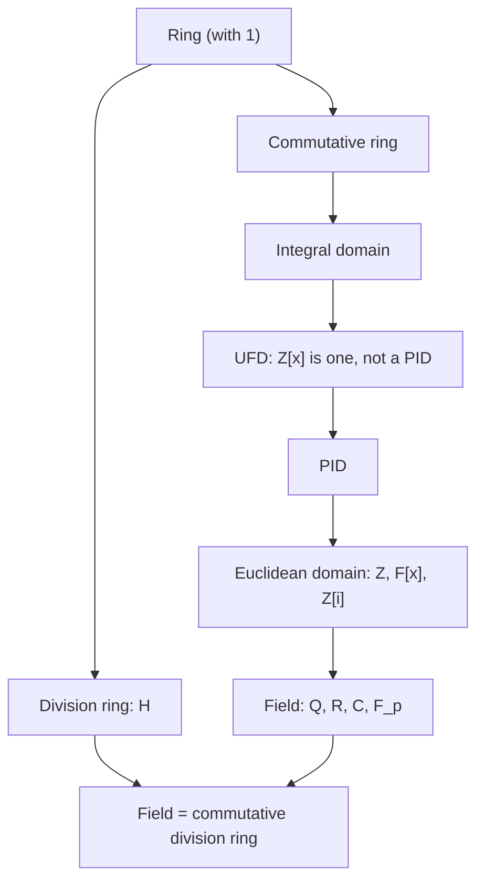
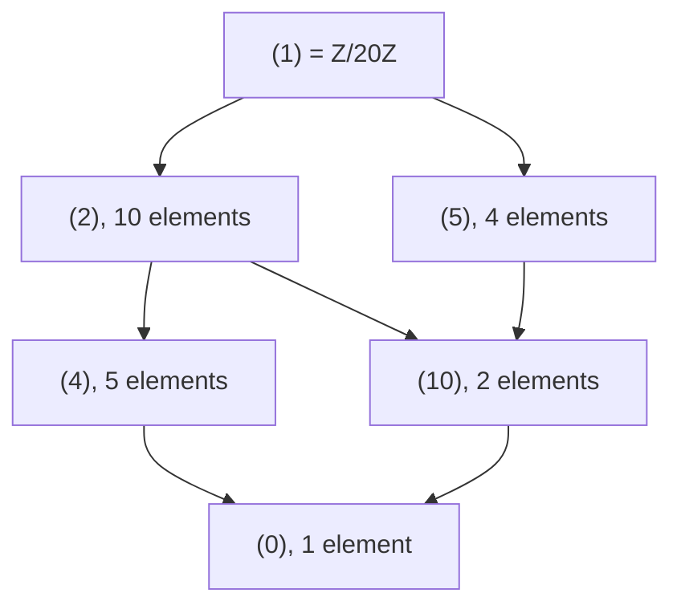
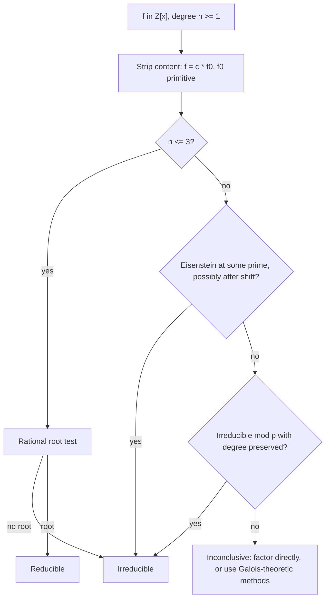

# Rings

> [Mathematics](../../README.md) › [Abstract Algebra](../README.md) › Rings · Level: Advanced · Prerequisites: [Set Theory](../../00-foundations/03-set-theory/README.md), [Proof Techniques](../../00-foundations/04-proof-techniques/README.md), [Divisibility and Primes](../../12-number-theory/01-divisibility-and-primes/README.md), [Congruences](../../12-number-theory/02-congruences/README.md), [Vector Spaces](../../08-linear-algebra/04-vector-spaces/README.md), [Groups](../01-groups/README.md) · Estimated time: 12 h

## 1. Introduction

A **group** (see [Groups](../01-groups/README.md)) is the algebra of one operation and its undoing. Almost every number system a reader already knows carries *two* operations, addition and multiplication, tied together by a rule that says multiplication distributes over addition. **Ring theory** is the axiomatic study of that pair.

The subject begins with a surprise: the same short list of axioms covers $\mathbb{Z}$, clock arithmetic $\mathbb{Z}/n\mathbb{Z}$, polynomials, matrices, real-valued functions, complex numbers and the quaternions — objects that feel utterly different. What differs is not the axioms but the *answers* to four questions one can ask in any ring:

1. Which elements can be divided by? (the **units**);
2. Which elements multiply to zero? (the **zero divisors**);
3. Which subsets can serve as the kernel of a homomorphism, so that a quotient ring exists? (the **ideals**);
4. How does factorisation behave — is it unique, as in $\mathbb{Z}$, or can it fail? (**Euclidean domains**, **PIDs**, **UFDs**).

The payoff is a body of theorems that answers these questions structurally. The ring axioms force the familiar bookkeeping identities ($0a = 0$, $(-a)(-b) = ab$, the binomial theorem when elements commute). Ideals turn out to be exactly the kernels, which makes quotient rings possible and yields the ring version of the first isomorphism theorem: $R/\ker\varphi \cong \operatorname{im}\varphi$. Prime and maximal ideals turn out to be exactly the ideals whose quotients are integral domains and fields, which converts a question about ideals into a question about arithmetic. And a chain of implications

$$\text{Euclidean domain} \;\Longrightarrow\; \text{principal ideal domain} \;\Longrightarrow\; \text{unique factorisation domain}$$

explains *why* $\mathbb{Z}$, $F[x]$ and $\mathbb{Z}[i]$ have unique factorisation, and why $\mathbb{Z}[x]$, though a UFD, is not a PID.

The theory also marks the exact boundary between what survives and what does not. Factorisation can fail: in $\mathbb{Z}[\sqrt{-5}]$ the number $6$ factors as $2\cdot 3$ and as $(1+\sqrt{-5})(1-\sqrt{-5})$ into irreducibles. Division can be one-sided: in $M_2(\mathbb{Q})$ a nonzero matrix can multiply another nonzero matrix to zero. Multiplication can be non-commutative: the quaternions $\mathbb{H}$ form a division ring that is not a field. Every one of these failures is a precise statement about which axioms are used where, and the proofs below record that information deliberately.

## 2. Prerequisites

* **Sets, relations and functions** — [Set Theory](../../00-foundations/03-set-theory/README.md) and [Relations and Functions](../../00-foundations/05-relations-and-functions/README.md): subsets, images, preimages, well-defined maps, equivalence classes. Quotient rings are built from equivalence classes of additive cosets.
* **Proof technique** — [Proof Techniques](../../00-foundations/04-proof-techniques/README.md): induction, proof by contradiction, uniqueness arguments, and the well-ordering principle, which powers the Euclidean algorithm and the ideal structure of $\mathbb{Z}$.
* **Divisibility** — [Divisibility and Primes](../../12-number-theory/01-divisibility-and-primes/README.md): $\gcd$, Bézout's identity, Euclid's lemma, the fundamental theorem of arithmetic. Ring theory abstracts exactly this material.
* **Congruences** — [Congruences](../../12-number-theory/02-congruences/README.md): $\mathbb{Z}/n\mathbb{Z}$ as a set of residue classes, and the fact that addition and multiplication are well defined on classes.
* **Vector spaces** — [Vector Spaces](../../08-linear-algebra/04-vector-spaces/README.md): the notions of vector space and basis, used in the examples on matrix rings.
* **Groups** — [Groups](../01-groups/README.md): the group axioms, subgroups, homomorphisms, cosets, the first isomorphism theorem for groups. Ring theory repeats the pattern "substructure → quotient → isomorphism theorem" with two operations instead of one.

## 3. Learning Objectives

By the end of this tutorial you will be able to:

1. State the ring axioms and verify them, or refute them, for a given algebraic structure.
2. Derive the standard consequences $0a = a0 = 0$, $(-1)a = -a$, $(-a)(-b) = ab$, and prove the binomial theorem for commuting elements.
3. Compute units, zero divisors and the characteristic of concrete rings, including $\mathbb{Z}/n\mathbb{Z}$, matrix rings and product rings.
4. Prove that a finite integral domain is a field, and distinguish integral domains, division rings and fields.
5. Decide whether a subset is a subring, a left ideal, a right ideal or a two-sided ideal, and prove that kernels of ring homomorphisms are two-sided ideals.
6. Construct quotient rings, verify that the operations are well defined, and use the ideal correspondence theorem.
7. Prove the first isomorphism theorem for rings and use it to identify quotients such as $\mathbb{R}[x]/(x^2+1) \cong \mathbb{C}$ and $\mathbb{Z}[x]/(2,x) \cong \mathbb{F}_2$.
8. Characterise prime and maximal ideals by their quotients, prove that maximal implies prime, and prove that in a PID nonzero primes are maximal.
9. Prove that every Euclidean domain is a PID and every PID is a UFD, and exhibit counterexamples that show neither implication reverses.
10. Run the division algorithm in $F[x]$, apply the rational root test, Gauss's lemma and Eisenstein's criterion, and prove that $\mathbb{Z}[x]$ is a UFD.

## 4. Intuition

### 4.1 Two operations that talk to each other

Think of a ring as a machine with two gears: addition moves you around, multiplication scales you. On its own each gear is understandable — addition makes an abelian group, multiplication makes a monoid. The rule that makes them a *ring* is distributivity:

$$a(b+c) = ab + ac, \qquad (a+b)c = ac + bc.$$

Distributivity is what lets you expand brackets, and expanding brackets is what makes computation possible. Remove it and you have two unrelated structures on one set; keep it and multiplication becomes an additive homomorphism in each variable.

### 4.2 The integers as the model

$\mathbb{Z}$ is the ring everyone knows, and every definition below is a question about what $\mathbb{Z}$ has that other rings might lack.

| Feature of $\mathbb{Z}$ | Abstract name | What can go wrong elsewhere |
|---|---|---|
| $ab = ba$ | commutative | matrices: $AB \ne BA$ |
| $ab = 0 \Rightarrow a = 0$ or $b = 0$ | integral domain | $\mathbb{Z}/6\mathbb{Z}$: $2\cdot 3 = 0$ |
| only $\pm1$ are invertible | units form a proper subgroup | $\mathbb{Q}$: every nonzero element is a unit |
| unique factorisation | UFD | $\mathbb{Z}[\sqrt{-5}]$: $6 = 2\cdot3 = (1+\sqrt{-5})(1-\sqrt{-5})$ |
| division with remainder | Euclidean domain | most rings have no such algorithm |

Each row is a theorem waiting to be proved, and each failure is an example waiting to be found.

### 4.3 Ideals are the sets you may divide by

In group theory a subgroup $H \le G$ can be quotiented exactly when it is normal, and normality is precisely what makes coset multiplication well defined. The ring analogue is an **ideal**: an additive subgroup $I$ closed under multiplication by arbitrary ring elements from either side. Closedness from the left gives $rI \subseteq I$; closedness from the right gives $Ir \subseteq I$. Both are needed, because in the product $(a+i)(b+j) = ab + aj + ib + ij$ the two cross terms point in opposite directions.

An ideal is therefore the ring-theoretic shadow of "a set of elements we agree to call zero". Quotienting by $I$ declares everything in $I$ to be zero, and the ideal axioms are exactly the conditions under which this declaration is consistent.

### 4.4 Three questions, one framework

Almost every theorem in this tutorial answers one of three questions.

* **Division.** Which elements have inverses? The invertible elements form a group $R^\times$ under multiplication, and much of the arithmetic of $R$ is captured by $R^\times$ together with the failure of division.
* **Zero.** Where does cancellation fail? Cancellation holds exactly in integral domains, and the proof is one line: $ab = ac$ gives $a(b-c) = 0$, so if $a \ne 0$ and there are no zero divisors then $b = c$.
* **Factorisation.** Can elements be written as products of irreducibles, and uniquely? The chain ED $\Rightarrow$ PID $\Rightarrow$ UFD answers this for a large family of rings, and each arrow needs a genuinely different tool: the division algorithm, single-generation of ideals, and the ascending chain condition.
* **Quotients.** Which ideals may be divided out, and what do the quotients look like? The prime and maximal ideals are exactly those whose quotients are domains and fields.

## 5. Formal Definition

### 5.1 The ring axioms

**Definition 5.1.1 (Ring).** A **ring** is a triple $(R, +, \cdot)$ consisting of a set $R$ and two binary operations $+$ and $\cdot$ on $R$ such that:

* **(R1) Addition is an abelian group.** $(R,+)$ is an abelian group: $+$ is associative and commutative, has an identity written $0$, and every $a \in R$ has an additive inverse $-a$.
* **(R2) Multiplication is associative.** $(ab)c = a(bc)$ for all $a,b,c \in R$.
* **(R3) Multiplication has an identity.** There is $1 \in R$ with $1a = a1 = a$ for all $a \in R$.
* **(R4) Distributivity.** $a(b+c) = ab+ac$ and $(a+b)c = ac+bc$ for all $a,b,c \in R$.
* **(R5) Nontriviality.** $1 \ne 0$.

A ring is **commutative** if $ab = ba$ for all $a,b \in R$.

**Conventions.** This tutorial follows the modern convention that a ring has a multiplicative identity and that $1 \ne 0$; a structure satisfying (R1)–(R4) but not (R3) is called a **rng** ("ring without an i") when it arises. Axiom (R5) excludes the **zero ring** $\{0\}$, in which $1 = 0$; keeping it out means that "field" and "integral domain" can be defined without extra clauses, and that the map $\mathbb{Z} \to R$, $n \mapsto n\cdot 1$, is never the zero map. Results using (R3) or (R5) are flagged where they occur.

**Definition 5.1.2 (Homomorphism of rings).** Let $R, S$ be rings. A function $\varphi : R \to S$ is a **ring homomorphism** if

$$\varphi(a+b) = \varphi(a) + \varphi(b), \qquad \varphi(ab) = \varphi(a)\varphi(b), \qquad \varphi(1_R) = 1_S$$

for all $a, b \in R$. A bijective homomorphism is an **isomorphism**, written $R \cong S$.

The three requirements say: $\varphi$ respects addition, respects multiplication, and respects the multiplicative identity. The last one is not automatic — the map $\mathbb{Z} \to \mathbb{Z}/6\mathbb{Z} \times \mathbb{Z}/6\mathbb{Z}$, $n \mapsto (n,0)$, respects both operations but sends $1$ to $(1,0) \ne (1,1)$, so it is not a ring homomorphism in this sense.

**Definition 5.1.3 (Subring).** A subset $S \subseteq R$ is a **subring** of $R$ if $S$ is a ring under the restrictions of $+$ and $\cdot$, with the same $0$ and $1$ as $R$. Equivalently, $1 \in S$, and $S$ is closed under subtraction and multiplication.

Requiring $1 \in S$ matters. $2\mathbb{Z} \subseteq \mathbb{Z}$ is closed under subtraction and multiplication, and is a perfectly good rng, but it is not a subring of $\mathbb{Z}$ in this convention because it does not contain $1$.

### 5.2 Immediate consequences of the axioms

**Proposition 5.2.1 (bookkeeping identities).** Let $R$ be a ring and $a, b \in R$. Then:

1. $0a = a0 = 0$;
2. $(-1)a = -a = a(-1)$;
3. $(-a)b = -(ab) = a(-b)$ and $(-a)(-b) = ab$;
4. $a(b-c) = ab - ac$ and $(a-b)c = ac - bc$.

**Proof.** (1) From $0 = 0+0$ and distributivity, $0a = (0+0)a = 0a + 0a$. Adding $-0a$ to both sides gives $0 = 0a$. The computation for $a0$ is the mirror image.

(2) $a + (-1)a = 1a + (-1)a = (1 + (-1))a = 0a = 0$ by (1), so $(-1)a$ is an additive inverse of $a$; additive inverses are unique in the group $(R,+)$, hence $(-1)a = -a$. Similarly $a(-1) = -a$.

(3) $(-a)b = ((-1)a)b = (-1)(ab) = -(ab)$ using associativity and (2); $a(-b) = -(ab)$ similarly. Then $(-a)(-b) = -((-a)b) = -(-(ab)) = ab$.

(4) $a(b-c) = a(b + (-c)) = ab + a(-c) = ab - ac$, and the other identity is the mirror image. $\blacksquare$

**Proposition 5.2.2 (the binomial theorem).** Let $R$ be a ring and $a,b \in R$ with $ab = ba$. Then for every $n \ge 1$,

$$(a+b)^n = \sum_{k=0}^{n} \binom{n}{k} a^k b^{n-k}.$$

**Proof.** Induct on $n$; the case $n = 1$ is clear. If the formula holds for $n$, then

$$(a+b)^{n+1} = (a+b)^n(a+b) = \sum_{k=0}^n \binom{n}{k}\left(a^k b^{n-k}a + a^k b^{n-k}b\right).$$

Because $a$ and $b$ commute, $b^{n-k}a = a b^{n-k}$, so the first term is $a^{k+1}b^{n-k}$ and the second is $a^kb^{n-k+1}$. Relabelling the first sum by $j = k+1$ and adding coefficients with Pascal's identity $\binom{n}{k-1} + \binom{n}{k} = \binom{n+1}{k}$ gives the claim. $\blacksquare$

**Corollary 5.2.3.** If $R$ is commutative, then for all $a,b \in R$ and $n \ge 1$,

$$(a+b)^n = \sum_{k=0}^n \binom{n}{k} a^k b^{n-k}, \qquad a^n - b^n = (a-b)\sum_{k=0}^{n-1} a^{n-1-k}b^k.$$

The second identity is verified by expanding the right-hand side; every interior term cancels. Both identities **fail** without commutativity: in $M_2(\mathbb{Q})$ with $A = \begin{pmatrix}0&1\\0&0\end{pmatrix}$ and $B = \begin{pmatrix}0&0\\1&0\end{pmatrix}$, one has $(A+B)^2 = I$ while $A^2 + 2AB + B^2 = 2I$.

### 5.3 The standard examples

**Example 5.3.1 (number rings).** $\mathbb{Z}$, $\mathbb{Q}$, $\mathbb{R}$ and $\mathbb{C}$ are commutative rings under the usual operations, of characteristic $0$. For $n \ge 2$, $\mathbb{Z}/n\mathbb{Z}$ is a commutative ring of characteristic $n$: addition and multiplication of residue classes are well defined because congruence is compatible with both operations, and $\bar 1 \ne \bar 0$. The Gaussian integers

$$\mathbb{Z}[i] = \{a + bi : a, b \in \mathbb{Z}\} \subseteq \mathbb{C}$$

form a subring of $\mathbb{C}$, and so does $\mathbb{Z}[\sqrt{2}] = \{a + b\sqrt{2} : a,b \in \mathbb{Z}\}$.

**Example 5.3.2 (polynomial rings).** For a ring $R$, let

$$R[x] = \left\{\text{finite sums } \textstyle\sum_{k=0}^{n} a_k x^k : a_k \in R\right\}$$

with coefficientwise addition and the convolution product. Then $R[x]$ is a ring, commutative when $R$ is, with $1$ the constant polynomial $1$ and $\deg(fg) \le \deg f + \deg g$. Section 7.11 proves that equality of degrees holds when $R$ is a domain, and that it can fail otherwise: over $R = \mathbb{Z}/4\mathbb{Z}$, $(2x)(2x) = 4x^2 = 0$.

**Example 5.3.3 (matrix rings).** For a ring $R$ and $n \ge 1$, the set $M_n(R)$ of $n \times n$ matrices over $R$ is a ring under entrywise addition and matrix multiplication, with identity $I_n$. For $n \ge 2$ and $R \ne \{0\}$ it is **not commutative**, and it has **zero divisors**: the matrix with a single $1$ in position $(1,1)$ times the matrix with a single $1$ in position $(2,2)$ is $0$.

**Example 5.3.4 (function rings).** For a set $X$ and a ring $R$, the set $R^X$ of all functions $X \to R$ is a ring under pointwise operations:

$$(f+g)(x) = f(x) + g(x), \qquad (fg)(x) = f(x)g(x).$$

It is commutative when $R$ is. If $X$ has at least two elements it has zero divisors: for distinct $x_0, x_1 \in X$ and $a \ne 0$ in $R$, the functions $f = a\cdot\mathbf{1}_{\{x_0\}}$ and $g = a\cdot\mathbf{1}_{\{x_1\}}$ are nonzero but $fg = 0$. Here $\mathbf{1}_A$ is the indicator function of $A$.

**Example 5.3.5 (products, group rings, quaternions).** The **direct product** $R \times S$ with componentwise operations is a ring with $1 = (1_R, 1_S)$. For a group $G$ and a ring $R$, the **group ring** $R[G]$ consists of formal sums $\sum_g a_g g$ with $a_g \in R$ almost all zero, multiplied using $g\cdot h = gh$; it is commutative exactly when both $R$ and $G$ are commutative. The **quaternions**

$$\mathbb{H} = \{a + bi + cj + dk : a,b,c,d \in \mathbb{R}\}$$

with $i^2 = j^2 = k^2 = ijk = -1$ form a ring in which every nonzero element is invertible but which is not commutative; Section 7.3 calls such a structure a division ring.

**Example 5.3.6 (a summary table).** Here "domain" means commutative with $1 \ne 0$ and no zero divisors.

| Ring | Commutative | Units | Domain | Field | Characteristic |
|---|---|---|---|---|---|
| $\mathbb{Z}$ | yes | $\{\pm 1\}$ | yes | no | $0$ |
| $\mathbb{Z}/n\mathbb{Z}$, $n \ge 2$ | yes | classes coprime to $n$ | iff $n$ prime | iff $n$ prime | $n$ |
| $\mathbb{Q}$, $\mathbb{R}$, $\mathbb{C}$ | yes | all nonzero | yes | yes | $0$ |
| $\mathbb{Z}[i]$ | yes | $\{\pm 1, \pm i\}$ | yes | no | $0$ |
| $\mathbb{F}_p$, $p$ prime | yes | all nonzero | yes | yes | $p$ |
| $F[x]$, $F$ a field | yes | $F^\times$ | yes | no | $\operatorname{char} F$ |
| $M_n(\mathbb{Q})$, $n \ge 2$ | no | $GL_n(\mathbb{Q})$ | no | no | $0$ |
| $\mathbb{Q}^X$, $X$ with $|X| \ge 2$ | yes | nowhere-zero functions | no | no | $0$ |
| $\mathbb{H}$ | no | all nonzero | no | no | $0$ |
| $R \times S$ | iff both are | $R^\times \times S^\times$ | never: $(1,0)(0,1) = (0,0)$ | no | $\operatorname{lcm}$ of the characteristics |

### 5.4 Non-examples, and what each axiom buys

**Example 5.4.1.** The following are *not* rings in the sense of Definition 5.1.1.

* $(\mathbb{N}_0, +, \cdot)$: no additive inverses, so (R1) fails.
* $(\mathbb{Z}, +, \star)$ with $a \star b = |ab|$: distributivity fails, since $a\star(b+c) = |ab+ac|$ need not equal $|ab| + |ac|$.
* $(2\mathbb{Z}, +, \cdot)$: (R1), (R2) and (R4) hold, but there is no identity, so (R3) fails. It is a rng, not a ring in our convention.
* The set of odd integers with the usual operations: not closed under addition, so not even a candidate.
* $M_n(\mathbb{Q})$ with $n \ge 2$: all axioms hold, but the ring is neither commutative nor a domain. It is a ring; its role here is as a counterexample to the hope that rings behave like $\mathbb{Z}$.

A useful diagnostic: check (R1) first (most failures are here), then whether $1$ exists, then commutativity and zero divisors.

## 6. Mathematical Notation

| Symbol | Read as | Meaning |
|---|---|---|
| $(R,+,\cdot)$ or $R$ | the ring $R$ | a set with the ring structure |
| $0$, $1$ | zero, one | additive and multiplicative identities, $0 \ne 1$ |
| $R^\times$ | the units of $R$ | $\{u \in R : uv = 1 \text{ for some } v\}$, a group under $\cdot$ |
| $a^{-1}$ | inverse of $a$ | defined only when $a \in R^\times$ |
| $-a$ | minus $a$ | the additive inverse of $a$ |
| $a^{n}$ | $a$ to the $n$ | $n$-fold product for $n \ge 0$, with $a^0 = 1$ |
| $n\cdot a$ | $n$ times $a$ | repeated sum, defined for $n \in \mathbb{Z}$ |
| $\operatorname{char} R$ | characteristic of $R$ | least $n \ge 1$ with $n\cdot 1 = 0$, or $0$ if none exists |
| $R[x]$ | $R$ adjoin $x$ | the polynomial ring in one variable over $R$ |
| $\deg f$ | degree of $f$ | the largest $k$ with $a_k \ne 0$; $\deg 0 := -\infty$ |
| $c(f)$ | content of $f$ | the gcd of the coefficients of $f \in \mathbb{Z}[x]$ |
| $I \trianglelefteq R$ | $I$ is an ideal of $R$ | additive subgroup closed under multiplication by every element of $R$ |
| $(a)$ | the principal ideal generated by $a$ | $aR = \{ar : r \in R\}$ |
| $(a_1,\dots,a_n)$ | the ideal generated by the $a_i$ | the smallest ideal containing all $a_i$, equal to $\sum_i Ra_i$ in a commutative ring |
| $R/I$ | $R$ modulo $I$ | the quotient ring of cosets $a + I$ |
| $I + J$, $I \cap J$, $IJ$ | sum, intersection, product | $\{i+j\}$, set intersection, finite sums $\sum i_k j_k$ |
| $\ker\varphi$ | kernel of $\varphi$ | $\{r \in R : \varphi(r) = 0\}$ |
| $\operatorname{im}\varphi$ | image of $\varphi$ | $\{\varphi(r) : r \in R\}$ |
| $R \cong S$ | $R$ is isomorphic to $S$ | there is a bijective ring homomorphism |
| $a \mid b$ | $a$ divides $b$ | $b = ac$ for some $c \in R$ |
| $a \sim b$ | $a$ is associate to $b$ | $a = ub$ for a unit $u$ |
| $p$ irreducible | $p$ is irreducible | nonzero nonunit, not a product of two nonunits |
| $p$ prime | $p$ is prime | nonzero nonunit with $p \mid ab \Rightarrow p \mid a$ or $p \mid b$ |
| $N(a)$ | norm of $a$ | a Euclidean function, or $a\bar a$ in an imaginary quadratic ring |
| $\mathbb{Z}[i]$ | the Gaussian integers | $\{a+bi : a,b \in \mathbb{Z}\}$ |
| $\mathbb{Z}[\sqrt{d}]$ | $\mathbb{Z}$ adjoin $\sqrt d$ | $\{a+b\sqrt d : a,b\in\mathbb{Z}\}$ |
| $\mathbb{H}$ | the quaternions | $\{a+bi+cj+dk\}$ with $i^2=j^2=k^2=ijk=-1$ |
| $\mathbb{F}_p$ | the field with $p$ elements | $\mathbb{Z}/p\mathbb{Z}$, $p$ prime |

## 7. Core Concepts

### 7.1 Units

**Definition 7.1.1.** An element $u \in R$ is a **unit** if there exists $v \in R$ with $uv = vu = 1$. The set of units is written $R^\times$.

**Proposition 7.1.2.** $R^\times$ is a group under multiplication.

**Proof.** If $u$ is a unit then its two-sided inverse is unique: from $uv = vu = 1$ and $uw = wu = 1$ follow $v = v(uw) = (vu)w = w$. For closure, if $uv = vu = 1$ and $u'v' = v'u' = 1$, then $(uu')(v'v) = u(u'v')v = uv = 1$ and $(v'v)(uu') = 1$, so $uu'$ is a unit with inverse $v'v$. Associativity is inherited from $R$, the element $1$ is its own inverse, and $v$ is an inverse of $u$. $\blacksquare$

**Proposition 7.1.3.** A unit is never a zero divisor: if $u \in R^\times$ and $ub = 0$ then $b = 0$.

**Proof.** Multiply $ub = 0$ on the left by $u^{-1}$. $\blacksquare$

**Example 7.1.4.**
* $\mathbb{Z}^\times = \{1,-1\}$.
* $\mathbb{Q}^\times = \mathbb{Q}\setminus\{0\}$; in a field every nonzero element is a unit.
* $(\mathbb{Z}/n\mathbb{Z})^\times = \{\bar a : \gcd(a,n) = 1\}$. Indeed $\bar a$ is a unit iff there is $b$ with $ab \equiv 1 \pmod n$, which by Bézout's identity is exactly $\gcd(a,n) = 1$. For $n = 12$ this gives $\{1,5,7,11\}$.
* $M_n(\mathbb{Q})^\times = GL_n(\mathbb{Q})$, the invertible matrices, detected by $\det \ne 0$.
* $F[x]^\times = F^\times$ for a field $F$: a polynomial has a polynomial inverse only if both have degree $0$ (Proposition 7.11.2).

### 7.2 Zero divisors and integral domains

**Definition 7.2.1.** A **zero divisor** in a ring $R$ is an element $a \ne 0$ for which there exists $b \ne 0$ with $ab = 0$ or $ba = 0$. A commutative ring with $1 \ne 0$ and no zero divisors is an **integral domain**.

**Proposition 7.2.2 (cancellation).** Let $R$ be a commutative ring with $1 \ne 0$. Then $R$ is an integral domain if and only if for all $a,b,c \in R$ with $a \ne 0$,

$$ab = ac \implies b = c.$$

**Proof.** If $R$ is a domain and $ab = ac$ with $a \ne 0$, then $a(b-c) = 0$; since $a \ne 0$ and there are no zero divisors, $b - c = 0$. Conversely, if cancellation holds and $ab = 0$ with $a \ne 0$, then $ab = a\cdot 0$ gives $b = 0$; so there are no zero divisors. $\blacksquare$

The commutativity in Definition 7.2.1 is a convention, and it matters: $\mathbb{H}$ has no zero divisors but is not an integral domain in this sense, because it is not commutative. The next theorem is one of the most useful in the subject: finiteness converts "no zero divisors" into "everything is invertible".

**Theorem 7.2.3 (a finite integral domain is a field).** Let $R$ be a finite integral domain. Then $R$ is a field.

**Proof.** Let $a \in R$ with $a \ne 0$ and define $\mu_a : R \to R$ by $\mu_a(x) = ax$. If $\mu_a(x) = \mu_a(y)$ then $a(x-y) = 0$, and since $a \ne 0$ and $R$ is a domain, $x = y$. So $\mu_a$ is injective. An injective map from a finite set to itself is surjective, so there is $b \in R$ with $ab = \mu_a(b) = 1$. Hence $a$ is a unit. Every nonzero element is a unit, so $R$ is a field. $\blacksquare$

**Corollary 7.2.4.** For $n \ge 2$, $\mathbb{Z}/n\mathbb{Z}$ is a field if and only if $n$ is prime.

**Proof.** If $n = ab$ with $1 < a,b < n$, then $\bar a\bar b = \bar 0$ with both factors nonzero, so the ring is not a domain. If $n$ is prime and $\bar a \ne \bar 0$, then $\gcd(a,n) = 1$, so $\bar a$ is a unit by Example 7.1.4. A commutative ring in which every nonzero element is a unit is a field. $\blacksquare$

### 7.3 Division rings, and the limits of commutativity

**Definition 7.3.1.** A **division ring** is a ring in which every nonzero element is a unit. A **field** is a commutative division ring.

Thus $\mathbb{H}$ is a division ring that is not a field, and $M_n(\mathbb{Q})$ for $n \ge 2$ is neither. The following remarkable theorem is stated for orientation; its proof belongs to the structure theory of finite division rings and is not given here.

**Theorem 7.3.2 (Wedderburn's little theorem).** Every finite division ring is a field.

So a *finite* division ring cannot be non-commutative: the quaternions are necessarily infinite. This is why "finite field" and "finite division ring" describe the same objects.

### 7.4 The characteristic of a ring

**Definition 7.4.1.** Let $R$ be a ring. The map $\iota : \mathbb{Z} \to R$, $\iota(n) = n\cdot 1$, is a ring homomorphism, so its kernel is an ideal of $\mathbb{Z}$, hence of the form $n\mathbb{Z}$. The **characteristic** of $R$, written $\operatorname{char} R$, is the non-negative integer $n$ with $\ker\iota = n\mathbb{Z}$.

Explicitly, $\operatorname{char} R$ is the least $n \ge 1$ with $n\cdot 1 = 0$, and $\operatorname{char} R = 0$ when no such $n$ exists. Because $1 \ne 0$, one has $\operatorname{char} R \ne 1$.

**Proposition 7.4.2.** Let $R$ be a ring and $n = \operatorname{char} R$. If $n > 0$ then $na = 0$ for every $a \in R$. If $n = 0$ then $ka = 0$ with $k \in \mathbb{Z}$ does **not** force $k = 0$ or $a = 0$, unless $R$ is a domain.

**Proof.** If $n > 0$ then $na = (n\cdot 1)a = 0\cdot a = 0$ by Proposition 5.2.1. For the second claim, in $M_2(\mathbb{Q})$ one has $2A = 0$ for the nonzero matrix $A$ with a single $1$ in position $(1,2)$, although $\operatorname{char} M_2(\mathbb{Q}) = 0$. $\blacksquare$

**Theorem 7.4.3 (characteristic of a domain).** If $R$ is an integral domain, then $\operatorname{char} R$ is either $0$ or a prime number.

**Proof.** Suppose $\operatorname{char} R = n$ with $n > 0$, and suppose $n = ab$ with $1 \le a,b \le n$. Since $\iota$ is a ring homomorphism, $0 = n\cdot 1 = (a\cdot 1)(b\cdot 1)$. If both $a\cdot 1$ and $b\cdot 1$ were nonzero they would be zero divisors, contradicting the domain hypothesis. So $a\cdot 1 = 0$ or $b \cdot 1 = 0$, which by minimality of $n$ forces $a = n$ or $b = n$. Hence $n$ has no factorisation into two factors both smaller than $n$ and greater than $1$, i.e. $n$ is prime. $\blacksquare$

**Theorem 7.4.4 (freshman's dream).** Let $R$ be a **commutative** ring of characteristic $p$, where $p$ is prime. Then

$$(a+b)^p = a^p + b^p, \qquad (a+b)^{p^k} = a^{p^k} + b^{p^k}$$

for all $a,b \in R$ and $k \ge 1$.

**Proof.** By the binomial theorem (valid because $R$ is commutative), $(a+b)^p = \sum_{k=0}^p \binom{p}{k}a^k b^{p-k}$. For $1 \le k \le p-1$ the integer $\binom{p}{k} = \frac{p!}{k!(p-k)!}$ is divisible by $p$ (the prime $p$ appears in the numerator but not in the denominator), so $\binom{p}{k}\cdot 1 = 0$ in $R$ and those terms vanish. The surviving terms are $a^p + b^p$. Iterating gives $(a+b)^{p^k} = \big((a+b)^{p^{k-1}}\big)^p = \big(a^{p^{k-1}} + b^{p^{k-1}}\big)^p = a^{p^k} + b^{p^k}$. $\blacksquare$

Commutativity is essential. In $M_2(\mathbb{F}_p)$ the identity fails: with $A = \begin{pmatrix}0&1\\0&0\end{pmatrix}$ and $B = \begin{pmatrix}0&0\\1&0\end{pmatrix}$ one has $(A+B)^2 = I$ while $A^2 + B^2 = 0$.

**Example 7.4.5 (characteristic computations).** $\operatorname{char}\mathbb{Z}/n\mathbb{Z} = n$. $\operatorname{char}(\mathbb{Z}/6\mathbb{Z} \times \mathbb{Z}/10\mathbb{Z}) = \operatorname{lcm}(6,10) = 30$, because $n\cdot(1,1) = (n \bmod 6, n \bmod 10)$ vanishes exactly when $6 \mid n$ and $10 \mid n$. $\operatorname{char} M_n(\mathbb{Z}/3\mathbb{Z}) = 3$, since $n\cdot I$ vanishes iff $n \equiv 0 \pmod 3$. $\operatorname{char}\mathbb{Z}[i] = 0$.

### 7.5 Ideals

**Definition 7.5.1.** An **ideal** of a ring $R$ is an additive subgroup $I \subseteq R$ such that

$$rI \subseteq I \quad\text{and}\quad Ir \subseteq I \qquad \text{for all } r \in R.$$

A **left ideal** satisfies only $rI \subseteq I$; a **right ideal** satisfies only $Ir \subseteq I$. An ideal is **proper** if $I \ne R$ and **nonzero** if $I \ne \{0\}$.

In a commutative ring the two conditions coincide, and $I$ is an ideal iff $I$ is an additive subgroup with $rI \subseteq I$. Ideals are the ring analogue of normal subgroups, and the analogy is exact: just as normality is what makes $G/H$ a group, being a two-sided ideal is what makes $R/I$ a ring (Theorem 7.6.1).

**Proposition 7.5.2.** An ideal $I$ contains $0$ and is closed under negation, sums, and multiplication by arbitrary elements. Moreover $I = R$ if and only if $1 \in I$.

**Proof.** $0 \in I$ since $I$ is an additive subgroup. If $1 \in I$ then for any $r \in R$, $r = r\cdot 1 \in I$, so $I = R$. Conversely if $I = R$ then $1 \in I$. $\blacksquare$

**Example 7.5.3.**
* $n\mathbb{Z} \subseteq \mathbb{Z}$ is an ideal for each $n \ge 0$; conversely every ideal of $\mathbb{Z}$ is of this form (Example 7.5.6).
* The kernel of a homomorphism is an ideal (Theorem 7.5.4), and this is the archetype.
* In $R[x]$, the set $(x) = \{f : f(0) = 0\}$ of polynomials with zero constant term is an ideal.
* In $M_n(\mathbb{Q})$ with $n \ge 2$, the set of matrices whose only nonzero entries lie in the first column is a **left** ideal but not a right ideal: multiplying on the right mixes columns. Symmetrically, nonzero entries confined to the first row give a right ideal that is not a left ideal. This is where two-sidedness in Definition 7.5.1 earns its keep.
* The subsets $\{0\}$ and $R$ are always ideals, called the **trivial** ideals.

**Theorem 7.5.4 (kernels are ideals).** Let $\varphi : R \to S$ be a ring homomorphism. Then $\ker\varphi$ is an ideal of $R$, and $\operatorname{im}\varphi$ is a subring of $S$. Moreover $\varphi$ is injective if and only if $\ker\varphi = \{0\}$.

**Proof.** $\ker\varphi$ is an additive subgroup: $\varphi(0) = 0$, and if $\varphi(a) = \varphi(b) = 0$ then $\varphi(a-b) = 0 - 0 = 0$. For $r \in R$ and $x \in \ker\varphi$,

$$\varphi(rx) = \varphi(r)\varphi(x) = \varphi(r)\cdot 0 = 0, \qquad \varphi(xr) = \varphi(x)\varphi(r) = 0,$$

so $rx, xr \in \ker\varphi$: the kernel is a two-sided ideal. The image is closed under subtraction and multiplication and contains $\varphi(1) = 1$, so it is a subring. Finally $\varphi(a) = \varphi(b)$ iff $\varphi(a-b) = 0$ iff $a-b \in \ker\varphi$; therefore $\varphi$ is injective iff $\ker\varphi = \{0\}$. $\blacksquare$

Both one-sided conditions are used, symmetrically. The next proposition shows that ideals are exactly the kernels.

**Proposition 7.5.5.** Let $I$ be an ideal of $R$. Then the quotient map $\pi : R \to R/I$, $\pi(a) = a + I$, is a surjective ring homomorphism with kernel $I$. Conversely every kernel of a ring homomorphism arises this way.

**Proof.** The quotient ring is constructed in Theorem 7.6.1; the kernel statement is immediate from the definition of the coset $a + I$, and surjectivity holds because $a+I = \pi(a)$. $\blacksquare$

**Example 7.5.6 (every ideal of $\mathbb{Z}$ is principal).** Let $I \subseteq \mathbb{Z}$ be an ideal. If $I = \{0\}$ then $I = (0)$. Otherwise let $d$ be the least positive element of $I$, which exists by the well-ordering principle. For $a \in I$, division with remainder gives $a = qd + r$ with $0 \le r < d$; since $r = a - qd \in I$, minimality of $d$ forces $r = 0$. Hence $a \in (d)$ and $I = (d)$.

**Definition 7.5.7 (generated ideals, sums, products).** For $S \subseteq R$, the ideal **generated** by $S$ is the smallest ideal containing $S$; when $R$ is commutative it equals

$$(S) = \left\{\textstyle\sum_{k=1}^{n} r_k s_k : n \ge 0,\ r_k \in R,\ s_k \in S\right\}.$$

For ideals $I, J$ one defines $I + J = \{i + j : i \in I,\ j \in J\}$ and $IJ = \{\sum_k i_k j_k\}$; both are ideals and $IJ \subseteq I \cap J$. An ideal generated by one element is **principal**; a **principal ideal domain** (PID) is an integral domain in which every ideal is principal.

### 7.6 Quotient rings

**Theorem 7.6.1 (the quotient ring).** Let $I$ be an ideal of $R$. The set $R/I = \{a + I : a \in R\}$ of additive cosets, with operations

$$(a+I) + (b+I) := (a+b) + I, \qquad (a+I)(b+I) := ab + I,$$

is a ring, and the quotient map $\pi : R \to R/I$ is a surjective ring homomorphism with kernel $I$. It satisfies $1 + I \ne 0 + I$ exactly when $I \ne R$.

**Proof.** *Cosets.* Since $I$ is an additive subgroup and $(R,+)$ is abelian, the cosets are the classes of the equivalence relation $a \sim b \iff a - b \in I$, and they partition $R$. Addition of cosets is well defined because $I$ is a subgroup.

*Multiplication is well defined.* Suppose $a' = a + i$ and $b' = b + j$ with $i, j \in I$. Then

$$a'b' = (a+i)(b+j) = ab + \underbrace{aj}_{\in I} + \underbrace{ib}_{\in I} + \underbrace{ij}_{\in I},$$

because $aj \in I$ (as $I$ is a right ideal), $ib \in I$ (as $I$ is a left ideal) and $ij \in I$ (as $I$ is closed under multiplication). Hence $a'b' - ab \in I$, i.e. $a'b' + I = ab + I$: the class of the product depends only on the classes of the factors.

*Axioms.* Each axiom for $R/I$ is inherited from the corresponding axiom in $R$: associativity, commutativity of addition, distributivity and associativity of multiplication all pass to classes because they hold for representatives. The class $0 + I$ is the additive identity, $(-a) + I$ is the inverse of $a + I$, and $1 + I$ is the multiplicative identity because $(1+I)(a+I) = a + I$.

*Nontriviality and kernel.* $1 + I = 0 + I$ iff $1 \in I$ iff $I = R$ by Proposition 7.5.2. Finally $\pi(a) = a + I = 0 + I$ iff $a \in I$, so $\ker\pi = I$, and $\pi$ is surjective by construction. $\blacksquare$

The theorem also explains why one-sided ideals are not enough. If $I$ is only a left ideal, then $ib \in I$ for $i \in I$ but $aj$ need not lie in $I$, so different representatives give different products and no ring structure is defined.

**Example 7.6.2 (a failed quotient).** Let $R = M_2(\mathbb{Q})$ and let $I$ be the left ideal of matrices with zero second column. The matrix $E_{11} = \begin{pmatrix}1&0\\0&0\end{pmatrix}$ lies in $I$, so $E_{11}$ and $0$ have the same class modulo $I$. Yet with $b = E_{12} = \begin{pmatrix}0&1\\0&0\end{pmatrix}$,

$$0\cdot b = 0 \in I, \qquad E_{11}\cdot b = E_{12} \notin I,$$

so the two products have different classes. Coset multiplication is therefore not well defined: $I$ is not an ideal, only a left ideal.

**Theorem 7.6.3 (ideal correspondence).** Let $I$ be an ideal of $R$. The maps

$$J \mapsto J/I := \{j + I : j \in J\}, \qquad K \mapsto \pi^{-1}(K)$$

give a bijection between the ideals $J$ of $R$ with $I \subseteq J$ and the ideals $K$ of $R/I$. Under it, $J$ is prime (respectively maximal) in $R$ if and only if $J/I$ is prime (respectively maximal) in $R/I$.

**Proof.** If $J$ is an ideal containing $I$, then $J/I$ is an ideal of $R/I$: it is an additive subgroup, and $(r+I)(j+I) = rj + I \in J/I$. If $K$ is an ideal of $R/I$, then $\pi^{-1}(K)$ is an ideal of $R$, by the same computation as in Theorem 7.5.4, and it contains $\pi^{-1}(0) = I$. The two constructions are mutually inverse: $\pi^{-1}(J/I) = J$ because $\pi$ is surjective, and $\pi(\pi^{-1}(K)) = K$ by surjectivity. Both maps preserve inclusion, so the correspondence preserves and reflects strict inclusions, and maximality transfers. For primality, note $R/J \cong (R/I)\big/(J/I)$ by Corollary 7.6.4 and apply Theorem 7.8.3. $\blacksquare$

**Corollary 7.6.4 (third isomorphism theorem).** If $I \subseteq J$ are ideals of $R$, then $J/I$ is an ideal of $R/I$ and

$$(R/I)\big/(J/I) \cong R/J.$$

**Proof.** The kernel of the composite $R \to R/I \to (R/I)/(J/I)$ is $J$, so Theorem 7.7.1 gives the result. $\blacksquare$

### 7.7 The first isomorphism theorem

**Theorem 7.7.1 (first isomorphism theorem for rings).** Let $\varphi : R \to S$ be a ring homomorphism. Then there is a unique isomorphism

$$\bar\varphi : R/\ker\varphi \longrightarrow \operatorname{im}\varphi, \qquad \bar\varphi(a + \ker\varphi) = \varphi(a).$$

**Proof.** Write $I = \ker\varphi$.

*Well defined.* If $a + I = a' + I$ then $a - a' \in I$, so $\varphi(a) - \varphi(a') = \varphi(a-a') = 0$, i.e. $\varphi(a) = \varphi(a')$. So the value of $\bar\varphi$ depends only on the coset.

*Homomorphism.* For all $a, a' \in R$,

$$\bar\varphi\big((a+I)+(a'+I)\big) = \bar\varphi(a+a'+I) = \varphi(a+a') = \varphi(a)+\varphi(a') = \bar\varphi(a+I) + \bar\varphi(a'+I),$$

and the same computation with products. Also $\bar\varphi(1 + I) = \varphi(1) = 1$.

*Injectivity.* If $\bar\varphi(a+I) = 0$ then $\varphi(a) = 0$, so $a \in I$ and $a + I = 0 + I$. A homomorphism with trivial kernel is injective by Theorem 7.5.4.

*Surjectivity onto the image.* Every element of $\operatorname{im}\varphi$ has the form $\varphi(a) = \bar\varphi(a+I)$.

*Uniqueness.* Any isomorphism with the stated property agrees with $\bar\varphi$ on every coset, hence equals it. $\blacksquare$

**Example 7.7.2 (three identifications).**
1. **Evaluation at $i$.** Let $\varphi : \mathbb{R}[x] \to \mathbb{C}$, $\varphi(f) = f(i)$. It is a ring homomorphism and is surjective because $a + bi = \varphi(a + bx)$. Its kernel consists of the real polynomials vanishing at $i$; since $x^2+1$ is irreducible over $\mathbb{R}$, every such polynomial is divisible by $x^2+1$ (Proposition 7.11.5), so $\ker\varphi = (x^2+1)$ and

$$\mathbb{R}[x]/(x^2+1) \cong \mathbb{C}.$$

2. **Setting $x = 0$.** The map $\mathbb{Z}[x] \to \mathbb{Z}$, $f \mapsto f(0)$, is surjective with kernel $(x)$, so $\mathbb{Z}[x]/(x) \cong \mathbb{Z}$.
3. **Mod $2$ and set $x = 0$.** The map $\mathbb{Z}[x] \to \mathbb{F}_2$, $f \mapsto f(0) \bmod 2$, has kernel $(2,x)$, so $\mathbb{Z}[x]/(2,x) \cong \mathbb{F}_2$. Since $\mathbb{F}_2$ is a field, $(2,x)$ is maximal; since $(2,x)$ is not principal (Example 7.13.2), $\mathbb{Z}[x]$ is not a PID.

**Theorem 7.7.3 (Chinese remainder theorem).** Let $I, J$ be ideals of a commutative ring $R$ with $I + J = R$. Then $IJ = I \cap J$ and

$$R/(I\cap J) \cong R/I \times R/J.$$

**Proof.** The map $\Phi : R \to R/I \times R/J$, $\Phi(r) = (r+I, r+J)$, is a ring homomorphism with kernel $I \cap J$, so Theorem 7.7.1 gives an isomorphism $R/(I\cap J) \cong \operatorname{im}\Phi$. For surjectivity, write $1 = i + j$ with $i \in I$, $j \in J$; given $(a + I, b + J)$, set $r = aj + bi$. Then $r \equiv aj \equiv a(1-i) \equiv a \pmod I$ and $r \equiv bi \equiv b(1-j) \equiv b \pmod J$, so $\Phi(r) = (a+I, b+J)$. Finally $IJ \subseteq I\cap J$ always; conversely if $x \in I \cap J$ then $x = x\cdot 1 = xi + xj$ with $xi \in IJ$ (as $x \in J$) and $xj \in IJ$ (as $x \in I$), so $x \in IJ$. $\blacksquare$

For $R = \mathbb{Z}$, $I = (m)$, $J = (n)$ with $\gcd(m,n) = 1$, this recovers $\mathbb{Z}/mn\mathbb{Z} \cong \mathbb{Z}/m\mathbb{Z} \times \mathbb{Z}/n\mathbb{Z}$.

### 7.8 Prime and maximal ideals

Throughout this section $R$ is a **commutative** ring with $1 \ne 0$ (in a non-commutative ring there are left, right and two-sided versions, and the theory is genuinely different; see Section 7.14).

**Definition 7.8.1 (prime ideal).** A proper ideal $I \subsetneq R$ is **prime** if

$$ab \in I \implies a \in I \ \text{or}\ b \in I \qquad \text{for all } a, b \in R.$$

**Definition 7.8.2 (maximal ideal).** A proper ideal $I \subsetneq R$ is **maximal** if there is no ideal $J$ with $I \subsetneq J \subsetneq R$.

**Theorem 7.8.3 (quotient characterisations).** Let $R$ be a commutative ring with $1 \ne 0$ and let $I \subsetneq R$ be an ideal. Then:

1. $I$ is prime if and only if $R/I$ is an integral domain;
2. $I$ is maximal if and only if $R/I$ is a field.

**Proof.** (1) *Prime $\Rightarrow$ domain.* Suppose $I$ is prime. In $R/I$, if $(a+I)(b+I) = 0+I$ then $ab \in I$, so $a \in I$ or $b \in I$, i.e. $a + I = 0 + I$ or $b + I = 0 + I$. So $R/I$ has no zero divisors; it is commutative with $1 + I \ne 0 + I$ because $I$ is proper. Hence it is an integral domain.

*Domain $\Rightarrow$ prime.* If $R/I$ is a domain and $ab \in I$, then $(a+I)(b+I) = 0 + I$, so one factor is zero, i.e. $a \in I$ or $b \in I$.

(2) *Maximal $\Rightarrow$ field.* Suppose $I$ is maximal and let $x + I \ne 0 + I$ in $R/I$, so $x \notin I$. The ideal $J = I + (x) = \{i + rx : i \in I,\ r \in R\}$ contains $I$ and contains $x \notin I$, so $I \subsetneq J$. Maximality forces $J = R$; in particular $1 \in J$, so $1 = i + rx$ for some $i \in I$, $r \in R$. Then $(r + I)(x + I) = rx + I = 1 - i + I = 1 + I$, so $x + I$ is a unit. Every nonzero element of $R/I$ is a unit, so $R/I$ is a field.

*Field $\Rightarrow$ maximal.* Suppose $R/I$ is a field and let $J$ be an ideal with $I \subseteq J \subseteq R$. By Theorem 7.6.3, $J/I$ is an ideal of the field $R/I$, so $J/I = 0$ or $J/I = R/I$ (a field has no other ideals: if an ideal contains a nonzero element it contains a unit, hence is the whole ring). Hence $J = I$ or $J = R$: there is nothing strictly between. $\blacksquare$

**Corollary 7.8.4 (maximal implies prime).** Every maximal ideal of a commutative ring with $1 \ne 0$ is prime.

**Proof.** A field is an integral domain, so Theorem 7.8.3 gives the conclusion. $\blacksquare$

The converse fails, and the standard counterexample is the zero ideal in $\mathbb{Z}$ versus $(x)$ in $\mathbb{Z}[x]$:

**Example 7.8.5.**
* $(x) \subseteq \mathbb{Z}[x]$ is prime because $\mathbb{Z}[x]/(x) \cong \mathbb{Z}$ is a domain (Example 7.7.2), but it is not maximal because $\mathbb{Z}$ is not a field. Indeed $(x) \subsetneq (2,x) \subsetneq \mathbb{Z}[x]$.
* $(2,x) \subseteq \mathbb{Z}[x]$ is maximal because $\mathbb{Z}[x]/(2,x) \cong \mathbb{F}_2$ is a field.
* In $\mathbb{Z}$, the prime ideals are $(0)$ and the ideals $(p)$ with $p$ prime; $(0)$ is prime but not maximal, and the $(p)$ are maximal.
* In $k[x,y]$ over a field $k$, $(x)$ is prime but not maximal, while $(x,y)$ is maximal, since $k[x,y]/(x,y) \cong k$.

**Proposition 7.8.6 (nonzero primes in a PID are maximal).** Let $R$ be a principal ideal domain and let $(p) \ne (0)$ be a nonzero prime ideal. Then $(p)$ is maximal.

**Proof.** Let $(p) \subseteq (a) \subseteq R$. Then $p = ab$ for some $b \in R$. Since $(p)$ is prime and $ab = p \in (p)$, either $a \in (p)$ or $b \in (p)$. If $a \in (p)$ then $(a) \subseteq (p)$, so $(a) = (p)$. If $b \in (p)$, write $b = pc$; then $p = apc$, so $p(1 - ac) = 0$. Since $R$ is a domain and $p \ne 0$, $ac = 1$, so $a$ is a unit and $(a) = R$. Hence no proper ideal lies strictly between $(p)$ and $R$. $\blacksquare$

**Proposition 7.8.7 (fields via ideals).** A commutative ring $R$ with $1 \ne 0$ is a field if and only if its only ideals are $(0)$ and $R$.

**Proof.** If $R$ is a field and $I \ne (0)$, pick $0 \ne a \in I$; then $a$ is a unit and $1 = a^{-1}a \in I$, so $I = R$. Conversely, if the only ideals are $(0)$ and $R$ and $a \ne 0$, the ideal $(a)$ is nonzero, hence equals $R$; so $1 = ab$ for some $b$ and $a$ is a unit. $\blacksquare$

### 7.9 Euclidean domains and principal ideal domains

**Definition 7.9.1 (Euclidean domain).** An integral domain $R$ is a **Euclidean domain** if there is a function $N : R\setminus\{0\} \to \mathbb{N}_0$ such that for all $a, b \in R$ with $b \ne 0$ there exist $q, r \in R$ with

$$a = qb + r \qquad \text{and} \qquad r = 0 \ \text{or}\ N(r) < N(b).$$

The function $N$ is called a **Euclidean function**. Nothing requires $N$ to be multiplicative; only the descent condition matters.

**Theorem 7.9.2 (Euclidean $\Rightarrow$ PID).** Every Euclidean domain is a principal ideal domain.

**Proof.** Let $I$ be an ideal of the Euclidean domain $R$. If $I = \{0\}$ then $I = (0)$. Otherwise choose $b \in I \setminus \{0\}$ with $N(b)$ minimal among the nonzero elements of $I$; such a $b$ exists because $\mathbb{N}_0$ is well ordered. For any $a \in I$, divide: $a = qb + r$ with $r = 0$ or $N(r) < N(b)$. Since $r = a - qb \in I$, minimality of $N(b)$ rules out $N(r) < N(b)$; hence $r = 0$ and $a = qb \in (b)$. Therefore $I \subseteq (b) \subseteq I$, so $I = (b)$ is principal. $\blacksquare$

**Example 7.9.3 (the standard Euclidean domains).**
* $\mathbb{Z}$ with $N(a) = |a|$: division with remainder.
* $F[x]$ for a field $F$ with $N(f) = \deg f$: Theorem 7.11.3.
* $\mathbb{Z}[i]$ with $N(a+bi) = a^2+b^2$: Proposition 7.9.5.
* $\mathbb{Z}[\sqrt{2}]$ with $N(a+b\sqrt2) = |a^2 - 2b^2|$ is Euclidean, and so is $\mathbb{Z}[\sqrt{-2}]$ with $N(a+b\sqrt{-2}) = a^2+2b^2$. Not every ring of integers is Euclidean; $\mathbb{Z}[\sqrt{-5}]$ is not, and by Example 9.8 it is not even a UFD.

**Theorem 7.9.4 (the Euclidean property of $\mathbb{Z}[i]$).** $\mathbb{Z}[i]$ is a Euclidean domain with $N(a+bi) = a^2+b^2$.

**Proof.** $N$ is multiplicative: $N(zw) = N(z)N(w)$ because $N(z) = z\bar z$ and $\overline{zw} = \bar z \bar w$, so $N(zw) = zw\bar z\bar w = N(z)N(w)$. Also $N(z) \in \mathbb{N}_0$ and $N(z) = 0$ iff $z = 0$.

Given $a, b \in \mathbb{Z}[i]$ with $b \ne 0$, compute the complex quotient $a/b = s + ti$ with $s, t \in \mathbb{Q}$. Choose integers $m, n$ with $|s - m| \le \tfrac12$ and $|t - n| \le \tfrac12$, and set $q = m + ni$ and $r = a - qb$. If $r = 0$ we are done. Otherwise

$$\frac{r}{b} = \frac{a}{b} - q = (s-m) + (t-n)i, \qquad N\!\left(\frac{r}{b}\right) = (s-m)^2 + (t-n)^2 \le \tfrac14 + \tfrac14 = \tfrac12,$$

so $N(r) = N\!\left(\frac{r}{b}\right) N(b) \le \tfrac12 N(b) < N(b)$. Thus $N$ is a Euclidean function. $\blacksquare$

**Definition 7.9.5 (PID).** An integral domain in which every ideal is principal is a **principal ideal domain**.

By Theorem 7.9.2, $\mathbb{Z}$, $F[x]$ and $\mathbb{Z}[i]$ are PIDs. The converse fails: there are PIDs that admit no Euclidean function (a theorem of Motzkin, not proved here), so "Euclidean" is strictly stronger than "PID". Section 7.13 shows that $\mathbb{Z}[x]$ is not even a PID.

### 7.10 Unique factorisation

**Definition 7.10.1.** Let $R$ be an integral domain and $a \in R$ a nonzero nonunit. Then $a$ is **irreducible** if $a = bc$ implies $b$ or $c$ is a unit; and $a$ is **prime** if $a \mid bc$ implies $a \mid b$ or $a \mid c$.

**Proposition 7.10.2 (prime $\Rightarrow$ irreducible).** In an integral domain, every prime element is irreducible.

**Proof.** Let $p$ be prime and suppose $p = ab$. Then $p \mid ab$, so $p \mid a$ or $p \mid b$; say $a = pc$. Then $p = pcb$, so $p(1 - cb) = 0$. Since $p \ne 0$ and $R$ is a domain, $cb = 1$, so $b$ is a unit. $\blacksquare$

The converse fails: in $\mathbb{Z}[\sqrt{-5}]$ the element $2$ is irreducible (Example 9.8) but not prime, since $2 \mid 6 = (1+\sqrt{-5})(1-\sqrt{-5})$ while $2 \nmid 1 \pm \sqrt{-5}$.

**Definition 7.10.3 (UFD).** An integral domain $R$ is a **unique factorisation domain** (UFD) if every nonzero nonunit $a \in R$ can be written as a product of irreducibles $a = p_1\cdots p_r$, and this factorisation is unique up to order and replacement of factors by associates: if $p_1\cdots p_r = q_1\cdots q_s$ with all factors irreducible, then $r = s$ and there is a permutation $\sigma$ with $p_i \sim q_{\sigma(i)}$.

**Lemma 7.10.4 (ascending chain condition in a PID).** Let $R$ be a PID. Then there is no infinite chain of ideals

$$I_1 \subsetneq I_2 \subsetneq I_3 \subsetneq \cdots.$$

**Proof.** Suppose such a chain exists and put $U = \bigcup_{n \ge 1} I_n$. Then $U$ is an ideal: given $a, b \in U$ there are indices with $a \in I_m$, $b \in I_k$; taking $N = \max(m,k)$ and using that the chain is increasing, both $a, b \in I_N$, so $a - b \in I_N \subseteq U$; and for $r \in R$, $ra \in I_m \subseteq U$. Since $R$ is a PID, $U = (u)$ for some $u$. Now $u \in U$ means $u \in I_n$ for some $n$, so $U = (u) \subseteq I_n \subseteq U$, giving $I_n = U$, and then $I_{n+1} = U$ as well. So the chain is not strictly increasing after stage $n$, a contradiction. $\blacksquare$

**Lemma 7.10.5 (irreducible $\Rightarrow$ prime in a PID).** In a PID every irreducible element is prime.

**Proof.** Let $p \in R$ be irreducible and suppose $p \mid ab$, say $ab = pc$. Consider the ideal $(p, a) = Rp + Ra$, which is principal, say $(p,a) = (d)$. Then $p = d e$ for some $e$. Since $p$ is irreducible, either $d$ is a unit or $e$ is a unit.

* If $d$ is a unit then $(d) = R$, so $1 = px + ay$ for some $x, y \in R$. Multiplying by $b$: $b = pbx + aby = p(bx + cy)$, so $p \mid b$.
* If $e$ is a unit then $d = pe^{-1}$, so $p \mid d$; since $d \mid a$ (as $a \in (d)$), we get $p \mid a$.

In both cases $p \mid a$ or $p \mid b$, so $p$ is prime. $\blacksquare$

**Theorem 7.10.6 (PID $\Rightarrow$ UFD).** Every principal ideal domain is a unique factorisation domain.

**Proof.** Let $R$ be a PID and let $a \in R$ be a nonzero nonunit.

*Existence.* Suppose $a$ is not a product of irreducibles. Then $a$ is not itself irreducible (a single irreducible is a product of irreducibles), so $a = a_1 c_1$ with both factors nonunits; at least one factor, call it $a_1$, is again not a product of irreducibles, since a product of two products of irreducibles would be one. Now $(a) \subseteq (a_1)$, and the inclusion is strict: if $(a) = (a_1)$ then $a_1 = ad$ and $a = a_1c_1 = a d c_1$, so $a(1 - dc_1) = 0$, hence $dc_1 = 1$ and $c_1$ is a unit, contrary to the choice of $c_1$. Repeating with $a_1$ in place of $a$ produces a strictly increasing chain $(a) \subsetneq (a_1) \subsetneq (a_2) \subsetneq \cdots$, contradicting Lemma 7.10.4. Hence every nonzero nonunit is a product of irreducibles.

*Uniqueness.* Suppose $p_1\cdots p_r = q_1 \cdots q_s$ with all $p_i, q_j$ irreducible. Induct on $r$. For $r \ge 1$, $p_1$ is prime by Lemma 7.10.5, and $p_1 \mid q_1\cdots q_s$, so $p_1 \mid q_j$ for some $j$; relabel so that $p_1 \mid q_1$. Write $q_1 = p_1 u$. Since $q_1$ is irreducible and $p_1$ is not a unit, $u$ must be a unit. Cancelling $p_1$ in the domain $R$ gives

$$p_2 \cdots p_r = (u q_2) q_3 \cdots q_s,$$

where $uq_2$ is irreducible (an associate of an irreducible is irreducible). By induction $r - 1 = s - 1$ and the factors $p_2,\dots,p_r$ match $uq_2, q_3, \dots, q_s$ up to order and associates, which gives the claim for $r$. $\blacksquare$

### 7.11 Polynomial rings and the division algorithm

**Proposition 7.11.1 (degree in a domain).** Let $R$ be an integral domain and let $f, g \in R[x]$ be nonzero. Then $\deg(fg) = \deg f + \deg g$. Consequently $R[x]$ is an integral domain.

**Proof.** Let $a_n$ and $b_m$ be the leading coefficients. Since $R$ is a domain, $a_nb_m \ne 0$, and it is the coefficient of $x^{n+m}$ in $fg$ while every higher coefficient vanishes. So $\deg(fg) = n + m$. A product of nonzero polynomials is nonzero, so there are no zero divisors. $\blacksquare$

Without the domain hypothesis the formula fails, as Example 5.3.2 showed.

**Proposition 7.11.2 (units of $R[x]$).** Let $R$ be an integral domain. Then $R[x]^\times = R^\times$, the constant polynomials with unit constant term.

**Proof.** If $f g = 1$ with $f, g \ne 0$, then $\deg f + \deg g = \deg 1 = 0$, so $\deg f = \deg g = 0$; both are constants and their product is $1$, so both are units in $R$. $\blacksquare$

**Theorem 7.11.3 (division algorithm over a field).** Let $F$ be a field and let $f, g \in F[x]$ with $g \ne 0$. Then there exist unique $q, r \in F[x]$ with

$$f = qg + r, \qquad \deg r < \deg g \ \ (\text{where } \deg 0 = -\infty).$$

**Proof.** *Existence.* Let $n = \deg f$ and $m = \deg g$, and induct on $n$. If $n < m$, take $q = 0$ and $r = f$. Otherwise write $f = a x^n + \cdots$ and $g = b x^m + \cdots$ with $a, b \ne 0$, and put

$$f_1 = f - \frac{a}{b}x^{n-m} g.$$

The term $ax^n$ cancels, so $\deg f_1 < n$. By induction $f_1 = q_1g + r$ with $\deg r < m$, hence $f = \left(q_1 + \frac{a}{b}x^{n-m}\right)g + r$.

*Uniqueness.* If $qg + r = q'g + r'$ with $\deg r, \deg r' < m$, then $(q - q')g = r' - r$. If $q \ne q'$ the left side is nonzero of degree at least $m$ (Proposition 7.11.1), while the right side has degree less than $m$: contradiction. So $q = q'$ and then $r = r'$. $\blacksquare$

**Corollary 7.11.4 (remainder and factor theorems).** Let $F$ be a field, $f \in F[x]$ and $a \in F$. The remainder of $f$ on division by $x - a$ is the constant $f(a)$; consequently $(x-a) \mid f$ if and only if $f(a) = 0$.

**Proof.** Divide $f$ by $x-a$: $f = q(x-a) + r$ with $\deg r < 1$, so $r \in F$. Evaluating at $a$ gives $f(a) = r$. Hence $r = 0$ iff $f(a) = 0$. $\blacksquare$

**Proposition 7.11.5 (degrees $2$ and $3$).** Let $F$ be a field and $f \in F[x]$ of degree $2$ or $3$. Then $f$ is irreducible in $F[x]$ if and only if $f$ has no root in $F$.

**Proof.** If $f$ has a root $a$, then $f = (x-a)q$ with $\deg q \ge 1$, so $f$ is reducible. Conversely, if $f = gh$ with $1 \le \deg g, \deg h$, then $\deg f = \deg g + \deg h \le 3$ forces one of the degrees to be $1$, say $\deg g = 1$; then $g$ has a root (its unique root is in $F$) which is also a root of $f$. $\blacksquare$

**Theorem 7.11.6 ($F[x]$ is Euclidean, hence a PID and a UFD).** Let $F$ be a field. With $N(f) = \deg f$, the ring $F[x]$ is a Euclidean domain, hence a PID and a UFD.

**Proof.** Theorem 7.11.3 provides the division algorithm, so $F[x]$ is Euclidean with the degree as Euclidean function. Theorem 7.9.2 gives a PID, Theorem 7.10.6 a UFD. $\blacksquare$

**Proposition 7.11.7 (when $R[x]$ is a PID).** Let $R$ be an integral domain. Then $R[x]$ is a PID if and only if $R$ is a field.

**Proof.** If $R = F$ is a field, $F[x]$ is a PID by Theorem 7.11.6.

Conversely, suppose $R[x]$ is a PID. If $R$ is not a field, it has a nonzero nonunit $a$ (if every nonzero element were a unit, $R$ would be a field). Consider the ideal $I = (x, a) = xR[x] + aR[x]$. It is proper: if $1 \in I$ then $1 = xf + ag$, and evaluating at $x = 0$ gives $1 = a\,g(0)$, so $a$ is a unit, a contradiction. Since $R[x]$ is a PID, $I = (h)$ for some $h$, so $h \mid x$ and $h \mid a$. From $a = hk$ with $a$ of degree $0$ and $R$ a domain we get $\deg h = \deg k = 0$, so $h \in R$. Then $x = h\ell$ for some $\ell \in R[x]$; comparing leading coefficients gives $h \cdot (\text{leading coefficient of } \ell) = 1$, so $h$ is a unit. But then $I = (h) = R[x]$, contradicting properness. Hence $R$ has no nonzero nonunit: it is a field. $\blacksquare$

### 7.12 Irreducibility criteria

**Definition 7.12.1.** For a nonzero $f = a_nx^n + \cdots + a_0 \in \mathbb{Z}[x]$, the **content** $c(f)$ is $\gcd(a_0,\dots,a_n) \in \mathbb{N}$; $f$ is **primitive** if $c(f) = 1$.

**Lemma 7.12.2 (Gauss).** The product of two primitive polynomials in $\mathbb{Z}[x]$ is primitive.

**Proof.** Let $f, g$ be primitive and let $p$ be any prime. Reducing coefficients modulo $p$ gives a ring homomorphism $\mathbb{Z}[x] \to \mathbb{F}_p[x]$, under which $f \mapsto \bar f$ and $g \mapsto \bar g$. Since $f$ is primitive, $p$ does not divide all its coefficients, so $\bar f \ne 0$; likewise $\bar g \ne 0$. The ring $\mathbb{F}_p[x]$ is a domain (Proposition 7.11.1 with $R = \mathbb{F}_p$, which is a field), so $\overline{fg} = \bar f\bar g \ne 0$. Hence no prime divides every coefficient of $fg$, which is exactly the statement $c(fg) = 1$. $\blacksquare$

**Corollary 7.12.3 (content is multiplicative).** For nonzero $f, g \in \mathbb{Z}[x]$, $c(fg) = c(f)c(g)$.

**Proof.** Write $f = c(f)f_0$ and $g = c(g)g_0$ with $f_0, g_0$ primitive. Then $fg = c(f)c(g)f_0g_0$ and $f_0g_0$ is primitive by Lemma 7.12.2, so the content of $fg$ is $c(f)c(g)$. $\blacksquare$

**Corollary 7.12.4 (Gauss, second form).** Let $f \in \mathbb{Z}[x]$ be primitive. Then $f$ is irreducible in $\mathbb{Z}[x]$ if and only if $f$ is irreducible in $\mathbb{Q}[x]$.

**Proof.** If $f$ is reducible in $\mathbb{Q}[x]$, say $f = gh$ with $1 \le \deg g, \deg h$, choose $a, b \in \mathbb{Z}\setminus\{0\}$ with $ag, bh \in \mathbb{Z}[x]$ and write $ag = c_1g_1$, $bh = c_2h_1$ with $g_1, h_1$ primitive. Then $abf = c_1c_2\,g_1h_1$. Taking contents and using Corollary 7.12.3 and primitivity of $f$ and of $g_1h_1$: $|ab| = |c_1c_2|$. Hence $f = \pm g_1h_1$, a factorisation into polynomials of positive degree in $\mathbb{Z}[x]$, so $f$ is reducible in $\mathbb{Z}[x]$. The converse is immediate since $\mathbb{Z}[x] \subseteq \mathbb{Q}[x]$. $\blacksquare$

**Theorem 7.12.5 (rational root test).** Let $f = a_nx^n + \cdots + a_0 \in \mathbb{Z}[x]$ with $a_n \ne 0$. If $p/q$ in lowest terms (so $\gcd(p,q) = 1$, $q > 0$) is a root of $f$, then

$$p \mid a_0 \qquad \text{and} \qquad q \mid a_n.$$

**Proof.** Substituting $x = p/q$ and multiplying by $q^n$ gives

$$a_np^n + a_{n-1}p^{n-1}q + \cdots + a_1pq^{n-1} + a_0q^n = 0.$$

Every term except $a_0q^n$ is divisible by $p$, hence $p \mid a_0q^n$; since $\gcd(p,q) = 1$, $p \mid a_0$. Similarly every term except $a_np^n$ is divisible by $q$, so $q \mid a_np^n$ and, since $\gcd(p,q) = 1$, $q \mid a_n$. $\blacksquare$

In particular, a monic integer polynomial has only integer roots, each dividing the constant term. This is why "no rational root" settles irreducibility for degrees $2$ and $3$ over $\mathbb{Q}$: combine Theorem 7.12.5 with Proposition 7.11.5.

**Theorem 7.12.6 (Eisenstein's criterion).** Let $f = a_nx^n + \cdots + a_0 \in \mathbb{Z}[x]$ with $n \ge 1$, and let $p$ be a prime such that

$$p \nmid a_n, \qquad p \mid a_i \ \text{for } 0 \le i \le n-1, \qquad p^2 \nmid a_0.$$

Then $f$ is irreducible in $\mathbb{Q}[x]$.

**Proof.** Multiplying $f$ by a nonzero rational does not change whether it is irreducible over $\mathbb{Q}$, so divide by the content and assume $f$ primitive: the hypotheses survive, because $p \nmid a_n$ forces $p \nmid c(f)$, and $p^2 \nmid a_0$ is inherited by $a_0/c(f)$ (if $p^2$ divided $a_0/c(f)$ it would divide $a_0$). Suppose then $f = gh$ with $g, h \in \mathbb{Q}[x]$ of positive degrees. By Corollary 7.12.4 we may take $g, h \in \mathbb{Z}[x]$ with positive degrees. Reduce modulo $p$. Since $p \mid a_i$ for $i < n$ and $p \nmid a_n$, the reduction is

$$\bar f = \bar a_n x^n, \qquad \bar a_n \ne 0,$$

and $\bar f = \bar g \bar h$. The ring $\mathbb{F}_p[x]$ is a UFD (Theorem 7.11.6) and $x$ is irreducible there, so the only divisors of $\bar a_n x^n$ are, up to units, powers of $x$: thus $\bar g = \bar b x^r$ and $\bar h = \bar c x^s$ with $r + s = n$, $r, s \ge 0$. If $r = 0$ then $\bar g$ is a nonzero constant, but then $\deg g = 0$ (because $p$ does not divide the leading coefficient of $g$, which is the leading coefficient of $\bar g$), contradicting $\deg g \ge 1$. Hence $r \ge 1$ and likewise $s \ge 1$. Both $\bar g$ and $\bar h$ are divisible by $x$, which means $p$ divides the constant terms $g(0)$ and $h(0)$. Then $p^2 \mid g(0)h(0) = a_0$, contradicting the hypothesis $p^2 \nmid a_0$. So no such factorisation exists. $\blacksquare$

**Corollary 7.12.7 (shifting and the cyclotomic example).** For $f \in \mathbb{Z}[x]$ and $a \in \mathbb{Z}$, $f(x)$ is irreducible in $\mathbb{Q}[x]$ if and only if $f(x+a)$ is: the substitution $x \mapsto x+a$ is an automorphism of $\mathbb{Q}[x]$ with inverse $x \mapsto x-a$. Hence $x^4+1$ is irreducible over $\mathbb{Q}$, because

$$(x+1)^4 + 1 = x^4 + 4x^3 + 6x^2 + 4x + 2$$

is Eisenstein at $p = 2$.

**Proposition 7.12.8 (reduction modulo $p$).** Let $f \in \mathbb{Z}[x]$ be primitive of degree $n$, and let $p$ be a prime not dividing the leading coefficient of $f$. If $\bar f \in \mathbb{F}_p[x]$ has degree $n$ and is irreducible in $\mathbb{F}_p[x]$, then $f$ is irreducible in $\mathbb{Q}[x]$.

**Proof.** A factorisation $f = gh$ in $\mathbb{Z}[x]$ with positive degrees reduces to $\bar f = \bar g\bar h$ with $\deg \bar g = \deg g$ and $\deg \bar h = \deg h$, both positive, since $p$ does not divide the leading coefficients of $g$ and $h$ (their product is the leading coefficient of $f$). This contradicts the irreducibility of $\bar f$. Hence $f$ is irreducible in $\mathbb{Z}[x]$ and, being primitive, in $\mathbb{Q}[x]$ by Corollary 7.12.4. $\blacksquare$

### 7.13 Unique factorisation in $\mathbb{Z}[x]$

**Theorem 7.13.1.** $\mathbb{Z}[x]$ is a unique factorisation domain.

**Proof.** *$\mathbb{Z}[x]$ is a domain* by Proposition 7.11.1.

*Existence.* Let $f \in \mathbb{Z}[x]$ be a nonzero nonunit and write $f = c\,f_0$ with $c = c(f) \in \mathbb{N}$ and $f_0$ primitive. In the UFD $\mathbb{Z}$, the integer $c$ is a product of primes $p_1\cdots p_k$ (empty when $c = 1$). In the UFD $\mathbb{Q}[x]$ (Theorem 7.11.6), the polynomial $f_0$ factors as $q_1\cdots q_m$ with each $q_j$ irreducible of positive degree. For each $j$ write $q_j = (a_j/b_j)r_j$ with $a_j, b_j \in \mathbb{Z}\setminus\{0\}$ and $r_j \in \mathbb{Z}[x]$ primitive; then $r_j$ is associate to $q_j$ in $\mathbb{Q}[x]$, hence irreducible in $\mathbb{Q}[x]$, hence irreducible in $\mathbb{Z}[x]$ by Corollary 7.12.4. Taking contents in $f_0 = \left(\prod_j a_j/b_j\right)\prod_j r_j$ and using that $f_0$ and $\prod_j r_j$ are primitive gives $\prod_j |a_j| = \prod_j |b_j|$, so $\prod_j a_j/b_j = \pm 1$ and

$$f = \pm\, p_1 \cdots p_k\, r_1 \cdots r_m$$

is a product of irreducibles.

*Uniqueness.* Suppose $\pm p_1\cdots p_k r_1 \cdots r_m = \pm p'_1 \cdots p'_{k'} r'_1\cdots r'_{m'}$ with all $p_i, p'_i$ prime in $\mathbb{Z}$ and all $r_j, r'_j$ primitive irreducible polynomials of positive degree. Taking contents and using Corollary 7.12.3 (the $r$'s contribute content $1$) gives $p_1 \cdots p_k = p'_1\cdots p'_{k'}$ up to sign, so by uniqueness in $\mathbb{Z}$ the prime multisets agree. Cancelling them in the domain $\mathbb{Z}[x]$ leaves $r_1\cdots r_m = \pm r'_1\cdots r'_{m'}$. All these polynomials are irreducible in $\mathbb{Q}[x]$, and $\mathbb{Q}[x]$ is a UFD, so $m = m'$ and, after a permutation, $r_j = c_j r'_j$ with $c_j \in \mathbb{Q}^\times$. Since $r_j$ and $r'_j$ are primitive integer polynomials, $|c_j| = 1$; so $r_j = \pm r'_j$ and the factorisations agree up to order and associates. $\blacksquare$

**Example 7.13.2 ($\mathbb{Z}[x]$ is a UFD but not a PID).** The ideal $(2,x)$ is not principal. If $(2,x) = (h)$ then $h \mid 2$, and since $2 = hk$ with $\deg h + \deg k = 0$ we get $h \in \{\pm 1, \pm 2\}$. From $h \mid x$ we deduce $h = \pm 1$, so $(h) = \mathbb{Z}[x]$; but $1 \notin (2,x)$, since every element $2f + xg$ evaluates at $0$ to an even integer. Hence $\mathbb{Z}[x]$ is not a PID, although it is a UFD by Theorem 7.13.1. It is also not Euclidean: a Euclidean domain is a PID.

**Remark 7.13.3.** More generally, if $R$ is a UFD then $R[x]$ is a UFD: the same proof works with $\mathbb{Z}$ replaced by $R$ and $\mathbb{Q}$ by $\operatorname{Frac}(R)$, using Gauss's lemma over a UFD. Hence $\mathbb{Z}[x_1,\dots,x_n]$ is a UFD for every $n$, and it is not a PID for $n \ge 1$ because $(2,x_1)$ is not principal (the argument of Example 7.13.2 with $x$ replaced by $x_1$).

### 7.14 A note on non-commutative examples

Most of Sections 7.8–7.13 uses commutativity, and it is worth seeing what happens without it. The cleanest non-commutative rings are the matrix rings.

**Theorem 7.14.1 ($M_n(F)$ is simple).** Let $F$ be a field and $n \ge 1$. Then $M_n(F)$ has exactly two two-sided ideals: $\{0\}$ and $M_n(F)$.

**Proof.** Let $I \ne \{0\}$ be a two-sided ideal and pick $0 \ne A \in I$. Some entry $a_{ij}$ of $A$ is nonzero, hence invertible in $F$. Let $E_{kl}$ denote the matrix unit with a single $1$ in position $(k,l)$. Then

$$E_{ij} = a_{ij}^{-1} E_{ii} A E_{jj} \in I,$$

because $I$ is closed under left and right multiplication by arbitrary matrices. Moreover for all $k, l$

$$E_{kl} = E_{ki}E_{ij}E_{jl} \in I,$$

and the matrix units span $M_n(F)$, so $I = M_n(F)$. $\blacksquare$

So $M_n(F)$ has no proper nonzero two-sided ideal; such rings are called **simple**. It nevertheless has many one-sided ideals, for instance the matrices whose only nonzero column is the first — which is exactly why the quotient $M_n(F)/I$ does not exist for such an $I$ (Example 7.6.2).

**Proposition 7.14.2 (the centre of $M_n(F)$).** For $n \ge 1$ and a field $F$, the matrices commuting with every matrix are exactly the scalar matrices $aI$.

**Proof.** Suppose $A$ commutes with every matrix, in particular with every $E_{ij}$. The matrix $AE_{ij}$ has as its $j$-th column the $i$-th column of $A$ and all other columns zero; $E_{ij}A$ has as its $i$-th row the $j$-th row of $A$ and all other rows zero. Equating entries for $k \ne j$ gives $a_{ki} = 0$ whenever $k \ne i$, so $A$ is diagonal; equating the $(i,i)$ entries of $AE_{ij}$ and $E_{ij}A$ gives $a_{ii} = a_{jj}$. Hence $A = aI$. $\blacksquare$

**Example 7.14.3 (division rings, and a positive non-commutative theorem).** The quaternions $\mathbb{H}$ form a division ring that is not a field, so the implication "division ring $\Rightarrow$ field" fails in general. Two positive facts survive without commutativity.

* A division ring has no nontrivial one-sided ideals: if $I$ is a left ideal and $0 \ne a \in I$, then $1 = a^{-1}a \in I$, so $I = D$.
* The centre of a division ring is a field, and $D$ is a vector space over it. For $\mathbb{H}$ the centre is $\mathbb{R}$, and $\mathbb{H}$ is a $4$-dimensional real vector space, which is the structural reason $|i^2| = |j^2| = |k^2| = |ijk| = 1$ can be imposed consistently.

In a non-commutative ring, "prime" and "maximal" split into several inequivalent notions (left, right, two-sided), and the clean quotient characterisations of Theorem 7.8.3 are lost. The commutative theory above is therefore not a simplification but the setting in which the dictionary between ideals and quotients is sharpest.

## 8. Formulas and Properties

The table collects the working results with their hypotheses. The section named in the last column contains the statement and the proof; hypotheses are never cosmetic, and the examples in Section 5.4 and Section 7.14 show what fails without them.

| Result | Hypotheses | Statement | Why it holds |
|---|---|---|---|
| Bookkeeping | ring | $0a = a0 = 0$, $(-1)a = -a$, $(-a)(-b) = ab$ | distributivity plus uniqueness of additive inverses (§5.2) |
| Binomial theorem | $ab = ba$ | $(a+b)^n = \sum_k \binom{n}{k}a^kb^{n-k}$ | induction and Pascal's identity (§5.2) |
| Cancellation | integral domain | $ab = ac$, $a \ne 0$ $\Rightarrow$ $b = c$ | $a(b-c) = 0$ and no zero divisors (§7.2) |
| Finite domain is a field | $R$ finite domain | every nonzero element is a unit | $\mu_a$ injective $\Rightarrow$ surjective (§7.2) |
| Characteristic of a domain | integral domain | $0$ or prime | $(a\cdot1)(b\cdot1) = 0$ plus minimality (§7.4) |
| Freshman's dream | commutative, char $p$ | $(a+b)^{p^k} = a^{p^k}+b^{p^k}$ | $p \mid \binom{p}{k}$ for $0 < k < p$ (§7.4) |
| Kernel is an ideal | ring homomorphism | $\ker\varphi$ is a two-sided ideal | $\varphi(rx) = \varphi(r)\varphi(x) = 0$ (§7.5) |
| Quotient ring | $I$ two-sided ideal | $R/I$ is a ring, $\lvert R/I\rvert = [R:I]$ | cross terms $aj, ib, ij$ all lie in $I$ (§7.6) |
| First isomorphism | ring homomorphism | $R/\ker\varphi \cong \operatorname{im}\varphi$ | map $a + \ker\varphi \mapsto \varphi(a)$ is a bijective homomorphism (§7.7) |
| Ideal correspondence | $I$ ideal | ideals of $R/I$ $\leftrightarrow$ ideals $J \supseteq I$ | $J \mapsto J/I$ and $K \mapsto \pi^{-1}(K)$ (§7.6) |
| Third isomorphism | $I \subseteq J$ ideals | $(R/I)/(J/I) \cong R/J$ | kernel of the composite is $J$ (§7.6) |
| Chinese remainder | $I + J = R$ | $R/(I\cap J) \cong R/I \times R/J$ | $r = aj+bi$ solves both congruences (§7.7) |
| Prime $\leftrightarrow$ domain | commutative, $I$ proper | $I$ prime $\iff$ $R/I$ domain | zero divisors in $R/I$ are products in $R \setminus I$ (§7.8) |
| Maximal $\leftrightarrow$ field | commutative, $I$ proper | $I$ maximal $\iff$ $R/I$ field | $I + (x) = R$ gives $1 = i + rx$ (§7.8) |
| Maximal $\Rightarrow$ prime | commutative, $I$ proper | maximal ideals are prime | field $\Rightarrow$ domain (§7.8) |
| Prime is maximal in a PID | PID, $(p) \ne 0$ prime | no ideal strictly between | $p = ab$ and primality forces $a \in (p)$ or $b \in (p)$ (§7.8) |
| Euclidean $\Rightarrow$ PID | Euclidean domain | every ideal is principal | pick $b \in I$ of minimal norm (§7.9) |
| PID $\Rightarrow$ UFD | PID | existence and uniqueness of factorisation | ascending chain condition plus irreducible $\Rightarrow$ prime (§7.10) |
| Degree formula | $R$ domain | $\deg(fg) = \deg f + \deg g$ | leading coefficients multiply to something nonzero (§7.11) |
| Units of $R[x]$ | $R$ domain | $R[x]^\times = R^\times$ | degrees add to $0$ (§7.11) |
| Division algorithm | $F$ field, $g \ne 0$ | unique $q, r$ with $f = qg+r$, $\deg r < \deg g$ | cancel the leading term and induct on $\deg f$ (§7.11) |
| Factor theorem | $F$ field | $(x-a) \mid f$ $\iff$ $f(a) = 0$ | the remainder is the constant $f(a)$ (§7.11) |
| Rational root test | $f \in \mathbb{Z}[x]$ | root $p/q$ $\Rightarrow$ $p \mid a_0$, $q \mid a_n$ | multiply $f(p/q) = 0$ by $q^n$ (§7.12) |
| Gauss's lemma | $\mathbb{Z}[x]$ | primitive $\times$ primitive is primitive | reduce modulo a prime, use that $\mathbb{F}_p[x]$ is a domain (§7.12) |
| Eisenstein | $p \nmid a_n$, $p \mid a_i$, $p^2 \nmid a_0$ | irreducible over $\mathbb{Q}$ | reduction mod $p$ forces $x \mid \bar g$ and $x \mid \bar h$ (§7.12) |
| Reduction mod $p$ | primitive, degree preserved | irreducible mod $p$ $\Rightarrow$ irreducible over $\mathbb{Q}$ | a factorisation would reduce to one of the same degrees (§7.12) |
| $\mathbb{Z}[x]$ is a UFD | — | unique factorisation in $\mathbb{Z}[x]$ | content splits off, Gauss passes to $\mathbb{Q}[x]$ (§7.13) |

**Reading a quotient.** Three questions settle almost every quotient ring: *what is it?* (find a surjective homomorphism out of $R$ with the ideal as kernel and apply Theorem 7.7.1), *is it a domain?* (that is primality of the ideal), *is it a field?* (that is maximality). For $F[x]/(f)$ with $f$ irreducible, all three answers are available at once: the quotient is a field because $(f)$ is maximal in the PID $F[x]$ (Proposition 7.8.6), and its elements are the classes of polynomials of degree less than $\deg f$.

**Testing irreducibility in $\mathbb{Z}[x]$.** In order of cost: (i) strip the content, since $f = c f_0$ is irreducible over $\mathbb{Q}$ iff $f_0$ is; (ii) for degree $2$ or $3$, apply the rational root test (Theorem 7.12.5 and Proposition 7.11.5); (iii) look for an Eisenstein prime, possibly after a shift $x \mapsto x + a$ (Theorem 7.12.6 and Corollary 7.12.7); (iv) reduce modulo a prime that does not divide the leading coefficient and test irreducibility in $\mathbb{F}_p[x]$ (Proposition 7.12.8). Failure of all four proves nothing: irreducibility has no single necessary criterion of this kind.

## 9. Step-by-Step Examples

Eight examples follow, in increasing order of difficulty. The first three are computations designed to build fluency with units, ideals and quotients; the last five require choosing the right theorem.

### Example 9.1 (Easy): units and zero divisors in $\mathbb{Z}/12\mathbb{Z}$

**Problem.** Find all units and all zero divisors of $R = \mathbb{Z}/12\mathbb{Z}$, verify that the units form a group, and identify its isomorphism type.

**Solution.** By Example 7.1.4, $\bar a$ is a unit iff $\gcd(a,12) = 1$, so

$$R^\times = \{\bar 1, \bar 5, \bar 7, \overline{11}\}.$$

Direct computation confirms it: $5^2 = 25 \equiv 1$, $7^2 = 49 \equiv 1$, $11^2 = 121 \equiv 1 \pmod{12}$, and $5\cdot 7 = 35 \equiv -1$, $5 \cdot 11 = 55 \equiv -1$, $7\cdot 11 = 77 \equiv -1$. Every element has order $2$, so $R^\times \cong \mathbb{Z}/2\mathbb{Z} \times \mathbb{Z}/2\mathbb{Z}$ (it is not cyclic: no element has order $4$).

The remaining nonzero classes are $\bar 2, \bar 3, \bar 4, \bar 6, \bar 8, \bar 9, \overline{10}$, and each is a zero divisor: $\bar 2\cdot \bar 6 = \overline{12} = \bar 0$, $\bar 3 \cdot \bar 4 = \bar 0$, $\bar 8 \cdot \bar 3 = \overline{24} = \bar 0$, $\bar 9\cdot \bar 4 = \overline{36} = \bar 0$, $\overline{10}\cdot \bar 6 = \overline{60} = \bar 0$. Counting: $4$ units $+$ $7$ zero divisors $+$ $1$ zero $= 12$ elements, so the classification is complete. The ring has characteristic $12$ and is not a domain (as $12$ is not prime).

### Example 9.2 (Easy): characteristic computations

**Problem.** Compute the characteristic of $R_1 = \mathbb{Z}/6\mathbb{Z} \times \mathbb{Z}/10\mathbb{Z}$, $R_2 = M_2(\mathbb{F}_3)$, $R_3 = \mathbb{F}_4$, $R_4 = \mathbb{Q}[x]$ and $R_5 = \mathbb{Z}[i]/(1+i)$.

**Solution.** In each case compute $n\cdot 1$.

* $R_1$: $n \cdot (1,1) = (n \bmod 6, n\bmod 10)$, which vanishes iff $6 \mid n$ and $10 \mid n$, i.e. iff $30 \mid n$. Hence $\operatorname{char} R_1 = 30 = \operatorname{lcm}(6,10)$.
* $R_2$: $n \cdot I_2 = nI_2$ vanishes iff $n \equiv 0 \pmod 3$, so $\operatorname{char} R_2 = 3$.
* $R_3$: the field with four elements has prime subfield $\mathbb{F}_2$, so $\operatorname{char} R_3 = 2$.
* $R_4$: $n \cdot 1$ is the constant polynomial $n$, never zero for $n \ne 0$; $\operatorname{char} R_4 = 0$.
* $R_5$: in $\mathbb{Z}[i]$, $(1+i)(1-i) = 2$, so $2 \equiv 0$ modulo $(1+i)$; and $1 \not\equiv 0$ since $1+i$ is not a unit. Hence $\operatorname{char} R_5 = 2$, and indeed $\mathbb{Z}[i]/(1+i) \cong \mathbb{F}_2$.

### Example 9.3 (Medium): the ideals of $\mathbb{Z}/20\mathbb{Z}$

**Problem.** List all ideals of $R = \mathbb{Z}/20\mathbb{Z}$, determine which are prime and which are maximal, and draw the inclusion diagram.

**Solution.** By Theorem 7.6.3 the ideals of $R$ correspond to the ideals $J$ of $\mathbb{Z}$ containing $20\mathbb{Z}$, that is, to the ideals $(d)$ with $d \mid 20$: the divisors are $1, 2, 4, 5, 10, 20$. This gives the six ideals

$$R = (1) \supseteq (2) \supseteq (4),\quad (2) \supseteq (10),\quad (5) \supseteq (10),\quad (4) \supseteq (0) = (20),\quad (10) \supseteq (0).$$

Sizes: $\lvert(d)\rvert = 20/d$, so $(2)$ has $10$ elements, $(4)$ has $5$, $(5)$ has $4$, $(10)$ has $2$ and $(0)$ has $1$.

*Prime.* $R/(d) \cong \mathbb{Z}/d\mathbb{Z}$ (Corollary 7.6.4), which is a domain iff $d$ is prime. Among the divisors of $20$, only $2$ and $5$ are prime, so the prime ideals are $(2)$ and $(5)$. Note that $(0)$ is **not** prime, because $\mathbb{Z}/20\mathbb{Z}$ has zero divisors.
*Maximal.* $\mathbb{Z}/d\mathbb{Z}$ is a field iff $d$ is prime, so again $(2)$ and $(5)$ are the maximal ideals. The correspondence of Theorem 7.6.3 is visible: $(2)$ and $(5)$ are the two maximal elements below $(1)$ in the diagram.

Every ideal here is principal, because every ideal of $\mathbb{Z}$ is principal and quotients of principal ideal rings are principal ideal rings. But $R$ is not a domain, so "principal ideal ring" is genuinely weaker than "PID".

### Example 9.4 (Medium): computing in $\mathbb{R}[x]/(x^2+1)$

**Problem.** Show that $\mathbb{R}[x]/(x^2+1)$ is a field, and find the inverse of the class of $x+2$.

**Solution.** $x^2+1$ has no real root, so it is irreducible over $\mathbb{R}$ (Proposition 7.11.5). In the PID $\mathbb{R}[x]$, the ideal generated by an irreducible element is maximal (Proposition 7.8.6), so the quotient is a field. Explicitly, the isomorphism $\mathbb{R}[x]/(x^2+1) \to \mathbb{C}$, $f \mapsto f(i)$, is onto with kernel $(x^2+1)$ (Example 7.7.2).

For the inverse, work in the quotient where $x^2 = -1$. Look for $\overline{ax+b}$ with

$$(x+2)(ax+b) = ax^2 + (2a+b)x + 2b \equiv (2b - a) + (2a+b)x.$$

Setting the coefficient of $x$ to $0$ and the constant to $1$: $b = -2a$ and $2(-2a) - a = 1$, so $-5a = 1$, $a = -\tfrac15$, $b = \tfrac25$. Hence

$$(x+2)^{-1} = \frac{2-x}{5}, \qquad \text{check: } (x+2)(2-x) = 4 - x^2 \equiv 4+1 = 5.$$

This is the ring-theoretic form of rationalising $\dfrac{1}{2+i} = \dfrac{2-i}{5}$.

### Example 9.5 (Medium): a gcd in the Gaussian integers

**Problem.** Compute a greatest common divisor of $3+4i$ and $5$ in $\mathbb{Z}[i]$.

**Solution.** Use the Euclidean algorithm with $N(a+bi) = a^2+b^2$. First $N(3+4i) = 9+16 = 25$ and $N(5) = 25$.

*Step 1.* Divide $3+4i$ by $5$: $\dfrac{3+4i}{5} = 0.6 + 0.8i$. Round the coordinates to the nearest integers, $1$ and $1$, giving $q_1 = 1+i$ and remainder

$$r_1 = 3+4i - 5(1+i) = -2 - i, \qquad N(r_1) = 4+1 = 5 < 25.$$

*Step 2.* Divide $5$ by $-2-i$. Since $N(-2-i) = 5$,

$$\frac{5}{-2-i} = \frac{5(-2+i)}{(-2-i)(-2+i)} = \frac{-10+5i}{5} = -2+i,$$

which is a Gaussian integer, so $q_2 = -2+i$ and $r_2 = 0$.

The last nonzero remainder is $-2-i$, so the gcd is $-2-i$ up to a unit, i.e. $2+i$ up to associates. Check: $3+4i = (2+i)^2$ and $5 = (2+i)(2-i)$, so $2+i$ divides both, and $N(2+i) = 5$ shows the gcd cannot be larger.

### Example 9.6 (Medium–hard): three irreducibility tests

**Problem.** Prove that (a) $x^4+1$ is irreducible over $\mathbb{Q}$; (b) $x^3-3x-1$ is irreducible over $\mathbb{Q}$; (c) $x^4+x+1$ is irreducible over $\mathbb{Q}$.

**Solution.** (a) *Eisenstein after a shift.* Substitute $x \mapsto x+1$:

$$(x+1)^4 + 1 = x^4 + 4x^3 + 6x^2 + 4x + 2.$$

Take $p = 2$: it does not divide the leading coefficient $1$, it divides $4, 6, 4, 2$, and $2^2 = 4$ does not divide $2$. Eisenstein (Theorem 7.12.6) gives irreducibility of $f(x+1)$, hence of $f$ by Corollary 7.12.7. (Without the shift, Eisenstein fails at every prime: the constant term is $1$.)

(b) *Rational root test.* A rational root $p/q$ has $p \mid 1$ and $q \mid 1$, so the only candidates are $\pm 1$. Now $f(1) = 1-3-1 = -3 \ne 0$ and $f(-1) = -1+3-1 = 1 \ne 0$. A degree $3$ polynomial with no root is irreducible over $\mathbb{Q}$ (Proposition 7.11.5).

(c) *Reduction modulo $2$.* The reduction $\bar f = x^4+x+1$ has degree $4$ and values $\bar f(0) = 1$, $\bar f(1) = 1+1+1 = 1$ in $\mathbb{F}_2$, so it has no linear factor. The only monic irreducible quadratic over $\mathbb{F}_2$ is $x^2+x+1$ (the others are $x^2 = x\cdot x$, $x^2+1 = (x+1)^2$ and $x^2+x = x(x+1)$), and

$$(x^2+x+1)^2 = x^4 + x^2 + 1 \ne x^4+x+1.$$

So $\bar f$ is irreducible in $\mathbb{F}_2[x]$. Since $f$ is primitive with leading coefficient $1$, Proposition 7.12.8 gives irreducibility over $\mathbb{Q}$.

### Example 9.7 (Hard): $\mathbb{Q}[x]/(x^2-2)$ and $\mathbb{Q}(\sqrt2)$

**Problem.** Show that $K = \mathbb{Q}[x]/(x^2-2)$ is a field, identify it with $\mathbb{Q}(\sqrt2)$, and compute the inverse of the class of $x+3$.

**Solution.** $x^2-2$ has no rational root (its roots are $\pm\sqrt2$, irrational), so it is irreducible over $\mathbb{Q}$; hence $(x^2-2)$ is maximal and $K$ is a field. The evaluation map $\varphi : \mathbb{Q}[x] \to \mathbb{R}$, $\varphi(f) = f(\sqrt2)$, is a ring homomorphism whose image is $\mathbb{Q}[\sqrt2] = \{a + b\sqrt2 : a,b\in\mathbb{Q}\} = \mathbb{Q}(\sqrt2)$ (the last equality because $\sqrt2$ is algebraic, so its inverse is again a polynomial in it: $\frac{1}{a+b\sqrt2} = \frac{a-b\sqrt2}{a^2-2b^2}$). Its kernel is the ideal of polynomials vanishing at $\sqrt2$, which is $(x^2-2)$ since $x^2-2$ is the monic polynomial of least degree with that property. By Theorem 7.7.1,

$$K = \mathbb{Q}[x]/(x^2-2) \cong \mathbb{Q}(\sqrt2).$$

Every element of $K$ has a unique representative $a+bx$ with $a,b \in \mathbb{Q}$, because division by $x^2-2$ leaves a remainder of degree at most $1$. Inside $K$ we have $x^2 = 2$. Then

$$(x+3)(ax+b) = ax^2 + (3a+b)x + 3b \equiv (2a+3b) + (3a+b)x,$$

so we need $3a+b = 0$ and $2a+3b = 1$. Substituting $b = -3a$ gives $2a - 9a = -7a = 1$, so $a = -\tfrac17$ and $b = \tfrac37$:

$$(x+3)^{-1} = \frac{3-x}{7}, \qquad \text{check: } (x+3)(3-x) = 9 - x^2 \equiv 9 - 2 = 7.$$

This matches $\dfrac{1}{3+\sqrt2} = \dfrac{3-\sqrt2}{7}$.

### Example 9.8 (Hard): failure of unique factorisation in $\mathbb{Z}[\sqrt{-5}]$

**Problem.** Prove that $\mathbb{Z}[\sqrt{-5}]$ is an integral domain but not a UFD, by exhibiting two genuinely different factorisations of $6$ into irreducibles.

**Solution.** $\mathbb{Z}[\sqrt{-5}] = \{a+b\sqrt{-5} : a,b\in\mathbb{Z}\}$ is a subring of $\mathbb{C}$, hence an integral domain. Define $N(a+b\sqrt{-5}) = a^2+5b^2 = z\bar z$. Then $N$ is multiplicative, since $N(zw) = zw\overline{zw} = z\bar z\, w\bar w = N(z)N(w)$, and $N(z) \in \mathbb{N}_0$ with $N(z) = 0$ iff $z = 0$. In particular $u$ is a unit iff $N(u) = 1$: the equation $a^2+5b^2 = 1$ forces $b = 0$, $a = \pm1$. So the units are $\pm 1$.

The two factorisations are

$$6 = 2\cdot 3 = (1+\sqrt{-5})(1-\sqrt{-5}),$$

the second because $(1+\sqrt{-5})(1-\sqrt{-5}) = 1 - (-5) = 6$.

*$2$ is irreducible.* If $2 = zw$ with $z, w$ nonunits, then $4 = N(z)N(w)$ with $N(z), N(w) \ge 2$, so $N(z) = N(w) = 2$. But $a^2+5b^2 = 2$ has no integer solution: $a^2 \le 2$ gives $a^2 \in \{0,1\}$, and neither $5b^2 = 2$ nor $5b^2 = 1$ has a solution.

*$3$ is irreducible.* If $3 = zw$ with both nonunits, then $9 = N(z)N(w)$ with both factors at least $2$, so both equal $3$. But $a^2+5b^2 = 3$ has no integer solution for the same reason ($a^2 \in \{0,1\}$ leaves $5b^2 \in \{3,2\}$).

*$1+\sqrt{-5}$ is irreducible.* Here $N(1+\sqrt{-5}) = 6$. A factorisation into nonunits would give $6 = N(z)N(w)$ with $N(z), N(w) \ge 2$, so one factor would have norm $2$ or $3$, both impossible.

*The factorisations differ genuinely.* The norms of $2$ and $3$ are $4$ and $9$, while $1\pm\sqrt{-5}$ both have norm $6$, so $2$ and $3$ are not associates of $1\pm\sqrt{-5}$. Moreover $1+\sqrt{-5}$ and $1-\sqrt{-5}$ are not associates: the only units are $\pm1$, and $-1-\sqrt{-5} \ne 1-\sqrt{-5}$.

Hence $6$ has two factorisations into irreducibles that are not related by order and units, so $\mathbb{Z}[\sqrt{-5}]$ is not a UFD. By Theorem 7.10.6 it cannot be a PID, and by Theorem 7.9.2 it cannot be Euclidean; the obstruction is visible in the norm: if the ideal $(2, 1+\sqrt{-5})$ were principal with generator $\gamma$, then $N(\gamma)$ would divide both $N(2) = 4$ and $N(1+\sqrt{-5}) = 6$, so $N(\gamma) \mid 2$; but $N(\gamma) = 1$ would make the ideal the whole ring, whereas $\mathbb{Z}[\sqrt{-5}]/(2,1+\sqrt{-5}) \cong \mathbb{F}_2$, and $N(\gamma) = 2$ has no solution.

## 10. Visual Explanations

### 10.1 The landscape of rings

The inclusions are strict, and each strictness has a named witness. An arrow $A \to B$ means "every $A$ is a $B$".

Witnesses for the strict inclusions: $\mathbb{Z}[x]$ is a UFD but not a PID (Example 7.13.2); $\mathbb{Z}[\sqrt{-5}]$ is a domain but not a UFD (Example 9.8); a PID that is not Euclidean exists (a theorem of Motzkin, not proved here), while $\mathbb{Z}$, $F[x]$ and $\mathbb{Z}[i]$ are Euclidean; $\mathbb{H}$ is a division ring but not a field; $M_2(\mathbb{Q})$ is a ring but not a domain.

### 10.2 The ideal lattice of $\mathbb{Z}/20\mathbb{Z}$

Read the diagram downwards as containment. Primes and maximals coincide here, at $(2)$ and $(5)$.

The lattice is *not* a chain, and that is the whole point of the correspondence in Theorem 7.6.3: the ideals of $\mathbb{Z}/20\mathbb{Z}$ mirror the divisibility poset of $20$, and the prime ideals sit exactly at the prime divisors.

### 10.3 A decision procedure for irreducibility over $\mathbb{Q}$

Every "yes" branch is a proof; no "no" branch proves reducibility. The one exception is the rational root test in degree $2$ or $3$, where failure to find a root *is* a proof of irreducibility.

## 11. Common Mistakes

**1. Forgetting that a subring must contain $1$.** $2\mathbb{Z}$ is closed under subtraction and multiplication but is not a subring of $\mathbb{Z}$ in the convention of this tutorial. Worse, if subrings need not contain $1$, a "subring" can have a different identity, and statements about units break.

**2. Verifying only closure under multiplication.** A subset of a ring must be checked for $1$, closure under subtraction, and closure under multiplication. Missing subtraction is the commonest gap: $\mathbb{N}_0 \subseteq \mathbb{Z}$ passes the multiplication test and fails everything else.

**3. Assuming every ideal is principal.** This holds in $\mathbb{Z}$ and in $F[x]$ because both are Euclidean, and it fails in $\mathbb{Z}[x]$, where $(2,x)$ needs two generators.

**4. Assuming $I \cap J = IJ$.** Always $IJ \subseteq I \cap J$, but in $\mathbb{Z}$ with $I = (2)$, $J = (4)$: $IJ = (8)$ while $I \cap J = (4)$. Equality needs $I + J = R$ (Theorem 7.7.3).

**5. Quotienting by an additive subgroup.** The quotient $R/I$ is a ring only when $I$ is a two-sided ideal. Example 7.6.2 shows concretely how multiplication fails for a one-sided ideal.

**6. Thinking $R/I$ is a subring of $R$.** It is a quotient: its elements are subsets of $R$ (the cosets), and the map $R \to R/I$ is surjective, never injective unless $I = 0$.

**7. Believing irreducible implies prime in every domain.** True in a UFD, and in particular in a PID, but false in $\mathbb{Z}[\sqrt{-5}]$, where $2$ is irreducible and $2 \mid 6$ without dividing either factor.

**8. Applying Eisenstein without checking all three hypotheses.** The polynomial $2x^2+2x+2$ "looks Eisenstein at $2$" but $2 \mid a_n$, and indeed it factors as $2(x^2+x+1)$. Equally, $x^4+4$ is not Eisenstein at $2$ because $4 \mid 4$; it factors as $(x^2-2x+2)(x^2+2x+2)$.

**9. Using $\deg(fg) = \deg f + \deg g$ over an arbitrary ring.** It requires a domain: over $\mathbb{Z}/4\mathbb{Z}$, $(2x)(2x) = 0$ has degree $-\infty$, not $2$.

**10. Confusing the prime ideal $(p)$ with the prime element $p$ in a non-UFD.** In $\mathbb{Z}[\sqrt{-5}]$ the element $2$ is irreducible but not prime, while in any commutative ring the ideal $(2)$ may or may not be prime; the two notions coincide exactly when the ring is a UFD and the element is nonzero.

**11. Assuming $(x)$ is maximal in $\mathbb{Z}[x]$.** The quotient is $\mathbb{Z}$, a domain but not a field, so $(x)$ is prime and not maximal (Example 7.8.5).

## 12. Applications

**Cryptography.** RSA computes in the ring $\mathbb{Z}/n\mathbb{Z}$: encryption is $m \mapsto m^e$, decryption $c \mapsto c^d$, and correctness is Euler's theorem in the group of units $(\mathbb{Z}/n\mathbb{Z})^\times$, whose order is $\varphi(n)$. The ring is not a field when $n = pq$ is a product of two primes, and that failure — the existence of zero divisors and the difficulty of finding them — is exactly what makes the scheme hard to break. The Chinese remainder theorem (Theorem 7.7.3) is used both to speed up decryption by working modulo $p$ and $q$ separately and, in secret-sharing schemes, to reconstruct a secret from residues.

**Coding theory and data transmission.** A cyclic code of length $n$ over $\mathbb{F}_q$ is by definition an ideal in the ring $\mathbb{F}_q[x]/(x^n-1)$; generator polynomials, parity-check polynomials and the BCH bound are all statements about divisibility in that quotient ring. Reed–Solomon codes evaluate polynomials at points of a finite field, and their decoding algorithms solve polynomial congruences. Cyclic redundancy checks (CRC), used in Ethernet and in storage formats, are literally the remainder of a message polynomial on division by a fixed generator polynomial over $\mathbb{F}_2$ — an application of Theorem 7.11.3.

**Computer algebra.** Exact computation with integers, rationals and algebraic numbers is implemented with quotient rings: $\mathbb{Z}[x]/(f)$ represents the algebraic number whose minimal polynomial is $f$, and arithmetic is polynomial arithmetic followed by reduction. Gröbner bases, the standard tool for solving polynomial systems, are computed from ideals in $k[x_1,\dots,x_n]$; ideal membership, which is undecidable by naive search, becomes a normal-form computation once a Gröbner basis is known. Modular arithmetic and the Chinese remainder theorem underlie multi-modular algorithms for integer and polynomial gcds.

**Number theory and Diophantine equations.** The Gaussian integers $\mathbb{Z}[i]$ are Euclidean, hence a UFD, and this proves Fermat's theorem that every prime $p \equiv 1 \pmod 4$ is a sum of two squares: such a $p$ is not prime in $\mathbb{Z}[i]$, so $p = (a+bi)(a-bi) = a^2+b^2$. In $\mathbb{Z}[\sqrt{-5}]$ unique factorisation fails, and the repair — factorising ideals instead of elements, with the class group measuring the failure — is the starting point of algebraic number theory and of the theory of Dedekind domains.

**Geometry, physics and engineering.** The quaternions $\mathbb{H}$ give a compact representation of rotations in three dimensions, used in computer graphics, robotics and spacecraft attitude estimation, precisely because $\mathbb{H}^\times$ is a non-commutative group acting on $\mathbb{R}^3$. Matrix rings $M_n(\mathbb{C})$ are the observable algebras of finite-level quantum systems, and their structure theory (simple rings, centres, one-sided ideals) classifies the ways a system can decompose. In control theory, transfer functions of linear systems form the field of fractions of a polynomial ring, so poles and zeros are statements about divisibility in $\mathbb{R}[s]$.

**Signal processing.** Polynomial multiplication is convolution, so filtering is multiplication in $R[x]$, and the fast Fourier transform is the evaluation isomorphism $\mathbb{C}[x]/(x^n-1) \cong \mathbb{C}^n$ that turns convolution into pointwise multiplication; the same idea over $\mathbb{Z}/p\mathbb{Z}$, with a prime $p$ having a suitable root of unity, gives the number-theoretic transform used in exact integer multiplication.

## 13. Exercises

The problem set is in [exercises.md](exercises.md): 36 problems, graded Beginner → Challenge, with a substantial share of proofs. Every problem names the section that supplies the technique. Attempt each one in writing before consulting the solutions.

## 14. Solutions

Full worked solutions, with the same numbering and every step shown, are in [solutions.md](solutions.md).

## 15. Summary

* A **ring** is an abelian group under $+$, a monoid under $\cdot$, with distributivity and $1 \ne 0$. Commutativity is not assumed unless stated.
* The axioms force $0a = a0 = 0$, $(-1)a = -a$ and $(-a)(-b) = ab$; the binomial theorem holds for commuting elements, and the "freshman's dream" $(a+b)^p = a^p+b^p$ holds in commutative rings of characteristic $p$.
* **Units** form a group $R^\times$; **zero divisors** are the obstruction to cancellation; a commutative ring with $1\ne0$ and no zero divisors is an **integral domain**, and every finite integral domain is a field.
* The **characteristic** is the generator of $\ker(\mathbb{Z} \to R)$; in a domain it is $0$ or prime.
* **Ideals** are additive subgroups closed under multiplication from both sides; exactly the kernels of ring homomorphisms. Left ideals suffice for left modules but not for quotients.
* For an ideal $I$, the **quotient ring** $R/I$ exists, and $R/I \cong \operatorname{im}\varphi$ for any $\varphi$ with $\ker\varphi = I$: the **first isomorphism theorem**. Ideals of $R/I$ correspond to ideals of $R$ containing $I$.
* A proper ideal $I$ is **prime** iff $R/I$ is a domain, and **maximal** iff $R/I$ is a field; maximal implies prime, and in a PID every nonzero prime is maximal.
* **Euclidean $\Rightarrow$ PID $\Rightarrow$ UFD**, with the division algorithm giving principal ideals, and the ascending chain condition plus "irreducible $\Rightarrow$ prime" giving uniqueness.
* In $F[x]$ there is a **division algorithm**; $F[x]$ is Euclidean, and $R[x]$ is a PID only when $R$ is a field.
* **Irreducibility**: degree $2,3$ need only the rational root test; **Eisenstein** and **reduction mod $p$** are sufficient criteria, and Gauss's lemma transfers factorisation between $\mathbb{Z}[x]$ and $\mathbb{Q}[x]$.
* $\mathbb{Z}[x]$ is a **UFD** but not a PID; $\mathbb{Z}[\sqrt{-5}]$ is a domain that is not a UFD, and $\mathbb{Z}[i]$ is Euclidean.
* In non-commutative rings, $M_n(F)$ has no nontrivial two-sided ideals but many one-sided ones, and $\mathbb{H}$ is a division ring that is not a field.

## 16. Further Learning

Within the repository: [Abstract Algebra](../README.md) for the discipline index and the study order; [Groups](../01-groups/README.md) for the quotient construction that Section 7 repeats with two operations; [Linear Algebra](../../08-linear-algebra/README.md) for matrices, determinants and the vector-space language used freely here; [Number Theory](../../12-number-theory/README.md) for divisibility, congruences, and the arithmetic that Sections 7.9–7.13 abstract; [Set Theory](../../00-foundations/03-set-theory/README.md) for the equivalence-class construction behind quotient rings.

Standard references: D. Dummit and R. Foote, *Abstract Algebra*, 3rd ed., Wiley, 2003, Chapters 7–9 and 16; M. Artin, *Algebra*, 2nd ed., Pearson, 2010, Chapters 10–12; S. Lang, *Undergraduate Algebra*, 3rd ed., Springer, 2005; J. B. Fraleigh, *A First Course in Abstract Algebra*, 7th ed., Pearson, 2002; M. F. Atiyah and I. G. Macdonald, *Introduction to Commutative Algebra*, Addison-Wesley, 1969, for the ideal theory of Section 7.8 done properly; and D. Cox, J. Little and D. O'Shea, *Ideals, Varieties, and Algorithms*, 4th ed., Springer, 2015, for ideals in $k[x_1,\dots,x_n]$.

The next step is [Fields](../03-fields/README.md): a field is a ring in which every nonzero element is a unit, and the questions that Section 7 answers for $\mathbb{Z}$ and $\mathbb{Z}[x]$ become the theory of field extensions, minimal polynomials and finite fields.

