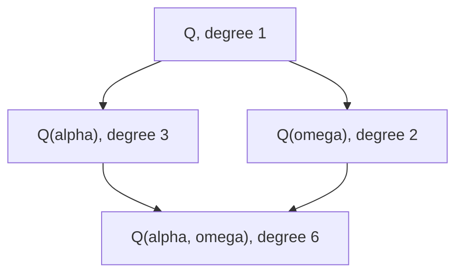
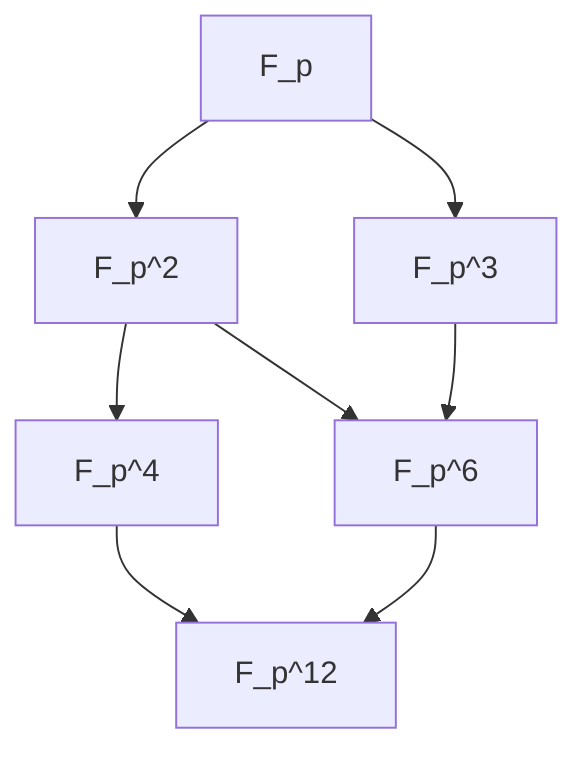
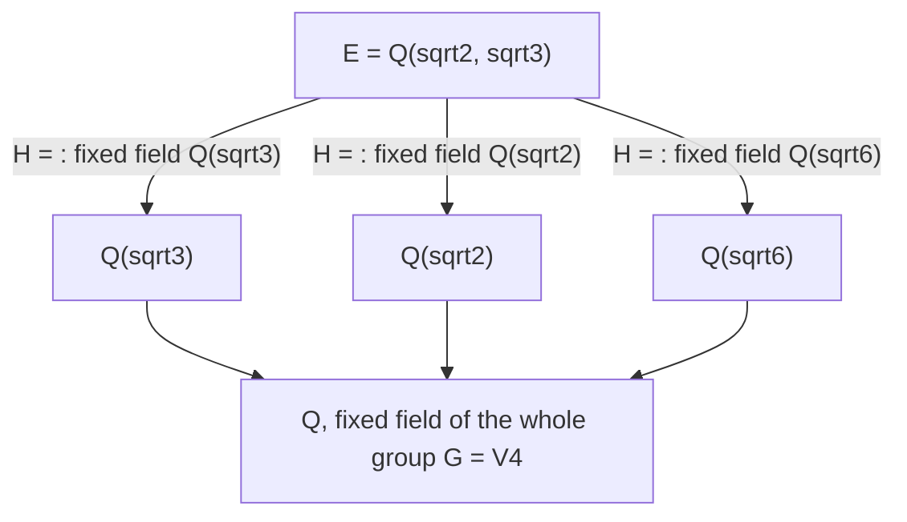

# Fields

> [Mathematics](../../README.md) › [Abstract Algebra](../README.md) › Fields · Level: Advanced · Prerequisites: [Set Theory](../../00-foundations/03-set-theory/README.md), [Proof Techniques](../../00-foundations/04-proof-techniques/README.md), [Congruences](../../12-number-theory/02-congruences/README.md), [Vector Spaces](../../08-linear-algebra/04-vector-spaces/README.md), [Groups](../01-groups/README.md), [Rings](../02-rings/README.md) · Estimated time: 12 h

## 1. Introduction

A **field** is a commutative ring in which every nonzero element is invertible. That single extra condition changes the subject: linear algebra becomes available over the coefficient object, polynomials acquire division with remainder, and equations that have no solution in a given field can be *made* to have one by adjoining a root. The study of fields is therefore the study of *solving equations by extending the number system*.

Three classical problems organise the theory, and all three are solved by it.

* **Which numbers can be constructed with straightedge and compass?** The constructible real numbers are exactly those lying in towers of quadratic extensions, so their degree over $\mathbb{Q}$ must be a power of $2$. Doubling the cube requires $\sqrt[3]{2}$, of degree $3$; trisecting a $60^\circ$ angle requires $\cos 20^\circ$, of degree $3$. Neither is a power of $2$, so both are impossible — a theorem where two thousand years of geometric effort produced nothing.
* **Do finite fields exist, and how many?** For every prime power $q = p^n$ there is exactly one field with $q$ elements, up to isomorphism. Its multiplicative group is cyclic, the map $x \mapsto x^p$ is an automorphism, and its subfields are exactly the fields $\mathbb{F}_{p^m}$ with $m \mid n$. These facts are the working foundation of coding theory and cryptography.
* **Why is there no formula for the roots of a quintic?** Because the *symmetries* of the roots — the automorphisms of the splitting field — form the group $S_5$, which cannot be built from abelian pieces. This is Galois theory, previewed in Section 7.8.

The route is as follows. Section 7.1 constructs the field of fractions, so every integral domain sits inside a field. Section 7.2 introduces the degree $[E:F]$ of an extension and proves the tower law, the multiplicative bookkeeping rule that makes degree arguments work. Section 7.3 attaches to each algebraic element its **minimal polynomial**, and Section 7.4 proves the central structural theorem of the subject:

$$F(\alpha) \cong F[x]/(m_\alpha(x)), \qquad [F(\alpha):F] = \deg m_\alpha.$$

Sections 7.5–7.6 treat finite fields and the algebraic closure; Section 7.7 applies the degree theory to the three classical construction problems; Section 7.8 previews Galois theory. Throughout, hypotheses matter: finite versus infinite, characteristic $0$ versus $p$, algebraic versus transcendental. They are stated every time.

## 2. Prerequisites

* **Rings** — [Rings](../02-rings/README.md): in particular integral domains, ideals, quotient rings, the first isomorphism theorem, polynomial rings, the division algorithm in $F[x]$, irreducible polynomials and maximal ideals. Every one of these is used in Section 7.
* **Groups** — [Groups](../01-groups/README.md): cyclic groups, Lagrange's theorem, orders of elements, group homomorphisms. The cyclicity proof for $\mathbb{F}_q^\times$ in Section 7.5 is pure group theory applied to the multiplicative group of a field.
* **Vector spaces** — [Vector Spaces](../../08-linear-algebra/04-vector-spaces/README.md): definition of a vector space, basis, dimension. A field extension $E/F$ is nothing but an $F$-vector space $E$, and $[E:F]$ is its dimension; the tower law is a statement about bases.
* **Congruences** — [Congruences](../../12-number-theory/02-congruences/README.md): $\mathbb{Z}/p\mathbb{Z}$ as a field, and the arithmetic of residues modulo a prime.
* **Sets and proofs** — [Set Theory](../../00-foundations/03-set-theory/README.md) and [Proof Techniques](../../00-foundations/04-proof-techniques/README.md): equivalence classes (used for the field of fractions), induction, minimal counterexample, and Zorn's lemma in the existence of algebraic closures.

## 3. Learning Objectives

By the end of this tutorial you will be able to:

1. State the field axioms, verify them for a given structure, and distinguish fields from integral domains and division rings.
2. Compute the characteristic of a field and identify its prime subfield as $\mathbb{F}_p$ or $\mathbb{Q}$.
3. Construct the field of fractions of an integral domain and prove its universal property.
4. Define $[E:F]$, compute it in concrete towers, and prove the tower law.
5. Decide whether an element is algebraic or transcendental, compute its minimal polynomial, and prove that the minimal polynomial is irreducible and unique.
6. Prove that $F(\alpha) \cong F[x]/(m_\alpha(x))$ and use the isomorphism to do arithmetic in simple extensions.
7. Prove that a finite field has $p^n$ elements, that its multiplicative group is cyclic, that the Frobenius map is an automorphism, and that fields of order $p^n$ exist and are unique.
8. Determine the subfields of $\mathbb{F}_{p^n}$ via the divisibility condition $m \mid n$.
9. Prove that a constructible number has degree a power of $2$, and deduce the impossibility of doubling the cube and trisecting the angle.
10. State the fundamental theorem of Galois theory and compute the Galois group of a small example.

## 4. Intuition

### 4.1 Arithmetic in which division never fails

In $\mathbb{Z}$ you can always add, subtract and multiply, but $3x = 1$ has no solution. In $\mathbb{Q}$ it does. A field is the end point of that process: every nonzero element has an inverse, so every equation $ax = b$ with $a \ne 0$ has the unique solution $x = a^{-1}b$.

The price is that a field cannot be "large and discrete" in the way $\mathbb{Z}$ is: a field that contains $1$ must contain all of $1+1$, $1+1+1$, … unless those eventually return to $0$, and must contain all their ratios unless those return to $0$. That is why the smallest field containing $1$ is either $\mathbb{Q}$ (characteristic $0$) or one of the finite fields $\mathbb{F}_p$ (characteristic $p$). Fields are rigid; that rigidity is what makes them analysable.

### 4.2 Inventing roots

$\mathbb{Q}$ has no element with square $2$. Rather than searching for one, *declare* one: take the polynomial ring $\mathbb{Q}[x]$ and quotient by the ideal generated by $x^2-2$. In the quotient the class of $x$ — call it $\alpha$ — satisfies $\alpha^2 = 2$ by construction, and because $x^2-2$ is irreducible the quotient is a field. The result is $\mathbb{Q}(\sqrt2)$, the smallest field containing $\mathbb{Q}$ and a square root of $2$.

The construction is completely general: to adjoin a root of an irreducible polynomial, quotient by the ideal it generates. The single hypothesis is irreducibility, because that is exactly what makes the ideal maximal (Section 7 of [Rings](../02-rings/README.md)), and maximality is exactly what makes the quotient a field.

### 4.3 Degree as a measure of size

$\mathbb{Q}(\sqrt2)$ is a two-dimensional vector space over $\mathbb{Q}$ with basis $\{1, \sqrt2\}$; $\mathbb{Q}(\sqrt[3]{2})$ is three-dimensional with basis $\{1, \alpha, \alpha^2\}$. The number $[E:F]$ — the dimension of $E$ as an $F$-vector space — is the right measure of "how much bigger" $E$ is.

This measure is multiplicative in towers: if $F \subseteq K \subseteq E$ then $[E:F] = [E:K][K:F]$. The reason is bookkeeping with bases: multiply a basis of $E$ over $K$ by a basis of $K$ over $F$ and get a basis of $E$ over $F$. Multiplicativity is the engine behind almost every impossibility theorem in the subject, including the constructibility results of Section 7.7.

For finite fields there is a second measure: the cardinality. If $[E:\mathbb{F}_p] = n$ then $|E| = p^n$. So "degree $n$ over the prime field" and "size $p^n$" say the same thing, and the tower law becomes a divisibility statement about exponents: $m \mid n$ iff $\mathbb{F}_{p^m} \subseteq \mathbb{F}_{p^n}$.

### 4.4 Why finite fields exist at all

A finite field of order $p^n$ cannot be $\mathbb{Z}/p^n\mathbb{Z}$: that ring has nilpotent elements and zero divisors. Instead it is $\mathbb{F}_p[x]/(f)$ for an irreducible $f$ of degree $n$. The miracle is that such an $f$ exists for every $n$, and that the resulting field does not depend on the choice of $f$. Both facts come from one polynomial: $x^{p^n}-x$, whose roots are exactly the elements of the field of order $p^n$. Every element $\alpha$ of such a field satisfies $\alpha^{p^n} = \alpha$, and the map $\alpha \mapsto \alpha^p$ — the **Frobenius map** — is a field automorphism that generates the symmetries of the field.

## 5. Formal Definition

### 5.1 The field axioms

**Definition 5.1.1 (Field).** A **field** is a commutative ring $F$ with $1 \ne 0$ in which every nonzero element is a unit:

$$\text{for every } a \in F \text{ with } a \ne 0 \text{ there exists } b \in F \text{ with } ab = 1.$$

Equivalently, $(F,+)$ is an abelian group with identity $0$, $(F\setminus\{0\},\cdot)$ is an abelian group with identity $1$, and multiplication distributes over addition.

The set $F^\times = F \setminus \{0\}$ is called the **multiplicative group** of $F$.

**Definition 5.1.2 (Field homomorphism).** A map $\sigma : F \to K$ between fields is a **field homomorphism** if $\sigma(a+b) = \sigma(a)+\sigma(b)$, $\sigma(ab) = \sigma(a)\sigma(b)$ and $\sigma(1_F) = 1_K$. An **isomorphism** is a bijective homomorphism; an **automorphism** of $F$ is an isomorphism $F \to F$.

**Proposition 5.1.3.** Every field homomorphism $\sigma : F \to K$ is injective.

**Proof.** The kernel is an ideal of the field $F$, hence $(0)$ or $F$; it is not $F$ because $\sigma(1) = 1 \ne 0$. So the kernel is $(0)$ and $\sigma$ is injective (Theorem 7.5.4 of [Rings](../02-rings/README.md)). $\blacksquare$

So a field homomorphism is always an embedding. This is why "contains a copy of" is the natural language for fields.

### 5.2 Examples and non-examples

**Example 5.2.1 (the basic fields).**
* $\mathbb{Q}$, $\mathbb{R}$, $\mathbb{C}$ are fields of characteristic $0$. So is $\mathbb{Q}(\sqrt2) = \{a+b\sqrt2 : a,b \in \mathbb{Q}\}$, with $(a+b\sqrt2)^{-1} = (a-b\sqrt2)/(a^2-2b^2)$.
* For a prime $p$, $\mathbb{F}_p = \mathbb{Z}/p\mathbb{Z}$ is a field of characteristic $p$: every nonzero class is a unit by Bézout (Corollary 7.2.4 of [Rings](../02-rings/README.md)).
* $\mathbb{Q}(i) = \{a+bi : a,b\in\mathbb{Q}\}$ and, more generally, $\mathbb{Q}(\sqrt d)$ for squarefree $d \ne 1$, are fields.
* $\mathbb{F}_4 = \mathbb{F}_2[x]/(x^2+x+1)$ is a field with four elements (Example 9.1). It is **not** $\mathbb{Z}/4\mathbb{Z}$, which has zero divisors.
* The rational function field $F(x) = \operatorname{Frac}(F[x])$ is a field containing $F[x]$.

**Example 5.2.2 (non-examples).**
* $\mathbb{Z}$ is not a field: $2$ is not invertible.
* $\mathbb{Z}/n\mathbb{Z}$ for composite $n$ is not a field: it has zero divisors.
* $\mathbb{Z}[x]$ and $F[x]$ are not fields: $x$ has no inverse (the units of $F[x]$ are $F^\times$).
* $\mathbb{H}$, the quaternions, satisfies every axiom except commutativity, and $M_n(\mathbb{Q})$ for $n \ge 2$ fails both commutativity and invertibility of nonzero elements.

### 5.3 Prime fields

**Definition 5.3.1.** A **subfield** of a field $F$ is a subset $K \subseteq F$ that is a field under the restricted operations and contains $1_F$. The **prime subfield** of $F$ is the intersection of all subfields of $F$.

**Proposition 5.3.2.** The intersection of any nonempty family of subfields of $F$ is a subfield, so the prime subfield is a subfield.

**Proof.** Let $(K_j)$ be subfields. Then $1 \in K_j$ for all $j$; and if $a, b$ lie in every $K_j$ then $a - b$ and, when $b \ne 0$, $ab^{-1}$ lie in every $K_j$ (each $K_j$ is a field). So the intersection contains $1$ and is closed under subtraction and division, hence is a field under the restricted operations. $\blacksquare$

**Theorem 5.3.3 (prime subfield is $\mathbb{F}_p$ or $\mathbb{Q}$).** Let $F$ be a field and let $P$ be its prime subfield.

1. If $\operatorname{char} F = p > 0$, then $P \cong \mathbb{F}_p$; explicitly $P = \{0, 1, 2\cdot1, \dots, (p-1)\cdot 1\}$.
2. If $\operatorname{char} F = 0$, then $P \cong \mathbb{Q}$; explicitly $P = \{(m\cdot 1)(n\cdot 1)^{-1} : m \in \mathbb{Z},\ n \in \mathbb{N}\}$.

**Proof.** The map $\iota : \mathbb{Z} \to F$, $\iota(n) = n\cdot1$, is a ring homomorphism with kernel $\operatorname{char}(F)\cdot\mathbb{Z}$.

(1) If the characteristic is $p > 0$, the first isomorphism theorem gives $\mathbb{Z}/p\mathbb{Z} \cong \operatorname{im}\iota \subseteq F$, and $\mathbb{Z}/p\mathbb{Z}$ is a field because $p$ is prime (Theorem 7.4.3 of [Rings](../02-rings/README.md) shows $p$ is prime). Hence $\operatorname{im}\iota$ is a subfield of $F$ isomorphic to $\mathbb{F}_p$. Every subfield of $F$ contains $1_F$ and is closed under addition, hence contains $\operatorname{im}\iota$; so $P = \operatorname{im}\iota \cong \mathbb{F}_p$.

(2) If the characteristic is $0$, $\iota$ is injective, so $F$ contains a copy of $\mathbb{Z}$. A subfield containing $1$ contains $\iota(m)$ for all $m$ and, since it is closed under division by nonzero elements, contains $\iota(m)\iota(n)^{-1}$ for all $n \ne 0$. The map
$$\mathbb{Q} \to F, \qquad \frac mn \mapsto \iota(m)\iota(n)^{-1}$$
is well defined (if $m/n = m'/n'$ then $mn' = m'n$, and applying $\iota$ gives $\iota(m)\iota(n') = \iota(m')\iota(n)$, so the two quotients agree because $\iota(n), \iota(n') \ne 0$), injective (its kernel is trivial since $\iota$ is injective and $F$ is a domain), and a ring homomorphism. So $P \cong \mathbb{Q}$. $\blacksquare$

**Corollary 5.3.4.** A field of characteristic $p$ contains $\mathbb{F}_p$, and a field of characteristic $0$ contains $\mathbb{Q}$. In particular every field contains one of $\mathbb{Q}, \mathbb{F}_2, \mathbb{F}_3, \mathbb{F}_5, \dots$

The corollary is used constantly: it lets a degree argument over an arbitrary field be reduced to one over its prime subfield.

## 6. Mathematical Notation

| Symbol | Read as | Meaning |
|---|---|---|
| $F$, $K$, $E$ | fields | the coefficient field, an intermediate field, the big field |
| $F^\times$ | $F$ star | the multiplicative group $F\setminus\{0\}$ |
| $\operatorname{char} F$ | characteristic | least $n$ with $n\cdot1 = 0$, or $0$ |
| $\mathbb{F}_p$ | F p | $\mathbb{Z}/p\mathbb{Z}$, the field with $p$ elements |
| $\mathbb{F}_q$ | F q | the field with $q = p^n$ elements, unique up to isomorphism |
| $\operatorname{Frac}(D)$ | fraction field of $D$ | the field of fractions of an integral domain $D$ |
| $F(x)$ | F of x | the field of rational functions over $F$ |
| $E/F$ | E over F | $E$ is a field extension of $F$, i.e. $F \subseteq E$ |
| $[E:F]$ | degree of $E$ over $F$ | $\dim_F E$; written $\infty$ when infinite |
| $F(\alpha)$ | F adjoin alpha | the smallest subfield of $E$ containing $F$ and $\alpha$ |
| $F[\alpha]$ | F bracket alpha | the smallest subring containing $F$ and $\alpha$, equal to $\{f(\alpha)\}$ |
| $F(\alpha_1,\dots,\alpha_n)$ | F adjoin the alphas | smallest subfield containing all of them |
| $m_\alpha(x)$ | minimal polynomial of alpha | the monic polynomial of least degree with $m_\alpha(\alpha) = 0$ |
| $\alpha$ algebraic | algebraic over $F$ | some nonzero $f \in F[x]$ has $f(\alpha) = 0$ |
| $\alpha$ transcendental | transcendental | no nonzero $f \in F[x]$ has $f(\alpha) = 0$ |
| $\bar F$ | algebraic closure | the smallest algebraically closed field containing $F$ |
| $\operatorname{Aut}(E/F)$ | automorphisms of $E$ over $F$ | field automorphisms of $E$ fixing $F$ pointwise |
| $\operatorname{Gal}(E/F)$ | Galois group | $\operatorname{Aut}(E/F)$ when $E/F$ is Galois |
| $\Phi_n(x)$ | $n$-th cyclotomic polynomial | the monic polynomial whose roots are the primitive $n$-th roots of unity |
| $\zeta_n$ | zeta n | $e^{2\pi i/n}$, a primitive $n$-th root of unity |
| $x^{p^n}-x$ | — | the polynomial whose roots are the elements of $\mathbb{F}_{p^n}$ |

## 7. Core Concepts

### 7.1 The field of fractions

An integral domain can always be enlarged to a field in a canonical, minimal way, by formally adjoining denominators.

**Theorem 7.1.1 (construction).** Let $D$ be an integral domain. On the set $D \times (D\setminus\{0\})$ define
$$(a,b) \sim (c,d) \iff ad = bc.$$
Then $\sim$ is an equivalence relation. Writing $a/b$ for the class of $(a,b)$ and $\operatorname{Frac}(D)$ for the set of classes, the operations
$$\frac ab + \frac cd := \frac{ad+bc}{bd}, \qquad \frac ab \cdot \frac cd := \frac{ac}{bd}$$
are well defined, and $\operatorname{Frac}(D)$ is a field, the **field of fractions** of $D$. The map $\iota : D \to \operatorname{Frac}(D)$, $\iota(a) = a/1$, is an injective ring homomorphism.

**Proof.** *Equivalence.* Reflexivity and symmetry are immediate. For transitivity, suppose $a/b = c/d$ and $c/d = e/f$, i.e. $ad = bc$ and $cf = de$. Multiply the first equation by $f$ and the second by $b$: $adf = bcf$ and $bcf = bde$, so $adf = bde$, i.e. $d(af - be) = 0$. Since $D$ is a domain and $d \ne 0$, $af = be$, that is $a/b = e/f$.

*Well-defined operations.* Suppose $a/b = a'/b'$; we must show that the sums and products with $c/d$ agree. For the sum, $ab' = a'b$ gives, after multiplying by $d$ and using commutativity, $(ad+bc)(b'd) = (a'd + b'c)(bd)$ in $D$, which is exactly the required equality of fractions; the product is similar and easier: $acb'd = a'cbd$. Denominators stay nonzero because a product of nonzero elements in a domain is nonzero. Associativity, commutativity and distributivity follow by transporting the corresponding identities from $D$ to common denominators, and $0/1$, $1/1$ are the identities.

*Field.* If $a/b \ne 0/1$ then $a \ne 0$, so $b/a$ is a legitimate fraction, and $(a/b)(b/a) = ab/ab = 1/1$. Every nonzero element is a unit.

*Embedding.* $\iota$ respects addition and multiplication and $\iota(1) = 1/1$; it is injective because $a/1 = 0/1$ means $a = 0$. $\blacksquare$

**Theorem 7.1.2 (universal property).** Let $D$ be an integral domain, $K$ a field, and $\varphi : D \to K$ an injective ring homomorphism. Then there is exactly one ring homomorphism $\tilde\varphi : \operatorname{Frac}(D) \to K$ with $\tilde\varphi \circ \iota = \varphi$, namely $\tilde\varphi(a/b) = \varphi(a)\varphi(b)^{-1}$.

**Proof.** *Existence.* For $b \ne 0$, $\varphi(b) \ne 0$ by injectivity, so $\varphi(b)$ is invertible in the field $K$ and $\varphi(a)\varphi(b)^{-1}$ is defined. If $a/b = a'/b'$ then $ab' = a'b$, so $\varphi(a)\varphi(b') = \varphi(a')\varphi(b)$; multiplying by $\varphi(b)^{-1}\varphi(b')^{-1}$ gives $\varphi(a)\varphi(b)^{-1} = \varphi(a')\varphi(b')^{-1}$. So $\tilde\varphi$ is well defined, and
$$\tilde\varphi\left(\frac ab + \frac cd\right) = (\varphi(a)\varphi(d) + \varphi(b)\varphi(c))(\varphi(b)\varphi(d))^{-1} = \varphi(a)\varphi(b)^{-1} + \varphi(c)\varphi(d)^{-1},$$
with the same computation for products; also $\tilde\varphi(1/1) = 1$. *Uniqueness.* Any such $\tilde\varphi$ must send $a/b = (a/1)(b/1)^{-1}$ to $\varphi(a)\varphi(b)^{-1}$. $\blacksquare$

**Example 7.1.3.** $\operatorname{Frac}(\mathbb{Z}) = \mathbb{Q}$; $\operatorname{Frac}(\mathbb{Z}[i]) = \mathbb{Q}(i)$; $\operatorname{Frac}(F[x]) = F(x)$, the rational function field; $\operatorname{Frac}(\mathbb{Z}[\sqrt2]) = \mathbb{Q}(\sqrt2)$. In each case the fraction field is the smallest field containing the domain, by Theorem 7.1.2.

### 7.2 Field extensions and the degree

**Definition 7.2.1.** A **field extension** $E/F$ is a field $E$ together with a subfield $F \subseteq E$. Then $E$ is a vector space over $F$ (the axioms are inherited from $E$), and the **degree** of the extension is
$$[E:F] = \dim_F E \in \mathbb{N} \cup \{\infty\}.$$
The extension is **finite** if $[E:F] < \infty$.

**Example 7.2.2.** $[\mathbb{C}:\mathbb{R}] = 2$ with basis $\{1, i\}$. $[\mathbb{Q}(\sqrt2):\mathbb{Q}] = 2$ with basis $\{1,\sqrt2\}$. $[\mathbb{Q}(\sqrt[3]2):\mathbb{Q}] = 3$ with basis $\{1,\alpha,\alpha^2\}$ where $\alpha^3 = 2$ (Example 9.2). $[\mathbb{R}:\mathbb{Q}] = \infty$, because a finite-dimensional vector space over the countable field $\mathbb{Q}$ is countable, whereas $\mathbb{R}$ is not.

**Theorem 7.2.3 (tower law).** Let $F \subseteq K \subseteq E$ be fields with $[K:F] = m$ and $[E:K] = n$ finite. Then
$$[E:F] = [E:K]\,[K:F] = nm.$$

**Proof.** Let $\beta_1,\dots,\beta_m$ be an $F$-basis of $K$ and $\alpha_1,\dots,\alpha_n$ a $K$-basis of $E$. Claim: the $nm$ products $\alpha_i\beta_j$ form an $F$-basis of $E$.

*Spanning.* Let $x \in E$. Since the $\alpha_i$ span $E$ over $K$, $x = \sum_i c_i\alpha_i$ with $c_i \in K$. Since the $\beta_j$ span $K$ over $F$, each $c_i = \sum_j d_{ij}\beta_j$ with $d_{ij} \in F$. Then
$$x = \sum_i \left(\sum_j d_{ij}\beta_j\right)\alpha_i = \sum_{i,j} d_{ij}\,(\alpha_i\beta_j).$$

*Independence.* Suppose $\sum_{i,j} d_{ij}\alpha_i\beta_j = 0$ with $d_{ij} \in F$. Regroup:
$$\sum_i \left(\sum_j d_{ij}\beta_j\right)\alpha_i = 0.$$
Each bracket lies in $K$, and the $\alpha_i$ are linearly independent over $K$, so every bracket is $0$: $\sum_j d_{ij}\beta_j = 0$ for each $i$. The $\beta_j$ are linearly independent over $F$, so $d_{ij} = 0$ for all $i, j$.

Hence the products form a basis with $nm$ elements, so $\dim_F E = nm$. $\blacksquare$

**Corollary 7.2.4.** If $F \subseteq K \subseteq E$ are fields, then $[K:F]$ divides $[E:F]$ whenever $[E:F]$ is finite. In particular, for any $\alpha \in E$, the degree $[F(\alpha):F]$ divides $[E:F]$.

The corollary is the standard tool for impossibility arguments: an element of degree $3$ cannot live in an extension of degree $4$.

**Proposition 7.2.5.** If $E/F$ is finite then every $\alpha \in E$ is algebraic over $F$; indeed $\alpha$ satisfies a nonzero polynomial over $F$ of degree at most $[E:F]$.

**Proof.** Let $n = [E:F]$. The $n+1$ elements $1, \alpha, \alpha^2, \dots, \alpha^n$ lie in the $n$-dimensional $F$-vector space $E$, so they are linearly dependent: there are $c_0,\dots,c_n \in F$, not all zero, with $\sum c_k\alpha^k = 0$. That is a nonzero polynomial of degree at most $n$ vanishing at $\alpha$. $\blacksquare$

### 7.3 Algebraic and transcendental elements

**Definition 7.3.1.** Let $E/F$ be a field extension and $\alpha \in E$. Then $\alpha$ is **algebraic over $F$** if there is a nonzero polynomial $f \in F[x]$ with $f(\alpha) = 0$; otherwise $\alpha$ is **transcendental over $F$**.

**Definition 7.3.2.** For $\alpha$ algebraic over $F$, the **minimal polynomial** $m_\alpha$ is the monic polynomial in $F[x]$ of least degree with $m_\alpha(\alpha) = 0$.

**Theorem 7.3.3 (properties of the minimal polynomial).** Let $E/F$ be a field extension and let $\alpha \in E$ be algebraic over $F$ with minimal polynomial $m = m_\alpha$. Then:

1. $m$ is well defined, that is, there is a unique monic polynomial of least degree vanishing at $\alpha$;
2. $m$ is irreducible in $F[x]$;
3. for every $f \in F[x]$, $f(\alpha) = 0$ if and only if $m \mid f$;
4. $m$ is the unique monic irreducible polynomial in $F[x]$ having $\alpha$ as a root.

**Proof.** (1) By definition of algebraicity the set $S = \{f \in F[x] : f(\alpha) = 0,\ f \ne 0\}$ is nonempty, so it contains an element of least degree and, multiplying by the inverse of the leading coefficient (which lies in $F$), a monic one. If $m_1, m_2$ are both monic of that minimal degree, then $m_1 - m_2 \in S \cup \{0\}$ has smaller degree, so $m_1 - m_2 = 0$.

(2) Suppose $m = gh$ with $g, h \in F[x]$ of positive degree. Then $0 = m(\alpha) = g(\alpha)h(\alpha)$ in the field $E$, so $g(\alpha) = 0$ or $h(\alpha) = 0$. Either way there is a nonzero polynomial vanishing at $\alpha$ of degree strictly less than $\deg m$, contradicting minimality.

(3) Divide: $f = qm + r$ with $\deg r < \deg m$. Then $f(\alpha) = r(\alpha)$. If $r \ne 0$ then $r$ is a nonzero polynomial of degree less than $\deg m$ vanishing at $\alpha$, impossible; so $r = 0$ and $m \mid f$. Conversely if $m \mid f$ then clearly $f(\alpha) = 0$.

(4) If $g$ is monic irreducible with $g(\alpha) = 0$, then $m \mid g$ by (3); since $g$ is irreducible and $m$ is not a unit, $m$ is associate to $g$, and both being monic, $m = g$. $\blacksquare$

**Theorem 7.3.4 (the degree is the degree of the minimal polynomial).** Let $\alpha$ be algebraic over $F$ with minimal polynomial $m$ of degree $n$. Then

$$F(\alpha) = F[\alpha] \cong F[x]/(m), \qquad [F(\alpha):F] = n,$$

and $\{1, \alpha, \dots, \alpha^{n-1}\}$ is an $F$-basis of $F(\alpha)$.

**Proof.** Consider the evaluation homomorphism $\mathrm{ev}_\alpha : F[x] \to E$, $\mathrm{ev}_\alpha(f) = f(\alpha)$. Its image is exactly $F[\alpha]$, the smallest subring of $E$ containing $F$ and $\alpha$, and its kernel is $(m)$ by Theorem 7.3.3(3). By the first isomorphism theorem for rings,

$$F[x]/(m) \cong F[\alpha].$$

Since $m$ is irreducible and $F[x]$ is a PID, $(m)$ is maximal (Proposition 7.8.6 of [Rings](../02-rings/README.md)); hence $F[\alpha]$ is a field. A field containing $F$ and $\alpha$ must contain $F[\alpha]$, so $F[\alpha]$ is the smallest such field, i.e. $F[\alpha] = F(\alpha)$.

For the degree: every class in $F[x]/(m)$ has a unique representative of degree $< n$ (division by the monic polynomial $m$), so the classes of $1, x, \dots, x^{n-1}$ form a basis of $F[x]/(m)$ over $F$. Under the isomorphism they correspond to $1, \alpha, \dots, \alpha^{n-1}$, which therefore form a basis of $F(\alpha)$. Hence $[F(\alpha):F] = n$. $\blacksquare$

**Corollary 7.3.5.** $\alpha$ is algebraic over $F$ if and only if $[F(\alpha):F] < \infty$.

**Proof.** If $\alpha$ is algebraic, Theorem 7.3.4 gives $[F(\alpha):F] = \deg m_\alpha < \infty$. If $[F(\alpha):F] < \infty$, Proposition 7.2.5 applies to the extension $F(\alpha)/F$. $\blacksquare$

**Corollary 7.3.6.** If $\alpha$ is transcendental over $F$, then $F[\alpha] \cong F[x]$ and $F(\alpha) \cong F(x)$.

**Proof.** The evaluation map is injective (a nonzero polynomial cannot vanish at a transcendental element), so $F[\alpha] \cong F[x]$, which is not a field. The fraction field of $F[\alpha]$ is $F(\alpha)$, and it is isomorphic to $\operatorname{Frac}(F[x]) = F(x)$ by Theorem 7.1.2. $\blacksquare$

**Example 7.3.7.**
* $\sqrt2$ over $\mathbb{Q}$: $m = x^2-2$, so $[\mathbb{Q}(\sqrt2):\mathbb{Q}] = 2$.
* $\sqrt[3]2$ over $\mathbb{Q}$: $m = x^3-2$ (irreducible by Eisenstein at $2$), so the degree is $3$.
* $i$ over $\mathbb{R}$: $m = x^2+1$, degree $2$; but $i$ over $\mathbb{Q}$ also has $m = x^2+1$, degree $2$.
* $\zeta_3 = e^{2\pi i/3}$ over $\mathbb{Q}$: $m = x^2+x+1$, degree $2$.
* $\pi$ and $e$ over $\mathbb{Q}$ are transcendental (Lindemann 1882, Hermite 1873); these are deep theorems, not proved here. $\sqrt2 + \pi$ is transcendental: if it were algebraic, then $\pi = (\sqrt2+\pi) - \sqrt2$ would lie in the finite extension $\mathbb{Q}(\sqrt2, \sqrt2+\pi)/\mathbb{Q}$ and hence be algebraic (Exercise 18), a contradiction.

### 7.4 Simple extensions: $F(\alpha) \cong F[x]/(m_\alpha)$

Theorem 7.3.4 is the working form of the construction in Section 4.2. Two consequences deserve separate statements.

**Theorem 7.4.1 (arithmetic in a simple extension).** Let $\alpha$ be algebraic over $F$ with minimal polynomial $m$ of degree $n$. Every element of $F(\alpha)$ has a unique expression
$$c_0 + c_1\alpha + \cdots + c_{n-1}\alpha^{n-1}, \qquad c_i \in F.$$
Addition is coefficientwise; multiplication is performed in $F[\alpha]$ and reduced using $m(\alpha) = 0$. Inverses exist and are computed by the extended Euclidean algorithm in $F[x]$, or by rationalising.

**Proof.** Uniqueness and addition are immediate from the basis statement of Theorem 7.3.4. For the inverse of $0 \ne \beta = g(\alpha)$: since $g(\alpha) \ne 0$, $m \nmid g$, and $m$ is irreducible, so $\gcd(m, g) = 1$; by Bézout in the Euclidean domain $F[x]$ there are $u, v$ with $um + vg = 1$. Evaluating at $\alpha$ gives $v(\alpha)g(\alpha) = 1$, so $v(\alpha) = \beta^{-1}$. $\blacksquare$

**Theorem 7.4.2 (isomorphism of simple extensions).** Let $\alpha$ and $\beta$ be algebraic over $F$ with the same minimal polynomial $m$. Then there is a unique $F$-isomorphism $F(\alpha) \to F(\beta)$ sending $\alpha \mapsto \beta$, given by $f(\alpha) \mapsto f(\beta)$.

**Proof.** Both fields are isomorphic to $F[x]/(m)$ by Theorem 7.3.4, and the composite $F(\alpha) \to F[x]/(m) \to F(\beta)$ sends $\alpha = x + (m)$ to $\beta = x + (m)$. Uniqueness holds because $F(\alpha)$ is generated as a field by $F$ and $\alpha$. $\blacksquare$

Theorem 7.4.2 is the first hint of Galois theory: **different roots of the same irreducible polynomial give interchangeable fields**. When $\beta$ lies in the same field as $\alpha$, the map $f(\alpha) \mapsto f(\beta)$ is an automorphism of that field only if it is surjective; this is why the count of automorphisms of $\mathbb{Q}(\sqrt[3]2)$ is $1$ while that of $\mathbb{Q}(\sqrt2)$ is $2$ (Example 9.7).

**Example 7.4.3 (degrees in a tower).** Let $\alpha = \sqrt[3]2$ and $\omega = e^{2\pi i/3}$. Then $[\mathbb{Q}(\alpha):\mathbb{Q}] = 3$. The polynomial $x^2+x+1$ has no real root, so it is irreducible over $\mathbb{Q}(\alpha) \subseteq \mathbb{R}$, hence $[\mathbb{Q}(\alpha,\omega):\mathbb{Q}(\alpha)] = 2$ and, by the tower law,
$$[\mathbb{Q}(\alpha,\omega):\mathbb{Q}] = 2\cdot 3 = 6.$$
This field is the splitting field of $x^3-2$: it contains all three roots $\alpha, \omega\alpha, \omega^2\alpha$. More on this in Example 9.7 and Section 7.8.

### 7.5 Finite fields

This section proves the classification of finite fields. Throughout, $p$ is a prime and $q = p^n$ with $n \ge 1$.

**Theorem 7.5.1 (the size is a prime power).** Let $F$ be a finite field. Then $\lvert F\rvert = p^n$ where $p = \operatorname{char} F$ and $n = [F:\mathbb{F}_p] \ge 1$.

**Proof.** By Corollary 5.3.4, $F$ contains its prime subfield $\mathbb{F}_p$. Since $F$ is finite it is a finite-dimensional $\mathbb{F}_p$-vector space; let $n = \dim_{\mathbb{F}_p} F \ge 1$. Choosing a basis $e_1,\dots,e_n$, every element of $F$ is a unique combination $\sum c_ie_i$ with $c_i \in \mathbb{F}_p$, so $\lvert F\rvert = p^n$. $\blacksquare$

**Lemma 7.5.2 (a polynomial has at most $\deg$ roots).** Let $K$ be a field and $f \in K[x]$ nonzero of degree $d$. Then $f$ has at most $d$ roots in $K$.

**Proof.** Induct on $d$. For $d = 0$, $f$ is a nonzero constant and has no roots. For $d \ge 1$, if $f$ has no root there is nothing to prove; otherwise let $a$ be a root. By the factor theorem, $f = (x-a)g$ with $\deg g = d-1$. Any root $b$ of $f$ satisfies $(b-a)g(b) = 0$, so $b = a$ or $g(b) = 0$; by induction $g$ has at most $d-1$ roots, so $f$ has at most $d$. $\blacksquare$

The lemma fails over rings with zero divisors: $3x$ has three roots in $\mathbb{Z}/6\mathbb{Z}$.

**Theorem 7.5.3 (the multiplicative group is cyclic).** Let $F$ be a finite field. Then $F^\times$ is a cyclic group.

**Proof.** Put $N = \lvert F^\times\rvert = q-1$.

*Step 1: a group lemma.* Let $G$ be a finite abelian group and let $m$ be the least common multiple of the orders of its elements. Then $G$ contains an element of order $m$. Indeed, let $a \in G$ have maximal order $r$ and let $b \in G$ have order $s$. If $s \nmid r$, some prime $\ell$ has $v_\ell(s) > v_\ell(r)$; then $a^{\ell^{v_\ell(r)}}$ has order $r/\ell^{v_\ell(r)}$ and $b^{s/\ell^{v_\ell(s)}}$ has order $\ell^{v_\ell(s)}$, these orders are coprime, so their product has order
$$\frac{r}{\ell^{v_\ell(r)}} \cdot \ell^{v_\ell(s)} = r\,\ell^{v_\ell(s)-v_\ell(r)} > r,$$
contradicting maximality. Hence every order divides $r$, so $m = r$ and $a$ has order $m$.

*Step 2: apply it.* By Lagrange's theorem, the order of every $a \in F^\times$ divides $N$, so the least common multiple $m$ of all orders divides $N$; in particular $m \le N$. On the other hand every $a \in F^\times$ satisfies $a^m = 1$ (its order divides $m$), so all $N$ elements of $F^\times$ are roots of $x^m-1$. That polynomial has at most $m$ roots by Lemma 7.5.2, so $N \le m$. Therefore $m = N$, and Step 1 produces $a \in F^\times$ of order $N$: $F^\times = \langle a\rangle$. $\blacksquare$

**Theorem 7.5.4 (Frobenius).** Let $F$ be a field of characteristic $p$ and define $\sigma : F \to F$ by $\sigma(x) = x^p$. Then $\sigma$ is a field homomorphism. If $F$ is finite, $\sigma$ is an automorphism.

**Proof.** $\sigma(1) = 1$ and $\sigma(xy) = x^py^p = \sigma(x)\sigma(y)$. For the sum, the freshman's dream (Theorem 7.4.4 of [Rings](../02-rings/README.md), which requires commutativity and characteristic $p$) gives
$$\sigma(x+y) = (x+y)^p = x^p + y^p = \sigma(x)+\sigma(y).$$
So $\sigma$ is a ring homomorphism, hence injective by Proposition 5.1.3. If $F$ is finite, an injective self-map of a finite set is surjective, so $\sigma \in \operatorname{Aut}(F)$. $\blacksquare$

**Corollary 7.5.5 (the fixed field of Frobenius).** Let $F$ be a finite field of characteristic $p$. Then $\{x \in F : x^p = x\} = \mathbb{F}_p$, the prime subfield.

**Proof.** The fixed points are the roots in $F$ of $x^p - x$, a polynomial of degree $p$, so there are at most $p$ of them (Lemma 7.5.2). Every element of the prime subfield $\mathbb{F}_p$ is a root (Fermat's little theorem, or direct computation), and there are $p$ of them. Hence the fixed set is exactly $\mathbb{F}_p$. $\blacksquare$

Corollary 7.5.5 is the key to computing degrees in finite fields: an element is fixed by $\sigma^k$ exactly when it lies in $\mathbb{F}_{p^k}$.

**Theorem 7.5.6 (the polynomial $x^{p^n}-x$).** Let $p$ be prime and $n \ge 1$. In $\mathbb{F}_p[x]$,

$$x^{p^n} - x = \prod_{d \mid n} \ \prod_{\substack{f \text{ monic irreducible}\\ \deg f = d}} f(x).$$

**Lemma 7.5.7.** Let $f$ be a monic irreducible of degree $d$ over $\mathbb{F}_p$. Then $f \mid x^{p^n}-x$ if and only if $d \mid n$.

**Proof.** Let $K = \mathbb{F}_p[x]/(f)$, a field with $p^d$ elements, and let $\alpha$ be the class of $x$, so that $K = \mathbb{F}_p(\alpha)$ and $f$ is the minimal polynomial of $\alpha$ over $\mathbb{F}_p$. Since $f \mid x^{p^n}-x$ iff $\alpha^{p^n} = \alpha$ (Theorem 7.3.3(3)), and $\alpha^{p^n} = \sigma^n(\alpha)$ for the Frobenius automorphism $\sigma$ of $K$ (Theorem 7.5.4), the condition is $\sigma^n(\alpha) = \alpha$.

Let $k$ be the least positive integer with $\sigma^k(\alpha) = \alpha$. Then $\sigma^n(\alpha) = \alpha$ iff $k \mid n$. So it remains to prove $k = d$.

*$k \le d$:* every $y \in K$ satisfies $y^{p^d} = y$ (for $y \ne 0$ use Lagrange in the group $K^\times$ of order $p^d-1$), so $\sigma^d$ is the identity on $K$ and $\sigma^d(\alpha) = \alpha$.

*$d \le k$:* consider $h(x) = \prod_{i=0}^{k-1}\bigl(x - \sigma^i(\alpha)\bigr) \in K[x]$. The coefficients of $h$ are fixed by $\sigma$, because $\sigma$ permutes the factors cyclically ($\sigma(\sigma^{k-1}(\alpha)) = \sigma^k(\alpha) = \alpha$). By Corollary 7.5.5 applied to $K$, the fixed field of $\sigma$ is $\mathbb{F}_p$; hence $h \in \mathbb{F}_p[x]$. Since $h(\alpha) = 0$, the minimal polynomial $f$ divides $h$, so $d = \deg f \le \deg h = k$.

Therefore $k = d$, and $f \mid x^{p^n}-x \iff d \mid n$. $\blacksquare$

**Proof of Theorem 7.5.6.** The derivative of $F(x) = x^{p^n}-x$ is $p^nx^{p^n-1}-1 = -1 \ne 0$ in characteristic $p$, so $\gcd(F,F') = 1$, which forces $F$ to be squarefree: if $g^2 \mid F$ then $g \mid F'$, hence $g \mid \gcd(F,F') = 1$. Therefore $F$ is a product of distinct monic irreducibles, and by Lemma 7.5.7 those are exactly the monic irreducibles whose degree divides $n$. Both sides are monic of the same factors, so they are equal. $\blacksquare$

**Theorem 7.5.8 (existence).** For every prime $p$ and every $n \ge 1$ there exists a field with $p^n$ elements.

**Proof.** *Splitting fields exist.* Given $f \in K[x]$ of positive degree, if $f$ does not yet split, choose an irreducible factor $g$ of $f$ of degree $\ge 2$ and pass to $K_1 = K[x]/(g)$, in which $g$ has the root $x + (g)$; write $f = (x-\alpha)g_1$ over $K_1$ and repeat with $g_1$, whose degree is smaller. The process terminates because the degree of the remaining factor strictly decreases, so after finitely many steps $f$ splits in an extension $F$ generated over $K$ by its roots. Such an $F$ is a **splitting field** of $f$.

Now take $K = \mathbb{F}_p$ and $f = x^{p^n}-x$. Let $F$ be a splitting field and let $S \subseteq F$ be the set of roots of $f$. Its derivative is $f' = p^nx^{p^n-1}-1 = -1 \ne 0$, so $\gcd(f,f') = 1$ and $f$ is squarefree (if $g^2 \mid f$ then $g \mid f'$, hence $g \mid \gcd(f,f')$); therefore $S$ has exactly $\deg f = p^n$ elements.

Moreover $S$ is a subfield of $F$: it contains $0$ and $1$, and if $a, b \in S$ then by the iterated freshman's dream
$$(a+b)^{p^n} = a^{p^n}+b^{p^n} = a+b, \qquad (ab)^{p^n} = a^{p^n}b^{p^n} = ab,$$
while for $a \ne 0$, $(a^{-1})^{p^n} = (a^{p^n})^{-1} = a^{-1}$; also $(-a)^{p^n} = -a$. Hence $S$ is a field, and it has $p^n$ elements. $\blacksquare$

*Counting irreducibles.* Comparing degrees in Theorem 7.5.6 and writing $N_d$ for the number of monic irreducibles of degree $d$ over $\mathbb{F}_p$ gives $p^n = \sum_{d \mid n} d\,N_d$. Over $\mathbb{F}_2$, for $n = 1,2,3,4$: $N_1 = 2$ ($x$ and $x+1$); $4 = N_1 + 2N_2$ gives $N_2 = 1$ ($x^2+x+1$); $8 = N_1 + 3N_3$ gives $N_3 = 2$ ($x^3+x+1$ and $x^3+x^2+1$); and $16 = N_1 + 2N_2 + 4N_4 = 2+2+4N_4$ gives $N_4 = 3$.

**Theorem 7.5.9 (uniqueness).** Any two fields with $q = p^n$ elements are isomorphic.

**Lemma 7.5.10 (splitting fields are unique).** Let $\sigma : F \to F'$ be a field isomorphism, $f \in F[x]$ nonzero, $E$ a splitting field of $f$ over $F$ and $E'$ a splitting field of $\sigma(f)$ over $F'$. Then $\sigma$ extends to an isomorphism $E \to E'$.

**Proof.** Induct on $\deg f$. If $f$ splits into linear factors over $F$, then $E = F$ and $E' = F'$, and $\sigma$ itself works. Otherwise let $g$ be an irreducible factor of $f$ of degree $\ge 2$, let $\alpha \in E$ and $\alpha' \in E'$ be roots of $g$ and $\sigma(g)$ respectively, and define
$$\tilde\sigma : F(\alpha) \to F'(\alpha'), \qquad \tilde\sigma(h(\alpha)) = \sigma(h)(\alpha').$$
This is well defined: the map $F[x] \to F'(\alpha')$, $h \mapsto \sigma(h)(\alpha')$, is a ring homomorphism whose kernel contains $(g)$ and, since $(g)$ is maximal and the map is not zero, equals $(g)$; so it factors through $F[x]/(g) \cong F(\alpha)$ and lands in the field $F'(\alpha') \cong F'[x]/(\sigma(g))$. Write $f = g\cdot k$; then $E$ is a splitting field of $k$ over $F(\alpha)$ and $E'$ is a splitting field of $\tilde\sigma(k)$ over $F'(\alpha')$, with $\deg k < \deg f$. By induction $\tilde\sigma$ extends to an isomorphism $E \to E'$. $\blacksquare$

**Proof of Theorem 7.5.9.** Let $F$ and $F'$ be fields with $q = p^n$ elements. Every element $a \in F$ satisfies $a^q = a$: this is clear for $a = 0$, and for $a \ne 0$ it follows from Lagrange's theorem in the group $F^\times$ of order $q-1$. Hence the $q$ elements of $F$ are exactly the roots of $x^q-x$, so $F$ is a splitting field of $x^q-x$ over its prime subfield $\mathbb{F}_p$. The same holds for $F'$. Applying Lemma 7.5.10 to the identity isomorphism $\mathbb{F}_p \to \mathbb{F}_p$ gives $F \cong F'$. $\blacksquare$

**Theorem 7.5.11 (subfields).** Let $q = p^n$. The subfields of $\mathbb{F}_{p^n}$ are exactly the fields $\mathbb{F}_{p^m}$ with $m \mid n$, and there is exactly one for each such $m$.

**Proof.** *Existence.* If $m \mid n$ then $x^{p^m}-x$ divides $x^{p^n}-x$ in $\mathbb{F}_p[x]$: modulo $g = x^{p^m}-x$ we have $x^{p^m} \equiv x$, and raising to the $p^m$-th power preserves congruences (reduction modulo $g$ is a ring homomorphism), so by iteration $x^{p^{n}} \equiv x \pmod g$ when $n = km$. Hence every root of $x^{p^m}-x$ is a root of $x^{p^n}-x$, i.e. $\mathbb{F}_{p^m} \subseteq \mathbb{F}_{p^n}$, where $\mathbb{F}_{p^m}$ denotes the set of roots of $x^{p^m}-x$. That set is a subfield: if $a^{p^m} = a$ and $b^{p^m} = b$ then $(a+b)^{p^m} = a+b$, $(ab)^{p^m} = ab$, and for $a \ne 0$, $(a^{-1})^{p^m} = a^{-1}$; it has exactly $p^m$ elements.

*Exhaustion.* Let $K \subseteq \mathbb{F}_{p^n}$ be a subfield. Then $K$ is finite, so $\lvert K\rvert = p^m$ for some $m$ (Theorem 7.5.1), and the tower law gives $n = [\mathbb{F}_{p^n}:K]\cdot[K:\mathbb{F}_p] = [\mathbb{F}_{p^n}:K]\cdot m$, so $m \mid n$. Moreover $K$ is a field with $p^m$ elements, hence isomorphic to $\mathbb{F}_{p^m}$ by Theorem 7.5.9; since a field with $p^m$ elements contained in $\mathbb{F}_{p^n}$ is exactly the set of roots of $x^{p^m}-x$, there is only one such $K$. $\blacksquare$

**Example 7.5.12 (small finite fields).**

| Field | Construction | Multiplicative group | Subfields |
|---|---|---|---|
| $\mathbb{F}_2$ | $\mathbb{Z}/2\mathbb{Z}$ | trivial | — |
| $\mathbb{F}_3$ | $\mathbb{Z}/3\mathbb{Z}$ | $\mathbb{Z}/2\mathbb{Z}$ | — |
| $\mathbb{F}_4$ | $\mathbb{F}_2[x]/(x^2+x+1)$ | $\mathbb{Z}/3\mathbb{Z}$ | $\mathbb{F}_2$ |
| $\mathbb{F}_8$ | $\mathbb{F}_2[x]/(x^3+x+1)$ | $\mathbb{Z}/7\mathbb{Z}$ | $\mathbb{F}_2$ |
| $\mathbb{F}_9$ | $\mathbb{F}_3[x]/(x^2+1)$ | $\mathbb{Z}/8\mathbb{Z}$ | $\mathbb{F}_3$ |
| $\mathbb{F}_{16}$ | $\mathbb{F}_2[x]/(x^4+x+1)$ | $\mathbb{Z}/15\mathbb{Z}$ | $\mathbb{F}_2, \mathbb{F}_4$ |

The subfield column is Theorem 7.5.11: $4$ has divisors $1,2$; $16$ has divisors $1,2,4$. Note $\mathbb{F}_4 \cap \mathbb{F}_8 = \mathbb{F}_2$ inside $\mathbb{F}_{64}$, consistent with $\gcd(2,3) = 1$; in general $\mathbb{F}_{p^m}\cap\mathbb{F}_{p^n} = \mathbb{F}_{p^{\gcd(m,n)}}$ and the compositum is $\mathbb{F}_{p^{\operatorname{lcm}(m,n)}}$.

### 7.6 The algebraic closure

**Definition 7.6.1.** A field $K$ is **algebraically closed** if every nonconstant polynomial in $K[x]$ has a root in $K$. An **algebraic closure** of $F$ is an algebraic extension $\bar F/F$ with $\bar F$ algebraically closed.

**Theorem 7.6.2 (existence and uniqueness of algebraic closures).** Every field $F$ has an algebraic closure $\bar F$, and any two algebraic closures of $F$ are isomorphic over $F$.

The proof of existence uses Zorn's lemma on the set of algebraic extensions of $F$ (or on the ideal generated by all polynomials) and is not given here; uniqueness is an application of the extension lemma 7.5.10 together with a back-and-forth argument. Three consequences are worth recording.

* Every $f \in F[x]$ splits into linear factors over $\bar F$, and $\bar F$ is exactly the set of elements algebraic over $F$ inside it.
* If $F$ is countable then $\bar F$ is countable; in particular $\overline{\mathbb{Q}}$, the field of algebraic numbers, is countable and algebraically closed.
* $\mathbb{C}$ is algebraically closed (the fundamental theorem of algebra) and is an algebraic closure of $\mathbb{R}$. The algebraic closure of $\mathbb{F}_p$ is
$$\overline{\mathbb{F}}_p = \bigcup_{n \ge 1} \mathbb{F}_{p^{n!}},$$
the union being nested because $n! \mid (n+1)!$; every polynomial over the union has coefficients in some $\mathbb{F}_{p^N}$ and splits in some finite extension $\mathbb{F}_{p^{Nk}}$, which is contained in $\mathbb{F}_{p^{m!}}$ for $m$ large enough.

The field $\overline{\mathbb{Q}}$ is where the classical problems of Section 7.7 live: a number is constructible only if it lies in $\overline{\mathbb{Q}}$, so transcendental numbers such as $\pi$ are automatically out of reach.

### 7.7 Constructible numbers and three impossible constructions

**Definition 7.7.1.** Start with the two points $(0,0)$ and $(1,0)$ in the plane. A point is **constructible** if it is obtained by finitely many applications of:

1. drawing the line through two constructed points;
2. drawing the circle with centre at a constructed point passing through a constructed point;
3. marking an intersection point of two constructed lines, of a line and a circle, or of two circles.

A real number $x$ is **constructible** if the point $(x,0)$ is constructible.

**Lemma 7.7.2 (each step adds at most one square root).** Suppose all constructed points so far have coordinates in a subfield $K \subseteq \mathbb{R}$. Then the coordinates of any newly constructed point lie in a field $K'$ with $[K':K] \le 2$.

**Proof.** (i) *Line meets line.* Two lines with coefficients in $K$ meet at the solution of a $2\times 2$ linear system with coefficients in $K$, and the solution lies in $K$ by Cramer's rule (the determinant is nonzero because the lines are not parallel).

(ii) *Line meets circle.* The line has an equation $\alpha x + \beta y = \gamma$ with $\alpha,\beta,\gamma \in K$; the circle has equation $(x-a)^2 + (y-b)^2 = r^2$ with $a,b,r \in K$ (the radius is the distance between two constructed points, whose square lies in $K$). If $\beta \ne 0$, solve for $y$ in the line equation and substitute: the result is a quadratic equation in $x$ with coefficients in $K$. Its roots lie in $K$ or in $K(\sqrt{D})$ for the discriminant $D \in K$, an extension of degree at most $2$. Then $y$ is determined by the linear equation, so it lies in the same field.

(iii) *Circle meets circle.* Subtracting the two circle equations eliminates $x^2+y^2$ and leaves a line (the radical axis) with coefficients in $K$; the problem reduces to case (ii). $\blacksquare$

**Theorem 7.7.3 (degree of a constructible number).** If $x \in \mathbb{R}$ is constructible, then $[\mathbb{Q}(x):\mathbb{Q}]$ is a power of $2$.

**Proof.** A construction of $(x,0)$ uses finitely many steps. Let $K_0 = \mathbb{Q}$ and let $K_{i+1}$ be the field generated by $K_i$ and the coordinates of the points produced at step $i+1$; by Lemma 7.7.2, $[K_{i+1}:K_i] \le 2$. If there are $N$ steps then $x \in K_N$ and, by the tower law,
$$[K_N:\mathbb{Q}] = \prod_{i=0}^{N-1}[K_{i+1}:K_i] \in \{1, 2, 4, 8, \dots\}.$$
By the tower law again, $[K_N:\mathbb{Q}] = [K_N:\mathbb{Q}(x)]\,[\mathbb{Q}(x):\mathbb{Q}]$, so $[\mathbb{Q}(x):\mathbb{Q}]$ divides a power of $2$ and hence is itself a power of $2$. $\blacksquare$

**Corollary 7.7.4 (doubling the cube is impossible).** There is no straightedge-and-compass construction of a cube whose volume is twice that of the unit cube.

**Proof.** Such a cube has side $\sqrt[3]{2}$, so it would suffice to construct the point $(\sqrt[3]{2}, 0)$. The polynomial $x^3-2$ is irreducible over $\mathbb{Q}$ by Eisenstein's criterion at $p = 2$, so the minimal polynomial of $\sqrt[3]{2}$ is $x^3-2$ and $[\mathbb{Q}(\sqrt[3]{2}):\mathbb{Q}] = 3$. Since $3$ is not a power of $2$, Theorem 7.7.3 forbids the construction. $\blacksquare$

**Corollary 7.7.5 (trisecting $60^\circ$ is impossible).** There is no straightedge-and-compass construction that divides a $60^\circ$ angle into three equal parts.

**Proof.** Trisecting $60^\circ$ amounts to constructing the point $(\cos 20^\circ, 0)$. From $\cos 3\theta = 4\cos^3\theta - 3\cos\theta$ with $\theta = 20^\circ$ and $\cos 60^\circ = \tfrac12$,
$$\tfrac12 = 4c^3 - 3c, \qquad c = \cos 20^\circ,$$
that is $8c^3 - 6c - 1 = 0$. Substitute $y = 2c$: $y^3 - 3y - 1 = 0$. The rational root test lists $\pm1$ as the only candidates, and $1 - 3 - 1 = -3 \ne 0$, $(-1)^3 + 3 - 1 = 1 \ne 0$; so $y^3-3y-1$ is irreducible over $\mathbb{Q}$ (it has degree $3$ and no root), and $[\mathbb{Q}(c):\mathbb{Q}] = [\mathbb{Q}(y):\mathbb{Q}] = 3$. Again $3$ is not a power of $2$. $\blacksquare$

**Example 7.7.6 (what *is* constructible).** The regular pentagon is constructible: with $\zeta_5 = e^{2\pi i/5}$, the number $c = \cos 72^\circ = (\zeta_5+\zeta_5^{-1})/2$ satisfies
$$4c^2 + 2c - 1 = 0, \qquad c = \frac{\sqrt5-1}{4},$$
so $[\mathbb{Q}(c):\mathbb{Q}] = 2$ and $c$ is constructible (the construction is the classical pentagon construction). More generally:

* **Gauss–Wantzel theorem (stated).** The regular $n$-gon is constructible if and only if $n = 2^a p_1p_2\cdots p_k$ where $a \ge 0$ and the $p_i$ are distinct Fermat primes, i.e. primes of the form $2^{2^m}+1$. Thus $n = 3, 4, 5, 6, 8, 10, 12, 15, 16, 17, 20, \dots$ are constructible, while $7, 9, 11, 13, 14, 18, 19$ are not. Gauss's discovery that the regular $17$-gon is constructible is the reason he chose mathematics.
* **Squaring the circle is impossible.** It requires constructing $\sqrt\pi$; but $\pi$ is transcendental over $\mathbb{Q}$ (Lindemann, 1882), hence so is $\sqrt\pi$, while every constructible number is algebraic (Theorem 7.7.3 implies $[\mathbb{Q}(x):\mathbb{Q}] < \infty$).

Necessity of the degree condition is not sufficiency in general: an element of degree $4$ whose Galois group is $S_4$ is not constructible, even though $4$ is a power of $2$. The correct characterisation is that the Galois group is a $2$-group, which is the Galois-theoretic shadow of "a tower of quadratic extensions".

### 7.8 A preview of Galois theory

**Definition 7.8.1.** Let $E/F$ be a field extension. Then
$$\operatorname{Aut}(E/F) = \{\sigma : E \to E \text{ automorphism} : \sigma(a) = a \text{ for all } a \in F\}$$
is a group under composition, the group of $F$-automorphisms of $E$.

**Theorem 7.8.2 (automorphisms permute roots).** Let $E/F$ be a field extension, $\sigma \in \operatorname{Aut}(E/F)$, and $\alpha \in E$ algebraic over $F$ with minimal polynomial $m$. Then $\sigma(\alpha)$ is also a root of $m$, and the map $\alpha \mapsto \sigma(\alpha)$ is injective on the set of roots of $m$ in $E$.

**Proof.** If $m = \sum c_kx^k$ with $c_k \in F$ then
$$0 = \sigma(0) = \sigma\Bigl(\sum c_k\alpha^k\Bigr) = \sum c_k\sigma(\alpha)^k = m(\sigma(\alpha)).$$
Injectivity is clear because $\sigma$ is injective. $\blacksquare$

**Theorem 7.8.3 (the bound).** If $E/F$ is a finite extension then $\lvert\operatorname{Aut}(E/F)\rvert \le [E:F]$.

**Proof sketch.** Induct on $n = [E:F]$. Choose $\alpha \in E\setminus F$ and let $K = F(\alpha)$, with $d = [K:F] \ge 2$. Every $\sigma \in \operatorname{Aut}(E/F)$ restricts to an embedding $K \to E$ fixing $F$, and by Theorem 7.8.2 such an embedding is determined by $\sigma(\alpha)$, a root of the minimal polynomial of $\alpha$, of which there are at most $d$. For each restriction there are at most $[E:K]$ extensions to $E$ by the induction hypothesis applied to $E/K$ (an automorphism of $E$ fixing $K$). Hence $\lvert\operatorname{Aut}(E/F)\rvert \le d\,[E:K] = [E:F]$. $\blacksquare$

**Definition 7.8.4.** A finite extension $E/F$ is **Galois** if $\lvert\operatorname{Aut}(E/F)\rvert = [E:F]$; then $\operatorname{Gal}(E/F) := \operatorname{Aut}(E/F)$ is the **Galois group** of the extension.

Equivalently (for the fields in this tutorial), $E/F$ is Galois when $E$ is the splitting field of a polynomial with distinct roots over $F$. Separability is automatic over $\mathbb{Q}$ and over finite fields, so in practice: **finite Galois = splitting field**.

**Example 7.8.5 (a complete example).** Let $E = \mathbb{Q}(\sqrt2,\sqrt3)$, of degree $4$ over $\mathbb{Q}$ (Example 9.2). Define
$$\sigma(\sqrt2) = -\sqrt2,\quad \sigma(\sqrt3) = \sqrt3; \qquad \tau(\sqrt2) = \sqrt2,\quad \tau(\sqrt3) = -\sqrt3.$$
Both extend uniquely to automorphisms of $E$, since $E$ is generated by $\sqrt2$ and $\sqrt3$; $\sigma^2 = \tau^2 = \mathrm{id}$ and $\sigma\tau = \tau\sigma$, so
$$G = \operatorname{Gal}(E/\mathbb{Q}) = \{\mathrm{id}, \sigma, \tau, \sigma\tau\} \cong \mathbb{Z}/2\mathbb{Z}\times\mathbb{Z}/2\mathbb{Z}.$$
Here $\lvert G\rvert = 4 = [E:\mathbb{Q}]$, so $E/\mathbb{Q}$ is Galois. Its subgroups and their fixed fields are:

| Subgroup $H$ | Order | Fixed field $E^H$ | $[E^H:\mathbb{Q}]$ |
|---|---|---|---|
| $\{\mathrm{id}\}$ | $1$ | $E = \mathbb{Q}(\sqrt2,\sqrt3)$ | $4$ |
| $\langle\sigma\rangle$ | $2$ | $\mathbb{Q}(\sqrt3)$ | $2$ |
| $\langle\tau\rangle$ | $2$ | $\mathbb{Q}(\sqrt2)$ | $2$ |
| $\langle\sigma\tau\rangle$ | $2$ | $\mathbb{Q}(\sqrt6)$ | $2$ |
| $G$ | $4$ | $\mathbb{Q}$ | $1$ |

Each row illustrates $\lvert H\rvert = [E:E^H]$ and $[G:H] = [E^H:\mathbb{Q}]$, and every subgroup is normal because $G$ is abelian, so every intermediate field is Galois over $\mathbb{Q}$.

**Theorem 7.8.6 (fundamental theorem of Galois theory — stated).** Let $E/F$ be a finite Galois extension with group $G = \operatorname{Gal}(E/F)$. Then there is an inclusion-reversing bijection
$$\{H : H \le G\} \longleftrightarrow \{K : F \subseteq K \subseteq E\}, \qquad H \mapsto E^H, \qquad K \mapsto \operatorname{Aut}(E/K),$$
with inverse given by the two maps shown. Under it:

1. $[E:E^H] = \lvert H\rvert$ and $[E^H:F] = [G:H]$;
2. $E^H/F$ is Galois if and only if $H \trianglelefteq G$, and then $\operatorname{Gal}(E^H/F) \cong G/H$;
3. $E/F$ is Galois if and only if $F$ is the fixed field of $G$.

This is the central theorem of the subject; its proof belongs to a course on Galois theory and is not given here (see [Galois Theory](../04-galois-theory/README.md) for the full development).

**Why the quintic has no radical formula.** A polynomial $f \in \mathbb{Q}[x]$ is solvable by radicals — its roots expressible from the coefficients using $+,-,\times,\div$ and $n$-th roots — if and only if its Galois group is a **solvable group**, i.e. admits a chain of subgroups with abelian quotients. For $n \ge 5$ the symmetric group $S_n$ is not solvable: its only proper normal subgroups are $A_n$ (for $n \ge 5$) and $\{e\}$, and $A_n$ is simple and non-abelian. The general polynomial of degree $5$ has Galois group $S_5$, so no formula in radicals can exist — the Abel–Ruffini theorem, proved by Abel in 1824 and explained structurally by Galois. Concrete quintics such as $x^5-x-1$ also have Galois group $S_5$.

The same circle of ideas explains Section 7.7: a constructible number generates an extension obtainable by a tower of quadratic steps, so its Galois group is a $2$-group. Degree a power of $2$ is necessary but, as noted, not sufficient.

## 8. Formulas and Properties

The table collects the working results with their hypotheses. Section numbers refer to the statement and proof above.

| Result | Hypotheses | Statement | Why it holds |
|---|---|---|---|
| Prime subfield | field $F$ | $P \cong \mathbb{F}_p$ if $\operatorname{char} F = p$, $P \cong \mathbb{Q}$ if $\operatorname{char} F = 0$ | image of $\mathbb{Z} \to F$ and closedness under division (§5.3) |
| Field of fractions | $D$ integral domain | $\operatorname{Frac}(D)$ is a field containing $D$ | equivalence classes of fractions (§7.1) |
| Universal property | $\varphi : D \to K$ injective, $K$ field | $\varphi$ factors uniquely through $\operatorname{Frac}(D)$ | $\tilde\varphi(a/b) = \varphi(a)\varphi(b)^{-1}$ (§7.1) |
| Tower law | $F \subseteq K \subseteq E$ finite | $[E:F] = [E:K]\,[K:F]$ | products of bases form a basis (§7.2) |
| Divisibility of degree | $F \subseteq K \subseteq E$, $[E:F] < \infty$ | $[K:F]$ divides $[E:F]$ | tower law (§7.2) |
| Finite $\Rightarrow$ algebraic | $[E:F] < \infty$ | every $\alpha \in E$ is algebraic, of degree $\le [E:F]$ | $1,\alpha,\dots,\alpha^n$ are dependent (§7.2) |
| Minimal polynomial | $\alpha$ algebraic over $F$ | $m_\alpha$ exists, is monic, irreducible, and $m_\alpha \mid f \iff f(\alpha) = 0$ | least-degree vanishing polynomial; division with remainder (§7.3) |
| Simple extension | $\alpha$ algebraic, $\deg m_\alpha = n$ | $F(\alpha) = F[\alpha] \cong F[x]/(m_\alpha)$, $[F(\alpha):F] = n$ | first isomorphism theorem; $(m_\alpha)$ maximal (§7.3) |
| Transcendental case | $\alpha$ transcendental | $F[\alpha] \cong F[x]$ and $F(\alpha) \cong F(x)$ | evaluation is injective (§7.3) |
| Size of a finite field | $F$ finite | $\lvert F\rvert = p^n$, $n = [F:\mathbb{F}_p]$ | $F$ is an $n$-dimensional $\mathbb{F}_p$-space (§7.5) |
| Root bound | $K$ field, $\deg f = d$ | $f$ has at most $d$ roots in $K$ | factor theorem and induction (§7.5) |
| Cyclic units | $F$ finite | $F^\times$ is cyclic of order $\lvert F\rvert - 1$ | lcm of element orders is attained and equals $q-1$ (§7.5) |
| Frobenius | $\operatorname{char} F = p$ | $x \mapsto x^p$ is a homomorphism; an automorphism if $F$ is finite | freshman's dream; injective self-map of a finite set (§7.5) |
| Fixed field | $F$ finite, $\operatorname{char} p$ | $\{x : x^p = x\} = \mathbb{F}_p$ | at most $p$ roots, and $\mathbb{F}_p$ supplies $p$ (§7.5) |
| The polynomial $x^{p^n}-x$ | $p$ prime | equals the product of monic irreducibles of degree dividing $n$ | squarefree; $f \mid x^{p^n}-x \iff \deg f \mid n$ (§7.5) |
| Existence | $p$ prime, $n \ge 1$ | a field with $p^n$ elements exists | roots of $x^{p^n}-x$ in its splitting field (§7.5) |
| Uniqueness | $q = p^n$ | any two fields of order $q$ are isomorphic | both are splitting fields of $x^q-x$; Lemma 7.5.10 (§7.5) |
| Subfields | $q = p^n$ | subfields are exactly the $\mathbb{F}_{p^m}$ with $m \mid n$ | divisibility of degrees plus $x^{p^m}-x \mid x^{p^n}-x$ (§7.5) |
| Constructible degree | $x$ constructible | $[\mathbb{Q}(x):\mathbb{Q}]$ is a power of $2$ | each construction step has degree $\le 2$; tower law (§7.7) |
| Automorphism bound | $[E:F] < \infty$ | $\lvert\operatorname{Aut}(E/F)\rvert \le [E:F]$ | an automorphism permutes the roots (§7.8) |

**How to compute $[F(\alpha):F]$.** Find the minimal polynomial: guess a polynomial $m \in F[x]$ with $m(\alpha) = 0$, prove it is irreducible over $F$ (rational root test in degree $2$ or $3$, Eisenstein, reduction mod $p$, or a degree argument), and conclude $[F(\alpha):F] = \deg m$. If $\alpha$ is presented inside a larger field, the degree can also be computed by the tower law, as in Example 9.2.

**How to prove a number is not constructible.** Exhibit its minimal polynomial over $\mathbb{Q}$ and show the degree is not a power of $2$. The two classical cases are $x^3-2$ (doubling the cube) and $8x^3-6x-1$ (trisecting $60^\circ$). If the degree *is* a power of $2$ the method is inconclusive.

**The dictionary.** Field-theoretic data on the left correspond to group-theoretic data on the right, once $E/F$ is finite Galois:

| Field side | Group side |
|---|---|
| intermediate field $K$ | subgroup $H = \operatorname{Aut}(E/K) \le G$ |
| $[E:K]$ | $\lvert H\rvert$ |
| $[K:F]$ | $[G:H]$ |
| $K/F$ Galois | $H \trianglelefteq G$ |
| $\operatorname{Gal}(K/F)$ | $G/H$ |
| compositum of $K_1, K_2$ | $H_1 \cap H_2$ |
| intersection $K_1 \cap K_2$ | $\langle H_1, H_2\rangle$ |

## 9. Step-by-Step Examples

Eight examples follow, in increasing order of difficulty. The first two are computations with degrees; the middle four are arithmetic in simple extensions and finite fields; the last two are the structural and the geometric payoffs.

### Example 9.1 (Easy): the field with four elements

**Problem.** Construct $\mathbb{F}_4$, list its elements, compute the multiplication table, find a generator of $\mathbb{F}_4^\times$, and compute the Frobenius map.

**Solution.** $x^2+x+1$ has no root in $\mathbb{F}_2$ ($0 \mapsto 1$, $1 \mapsto 1+1+1 = 1$), so it is irreducible and
$$\mathbb{F}_4 = \mathbb{F}_2[x]/(x^2+x+1) = \{0, 1, \alpha, \alpha+1\}, \qquad \alpha^2 = \alpha+1.$$
The multiplication is forced by $\alpha^2 = \alpha+1$:
$$\alpha\cdot\alpha = \alpha+1, \qquad \alpha(\alpha+1) = \alpha^2+\alpha = (\alpha+1)+\alpha = 1, \qquad (\alpha+1)^2 = \alpha^2+1 = \alpha.$$
So $\alpha^3 = \alpha(\alpha+1) = 1$: the class $\alpha$ has order $3$ and $\mathbb{F}_4^\times = \{1,\alpha,\alpha^2\} \cong \mathbb{Z}/3\mathbb{Z}$. Every nonzero element is a root of $x^3-1 = (x-1)(x^2+x+1)$, consistent with $\lvert\mathbb{F}_4^\times\rvert = 3$.

The Frobenius map $\sigma(x) = x^2$ sends $1 \mapsto 1$, $\alpha \mapsto \alpha^2 = \alpha+1$, $\alpha+1 \mapsto (\alpha+1)^2 = \alpha$. It is the transposition of $\alpha$ and $\alpha+1$, of order $2 = [\mathbb{F}_4:\mathbb{F}_2]$, and its fixed field is $\{0,1\} = \mathbb{F}_2$, as Corollary 7.5.5 predicts. The minimal polynomial factors over $\mathbb{F}_4$:
$$x^2+x+1 = (x-\alpha)(x-(\alpha+1)).$$

### Example 9.2 (Easy): five degree computations

**Problem.** Compute $[\mathbb{C}:\mathbb{R}]$, $[\mathbb{Q}(\sqrt2):\mathbb{Q}]$, $[\mathbb{Q}(\sqrt[3]2):\mathbb{Q}]$, $[\mathbb{Q}(\sqrt2,\sqrt3):\mathbb{Q}]$ and $[\mathbb{R}:\mathbb{Q}]$.

**Solution.** *$[\mathbb{C}:\mathbb{R}] = 2$*: $\{1,i\}$ is an $\mathbb{R}$-basis, and $i \notin \mathbb{R}$.

*$[\mathbb{Q}(\sqrt2):\mathbb{Q}] = 2$*: the minimal polynomial of $\sqrt2$ is $x^2-2$, irreducible because it has no rational root.

*$[\mathbb{Q}(\sqrt[3]2):\mathbb{Q}] = 3$*: $x^3-2$ is Eisenstein at $2$, hence irreducible; it vanishes at $\sqrt[3]2$, so it is the minimal polynomial. Basis: $1, \alpha, \alpha^2$.

*$[\mathbb{Q}(\sqrt2,\sqrt3):\mathbb{Q}] = 4$*: first, $\sqrt3 \notin \mathbb{Q}(\sqrt2)$. If $\sqrt3 = a+b\sqrt2$ with $a,b\in\mathbb{Q}$, then squaring gives $3 = a^2+2b^2+2ab\sqrt2$; since $\sqrt2 \notin \mathbb{Q}$, $ab = 0$. If $b = 0$ then $\sqrt3 \in \mathbb{Q}$, false; if $a = 0$ then $3 = 2b^2$, i.e. $2p^2 = 3q^2$ for $b = p/q$ in lowest terms, which forces $2 \mid q$ and then $4 \mid 2p^2$, so $2 \mid p$: contradiction. Hence $x^2-3$ is irreducible over $\mathbb{Q}(\sqrt2)$, and the tower law gives
$$[\mathbb{Q}(\sqrt2,\sqrt3):\mathbb{Q}] = [\mathbb{Q}(\sqrt2,\sqrt3):\mathbb{Q}(\sqrt2)]\,[\mathbb{Q}(\sqrt2):\mathbb{Q}] = 2\cdot2 = 4.$$

*$[\mathbb{R}:\mathbb{Q}] = \infty$*: a finite-dimensional vector space over the countable field $\mathbb{Q}$ is countable (it is $\mathbb{Q}^n$ for some $n$), but $\mathbb{R}$ is uncountable.

Note the contrast between degree and size: $[\mathbb{F}_8:\mathbb{F}_2] = 3$ while $\lvert\mathbb{F}_8\rvert = 8$. Degree measures dimension, not cardinality.

### Example 9.3 (Medium): the minimal polynomial of $\sqrt2+\sqrt3$

**Problem.** Show that $\alpha = \sqrt2+\sqrt3$ has $[\mathbb{Q}(\alpha):\mathbb{Q}] = 4$ and find its minimal polynomial.

**Solution.** *A polynomial vanishing at $\alpha$.* Since $\alpha^2 = 2 + 3 + 2\sqrt6 = 5+2\sqrt6$,
$$(\alpha^2-5)^2 = (2\sqrt6)^2 = 24, \qquad \alpha^4 - 10\alpha^2 + 25 = 24, \qquad \alpha^4-10\alpha^2+1 = 0.$$

*The degree is $4$.* Clearly $\alpha \in \mathbb{Q}(\sqrt2,\sqrt3)$, so $[\mathbb{Q}(\alpha):\mathbb{Q}]$ divides $4$ by the tower law. Compute the reciprocal: rationalising,
$$\frac{1}{\alpha} = \frac{1}{\sqrt3+\sqrt2}\cdot\frac{\sqrt3-\sqrt2}{\sqrt3-\sqrt2} = \sqrt3-\sqrt2.$$
Hence
$$\sqrt3 = \frac{\alpha + \alpha^{-1}}{2}, \qquad \sqrt2 = \frac{\alpha-\alpha^{-1}}{2},$$
so $\mathbb{Q}(\sqrt2,\sqrt3) \subseteq \mathbb{Q}(\alpha)$. Therefore $[\mathbb{Q}(\alpha):\mathbb{Q}] \ge 4$ and, with the bound above, $[\mathbb{Q}(\alpha):\mathbb{Q}] = 4$.

*The minimal polynomial.* A degree $4$ polynomial vanishing at $\alpha$ must be the minimal polynomial (it has the right degree and is monic), so
$$m_\alpha(x) = x^4-10x^2+1,$$
which is consequently irreducible over $\mathbb{Q}$. Verification: $x^4-10x^2+1 = (x^2-5)^2-24$, with roots $\pm\sqrt2\pm\sqrt3$.

### Example 9.4 (Medium): inverses in $\mathbb{Q}(\sqrt[3]2)$

**Problem.** Let $\alpha = \sqrt[3]2$. Write $(1+\alpha)^{-1}$ and $(\alpha-1)^{-1}$ in the basis $1,\alpha,\alpha^2$ of $\mathbb{Q}(\alpha)$.

**Solution.** Work with $\alpha^3 = 2$. For the first, use the difference of cubes — or rather the sum of cubes:
$$(1+\alpha)(1-\alpha+\alpha^2) = 1 + \alpha^3 = 1+2 = 3,$$
so $(1+\alpha)^{-1} = \tfrac13(1-\alpha+\alpha^2)$. Check: the product is exactly $3$, and $3 \ne 0$.

For the second, note
$$(\alpha-1)(\alpha^2+\alpha+1) = \alpha^3-1 = 2-1 = 1,$$
so $(\alpha-1)^{-1} = \alpha^2+\alpha+1$.

Both computations are instances of Theorem 7.4.1: the inverse of $g(\alpha)$ is $v(\alpha)$, where $v$ is a Bézout coefficient in $vg + um = 1$. For $g = x+1$ and $m = x^3-2$ one has
$$3 = (x^2-x+1)(x+1) - (x^3-2),$$
so $v = \tfrac13(x^2-x+1)$ and $u = -\tfrac13$ satisfy $vg + um = 1$; evaluating at $\alpha$ gives $\tfrac13(1-\alpha+\alpha^2)$ as before.

### Example 9.5 (Medium): arithmetic in $\mathbb{Q}[x]/(x^2-2)$

**Problem.** Show that $K = \mathbb{Q}[x]/(x^2-2)$ is a field isomorphic to $\mathbb{Q}(\sqrt2)$, and compute the inverse of the class of $x+1$.

**Solution.** $x^2-2$ is irreducible over $\mathbb{Q}$ (no rational root), so $(x^2-2)$ is maximal in the PID $\mathbb{Q}[x]$ and $K$ is a field (Theorem 7.3.4). The evaluation map $\varphi : \mathbb{Q}[x] \to \mathbb{R}$, $f \mapsto f(\sqrt2)$, is a unital homomorphism with image $\mathbb{Q}[\sqrt2] = \mathbb{Q}(\sqrt2)$ and kernel $(x^2-2)$: the kernel is nonzero and generated by the minimal polynomial of $\sqrt2$, namely $x^2-2$. By the first isomorphism theorem, $K \cong \mathbb{Q}(\sqrt2)$.

In $K$ we have $x^2 = 2$. Hence
$$(x+1)(x-1) = x^2-1 \equiv 2-1 = 1 \pmod{x^2-2},$$
so the class of $x+1$ has inverse the class of $x-1$. As a check, the inverse should be $\dfrac{1}{1+\sqrt2} = \sqrt2-1$, which is exactly the polynomial $x-1$ evaluated at $\sqrt2$.

### Example 9.6 (Medium–hard): the field with eight elements

**Problem.** Construct $\mathbb{F}_8 = \mathbb{F}_2[x]/(x^3+x+1)$, list the powers of $\alpha = \bar x$, verify that $\mathbb{F}_8^\times$ is cyclic, and compute the orbits of the Frobenius map.

**Solution.** $x^3+x+1$ has no root in $\mathbb{F}_2$ ($0\mapsto1$, $1\mapsto1+1+1=1$) and is not a product of a linear and a quadratic factor (there is no root), so it is irreducible; the quotient is a field with $2^3 = 8$ elements. With $\alpha^3 = \alpha+1$:

| $k$ | $0$ | $1$ | $2$ | $3$ | $4$ | $5$ | $6$ | $7$ |
|---|---|---|---|---|---|---|---|---|
| $\alpha^k$ | $1$ | $\alpha$ | $\alpha^2$ | $\alpha+1$ | $\alpha^2+\alpha$ | $\alpha^2+\alpha+1$ | $\alpha^2+1$ | $1$ |

The seven entries for $k = 0,\dots,6$ are distinct and there are exactly seven nonzero elements, so every nonzero element is a power of $\alpha$: $\mathbb{F}_8^\times = \langle\alpha\rangle \cong \mathbb{Z}/7\mathbb{Z}$, in agreement with Theorem 7.5.3. The computation of each step: $\alpha^4 = \alpha\cdot\alpha^3 = \alpha(\alpha+1) = \alpha^2+\alpha$; $\alpha^5 = \alpha^3+\alpha^2 = \alpha^2+\alpha+1$; $\alpha^6 = \alpha^3+\alpha^2+\alpha = (\alpha+1)+\alpha^2+\alpha = \alpha^2+1$; $\alpha^7 = \alpha^3+\alpha = 1$.

The Frobenius map $\sigma(y) = y^2$ acts by $\alpha \mapsto \alpha^2 \mapsto \alpha^4 \mapsto \alpha^8 = \alpha$: an orbit of size $3 = [\mathbb{F}_8:\mathbb{F}_2]$. On the other nonzero elements: $\alpha^3 = \alpha+1 \mapsto \alpha^6 = \alpha^2+1 \mapsto \alpha^{12} = \alpha^5 \mapsto \alpha^{24} = \alpha^3$, another orbit of size $3$. The fixed points of $\sigma$ are the elements of $\mathbb{F}_2 = \{0,1\}$, as Corollary 7.5.5 says.

### Example 9.7 (Hard): $\mathbb{Q}(\sqrt[3]2)$ versus its splitting field

**Problem.** Let $\alpha = \sqrt[3]2$ and $\omega = e^{2\pi i/3}$. Compute $\operatorname{Aut}(\mathbb{Q}(\alpha)/\mathbb{Q})$ and $\operatorname{Aut}(\mathbb{Q}(\alpha,\omega)/\mathbb{Q})$, and compare with the degrees.

**Solution.** *The real cubic field.* $[\mathbb{Q}(\alpha):\mathbb{Q}] = 3$ (Example 9.2). Let $\sigma \in \operatorname{Aut}(\mathbb{Q}(\alpha)/\mathbb{Q})$. By Theorem 7.8.2, $\sigma(\alpha)$ is a root of $x^3-2$, so $\sigma(\alpha) \in \{\alpha, \omega\alpha, \omega^2\alpha\}$. The last two are non-real, while $\mathbb{Q}(\alpha) \subseteq \mathbb{R}$; hence $\sigma(\alpha) = \alpha$. Since $\alpha$ generates the extension, $\sigma = \mathrm{id}$ and
$$\lvert\operatorname{Aut}(\mathbb{Q}(\alpha)/\mathbb{Q})\rvert = 1 < 3 = [\mathbb{Q}(\alpha):\mathbb{Q}].$$
So $\mathbb{Q}(\alpha)/\mathbb{Q}$ is **not** Galois.

*The splitting field.* Let $E = \mathbb{Q}(\alpha,\omega)$. Since $x^2+x+1$ has no real root and $\mathbb{Q}(\alpha) \subseteq \mathbb{R}$, it is irreducible over $\mathbb{Q}(\alpha)$, so $[E:\mathbb{Q}] = 3\cdot 2 = 6$ by the tower law. Every $\mathbb{Q}$-automorphism of $E$ sends $\alpha$ to a root of $x^3-2$ in $E$ (there are three: $\alpha, \omega\alpha, \omega^2\alpha$) and $\omega$ to a root of $x^2+x+1$ in $E$ (there are two: $\omega, \omega^2$). So there are at most $6$ automorphisms. All six occur: for $i \in \{0,1,2\}$ and $j \in \{0,1\}$ there is a unique automorphism with
$$\alpha \mapsto \omega^i\alpha, \qquad \omega \mapsto \omega^j,$$
because $E$ is generated by $\alpha$ and $\omega$ and the images satisfy the defining relations. Hence $\lvert\operatorname{Aut}(E/\mathbb{Q})\rvert = 6 = [E:\mathbb{Q}]$: $E/\mathbb{Q}$ **is** Galois, with Galois group of order $6$ that is non-abelian (two automorphisms with $i = 1, j = 0$ and $i = 0, j = 1$ do not commute), hence $\cong S_3$.

The moral: passing to the splitting field — adjoining the missing roots — is exactly what turns a non-Galois extension into a Galois one, and it is also what the fundamental theorem requires.

### Example 9.8 (Hard): which angles are constructible

**Problem.** Show that $\cos 72^\circ$ is constructible and that $\cos 20^\circ$ is not. Deduce that the regular pentagon can be constructed and that a $60^\circ$ angle cannot be trisected.

**Solution.** *$\cos 72^\circ$.* Let $\zeta = e^{2\pi i/5}$, a primitive fifth root of unity, satisfying $\zeta^4+\zeta^3+\zeta^2+\zeta+1 = 0$. Dividing by $\zeta^2$ and putting $c = \cos 72^\circ = (\zeta+\zeta^{-1})/2$,
$$(\zeta^2+\zeta^{-2}) + (\zeta+\zeta^{-1}) + 1 = 0 \implies (4c^2-2) + 2c + 1 = 0 \implies 4c^2+2c-1 = 0.$$
Hence
$$c = \frac{-2 \pm \sqrt{4+16}}{8} = \frac{-1\pm\sqrt5}{4},$$
and since $c > 0$, $c = (\sqrt5-1)/4$. The minimal polynomial is $x^2+\tfrac12x-\tfrac14$, a scalar multiple of $4x^2+2x-1$ (irreducible because $\sqrt5 \notin \mathbb{Q}$), so $[\mathbb{Q}(c):\mathbb{Q}] = 2$, a power of $2$: this is consistent with, and indeed the reason for, the classical construction of the regular pentagon.

*$\cos 20^\circ$.* From $\cos3\theta = 4\cos^3\theta-3\cos\theta$ with $\theta = 20^\circ$,
$$\tfrac12 = 4c^3-3c \implies 8c^3-6c-1 = 0, \qquad c = \cos20^\circ.$$
Substituting $y = 2c$ gives $y^3-3y-1 = 0$; the only rational candidates are $\pm1$, and neither is a root, so $y^3-3y-1$ is irreducible over $\mathbb{Q}$ and
$$[\mathbb{Q}(\cos20^\circ):\mathbb{Q}] = 3.$$
Since $3$ is not a power of $2$, Theorem 7.7.3 shows that $\cos20^\circ$ is not constructible. Constructing a $20^\circ$ angle is exactly what trisecting $60^\circ$ requires, so that trisection is impossible.

Both arguments use only the degree; the actual Galois groups are $V_4$ for $\mathbb{Q}(\cos72^\circ)$ and $S_3$ for $\mathbb{Q}(\cos20^\circ)$, and only the first is a $2$-group.

## 10. Visual Explanations

### 10.1 A tower of fields and its degrees

The tower law reads multiplicatively along any path from the bottom to the top. This is the diagram for Example 9.7.

Every arrow is a degree-$2$ or degree-$3$ extension, and $6 = 3\cdot2 = 2\cdot3$: the two paths agree, which is the tower law.

### 10.2 Subfields of a finite field

For $\mathbb{F}_{p^{12}}$ the subfields correspond to the divisors of $12$; the edge $m \to m'$ means $\mathbb{F}_{p^m} \subseteq \mathbb{F}_{p^{m'}}$, i.e. $m \mid m'$.

Reading upwards, $[\mathbb{F}_{p^{12}}:\mathbb{F}_{p^4}] = 3$, $[\mathbb{F}_{p^{12}}:\mathbb{F}_{p^6}] = 2$, and so on; the degree is the quotient of the exponents, by the tower law.

### 10.3 The Galois correspondence for $\mathbb{Q}(\sqrt2,\sqrt3)$

Larger subgroups correspond to smaller fields: this is the inclusion reversal in Theorem 7.8.6, matching the table in Example 7.8.5.

## 11. Common Mistakes

**1. Confusing $[E:F]$ with $\lvert E\rvert$.** $[\mathbb{F}_8:\mathbb{F}_2] = 3$ while $\lvert\mathbb{F}_8\rvert = 8$. The degree is a dimension; the size is a cardinality.

**2. Assuming $F(\alpha) = F[\alpha]$ always.** They agree exactly when $\alpha$ is algebraic over $F$. For $\alpha$ transcendental, $F[\alpha] \cong F[x]$ is not a field, and $F(\alpha) \cong F(x)$ is strictly larger.

**3. Confusing "$\alpha$ is algebraic over $F$" with "$\alpha$ has a root in $F$".** $\sqrt2$ is algebraic over $\mathbb{Q}$ even though $x^2-2$ has no root in $\mathbb{Q}$; algebraicity is about a polynomial *with coefficients in $F$* vanishing at $\alpha$.

**4. Assuming the minimal polynomial stays irreducible in larger fields.** $x^2-2$ is irreducible over $\mathbb{Q}$ but splits over $\mathbb{Q}(\sqrt2)$; $x^2+1$ is irreducible over $\mathbb{R}$ but not over $\mathbb{C}$. Irreducibility is always relative to the coefficient field.

**5. Believing $\mathbb{Z}/4\mathbb{Z}$ is a field, or that a field of order $4$ is unique in a naive sense.** $\mathbb{Z}/4\mathbb{Z}$ has zero divisors; the field of order $4$ is $\mathbb{F}_2[x]/(x^2+x+1)$. A field of order $4$ exists and is unique up to isomorphism, but it is not $\mathbb{Z}/4\mathbb{Z}$.

**6. Thinking every finite field has prime order.** The size must be a prime *power* (Theorem 7.5.1), and every prime power occurs.

**7. Applying the freshman's dream in characteristic $0$ or in a non-commutative ring.** $(x+y)^2 = x^2+y^2$ requires characteristic $2$ and commutativity; in $M_2(\mathbb{F}_2)$ the matrix identity fails for $A = E_{12}$, $B = E_{21}$.

**8. Assuming Frobenius is surjective in every field of characteristic $p$.** In $F = \mathbb{F}_p(t)$ the map $t \mapsto t^p$ is injective but not surjective: $t$ has no $p$-th root in $F$. Surjectivity in Theorem 7.5.4 uses finiteness.

**9. Writing $\mathbb{Q}(\sqrt2,\sqrt3) = \mathbb{Q}(\sqrt6)$.** The field $\mathbb{Q}(\sqrt6)$ has degree $2$; the compositum has degree $4$. It contains three distinct quadratic subfields, $\mathbb{Q}(\sqrt2)$, $\mathbb{Q}(\sqrt3)$ and $\mathbb{Q}(\sqrt6)$.

**10. Believing "degree a power of 2" is sufficient for constructibility.** It is necessary (Theorem 7.7.3) but not sufficient: an element of degree $4$ with Galois group $S_4$ is not constructible. The correct criterion is that the Galois group be a $2$-group.

**11. Forgetting that $[E:F]$ divides $[L:F]$ only when $F \subseteq E \subseteq L$.** For unrelated intermediate extensions there is no divisibility; and for non-finite extensions the tower law needs the convention $\infty\cdot n = \infty$.

**12. Using Lagrange's theorem on $F^\times$ with the wrong order.** The group has order $\lvert F\rvert - 1$, not $\lvert F\rvert$: for $\mathbb{F}_q$ one has $a^{q-1} = 1$ for $a \ne 0$ and $a^q = a$ for all $a$.

## 12. Applications

**Cryptography.** AES works in the field $\mathbb{F}_{256} = \mathbb{F}_2[x]/(x^8+x^4+x^3+x+1)$: its S-box is built from inversion in this field (extended by an affine map over $\mathbb{F}_2$), and MixColumns is multiplication by fixed field elements. Elliptic-curve cryptography uses the group of points of a curve over a finite field $\mathbb{F}_q$, and its security and parameter sizes depend on $q$ being a prime power with the right structure. Shamir secret sharing is polynomial interpolation over a field $\mathbb{F}_p$: a secret is the constant term of a random polynomial of degree $k-1$, and any $k$ shares determine it because a degree-$k-1$ polynomial over a field is determined by $k$ values (Lemma 7.5.2 is the uniqueness behind this).

**Coding and data storage.** Reed–Solomon codes evaluate polynomials of degree $<k$ at $n$ points of a finite field; the received word is corrected by solving linear systems over $\mathbb{F}_q$, and the field must have at least $n$ elements. BCH and cyclic codes are ideals in $\mathbb{F}_q[x]/(x^n-1)$ and their distance bounds come from the Frobenius action on the roots of the generator polynomial. QR codes, CDs, DVDs and deep-space links all use Reed–Solomon codes over $\mathbb{F}_{256}$ or related fields. Finite-field arithmetic is also the basis of low-density parity-check code design over $\mathbb{F}_{2^m}$.

**Pseudorandom sequences and hardware.** A linear feedback shift register over $\mathbb{F}_2$ with a primitive connection polynomial produces an $m$-sequence of period $2^n-1$, the longest possible for a nonzero $n$-bit state. The maximal period is exactly the statement that a primitive element generates $\mathbb{F}_{2^n}^\times$ (Theorem 7.5.3), and such sequences are used in spread-spectrum communication, GPS ranging codes and built-in self-test hardware.

**Combinatorics and geometry.** Finite projective planes and affine planes are constructed from the vector spaces $\mathbb{F}_q^3$ and $\mathbb{F}_q^2$; the number of points on a line, the number of lines through a point, and the design parameters are all functions of $q$. Difference sets, mutually orthogonal Latin squares and many block designs come from characters and multiplicative subgroups of finite fields.

**Classical geometry.** Constructibility is settled by Theorem 7.7.3 and its refinements: the regular $n$-gon is constructible exactly for $n = 2^a p_1\cdots p_k$ with distinct Fermat primes $p_i$ (Gauss–Wantzel), so the $17$-gon is constructible but the $7$-gon and $9$-gon are not; the cube cannot be doubled, the angle cannot be trisected in general, and the circle cannot be squared. These are theorems about field degrees, not about the physical limitations of drawing instruments.

**Algebra and number theory.** Algebraic number theory studies finite extensions of $\mathbb{Q}$ through their rings of integers; the minimal polynomial, the degree and the discriminant are the first invariants. The fact that $\mathbb{Q}(\sqrt2,\sqrt3,\sqrt5,\dots)$ has many quadratic subfields is the beginning of Kummer theory. Galois's criterion for solvability by radicals (Section 7.8) is the historical origin of group theory, and the modern theory of Galois representations is central to the proof of Fermat's Last Theorem.

**Computer algebra.** Factoring polynomials over finite fields (Berlekamp, Cantor–Zassenhaus) and over $\mathbb{Q}$ (via reduction mod $p$ and Hensel lifting) is routine in computer algebra systems, and it rests on the structure theorems of this tutorial: $F[x]$ is a UFD, $\mathbb{F}_q^\times$ is cyclic, and $\mathbb{F}_{p^m} \subseteq \mathbb{F}_{p^n}$ iff $m \mid n$.

## 13. Exercises

The problem set is in [exercises.md](exercises.md): 36 problems, graded Beginner → Challenge, with a substantial share of proofs. Every problem names the section that supplies the technique. Attempt each one in writing before consulting the solutions.

## 14. Solutions

Full worked solutions, with the same numbering and every step shown, are in [solutions.md](solutions.md).

## 15. Summary

* A **field** is a commutative ring with $1 \ne 0$ in which every nonzero element is a unit. Every field homomorphism is injective.
* The **prime subfield** is $\mathbb{F}_p$ in characteristic $p$ and $\mathbb{Q}$ in characteristic $0$; consequently every field contains one of these.
* Every integral domain embeds in its **field of fractions**, which is characterised by a universal property and is the smallest field containing the domain.
* The **degree** $[E:F] = \dim_F E$ satisfies the **tower law** $[E:F] = [E:K][K:F]$; hence $[K:F]$ divides $[E:F]$ and an element of degree $3$ cannot lie in an extension of degree $4$.
* An element is **algebraic** iff $[F(\alpha):F] < \infty$; its **minimal polynomial** is the unique monic irreducible polynomial vanishing at it, and it divides every polynomial vanishing at $\alpha$.
* **$F(\alpha) = F[\alpha] \cong F[x]/(m_\alpha)$**, of degree $\deg m_\alpha$, with basis $1,\alpha,\dots,\alpha^{n-1}$; this is how roots are adjoined.
* A finite field has $p^n$ elements; its **multiplicative group is cyclic**; **Frobenius** $x \mapsto x^p$ is an automorphism with fixed field $\mathbb{F}_p$.
* **$x^{p^n}-x$** is the product of the monic irreducibles of degree dividing $n$; hence a field of order $p^n$ exists for all $p, n$, and any two such fields are isomorphic.
* The subfields of $\mathbb{F}_{p^n}$ are exactly the $\mathbb{F}_{p^m}$ with $m \mid n$.
* The **algebraic closure** exists and is unique; $\mathbb{C}$ is an algebraic closure of $\mathbb{R}$ and $\overline{\mathbb{F}}_p = \bigcup_n\mathbb{F}_{p^{n!}}$.
* **Constructible numbers** have degree a power of $2$ over $\mathbb{Q}$; this proves the impossibility of doubling the cube and trisecting $60^\circ$, while $\cos72^\circ$ of degree $2$ is constructible.
* **Galois theory** counts automorphisms: $\lvert\operatorname{Aut}(E/F)\rvert \le [E:F]$, with equality defining Galois extensions; subgroups correspond to intermediate fields, and solvability of the Galois group is equivalent to solvability by radicals.

## 16. Further Learning

Within the repository: [Abstract Algebra](../README.md) for the discipline index and the study order; [Galois Theory](../04-galois-theory/README.md) for the full development of Section 7.8; [Rings](../02-rings/README.md) for ideals, quotient rings and the polynomial arithmetic used throughout; [Groups](../01-groups/README.md) for cyclic groups, Lagrange's theorem and solvable groups; [Vector Spaces](../../08-linear-algebra/04-vector-spaces/README.md) for bases and dimension, which are the content of the degree; [Congruences](../../12-number-theory/02-congruences/README.md) for $\mathbb{F}_p$ and modular arithmetic; [Complex Numbers](../../03-algebra/13-complex-numbers/README.md) for roots of unity and the geometry of $\mathbb{C}$.

Standard references: D. Dummit and R. Foote, *Abstract Algebra*, 3rd ed., Wiley, 2003, Chapters 13–14; S. Lang, *Algebra*, 3rd ed., Springer, 2002, Chapters V–VI; M. Artin, *Algebra*, 2nd ed., Pearson, 2010, Chapter 15; I. Stewart, *Galois Theory*, 4th ed., CRC Press, 2015, which covers Sections 7.2–7.8 in full detail; R. Lidl and H. Niederreiter, *Finite Fields*, 2nd ed., Cambridge University Press, 1997, for Section 7.5 and its applications; K. Ireland and M. Rosen, *A Classical Introduction to Modern Number Theory*, 2nd ed., Springer, 1990, for the arithmetic background.

The natural next step is Galois theory proper, developed in [Galois Theory](../04-galois-theory/README.md): the fundamental theorem quoted in Section 7.8, together with the study of solvable groups, produces the Abel–Ruffini theorem and the classification of constructible regular polygons. Beyond that, algebraic number theory replaces $\mathbb{Q}$ by a number field and studies its ring of integers, its ideals and its class group.

