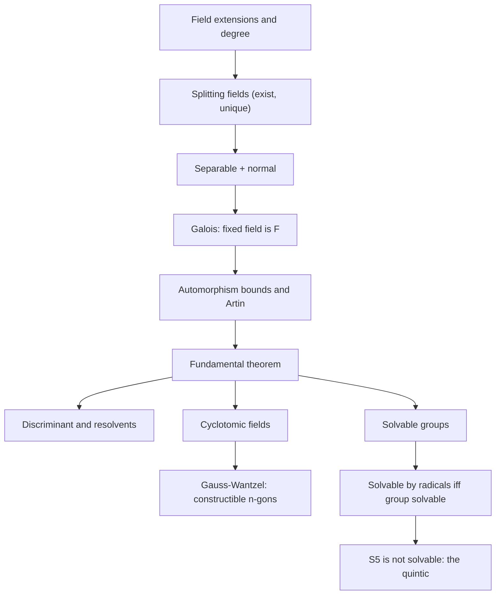
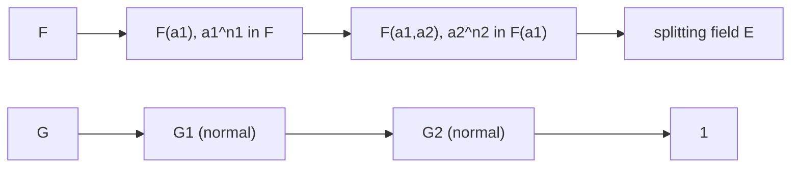

# Galois Theory

> [Mathematics](../../README.md) › [Abstract Algebra](../README.md) › Galois Theory · Level: Advanced · Prerequisites: [Groups](../01-groups/README.md), [Rings](../02-rings/README.md), [Vector Spaces](../../08-linear-algebra/04-vector-spaces/README.md), [Complex Numbers](../../03-algebra/13-complex-numbers/README.md), [Proof Techniques](../../00-foundations/04-proof-techniques/README.md) · Estimated time: 14 h

## 1. Introduction

In 1545 Gerolamo Cardano published *Ars Magna*, and with it a formula that writes the roots of any cubic equation in terms of square and cube roots of expressions built from the coefficients. Lodovico Ferrari extended the method to quartics within the same book. For the next three centuries the obvious question was whether degree five admits the same treatment.

The answer is *no*, and the reason is not that nobody was clever enough. It is a theorem:

> **There is no formula, using only the four field operations and root extractions, that expresses the roots of a general quintic in terms of its coefficients.**

The path to that theorem is one of the great stories of mathematics.

| Year | Who | What |
|---|---|---|
| 1545 | Cardano, Ferrari | cubic and quartic solved by radicals |
| 1770 | Lagrange | resolvents; observes that the *permutations* of roots are the hidden structure |
| 1799 | Ruffini | first (incomplete) proof of the impossibility for degree 5 |
| 1824 | Abel | a complete proof for the general quintic |
| 1832 | Galois | the exact criterion: solvable by radicals $\Leftrightarrow$ solvable group |
| 1846 | Liouville | publishes Galois's manuscripts, fourteen years after Galois's death |
| 1890s–1930s | Dedekind, Weber, Steinitz, Artin, Noether | the modern formulation via field extensions and automorphism groups |

What makes the theorem possible is a change of viewpoint. Instead of asking "which formula?", Galois asked "which *symmetries* do the roots have?". Fix a polynomial $f$ with coefficients in a field $F$, and let $E$ be the field obtained by adjoining all roots of $f$ to $F$. An **automorphism of $E$ over $F$** is a bijection $E \to E$ that preserves addition and multiplication and fixes every element of $F$. Such a map must send a root of $f$ to a root of $f$, so it permutes the roots; the automorphisms form a group $\operatorname{Gal}(E/F)$, the **Galois group** of the extension.

Two facts make this group the exact measure of difficulty:

1. **Galois correspondence.** The subgroups of $\operatorname{Gal}(E/F)$ classify the fields sitting between $F$ and $E$. "Solving the equation in steps" means passing through intermediate fields, so it corresponds to passing through subgroups.
2. **Radicals are abelian steps.** Adjoining an $n$-th root of an element adds a layer whose Galois group is abelian (cyclic, in the presence of the right roots of unity). Hence a solution by radicals produces a chain of subgroups in which each step is abelian.

A group that can be built from abelian layers is called **solvable**. So a polynomial is solvable by radicals exactly when its Galois group is solvable. The symmetric group $S_5$ is *not* solvable, and the general quintic has Galois group $S_5$; that is the whole story.

The same circle of ideas settles the other great classical question. The ancient Greeks asked which regular polygons are constructible with ruler and compass. Gauss, at age 19, discovered that the regular 17-gon is constructible; Wantzel completed the criterion in 1837. In modern language: the constructible numbers form a field obtained by a tower of quadratic extensions, so every constructible number generates a field of degree a power of $2$ — and the degree of the field generated by a primitive $n$-th root of unity is $\varphi(n)$. The regular $n$-gon is constructible precisely when $\varphi(n)$ is a power of $2$.

**Where this topic is used.** Galois theory is the organising theory of classical algebra. Beyond the quintic it gives: the classification of finite fields and their automorphism groups (Frobenius), the algebra behind cyclic error-correcting codes, the arithmetic of finite fields used in cryptography (AES, elliptic-curve pairings), the theory of ruler-and-compass constructions, and the language in which modern number theory (Galois representations) is written.

**What this topic is not.** It is not a formula-hunting expedition. The conclusion is a *negative* theorem with a *positive* proof: we classify exactly which equations have radical solutions, and why.

## 2. Prerequisites

This topic sits at the end of the abstract-algebra sequence, and it borrows from four places. Read the linked material first; the present tutorial does not reprove it.

* **[Groups](../01-groups/README.md)** — subgroups, normality, quotient groups, the first isomorphism theorem, Lagrange's theorem, group actions (§7.8), permutation groups, cycle notation, the sign homomorphism $\operatorname{sgn}$ and the alternating group $A_n$ (§7.9). Solvability of groups appears for the first time in the present topic, so no prior knowledge of it is needed.
* **[Rings](../02-rings/README.md)** — integral domains, fields, characteristic, ideals, quotient rings, the first isomorphism theorem for rings (§7.5–7.7), Euclidean domains and the division algorithm, polynomial rings, and the irreducibility criteria (§7.11–7.12), including Gauss's lemma, Eisenstein's criterion and reduction modulo a prime.
* **[Vector Spaces](../../08-linear-algebra/04-vector-spaces/README.md)** — the notion of a basis and of dimension over a field. A field extension is a vector space over its base field, and *every* degree argument below is a dimension argument.
* **[Complex Numbers](../../03-algebra/13-complex-numbers/README.md)** — the complex exponential, roots of unity, and the factorisation of $z^n - 1$. In particular $e^{i\theta} = \cos\theta + i\sin\theta$, $\zeta_n = e^{2\pi i/n}$, and $z^n - 1 = \prod_{k=0}^{n-1}(z - \zeta_n^k)$.
* **[Proof Techniques](../../00-foundations/04-proof-techniques/README.md)** — induction, contradiction, and the logic of "if and only if".

Field-theoretic background beyond Rings — degrees, minimal polynomials, separability, normality — is developed from scratch in Sections 5 and 7, so a reader who knows groups and rings can start here. A course that has already covered fields may skim Section 5 for terminology.

## 3. Learning Objectives

By the end of this topic you will be able to:

1. Compute the degree $[E:F]$ of a field extension, and use the tower law and the multiplicativity of degrees.
2. Decide whether a given element is algebraic over a field, write down its minimal polynomial, and prove minimality.
3. Construct splitting fields, and explain why a splitting field exists and is unique up to isomorphism over the base field.
4. State precisely what *separable*, *normal* and *Galois* mean, and give examples distinguishing the three conditions.
5. Compute $\operatorname{Gal}(E/F)$ for extensions of small degree, including $[E:F] \le 8$.
6. Determine the Galois group of a quadratic, a cubic, and a quartic over $\mathbb{Q}$, using discriminants and resolvents, and justify each step.
7. State the fundamental theorem of Galois theory with all its correspondences, and use it in both directions on a worked example.
8. Compute the degree and Galois group of $\mathbb{Q}(\zeta_n)/\mathbb{Q}$, and use it to decide whether a regular $n$-gon is constructible.
9. Define solvability of a group, prove that $S_5$ is not solvable, and explain why that settles the general quintic.
10. State the theorem "solvable by radicals iff solvable Galois group" with the correct hypotheses (characteristic zero, roots of unity), and prove the harder direction.
11. Distinguish the *general* quintic problem from the question of solving a *particular* quintic, and say what remains true in each case.
12. State the inverse Galois problem as an open problem, and explain why it is not affected by the above.

## 4. Intuition

Before any definitions, here is the idea in plain language.

### 4.1 A formula cannot tell the roots apart

Suppose a formula $x = \sqrt[5]{}\,\cdots$ solves a quintic. The formula is built from the coefficients by additions, multiplications, divisions and root extractions. Each of these operations is a *rational function* of the coefficients, possibly with radicals. Now here is the crucial point:

> Any expression you can write down is **symmetric** in the roots: if you relabel the roots in some way, the expression either stays the same or returns as one of its finitely many "conjugates".

A radical formula must produce each root when the coefficients are substituted. Think of the formula as a machine: it takes the coefficients (which are symmetric functions of the roots) and returns a number. If we restart the machine after relabelling the roots, the input is identical, so the output is identical. Yet the "correct" output should now be a different root. The only way out is that the machine can be *ambiguous*: as the radical expressions wind around, they pass through several values (branches). The set of all branches of the formula is stable under relabelling the roots.

The permutations of the roots that can be *realised by the ambiguity of a formula* form a group. Galois's insight: the difficulty of solving the equation is exactly the structure of this group.

### 4.2 Symmetry really is measurable

Consider $x^2 - 2$ over $\mathbb{Q}$. Its roots are $\pm\sqrt 2$, and the field $E = \mathbb{Q}(\sqrt2)$ contains both. The map $\sigma$ defined by $\sigma(a + b\sqrt 2) = a - b\sqrt 2$ for $a, b \in \mathbb{Q}$ preserves sums and products and fixes $\mathbb{Q}$; it swaps the two roots. So the "relabelling" of the roots is not a fiction — it is an actual symmetry of the field $E$, an automorphism. The Galois group has two elements.

Now consider $x^3 - 2$ over $\mathbb{Q}$. The roots are $\sqrt[3]{2}$, $\omega\sqrt[3]{2}$, $\omega^2\sqrt[3]{2}$, where $\omega = e^{2\pi i/3}$. The field $\mathbb{Q}(\sqrt[3]{2})$ is contained in $\mathbb{R}$. It contains the first root but not the other two, so it has *no* nontrivial symmetry at all: any automorphism must send $\sqrt[3]{2}$ to a root inside the field, and the only such root is $\sqrt[3]{2}$ itself. The other two roots live in a bigger field $E = \mathbb{Q}(\sqrt[3]{2}, \omega)$, and only there does the full symmetry become visible: $E$ has six automorphisms, forming $S_3$.

The lesson: **symmetry is invisible until the field contains all the roots.** This is why the splitting field, not the field generated by one root, is the right object.

### 4.3 Layers of a building, layers of a group

Think of a radical solution as a building. The ground floor is $F$; each new floor is built by adjoining a single radical $\sqrt[n]{a}$ to the floor below. The Galois correspondence reverses the picture: each floor of the building is a subgroup of the top group, and the *shape of the new floor*, measured by the quotient of the two corresponding subgroups, tells you what kind of step was taken. Adjoining an $n$-th root produces an abelian step.

So: solving by radicals $\;\leftrightarrow\;$ a tower of fields with abelian steps $\;\leftrightarrow\;$ a chain of subgroups with abelian quotients. Such groups are called solvable. A building can only be erected if its group can be dismantled floor by floor into abelian pieces.

For $x^5 - 2$ such a building exists: adjoin $\sqrt[5]{2}$ and then a fifth root of unity, and the group has order $20$, which is solvable. For the *general* quintic the group is $S_5$ of order $120$, and $S_5$ contains the simple non-abelian group $A_5$ of order $60$ — a floor with no internal structure to exploit. That is the obstruction. It is not a lack of cleverness; it is a structural absence of a staircase.

### 4.4 An analogy: dismantling a machine

Imagine a machine bolted together with screws of five different sizes, and you own a single wrench. Each radical extraction is one turn of the wrench: it can loosen a layer of symmetry, but only one layer, and only if the layer is of the "abelian" kind. The Galois group records the layers that remain. A group such as $A_5$ is a solid block: no layer of it can be removed, because its only normal subgroups are the trivial ones. A quintic whose group is $S_5$ is a machine whose core is a solid block — no sequence of wrench turns dismantles it, no matter how long you work.

The analogy breaks down in one place, and it is worth knowing where: the wrench of the analogy works on *any* layer, whereas radical extractions require the layer's quotient to be abelian. That restriction is precisely what "solvable" encodes.

### 4.5 Why groups of permutations?

Every automorphism of the splitting field permutes the roots, and it is completely determined by that permutation: the splitting field is generated by the roots, so once you know where each root goes, you know the automorphism. The Galois group is therefore a *subgroup of the symmetric group* $S_n$ — a group of permutations of $n$ symbols. Everything becomes finite and combinatorial: cycle types, transitivity, normal subgroups of $S_n$. The infamously large group $S_5$ is not an abstract monster; it is the group of the 120 ways to shuffle five cards.
## 5. Formal Definition

Throughout, $F$ is a field. The prime field of $F$ is $\mathbb{Q}$ if $\operatorname{char} F = 0$ and $\mathbb{F}_p$ if $\operatorname{char} F = p$. Unless stated otherwise, $F \subseteq E$ are fields and $F(\alpha)$ denotes the smallest subfield of $E$ containing $F$ and $\alpha$.

### 5.1 Field extensions and degree

**Definition 5.1.1 (field extension).** A **field extension** $E/F$ is a field $E$ together with a subfield $F \subseteq E$. We write $E/F$ and read it "E over F". The **degree** of the extension is
$$[E:F] := \dim_F E,$$
the dimension of $E$ regarded as a vector space over $F$ (scalars act by multiplication in $E$). The extension is **finite** if $[E:F] < \infty$, and **infinite** otherwise.

The vector-space axioms are met automatically: the field axioms of $E$ make $E$ an abelian group under addition, scalar multiplication by $F$ distributes over addition in both slots, and $1 \cdot x = x$. This is the single most useful observation of the topic: **all degree arguments are linear algebra.**

**Example 5.1.2.** (a) $[\mathbb{C}:\mathbb{R}] = 2$, since $\{1, i\}$ is an $\mathbb{R}$-basis of $\mathbb{C}$.
(b) $[\mathbb{Q}(\sqrt 2):\mathbb{Q}] = 2$, since $\{1, \sqrt2\}$ is a $\mathbb{Q}$-basis and $\sqrt2 \notin \mathbb{Q}$.
(c) $[\mathbb{R}:\mathbb{Q}] = \infty$: a finite-dimensional $\mathbb{Q}$-subspace of $\mathbb{R}$ is countable, because $\mathbb{Q}$ is countable, but $\mathbb{R}$ is not.
(d) For any field $F$, $[F:F] = 1$.

**Theorem 5.1.3 (tower law).** If $F \subseteq K \subseteq E$ are fields, then
$$[E:F] = [E:K]\,[K:F],$$
with the convention that a product is infinite if one factor is infinite. In particular, if $[E:F]$ is finite then so are $[E:K]$ and $[K:F]$, and both divide $[E:F]$.

The proof is given in Section 7.1: a basis of $E$ over $K$ multiplied by a basis of $K$ over $F$ is a basis of $E$ over $F$.

### 5.2 Algebraic elements and minimal polynomials

**Definition 5.2.1 (algebraic, transcendental).** Let $E/F$ be a field extension and $\alpha \in E$. Then $\alpha$ is **algebraic over $F$** if there is a nonzero polynomial $p \in F[x]$ with $p(\alpha) = 0$. Otherwise $\alpha$ is **transcendental over $F$**. The extension $E/F$ is **algebraic** if every element of $E$ is algebraic over $F$.

**Theorem 5.2.2 (the minimal polynomial).** Let $\alpha \in E$ be algebraic over $F$ and let
$$I(\alpha) := \{p \in F[x] : p(\alpha) = 0\}.$$
Then:

1. $I(\alpha)$ is the principal ideal $(m_\alpha)$ generated by a unique monic polynomial $m_\alpha \in F[x]$, called the **minimal polynomial** of $\alpha$ over $F$.
2. $m_\alpha$ is irreducible in $F[x]$.
3. $m_\alpha$ is the monic polynomial of least degree vanishing at $\alpha$.
4. There is an isomorphism of fields $F[x]/(m_\alpha) \cong F(\alpha)$ sending $x \mapsto \alpha$; in particular $[F(\alpha):F] = \deg m_\alpha$.
5. If $p \in F[x]$ is monic, irreducible and $p(\alpha) = 0$, then $p = m_\alpha$.

*Proof.* (1) The evaluation map $\operatorname{ev}_\alpha : F[x] \to E$, $p \mapsto p(\alpha)$, is a ring homomorphism, so $I(\alpha) = \ker \operatorname{ev}_\alpha$ is an ideal of the Euclidean domain $F[x]$, hence principal: $I(\alpha) = (m_\alpha)$ for some nonzero $m_\alpha$; dividing by its leading coefficient makes it monic and unique.

(2) If $m_\alpha = gh$ with $\deg g, \deg h < \deg m_\alpha$ and both nonconstant, then $g(\alpha)h(\alpha) = 0$ in the field $E$, so $g(\alpha) = 0$ or $h(\alpha) = 0$, contradicting minimality of the degree of $m_\alpha$.

(3) is immediate from (1): the elements of $I(\alpha)$ are exactly the multiples of $m_\alpha$.

(4) By the first isomorphism theorem for rings, $F[x]/(m_\alpha)$ embeds in $E$ with image $F[\alpha]$, the smallest *subring* containing $F$ and $\alpha$. Since $m_\alpha$ is irreducible, $(m_\alpha)$ is a maximal ideal (Rings §7.8), so $F[x]/(m_\alpha)$ is a field; hence $F[\alpha]$ is a field, so $F[\alpha] = F(\alpha)$. The residue classes $1, x, \dots, x^{d-1}$ with $d = \deg m_\alpha$ form an $F$-basis of the quotient, so $[F(\alpha):F] = d$.

(5) A monic irreducible multiple of $m_\alpha$ of the same degree must equal it. $\blacksquare$

**Example 5.2.3.** (a) $m_{\sqrt2} = x^2 - 2$ over $\mathbb{Q}$.
(b) $m_{\sqrt[3]{2}} = x^3 - 2$ over $\mathbb{Q}$: it is irreducible by Eisenstein at $2$ (Rings §7.12), so $[\mathbb{Q}(\sqrt[3]2):\mathbb{Q}] = 3$.
(c) $m_{\sqrt2 + \sqrt3} = x^4 - 10x^2 + 1$; see Example 9.1.
(d) $m_i = x^2 + 1$ over $\mathbb{R}$.
(e) $m_{\sqrt2} = x - \sqrt 2$ over $\mathbb{R}$, so $[\mathbb{R}(\sqrt2):\mathbb{R}] = 1$.
(f) $\pi$ and $e$ are transcendental over $\mathbb{Q}$ (Lindemann 1882, Hermite 1873); we use only the fact, never its proof.

### 5.3 Simple extensions and adjoining elements

**Definition 5.3.1.** For a field $F \subseteq E$ and a subset $S \subseteq E$, $F(S)$ denotes the intersection of all subfields of $E$ containing $F \cup S$; it is the smallest such subfield. If $S = \{\alpha_1,\dots,\alpha_n\}$ we write $F(\alpha_1,\dots,\alpha_n)$. The extension $F(\alpha)/F$ is called **simple**.

**Lemma 5.3.2.** For a field $E$, elements $\alpha, \beta \in E$ and a subfield $F$:
$$F(\alpha)(\beta) = F(\alpha,\beta) = F(\beta)(\alpha).$$

*Proof.* Both sides are the smallest subfield containing $F, \alpha, \beta$. $\blacksquare$

**Proposition 5.3.3.** If $\alpha_1,\dots,\alpha_n \in E$ are algebraic over $F$, then $F(\alpha_1,\dots,\alpha_n)/F$ is a finite algebraic extension, and
$$[F(\alpha_1,\dots,\alpha_n):F] \le \prod_{i=1}^{n} [F(\alpha_i):F],$$
with equality when each $\alpha_i$ has degree over $F(\alpha_1,\dots,\alpha_{i-1})$ equal to its degree over $F$.

*Proof.* Each step $F(\alpha_1,\dots,\alpha_{i-1}) \subseteq F(\alpha_1,\dots,\alpha_i)$ is generated by an element algebraic over the smaller field (its minimal polynomial over the smaller field divides its minimal polynomial over $F$), so it is finite; apply the tower law $n$ times and note that each degree is at most $[F(\alpha_i):F]$. $\blacksquare$

### 5.4 Splitting fields

**Definition 5.4.1 (splitting field).** Let $f \in F[x]$ have degree $\ge 1$. A field extension $E/F$ is a **splitting field of $f$ over $F$** if

* $f$ factors into linear factors in $E[x]$, that is, $f(x) = c\prod_{i=1}^{n}(x - \alpha_i)$ with $c \in F^\times$ and $\alpha_i \in E$, and
* $E = F(\alpha_1,\dots,\alpha_n)$: no proper subfield of $E$ containing $F$ has this property.

Equivalently, $E$ is generated over $F$ by all roots of $f$, and contains all of them. We also say "$f$ splits in $E$" for the first condition.

**Example 5.4.2.** (a) The splitting field of $x^2 - 2$ over $\mathbb{Q}$ is $\mathbb{Q}(\sqrt2)$.
(b) The splitting field of $x^3 - 2$ over $\mathbb{Q}$ is $\mathbb{Q}(\sqrt[3]{2}, \omega)$ with $\omega = e^{2\pi i/3}$, because $\mathbb{Q}(\sqrt[3]2) \subseteq \mathbb{R}$ contains only one of the three roots.
(c) The splitting field of $x^2 + 1$ over $\mathbb{R}$ is $\mathbb{C} = \mathbb{R}(i)$.
(d) The splitting field of $x^2 + 1$ over $\mathbb{F}_2$ is $\mathbb{F}_2$ itself, because $x^2+1 = (x+1)^2$ there.
(e) The splitting field of $x^4 - 5x^2 + 6 = (x^2-2)(x^2-3)$ over $\mathbb{Q}$ is $\mathbb{Q}(\sqrt2,\sqrt3)$.

Notice that the splitting field does not depend on which irreducible factor of $f$ we look at; it is the smallest field containing $F$ in which the *whole* polynomial factors. Section 7.3 proves that it always exists and is unique.

### 5.5 Separability

**Definition 5.5.1 (formal derivative).** For $f = \sum_{k=0}^{n} a_k x^k \in F[x]$, the **formal derivative** is
$$f' := \sum_{k=1}^{n} k\,a_k x^{k-1} \in F[x],$$
where $k\,a_k$ means the $k$-fold sum $a_k + \cdots + a_k$ in $F$.

The formal derivative satisfies the usual sum, product and chain rules (the proofs are the same as in calculus and use only the field axioms), and it detects multiple roots in every characteristic:

**Lemma 5.5.2.** Let $f \in F[x]$ be nonconstant and let $E$ be a splitting field of $f$. Then $f$ has a repeated root in $E$ (that is, $f = (x-\alpha)^2 g$ for some $\alpha \in E$, $g \in E[x]$) if and only if $\gcd(f, f') \ne 1$ in $F[x]$.

*Proof.* Write $f = (x - \alpha)^2 g$ over $E$. The product rule gives $f' = 2(x-\alpha)g + (x-\alpha)^2 g'$, so $f'(\alpha) = 0$, hence $\alpha$ is a common root of $f$ and $f'$ in $E$, hence $\gcd(f,f') \ne 1$ in $E[x]$ and therefore in $F[x]$ (the gcd over $F$ is also a gcd over $E$; see Rings §7.11). Conversely if $d = \gcd(f,f') \in F[x]$ has positive degree, then $d$ has a root $\alpha$ in a splitting field of $fd$, and $f(\alpha) = f'(\alpha) = 0$; writing $f = (x-\alpha)h$ gives $f' = h + (x-\alpha)h'$, so $h(\alpha) = 0$ and $f$ has the repeated root $\alpha$. $\blacksquare$

**Definition 5.5.3 (separable).** A polynomial $f \in F[x]$ is **separable** if it has no repeated root in a splitting field, equivalently (Lemma 5.5.2) if $\gcd(f, f') = 1$. An algebraic element $\alpha$ is **separable over $F$** if $m_\alpha$ is separable, and an algebraic extension $E/F$ is **separable** if every element of $E$ is separable over $F$.

**Theorem 5.5.4.** If $\operatorname{char} F = 0$, then every polynomial over $F$ is separable, and every algebraic extension of $F$ is separable.

*Proof.* Let $f \in F[x]$ be nonconstant of degree $n$ with leading coefficient $c \ne 0$. Then $f'$ has degree $n-1$ and leading coefficient $nc \ne 0$ (here we use $n \cdot 1_F \ne 0$, which fails in characteristic $p$ when $p \mid n$). So $f' \ne 0$ and $\deg f' < \deg f$, whence $f \nmid f'$ and $\gcd(f,f') = 1$. $\blacksquare$

Separability can fail only in positive characteristic: the standard example is $t^p - x$ over $\mathbb{F}_p(x)$, where $t^p - x = (t - x^{1/p})^p$ in the extension $\mathbb{F}_p(x^{1/p})$.

**Definition 5.5.5 (perfect field).** A field $F$ is **perfect** if every algebraic extension of $F$ is separable. Fields of characteristic $0$ are perfect (Theorem 5.5.4), and every finite field is perfect.

### 5.6 Normal extensions

**Definition 5.6.1 (normal).** An algebraic extension $E/F$ is **normal** if every irreducible polynomial $p \in F[x]$ that has a root in $E$ splits into linear factors in $E[x]$.

Informally: $E$ never contains "only part" of the roots of a polynomial it knows about.

**Example 5.6.2.** (a) $\mathbb{Q}(\sqrt2)/\mathbb{Q}$ is normal: the minimal polynomial of $\sqrt2$ is $x^2-2 = (x-\sqrt2)(x+\sqrt2)$, and both roots lie in $\mathbb{Q}(\sqrt2)$.
(b) $\mathbb{Q}(\sqrt[3]2)/\mathbb{Q}$ is **not** normal: $x^3 - 2$ has the root $\sqrt[3]{2}$ in the field but the other two roots are non-real.
(c) $\mathbb{Q}(\sqrt2,\sqrt3)/\mathbb{Q}$ is normal (Theorem 7.5.1: it is a splitting field).
(d) $\mathbb{Q}(\zeta_n)/\mathbb{Q}$ is normal for every $n \ge 1$: $\zeta_n$ is a root of $x^n - 1$, which splits in $\mathbb{Q}(\zeta_n)$ because every root of $x^n-1$ is a power of $\zeta_n$.

Normality is *not* inherited by intermediate fields in general, and it is not transitive; Section 7.5 gives the precise inheritance statements (it *is* inherited by the top field over a larger base field).

### 5.7 Automorphisms, fixed fields, and the definition of a Galois extension

**Definition 5.7.1 (automorphism over $F$).** Let $E/F$ be a field extension. An **$F$-automorphism of $E$** is a field automorphism $\sigma : E \to E$ with $\sigma(a) = a$ for all $a \in F$. The set of all $F$-automorphisms of $E$ is a group under composition, written $\operatorname{Aut}(E/F)$.

**Definition 5.7.2 (fixed field).** For a subgroup $H \le \operatorname{Aut}(E/F)$, the **fixed field** of $H$ is
$$E^H := \{x \in E : \sigma(x) = x \text{ for all } \sigma \in H\}.$$
For a single automorphism $\sigma$ we write $E^\sigma := E^{\langle \sigma\rangle}$.

$E^H$ is a subfield of $E$ containing $F$ (Section 7.6 proves this).

**Definition 5.7.3 (Galois extension).** An algebraic extension $E/F$ is **Galois** if
$$E^{\operatorname{Aut}(E/F)} = F,$$
that is, the only elements of $E$ fixed by every $F$-automorphism of $E$ are the elements of $F$. When $E/F$ is Galois we write
$$\operatorname{Gal}(E/F) := \operatorname{Aut}(E/F)$$
and call it the **Galois group** of the extension.

This is the definition we use throughout: Galois means "the fixed field of the automorphism group is exactly the base field". Section 7.7 proves that for *finite* extensions this is equivalent to being normal and separable, which is the definition many textbooks use.

**Example 5.7.4.** (a) $\mathbb{Q}(\sqrt2)/\mathbb{Q}$ is Galois: $\operatorname{Aut}$ has two elements, $\operatorname{id}$ and $\sigma(\sqrt2) = -\sqrt2$, and $E^{\operatorname{Aut}} = \mathbb{Q}$.
(b) $\mathbb{Q}(\sqrt[3]2)/\mathbb{Q}$ is not Galois: $\operatorname{Aut}(E/\mathbb{Q})$ is trivial, so $E^{\operatorname{Aut}} = E \ne \mathbb{Q}$.
(c) $\mathbb{Q}(\sqrt[4]2)/\mathbb{Q}$ is not Galois: an automorphism sends $\sqrt[4]2$ to a root of $x^4-2$ inside the field, and the only such root is $\sqrt[4]2$ itself (the others are $\pm i\sqrt[4]2$, non-real), so again $\operatorname{Aut}$ is trivial.
(d) $\mathbb{Q}(\sqrt2,\sqrt3)/\mathbb{Q}$ is Galois with group $V_4$; see Example 9.2.
(e) $\mathbb{C}/\mathbb{R}$ is Galois with group of order $2$.
(f) $\mathbb{R}/\mathbb{Q}$ is **not** Galois, and fails on two counts: it is not algebraic ($\pi$ is transcendental over $\mathbb{Q}$), and even the algebraic condition aside, $\operatorname{Aut}(\mathbb{R}/\mathbb{Q})$ is trivial (an automorphism of $\mathbb{R}$ preserves squares, hence preserves the order, hence is the identity), so the fixed field is $\mathbb{R} \ne \mathbb{Q}$.

### 5.8 The Galois group of a polynomial

**Definition 5.8.1.** Let $f \in F[x]$ have degree $n \ge 1$ and let $E$ be a splitting field of $f$ over $F$. The **Galois group of $f$ over $F$** is
$$\operatorname{Gal}(f/F) := \operatorname{Gal}(E/F).$$
If $f$ is separable, $\operatorname{Gal}(f/F)$ acts faithfully on the $n$ roots, so it is (isomorphic to) a subgroup of $S_n$, determined up to conjugacy in $S_n$. We then also write $\operatorname{Gal}(f) \le S_n$.

The up-to-conjugacy caveat matters. The roots are unlabelled; an isomorphism of $E$ with another splitting field $E'$ carries one labelling to another, so the subgroup of $S_n$ is well defined only up to relabelling the roots, that is, up to conjugacy. Statements such as "the group is $S_3$" or "the group is cyclic of order $3$" are unaffected, while statements about *specific* permutations require a labelling.

**Lemma 5.8.2.** Let $f \in F[x]$ be separable of degree $n$ with splitting field $E$, and let $G = \operatorname{Gal}(E/F) \le S_n$. Then $G$ is **transitive** on the $n$ roots if and only if $f$ is irreducible in $F[x]$.

*Proof.* If $f$ is irreducible and $\alpha, \beta$ are roots, then $m_\alpha = m_\beta = f$ (Theorem 5.2.2(5)), and the isomorphism $F(\alpha) \to F(\beta)$, $\alpha \mapsto \beta$, extends to an $F$-automorphism of the splitting field $E$ (Theorem 7.2.3, the extension lemma, together with the uniqueness of splitting fields). Hence some element of $G$ carries $\alpha$ to $\beta$.
Conversely, if $f = gh$ with nonconstant $g, h \in F[x]$ and $\alpha$ is a root of $g$, then every $\sigma \in G$ sends $\alpha$ to a root of $g$, so the orbit of $\alpha$ lies in the set of roots of $g$ and is a proper subset of the roots of $f$. $\blacksquare$

These definitions are enough to state every theorem. Sections 7 and 9 do the mathematics.

## 6. Mathematical Notation

| Symbol | Read as | Meaning |
|---|---|---|
| $E/F$ | "$E$ over $F$" | a field extension: $F \subseteq E$ are fields |
| $[E:F]$ | "degree of $E$ over $F$" | $\dim_F E$, the dimension of $E$ as an $F$-vector space |
| $F(\alpha)$, $F(S)$ | "$F$ adjoin $\alpha$" | the smallest subfield containing $F$ and $\alpha$ (or the set $S$) |
| $m_\alpha$ | "minimal polynomial of $\alpha$" | the monic polynomial in $F[x]$ of least degree vanishing at $\alpha$ |
| $\operatorname{Aut}(E/F)$ | "automorphisms of $E$ over $F$" | field automorphisms of $E$ fixing $F$ pointwise |
| $\operatorname{Gal}(E/F)$ | "Galois group of $E$ over $F$" | $\operatorname{Aut}(E/F)$ when $E/F$ is Galois |
| $\operatorname{Gal}(f/F)$, $\operatorname{Gal}(f)$ | "Galois group of $f$" | $\operatorname{Gal}(E/F)$ for $E$ a splitting field of $f$ |
| $E^H$ | "$E$ fixed by $H$" | $\{x \in E : \sigma(x) = x \ \forall \sigma \in H\}$ |
| $\mu_n$ | "the $n$-th roots of unity" | $\{z \in \overline{F} : z^n = 1\}$ |
| $\zeta_n$ | "zeta sub $n$" | $e^{2\pi i/n}$, a primitive $n$-th root of unity in $\mathbb{C}$ |
| $\Phi_n$ | "phi sub $n$" | the $n$-th cyclotomic polynomial, $\prod_{(k,n)=1}(x - \zeta_n^k)$ |
| $\varphi(n)$ | "Euler's totient of $n$" | the number of $k \in \{1,\dots,n\}$ with $\gcd(k,n)=1$ |
| $\Delta(f)$, $\operatorname{disc}(f)$ | "discriminant of $f$" | $\prod_{i<j}(\alpha_i - \alpha_j)^2$ for the roots $\alpha_i$ of $f$ |
| $\delta(f)$ | "square root of the discriminant" | $\prod_{i<j}(\alpha_i - \alpha_j)$, defined up to sign |
| $S_n$, $A_n$ | "symmetric / alternating group" | all permutations of $n$ symbols; the even ones |
| $\operatorname{sgn}(\sigma)$ | "sign of sigma" | $+1$ for even, $-1$ for odd permutations |
| $C_n$ | "cyclic group of order $n$" | $\mathbb{Z}/n\mathbb{Z}$ |
| $V_4$ | "Viergruppe" | $\{e, (1\,2)(3\,4), (1\,3)(2\,4), (1\,4)(2\,3)\} \le S_4$ |
| $D_4$ | "dihedral group of order 8" | the symmetries of a square; order $2\cdot 4 = 8$ |
| $\mathbb{F}_q$ | "the field with $q$ elements" | exists and is unique for $q = p^k$, $p$ prime |
| $\operatorname{char} F$ | "characteristic of $F$" | the least $p>0$ with $p\cdot 1_F = 0$, or $0$ |
| $H \le G$, $H \trianglelefteq G$ | "H subgroup of G", "H normal in G" | subgroup; normal subgroup |
| $\langle S \rangle$ | "subgroup generated by $S$" | smallest subgroup containing $S$ |
| $G'$, $G^{(i)}$ | "derived subgroup, i-th derived subgroup" | $G' = \langle aba^{-1}b^{-1}\rangle$, $G^{(i+1)} = (G^{(i)})'$ |
| $N \rtimes H$ | "N semidirect H" | semidirect product, as in $C_p \rtimes (\mathbb{Z}/p)^\times$ |
| $\varphi$ | "phi" | Euler's totient; the same letter as the golden ratio, told apart by context |

Reading formulas aloud: "$[E:F]=n$" is "the degree of $E$ over $F$ is $n$"; "$E^H = F$" is "$E$ fixed by $H$ is $F$"; "$\operatorname{Gal}(f)\cong S_5$" is "the Galois group of $f$ is isomorphic to the symmetric group on five letters". The symbol $\le$ in $H \le G$ is read "is a subgroup of", never "is less than".

## 7. Core Concepts

This section builds the theory in the order in which it is used. Every numbered result has its hypotheses displayed and its proof either given or explicitly cited.

### 7.1 Degrees, the tower law, and finite implies algebraic

**Theorem 7.1.1 (tower law).** Let $F \subseteq K \subseteq E$ be fields. Then
$$[E:F] = [E:K]\cdot[K:F].$$

*Proof.* Choose a $K$-basis $(e_i)_{i\in I}$ of $E$ and an $F$-basis $(f_j)_{j\in J}$ of $K$. We show that $(e_i f_j)_{(i,j)\in I\times J}$ is an $F$-basis of $E$.

*Spanning.* Let $x \in E$. Since the $e_i$ span $E$ over $K$, $x = \sum_i a_i e_i$ with $a_i \in K$ and only finitely many $a_i \ne 0$. Each $a_i = \sum_j b_{ij} f_j$ with $b_{ij} \in F$, finitely many nonzero. Then
$$x = \sum_i \Big(\sum_j b_{ij} f_j\Big) e_i = \sum_{i,j} b_{ij}\,(f_j e_i) = \sum_{i,j} b_{ij}\,(e_i f_j),$$
using commutativity of multiplication in $E$.

*Independence.* Suppose $\sum_{i,j} c_{ij} e_i f_j = 0$ with $c_{ij} \in F$, finitely many nonzero. Regroup:
$$\sum_i \Big(\sum_j c_{ij} f_j\Big) e_i = 0.$$
The inner sums lie in $K$, and the $e_i$ are $K$-independent, so $\sum_j c_{ij} f_j = 0$ for every $i$. The $f_j$ are $F$-independent, so $c_{ij} = 0$ for all $i,j$.

Hence $(e_i f_j)$ is an $F$-basis, and $[E:F] = |I \times J| = |I|\,|J| = [E:K][K:F]$, where the cardinal arithmetic uses the usual conventions for infinite cardinals; in the finite case it is ordinary multiplication. $\blacksquare$

**Corollary 7.1.2.** If $F \subseteq K \subseteq E$ and $[E:F]$ is finite, then $[E:K]$ and $[K:F]$ are finite and both divide $[E:F]$.

**Corollary 7.1.3 (no intermediate fields of prime degree).** If $[E:F] = p$ is prime, then the only fields $K$ with $F \subseteq K \subseteq E$ are $K = F$ and $K = E$.

*Proof.* $[K:F]$ divides $p$. $\blacksquare$

**Theorem 7.1.4 (finite implies algebraic).** If $[E:F] < \infty$, then $E/F$ is algebraic. More precisely, every $\alpha \in E$ satisfies a polynomial over $F$ of degree at most $[E:F]$.

*Proof.* Let $n = [E:F]$. The $n+1$ elements $1, \alpha, \dots, \alpha^n$ are $F$-linearly dependent, so there are $a_0,\dots,a_n \in F$, not all zero, with $\sum_{k=0}^{n} a_k \alpha^k = 0$. $\blacksquare$

**Proposition 7.1.5 (degree of a sum and a product).** If $\alpha, \beta$ are algebraic over $F$, then $F(\alpha,\beta)/F$ is finite, and $[F(\alpha,\beta):F] \le [F(\alpha):F]\cdot[F(\beta):F]$; in particular $\alpha + \beta$, $\alpha\beta$ and $\alpha/\beta$ (for $\beta \ne 0$) are algebraic over $F$.

*Proof.* $F(\alpha,\beta) = F(\alpha)(\beta)$ by Lemma 5.3.2. The minimal polynomial of $\beta$ over $F(\alpha)$ divides $m_\beta \in F[x]$, so its degree is at most $\deg m_\beta = [F(\beta):F]$. The tower law gives the bound. The field $F(\alpha,\beta)$ is finite over $F$, hence algebraic over $F$ by Theorem 7.1.4, and it contains $\alpha+\beta$, $\alpha\beta$ and $\alpha/\beta$. $\blacksquare$

Consequently the set of elements of $E$ algebraic over $F$ is a subfield of $E$; it is called the **algebraic closure of $F$ in $E$**.

### 7.2 Constructing roots: Kronecker's theorem and the extension lemma

Two tools are needed before splitting fields can be discussed: a way to manufacture a root of an irreducible polynomial, and a way to move isomorphisms from one field to another.

**Theorem 7.2.1 (Kronecker).** Let $p \in F[x]$ be irreducible of degree $d \ge 1$. Then $E := F[x]/(p)$ is a field, the map $F \to E$, $a \mapsto a + (p)$, is an injective field homomorphism, and the residue class $\alpha := x + (p)$ satisfies $p(\alpha) = 0$. Moreover $[E:F] = d$ and $E = F(\alpha)$.

*Proof.* Since $F[x]$ is a Euclidean domain and $p$ is irreducible, $(p)$ is a maximal ideal (Rings §7.8), so the quotient is a field. The composite $F \to F[x] \to F[x]/(p)$ is injective because no nonzero constant is divisible by $p$, so we may regard $F$ as a subfield of $E$. For $p = \sum a_k x^k$,
$$p(\alpha) = \sum a_k \alpha^k = \Big(\sum a_k x^k\Big) + (p) = p + (p) = 0.$$
The classes $1, \alpha, \dots, \alpha^{d-1}$ form a basis by the division algorithm. $\blacksquare$

**Example 7.2.2.** (a) $\mathbb{R}[x]/(x^2+1) \cong \mathbb{C}$.
(b) $\mathbb{Q}[x]/(x^3-2) \cong \mathbb{Q}(\sqrt[3]2)$.
(c) $\mathbb{F}_2[x]/(x^2+x+1)$ is a field with $4$ elements, since $x^2+x+1$ has no root in $\mathbb{F}_2$.

**Theorem 7.2.3 (extension lemma for simple extensions).** Let $\sigma : F \to F'$ be an isomorphism of fields, let $p \in F[x]$ be irreducible, and let $p^\sigma \in F'[x]$ be the polynomial obtained by applying $\sigma$ to the coefficients. Let $\alpha$ be a root of $p$ in an extension of $F$ and $\beta$ a root of $p^\sigma$ in an extension of $F'$. Then there is a unique isomorphism
$$\tilde\sigma : F(\alpha) \to F'(\beta)$$
with $\tilde\sigma|_F = \sigma$ and $\tilde\sigma(\alpha) = \beta$.

*Proof.* By Theorem 5.2.2(4) applied twice, together with the isomorphism $F[x] \cong F'[x]$ sending $x \mapsto x$ and $a \mapsto \sigma(a)$,
$$F(\alpha) \cong F[x]/(p) \;\cong\; F'[x]/(p^\sigma) \;\cong\; F'(\beta),$$
and the composite sends $\alpha \leftrightarrow x + (p) \leftrightarrow x + (p^\sigma) \leftrightarrow \beta$ and restricts to $\sigma$ on $F$. Uniqueness holds because $F(\alpha)$ is generated over $F$ by $\alpha$, and an isomorphism of fields is determined by its values on a generating set. $\blacksquare$

**Corollary 7.2.4.** Let $p \in F[x]$ be irreducible and let $\alpha, \beta$ be two roots of $p$ in an algebraic closure $\overline F$. Then there is an $F$-isomorphism $F(\alpha) \to F(\beta)$ sending $\alpha \mapsto \beta$. In particular, if one root of an irreducible polynomial lies in a field $K \supseteq F$, then $K$ contains an isomorphic copy of $F(\alpha)$ for *every* root $\alpha$ of $p$ — but not necessarily the root itself. This distinction is exactly the content of normality (Section 7.5).

### 7.3 Splitting fields: existence and uniqueness

**Theorem 7.3.1 (existence of splitting fields).** Let $f \in F[x]$ have degree $n \ge 1$. Then $f$ has a splitting field $E$ over $F$, and
$$[E:F] \le n!.$$

*Proof.* Induct on $n$. If $n = 1$, or if $f$ already factors into linear factors over $F$, take $E = F$.

Otherwise pick an irreducible factor $p$ of $f$ of degree $d \ge 2$ and let $F_1 := F[x]/(p)$; by Kronecker's theorem (7.2.1) $F_1$ contains a root $\alpha$ of $p$, and $[F_1:F] = d$. Write
$$f(x) = (x - \alpha)f_1(x) \quad \text{in } F_1[x], \qquad \deg f_1 = n-1.$$
By induction $f_1$ has a splitting field $E$ over $F_1$, with $[E:F_1] \le (n-1)!$. Then $f$ splits in $E$, and $E$ is generated over $F$ by $\alpha$ together with the roots of $f_1$ — that is, by the roots of $f$. So $E$ is a splitting field of $f$ over $F$, and the tower law gives
$$[E:F] = [E:F_1]\,[F_1:F] \le (n-1)! \cdot d \le n!. \qquad \blacksquare$$

**Theorem 7.3.2 (uniqueness of splitting fields).** Let $\sigma : F \to F'$ be an isomorphism of fields, let $f \in F[x]$, and let $f^\sigma \in F'[x]$ be the polynomial obtained by applying $\sigma$ to the coefficients. If $E$ is a splitting field of $f$ over $F$ and $E'$ is a splitting field of $f^\sigma$ over $F'$, then $\sigma$ extends to an isomorphism $E \to E'$.

*Proof.* Induct on $n = \deg f$. If $n = 1$ then $E = F$, $E' = F'$ and $\sigma$ itself works.

Otherwise, if $f$ does not split in $F[x]$, choose an irreducible factor $p$ of $f$ with $\deg p \ge 2$, a root $\alpha \in E$ of $p$ and a root $\beta \in E'$ of $p^\sigma$. By the extension lemma (7.2.3) there is an isomorphism $\sigma_1 : F(\alpha) \to F'(\beta)$ extending $\sigma$ with $\sigma_1(\alpha) = \beta$. Write
$$f = (x-\alpha)f_1 \ \text{ in } F(\alpha)[x], \qquad f^\sigma = (x - \beta)\,f_1^{\sigma_1} \ \text{ in } F'(\beta)[x].$$
The roots of $f$ are $\alpha$ together with the roots of $f_1$, so $E$ is a splitting field of $f_1$ over $F(\alpha)$; likewise $E'$ is a splitting field of $f_1^{\sigma_1}$ over $F'(\beta)$. Since $\deg f_1 = n-1$, the induction hypothesis extends $\sigma_1$ to an isomorphism $E \to E'$, which extends $\sigma$. $\blacksquare$

**Corollary 7.3.3.** (a) Any two splitting fields of $f$ over $F$ are isomorphic over $F$.
(b) If $E_1$ and $E_2$ are splitting fields of $f$ inside a fixed algebraic closure $\overline F$, then $E_1 = E_2$.
(c) If $E$ is a splitting field of $f$ over $F$ and $F \subseteq K \subseteq E$, then $E$ is a splitting field of $f$ over $K$ as well.

*Proof.* (a) is Theorem 7.3.2 with $\sigma = \operatorname{id}_F$. (b) Each $E_i$ is generated over $F$ by the roots of $f$ *inside* $\overline F$; these roots are the same set for both fields, so $E_1 = E_2$. (c) $f$ splits in $E$ and $E$ is generated over $F$ — hence over $K$ — by its roots. $\blacksquare$

### 7.4 Separability and the counting of embeddings

Fix an algebraic closure $\overline F$ of $F$. Every algebraic extension of $F$ is, up to $F$-isomorphism, a subfield of $\overline F$ (this is the standard property of algebraic closures; we use it only as a convenient container).

**Definition 7.4.1 (separability degree).** For a finite extension $E/F$, the **separability degree** is
$$[E:F]_s := \#\{\sigma : E \to \overline F : \sigma \text{ is an } F\text{-embedding}\}.$$

**Lemma 7.4.2 (extension of embeddings).** Let $F \subseteq K \subseteq E$ be fields with $[E:F] < \infty$, and let $\sigma : K \to \overline F$ be an $F$-embedding. Then $\sigma$ extends to an $F$-embedding $E \to \overline F$.

*Proof.* Since $[E:F] < \infty$, $E = K(\alpha_1,\dots,\alpha_r)$ for some $\alpha_i$ (take a basis). Extend one generator at a time: if $\sigma$ is defined on $K(\alpha_1,\dots,\alpha_{i-1})$ and $p$ is the minimal polynomial of $\alpha_i$ over that field, then $\sigma(p)$ has a root $\beta \in \overline F$ (as $\overline F$ is algebraically closed), and Theorem 7.2.3 extends $\sigma$ to $K(\alpha_1,\dots,\alpha_i)$ with $\alpha_i \mapsto \beta$. $\blacksquare$

**Theorem 7.4.3 (the embedding count).** Let $F \subseteq K \subseteq E$ be finite extensions. Then
$$[E:F]_s = [E:K]_s\,[K:F]_s, \qquad \text{and} \qquad [E:F]_s \le [E:F],$$
with equality $[E:F]_s = [E:F]$ if and only if $E/F$ is separable.

*Proof.* **Multiplicativity.** Every $F$-embedding $\tau : E \to \overline F$ restricts to an $F$-embedding $\sigma = \tau|_K : K \to \overline F$, and by Lemma 7.4.2 every such $\sigma$ extends to at least one $\tau$. For a fixed $\sigma$, the extensions $\tau$ correspond bijectively to $K$-embeddings of $E$ into $\overline F$ after transporting the coefficients along $\sigma$; hence their number is the same for every $\sigma$, namely $[E:K]_s$. Summing over the $[K:F]_s$ choices of $\sigma$ gives $[E:F]_s = [K:F]_s[E:K]_s$.

**The inequality, and the criterion.** Induct on $n = [E:F]$. For $n = 1$ both sides are $1$. For $n > 1$ choose $\alpha \in E \setminus F$, put $p = m_{\alpha,F}$ and $d = \deg p = [F(\alpha):F]$. Let $r$ be the number of distinct roots of $p$ in $\overline F$. An $F$-embedding of $E$ restricts to an $F$-embedding of $F(\alpha)$, and these are exactly the maps $\alpha \mapsto \rho$ for the $r$ distinct roots $\rho$ of $p$; by multiplicativity and induction,
$$[E:F]_s = r \cdot [E:F(\alpha)]_s \le r\cdot[E:F(\alpha)] \le d \cdot [E:F(\alpha)] = [E:F].$$
If $E/F$ is separable, then $p$ is separable, so $r = d$, and $E/F(\alpha)$ is separable, so by induction $[E:F(\alpha)]_s = [E:F(\alpha)]$; the two inequalities are equalities.

Conversely, if $[E:F]_s = [E:F]$, then for every $\alpha \in E \setminus F$ the chain forces $r = d$ (because $r \le d$ and $[E:F(\alpha)]_s \le [E:F(\alpha)]$, and the outer products agree); so every minimal polynomial of an element has $\deg p$ distinct roots in $\overline F$, that is, $E/F$ is separable. $\blacksquare$

**Theorem 7.4.4 (characteristic zero is perfect).** If $\operatorname{char} F = 0$, then every algebraic extension $E/F$ is separable, and $[E:F]_s = [E:F]$.

*Proof.* By Theorem 5.5.4 every polynomial over $F$ is separable, so every minimal polynomial of an element of $E$ is separable; Theorem 7.4.3 then gives the equality. $\blacksquare$

**Example 7.4.5 (inseparability in characteristic $p$).** Let $p$ be prime, $F = \mathbb{F}_p(t)$ and $E = F(t^{1/p})$, where $t^{1/p}$ denotes a root of $x^p - t$. Then $x^p - t = (x - t^{1/p})^p$ in $E[x]$, so the minimal polynomial $x^p - t$ is inseparable, $E/F$ is inseparable, and $[E:F]_s = 1 < p = [E:F]$. Note that $E/F$ is normal: the irreducible polynomial $x^p - t$ has its (only) root in $E$ and splits there.

This example is the reason every theorem below that involves separability carries a characteristic hypothesis, and why the theory is cleanest in characteristic $0$.

### 7.5 Normal extensions

**Theorem 7.5.1 (characterisations of normality).** Let $E/F$ be a finite extension. The following are equivalent.

1. $E/F$ is normal (Definition 5.6.1).
2. $E$ is the splitting field over $F$ of some polynomial $f \in F[x]$.
3. Every $F$-embedding $\sigma : E \to \overline F$ satisfies $\sigma(E) = E$.

*Proof.* **(1) $\Rightarrow$ (2).** Since $[E:F] < \infty$, we may write $E = F(\alpha_1,\dots,\alpha_r)$ where $\alpha_1,\dots,\alpha_r$ are the elements of any $F$-basis of $E$. Let $f := m_{\alpha_1}\cdots m_{\alpha_r}$. Each $m_{\alpha_i}$ has the root $\alpha_i \in E$, so by normality it splits in $E[x]$; hence $f$ splits in $E$. Moreover $E$ is generated over $F$ by the roots $\alpha_i$ of $f$. So $E$ is a splitting field of $f$.

**(2) $\Rightarrow$ (3).** Let $E$ be the splitting field of $f$ and let $\sigma$ fix $F$. If $\alpha \in E$ is a root of $f$, then $0 = \sigma(f(\alpha)) = f(\sigma(\alpha))$, so $\sigma(\alpha)$ is again a root of $f$ and lies in $E$. Since $E = F(\text{roots})$, $\sigma(E) \subseteq E$. As $\sigma$ is injective and $F$-linear, $[\sigma(E):F] = [E:F] < \infty$; a subspace of the same finite dimension is everything, so $\sigma(E) = E$.

**(3) $\Rightarrow$ (1).** Let $p \in F[x]$ be irreducible with a root $\alpha \in E$, and let $\beta \in \overline F$ be any root of $p$. By Corollary 7.2.4 there is an $F$-isomorphism $F(\alpha) \to F(\beta)$ with $\alpha \mapsto \beta$; by Lemma 7.4.2 it extends to an $F$-embedding $\sigma : E \to \overline F$. By (3), $\sigma(E) = E$, so $\beta = \sigma(\alpha) \in E$. Hence every root of $p$ lies in $E$ and $p$ splits in $E$. $\blacksquare$

**Corollary 7.5.2.** Every splitting field is normal over its base field. Conversely, every finite normal extension is the splitting field of the product of the minimal polynomials of a generating set.

**Proposition 7.5.3 (normality is inherited upwards).** Let $F \subseteq K \subseteq E$ be finite extensions. If $E/F$ is normal, then $E/K$ is normal.

*Proof.* By Theorem 7.5.1, $E$ is a splitting field of some $f$ over $F$; by Corollary 7.3.3(c) it is a splitting field of the same $f$ over $K$, hence normal over $K$ by Theorem 7.5.1. $\blacksquare$

**Proposition 7.5.4 (normality is not inherited downwards, and is not transitive).** Let $f = x^3 - 2$, let $E = \mathbb{Q}(\sqrt[3]2, \omega)$ be its splitting field and $K = \mathbb{Q}(\sqrt[3]2)$.

1. $E/\mathbb{Q}$ is normal, but $K/\mathbb{Q}$ is not.
2. $\mathbb{Q} \subseteq \mathbb{Q}(\sqrt2) \subseteq \mathbb{Q}(\sqrt[4]2)$ is a chain in which both steps are normal, yet the total extension $\mathbb{Q}(\sqrt[4]2)/\mathbb{Q}$ is not normal.

*Proof.* (1) $E$ is a splitting field, hence normal (Corollary 7.5.2). $K \subseteq \mathbb{R}$ does not contain the non-real roots of $x^3-2$, so $K/\mathbb{Q}$ is not normal.

(2) $\mathbb{Q}(\sqrt2)/\mathbb{Q}$ is the splitting field of $x^2-2$; $\mathbb{Q}(\sqrt[4]2)/\mathbb{Q}(\sqrt2)$ is the splitting field of $x^2 - \sqrt2$, whose roots $\pm\sqrt[4]2$ both lie in $\mathbb{Q}(\sqrt[4]2)$. But $\mathbb{Q}(\sqrt[4]2) \subseteq \mathbb{R}$ does not contain the non-real roots $\pm i\sqrt[4]2$ of $x^4-2$, so it is not normal over $\mathbb{Q}$. $\blacksquare$

### 7.6 Fixed fields, independence of characters, and Artin's theorem

**Proposition 7.6.1.** Let $E$ be a field and $H \le \operatorname{Aut}(E)$ a subgroup. Then $E^H$ is a subfield of $E$. If $H \le \operatorname{Aut}(E/F)$, then $F \subseteq E^H$.

*Proof.* Let $x, y \in E^H$ and $\sigma \in H$. Then $\sigma(x \pm y) = \sigma(x) \pm \sigma(y) = x \pm y$, $\sigma(xy) = xy$, $\sigma(1) = 1$, and if $x \ne 0$ then $\sigma(x^{-1}) = \sigma(x)^{-1} = x^{-1}$. So $E^H$ is closed under the field operations and contains $0, 1$. If $\sigma$ fixes $F$ pointwise, then every $a \in F$ lies in $E^H$. $\blacksquare$

**Theorem 7.6.2 (Dedekind's lemma).** Let $E$ and $L$ be fields and let $\sigma_1,\dots,\sigma_n : E \to L$ be *distinct* field homomorphisms. Then they are linearly independent over $L$: if $c_1,\dots,c_n \in L$ and $\sum_{i=1}^{n} c_i \sigma_i(x) = 0$ for all $x \in E$, then $c_1 = \cdots = c_n = 0$.

*Proof.* Suppose there is a nontrivial relation and choose one with the number $n$ of nonzero coefficients as small as possible. Then $n \ge 2$ (a single nonzero term $c_1\sigma_1$ is nonzero because $\sigma_1(1) = 1$). Relabel so $c_1 \ne 0$ and $c_2 \ne 0$. Since $\sigma_1 \ne \sigma_2$ there exists $a \in E$ with $\sigma_1(a) \ne \sigma_2(a)$. For every $x \in E$,
$$0 = \sum_{i=1}^{n} c_i \sigma_i(ax) = \sum_{i=1}^{n} c_i \sigma_i(a)\sigma_i(x).$$
Multiply the original relation at $x$ by $\sigma_1(a)$ and subtract:
$$\sum_{i=2}^{n} c_i\big(\sigma_i(a) - \sigma_1(a)\big)\sigma_i(x) = 0 \quad \text{for all } x \in E.$$
This is a relation with $n-1$ terms, and the coefficient of $i = 2$ is $c_2(\sigma_2(a) - \sigma_1(a)) \ne 0$. Contradiction to minimality. $\blacksquare$

**Theorem 7.6.3 (automorphism bound).** If $E/F$ is a finite extension, then $|\operatorname{Aut}(E/F)| \le [E:F]$.

*Proof.* Let $m = [E:F]$, let $e_1,\dots,e_m$ be an $F$-basis of $E$, and let $\sigma_1,\dots,\sigma_n \in \operatorname{Aut}(E/F)$ be distinct with $n > m$. The homogeneous linear system in the unknowns $c_1,\dots,c_n \in E$
$$\sum_{i=1}^{n} \sigma_i(e_j)\,c_i = 0, \qquad j = 1,\dots,m,$$
has more unknowns than equations, so it has a nonzero solution. For $x = \sum_j a_j e_j$ with $a_j \in F$,
$$\sum_{i=1}^{n} c_i \sigma_i(x) = \sum_j a_j \sum_i c_i \sigma_i(e_j) = 0,$$
using $\sigma_i(a_j) = a_j$. Thus $\sum_i c_i\sigma_i = 0$ is a nontrivial linear relation among distinct homomorphisms, contradicting Dedekind's lemma. $\blacksquare$

**Theorem 7.6.4 (Artin).** Let $E$ be a field and $G$ a *finite* group of automorphisms of $E$, with fixed field $F = E^G$. Then
$$[E:F] = |G|.$$

*Proof.* Every element of $G$ fixes $F$ by definition, so $G \le \operatorname{Aut}(E/F)$ and Theorem 7.6.3 gives
$$|G| \le |\operatorname{Aut}(E/F)| \le [E:F]. \tag{$\ast$}$$

For the reverse inequality, write $G = \{\sigma_1,\dots,\sigma_n\}$ with $\sigma_1 = \operatorname{id}$, and suppose for contradiction that $[E:F] > n$. Choose $x_1,\dots,x_{n+1} \in E$ linearly independent over $F$. The system of $n$ equations in $n+1$ unknowns $c_1,\dots,c_{n+1} \in E$,
$$\sum_{j=1}^{n+1} \sigma_i(x_j)\,c_j = 0, \qquad i = 1,\dots,n,$$
has a nonzero solution. Among all nonzero solutions choose one with the fewest nonzero entries; relabel so that $c_1,\dots,c_r \ne 0$ and $c_{r+1} = \cdots = c_{n+1} = 0$, where $1 \le r \le n+1$.

For any $\tau \in G$, applying $\tau$ to all equations gives
$$\sum_{j=1}^{r} \tau\sigma_i(x_j)\,\tau(c_j) = 0, \qquad i = 1,\dots,n.$$
As $\tau$ permutes the set $\{\sigma_i\}$, the tuple $(\tau c_1,\dots,\tau c_r, 0,\dots)$ is again a solution. Subtracting it from $(c_1,\dots,c_r,0,\dots)$ gives a solution with at most $r$ nonzero entries and fewer unless $\tau(c_j) = c_j$ for all $j$. By minimality, $\tau(c_j) = c_j$ for all $j$ and all $\tau \in G$; hence all $c_j \in E^G = F$.

Now the first equation ($\sigma_1 = \operatorname{id}$) reads $\sum_{j=1}^{r} x_j c_j = 0$ with $c_j \in F$, not all zero. This contradicts the $F$-linear independence of $x_1,\dots,x_{n+1}$. Hence $[E:F] \le n = |G|$, and with $(\ast)$ we get equality. $\blacksquare$

**Corollary 7.6.5.** In the situation of Artin's theorem, $E/E^G$ is Galois and $\operatorname{Gal}(E/E^G) = G$.

*Proof.* By Theorem 7.6.4, $[E:E^G] = |G|$, and $G \le \operatorname{Aut}(E/E^G)$. The bound $(\ast)$ forces $G = \operatorname{Aut}(E/E^G)$, so the fixed field of $\operatorname{Aut}(E/E^G)$ is $E^G$ by definition of $G$. $\blacksquare$

Artin's theorem is the engine behind the fundamental theorem: it says that *every* finite group of automorphisms is a full Galois group of the extension over its fixed field, and that no automorphism is lost.

### 7.7 Characterisations of finite Galois extensions

**Theorem 7.7.1.** Let $E/F$ be a finite extension. The following are equivalent.

1. $E/F$ is Galois: $E^{\operatorname{Aut}(E/F)} = F$.
2. $|\operatorname{Aut}(E/F)| = [E:F]$.
3. $E/F$ is normal and separable.
4. $E$ is the splitting field over $F$ of a separable polynomial.

*Proof.* **(1) $\Rightarrow$ (2).** Let $G = \operatorname{Aut}(E/F)$. By (1), $F = E^G$; since $[E:F]$ is finite and $G \le \operatorname{Aut}(E/E^G)$, Theorem 7.6.3 gives $|G| \le [E:F] < \infty$, so $G$ is finite and Artin's theorem (7.6.4) applies: $[E:E^G] = |G|$, that is, $[E:F] = |G|$.

**(2) $\Rightarrow$ (1).** Let $F' := E^{\operatorname{Aut}(E/F)} \supseteq F$. Every $F$-automorphism is an $F'$-automorphism, so $\operatorname{Aut}(E/F) \subseteq \operatorname{Aut}(E/F')$; Artin's theorem applied to the finite group $\operatorname{Aut}(E/F)$ (acting on $E$ with fixed field $F'$) gives
$$[E:F'] = |\operatorname{Aut}(E/F)| = [E:F].$$
By the tower law $[E:F] = [E:F'][F':F]$, so $[F':F] = 1$ and $F' = F$.

**(2) $\Rightarrow$ (3).** By Theorem 7.4.3, $[E:F]_s \le [E:F]$, with equality iff $E/F$ separable. Every $F$-automorphism of $E$ is an $F$-embedding $E \to \overline F$, so
$$[E:F] = |\operatorname{Aut}(E/F)| \le [E:F]_s \le [E:F].$$
Thus equality holds and $E/F$ is separable. Moreover every $F$-embedding $E \to \overline F$ must then be one of the $[E:F]$ automorphisms (there are exactly $[E:F]$ embeddings and all of them lie in the finite set $\operatorname{Aut}(E/F)$), so every embedding maps $E$ onto $E$; by Theorem 7.5.1(3), $E/F$ is normal.

**(3) $\Rightarrow$ (4).** By Theorem 7.5.1(2), $E$ is the splitting field of some $f \in F[x]$. Take $f$ to be the product of the minimal polynomials of a finite generating set of $E/F$; each of these is separable because $E/F$ is separable (its roots lie in $E$), so $f$ is separable and $E$ is still its splitting field.

**(4) $\Rightarrow$ (3).** A splitting field is normal (Theorem 7.5.1). It is separable: the roots of a separable $f$ are separable over $F$, and $E$ is generated by finitely many of them, say $\alpha_1,\dots,\alpha_r$. Put $K_i = F(\alpha_1,\dots,\alpha_i)$. Each $\alpha_i$ is separable over $K_{i-1}$, because $m_{\alpha_i,K_{i-1}}$ divides $m_{\alpha_i,F}$, which is separable; so by multiplicativity in Theorem 7.4.3,
$$[K_i:K_{i-1}]_s = [K_i:K_{i-1}],$$
and multiplying over $i$ gives $[E:F]_s = [E:F]$. By Theorem 7.4.3, $E/F$ is separable.

**(3) $\Rightarrow$ (2).** By Theorem 7.5.1(3), every $F$-embedding $E \to \overline F$ has image $E$, hence is an automorphism; by Theorem 7.4.3 there are exactly $[E:F]$ such embeddings because $E/F$ is separable. So $|\operatorname{Aut}(E/F)| = [E:F]$. $\blacksquare$

**Corollary 7.7.2.** If $E/F$ is finite Galois, then $|\operatorname{Gal}(E/F)| = [E:F]$, and $E/F$ has only finitely many intermediate fields.

*Proof.* The first claim is (1) $\Leftrightarrow$ (2). For the second, subgroups of a finite group are finitely many, and by the fundamental theorem (Section 7.9) intermediate fields correspond injectively to subgroups. $\blacksquare$

**Proposition 7.7.3 (Galois is inherited upwards).** If $E/F$ is Galois and $F \subseteq K \subseteq E$, then $E/K$ is Galois, and $\operatorname{Gal}(E/K) \le \operatorname{Gal}(E/F)$.

*Proof.* By Theorem 7.7.1(4), $E$ is the splitting field of a separable $f \in F[x]$; then $f \in K[x]$ is separable and $E$ is its splitting field over $K$ (Corollary 7.3.3(c)), so $E/K$ is Galois by Theorem 7.7.1(4). Every $K$-automorphism of $E$ fixes $F$, so $\operatorname{Gal}(E/K) \subseteq \operatorname{Gal}(E/F)$. $\blacksquare$

**Proposition 7.7.5 (degree two).** If $[E:F] = 2$ and $\operatorname{char} F \ne 2$, then $E/F$ is Galois with group $C_2$.

*Proof.* Choose $\alpha \in E\setminus F$; then $E = F(\alpha)$ and $m_\alpha = x^2 + bx + c$. Since $\operatorname{char} F \ne 2$, the discriminant $b^2 - 4c$ is nonzero (irreducibility) and the roots are $\frac{-b \pm \sqrt{b^2-4c}}{2}$, both lying in $E$ because $\sqrt{b^2-4c} = 2\alpha + b \in E$. So $E$ is the splitting field of $x^2+bx+c$. It is separable because the discriminant is nonzero (or by Theorem 5.5.4 if $\operatorname{char} F = 0$; in characteristic $p \ne 2$ a repeated root would force $b^2 - 4c = 0$). Then $E/F$ is Galois by Theorem 7.7.1, and $|\operatorname{Gal}| = [E:F] = 2$. $\blacksquare$

### 7.8 The Galois group of a polynomial as a permutation group

**Theorem 7.8.1 (the group acts on the roots).** Let $f \in F[x]$ be separable of degree $n$ with splitting field $E$ and $G = \operatorname{Gal}(f/F)$. Then $G$ acts faithfully on the set of $n$ roots, so $G$ is isomorphic to a subgroup of $S_n$; consequently
$$|G| = [E:F] \text{ divides } n!, \qquad G \text{ is determined up to conjugacy in } S_n.$$

*Proof.* Let $R$ be the set of roots. Every $\sigma \in G$ permutes $R$ because $f(\sigma(\alpha)) = \sigma(f(\alpha)) = 0$ for $\alpha \in R$, and $\sigma$ is injective. The map $G \to \operatorname{Sym}(R) \cong S_n$ is a homomorphism. Its kernel consists of the automorphisms fixing every root; since $E = F(R)$ and an automorphism fixing $F$ and every root fixes every rational expression in the roots, the kernel is trivial. Hence $G \hookrightarrow S_n$. The order statement is Corollary 7.7.2. $\blacksquare$

Lemma 5.8.2 already records the first structural fact: **$G$ is transitive on the roots if and only if $f$ is irreducible**. Two further structural results are needed for computations.

**Theorem 7.8.2 (cycle types from reduction modulo a prime).** Let $f \in \mathbb{Z}[x]$ be monic of degree $n$ and let $p$ be a prime such that the reduction $\bar f \in \mathbb{F}_p[x]$ is separable (equivalently $p \nmid \operatorname{disc}(f)$). Suppose
$$\bar f = \bar g_1 \cdots \bar g_k$$
is the factorisation of $\bar f$ into monic irreducibles over $\mathbb{F}_p$, with $\deg \bar g_i = d_i$. Then $\operatorname{Gal}(f/\mathbb{Q})$, viewed as a subgroup of $S_n$ via its action on the roots of $f$, contains a permutation with cycle type $(d_1,\dots,d_k)$.

*Proof sketch (standard; the details belong to algebraic number theory).* Let $E$ be a splitting field of $f$, let $\mathcal O$ be the ring of algebraic integers of $E$, and let $\mathfrak P$ be a prime of $\mathcal O$ above $p$. The residue field $k = \mathcal O/\mathfrak P$ is a finite extension of $\mathbb{F}_p$. Reduction modulo $\mathfrak P$ maps the roots of $f$ bijectively to the roots of $\bar f$ in $k$, because $\bar f$ is separable. The **decomposition group** $D_{\mathfrak P} = \{\sigma \in \operatorname{Gal}(E/\mathbb{Q}) : \sigma(\mathfrak P) = \mathfrak P\}$ maps onto $\operatorname{Gal}(k/\mathbb{F}_p)$, and $\operatorname{Gal}(k/\mathbb{F}_p)$ is generated by the Frobenius $x \mapsto x^p$. On the roots of an irreducible factor $\bar g_i$ of degree $d_i$, Frobenius acts as a single $d_i$-cycle (the roots of $\bar g_i$ are exactly the Frobenius orbit of any one of them). Lifting the Frobenius to an element $\sigma \in D_{\mathfrak P}$ gives a permutation of the roots whose cycles are exactly the Frobenius orbits, that is, of type $(d_1,\dots,d_k)$. $\square$

**Lemma 7.8.3 (transpositions along a connected graph).** Let $\Gamma$ be a connected graph with vertex set $\{1,\dots,n\}$ and edge set $T$. Then the transpositions $(uv)$ for $\{u,v\} \in T$ generate $S_n$.

*Proof.* Along a path $u = v_0, v_1, \dots, v_k = v$ one has, by induction on $k$, the identity of transpositions
$$(v_0\,v_k) = (v_0\,v_{k-1})(v_{k-1}\,v_k)(v_0\,v_{k-1}),$$
which is the conjugation rule $(ab)(bc)(ab) = (ac)$. Since $\Gamma$ is connected, every transposition $(uv)$ is a product of edge transpositions, and transpositions generate $S_n$. $\blacksquare$

**Lemma 7.8.4 (transitive plus a transposition, in prime degree).** Let $p$ be prime and let $G \le S_p$ be transitive. If $G$ contains a transposition, then $G = S_p$.

*Proof.* By the orbit–stabiliser theorem and Cauchy's theorem ([Groups §7.8](../01-groups/README.md#78-group-actions-orbits-and-counting)) $p$ divides $|G|$: transitivity gives $\{1,\dots,p\}$ as a single orbit, so $|G| = p\cdot|G_1|$. Hence $G$ contains a $p$-cycle $\sigma$ (Cauchy's theorem for the prime $p$). Relabel so that $\sigma = (1\,2\,\cdots\,p)$. Let $\tau = (a\,b) \in G$. The conjugates
$$\sigma^k \tau \sigma^{-k} = (\sigma^k(a)\ \sigma^k(b)), \qquad k = 0,\dots,p-1,$$
all lie in $G$. Put $d = b - a$ in $\mathbb{F}_p$, $d \ne 0$. The pairs $\{x, x+d\}$ as $x$ runs over $\mathbb{F}_p$ are the edges of the graph on $\mathbb{F}_p$ joining $x$ to $x+d$; since $x \mapsto x+d$ is a single $p$-cycle, this graph is connected. By Lemma 7.8.3 those transpositions generate $S_p$, so $G = S_p$. $\blacksquare$

**Corollary 7.8.5 (one real pair).** Let $f \in \mathbb{Q}[x]$ be irreducible of prime degree $p$ and suppose $f$ has exactly two non-real roots in $\mathbb{C}$. Then $\operatorname{Gal}(f/\mathbb{Q}) \cong S_p$.

*Proof.* Let $G$ be the Galois group acting on the $p$ roots. It is transitive (Lemma 5.8.2). Complex conjugation is an automorphism of the splitting field (it fixes $\mathbb{Q}$ and permutes the roots) that fixes the $p-2$ real roots and interchanges the two non-real ones, since roots are distinct (characteristic $0$). So $G$ contains a transposition, and Lemma 7.8.4 gives $G = S_p$. $\blacksquare$

### 7.9 The fundamental theorem of Galois theory

**Theorem 7.9.1 (fundamental theorem of Galois theory).** Let $E/F$ be a finite Galois extension with group $G = \operatorname{Gal}(E/F)$. Then:

**(a) The correspondence.** The maps
$$\Phi : H \longmapsto E^H, \qquad \Psi : K \longmapsto \operatorname{Gal}(E/K)$$
are mutually inverse bijections between
$$\{\text{subgroups } H \le G\} \quad \text{and} \quad \{\text{fields } K : F \subseteq K \subseteq E\}.$$
They reverse inclusions:
$$H_1 \subseteq H_2 \iff E^{H_2} \subseteq E^{H_1}.$$

**(b) Degrees.** For every $H \le G$,
$$[E : E^H] = |H| \qquad\text{and}\qquad [E^H : F] = [G:H] = \frac{|G|}{|H|}.$$

**(c) Normal subgroups and normal extensions.** For $H \le G$:
$$H \trianglelefteq G \iff E^H/F \text{ is Galois (equivalently, normal)},$$
and in that case restriction of automorphisms gives an isomorphism
$$\operatorname{Gal}(E^H/F) \;\cong\; G/H.$$

**(d) Lattice identities.** For subgroups $H_1, H_2 \le G$,
$$E^{H_1 \cap H_2} = E^{H_1}E^{H_2} \quad (\text{the compositum, the smallest subfield containing both}),$$
$$E^{\langle H_1, H_2\rangle} = E^{H_1} \cap E^{H_2}.$$

**(e) Conjugation.** For $\sigma \in G$ and $H \le G$,
$$\sigma\big(E^H\big) = E^{\sigma H \sigma^{-1}}.$$

**(f) Galois subextensions.** For an intermediate field $K$, the extension $K/F$ is Galois if and only if $\operatorname{Gal}(E/K) \trianglelefteq G$, and then $\operatorname{Gal}(K/F) \cong G/\operatorname{Gal}(E/K)$.

**Proof outline.** *Both maps are well defined.* If $H \le G$, then $E^H$ is a field containing $F$ (Proposition 7.6.1). If $K$ is an intermediate field, then $E/K$ is Galois by Proposition 7.7.3, so $\operatorname{Gal}(E/K) = \operatorname{Aut}(E/K)$ is a genuine Galois group and a subgroup of $G$.

*The maps are inverse.* Let $K$ be intermediate. Since $E/K$ is Galois, $E^{\operatorname{Gal}(E/K)} = K$ by definition. Let $H \le G$. Artin's theorem (7.6.4) applied to the finite group $H$ acting on $E$ gives $[E : E^H] = |H|$; hence $H$ is a subgroup of $\operatorname{Gal}(E/E^H)$ of the same order as a group which, by Theorem 7.6.3, has order at most $[E:E^H] = |H|$. Therefore $\operatorname{Gal}(E/E^H) = H$.

*Degrees.* $[E:E^H] = |H|$ is Artin's theorem; the second formula is the tower law, $[E:F] = [E:E^H][E^H:F] = |H|\,[E^H:F]$, together with $|G| = [E:F]$.

*Inclusions.* If $H_1 \subseteq H_2$, every element fixed by $H_2$ is fixed by $H_1$, so $E^{H_2} \subseteq E^{H_1}$. Applying $\Psi$ to both sides of $E^{H_2} \subseteq E^{H_1}$ gives the converse.

*Normal subgroups.* For $\sigma \in G$ and $H \le G$, one computes directly from the definitions that $\sigma(E^H) = E^{\sigma H\sigma^{-1}}$ — this is (e). Hence $H \trianglelefteq G$ iff $\sigma(E^H) = E^H$ for all $\sigma \in G$ iff $E^H$ is stable under every $F$-automorphism of $E$. By Theorem 7.5.1(3), a finite extension is normal iff it is stable under all embeddings, and here every embedding of $E^H$ into $\overline F$ extends to an element of $G$ (Lemma 7.4.2), so stability is exactly normality of $E^H/F$. If $H \trianglelefteq G$, restriction $\sigma \mapsto \sigma|_{E^H}$ is a homomorphism $G \to \operatorname{Gal}(E^H/F)$, surjective because every automorphism of $E^H$ over $F$ extends to an automorphism of $E$ (normality plus Lemma 7.4.2), with kernel $\operatorname{Gal}(E/E^H) = H$; the first isomorphism theorem gives $G/H \cong \operatorname{Gal}(E^H/F)$.

*Lattice identities.* For subgroups $H_1,H_2 \le G$, an automorphism of $E$ fixes the compositum $E^{H_1}E^{H_2}$ pointwise exactly when it fixes each of $E^{H_1}$ and $E^{H_2}$ pointwise (the compositum is generated by the two fields), that is,
$$\operatorname{Gal}\big(E/E^{H_1}E^{H_2}\big) = \operatorname{Gal}(E/E^{H_1}) \cap \operatorname{Gal}(E/E^{H_2}) = H_1 \cap H_2 = \operatorname{Gal}\big(E/E^{H_1\cap H_2}\big),$$
where the last equality uses (a) twice. Since $\Psi$ is injective, $E^{H_1}E^{H_2} = E^{H_1\cap H_2}$. The second identity is its formal dual: an element of $E$ is fixed by every element of $\langle H_1,H_2\rangle$ iff it is fixed by both $H_1$ and $H_2$.

*Conjugation.* If $x \in E^H$ and $\sigma \in G$, then for $h \in H$, $(\sigma h\sigma^{-1})(\sigma x) = \sigma h x = \sigma x$, so $\sigma x \in E^{\sigma H\sigma^{-1}}$; this gives $\subseteq$, and the reverse inclusion follows by applying the same argument to $\sigma^{-1}$. $\blacksquare$

**Remark 7.9.2 (how to use the theorem).** Read the correspondence as a dictionary with four entries:

| Group side | Field side |
|---|---|
| subgroup $H \le G$ | intermediate field $E^H$ |
| larger subgroup | smaller field |
| $[G:H]$ | $[E^H:F]$ |
| normal subgroup $H \trianglelefteq G$ | normal intermediate field $E^H/F$, with group $G/H$ |
| intersection $H_1\cap H_2$ | compositum $E^{H_1}E^{H_2}$ |
| generated subgroup $\langle H_1,H_2\rangle$ | intersection $E^{H_1}\cap E^{H_2}$ |
| conjugate subgroup $\sigma H\sigma^{-1}$ | conjugate field $\sigma(E^H)$ |

Two consequences are worth stating separately, because they are used constantly.

**Corollary 7.9.3.** A finite Galois extension has only finitely many intermediate fields, and their number equals the number of subgroups of $G$.

**Corollary 7.9.4.** If $E/F$ is Galois with $G$ abelian, then *every* intermediate field $K$ is Galois over $F$.

*Proof.* Every subgroup of an abelian group is normal, so every intermediate field corresponds to a normal subgroup, hence is normal over $F$ by Theorem 7.9.1(c); it is separable over $F$ because $E/F$ is separable (Theorem 7.7.1). Hence $K/F$ is Galois. $\blacksquare$

### 7.10 The discriminant

**Definition 7.10.1 (discriminant).** Let $f \in F[x]$ be monic of degree $n$ with roots $\alpha_1,\dots,\alpha_n$ in a splitting field. The **discriminant** of $f$ is
$$\Delta(f) := \prod_{1 \le i < j \le n} (\alpha_i - \alpha_j)^2 \;\in\; E,$$
and the **square root of the discriminant** is
$$\delta(f) := \prod_{1 \le i < j \le n} (\alpha_i - \alpha_j) \;\in\; E.$$
So $\Delta = \delta^2$, and $\delta$ is determined only up to sign.

**Lemma 7.10.2.** With the notation of Definition 7.10.1:

1. $\Delta(f) \in F$; that is, the product is symmetric in the roots and can be expressed as a polynomial in the coefficients.
2. $\Delta(f) \ne 0$ if and only if $f$ is separable.

*Proof.* (1) Any permutation of the roots permutes the factors $(\alpha_i - \alpha_j)^2$, so $\Delta$ is a symmetric polynomial in the roots with coefficients in $F$; by the fundamental theorem of symmetric polynomials it is a polynomial in the elementary symmetric functions, which are the coefficients of $f$ up to sign (Rings §7.13).

(2) $\Delta = 0$ iff $\alpha_i = \alpha_j$ for some $i \ne j$, iff $f$ has a repeated root. $\blacksquare$

**Theorem 7.10.3 (the discriminant detects the parity of the group).** Let $f \in F[x]$ be separable of degree $n$ with splitting field $E$ and group $G = \operatorname{Gal}(f/F) \le S_n$. Then
$$G \subseteq A_n \iff \delta(f) \in F \iff \Delta(f) \text{ is a square in } F.$$

*Proof.* For $\sigma \in G$ and $\delta = \prod_{i<j}(\alpha_i - \alpha_j)$, the permutation $\sigma$ acts on the roots, and the product $\delta$ changes by the sign of that permutation:
$$\sigma(\delta) = \prod_{i<j}\big(\alpha_{\sigma(i)} - \alpha_{\sigma(j)}\big) = \operatorname{sgn}(\sigma)\,\delta,$$
because reordering the factors by $\sigma$ introduces exactly the inversions of $\sigma$, and each inversion changes a sign. (Equivalently, $\delta$ is the Vandermonde determinant, and permuting rows multiplies a determinant by the sign of the permutation.)

Hence $\delta \in E^G = F$ iff $\operatorname{sgn}(\sigma) = +1$ for all $\sigma \in G$, i.e. $G \subseteq A_n$. Since $\Delta = \delta^2$ lies in $F$, the condition $\delta \in F$ is equivalent to $\Delta$ having a square root in $F$: if $\Delta = c^2$ with $c \in F$ then $\delta = \pm c \in F$, and conversely $\delta \in F$ gives $\Delta = \delta^2$. $\blacksquare$

Note where separability is used: if $f$ has a repeated root then $\Delta = 0 = 0^2$ is trivially a square, but $G$ need not lie in $A_n$ — the theorem would be false. Always check $\Delta \ne 0$.

**Proposition 7.10.4 (discriminant formulas).**

1. For $x^2 + bx + c$: $\Delta = b^2 - 4c$.
2. For $x^3 + px + q$: $\Delta = -4p^3 - 27q^2$.
3. For $x^4 + px^2 + qx + r$:
$$\Delta = 256r^3 - 128p^2r^2 + 144pq^2r - 27q^4 + 16p^4r - 4p^3q^2.$$

*Proof.* (1) The roots are $\frac{-b \pm \sqrt{b^2-4c}}{2}$, whose difference is $\sqrt{b^2-4c}$; squaring gives $b^2-4c$.

(2) Write the roots as $\alpha,\beta,\gamma$ with $\alpha+\beta+\gamma = 0$, $\alpha\beta+\alpha\gamma+\beta\gamma = p$ and $\alpha\beta\gamma = -q$. The product $\Delta = (\alpha-\beta)^2(\beta-\gamma)^2(\gamma-\alpha)^2$ is homogeneous of degree $6$ and symmetric, so it is a polynomial of weighted degree $6$ in $p$ (weight $2$) and $q$ (weight $3$). The only such monomials are $p^3$ and $q^2$, so $\Delta = Ap^3 + Bq^2$ for constants $A,B \in \mathbb{Q}$. Two examples determine them:

* $f = x^3 - x$, so $p = -1$, $q = 0$; the roots are $0, 1, -1$ and $\Delta = (0-1)^2(1+1)^2(-1-0)^2 = 1\cdot 4\cdot 1 = 4$. Hence $A\cdot(-1)^3 = 4$, so $A = -4$.
* $f = x^3 - 1$, so $p = 0$, $q = -1$; the roots are $1,\omega,\omega^2$ and a direct computation gives $\Delta = -27$ (Exercise 8). Hence $B\cdot(-1)^2 = -27$, so $B = -27$.

Thus $\Delta = -4p^3 - 27q^2$.

(3) This is the classical formula for the quartic; it can be verified by the same homogeneity argument (the discriminant is homogeneous of degree $12$ in the roots, hence weighted degree $12$ in $p,q,r$ of weights $2,3,4$) together with evaluation on enough examples; we use it only in the examples of Section 9 and in the exercises, where we also verify it numerically. $\blacksquare$

**Remark 7.10.6 (real cubics).** If $f \in \mathbb{R}[x]$ is a cubic with three distinct real roots, then $\delta = \prod_{i<j}(\alpha_i - \alpha_j)$ is a real number and $\Delta = \delta^2 > 0$. If $f$ has one real root and a complex conjugate pair, then the differences come in conjugate pairs, $\delta$ is purely imaginary, and $\Delta < 0$. For an irreducible cubic over $\mathbb{Q}$, this gives the classical *casus irreducibilis*: three real roots $\Rightarrow \Delta > 0 \Rightarrow$ group $A_3$, and the Cardano formula of Section 7.11 necessarily involves non-real intermediate quantities even though all roots are real.

### 7.11 Resolvents

A **resolvent** is an auxiliary polynomial whose roots are a symmetric description of the roots of $f$ with fewer of them, chosen so that the Galois group of the resolvent is a quotient of $G$. Factorisation of the resolvent over $F$ then reveals information about $G$.

**Definition 7.11.1 (resolvent, informal).** Let $f \in F[x]$ be separable with roots $\alpha_1,\dots,\alpha_n$, and let $\theta(\alpha_1,\dots,\alpha_n)$ be a rational function. The **resolvent** of $f$ with respect to $\theta$ is the monic polynomial whose roots are the distinct values of $\theta$ on the orbit of $(\alpha_1,\dots,\alpha_n)$ under $S_n$ (equivalently, under $G$ if one only wants the factor relevant to $G$). Its degree is the index of the stabiliser of $\theta$ in the acting group.

**The cubic resolvent (Lagrange, 1770).** Let $f = x^3 + px + q$ have roots $\alpha,\beta,\gamma$, let $\omega = e^{2\pi i/3}$, and set
$$u := \alpha + \omega\beta + \omega^2\gamma, \qquad v := \alpha + \omega^2\beta + \omega\gamma.$$
Using $\omega^2 + \omega + 1 = 0$, a direct expansion gives
$$u + v = 3\alpha, \qquad uv = -3p, \qquad u^3 + v^3 = -27q, \qquad u^3v^3 = -27p^3.$$
(For the third identity: $u^3+v^3 = (u+v)^3 - 3uv(u+v) = 27\alpha^3 + 27p\alpha = 27(\alpha^3+p\alpha) = -27q$.) Hence $u^3$ and $v^3$ are the two roots of the **quadratic resolvent**
$$t^2 + 27q\,t - 27p^3 = 0,$$
whose discriminant is $729q^2 + 108p^3 = -27\Delta$. Solving it and taking cube roots gives **Cardano's formula**
$$\alpha = \frac{1}{3}\left(\sqrt[3]{-\frac{27q}{2} + \frac{3}{2}\sqrt{-3\Delta}} \;+\; \sqrt[3]{-\frac{27q}{2} - \frac{3}{2}\sqrt{-3\Delta}}\right),$$
in which the two cube roots must be chosen with product $-3p$.

**Example 7.11.2.** For $x^3 - 3x + 1$ we have $p = -3$, $q = 1$, $\Delta = 81$, so $-27\Delta = -2187 = (27i\sqrt3)^2$ and the quadratic resolvent is $t^2 + 27t + 729 = 0$ with roots $\frac{-27 \pm 27i\sqrt3}{2} = 27e^{\pm 2\pi i/3}$. Thus $u = 3e^{2\pi i/9}$, $v = 3e^{-2\pi i/9}$, and
$$\alpha = \frac{u+v}{3} = 2\cos\frac{2\pi}{9} \approx 1.532,$$
which is indeed a root: $1.532^3 - 3(1.532) + 1 \approx 3.596 - 4.596 + 1 = 0$. The other two roots are $2\cos\frac{4\pi}{9} \approx 0.347$ and $2\cos\frac{8\pi}{9} \approx -1.879$. All three roots are real, yet the resolvent's roots $27e^{\pm 2\pi i/3}$ are not: this is Remark 7.10.6 in action.

**Definition 7.11.3 (the cubic resolvent of a quartic).** Let $f = x^4 + px^2 + qx + r$ have roots $\alpha_1,\alpha_2,\alpha_3,\alpha_4$, and set
$$s_1 := \alpha_1\alpha_2 + \alpha_3\alpha_4, \qquad s_2 := \alpha_1\alpha_3 + \alpha_2\alpha_4, \qquad s_3 := \alpha_1\alpha_4 + \alpha_2\alpha_3.$$
The **cubic resolvent** of $f$ is
$$g(y) := (y - s_1)(y - s_2)(y - s_3) = y^3 - p\,y^2 - 4r\,y + (4pr - q^2).$$

*Justification of the coefficients.* The elementary symmetric functions of $s_1,s_2,s_3$ evaluate, in terms of those of the roots $e_1 = 0$, $e_2 = p$, $e_3 = -q$, $e_4 = r$, to
$$s_1+s_2+s_3 = e_2 = p, \qquad s_1s_2+s_1s_3+s_2s_3 = e_1e_3 - 4e_4 = -4r, \qquad s_1s_2s_3 = e_3^2 + e_1^2e_4 - 4e_2e_4 = q^2 - 4pr,$$
so $g(y) = y^3 - p y^2 - 4ry + (4pr - q^2)$. These three identities are direct expansions: each monomial $\alpha_i\alpha_j\alpha_k\alpha_l$ appears with total coefficient $-4$, $0$ or $1$ according to how many of its indices coincide. $\square$

**Theorem 7.11.4 (the resolvent cubic classifies the quartic group).** Let $f \in F[x]$ be an irreducible separable quartic with group $G \le S_4$ and resolvent cubic $g$ as in Definition 7.11.3. Then:

1. $g$ has a root in $F$ if and only if $G$ is contained in a conjugate of $D_4$ (equivalently, $G \in \{V_4, C_4, D_4\}$);
2. $g$ splits into three linear factors over $F$ if and only if $G = V_4$;
3. $g$ is irreducible over $F$ if and only if $G \in \{A_4, S_4\}$; in that case $G = A_4$ iff $\Delta(f)$ is a square in $F$, and otherwise $G = S_4$.

*Proof.* Consider the action of $S_4$ on the three **partitions**
$$\pi_1 = \{\{1,2\},\{3,4\}\}, \qquad \pi_2 = \{\{1,3\},\{2,4\}\}, \qquad \pi_3 = \{\{1,4\},\{2,3\}\}.$$
This gives a homomorphism $\varphi : S_4 \to S_3$ whose kernel is exactly $V_4$ (an element acts trivially iff it preserves each of the three pairings, which forces it into $V_4$). The values $s_1,s_2,s_3$ are attached to $\pi_1,\pi_2,\pi_3$, and for $\sigma \in S_4$ one checks from the definitions that $\sigma(s_i)$ is the value attached to $\sigma(\pi_i)$. Hence the field $F(s_1,s_2,s_3)$ is the fixed field of $\ker(\varphi|_G) = G \cap V_4$, and
$$[F(s_1,s_2,s_3):F] = [G : G\cap V_4] = |\varphi(G)|.$$

Since $g$ is the minimal polynomial product of $s_1,s_2,s_3$ over $F$, its factorisation type is governed by $|\varphi(G)|$ and by whether $\varphi(G)$ is transitive on three points:
* $g$ has a root in $F$ iff some $s_i \in F$ iff $\varphi(G)$ fixes a point iff $|\varphi(G)| \in \{1,2\}$;
* $g$ splits iff all $s_i \in F$ iff $\varphi(G) = 1$ iff $G \le V_4$;
* $g$ is irreducible iff $F(s_1,s_2,s_3)$ has degree $3$ iff $|\varphi(G)| = 3$ or $6$ (a subgroup of $S_3$ of order $3$ or $6$ acts transitively).

Now let $f$ be irreducible, so $G$ is transitive of degree $4$. The transitive subgroups of $S_4$ are $C_4$, $V_4$, $D_4$, $A_4$, $S_4$ (up to conjugacy). Since $\ker\varphi = V_4$ and $\varphi(D_4) = \varphi(S_4) = S_3$, $\varphi(A_4) = A_3$, $\varphi(C_4)$ has order $2$, $\varphi(V_4) = 1$:
* $|\varphi(G)| \in \{1,2\}$ gives $G \in \{V_4, C_4, D_4\}$: this is (1). Note that $V_4$ gives order $1$ and $C_4$ and $D_4$ both give order $2$, so the resolvent alone does not separate $C_4$ from $D_4$ — for that one needs $|G| = [E:F]$.
* $|\varphi(G)| = 3$ or $6$ gives $G \in \{A_4, S_4\}$: this is (3), and the parity is decided by Theorem 7.10.3.

Finally, for (2): if $G = V_4$ then $\varphi(G) = 1$ and $g$ splits, since each $s_i$ is fixed by $V_4$; conversely $g$ split implies $G \cap V_4 = G$, so $G \le V_4$, and $G$ is transitive of degree $4$, so $G = V_4$ (a proper subgroup of $V_4$ is not transitive on four points). $\blacksquare$

**Example 7.11.5.** (a) $f = x^4 - 10x^2 + 1$: $p = -10$, $q = 0$, $r = 1$, so $g(y) = y^3 + 10y^2 - 4y - 40 = (y-2)(y+2)(y+10)$ splits. Alternatively, in the notation of Example 9.5 the values $s_1,s_2,s_3$ are $-2,2,-10$ in some order. Hence $G = V_4$.
(b) $f = x^4 - 2$: $p = 0$, $q = 0$, $r = -2$, so $g(y) = y^3 + 8y = y(y^2+8)$, which has exactly one root in $\mathbb{Q}$. So $G \in \{C_4, D_4\}$; since $[E:\mathbb{Q}] = 8$ (Example 9.6), $G = D_4$.
(c) $f = x^4 + x + 1$: $p = 0$, $q = 1$, $r = 1$, so $g(y) = y^3 - 4y - 1$, which has no rational root and is therefore irreducible. So $G \in \{A_4, S_4\}$; $\Delta = 229$ is not a square, so $G = S_4$ (Example 9.7).
(d) $f = x^4 - 4x^2 + 2$: $p = -4$, $q = 0$, $r = 2$, so $g(y) = y^3 + 4y^2 - 8y - 32 = (y+4)(y^2 - 8)$, with exactly one rational root. So $G \in \{C_4, D_4\}$; and indeed $G \cong C_4$ (Exercise 16), computed from an explicit automorphism rather than from the resolvent.

### 7.12 Cyclotomic fields

**Definition 7.12.1.** Let $n \ge 1$. A **primitive $n$-th root of unity** is an element $\zeta$ with $\zeta^n = 1$ and $\zeta^k \ne 1$ for $1 \le k < n$. In $\mathbb{C}$ we take $\zeta_n = e^{2\pi i/n}$. The **$n$-th cyclotomic polynomial** is
$$\Phi_n(x) := \prod_{\substack{1 \le k \le n \\ \gcd(k,n)=1}} \big(x - \zeta_n^k\big) \;\in\; \mathbb{C}[x],$$
a monic polynomial of degree $\varphi(n)$.

**Lemma 7.12.2.** For every $n \ge 1$:
$$x^n - 1 = \prod_{d \mid n} \Phi_d(x),$$
and $\Phi_n \in \mathbb{Z}[x]$.

*Proof.* Every $n$-th root of unity is a primitive $d$-th root of unity for exactly one $d \mid n$ (namely $d = n/\operatorname{ord}(\zeta)$), which gives the factorisation in $\mathbb{C}[x]$. Induction on $n$ shows $\Phi_n = (x^n-1)\big/\prod_{d\mid n, d<n}\Phi_d$; the numerator and the denominator are monic with integer coefficients, and the division is exact, so by Gauss's lemma (Rings §7.13) the quotient has integer coefficients. $\blacksquare$

**Example 7.12.3.** $\Phi_1 = x-1$; $\Phi_2 = x+1$; $\Phi_3 = x^2+x+1$; $\Phi_4 = x^2+1$; $\Phi_5 = x^4+x^3+x^2+x+1$; $\Phi_6 = x^2-x+1$; $\Phi_8 = x^4+1$; $\Phi_9 = x^6+x^3+1$; $\Phi_{12} = x^4-x^2+1$. Note $\Phi_{2p}(x) = \Phi_p(-x)$ for odd primes $p$, e.g. $\Phi_6(x) = \Phi_3(-x) = x^2 - x + 1$.

**Theorem 7.12.4 (irreducibility of cyclotomic polynomials).** $\Phi_n$ is irreducible over $\mathbb{Q}$ for every $n \ge 1$; hence $[\mathbb{Q}(\zeta_n):\mathbb{Q}] = \varphi(n)$.

*Proof for $n = p$ prime.* Write $\Phi_p(x) = \frac{x^p-1}{x-1} = x^{p-1} + x^{p-2} + \cdots + x + 1$. Then
$$\Phi_p(x+1) = \frac{(x+1)^p - 1}{x} = x^{p-1} + \binom{p}{1}x^{p-2} + \cdots + \binom{p}{p-1}.$$
Every non-leading coefficient is divisible by $p$ (since $p \mid \binom pk$ for $1 \le k \le p-1$), and the constant term is $\binom pp = 1$, not divisible by $p^2$. So $\Phi_p(x+1)$ is Eisenstein at $p$, hence irreducible over $\mathbb{Q}$ (Rings §7.12); substituting $x \mapsto x-1$ preserves irreducibility, so $\Phi_p$ is irreducible. Since $\zeta_p$ is a root of $\Phi_p$, its minimal polynomial is $\Phi_p$ and $[\mathbb{Q}(\zeta_p):\mathbb{Q}] = p-1$.

*The general case* is Gauss's theorem. The standard proof uses reduction modulo primes not dividing $n$ and Frobenius elements: for every prime $q \nmid n$, the Frobenius $x \mapsto x^q$ is an automorphism of $\mathbb{Q}(\zeta_n)$, and the Galois group is generated by such elements; one shows that every primitive root $\zeta_n^k$ is a conjugate of $\zeta_n$ by writing $k$ as a product of primes not dividing $n$ and applying those Frobenius automorphisms. We use the general case as a cited theorem (Dummit & Foote §13.6, Lang, *Algebra*, VI §3). $\blacksquare$

**Theorem 7.12.5 (cyclotomic extensions are abelian).** Let $E = \mathbb{Q}(\zeta_n)$ and $G = \operatorname{Gal}(E/\mathbb{Q})$. Then:

1. $E$ is the splitting field of $x^n-1$, which is separable over $\mathbb{Q}$; hence $E/\mathbb{Q}$ is Galois (Theorem 7.7.1).
2. $G \cong (\mathbb{Z}/n\mathbb{Z})^\times$, via $k \mapsto \sigma_k$, where $\sigma_k(\zeta_n) = \zeta_n^k$.
3. $G$ is abelian (indeed $\sigma_k\sigma_l = \sigma_{kl} = \sigma_{lk}$), so every intermediate field of $E/\mathbb{Q}$ is Galois over $\mathbb{Q}$ (Corollary 7.9.4).

*Proof.* (1) $x^n-1$ has derivative $nx^{n-1}$, whose only root is $0$, so $\gcd(x^n-1, nx^{n-1}) = 1$ and $x^n-1$ is separable; $E$ is its splitting field because the roots are exactly the powers of $\zeta_n$.

(2) An automorphism $\sigma$ sends $\zeta_n$ to another root of $\Phi_n$, that is, to a primitive $n$-th root $\zeta_n^k$ with $\gcd(k,n)=1$; and it is determined by that choice. The map $k \mapsto \sigma_k$ is a homomorphism $(\mathbb{Z}/n)^\times \to G$; it is injective because $\gcd(k,n)=1$ and $\sigma_k = \operatorname{id}$ forces $\zeta_n^k = \zeta_n$. For surjectivity: $|G| = [E:\mathbb{Q}] = \varphi(n) = |(\mathbb{Z}/n)^\times|$ by Theorems 7.7.1 and 7.12.4, so the injection is a bijection.

(3) is immediate from (2). $\blacksquare$

**Example 7.12.6 ($n = 7$).** $(\mathbb{Z}/7)^\times = \{1,2,3,4,5,6\} \cong C_6$ (generated by $3$). Hence $G$ has a unique subgroup of index $2$, namely the subgroup of squares $\{1,2,4\}$, and by the fundamental theorem $E/\mathbb{Q}$ has a unique quadratic subfield. We can find it explicitly. Put
$$\eta := \zeta_7 + \zeta_7^2 + \zeta_7^4, \qquad \eta' := \zeta_7^3 + \zeta_7^5 + \zeta_7^6 = -1 - \eta.$$
Multiplying out, the products $\zeta_7^{a+b}$ with $a \in \{1,2,4\}$ and $b \in \{3,5,6\}$ are: each of $\zeta_7^1,\dots,\zeta_7^6$ exactly once, and $\zeta_7^0 = 1$ exactly three times. Therefore
$$\eta\eta' = 3 + (\zeta_7 + \zeta_7^2 + \cdots + \zeta_7^6) = 3 - 1 = 2.$$
So $\eta, \eta'$ are the roots of $t^2 + t + 2 = 0$, giving $\eta = \frac{-1+\sqrt{-7}}{2}$ and
$$\mathbb{Q}(\zeta_7)^{\{1,2,4\}} = \mathbb{Q}(\eta) = \mathbb{Q}(\sqrt{-7}),$$
a quadratic field, as predicted. The conjugate class of $\eta$ under the *other* coset $\{3,5,6\}$ gives $\eta'$, the other root.

**Example 7.12.7 ($n = 5$).** $(\mathbb{Z}/5)^\times \cong C_4$; the unique subgroup of index $2$ is $\{1,4\}$, whose fixed field is generated by $\eta = \zeta_5 + \zeta_5^4 = 2\cos\frac{2\pi}{5}$. Let $\eta' = \zeta_5^2 + \zeta_5^3 = -1 - \eta$. Then $\eta + \eta' = -1$, and the expansion $\eta\eta' = \zeta_5^3 + \zeta_5^4 + \zeta_5 + \zeta_5^2 = -1$ gives that $\eta$ is a root of $t^2 + t - 1 = 0$. Hence $\eta = \frac{-1+\sqrt5}{2}$ and $\mathbb{Q}(\zeta_5)^{\{1,4\}} = \mathbb{Q}(\sqrt5)$, again the unique quadratic subfield.

**Remark 7.12.8 (Kronecker–Weber theorem).** Every finite abelian extension of $\mathbb{Q}$ is contained in some $\mathbb{Q}(\zeta_n)$. This is a deep theorem (Kronecker 1853 for the case of $\mathbb{Q}(\sqrt d)$, Weber 1886/1887 in general; modern proofs use class field theory). It shows that cyclotomic fields are not an idle example: they exhaust all abelian behaviour over $\mathbb{Q}$. We cite it only for orientation.

### 7.13 Constructibility and the Gauss–Wantzel theorem

**Definition 7.13.1 (constructible numbers).** Start with the points $O = (0,0)$ and $I = (1,0)$ in the Euclidean plane. A point is **constructible** if it can be obtained by a finite sequence of the following operations:

* draw the line through two already constructed points;
* draw the circle with centre an already constructed point, passing through another already constructed point;
* mark the intersection points of two such lines/circles.

A real number $\alpha$ is **constructible** if the point $(\alpha,0)$ is constructible. A regular $n$-gon is **constructible** if its vertices are constructible (equivalently, if $\cos\frac{2\pi}{n}$ is constructible).

**Theorem 7.13.2 (the field of constructible numbers).** The set $K \subseteq \mathbb{R}$ of constructible real numbers is a field containing $\mathbb{Q}$, and it is closed under square roots of positive elements. Moreover, if $\alpha$ is constructible then there is a tower
$$\mathbb{Q} = F_0 \subseteq F_1 \subseteq \cdots \subseteq F_m \subseteq \mathbb{R}, \qquad \alpha \in F_m,$$
with $[F_i : F_{i-1}] \le 2$ for every $i$.

*Proof sketch.* Given constructible segments of lengths $a,b$, elementary compass-and-straightedge constructions produce $a+b$, $a-b$, $ab$, $a/b$ ($b \ne 0$) and $\sqrt a$ (intercept theorem and the geometric mean construction); this shows that $K$ is a field closed under square roots. The coordinates of the intersection of two lines are rational functions of the coefficients of the line equations, which lie in the field generated by the coordinates of the constructed points; the intersection of a line and a circle, or of two circles, requires solving a quadratic equation. So every construction step enlarges the field of coordinates by an extension of degree at most $2$, which gives the tower. $\square$

**Theorem 7.13.3 (degree obstruction).** If $\alpha \in \mathbb{R}$ is constructible, then $[\mathbb{Q}(\alpha):\mathbb{Q}]$ is a power of $2$.

*Proof.* By Theorem 7.13.2, $\alpha$ lies in a tower with steps of degree $\le 2$, so $[\mathbb{Q}(\alpha):\mathbb{Q}]$ divides $[F_m:\mathbb{Q}] \le 2^m$ (tower law); a divisor of a power of $2$ is a power of $2$. $\blacksquare$

**Corollary 7.13.4 (three classical impossibilities).**

1. **Doubling the cube** is impossible: it requires constructing $\sqrt[3]{2}$, of degree $3$ over $\mathbb{Q}$.
2. **Trisecting an arbitrary angle** is impossible: the angle $60^\circ$ would give $\cos 20^\circ$, whose minimal polynomial is $8x^3 - 6x - 1$, of degree $3$ (Exercise 20).
3. **Squaring the circle** is impossible: it requires constructing $\sqrt\pi$, and $\pi$ is transcendental over $\mathbb{Q}$ (Lindemann 1882), so $[\mathbb{Q}(\pi):\mathbb{Q}]$ is infinite.

**Theorem 7.13.5 (converse, for Galois extensions).** Let $\alpha \in \mathbb{R}$ and suppose $[\mathbb{Q}(\alpha):\mathbb{Q}] = 2^k$ and $\mathbb{Q}(\alpha)/\mathbb{Q}$ is Galois. Then $\alpha$ is constructible.

*Proof.* Let $E = \mathbb{Q}(\alpha)$ and $G = \operatorname{Gal}(E/\mathbb{Q})$, so $|G| = 2^k$. A finite $p$-group has a normal subgroup of index $p$ (its centre is nontrivial, and the centre contains a subgroup of index $p$); hence there is a chain
$$G = G_0 \trianglerighteq G_1 \trianglerighteq \cdots \trianglerighteq G_k = \{1\}, \qquad [G_{i-1}:G_i] = 2.$$
By the fundamental theorem (Theorem 7.9.1), the corresponding fixed fields
$$\mathbb{Q} = E^{G_0} \subseteq E^{G_1} \subseteq \cdots \subseteq E^{G_k} = E$$
form a tower of quadratic extensions. Every element of a quadratic extension of a subfield of $\mathbb{R}$ is obtained by one square root, hence is constructible by Theorem 7.13.2; inductively all elements of $E$, in particular $\alpha$, are constructible. $\blacksquare$

Note the hypothesis: "degree a power of 2" alone is *not* sufficient in general, because the tower of Theorem 7.13.2 need not consist of normal steps. Galois-ness of $\mathbb{Q}(\alpha)/\mathbb{Q}$ turns the subgroup chain into a quadratic field tower.

**Theorem 7.13.6 (Gauss–Wantzel).** Let $n \ge 3$. The regular $n$-gon is constructible if and only if $\varphi(n)$ is a power of $2$. Equivalently, if and only if
$$n = 2^a\,p_1p_2\cdots p_r$$
where $a \ge 0$ and $p_1,\dots,p_r$ are *distinct* odd primes with each $p_i - 1$ a power of $2$ (Fermat primes).

*Proof.* Let $E = \mathbb{Q}(\zeta_n)$ and $\alpha = \zeta_n + \zeta_n^{-1} = 2\cos\frac{2\pi}{n} \in \mathbb{R}$; constructing the regular $n$-gon is equivalent to constructing $\alpha$ (the vertices are then obtained by stepping around the circle).

*Necessity.* If the $n$-gon is constructible, then $\alpha$ is constructible, so $[\mathbb{Q}(\alpha):\mathbb{Q}]$ is a power of $2$ by Theorem 7.13.3. By Theorem 7.12.5 and the fundamental theorem, $[\mathbb{Q}(\zeta_n):\mathbb{Q}(\alpha)] = 2$ (complex conjugation generates a subgroup of order $2$ with fixed field $\mathbb{Q}(\alpha)$), so
$$[\mathbb{Q}(\alpha):\mathbb{Q}] = \frac{\varphi(n)}{2}$$
is a power of $2$; hence $\varphi(n)$ is a power of $2$.

*Sufficiency.* If $\varphi(n) = 2^k$, then $G = \operatorname{Gal}(E/\mathbb{Q}) \cong (\mathbb{Z}/n)^\times$ has order $2^k$ (Theorem 7.12.5), so it has a chain of normal subgroups of index $2$ as in the proof of Theorem 7.13.5. The corresponding fixed fields form a tower of quadratic extensions from $\mathbb{Q}$ to $E$; each step is obtained by adjoining a square root, hence is constructible, so $\zeta_n$ and therefore the $n$-gon are constructible.

*The arithmetic form.* Write $n = 2^a\prod p_i^{e_i}$. Then $\varphi(n) = 2^{a-1}\prod p_i^{e_i-1}(p_i-1)$ (with the convention that the factor $2^{a-1}$ is omitted for $a = 0$). This is a power of $2$ iff each $e_i = 1$ and each $p_i - 1$ is a power of $2$, i.e. each odd prime is a Fermat prime and occurs only once. $\blacksquare$

**Example 7.13.7.** (a) $n = 17$: $\varphi(17) = 16 = 2^4$, so the regular $17$-gon is constructible — Gauss's discovery of 1796.
(b) $n = 7$: $\varphi(7) = 6$, not a power of $2$, so the regular $7$-gon is not constructible.
(c) $n = 9$: $\varphi(9) = 6$, not constructible. $n = 15$: $\varphi(15) = 8$, constructible (because $15 = 3\cdot 5$ with both $3-1 = 2$ and $5-1 = 4$ powers of $2$).
(d) $n = 24$: $\varphi(24) = 8$, constructible. $n = 25$: $\varphi(25) = 20$, not constructible ($5$ appears twice).
(e) The known Fermat primes are $3, 5, 17, 257, 65537$. The next candidate $2^{32}+1 = 4294967297 = 641\cdot 6700417$ is not prime, so the regular $4294967297$-gon is not constructible; whether any Fermat prime beyond $65537$ exists is an open problem, and therefore so is the question whether any further odd $n$ with $\varphi(n)$ a power of $2$ exist. For each *fixed* $n$, however, the criterion is a finite computation: factor $n$ and test $\varphi(n)$.

### 7.14 Solvable groups and solvability by radicals

**Definition 7.14.1 (solvable group).** A group $G$ is **solvable** if there is a finite chain of subgroups
$$\{e\} = G_0 \trianglelefteq G_1 \trianglelefteq \cdots \trianglelefteq G_m = G$$
such that each quotient $G_{i+1}/G_i$ is abelian. Equivalently, the **derived series** $G^{(0)} = G$, $G^{(i+1)} = (G^{(i)})'$ reaches $\{e\}$; equivalently, there is a chain from $G$ down to $\{e\}$ with abelian quotients (reverse the chain above).

**Lemma 7.14.2 (closure properties of solvability).**

1. Every abelian group is solvable.
2. Subgroups of solvable groups are solvable.
3. Quotients of solvable groups are solvable.
4. If $N \trianglelefteq G$, $N$ solvable and $G/N$ solvable, then $G$ solvable.

*Proof.* (1) is the chain $\{e\} \trianglelefteq G$ with $G/\{e\} = G$ abelian.

(2) If $G_0 \trianglelefteq \cdots \trianglelefteq G_m = G$ has abelian quotients and $H \le G$, then $H_i := H \cap G_i$ satisfies $H_i \trianglelefteq H_{i+1}$ and $H_{i+1}/H_i \hookrightarrow G_{i+1}/G_i$ (second isomorphism theorem), so the quotients are abelian.

(3) If $\pi : G \to Q$ is surjective, the images $\pi(G_i)$ form a chain in $Q$ with quotients $\pi(G_{i+1})/\pi(G_i)$ a quotient of the abelian group $G_{i+1}/G_i$.

(4) Take chains for $N$ and for $G/N$, and lift the latter to subgroups of $G$ containing $N$ (correspondence theorem for quotients, Groups §7.6). Concatenating gives a chain from $\{e\}$ to $G$ with abelian steps. $\blacksquare$

**Definition 7.14.3 (radical extension, solvable by radicals).** An extension $E/F$ is **radical** if there is a tower
$$F = F_0 \subseteq F_1 \subseteq \cdots \subseteq F_m = E, \qquad F_i = F_{i-1}(\alpha_i),$$
in which for each $i$ there is $n_i \ge 1$ with $\alpha_i^{n_i} \in F_{i-1}$. A polynomial $f \in F[x]$ is **solvable by radicals over $F$** if its splitting field is contained in a radical extension of $F$.

Note that adjoining a root of unity $\zeta_n$ *is* a radical step, since $\zeta_n^n = 1 \in F$. So the definition automatically permits the roots of unity that the computations below require.

**Lemma 7.14.4 (one radical step, with roots of unity present).** Let $F$ contain a primitive $n$-th root of unity $\zeta$, and assume $\operatorname{char} F$ does not divide $n$ (in particular $\operatorname{char} F = 0$ is allowed). Let $E = F(\alpha)$ with $\alpha^n = a \in F^\times$. Then $E/F$ is Galois and $\operatorname{Gal}(E/F)$ is cyclic of order dividing $n$: for each $\sigma \in G$ there is a unique $k(\sigma) \in \mathbb{Z}/n\mathbb{Z}$ with
$$\sigma(\alpha) = \zeta^{k(\sigma)}\alpha,$$
and $\sigma \mapsto k(\sigma)$ is an injective homomorphism $G \to \mathbb{Z}/n\mathbb{Z}$.

*Proof.* Since $\zeta \in F$, the elements $\alpha, \zeta\alpha, \dots, \zeta^{n-1}\alpha$ are roots of $x^n - a$ lying in $E$, so $x^n-a$ splits in $E$ and $E$ is its splitting field. The polynomial is separable because its derivative $nx^{n-1}$ has no nonzero root ($\operatorname{char} F \nmid n$). Hence $E/F$ is Galois (Theorem 7.7.1).

For $\sigma \in G$: $\sigma(\alpha)^n = \sigma(a) = a$, so $\sigma(\alpha) = \zeta^k\alpha$ for a unique $k \in \mathbb{Z}/n$ (uniqueness because $\alpha \ne 0$). For $\sigma, \tau \in G$,
$$\sigma\tau(\alpha) = \sigma(\zeta^{k(\tau)}\alpha) = \zeta^{k(\tau)}\zeta^{k(\sigma)}\alpha = \zeta^{k(\sigma)+k(\tau)}\alpha,$$
using $\zeta \in F$. So $k$ is a homomorphism. It is injective because $\sigma(\alpha) = \alpha$ forces $\sigma$ to fix the generator $\alpha$ of $E$ over $F$. $\blacksquare$

**Lemma 7.14.5 (Galois radical towers).** Let $\operatorname{char} F = 0$ and let $E/F$ be a radical extension. Then there is a Galois extension $L/F$ containing $E$ and a tower
$$F = L_0 \subseteq L_1 \subseteq \cdots \subseteq L_r = L$$
in which each $L_i/L_{i-1}$ is Galois with abelian Galois group.

*Proof.* Let $F = F_0 \subseteq \cdots \subseteq F_m = E$ be a radical tower with $F_i = F_{i-1}(\alpha_i)$, $\alpha_i^{n_i} \in F_{i-1}$. Put $N := n_1n_2\cdots n_m$ and $K_0 := F(\zeta_N)$; then $K_0/F$ is a tower of radical steps of the form "adjoin an $n$-th root of $1$", and each step $K(\zeta_n)/K$ is Galois with group embedding into $(\mathbb{Z}/n)^\times$ (Theorem 7.12.5), hence abelian. Now set $K_i := K_{i-1}(\alpha_i)$ for $i = 1,\dots,m$, so $K_m = E(\zeta_N)$. Since $\zeta_{n_i} \in K_0 \subseteq K_{i-1}$ and $\alpha_i^{n_i} \in F_{i-1} \subseteq K_{i-1}$, Lemma 7.14.4 shows that $K_i/K_{i-1}$ is cyclic Galois.

Finally let $L$ be the Galois closure of $K_m$ over $F$. We show that the conjugates of the $\alpha_i$ can be adjoined in groups of cyclic steps. Inductively, suppose $M \supseteq K_0$ is a field obtained from $K_0$ by cyclic radical steps and containing all $F$-conjugates of $\alpha_1,\dots,\alpha_{i-1}$. For any $F$-embedding $\sigma$, the element $\beta = \sigma(\alpha_i)$ satisfies
$$\beta^{n_i} = \sigma(\alpha_i^{n_i}) \in \sigma\big(F(\alpha_1,\dots,\alpha_{i-1})\big) \subseteq M,$$
because $M$ contains all conjugates of $\alpha_1,\dots,\alpha_{i-1}$, hence all conjugates of every element of $F(\alpha_1,\dots,\alpha_{i-1})$. Adjoining $\beta$ to $M$ is a cyclic Galois step by Lemma 7.14.4. Adjoining the finitely many conjugates of $\alpha_i$ one at a time gives a tower of cyclic Galois steps, and after finitely many stages we reach a field containing every $\sigma(K_m)$, that is, containing $L$. Trimming the tower so that it ends at $L$ gives the required tower. $\blacksquare$

**Theorem 7.14.6 (solvable by radicals implies solvable Galois group).** Let $\operatorname{char} F = 0$ and let $f \in F[x]$. If $f$ is solvable by radicals over $F$, then $\operatorname{Gal}(f/F)$ is solvable.

*Proof.* Let $E$ be the splitting field of $f$ over $F$; by hypothesis $E \subseteq M$ for a radical extension $M/F$. By Lemma 7.14.5 there is a Galois extension $L/F$ containing $M$ (hence $E$) with a tower $F = L_0 \subseteq \cdots \subseteq L_r = L$ in which every $L_i/L_{i-1}$ is Galois with abelian group.

Set $G_i := \operatorname{Gal}(L/L_i)$ for $i = 0,\dots,r$; thus $G_0 = \operatorname{Gal}(L/F)$ and $G_r = \{1\}$. Since $L/F$ is Galois, so is $L/L_{i-1}$ (Proposition 7.7.3), and $L_i/L_{i-1}$ is Galois; by Theorem 7.9.1(c), $G_i \trianglelefteq G_{i-1}$ and
$$G_{i-1}/G_i \;\cong\; \operatorname{Gal}(L_i/L_{i-1}),$$
which is abelian. Hence $G_0 = \operatorname{Gal}(L/F)$ is solvable.

Finally, restriction $\sigma \mapsto \sigma|_E$ is a homomorphism $\operatorname{Gal}(L/F) \to \operatorname{Gal}(E/F)$, surjective because every $F$-automorphism of $E$ extends to one of $L$ (normality of $L/F$ plus Lemma 7.4.2) and with kernel $\operatorname{Gal}(L/E)$. So $\operatorname{Gal}(f/F) = \operatorname{Gal}(E/F)$ is a quotient of the solvable group $\operatorname{Gal}(L/F)$, hence solvable by Lemma 7.14.2(3). $\blacksquare$

**Lemma 7.14.7 (Kummer's lemma).** Let $F$ contain a primitive $p$-th root of unity $\zeta$, let $K/F$ be cyclic Galois of prime degree $p$, and let $\sigma$ generate $\operatorname{Gal}(K/F)$. Then there exists $\beta \in K$ with $K = F(\beta)$ and $\beta^p \in F$; more precisely, for any $\alpha$ with $K = F(\alpha)$ and $\alpha \ne 0$, the **Lagrange resolvent**
$$\beta := \sum_{k=0}^{p-1} \zeta^{-k}\sigma^k(\alpha)$$
satisfies $\sigma(\beta) = \zeta\beta$, hence $\beta^p \in F$, and $\beta \ne 0$.

*Proof.* Compute, using $\sigma(\zeta) = \zeta$ and $\sigma^p = \operatorname{id}$:
$$\sigma(\beta) = \sum_{k=0}^{p-1}\zeta^{-k}\sigma^{k+1}(\alpha) = \zeta\sum_{j=1}^{p}\zeta^{-j}\sigma^{j}(\alpha) = \zeta\Big(\sum_{j=0}^{p-1}\zeta^{-j}\sigma^j(\alpha)\Big) = \zeta\beta,$$
where the middle step reindexes $j = k+1$ and uses $\sigma^p(\alpha) = \alpha$ and $\zeta^{-p} = 1$. Then $\sigma(\beta^p) = (\zeta\beta)^p = \beta^p$, so $\beta^p \in K^{\langle\sigma\rangle} = F$ (the extension being Galois with group $\langle\sigma\rangle$). Finally $\beta \ne 0$: the automorphisms $\operatorname{id},\sigma,\dots,\sigma^{p-1}$ are distinct characters of $K$, so by Dedekind's lemma (7.6.2) they are linearly independent over $K$, and a nontrivial vanishing sum $\sum_k \zeta^{-k}\sigma^k(\alpha) = 0$ would be exactly such a relation. Hence $F(\beta)$ is an intermediate field containing an element outside $F$, and since $[K:F] = p$ is prime, $F(\beta) = K$. $\blacksquare$

**Theorem 7.14.8 (solvable group implies solvable by radicals).** Let $\operatorname{char} F = 0$, let $f \in F[x]$, and suppose $F$ contains a primitive $p$-th root of unity for every prime $p$ that divides the order of $\operatorname{Gal}(f/F)$. If $\operatorname{Gal}(f/F)$ is solvable, then $f$ is solvable by radicals over $F$.

*Proof.* Let $E$ be the splitting field, $G = \operatorname{Gal}(E/F)$, and refine a chain of subgroups with abelian quotients to one whose successive quotients are cyclic of prime order (any finite abelian group has a chain of subgroups with cyclic prime quotients). By the fundamental theorem and Theorem 7.9.1(c) we get a tower
$$F = K_0 \subseteq K_1 \subseteq \cdots \subseteq K_m = E$$
with $K_i/K_{i-1}$ cyclic Galois of prime degree $p_i$. By the hypothesis, $\zeta_{p_i} \in F \subseteq K_{i-1}$. Lemma 7.14.7 applied to $K_i/K_{i-1}$ produces $\beta_i$ with $K_i = K_{i-1}(\beta_i)$ and $\beta_i^{p_i} \in K_{i-1}$. So $E/F$ is radical, and $f$ is solvable by radicals. (If $F$ lacks some roots of unity, adjoin them first — this is a radical step, and it only enlarges $F$.) $\blacksquare$

**Theorem 7.14.9 (the criterion).** Let $\operatorname{char} F = 0$ and $f \in F[x]$. Then
$$f \text{ is solvable by radicals over } F \iff \operatorname{Gal}(f/F) \text{ is solvable}.$$

*Proof.* Combine Theorems 7.14.6 and 7.14.8. $\blacksquare$

### 7.15 $S_5$, $A_5$, and the quintic

**Theorem 7.15.1 ($S_n$ is solvable only for $n \le 4$).** $S_1, S_2, S_3, S_4$ are solvable; for $n \ge 5$, $A_n$ is simple and non-abelian, and $S_n$ is not solvable.

*Proof.* $S_1, S_2$ are abelian. For $S_3$: $\{e\} \trianglelefteq A_3 \trianglelefteq S_3$ with quotients $C_3$ and $C_2$. For $S_4$: $\{e\} \trianglelefteq V_4 \trianglelefteq A_4 \trianglelefteq S_4$ with quotients $V_4 \cong C_2\times C_2$, $A_4/V_4 \cong C_3$, $S_4/A_4 \cong C_2$ (Groups §7.11).

For $n \ge 5$ it suffices by Lemma 7.14.2(2) to show that $A_5$ is not solvable, since $A_5 \le A_n$ for $n \ge 5$ (permutations of the first five letters).

**Lemma 7.15.2.** $A_5$ is simple.

*Proof.* Conjugacy classes in $S_5$ and their sizes: identity ($1$); transpositions ($10$); $3$-cycles ($20$); double transpositions ($15$); $4$-cycles ($30$); $5$-cycles ($24$). The even classes, and their sizes inside $A_5$, are:

* identity: $1$;
* $3$-cycles: the $S_5$-centraliser of $(1\,2\,3)$ is $\langle(1\,2\,3)\rangle \times S_{\{4,5\}}$, of order $6$; its intersection with $A_5$ is $\langle(1\,2\,3)\rangle$ of order $3$ (the transposition $(4\,5)$ is odd), so the $A_5$-class has $60/3 = 20$ elements — all $3$-cycles;
* double transpositions: the $S_5$-centraliser of $(1\,2)(3\,4)$ has order $8$ and contains odd elements, so its intersection with $A_5$ has order $4$ and the $A_5$-class has $60/4 = 15$ elements — all double transpositions;
* $5$-cycles: the $S_5$-centraliser of $(1\,2\,3\,4\,5)$ is $\langle(1\,2\,3\,4\,5)\rangle$, of order $5$, contained in $A_5$; so the $A_5$-class has $60/5 = 12$ elements, and the $24$ five-cycles split into two classes of $12$.

A normal subgroup $N \trianglelefteq A_5$ is a union of $A_5$-conjugacy classes and contains the identity. The class sizes are $1, 20, 15, 12, 12$, so the possible orders $|N|$ are sums of $1$ and some of $20,15,12,12$. These sums are $1, 13, 16, 21, 25, 28, 33, 36, 40, 45, 48, 60$; the only ones dividing $60$ are $1$ and $60$. Hence $N = \{e\}$ or $N = A_5$. $\blacksquare$

**Lemma 7.15.3.** A solvable simple group is cyclic of prime order.

*Proof.* Let $G$ be simple and solvable, with derived series $G = G^{(0)} \trianglerighteq G^{(1)} \trianglerighteq \cdots \trianglerighteq G^{(m)} = \{e\}$. Let $i$ be the last index with $G^{(i)} \ne \{e\}$. Then $G^{(i)}$ is a nontrivial normal subgroup of the simple group $G$, so $G^{(i)} = G$; and $G^{(i+1)} = (G^{(i)})' = \{e\}$, so $G$ is abelian. A simple abelian group is cyclic of prime order. $\blacksquare$

Since $A_5$ is simple (Lemma 7.15.2) and non-abelian ($(1\,2\,3)(1\,2\,4) \ne (1\,2\,4)(1\,2\,3)$), Lemma 7.15.3 shows $A_5$ is not solvable. Hence $S_5$ is not solvable (a subgroup of a solvable group is solvable), and neither is $S_n$ for $n \ge 5$. $\blacksquare$

**Theorem 7.15.4 (the general quintic has group $S_5$).** Let $F = \mathbb{Q}(t_1,\dots,t_5)$ be the field of rational functions in five indeterminates and let
$$f(x) = x^5 - t_1x^4 + t_2x^3 - t_3x^2 + t_4x - t_5 \in F[x].$$
Then the splitting field of $f$ over $F$ is $F(x_1,\dots,x_5)$, where $x_i$ are the roots, and
$$\operatorname{Gal}(f/F) \cong S_5.$$

*Proof.* The roots $x_1,\dots,x_5$ are algebraically independent over $\mathbb{Q}$ (they are the indeterminates of the universal splitting field), and $t_i = e_i(x_1,\dots,x_5)$ is the $i$-th elementary symmetric function. So $F = \mathbb{Q}(e_1,\dots,e_5)$ inside $\mathbb{Q}(x_1,\dots,x_5)$.

The group $S_5$ acts on $\mathbb{Q}(x_1,\dots,x_5)$ by permuting the variables, and it fixes every $e_i$, hence all of $F$. Its fixed field is exactly $F$: this is the **fundamental theorem of symmetric rational functions**, $\mathbb{Q}(x_1,\dots,x_5)^{S_5} = \mathbb{Q}(e_1,\dots,e_5)$. (One proof: by Artin's theorem, $[\mathbb{Q}(x):\mathbb{Q}(x)^{S_5}] = 120$; and $\mathbb{Q}(x)$ has degree $120$ over $\mathbb{Q}(e_1,\dots,e_5)$, because the $120$ monomials $x_1^{a_1}\cdots x_5^{a_5}$ with $0 \le a_i < i$ form a basis of $\mathbb{Q}[x]$ as a module over $\mathbb{Q}[e_1,\dots,e_5]$; two fields of the same finite degree, one containing the other, coincide.) So the extension $F(x_1,\dots,x_5)/F$ is Galois with group $S_5$ by Corollary 7.6.5, and it is the splitting field of $f$. $\blacksquare$

**Corollary 7.15.5 (insolubility of the general quintic).** There is no formula that expresses the roots of the general quintic in terms of the coefficients $t_1,\dots,t_5$ using the field operations and root extractions.

*Proof.* Such a formula would make $f$ solvable by radicals over $F = \mathbb{Q}(t_1,\dots,t_5)$ (characteristic $0$). By Theorem 7.14.6 the group $S_5$ would be solvable, contradicting Theorem 7.15.1. $\blacksquare$

**Theorem 7.15.6 (a specific quintic with group $S_5$).** The polynomial $f(x) = x^5 - 10x + 5$ is irreducible over $\mathbb{Q}$, has exactly three real roots, and $\operatorname{Gal}(f/\mathbb{Q}) \cong S_5$. In particular $f$ is *not* solvable by radicals over $\mathbb{Q}$.

*Proof.* $f$ is Eisenstein at $5$ ($5 \mid 10$, $5 \mid 5$, $25 \nmid 5$), hence irreducible. Its derivative is $f'(x) = 5(x^4 - 2)$, with critical points at $\pm\alpha$ where $\alpha = \sqrt[4]{2} \approx 1.189$. Since $\alpha^4 = 2$, we have $\alpha^5 = 2\alpha = 2\sqrt[4]2 \approx 2.378$, and
$$f(-\alpha) = -\alpha^5 + 10\alpha + 5 = -2\alpha + 10\alpha + 5 = 8\alpha + 5 \approx 8(1.189) + 5 = 14.5 > 0,$$
$$f(\alpha) = \alpha^5 - 10\alpha + 5 = 2\alpha - 10\alpha + 5 = 5 - 8\alpha \approx 5 - 9.51 = -4.51 < 0.$$
Also $f(x) \to -\infty$ as $x \to -\infty$ and $f(x) \to +\infty$ as $x \to +\infty$, and $f$ is monotone on each of $(-\infty,-\alpha)$, $(-\alpha,\alpha)$, $(\alpha,\infty)$. Hence there is one root in each of these three intervals and no others: three real roots, and the remaining two are a non-real conjugate pair. By Corollary 7.8.5 (with $p = 5$), $\operatorname{Gal}(f) \cong S_5$. Theorem 7.14.6 then says $f$ is not solvable by radicals. $\blacksquare$

Numerically the roots are approximately $-1.89$, $0.504$ and $1.62$; note $f(0) = 5 > 0 > f(0.51)$, which locates the middle root in $(0,0.51)$.

### 7.16 The inverse Galois problem (open)

Every finite Galois extension has a finite group, and the fundamental theorem says which fields correspond to which subgroups. The **inverse Galois problem** asks the converse:

> **Open problem.** Is every finite group isomorphic to $\operatorname{Gal}(E/\mathbb{Q})$ for some finite Galois extension $E/\mathbb{Q}$?

What is known:

* Every finite *abelian* group occurs: by the Kronecker–Weber theorem (Remark 7.12.8), it suffices to realise quotients of $(\mathbb{Z}/n)^\times$, and for a cyclic group $C_m$ one takes $n$ with $m \mid \varphi(n)$ and a quotient of $(\mathbb{Z}/n)^\times$.
* Every finite *solvable* group occurs (Shafarevich, 1954).
* $S_n$ and $A_n$ occur for all $n$ (Hilbert's irreducibility theorem applied to $x^n - x - 1$ and its discriminant twist).
* Many sporadic simple groups are known to occur, but the problem for a general finite group remains open. Over $\mathbb{C}(t)$ the answer is *yes* (Riemann's existence theorem); over $\mathbb{Q}$ it is open.

The problem is a good illustration of the limits of the theory in this topic: Galois theory tells you everything about a *given* extension, and nothing about which groups can arise from extensions of a *given* field.

## 8. Formulas and Properties

| Result | Hypotheses | Statement | Why it holds |
|---|---|---|---|
| Tower law | $F \subseteq K \subseteq E$ | $[E:F] = [E:K][K:F]$ | multiply bases (§7.1) |
| Splitting field exists | $f \in F[x]$, $\deg f = n$ | $[E:F] \le n!$ | Kronecker plus induction (§7.3) |
| Artin's theorem | $G$ finite group of automorphisms of $E$ | $[E:E^G] = \vert G\vert$ | independence of characters (§7.6) |
| Galois $\Leftrightarrow$ normal + separable | $[E:F] < \infty$ | (1)–(4) of Theorem 7.7.1 | counting embeddings (§7.7) |
| Fundamental theorem | $E/F$ finite Galois | subgroups $\leftrightarrow$ intermediate fields, degrees reversed | §7.9 |
| Discriminant criterion | $f$ separable, $G \le S_n$ | $G \subseteq A_n \iff \Delta(f)$ is a square in $F$ | $\sigma(\delta) = \operatorname{sgn}(\sigma)\delta$ (§7.10) |
| Resolvent cubic | $f = x^4+px^2+qx+r$ | $g(y) = y^3-py^2-4ry+(4pr-q^2)$ | symmetric functions of $s_1,s_2,s_3$ (§7.11) |
| Cyclotomic group | $n \ge 1$ | $\operatorname{Gal}(\mathbb{Q}(\zeta_n)/\mathbb{Q}) \cong (\mathbb{Z}/n)^\times$, degree $\varphi(n)$ | irreducibility of $\Phi_n$ (§7.12) |
| Gauss–Wantzel | $n \ge 3$ | $n$-gon constructible $\iff \varphi(n) = 2^k$ | cyclotomic group is a $2$-group iff $\varphi(n)=2^k$ (§7.13) |
| Solvability criterion | $\operatorname{char} F = 0$ | $f$ solvable by radicals $\iff \operatorname{Gal}(f)$ solvable | radical towers $\leftrightarrow$ subgroup chains (§7.14) |
| $S_n$ solvable | $n \ge 1$ | iff $n \le 4$ | $A_5$ simple (§7.15) |
| General quintic | $f = x^5 - t_1x^4+\cdots-t_5$ over $\mathbb{Q}(t_1,\dots,t_5)$ | group $S_5$, not solvable by radicals | symmetric functions plus Theorem 7.15.1 (§7.15) |

## 9. Step-by-Step Examples

The eight examples below climb from degree $2$ to degree $5$. In each one the strategy is: find the splitting field, compute its degree (a lower bound from an irreducible factor, an upper bound from a generating set), list the automorphisms, and identify the group.

### Example 9.1 (Easy): degree bookkeeping and $\sqrt2+\sqrt3$

**(a)** $[\mathbb{Q}(\sqrt2):\mathbb{Q}] = 2$, since $m_{\sqrt2} = x^2-2$ is irreducible (no rational root).

**(b)** $[\mathbb{Q}(\sqrt2,\sqrt3):\mathbb{Q}] = 4$. Indeed $[\mathbb{Q}(\sqrt3):\mathbb{Q}] = 2$, and $x^2-3$ stays irreducible over $\mathbb{Q}(\sqrt2)$: if $\sqrt3 = a+b\sqrt2$ with $a,b \in \mathbb{Q}$, then $3 = a^2+2b^2+2ab\sqrt2$, so $ab = 0$; $a = 0$ gives $3 = 2b^2$ and $b = 0$ gives $3 = a^2$, both impossible in $\mathbb{Q}$.

**(c)** For $\alpha = \sqrt2+\sqrt3$:
$$\alpha^2 = 5 + 2\sqrt6 \;\Longrightarrow\; (\alpha^2-5)^2 = 24 \;\Longrightarrow\; \alpha^4 - 10\alpha^2 + 1 = 0.$$
So $\alpha$ satisfies $m(x) = x^4-10x^2+1$. Moreover $\sqrt6 = \frac{\alpha^2-5}{2} \in \mathbb{Q}(\alpha)$ and
$$\alpha\sqrt6 = 2\sqrt3 + 3\sqrt2 \in \mathbb{Q}(\alpha), \qquad \alpha\sqrt6 - 3\alpha = -\sqrt3 \in \mathbb{Q}(\alpha),$$
so $\sqrt3 \in \mathbb{Q}(\alpha)$ and $\sqrt2 = \alpha - \sqrt3 \in \mathbb{Q}(\alpha)$. Hence $\mathbb{Q}(\alpha) = \mathbb{Q}(\sqrt2,\sqrt3)$, which has degree $4$ by (b); therefore $m$ is the minimal polynomial and is irreducible.

### Example 9.2 (Easy): all quadratics, and the group $V_4$

Let $\operatorname{char} F \ne 2$ and $f = x^2+bx+c \in F[x]$ with $\Delta = b^2-4c$. The roots are $\frac{-b\pm\sqrt\Delta}{2}$, so the splitting field is $F(\sqrt\Delta)$.

* If $\Delta$ is a square in $F$, then $f$ splits in $F$, the splitting field is $F$, and the group is trivial.
* Otherwise $F(\sqrt\Delta)/F$ has degree $2$ and is Galois with group $C_2$ (Proposition 7.7.5), the nontrivial element sending $\sqrt\Delta \mapsto -\sqrt\Delta$.

Over $\mathbb{Q}$: $x^2-5$ has group $C_2$ ($\Delta = 20$); $x^2-4$ has trivial group ($\Delta = 16 = 4^2$); $x^2-2x+2$ has group $C_2$ ($\Delta = -4$, roots $1\pm i$).

Now $E = \mathbb{Q}(\sqrt2,\sqrt3)$. Its four automorphisms are determined by the signs:
$$\operatorname{id}: (\sqrt2,\sqrt3)\mapsto(\sqrt2,\sqrt3), \quad \sigma: (\sqrt2,\sqrt3)\mapsto(-\sqrt2,\sqrt3), \quad \tau: (\sqrt2,\sqrt3)\mapsto(\sqrt2,-\sqrt3), \quad \sigma\tau: (\sqrt2,\sqrt3)\mapsto(-\sqrt2,-\sqrt3).$$
Every element of $E$ can be written $a + b\sqrt2 + c\sqrt3 + d\sqrt6$ with $a,b,c,d \in \mathbb{Q}$ (a $\mathbb{Q}$-basis), so these four maps are well defined and exhaust $\operatorname{Gal}(E/\mathbb{Q})$; all have order $\le 2$, so the group is $V_4$. The corresponding fields (using the fundamental theorem) are:

| Subgroup | Fixed field | Degree over $\mathbb{Q}$ |
|---|---|---|
| $G = V_4$ | $\mathbb{Q}$ | $1$ |
| $\langle\sigma\rangle$ | $\mathbb{Q}(\sqrt3)$ | $2$ |
| $\langle\tau\rangle$ | $\mathbb{Q}(\sqrt2)$ | $2$ |
| $\langle\sigma\tau\rangle$ | $\mathbb{Q}(\sqrt6)$ | $2$ |
| $\{1\}$ | $\mathbb{Q}(\sqrt2,\sqrt3)$ | $4$ |

All five subgroups are normal (the group is abelian), so all three quadratic fields are Galois over $\mathbb{Q}$ — as Corollary 7.9.4 predicts.

### Example 9.3 (Medium): $x^3-2$ has group $S_3$

Let $\alpha = \sqrt[3]2$ and $\omega = e^{2\pi i/3}$, so the roots are $\alpha, \omega\alpha, \omega^2\alpha$ and $E = \mathbb{Q}(\alpha,\omega)$.

**Degree.** $[\mathbb{Q}(\alpha):\mathbb{Q}] = 3$ (Eisenstein at $2$). Over $\mathbb{Q}(\alpha) \subseteq \mathbb{R}$ the polynomial $x^2+x+1$ has no root (its discriminant is $-3 < 0$), so it is irreducible and $[E:\mathbb{Q}(\alpha)] = 2$. Hence $[E:\mathbb{Q}] = 6$, and $|G| = 6$ by Theorem 7.7.1.

**Automorphisms.** An automorphism is determined by $\alpha \mapsto \omega^k\alpha$ ($3$ choices, all roots of $x^3-2$) and $\omega \mapsto \omega^j$ ($j = 1,2$). All $6$ combinations occur, because $E$ is the splitting field and the extension is separable. Define
$$\sigma(\alpha) = \omega\alpha, \quad \sigma(\omega) = \omega; \qquad \tau(\alpha) = \alpha, \quad \tau(\omega) = \omega^2.$$
Then $\sigma^3 = \operatorname{id}$, $\tau^2 = \operatorname{id}$, and
$$\tau\sigma\tau(\alpha) = \tau\sigma(\alpha) = \tau(\omega\alpha) = \omega^2\alpha = \sigma^2(\alpha), \qquad \tau\sigma\tau(\omega) = \tau\sigma(\omega^2) = \omega^2 = \sigma^2(\omega),$$
so $\tau\sigma\tau = \sigma^2 = \sigma^{-1}$. A group generated by an element of order $3$ and an element of order $2$ with $\tau\sigma\tau = \sigma^{-1}$ has order $6$ and is non-abelian, hence $G \cong S_3$ (with $\sigma$ a $3$-cycle and $\tau$ a transposition of the roots).

**Checks.** $\Delta(x^3-2) = -108$, not a square, consistent with $G \not\subseteq A_3$. The subgroup $A_3 = \langle\sigma\rangle$ is normal and its fixed field is $E^{\langle\sigma\rangle} = \mathbb{Q}(\omega) = \mathbb{Q}(\sqrt{-3})$, the unique quadratic subfield; the three subgroups of order $2$ are conjugate, and their fixed fields $\mathbb{Q}(\alpha)$, $\mathbb{Q}(\omega\alpha)$, $\mathbb{Q}(\omega^2\alpha)$ are the three conjugate (non-normal) cubic subfields.

### Example 9.4 (Medium): $x^3-3x+1$ has group $A_3$, and the roots are cosines

**Irreducibility.** $f(1) = -1$, $f(-1) = 5$, so there is no rational root and $f$ is irreducible.

**Discriminant.** $\Delta = -4(-3)^3 - 27(1)^2 = 108-27 = 81 = 9^2$, a square. By Theorem 7.10.3, $G \subseteq A_3$; since $G$ is transitive of degree $3$, $G = A_3 \cong C_3$. Therefore $[E:\mathbb{Q}] = 3$, and $E = \mathbb{Q}(\alpha)$ already contains all three roots.

**Explicit automorphism.** Let $\alpha$ be a root and put $\beta := \alpha^2-2$, $\gamma := -\alpha-\beta = 2-\alpha-\alpha^2$. Using $\alpha^3 = 3\alpha-1$:
$$\beta^2 - 2 = (\alpha^2-2)^2 - 2 = \alpha^4 - 4\alpha^2 + 2 = (3\alpha^2-\alpha) - 4\alpha^2 + 2 = -\alpha^2-\alpha+2 = \gamma,$$
$$\gamma^2 - 2 = \alpha$$
(indeed $\gamma^2 = (2-\alpha-\alpha^2)^2 = 4-3\alpha^2+\alpha^4-4\alpha+2\alpha^3 = 4-3\alpha^2+(3\alpha^2-\alpha)-4\alpha+2(3\alpha-1) = 2+\alpha$), so $\sigma : \alpha \mapsto \beta \mapsto \gamma \mapsto \alpha$ is a $3$-cycle of automorphisms, $G = \langle\sigma\rangle \cong C_3$. Numerically $\alpha = 2\cos\frac{2\pi}{9} \approx 1.532$, $\beta \approx 0.347$, $\gamma \approx -1.879$, matching the Cardano computation of Example 7.11.2.

### Example 9.5 (Medium): the quartic $x^4-10x^2+1$ has group $V_4$

**Roots.** $x^4-10x^2+1 = (x^2-5)^2-24$, so $x^2 = 5 \pm 2\sqrt6 = (\sqrt3\pm\sqrt2)^2$. The four roots are
$$\sqrt3+\sqrt2, \quad \sqrt3-\sqrt2, \quad -\sqrt3+\sqrt2, \quad -\sqrt3-\sqrt2,$$
and the splitting field is $E = \mathbb{Q}(\sqrt2,\sqrt3)$ of degree $4$ (Example 9.1(b)).

**Group.** By Example 9.2, $\operatorname{Gal}(E/\mathbb{Q}) = V_4$, and all four automorphisms permute the four roots; the action is faithful because $E$ is generated by the roots ($\sqrt3 = \frac{1}{2}\big[(\sqrt3+\sqrt2)+(\sqrt3-\sqrt2)\big]$, $\sqrt2 = \frac12\big[(\sqrt3+\sqrt2)-(\sqrt3-\sqrt2)\big]$).

**Checks.** $\Delta = 256 - 128(100) + 16(10000) = 147456 = 384^2$, a square, consistent with $V_4 \subseteq A_4$. The resolvent cubic is $y^3+10y^2-4y-40 = (y-2)(y+2)(y+10)$, which splits completely — the signature of $V_4$ (Theorem 7.11.4(2)). The three roots are $-2, 2, -10$ in some order, matching the values computed directly in Example 7.11.5(a).

### Example 9.6 (Medium–hard): the quartic $x^4-2$ has group $D_4$, with the full correspondence

Let $\alpha = \sqrt[4]2$, so the roots are $\alpha, i\alpha, -\alpha, -i\alpha$ and $E = \mathbb{Q}(\alpha,i)$.

**Degree.** $[\mathbb{Q}(\alpha):\mathbb{Q}] = 4$ (Eisenstein at $2$). Over $\mathbb{Q}(\alpha) \subseteq \mathbb{R}$ the polynomial $x^2+1$ is irreducible, so $[E:\mathbb{Q}] = 8$ and $|G| = 8$.

**Two automorphisms.**
$$\sigma(\alpha) = i\alpha, \quad \sigma(i) = i; \qquad \tau(\alpha) = \alpha, \quad \tau(i) = -i.$$
Then $\sigma^4 = \operatorname{id}$ (since $\sigma^k(\alpha) = i^k\alpha$), $\tau^2 = \operatorname{id}$, and
$$\tau\sigma\tau(\alpha) = \tau\sigma(\alpha) = \tau(i\alpha) = -i\alpha = \sigma^{-1}(\alpha), \qquad \tau\sigma\tau(i) = \tau\sigma(-i) = -i = \sigma^{-1}(i),$$
so $\tau\sigma\tau = \sigma^{-1}$. The group $\langle\sigma,\tau\rangle$ has order $8$ and is the dihedral group $D_4$ of the square; since $|G| = 8$, it is all of $G$.

**Every subgroup and its fixed field.** Here $D_4 = \{1,\sigma,\sigma^2,\sigma^3,\tau,\sigma\tau,\sigma^2\tau,\sigma^3\tau\}$, and the identity $[E:E^H] = |H|$ gives the degree check in the last column.

| Subgroup $H$ | Order | Fixed field $E^H$ | $[E^H:\mathbb{Q}] = [G:H]$ |
|---|---|---|---|
| $D_4$ | $8$ | $\mathbb{Q}$ | $1$ |
| $\langle\sigma\rangle$ | $4$ | $\mathbb{Q}(i)$ | $2$ |
| $\langle\sigma^2,\tau\rangle = \{1,\sigma^2,\tau,\sigma^2\tau\}$ | $4$ | $\mathbb{Q}(\sqrt2)$ | $2$ |
| $\langle\sigma^2,\sigma\tau\rangle = \{1,\sigma^2,\sigma\tau,\sigma^3\tau\}$ | $4$ | $\mathbb{Q}(i\sqrt2)$ | $2$ |
| $\langle\sigma^2\rangle$ | $2$ | $\mathbb{Q}(\sqrt2,i)$ | $4$ |
| $\langle\tau\rangle$ | $2$ | $\mathbb{Q}(\alpha)$ | $4$ |
| $\langle\sigma^2\tau\rangle$ | $2$ | $\mathbb{Q}(i\alpha)$ | $4$ |
| $\langle\sigma\tau\rangle$ | $2$ | $\mathbb{Q}((1+i)\alpha)$ | $4$ |
| $\langle\sigma^3\tau\rangle$ | $2$ | $\mathbb{Q}((1-i)\alpha)$ | $4$ |
| $\{1\}$ | $1$ | $E = \mathbb{Q}(\alpha,i)$ | $8$ |

**How the table is obtained.** $\langle\sigma\rangle$ fixes $i$, so its fixed field is $\mathbb{Q}(i)$ (degree $2$). $\langle\tau\rangle$ fixes $\alpha$, so its fixed field is $\mathbb{Q}(\alpha)$. $\sigma^2$ sends $\alpha \mapsto -\alpha$ and $i \mapsto i$, so it fixes $\sqrt2$ and $i$; together with $\tau$ we get $\mathbb{Q}(\sqrt2)$. For the four order-$2$ subgroups, one checks each claimed generator is fixed (e.g. $\sigma\tau : \alpha \mapsto i\alpha$, $i \mapsto -i$ fixes $(1+i)\alpha$ because $(1+i)\alpha \mapsto (1-i)(i\alpha) = (i+1)\alpha$), and degrees then force equality. The three order-$4$ subgroups all have index $2$ and are therefore normal; their fixed fields $\mathbb{Q}(i)$, $\mathbb{Q}(\sqrt2)$, $\mathbb{Q}(i\sqrt2)$ are the three quadratic subfields, each Galois over $\mathbb{Q}$ with group $C_2$. The order-$2$ subgroups are not normal (except $\langle\sigma^2\rangle$, which is central), and indeed $\mathbb{Q}(\alpha)$ is not normal over $\mathbb{Q}$.

**Checks.** $\Delta = 256(-8) = -2048$, not a square, so $G \not\subseteq A_4$. The resolvent cubic is $y^3+8y = y(y^2+8)$: one rational root, so $G \in \{C_4,D_4\}$ (Theorem 7.11.4(1)); $|G| = 8$ forces $D_4$.

### Example 9.7 (Hard): the quartic $x^4+x+1$ has group $S_4$

**Irreducibility mod $2$.** Over $\mathbb{F}_2$, $\bar f = x^4+x+1$ has $\bar f(0) = \bar f(1) = 1$, so it has no linear factor; the only irreducible quadratic over $\mathbb{F}_2$ is $x^2+x+1$, and $(x^2+x+1)^2 = x^4+x^2+1 \ne x^4+x+1$. Hence $\bar f$ is irreducible of degree $4$, and therefore $f$ is irreducible over $\mathbb{Q}$.

**Dedekind's theorem.** $\bar f$ is separable (as an irreducible polynomial over the perfect field $\mathbb{F}_2$), so by Theorem 7.8.2 the group $G$ contains a permutation of cycle type $(4)$: a $4$-cycle. In particular $G$ contains an odd permutation.

**Resolvent cubic.** $p = 0$, $q = 1$, $r = 1$, so $g(y) = y^3-4y-1$. It has no rational root ($g(1) = -4$, $g(-1) = 2$, and the only rational candidates are $\pm1$), so $g$ is irreducible and $G \in \{A_4,S_4\}$ (Theorem 7.11.4(3)). Since $G$ has an odd element, $G \not\subseteq A_4$; hence $G = S_4$.

**Check.** $\Delta = 229$, a prime, not a square, consistent with $G = S_4 \not\subseteq A_4$. Also $|G| = 24$, so the splitting field of $x^4+x+1$ has degree $24$ over $\mathbb{Q}$ — the maximum allowed by Theorem 7.3.1.

### Example 9.8 (Hard): the quintic $x^5-10x+5$ has group $S_5$

By Theorem 7.15.6, $f = x^5-10x+5$ is irreducible (Eisenstein at $5$), has exactly three real roots, and therefore has group $S_5$ by Corollary 7.8.5. Here is the reasoning in outline, with the numbers checked:

* $f'(x) = 5x^4-10 = 5(x^4-2)$ has exactly two real zeros $\pm\alpha$, $\alpha = \sqrt[4]2 \approx 1.189$;
* $f(-\alpha) \approx 14.5 > 0$ and $f(\alpha) \approx -4.51 < 0$, while $f \to -\infty$ at $-\infty$ and $f \to +\infty$ at $+\infty$; monotonicity on the three intervals gives exactly three real roots;
* complex conjugation fixes the three real roots and swaps the two non-real ones, so $G$ contains a transposition (the roots are distinct since $\operatorname{char} = 0$);
* irreducibility gives transitivity, so $5 \mid |G|$ and $G$ contains a $5$-cycle; by Lemma 7.8.4, a transitive subgroup of $S_5$ containing a transposition is all of $S_5$.

Consequently $\operatorname{Gal}(f) \cong S_5$ is not solvable (Theorem 7.15.1), and $f$ is not solvable by radicals (Theorem 7.14.6). The same conclusion holds for the general quintic by Theorem 7.15.4 and Corollary 7.15.5, where no specific polynomial is needed: the *generic* polynomial over $\mathbb{Q}(t_1,\dots,t_5)$ already has group $S_5$.

## 10. Visual Explanations

The dependency structure of the theory is linear: each layer feeds the next.

The two towers in the theory are mirror images of each other. On the left, a radical solution; on the right, its group chain.

The left chain has abelian steps because adjoining a radical has abelian Galois group once the roots of unity are present (Lemma 7.14.4); the right chain is what "solvable" means. The fundamental theorem converts one picture into the other, with inclusions reversed. For $x^4-2$ both pictures are written out completely in Example 9.6, and for $\mathbb{Q}(\zeta_7)/\mathbb{Q}$ the subgroup lattice of $(\mathbb{Z}/7)^\times \cong C_6$ is a hexagon whose unique subgroup of index $2$ corresponds to the unique quadratic subfield $\mathbb{Q}(\sqrt{-7})$.

## 11. Common Mistakes

1. **Assuming "irreducible" means "Galois".** $\mathbb{Q}(\sqrt[3]{2})/\mathbb{Q}$ is generated by a root of an irreducible polynomial but has trivial automorphism group and is not normal. Irreducibility gives *transitivity* of the action, not normality of the extension.
2. **Confusing $\operatorname{Aut}(E/F)$ with $\operatorname{Gal}(f/F)$ when $E$ is too small.** For $x^3-2$ over $\mathbb{Q}(\sqrt[3]2)$ the automorphism group is trivial; the group $S_3$ only appears over the splitting field.
3. **Using $[E:F] = |\operatorname{Aut}(E/F)|$ without Galois-ness.** The correct general statement is $|\operatorname{Aut}| \le [E:F]$ (Theorem 7.6.3), with equality exactly for Galois extensions (Theorem 7.7.1).
4. **Forgetting separability in positive characteristic.** Over $\mathbb{F}_p(t)$, $x^p - t = (x - t^{1/p})^p$ is irreducible and normal (it has its only root in the field) but not Galois: the fixed field of its trivial automorphism group is the whole field.
5. **Believing every intermediate field of a Galois extension is Galois.** True only when $G$ is abelian (Corollary 7.9.4); in general $E^H/F$ is Galois iff $H \trianglelefteq G$ (Theorem 7.9.1(c)).
6. **Thinking the discriminant criterion works for inseparable polynomials.** Then $\Delta = 0$, which is always a square, and the criterion collapses; the hypothesis "separable" in Theorem 7.10.3 is essential.
7. **Misusing resolvents.** A statement such as $\operatorname{Gal}(f) \cong S_4$ concerns an unlabelled set of roots and is only up to conjugacy; and the resolvent cubic classification (Theorem 7.11.4) assumes $f$ irreducible — applied to a reducible quartic it says nothing.
8. **Confusing "solvable" with "abelian", or "not solvable by radicals" with "no roots".** Solvable is a chain condition ($S_4$ is solvable but not abelian), and $x^5-10x+5$ has five complex roots although no radical formula exists. Also, the resolvent cubic cannot separate $C_4$ from $D_4$; the order $[E:F]$ does.
9. **Getting the constructibility criterion wrong.** For the $n$-gon the criterion is "$\varphi(n)$ is a power of $2$", not "$n$ is a power of $2$"; and for a general constructible $\alpha$, degree a power of $2$ is necessary but not sufficient unless $\mathbb{Q}(\alpha)/\mathbb{Q}$ is Galois (Theorem 7.13.5). Relatedly, $[\mathbb{Q}(\zeta_n):\mathbb{Q}] = \varphi(n)$, not $n$: $[\mathbb{Q}(\zeta_8):\mathbb{Q}] = 4$.

## 12. Applications

**Constructibility and classical geometry.** Section 7.13 converts the compass-and-straightedge problems of antiquity into finite group theory: doubling the cube, trisecting the angle and squaring the circle are impossible, and the constructible $n$-gons are classified by $\varphi(n)$ being a power of $2$. This is the oldest application of Galois theory and the one that made it famous.

**Coding theory.** Let $q$ be a prime power and $n$ coprime to $q$. The splitting field of $x^n-1$ over $\mathbb{F}_q$ is $\mathbb{F}_{q^m}$ with $m$ the order of $q$ modulo $n$, and the Galois group of $\mathbb{F}_{q^m}/\mathbb{F}_q$ is cyclic, generated by the Frobenius $x \mapsto x^q$ (proved by the same argument as Theorem 7.12.5, in finite characteristic). Its orbits on the $n$-th roots of unity are the **$q$-cyclotomic cosets**, and the factorisation of $x^n-1$ into irreducibles over $\mathbb{F}_q$ is indexed by those cosets. A cyclic code of length $n$ is an ideal of $\mathbb{F}_q[x]/(x^n-1)$, hence a union of irreducible factors, hence a union of Frobenius orbits: the Galois correspondence is doing the bookkeeping. The BCH bound, which guarantees a minimum distance from the number of consecutive roots a code contains, is stated directly in terms of these roots.

**Cryptography.** Finite fields $\mathbb{F}_{2^8} = \mathbb{F}_2[x]/(x^8+x^4+x^3+x+1)$ are the arithmetic of AES, and the Frobenius automorphism $x \mapsto x^2$ (order $8$ on $\mathbb{F}_{2^8}$) is used in linearised polynomials and in the design of S-boxes with good differential properties. In elliptic-curve cryptography, pairings such as the Tate and Weil pairings are defined through the action of Galois groups on torsion points, and the "embedding degree" is the degree of the field extension in which the pairing takes values. The security of discrete-logarithm systems rests on the structure of $\mathbb{F}_{q^n}^\times$, a cyclic group whose group of automorphisms over $\mathbb{F}_q$ is cyclic of order $n$.

## 13. Exercises

The problem set is [exercises.md](exercises.md): 38 problems, grouped Beginner / Intermediate / Advanced / Challenge, with continuous numbering. Each problem names the section of this tutorial that supplies the technique; more than half are marked *(proof)* and ask for complete arguments. Exercises 1–12 build fluency with degrees, splitting fields, separability, discriminants and cyclotomic fields; 13–23 require combining two or more theorems; 24–33 are proof-heavy; 34–38 are genuinely hard, including the construction of Galois radical towers and the proof that $x^5-x-1$ has group $S_5$.

## 14. Solutions

Complete worked solutions to every problem are in [solutions.md](solutions.md). Each solution states the strategy, carries out every algebraic step, and flags the hypothesis (characteristic, separability, normality) that makes the step legitimate. Attempt the problems in writing before reading them.

## 15. Summary

* A **field extension** $E/F$ has a degree $[E:F] = \dim_F E$; degrees multiply in towers.
* A **splitting field** of $f$ exists, is unique up to $F$-isomorphism, is normal, and has degree at most $(\deg f)!$.
* $E/F$ is **Galois** when $E^{\operatorname{Aut}(E/F)} = F$; for finite extensions this is equivalent to $E$ being the splitting field of a separable polynomial, equivalently to $|\operatorname{Aut}(E/F)| = [E:F]$, equivalently to normal plus separable.
* The **Galois group** of a separable polynomial of degree $n$ is a subgroup of $S_n$, transitive iff the polynomial is irreducible, of order equal to the degree of the splitting field.
* The **fundamental theorem** reverses inclusions between subgroups and intermediate fields, sends indices to degrees, and sends normal subgroups to normal (hence Galois) intermediate fields with quotient group $G/H$.
* The **discriminant** detects the parity of $G$: $G \subseteq A_n$ iff $\Delta$ is a square in $F$; useful formulas are $\Delta = b^2-4c$ (quadratic) and $\Delta = -4p^3-27q^2$ (cubic).
* **Resolvents** are auxiliary polynomials whose factorisation over $F$ reveals the image of $G$ in a quotient of $S_n$; the cubic resolvent classifies irreducible quartics up to $V_4$, $C_4$, $D_4$, $A_4$, $S_4$.
* **Cyclotomic fields** have abelian Galois group $(\mathbb{Z}/n)^\times$ of order $\varphi(n)$; this is the source of Gauss–Wantzel: the regular $n$-gon is constructible iff $\varphi(n)$ is a power of $2$.
* **Solvable groups** are those with a chain of normal subgroups with abelian quotients. In characteristic zero, $f$ is solvable by radicals iff $\operatorname{Gal}(f)$ is solvable.
* $A_5$ is simple and non-abelian, so $S_5$ is not solvable; the general quintic has group $S_5$, hence no radical formula exists. Particular quintics may still be solvable ($x^5-2$ is).
* The **inverse Galois problem** — is every finite group a Galois group over $\mathbb{Q}$? — is open.

## 16. Further Learning

* Next in this discipline: modules over rings, and the categorified view of the Galois correspondence; see [Abstract Algebra](../README.md) and [Advanced Topics](../../24-advanced-topics/README.md).
* Companion material in this repository: [Groups](../01-groups/README.md) for subgroup lattices and $S_n$; [Rings](../02-rings/README.md) for polynomial rings, irreducibility and quotient fields; [Complex Numbers](../../03-algebra/13-complex-numbers/README.md) for roots of unity; [Numerical Analysis](../../19-numerical-analysis/README.md) for approximating roots when no formula exists.
* Standard texts, in increasing order of difficulty:
  * I. Stewart, *Galois Theory*, 4th ed. — the most readable full course, with historical detail.
  * D. S. Dummit and R. M. Foote, *Abstract Algebra*, 3rd ed., Chapters 13–14 — the standard reference for the material used here.
  * S. Lang, *Algebra*, revised 3rd ed., Chapters V–VI — the general (including positive characteristic) treatment.
* Historical sources: Galois's *Mémoire sur les conditions de résolubilité des équations par radicaux* (1831), translated in Stewart's appendix; Abel's 1824 memoir; Cardano's *Ars Magna* (1545).
