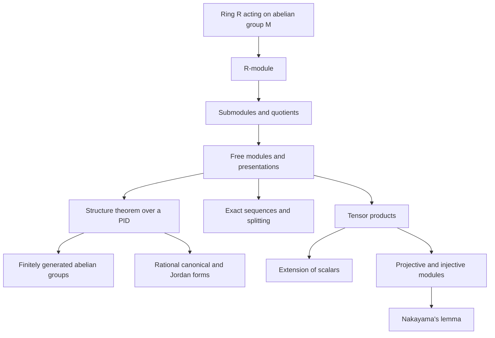
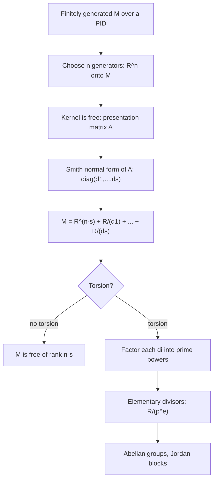

# Modules

> [Mathematics](../../README.md) › [Abstract Algebra](../README.md) · Level: Advanced · Prerequisites: [Groups](../01-groups/README.md), [Rings](../02-rings/README.md), [Fields](../03-fields/README.md), [Vector Spaces](../../08-linear-algebra/04-vector-spaces/README.md), [Eigenvalues and Eigenvectors](../../08-linear-algebra/07-eigenvalues-and-eigenvectors/README.md) · Estimated time: 600 min

## 1. Introduction

A vector space is an abelian group acted on by a field. An abelian group is a set with an addition
that behaves like vector addition and nothing more. Both are the same structure once the field is
replaced by a possibly weaker ring:

$$\text{module over a field }k=\text{vector space over }k,\qquad \text{module over }\mathbb{Z}=\text{abelian group}.$$

The second identity is why the subject exists. The multiple $n\cdot g$ is defined for every
$n\in\mathbb{Z}$ by repeated addition, and *every* abelian group carries this action. Three classical
classification theorems then become one:

| Classical statement | Module statement |
|---|---|
| Finitely generated abelian groups | Finitely generated modules over $\mathbb{Z}$ |
| Smith normal form of an integer matrix | Finitely generated modules over a PID |
| Rational canonical and Jordan forms | Finitely generated torsion modules over $k[x]$ |

The third row deserves emphasis. For a $k$-vector space $V$ and a linear $T:V\to V$, the rule
$p(x)\cdot v:=p(T)v$ makes $V$ a $k[x]$-module: a submodule is a $T$-invariant subspace, an
$k[x]$-linear map is a map commuting with $T$, and two operators are similar exactly when their
modules are isomorphic. Classification of operators up to similarity *is* the structure theorem for
modules over $k[x]$. Nothing is proved twice.

**What survives, and what dies.** Since the axioms are the vector-space axioms with "field" weakened to
"ring", every formal argument survives verbatim: submodules, quotients, kernels, images, the
isomorphism theorems, direct sums, exact sequences, matrices of homomorphisms. What dies is everything
that divides by a nonzero scalar:

| Vector-space theorem | Over a general ring |
|---|---|
| every module has a basis | false: $\mathbb{Z}/2$ over $\mathbb{Z}$ |
| every submodule is a direct summand | false: $2\mathbb{Z}\subset\mathbb{Z}$ |
| every surjection splits | false: $\mathbb{Z}\twoheadrightarrow\mathbb{Z}/2$ |
| finitely generated and torsion-free implies free | false: $(x,y)\subset k[x,y]$ |
| an injective endomorphism is an isomorphism | false: $\mathbb{Z}\xrightarrow{\times2}\mathbb{Z}$ |

Section 7.4 proves each row. The rest of the chapter builds the tools that replace basis arguments:
presentations by generators and relations, exact sequences, tensor products, projective and injective
modules, and Nakayama's lemma. These are the words in which algebraic topology (homology), algebraic
geometry (sheaves of modules), representation theory (modules over a group algebra) and linear systems
theory (modules over $k[x]$) are written. Two habits make the subject manageable: compute a
*presentation* whenever a finitely generated module appears, and notice at which line a proof divides
by a scalar — that line is exactly where a theorem stops being true over a general ring.

## 2. Prerequisites

**Groups.** Subgroups, quotient groups, the first isomorphism theorem, cyclic groups, Lagrange's
theorem. Abelian groups are written additively. See [Groups](../01-groups/README.md).

**Rings.** Ideals, quotient rings, homomorphisms, integral domains, principal ideal and Euclidean
domains, unique factorisation, $R[x]$, the Chinese remainder theorem. See [Rings](../02-rings/README.md).

**Fields.** $\mathbb{Q},\mathbb{R},\mathbb{C},\mathbb{F}_p$, and the fact that $k[x]$ is Euclidean when
$k$ is a field. See [Fields](../03-fields/README.md).

**Linear algebra.** Basis, dimension, linear maps, matrices, rank–nullity, eigenvalues, the
characteristic polynomial, similarity. See [Vector Spaces](../../08-linear-algebra/04-vector-spaces/README.md),
[Linear Transformations](../../08-linear-algebra/05-linear-transformations/README.md),
[Eigenvalues and Eigenvectors](../../08-linear-algebra/07-eigenvalues-and-eigenvectors/README.md) and
[Determinants](../../08-linear-algebra/06-determinants/README.md).

**Divisibility.** The Euclidean algorithm, Bézout's identity, $\gcd$, prime factorisation, the Chinese
remainder theorem in $\mathbb{Z}$. See [Divisibility and Primes](../../12-number-theory/01-divisibility-and-primes/README.md).

No homological algebra and no category theory are assumed.

## 3. Learning Objectives

By the end of this tutorial you will be able to

1. state the module axioms and verify them for vector spaces, abelian groups, ideals, quotient rings and
   $k[x]$-modules coming from an operator;
2. define submodules, quotients, $R$-linear maps, and prove the isomorphism theorems for modules;
3. define free modules, prove that coordinates in a basis are unique, and prove that rank is well
   defined over a commutative ring;
4. prove the standard counterexamples showing that the vector-space theorems fail over general rings;
5. define torsion, annihilators and the torsion submodule, and prove that the torsion elements of a
   module over a domain form a submodule;
6. state the structure theorem for finitely generated modules over a PID in invariant-factor and
   elementary-divisor form, with uniqueness, and reproduce its proof outline;
7. compute invariant factors from a presentation matrix by the Smith normal form;
8. classify finitely generated abelian groups of a given order;
9. derive the rational canonical form and the Jordan form from the structure theorem, and read off the
   minimal and characteristic polynomials from the invariant factors;
10. define exact sequences, prove the splitting lemma, and state the snake lemma with its connecting map;
11. define the tensor product by its universal property and compute with it, including
    $\mathbb{Z}/m\otimes\mathbb{Z}/n$ and extension of scalars;
12. define projective and injective modules, prove the characterisations of projectivity, and give a
    projective module that is not free;
13. state and prove Nakayama's lemma and use it to compute minimal generating sets over a local ring;
14. explain where modules appear in topology, representation theory, geometry and system theory.

## 4. Intuition

**Scalars you cannot divide.** A vector space lets you scale by any field element; a module only by ring
elements, which may have no inverse. Over $\mathbb{Z}$ the only scalars are integers, so the only
operation is repeated addition. This has an immediate consequence: in a vector space $2v=0$ forces
$v=0$ because one divides by $2$; in an abelian group $2v=0$ is an ordinary equation and $v$ may have
order $2$. A module inherits the arithmetic of its ring of scalars.

**The ring remembers relations.** A free module is a set of formal coordinates $\sum a_ie_i$, with
$a_ie_i$ added and scaled coefficientwise, and with the single rule that all coefficients zero is the
only expression for $0$. A general module is a free module plus identities, recorded by a matrix of
relations: $\mathbb{Z}/6$ is the free module on one letter $e$ together with $6e=0$. A presentation is
a complete description, because quotienting a free module by the relation submodule returns the module.

**Linear algebra with a chosen operator.** If $x$ acts on $V$ as $T$, then $p(x)$ acts as $p(T)$ and $V$
becomes a $k[x]$-module. Decomposing $V$ into cyclic summands is choosing a basis in which $T$ is block
diagonal with companion blocks — the rational canonical form. Over an algebraically closed field the
blocks refine to Jordan blocks. The structure theorem is the single statement behind both.

**Torsion: elements that die.** In $\mathbb{Z}/6$ the element $\bar2$ is killed by $3$; in $\mathbb{Z}$
no nonzero element is killed by a nonzero scalar. The elements killed by some nonzero scalar form the
*torsion submodule*, the part of the module living over a quotient ring. Over a PID a finitely
generated module is a free part plus a torsion part, and the torsion part factors completely, like an
integer into prime powers.

**Exact sequences: bookkeeping of what is left over.** A short exact sequence $0\to A\to B\to C\to0$ says
that $B$ is built from $A$ and $C$: the first map is injective, the second surjective, and the image of
one is the kernel of the other. It does *not* say $B\cong A\oplus C$; that is exactly what "the sequence
splits" adds, and it fails in general. The snake lemma extracts a long exact sequence from a map
between two short exact sequences and is the first theorem of homological algebra.

## 5. Formal Definition

Let $R$ be a ring with identity; "module" means left module. From Section 7.12 onwards $R$ is
commutative, so that tensor products are again $R$-modules.

**Definition 5.1** (left $R$-module). A **left $R$-module** is an abelian group $(M,+)$ with a map
$R\times M\to M$, $(r,m)\mapsto rm$, such that for all $r,s\in R$, $m,n\in M$:
$$r(m+n)=rm+rn,\qquad (r+s)m=rm+sm,\qquad (rs)m=r(sm),\qquad 1m=m .$$
The first axiom says each $r$ acts by an endomorphism of the group; the next two say $r\mapsto(r\cdot)$
is a ring homomorphism; the last says $1$ acts as the identity. The identities $0m=0$ and $r0=0$ follow
from the axioms.

**Definition 5.2** (right module, bimodule). A **right $R$-module** has a map $M\times R\to M$,
$(m,r)\mapsto mr$, with the mirror axioms, associativity reading $m(rs)=(mr)s$. An **$(R,S)$-bimodule** is
a left $R$- and right $S$-module with $(rm)s=r(ms)$. Over a commutative ring every module is a bimodule.

**Definition 5.3** ($R$-linear map). A map $f:M\to N$ is **$R$-linear** if $f(m+n)=f(m)+f(n)$ and
$f(rm)=rf(m)$ for all $m,n\in M$, $r\in R$. The set of such maps is $\operatorname{Hom}_R(M,N)$, an
abelian group under pointwise addition (an $R$-module when $R$ is commutative). We write
$\operatorname{End}_R(M)=\operatorname{Hom}_R(M,M)$ (a ring under composition),
$\operatorname{Aut}_R(M)$ for its group of units, and $M\cong N$ when a bijective $R$-linear map exists.

**Definition 5.4** (submodule). A subset $N\subseteq M$ is a **submodule** if it is a subgroup and
$rn\in N$ for all $r\in R$, $n\in N$. **Lemma.** A nonempty $N\subseteq M$ is a submodule iff
$x+ry\in N$ for all $x,y\in N$, $r\in R$. *Proof.* Take $r=-1$ for closure under subtraction, then
$x=0$ for closure under scalars; the converse is immediate. $\blacksquare$

**Definition 5.5** (quotient module). For a submodule $N\subseteq M$ the rule $r(m+N):=rm+N$ is well
defined, because $m'-m\in N$ implies $r(m'-m)\in N$; the resulting module is $M/N$.

**Definition 5.6** (free module, basis, rank). A subset $B\subseteq M$ is a **basis** if every $m\in M$
is a finite sum $m=\sum_{b\in B}r_bb$, all but finitely many $r_b$ zero, **in exactly one way**. A module
with a basis is **free**; for $B=\{e_1,\dots,e_n\}$ we write $M=R^n$. Over a commutative ring the
cardinality of any basis is the **rank** (well defined by Proposition 7.13).

**Definition 5.7** (finitely generated, cyclic, presentation). $M$ is **finitely generated** if
$M=Rm_1+\cdots+Rm_n$ for some $m_i\in M$, and **cyclic** if $M=Rm$. A **presentation** is a surjection
$\pi:R^n\to M$ together with generators of $\ker\pi$, displayed as $R^m\xrightarrow{A}R^n\to M\to0$; then
$M\cong\operatorname{coker}A=R^n/AR^m$. Here $A$ is the matrix whose columns are the relations.

**Definition 5.8** (torsion, annihilator). Let $R$ be a domain. An element $m\in M$ is a **torsion
element** if $rm=0$ for some nonzero $r\in R$. The **annihilator** is
$\operatorname{Ann}(m)=\{r:rm=0\}$, an ideal, and
$\operatorname{Ann}(M)=\bigcap_m\operatorname{Ann}(m)$. $M$ is **torsion-free** if $0$ is the only
torsion element and a **torsion module** if every element is torsion.

**Definition 5.9** (direct sum). For submodules $M_i\subseteq M$, we write $M=\bigoplus_{i\in I}M_i$ if
every $m\in M$ is a finite sum $\sum m_i$ with $m_i\in M_i$ in exactly one way. The **external** direct
sum $\bigoplus_iM_i$ is the submodule of $\prod_iM_i$ of tuples with finitely many nonzero entries. For
two summands, $M=M_1\oplus M_2$ iff $M=M_1+M_2$ and $M_1\cap M_2=0$.

## 6. Mathematical Notation

| Symbol | Read as | Meaning |
|---|---|---|
| $R$, $M$, $N$ | the ring, the module | scalars and the acted-on group |
| $rm$, $Rm$ | $r$ times $m$; the cyclic submodule | action; $\{rm:r\in R\}$ |
| $\operatorname{Hom}_R(M,N)$, $\operatorname{End}_R(M)$ | $R$-linear maps; endomorphisms | abelian group; ring |
| $\ker f$, $\operatorname{im}f$, $\operatorname{coker}f$ | kernel, image, cokernel | $\operatorname{coker}f=N/\operatorname{im}f$ |
| $M/N$ | $M$ modulo $N$ | quotient module |
| $R^n$ | free module of rank $n$ | column vectors |
| $M\oplus N$ | direct sum | pairs, componentwise |
| $\operatorname{Ann}(m)$, $\operatorname{Ann}(M)$ | annihilator | scalars killing $m$ (or all of $M$) |
| $M_{\mathrm{tor}}$ | torsion submodule | elements of finite order |
| $0\to A\xrightarrow{f}B\xrightarrow{g}C\to0$ | short exact sequence | $f$ injective, $g$ surjective, $\operatorname{im}f=\ker g$ |
| $M\otimes_RN$, $m\otimes n$ | tensor product, elementary tensor | universal target of bilinear maps |
| $S\otimes_RM$ | extension of scalars | an $S$-module for $R\to S$ |
| $J(R)$ | Jacobson radical | intersection of the maximal ideals |
| $d_1\mid\cdots\mid d_k$ | invariant factors | the chain in the structure theorem |
| $p^{e}$ | elementary divisor | a prime power summand |
| $C_p$ | companion matrix | matrix of multiplication by $x$ on $k[x]/(p)$ |
| $\chi_T$, $m_T$ | characteristic, minimal polynomial | of the operator $T$ |
| $\mathbb{Z}/n$ | cyclic group of order $n$ | also written $\mathbb{Z}_n$ |

Reading aloud: "$M\otimes_RN$" is "M tensor N over R"; "$\operatorname{coker}A$" is "the cokernel of A";
"$0\to A\to B\to C\to0$" is "a short exact sequence from A to C through B".

## 7. Core Concepts

### 7.1 The Three Archetypes

**Theorem 7.1** (a module is a ring action). For an abelian group $M$, left $R$-module structures on $M$
correspond bijectively to unital ring homomorphisms $\rho:R\to\operatorname{End}_{\mathbb{Z}}(M)$.

*Proof.* Given the action put $\rho(r)(m)=rm$. The first axiom says $\rho(r)$ is a group endomorphism,
the second that $\rho$ is additive, the third that $\rho(rs)=\rho(r)\rho(s)$, the fourth that
$\rho(1)=\mathrm{id}$. The computation reverses. $\blacksquare$

So a module is an abelian group with a representation of $R$ by endomorphisms of that group. The three
archetypes are the three most important choices of $R$.

**Example 7.2** (field). If $R=k$ is a field, modules are vector spaces, submodules are subspaces, and
every module is free by the basis-extension argument, which divides by nonzero scalars. This is the only
case in which all modules are free.

**Example 7.3** ($\mathbb{Z}$). An abelian group $M$ has exactly one $\mathbb{Z}$-module structure:
$$n\cdot m=\underbrace{m+\cdots+m}_{n},\quad 0\cdot m=0,\quad (-n)\cdot m=-(nm)\qquad(n>0).$$
Uniqueness follows from $2m=m+m$, induction, and $(n+(-n))m=0$. Hence $\mathbb{Z}$-submodules are
subgroups, $\mathbb{Z}$-linear maps are group homomorphisms, and the $\mathbb{Z}$-modules are exactly
the abelian groups.

**Example 7.4** ($k[x]$). Let $V$ be a $k$-vector space. A $k[x]$-module structure on $V$ restricting to
the given $k$-action is the same as one $k$-linear operator $T:V\to V$. *Proof.* Given the module put
$T(v)=xv$; then $p(x)v=p(T)v$, and $p\mapsto p(T)$ is a ring homomorphism, so Theorem 7.1 applies.
Conversely $T$ determines the action by $p(x)\cdot v:=p(T)v$. $\blacksquare$

Under this dictionary $k[x]$-submodules are $T$-invariant subspaces, $k[x]$-linear maps are the linear
maps commuting with $T$, and two operators are similar exactly when the corresponding modules are
isomorphic. If $\dim_kV=n<\infty$ then $V$ is a finitely generated **torsion** $k[x]$-module: for
$v\in V$ the $n+1$ vectors $v,Tv,\dots,T^nv$ are dependent, giving a nonzero polynomial killing $v$.

**Example 7.5** (ideals and quotients). Let $R$ be commutative. The **regular module** is $R$ acting on
itself; its submodules are the ideals. If $I\subseteq R$ is an ideal, then $R/I$ is an $R$-module, and:

**Proposition 7.6** (modules over a quotient ring). An $R$-module $M$ is an $R/I$-module, with the
action induced from $R$, if and only if $IM=0$; then $R$- and $R/I$-submodules coincide.

*Proof.* If $M$ is an $R/I$-module then $am=(a+I)m=0$ for $a\in I$. Conversely if $IM=0$, declare
$(r+I)m:=rm$; this is well defined since $r'-r\in I$ gives $(r'-r)m\in IM=0$. $\blacksquare$

Thus a $\mathbb{Z}/n$-module is an abelian group killed by $n$; for instance $\mathbb{Z}/2$ is a
$\mathbb{Z}/6$-module. This is used in Example 9.2.

### 7.2 Submodules, Quotients and Homomorphisms

**Proposition 7.7** (kernels and images). If $f:M\to N$ is $R$-linear, then $\ker f\subseteq M$ and
$\operatorname{im}f\subseteq N$ are submodules, $f$ is injective iff $\ker f=0$, and
$M/\ker f\cong\operatorname{im}f$.

*Proof.* For $x,y\in\ker f$ and $r\in R$, $f(x+ry)=0$, so $N$ passes the submodule test of Definition
5.4; the same test applies to images. The map $m+\ker f\mapsto f(m)$ is a well-defined bijective
$R$-linear map onto $\operatorname{im}f$. $\blacksquare$

This is the **first isomorphism theorem**; the other two are equally formal.
**(Second)** For submodules $S,T\subseteq M$, $(S+T)/T\cong S/(S\cap T)$.
**(Third)** For $N\subseteq L\subseteq M$, $(M/N)/(L/N)\cong M/L$.

**Theorem 7.8** (universal property of the quotient). If $\pi:M\to M/N$ is the projection and $f:M\to P$
is $R$-linear with $N\subseteq\ker f$, there is a unique $R$-linear $\bar f:M/N\to P$ with
$\bar f\circ\pi=f$.

*Proof.* $\bar f(m+N)=f(m)$ is well defined, linear, and unique because $\pi$ is onto. $\blacksquare$

**Theorem 7.9** (correspondence). The map $L\mapsto\pi(L)$ is a bijection from submodules of $M$
containing $N$ to submodules of $M/N$, with inverse $K\mapsto\pi^{-1}(K)$.

*Proof.* $\pi^{-1}\pi(L)=L+N=L$ for $L\supseteq N$, and $\pi\pi^{-1}(K)=K$ since $\pi$ is onto.
$\blacksquare$

**Example 7.10.** The submodules of $\mathbb{Z}/12$ correspond to the subgroups of a cyclic group of
order $12$, hence to the divisors of $12$: they are $0$ (order $1$), $(6)\cong\mathbb{Z}/2$,
$(4)\cong\mathbb{Z}/3$, $(3)\cong\mathbb{Z}/4$, $(2)\cong\mathbb{Z}/6$ and $\mathbb{Z}/12$. A subgroup
of order $m$ lies in the subgroup of order $m'$ exactly when $m\mid m'$, so the maximal chains are
$$\{0\}\subset(6)\subset(3)\subset\mathbb{Z}/12,\quad
\{0\}\subset(6)\subset(2)\subset\mathbb{Z}/12,\quad
\{0\}\subset(4)\subset(2)\subset\mathbb{Z}/12,$$
each with three proper inclusions. The lattice is not a chain, and its shape is governed by
$12=2^2\cdot3$: the $2$-part and the $3$-part can be studied separately, which is the structure theorem
in miniature.

### 7.3 Free Modules and Bases

**Theorem 7.11** (universal property of free modules). Let $M$ be free with basis $B$. Every function
$\varphi:B\to N$ extends uniquely to an $R$-linear map $\tilde\varphi:M\to N$.

*Proof.* Set $\tilde\varphi(\sum r_bb)=\sum r_b\varphi(b)$; the sum is finite and linearity is
coefficientwise. Uniqueness holds because $B$ generates. $\blacksquare$

**Corollary 7.12** (unique coordinates). If $\sum r_bb=\sum s_bb$ with finite sums, then $r_b=s_b$ for
all $b$. *Proof.* Subtract; otherwise $0$ would have two expressions. $\blacksquare$

**Proposition 7.13** (rank is well defined). Let $R\ne0$ be commutative and $R^m\cong R^n$. Then $m=n$.

*Proof.* Let $\mathfrak m\subseteq R$ be maximal. Tensoring with $R/\mathfrak m$ gives
$(R/\mathfrak m)^m\cong(R/\mathfrak m)^n$ (Section 7.12), and dimensions over the field $R/\mathfrak m$
coincide. $\blacksquare$

A ring with this property has **invariant basis number**; every nonzero commutative ring does.

**Proposition 7.14** (submodules of free modules need not be free). The ideal $(x,y)\subseteq k[x,y]$ is
finitely generated and torsion-free but not free, and needs two generators although the ambient module
needs one.

*Proof.* Suppose $(x,y)$ were free. Over a domain any two nonzero elements $f,g$ of an ideal satisfy
$g\cdot f-f\cdot g=0$, so a free ideal has rank $1$ and is therefore principal, say $(x,y)=(h)$. Then
$h\mid x$ and $h\mid y$, so $h\mid\gcd(x,y)=1$, hence $h$ is a unit and $(x,y)=k[x,y]$, which is false
because $x\notin(y)$. Hence $(x,y)$ is not free and, not being principal, needs at least two
generators. $\blacksquare$

### 7.4 Where the Vector-Space Theorems Fail

**Failure 1 (no basis).** $\mathbb{Z}/2$ and $\mathbb{Q}$ are not free $\mathbb{Z}$-modules.
*Proof.* In a free module a nonzero $x=\sum r_bb$ has a nonzero coefficient $r_{b_0}$, and $rx=0$ forces
$rr_{b_0}=0$, hence $r=0$ over a domain. But $2\cdot\bar1=0$ in $\mathbb{Z}/2$. For $\mathbb{Q}$:
$\mathbb{Q}$ is **divisible** (every $q$ is $n\cdot(q/n)$), while a nonzero free group is not: for
$x=\sum n_ie_i\ne0$ pick a prime $p\nmid n_{i_0}$; then $x=py$ would force $p\mid n_i$ for all $i$.
$\blacksquare$

**Failure 2 (no complement).** $2\mathbb{Z}\subseteq\mathbb{Z}$ is not a direct summand. *Proof.* If
$\mathbb{Z}=2\mathbb{Z}\oplus N$ then $n\in N$ gives $2n\in N\cap2\mathbb{Z}=0$, so $N=0$, false.
$\blacksquare$ Likewise $\mathbb{Z}/2=\{0,2\}\subseteq\mathbb{Z}/4$ has no complement, since
$\mathbb{Z}/4\not\cong\mathbb{Z}/2\oplus\mathbb{Z}/2$ (no element of order $4$).

**Failure 3 (no splitting).** The surjection $\pi:\mathbb{Z}\to\mathbb{Z}/2$ has no section. *Proof.*
$2s(\bar1)=s(2\bar1)=0$ and $\mathbb{Z}$ is torsion-free, so $s(\bar1)=0\ne\bar1$ preimage.
Equivalently $\operatorname{Hom}_{\mathbb{Z}}(\mathbb{Z}/2,\mathbb{Z})=0$. $\blacksquare$

**Failure 4 (injective is not surjective).** $\mathbb{Z}\xrightarrow{\times2}\mathbb{Z}$ is injective but
not onto, so a linearly independent set of size $1$ in a free module of rank $1$ need not span.

**Failure 5 (spanning does not contain a basis).** $\{2,3\}$ spans $\mathbb{Z}$ because $3-2=1$, but
neither $\{2\}$ nor $\{3\}$ spans, and $\{2\}$ is independent but does not extend to a basis: the only
bases of $\mathbb{Z}$ are $\{1\}$ and $\{-1\}$.

**Failure 6 (torsion-free is not free).** Proposition 7.14. Over the PID $\mathbb{Z}$ the analogous
failure requires infinite generation, as $\mathbb{Q}$ shows.

### 7.5 Direct Sums and Complements

**Proposition 7.15.** (a) For submodules $M_i\subseteq M$, $M=\bigoplus_iM_i$ iff the natural map
$\bigoplus_iM_i\to M$ is an isomorphism. (b) If $e\in\operatorname{End}_R(M)$ satisfies $e^2=e$ then
$M=\ker e\oplus\operatorname{im}e$. (c) For infinite $I$ with infinitely many $M_i\ne0$, the inclusion
$\bigoplus_iM_i\to\prod_iM_i$ is strict: the tuple $(1,2,4,8,\dots)$ in $\prod_n\mathbb{Z}$ is not a
finite sum of basis vectors.

*Proof.* (a) Uniqueness of expressions is injectivity of the map. (b) Every $m=e(m)+(m-e(m))$ with
$e(m-e(m))=0$; a common element satisfies $x=e(y)$ and $0=e(x)=e^2(y)=x$. (c) A finite sum has finitely
many nonzero coordinates. $\blacksquare$

### 7.6 Finitely Generated Modules and Torsion

**Proposition 7.16.** Let $R$ be a domain. The torsion elements of $M$ form a submodule
$M_{\mathrm{tor}}$, and $M/M_{\mathrm{tor}}$ is torsion-free.

*Proof.* If $rm=sn=0$ with $r,s\ne0$, then $rs\ne0$ and $rs(m+n)=0$, and $r(am)=0$. If
$r(m+M_{\mathrm{tor}})=0$ with $r\ne0$, then $rm\in M_{\mathrm{tor}}$, so $srm=0$ with $sr\ne0$ and
$m\in M_{\mathrm{tor}}$. $\blacksquare$

Hence there is a canonical short exact sequence
$0\to M_{\mathrm{tor}}\to M\to M/M_{\mathrm{tor}}\to0$. Over a PID with $M$ finitely generated it
splits, because $M/M_{\mathrm{tor}}$ is then free (Corollary 7.23); over a general domain it need not.

**Proposition 7.17.** Over a commutative ring $\operatorname{Ann}(m)$ is an ideal and
$\operatorname{Ann}(M)=\bigcap_m\operatorname{Ann}(m)$. Over a PID, if
$M=R/(d_1)\oplus\cdots\oplus R/(d_k)$ with $d_1\mid\cdots\mid d_k$, then $\operatorname{Ann}(M)=(d_k)$.

*Proof.* $\operatorname{Ann}(m)=\ker(R\to M,\ r\mapsto rm)$. A scalar kills a direct sum iff it kills
each summand, and $(d_k)\subseteq(d_i)$ because $d_i\mid d_k$. $\blacksquare$

The generator $d_k$ is the module-theoretic minimal polynomial: the smallest principal ideal killing $M$.

### 7.7 The Structure Theorem for Finitely Generated Modules over a PID

Let $R$ be a PID and $M$ finitely generated.

**Lemma 7.18.** Every submodule of $R^n$ is free of rank at most $n$.

*Proof.* Induct on $n$. For $n=1$, a submodule is an ideal $(a)$, free of rank $1$ or $0$. For $n\ge2$
let $\pi:R^n\to R$ be the last coordinate and $\pi(N)=(a)$. If $a=0$, then
$N\subseteq R^{n-1}\times0$ and induction applies. If $a\ne0$ choose $x\in N$ with $\pi(x)=a$; for
$y\in N$ we have $\pi(y)=ba$, so $y-bx\in N\cap\ker\pi$, giving $N=Rx\oplus(N\cap\ker\pi)$ with the sum
direct because $\pi(x)\ne0$. Induction gives a basis of $N\cap\ker\pi$, and adding $x$ gives one of $N$.
$\blacksquare$

**Corollary 7.19.** A finitely generated $M$ has a presentation
$R^m\xrightarrow{A}R^n\to M\to0$ with $m\le n$.

*Proof.* Choose $n$ generators, let $\pi:R^n\to M$ be the surjection; $\ker\pi$ is free of rank
$m\le n$ by Lemma 7.18, with basis the columns of $A$, so $M\cong\operatorname{coker}A$. $\blacksquare$

**Theorem 7.20** (Smith normal form). Every nonzero $n\times m$ matrix $A$ over a PID admits invertible
$P,Q$ with
$$PAQ=\begin{pmatrix}\operatorname{diag}(d_1,\dots,d_s)&0\\0&0\end{pmatrix},\qquad d_1\mid d_2\mid\cdots\mid d_s .$$

*Proof outline.* Row and column operations (swaps, adding a multiple of one line to another,
multiplying by a unit) are left and right multiplication by invertible matrices. Bring a nonzero entry
to position $(1,1)$ and call it $a$; divide the rest of the first row and column by $a$ with remainder,
and if a remainder is nonzero add that column or row to the first and repeat. Each repetition replaces
$a$ by a proper divisor, so the ideal generated by the first row and column grows strictly and the
process stops (a PID has no infinite strictly ascending chain of ideals, since a chain
$I_1\subsetneq I_2\subsetneq\cdots$ with $I=\bigcup I_j$ principal would be reached at a finite stage).
Then clear the first row and column and recurse. Finally, if $d_1\nmid d_j$, add column $j$ to column
$1$ and repeat: the new corner is a proper divisor, so the chain argument again terminates. $\blacksquare$

**Theorem 7.21** (structure theorem, invariant factors). There are $r\ge0$ and nonzero nonunits
$d_1,\dots,d_k\in R$ with $d_1\mid d_2\mid\cdots\mid d_k$ such that
$$M\cong R^r\oplus R/(d_1)\oplus\cdots\oplus R/(d_k).$$
The integer $r$ and the ideals $(d_i)$ are uniquely determined by $M$; the $d_i$ are the **invariant
factors**. If $M$ is torsion then $r=0$.

**Theorem 7.22** (elementary divisors). There are prime elements $p_1,\dots,p_s$ (not necessarily
distinct) and exponents $e_i\ge1$ with
$$M\cong R^r\oplus R/(p_1^{e_1})\oplus\cdots\oplus R/(p_s^{e_s}),$$
and the multiset of pairs $(p_i,e_i)$ is unique up to order and units.

The two forms are equivalent: by the Chinese remainder theorem
$R/(d_i)\cong\bigoplus_jR/(p_j^{a_{ij}})$ when $d_i=\prod_jp_j^{a_{ij}}$, and the divisibility chain says
$a_{1j}\le a_{2j}\le\cdots$ for each prime $j$. Collecting the largest exponents gives the $d_i$ back.

*Proof outline of Theorem 7.21.* By Corollary 7.19, $M\cong\operatorname{coker}A$. Diagonalise:
$\operatorname{coker}A\cong\operatorname{coker}(PAQ)$ because $P,Q$ are invertible, and the latter is
$$R^n\big/(d_1R\oplus\cdots\oplus d_sR\oplus0)\cong R^{n-s}\oplus R/(d_1)\oplus\cdots\oplus R/(d_s).$$
Delete the $d_i$ that are units and set $r=n-s$. For uniqueness let $\Delta_i$ be the gcd of all
$i\times i$ minors of $A$ ($\Delta_0=1$), the $i$-th **determinantal divisor**. Minors of $PAQ$ are
minors of $A$ times units, so $\Delta_i$ depends only on $\operatorname{im}A$, not on the presentation;
for a diagonal matrix $\Delta_i=d_1\cdots d_i$. Hence $d_i=\Delta_i/\Delta_{i-1}$, and $s$ and $r=n-s$
are determined by $M$. $\blacksquare$

**Corollary 7.23** (finitely generated torsion-free modules over a PID are free). If $M$ is finitely
generated and torsion-free then $M\cong R^r$ with $r=\operatorname{rank}_RM$.

*Proof.* A nonzero $R/(d)$ has $d$-torsion, so no torsion summand can occur in Theorem 7.21. $\blacksquare$

**Remark 7.24** (why the hypotheses). Finite generation is needed ($\mathbb{Q}$ over $\mathbb{Z}$ is
torsion-free and not free); the PID hypothesis is needed ($(x,y)$ over $k[x,y]$). Over a non-Noetherian
domain a finitely generated module can even fail to be finitely presented.

### 7.8 Application I: Finitely Generated Abelian Groups

**Theorem 7.25** (fundamental theorem of finitely generated abelian groups). Every finitely generated
abelian group satisfies
$$G\cong\mathbb{Z}^r\oplus\mathbb{Z}/d_1\oplus\cdots\oplus\mathbb{Z}/d_k,\qquad d_1\mid d_2\mid\cdots\mid d_k,\ d_i>1,$$
and $r\ge0$ and the $d_i$ are uniquely determined. Equivalently
$G\cong\mathbb{Z}^r\oplus\mathbb{Z}/p_1^{e_1}\oplus\cdots\oplus\mathbb{Z}/p_s^{e_s}$ with primes $p_i$,
uniquely up to order.

*Proof.* $\mathbb{Z}$ is a PID and a finitely generated abelian group is a finitely generated
$\mathbb{Z}$-module; apply Theorems 7.21 and 7.22. $\blacksquare$

The free rank $r$ is the **rank** of $G$, and $G_{\mathrm{tor}}$ is exactly the set of elements of
finite order, with $G/G_{\mathrm{tor}}\cong\mathbb{Z}^r$.

**Corollary 7.26** (finite groups). A finite abelian group of order $n=\prod_ip_i^{a_i}$ is the direct
sum of its Sylow subgroups, and the number of abelian groups of order $n$ is $\prod_ip(a_i)$, where
$p(a)$ is the number of partitions of $a$.

*Proof.* In Theorem 7.22 the summands of prime-power order group by prime into the Sylow subgroups, and
a partition of $a$ records the exponents of $p$ in the elementary divisors. $\blacksquare$

**Example 7.27** (order $360$). With $360=2^3\cdot3^2\cdot5$ and $p(3)=3$, $p(2)=2$, $p(1)=1$ there are
$6$ abelian groups of order $360$, for instance
$$\mathbb{Z}/8\oplus\mathbb{Z}/9\oplus\mathbb{Z}/5,\qquad
\mathbb{Z}/2\oplus\mathbb{Z}/2\oplus\mathbb{Z}/2\oplus\mathbb{Z}/3\oplus\mathbb{Z}/3\oplus\mathbb{Z}/5 .$$
In invariant-factor form the second is $\mathbb{Z}/2\oplus\mathbb{Z}/6\oplus\mathbb{Z}/30$: the largest
invariant factor collects the largest power of each prime, the next the second largest, and so on,
and indeed $2\cdot6\cdot30=360$.

### 7.9 Application II: Rational Canonical Form and Jordan Form

Let $k$ be a field, $V$ a finite-dimensional $k$-vector space and $T:V\to V$. Regard $V$ as a
$k[x]$-module as in Example 7.4; $k[x]$ is a Euclidean domain, hence a PID, and $V$ is finitely
generated and torsion.

**Theorem 7.28** (rational canonical form). There are monic $d_1\mid d_2\mid\cdots\mid d_k$ of degree
$\ge1$ with $V\cong k[x]/(d_1)\oplus\cdots\oplus k[x]/(d_k)$ as $k[x]$-modules, uniquely. In the basis
$1,x,\dots,x^{\deg d_i-1}$ of each summand the matrix of $T$ is the companion matrix
$$C_p=\begin{pmatrix}0&0&\cdots&0&-a_0\\1&0&\cdots&0&-a_1\\0&1&\cdots&0&-a_2\\\vdots&&\ddots&&\vdots\\0&0&\cdots&1&-a_{n-1}\end{pmatrix}
\quad\text{for }p(x)=x^n+a_{n-1}x^{n-1}+\cdots+a_0,$$
so the matrix of $T$ is $\operatorname{diag}(C_{d_1},\dots,C_{d_k})$. Moreover
$\chi_T=\prod_id_i$ and $m_T=d_k$.

*Proof.* Theorem 7.21 gives the decomposition with $r=0$. In $k[x]/(p)$ the classes $1,x,\dots,x^{n-1}$
form a $k$-basis, and multiplication by $x$ sends $x^j\mapsto x^{j+1}$ for $j<n-1$ and
$x^{n-1}\mapsto-a_0-a_1x-\cdots-a_{n-1}x^{n-1}$, which is $C_p$. The characteristic polynomial of $C_p$
is $p$ (expand $\det(xI-C_p)$ along the last column) and is multiplicative over block sums, so
$\chi_T=\prod_id_i$. By Proposition 7.17 the annihilator of $V$ is $(d_k)$, and the annihilator is
generated by the minimal polynomial. $\blacksquare$

Two operators on finite-dimensional spaces are similar if and only if they have the same rational
canonical form, i.e. the same invariant factors. Eigenvalues alone do not suffice; this is the precise
answer to the similarity problem.

**Theorem 7.29** (Jordan form). If $\chi_T$ splits over $k$, then every elementary divisor is a power
$(x-\lambda)^e$, and in the basis $1,(x-\lambda),\dots,(x-\lambda)^{e-1}$ of $k[x]/((x-\lambda)^e)$ the
matrix of $T$ is the $e\times e$ block with $\lambda$ on the diagonal and $1$ on the subdiagonal;
reversing the basis gives the usual **Jordan block** $J_e(\lambda)$ with $\lambda$ on the diagonal and
$1$ on the superdiagonal. Hence $T$ is similar to a block diagonal matrix of Jordan blocks, unique up to
the order of the blocks.

*Proof.* Each invariant factor factors into linear prime powers; apply Theorem 7.22 and the computation
of Theorem 7.28 with $x=\lambda+(x-\lambda)$. $\blacksquare$

**Example 7.30** ($4\times4$). For
$A=\begin{pmatrix}1&1&0&0\\0&1&0&0\\0&0&1&0\\0&0&0&-1\end{pmatrix}$ we have $\chi_A=(x-1)^3(x+1)$ and
$m_A=(x-1)^2(x+1)$, since the block of size $2$ occurs. The elementary divisors are
$(x-1)^2,(x-1),(x+1)$; grouping the highest powers first gives invariant factors
$d_2=(x-1)^2(x+1)=x^3-x^2-x+1$ and $d_1=(x-1)$. The rational canonical form is
$C_{x-1}\oplus C_{x^3-x^2-x+1}$, a matrix with integer entries similar to $A$ over $\mathbb{Q}$. This
form exists over every field, whereas the Jordan form of $A$ exists here only because both eigenvalues
are rational.

### 7.10 Exact Sequences and the Splitting Lemma

**Definition 7.31** (exactness). A sequence
$\cdots\to M_{i+1}\xrightarrow{f_{i+1}}M_i\xrightarrow{f_i}M_{i-1}\to\cdots$ is **exact** at $M_i$ if
$\operatorname{im}f_{i+1}=\ker f_i$, and exact if this holds at every interior term. A **short exact
sequence** is an exact sequence $0\to A\xrightarrow{f}B\xrightarrow{g}C\to0$, i.e. $f$ injective, $g$
surjective, $\operatorname{im}f=\ker g$.

**Example 7.32.** (1) $0\to N\to M\to M/N\to0$ for a submodule $N$. (2)
$0\to\mathbb{Z}\xrightarrow{\times2}\mathbb{Z}\to\mathbb{Z}/2\to0$, which does not split (Failure 3).
(3) $0\to A\to A\oplus C\to C\to0$, which does split. (4)
$0\to\mathbb{Z}\to\mathbb{Q}\to\mathbb{Q}/\mathbb{Z}\to0$ does not split: a splitting would give a
nonzero map from a torsion group to a torsion-free one.

**Lemma 7.33.** In $0\to A\xrightarrow{f}B\xrightarrow{g}C\to0$: (a) $f$ is an isomorphism iff $C=0$;
(b) $g$ is an isomorphism iff $A=0$; (c) if $A$ and $C$ are finitely generated then so is $B$; (d) if $B$
is finitely generated then so is $C$, and so is $A$ when $R$ is Noetherian (in particular a PID).

*Proof.* (a), (b) immediate. (c) If $a_i$ generate $A$ and $c_j$ generate $C$, choose $b_j$ with
$g(b_j)=c_j$; then $f(a_i)$ and $b_j$ generate $B$, since $b-\sum r_jb_j\in\ker g=\operatorname{im}f$.
(d) $C=g(B)$; and $A\cong\ker g$, a submodule of $B$, which is finitely generated over a Noetherian
ring. $\blacksquare$

**Theorem 7.34** (splitting lemma). For $0\to A\xrightarrow{f}B\xrightarrow{g}C\to0$ the following are
equivalent: (i) there is $s:C\to B$ with $g\circ s=\mathrm{id}_C$; (ii) there is $r:B\to A$ with
$r\circ f=\mathrm{id}_A$; (iii) $B\cong A\oplus C$ with $f$ and $g$ the structural maps.

*Proof.* (i)$\Rightarrow$(iii): $\Phi(a,c)=f(a)+s(c)$ is linear; it is onto because
$b-s(g(b))\in\ker g=\operatorname{im}f$, and injective because $f(a)+s(c)=0$ gives $c=0$ then $a=0$.
(iii)$\Rightarrow$(i),(ii): take $s(c)=(0,c)$, $r(a,c)=a$. (ii)$\Rightarrow$(iii): $\Psi(b)=(r(b),g(b))$
is injective, since $r(b)=g(b)=0$ makes $b=f(a)$ with $a=r(b)=0$, and onto, since for $(a,c)$ choose
$b_0$ with $g(b_0)=c$ and put $b=b_0+f(a-r(b_0))$. $\blacksquare$

**Corollary 7.35.** Every short exact sequence of vector spaces splits, because a basis of $C$ lifts to
independent vectors of $B$. Hence $\dim B=\dim A+\dim C$ — rank–nullity. Over a general ring this fails,
as $\mathbb{Z}\to\mathbb{Z}/2$ shows.

### 7.11 The Snake Lemma

**Theorem 7.36** (snake lemma). Let
$$\begin{array}{ccccccc}
 & & A & \xrightarrow{f} & B & \xrightarrow{g} & C\longrightarrow0\\[2pt]
 & & {\scriptstyle\alpha}\big\downarrow & & {\scriptstyle\beta}\big\downarrow & & {\scriptstyle\gamma}\big\downarrow\\[2pt]
0\longrightarrow & A' & \xrightarrow{f'} & B' & \xrightarrow{g'} & C' &
\end{array}$$
be a commutative diagram with exact rows. Then there is an exact sequence
$$\ker\alpha\xrightarrow{\bar f}\ker\beta\xrightarrow{\bar g}\ker\gamma\xrightarrow{\delta}\operatorname{coker}\alpha
\xrightarrow{\bar f'}\operatorname{coker}\beta\xrightarrow{\bar g'}\operatorname{coker}\gamma,$$
where the outer maps are induced by $f,g,f',g'$. If $f$ is injective then $\bar f$ is injective, and if
$g'$ is surjective then $\bar g'$ is surjective.

**Construction of $\delta$.** For $c\in\ker\gamma$ choose $b\in B$ with $g(b)=c$. Then
$g'(\beta(b))=\gamma(c)=0$, so $\beta(b)=f'(a')$ for a unique $a'\in A'$; set
$\delta(c)=a'+\operatorname{im}\alpha$. If $\tilde b$ is another choice, $b-\tilde b=f(a)$ and
$\beta(b)-\beta(\tilde b)=f'(\alpha(a))$, so the class in $\operatorname{coker}\alpha$ is unchanged.

Exactness at the six positions is a diagram chase; the map $\delta$ runs diagonally, which gives the
lemma its name. Two consequences are used constantly: if $\alpha$ is onto and $\beta$ injective then
$\delta$ is an isomorphism, and if $\alpha$ and $\beta$ are isomorphisms then so is $\gamma$ (injectivity
from $\ker\gamma=0$, surjectivity because $g'$ is onto and $\operatorname{coker}\beta=0$). The general
**five lemma** — four isomorphisms in a ladder force the fifth — is proved the same way.

### 7.12 Tensor Products

From here on $R$ is commutative.

**Definition 7.37** (bilinear). A map $f:M\times N\to P$ is **$R$-bilinear** if it is $R$-linear in each
variable separately. Bilinear maps are not linear on $M\times N$: $f(2m,2n)=4f(m,n)$.

**Definition 7.38** (tensor product). A **tensor product** is a pair $(T,\otimes)$ with $T$ an
$R$-module and $\otimes:M\times N\to T$ bilinear, such that for every bilinear $f:M\times N\to P$ there
is a unique linear $\tilde f:T\to P$ with $\tilde f(m\otimes n)=f(m,n)$.

**Theorem 7.39** (existence and uniqueness). The tensor product exists and is unique up to a unique
isomorphism. *Construction.* Take the free module $F$ on symbols $[m,n]$ and quotient by the submodule
generated by $[m+m',n]-[m,n]-[m',n]$, $[m,n+n']-[m,n]-[m,n']$, and $[rm,n]-r[m,n]$, $[m,rn]-r[m,n]$; the
relations say exactly that $\otimes$ is bilinear, and the universal property follows by extending from
the basis. $\blacksquare$

**Proposition 7.40** (properties). (a) $M\otimes N\cong N\otimes M$. (b) $R\otimes M\cong M$ via
$r\otimes m\mapsto rm$. (c) $(\bigoplus_iM_i)\otimes N\cong\bigoplus_i(M_i\otimes N)$. (d)
$(R/I)\otimes M\cong M/IM$. (e) $M\otimes0=0$. (f) $(M\otimes N)\otimes P\cong M\otimes(N\otimes P)$.
Each map is induced by a bilinear map, and the two composites fix elementary tensors.

**Theorem 7.41** (right exactness). If $M'\xrightarrow{f}M\xrightarrow{g}M''\to0$ is exact, then
$$M'\otimes N\xrightarrow{f\otimes1}M\otimes N\xrightarrow{g\otimes1}M''\otimes N\longrightarrow0$$
is exact.

*Proof.* Surjectivity: $m''\otimes n=g(m)\otimes n$ for a preimage $m$. For exactness in the middle, let
$D=\operatorname{coker}(f\otimes1)$; the map $M\times N\to D$, $(m,n)\mapsto m\otimes n$, kills
$\operatorname{im}f\times N$, hence induces a bilinear map $M''\times N\to D$ and a linear
$M''\otimes N\to D$, which is inverse to $M''\otimes N\to D$ on elementary tensors. $\blacksquare$

**Warning 7.42.** Tensoring $0\to\mathbb{Z}\xrightarrow{\times2}\mathbb{Z}\to\mathbb{Z}/2\to0$ with
$\mathbb{Z}/2$ gives $\mathbb{Z}/2\xrightarrow{0}\mathbb{Z}/2\to\mathbb{Z}/2\to0$, which is not exact on
the left: $1\otimes\bar1\ne0$ maps to $2\otimes\bar1=\bar2\otimes1=0$. A module $N$ for which
$-\otimes N$ is exact is **flat**; free and projective modules are flat, and $\mathbb{Z}/2$ is not.

**Example 7.43.** (a) $\mathbb{Z}/m\otimes\mathbb{Z}/n\cong\mathbb{Z}/\gcd(m,n)$, by tensoring the
presentation $\mathbb{Z}\xrightarrow{m}\mathbb{Z}\to\mathbb{Z}/m\to0$ with $\mathbb{Z}/n$ and using
right exactness: the cokernel is $(\mathbb{Z}/n)/m(\mathbb{Z}/n)\cong\mathbb{Z}/\gcd(m,n)$. In
particular $\mathbb{Z}/2\otimes\mathbb{Z}/3=0$. (b) $\mathbb{Q}\otimes\mathbb{Z}/n=0$, because
multiplication by $n$ on $\mathbb{Q}$ is onto. (c) $\mathbb{Q}\otimes\mathbb{Q}\cong\mathbb{Q}$ via
$a\otimes b\mapsto ab$, with inverse $q\mapsto q\otimes1$. (d)
$\mathbb{Z}[x]\otimes\mathbb{Z}[y]\cong\mathbb{Z}[x,y]$. (e) Not every element is elementary: in
$\mathbb{C}\otimes_{\mathbb{R}}\mathbb{C}$ the element $1\otimes i-i\otimes1$ is nonzero (see Example
7.45).

**Definition 7.44** (extension of scalars). For a ring map $R\to S$ and an $R$-module $M$, the module
$S\otimes_RM$ with $s'(s\otimes m)=(s's)\otimes m$ is the **extension of scalars**, characterised by
$\operatorname{Hom}_S(S\otimes_RM,N)\cong\operatorname{Hom}_R(M,N)$ for $S$-modules $N$.

**Example 7.45.** (a) $\mathbb{C}\otimes_{\mathbb{R}}\mathbb{C}\cong\mathbb{C}\times\mathbb{C}$: since
$\mathbb{C}=\mathbb{R}[x]/(x^2+1)$,
$\mathbb{C}\otimes_{\mathbb{R}}\mathbb{C}\cong\mathbb{C}[x]/((x-i)(x+i))\cong\mathbb{C}\times\mathbb{C}$
by the Chinese remainder theorem; the two factors are the identity and conjugation. Under this map
$1\otimes i-i\otimes1$ corresponds to $(0,2i)\ne0$. (b) $\mathbb{C}\otimes_{\mathbb{R}}\mathbb{R}[x]\cong\mathbb{C}[x]$.
(c) $\mathbb{Q}\otimes_{\mathbb{Z}}\mathbb{Z}[\sqrt2]\cong\mathbb{Q}(\sqrt2)$. (d)
$\mathbb{F}_p\otimes_{\mathbb{Z}}\mathbb{Z}[i]\cong\mathbb{F}_p[i]$, which is $\mathbb{F}_p\times\mathbb{F}_p$
for $p\equiv1\pmod4$, a field $\mathbb{F}_{p^2}$ for $p\equiv3\pmod4$, and
$\mathbb{F}_2[\varepsilon]/(\varepsilon^2)$ for $p=2$.

### 7.13 Projective and Injective Modules

**Definition 7.46** (projective). $P$ is **projective** if for every surjection $p:M\to N$ and every
$f:P\to N$ there is $\tilde f:P\to M$ with $p\circ\tilde f=f$: every map into the target lifts through a
surjection.

**Theorem 7.47** (characterisations). For an $R$-module $P$ the following are equivalent: (i) $P$ is
projective; (ii) $\operatorname{Hom}_R(P,-)$ is exact; (iii) every surjection $M\to P$ splits; (iv) $P$
is a direct summand of a free module.

*Proof.* (i)$\Leftrightarrow$(ii): $\operatorname{Hom}(P,-)$ is always left exact, and right exactness
says precisely that maps $P\to C$ lift to $B$. (i)$\Rightarrow$(iii): lift the identity of $P$.
(iii)$\Rightarrow$(iv): apply (iii) to a surjection $F\to P$ from a free module. (iv)$\Rightarrow$(i):
if $F=P\oplus P'$ is free, extend $f$ to $F$ by $0$ on $P'$, lift using freeness (Theorem 7.11), and
project to $P$. $\blacksquare$

**Corollary 7.48.** Free modules are projective. The converse fails: over $R=\mathbb{Z}/6$ we have
$R\cong(3)\oplus(2)$ with $(3)\cong\mathbb{Z}/2$, so $\mathbb{Z}/2$ is a direct summand of the free
module $R$ and hence projective. It is not free, because a basis vector of a free module has zero
annihilator, while every element of $\mathbb{Z}/2$ is killed by $2$.

**Theorem 7.49.** Over a PID every projective module is free. For a finitely generated $P$ this is
immediate: $P$ is a direct summand of some $R^n$, hence a submodule of a free module, hence free by
Lemma 7.18.

**Proposition 7.50** (dual basis lemma). A finitely generated $M$ is projective iff there are
$x_1,\dots,x_n\in M$ and $\varphi_1,\dots,\varphi_n\in\operatorname{Hom}_R(M,R)$ with
$x=\sum_i\varphi_i(x)x_i$ for all $x\in M$.

*Proof.* If $M$ is a summand of a free $F$ with basis $u_j$ and projection $\pi$, take $x_j=\pi(u_j)$ and
$\varphi_j$ = the $u_j$-coefficient; then $m=\pi(m)=\sum_j\varphi_j(m)x_j$. Conversely define
$\Phi(m)=(\varphi_i(m))$ and $\Psi(r)=\sum_ir_ix_i$; then $\Psi\Phi=\mathrm{id}_M$, so $M$ is a summand
of $R^n$. $\blacksquare$

**Example 7.51** (projective, not free, over a domain). Let $R=\mathbb{Z}[\sqrt{-5}]$ and
$I=(2,1+\sqrt{-5})$. Then $|R/I|=2$ (mod $2$, $R/(2)\cong\mathbb{F}_2[t]/(t+1)^2$ and $I/(2)=(t+1)$),
so if $I=(\alpha)$ then $N(\alpha)=a^2+5b^2=2$, which has no integer solution: $I$ is not principal,
hence not free. Take $x_1=2$, $x_2=1+\sqrt{-5}$, $b_1=-1$, $b_2=\tfrac12(1-\sqrt{-5})$ and
$\varphi_i(x)=b_ix$; both $b_i$ satisfy $b_iI\subseteq R$, and
$$\varphi_1(x)x_1+\varphi_2(x)x_2=-2x+\tfrac12(1-\sqrt{-5})(1+\sqrt{-5})x=-2x+3x=x .$$
By Proposition 7.50, $I$ is projective. This is the classical example: $\mathbb{Z}[\sqrt{-5}]$ is a
Dedekind domain of class number $2$, and $6=2\cdot3=(1+\sqrt{-5})(1-\sqrt{-5})$ shows the failure of
unique factorisation.

**Definition 7.52** (injective). $I$ is **injective** if every $f:A\to I$ extends along every injection
$A\to B$; equivalently $\operatorname{Hom}_R(-,I)$ is exact.

**Theorem 7.53** (Baer's criterion). $I$ is injective iff every $R$-linear map $\mathfrak a\to I$ from an
ideal $\mathfrak a\subseteq R$ extends to $R$.

**Proposition 7.54.** A $\mathbb{Z}$-module is injective iff it is **divisible** (every $d$ is $nd'$ for
all $n\ge1$). Hence $\mathbb{Q}$ and $\mathbb{Q}/\mathbb{Z}$ are injective and $\mathbb{Z}$ is not.

*Proof.* Ideals of $\mathbb{Z}$ are $(n)$, and a map $(n)\to D$, $n\mapsto d$, extends iff $d=nd'$; so
Baer's criterion is divisibility. $\mathbb{Z}$ is not divisible. $\blacksquare$

Projectivity lifts maps *out of* a module along surjections; injectivity extends maps *into* a module
along injections. Over $\mathbb{Z}$ the two classes are as different as possible: projective $=$ free,
injective $=$ divisible.

### 7.14 Nakayama's Lemma

**Definition 7.55.** A **maximal ideal** is a proper ideal contained in no larger proper ideal, and every
proper ideal lies in one. The **Jacobson radical** $J(R)$ is the intersection of all maximal ideals; for
a local ring $(R,\mathfrak m)$ one has $J(R)=\mathfrak m$.

**Lemma 7.56.** If $x\in J(R)$ then $1-x$ is a unit. *Proof.* Otherwise $(1-x)$ lies in a maximal ideal
$\mathfrak m$, and then $x\in J(R)\subseteq\mathfrak m$ gives $1=(1-x)+x\in\mathfrak m$, absurd.
$\blacksquare$

**Theorem 7.57** (Nakayama's lemma). Let $M$ be a finitely generated $R$-module with $JM=M$, where
$J=J(R)$. Then $M=0$.

*Proof.* Suppose $M\ne0$ and let $x_1,\dots,x_n$ generate with $n\ge1$ minimal. Since $x_n\in JM$,
$x_n=\sum_{i=1}^nr_ix_i$ with $r_i\in J$, so $(1-r_n)x_n=\sum_{i<n}r_ix_i$. By Lemma 7.56, $1-r_n$ is a
unit, so $x_n$ lies in the span of $x_1,\dots,x_{n-1}$, contradicting minimality. $\blacksquare$

**Corollary 7.58.** Let $M$ be finitely generated. (a) If $M=N+JM$ for a submodule $N$, then $M=N$
(apply the theorem to $M/N$). (b) If the images of $x_1,\dots,x_n$ generate $M/JM$, then they generate
$M$. (c) If $(R,\mathfrak m)$ is local, every minimal generating set of $M$ has exactly
$\dim_{R/\mathfrak m}(M/\mathfrak mM)$ elements.

*Proof of (c).* A generating set of size $d$ maps to a spanning set of $M/\mathfrak mM$, so
$d\ge\dim$. Conversely a basis of $M/\mathfrak mM$ lifts to generators by (b), and no smaller set
generates, so the minimum equals the dimension. $\blacksquare$

**Example 7.59** (finite generation is needed). Let $R=\mathbb{Z}_{(2)}$ (rationals with odd
denominator), a local ring with maximal ideal $2R$, and $M=\mathbb{Z}[\tfrac12]$. Then $2M=M$ but
$M\ne0$. The module is not finitely generated: a finitely generated submodule lies in
$\tfrac1{2^N}\mathbb{Z}_{(2)}$ for some $N$ and misses $\tfrac1{2^{N+1}}$.

**Example 7.60** (minimal generators). For $R=\mathbb{Z}_{(2)}$ and $M=R/(4)\oplus R/(2)$ we have
$M/2M\cong R/(2)\oplus R/(2)$ of dimension $2$ over $\mathbb{F}_2$, so $M$ needs exactly two
generators. Over a local ring, minimal generating sets are computed by linear algebra over the residue
field — the same operation as over a field.

## 8. Formulas and Properties

| Result | Hypotheses | Content | Why it holds |
|---|---|---|---|
| Structure theorem | $R$ PID, $M$ fg | $M\cong R^r\oplus\bigoplus R/(d_i)$, $d_1\mid\cdots\mid d_k$ | Smith normal form of a presentation matrix |
| Determinantal divisors | $A$ over a PID | $d_i=\Delta_i/\Delta_{i-1}$ | minors are basis-independent up to units |
| Free rank | $R$ PID, $M$ fg | $r=\operatorname{rank}_RM=\dim_{\operatorname{Frac}R}(M\otimes_R\operatorname{Frac}R)$ | localisation inverts all nonzero scalars |
| Torsion splitting | $R$ PID, $M$ fg | $M\cong M_{\mathrm{tor}}\oplus R^r$ | $M/M_{\mathrm{tor}}$ is free |
| Abelian groups | $G$ fg abelian | $G\cong\mathbb{Z}^r\oplus\bigoplus\mathbb{Z}/p_i^{e_i}$ | structure theorem for $R=\mathbb{Z}$ |
| Count of groups | $|G|=\prod p_i^{a_i}$ | $\prod_ip(a_i)$ | partitions of the exponents |
| Rational canonical form | $\dim_kV<\infty$ | $\bigoplus C_{d_i}$, $\chi_T=\prod d_i$, $m_T=d_k$ | $V$ is a fg torsion $k[x]$-module |
| Jordan form | $\chi_T$ splits | blocks $J_e(\lambda)$ | prime powers of linear factors |
| Splitting | $0\to A\to B\to C\to0$ | splits iff $B\cong A\oplus C$ | section, retraction, or projection |
| Tensor | $R$ commutative | $R/I\otimes M\cong M/IM$ | balance of the two actions |
| Torsion of a tensor | $R=\mathbb{Z}$ | $\mathbb{Z}/m\otimes\mathbb{Z}/n\cong\mathbb{Z}/\gcd(m,n)$ | right exactness and $(m,n)$-torsion |
| Projective over a PID | $R$ PID | projective $=$ free | submodule of a free module is free |
| Nakayama | $M$ fg, $JM=M$ | $M=0$ | $1-r$ invertible for $r\in J$ |

Three of these deserve a word of justification beyond the table.

**Why the free rank is visible in the tensor product.** Let $K=\operatorname{Frac}R$ and apply
$-\otimes_RK$. Since $K$ is flat over a PID (it is a localisation, hence a filtered colimit of free
modules), the decomposition becomes $M\otimes_RK\cong K^r$ because $R/(d)\otimes_RK=K/dK=0$. So $r$ is
the dimension of a vector space, and the vector-space theory computes it.

**Why $\mathbb{Z}/m\otimes\mathbb{Z}/n$ has order $\gcd(m,n)$.** The module $\mathbb{Z}/m$ is presented
by one generator and one relation $m$. Right exactness turns the presentation into
$0\to\mathbb{Z}/n\xrightarrow{m}\mathbb{Z}/n\to\mathbb{Z}/m\otimes\mathbb{Z}/n\to0$, and the cokernel of
multiplication by $m$ on $\mathbb{Z}/n$ is $\mathbb{Z}/\gcd(m,n)$.

**Why projective over a PID means free.** A projective module is a summand of a free module, and a
summand is a submodule; over a PID submodules of free modules are free (Lemma 7.18). No such argument
exists over $k[x,y]$, where the submodule $(x,y)$ is not free — and indeed over that ring there are
finitely generated projectives that are not free, though the example is harder than Example 7.51.

## 9. Step-by-Step Examples

**Example 9.1** (submodules and Hom, easy). Let $M=\mathbb{Z}/12$. Its submodules are the ideals
$(d)/(12)$ for $d\mid12$, that is $\mathbb{Z}/12$, $(2)\cong\mathbb{Z}/6$, $(3)\cong\mathbb{Z}/4$,
$(4)\cong\mathbb{Z}/3$, $(6)\cong\mathbb{Z}/2$, and $0$. Now compute
$\operatorname{Hom}_{\mathbb{Z}}(\mathbb{Z}/4,\mathbb{Z}/6)$: a homomorphism is determined by
$f(\bar1)=\bar a$ with $4\bar a=0$ in $\mathbb{Z}/6$, i.e. $6\mid4a$, i.e. $3\mid2a$, i.e. $3\mid a$.
The solutions are $\bar a\in\{0,3\}$, so the Hom group has two elements, in agreement with
$|\operatorname{Hom}(\mathbb{Z}/m,\mathbb{Z}/n)|=\gcd(m,n)$ here equal to $2$.

**Example 9.2** ($\mathbb{Z}/2$ over $\mathbb{Z}/6$, easy). Let $R=\mathbb{Z}/6$ and $M=\mathbb{Z}/2$.
Since $6M=0$, Proposition 7.6 makes $M$ an $R$-module by $\bar r\cdot\bar m=\overline{rm}$. The Chinese
remainder theorem gives $R\cong(3)\oplus(2)$ as $R$-modules, with $(3)=\{0,3\}\cong\mathbb{Z}/2$; so $M$
is a direct summand of the free module $R$ and is therefore projective (Theorem 7.47). It is not free:
a basis vector $e_1$ in a free $R$-module has $\operatorname{Ann}(e_1)=(0)$, since $re_1=0$ forces
$r=0$, whereas every element of $\mathbb{Z}/2$ is killed by $2\ne0$.

**Example 9.3** ($k[x]$-module and rational canonical form, medium). Let
$A=\begin{pmatrix}1&1&0\\0&1&0\\0&0&-1\end{pmatrix}$ act on $V=\mathbb{Q}^3$ and put $v=(0,1,1)$. Then
$$Av=(1,1,-1),\qquad A^2v=(2,1,1),\qquad A^3v=(3,1,-1)=-v+Av+A^2v .$$
The vectors $v,Av,A^2v$ are independent (the matrix with these columns has determinant $-4$), so they
form a basis and $v$ is a **cyclic vector**. In this basis the matrix of $A$ is built column by column
from $A(v)=0\cdot v+1\cdot Av+0\cdot A^2v$, $A(Av)=A^2v$, and $A(A^2v)=A^3v$:
$$C=\begin{pmatrix}0&0&-1\\1&0&1\\0&1&1\end{pmatrix},$$
the companion matrix of $p(x)=x^3-x^2-x+1=(x-1)^2(x+1)$. Hence $V\cong\mathbb{Q}[x]/(p)$ is cyclic as a
$\mathbb{Q}[x]$-module, with a single invariant factor $d_1=p$, $\chi_A=m_A=p$, and rational canonical
form $C$. The Jordan form, which exists here because $p$ splits over $\mathbb{Q}$, is
$J_2(1)\oplus J_1(-1)$, and indeed $A$ is already in that form.

**Example 9.4** (Smith normal form, medium). (a) For $A=\operatorname{diag}(2,4,6)$ the determinantal
divisors are $\Delta_1=2$, $\Delta_2=\gcd(8,12,24)=4$, $\Delta_3=48$, so $d_1=2$, $d_2=2$, $d_3=12$ and
$$\mathbb{Z}^3/A\mathbb{Z}^3\cong\mathbb{Z}/2\oplus\mathbb{Z}/2\oplus\mathbb{Z}/12 .$$
Equivalently, $\mathbb{Z}/4\oplus\mathbb{Z}/6\cong\mathbb{Z}/2\oplus\mathbb{Z}/12$, the general identity
$\mathbb{Z}/a\oplus\mathbb{Z}/b\cong\mathbb{Z}/\gcd(a,b)\oplus\mathbb{Z}/\operatorname{lcm}(a,b)$.
(b) For $A=\begin{pmatrix}2&1&0\\1&3&1\\0&1&2\end{pmatrix}$ we have $\Delta_1=1$ (the entry $1$),
$\Delta_2=1$ (the minor $1\cdot1-0\cdot3=1$), $\Delta_3=\det A=8$. Hence the invariant factors are
$1,1,8$ and $\mathbb{Z}^3/A\mathbb{Z}^3\cong\mathbb{Z}/8$: the module is cyclic, which is not obvious
from the presentation.

**Example 9.5** (tensor computations, medium). (a) $\mathbb{Z}/4\otimes\mathbb{Z}/6\cong\mathbb{Z}/2$.
(b) $\mathbb{Q}\otimes\mathbb{Z}/12=0$, since $12\mathbb{Q}=\mathbb{Q}$. (c)
$\mathbb{Z}/2\otimes\mathbb{Z}/3=0$, while $\mathbb{Z}/2\otimes\mathbb{Z}/2\cong\mathbb{Z}/2$. (d)
$\mathbb{C}\otimes_{\mathbb{R}}\mathbb{C}\cong\mathbb{C}\times\mathbb{C}$; under this isomorphism
$z\otimes w\mapsto(zw,z\bar w)$, so $1\otimes i\mapsto(i,-i)$ and $i\otimes1\mapsto(i,i)$, and
$1\otimes i-i\otimes1\mapsto(0,-2i)\ne0$. This is the simplest proof that a tensor is not a single
elementary tensor.

**Example 9.6** (which sequences split, medium). (a) $0\to\mathbb{Z}\xrightarrow{2}\mathbb{Z}\to\mathbb{Z}/2\to0$
does not split: a section $s$ would satisfy $2s(\bar1)=0$, so $s(\bar1)=0\ne\bar1$ in the image.
(b) $0\to\mathbb{Z}/2\xrightarrow{2}\mathbb{Z}/4\to\mathbb{Z}/2\to0$ does not split, since
$\mathbb{Z}/4\not\cong\mathbb{Z}/2\oplus\mathbb{Z}/2$ (no element of order $4$).
(c) $0\to\mathbb{Z}/2\to\mathbb{Z}/6\to\mathbb{Z}/3\to0$ splits: the Chinese remainder theorem gives
$\mathbb{Z}/6\cong\mathbb{Z}/2\oplus\mathbb{Z}/3$, and the maps are the structural ones, so
Theorem 7.34(iii) applies. The moral: the same numerical shape $0\to A\to B\to C\to0$ can split or not,
and the invariant factors of $B$ decide.

**Example 9.7** (classification and Nakayama, hard). (a) Since $72=2^3\cdot3^2$ and $p(3)=3$, $p(2)=2$,
there are six abelian groups of order $72$:
$$\mathbb{Z}/8\oplus\mathbb{Z}/9,\ \mathbb{Z}/8\oplus\mathbb{Z}/3\oplus\mathbb{Z}/3,\
\mathbb{Z}/4\oplus\mathbb{Z}/2\oplus\mathbb{Z}/9,\ \mathbb{Z}/4\oplus\mathbb{Z}/2\oplus\mathbb{Z}/3\oplus\mathbb{Z}/3,\
\mathbb{Z}/2^3\oplus\mathbb{Z}/9,\ \mathbb{Z}/2^3\oplus\mathbb{Z}/3^2 .$$
(b) $\mathbb{Z}/2\oplus\mathbb{Z}/36$ and $\mathbb{Z}/6\oplus\mathbb{Z}/12$ both have order $72$, but
the first has an element of order $36$ and the second has exponent $\operatorname{lcm}(6,12)=12$; they
are not isomorphic, and their invariant factors $(2,36)$ and $(6,12)$ differ, as Theorem 7.25 predicts.
(c) Let $R=\mathbb{Z}_{(2)}$ and $M=R/(8)\oplus R/(4)\oplus R/(2)$. Then
$M/2M\cong(R/2)^3$, of dimension $3$ over $\mathbb{F}_2$, so by Nakayama $M$ needs exactly three
generators; its invariant factors are $2\mid4\mid8$, matching the three summands.

## 10. Visual Explanations

The structure theorem as a decision procedure for a finitely generated module over a PID:

| Linear algebra over a field | Module theory over a ring |
|---|---|
| basis | generating set, or basis if free |
| subspace | submodule |
| quotient space | quotient module |
| linear map | $R$-linear map |
| direct sum of subspaces | direct sum of submodules |
| rank–nullity | short exact sequence, if it splits |
| matrix of a map | matrix of a presentation |
| Jordan form | elementary divisors |
| rational canonical form | invariant factors |

## 11. Common Mistakes

1. **Assuming every module has a basis.** Over $\mathbb{Z}$, $\mathbb{Z}/2$ has none; over $k[x,y]$ even
   a torsion-free ideal can fail. "Choose a basis" is legal only after proving the module is free.
2. **Assuming submodules are summands.** A short exact sequence is not a direct sum. The two differ
   precisely by the existence of a section (Theorem 7.34).
3. **Confusing the invariant factors with the elementary divisors.** The $d_i$ form a divisibility chain
   and multiply to the order; the $p^e$ are prime powers and are the ones matching Jordan blocks.
4. **Forgetting the free rank.** Writing $M\cong\bigoplus\mathbb{Z}/(d_i)$ and omitting $\mathbb{Z}^r$
   loses all the torsion-free information; the free part is invisible to torsion invariants.
5. **Treating $\otimes$ as left exact.** It is right exact only; Warning 7.42 is the standard
   counterexample, and it shows that $\mathbb{Q}\otimes\mathbb{Z}/2=0$ does not imply
   $\mathbb{Z}/2=0$.
6. **Applying Nakayama without finite generation.** Example 7.59 satisfies $JM=M$ and $M\ne0$.
7. **Believing projective implies free.** True over a field and over a PID, false over $\mathbb{Z}/6$
   and over $\mathbb{Z}[\sqrt{-5}]$.
8. **Reversing the divisibility chain.** It is $d_1\mid d_2\mid\cdots\mid d_k$ with $d_k$ the largest;
   the largest invariant factor is the minimal polynomial in the $k[x]$ case.

## 12. Applications

* **Algebraic topology.** A chain complex is a sequence of modules with $d^2=0$, and its homology
  $H_n=\ker d_n/\operatorname{im}d_{n+1}$ is computed with the snake lemma. See
  [Algebraic Topology](../../17-topology/05-algebraic-topology/README.md).
* **Representation theory.** A representation of a group $G$ over $k$ is a $k[G]$-module; irreducible
  representations are simple modules, and Maschke's theorem is the statement that $k[G]$ is semisimple.
* **Algebraic geometry and sheaves.** A sheaf of $\mathcal{O}_X$-modules is a module varying over a
  space; quasi-coherent sheaves on an affine scheme are exactly modules over its coordinate ring.
* **Linear systems and control.** A linear recurrence or a linear system with transfer function
  $p(s)/q(s)$ is a module over $k[s]$; controllability is a statement about cyclic vectors, and the
  invariant factors are the controllability indices.
* **Abelian groups in cryptography and coding.** Finite abelian groups are the group structure of
  elliptic-curve torsion subgroups; the classification tells exactly which groups can occur.
* **Crystallography.** Lattices are free $\mathbb{Z}$-modules of rank equal to the dimension, and
  sublattices have finite index computed by the determinant of a presentation matrix.
* **Category theory and homological algebra.** Projective and injective objects, exact sequences and
  derived functors are the language of
  [Category Theory](../../24-advanced-topics/03-category-theory/README.md).

## 13. Exercises

The problem set contains **36 exercises** in [exercises.md](exercises.md): direct computation with
submodules, quotients and Hom (Beginner); classification, Smith normal form, tensor products and
splitting (Intermediate); proofs of the isomorphism theorems, Nakayama, right exactness and the dual
basis lemma (Advanced); and the projective non-free module over $\mathbb{Z}[\sqrt{-5}]$, counting
groups of large order, and the limits of the structure theorem (Challenge).

## 14. Solutions

Complete worked solutions for all 36 exercises are in [solutions.md](solutions.md). Each states the
strategy, carries out every step, names the theorem used with its hypotheses, and checks the answer where
an independent check exists.

## 15. Summary

* A module is an abelian group with an action of a ring; vector spaces are modules over a field and
  abelian groups are modules over $\mathbb{Z}$.
* Submodules, quotients, kernels, images and the isomorphism theorems are the vector-space constructions
  with $r$ ranging over a ring; nothing in their proofs divides.
* Free modules have bases with unique coordinates, and rank is well defined over a commutative ring.
* Over a general ring modules may have no basis, submodules may have no complement, surjections may not
  split, and injective endomorphisms may fail to be onto.
* Torsion elements form a submodule over a domain, and $M/M_{\mathrm{tor}}$ is torsion-free.
* Over a PID every finitely generated module is $R^r\oplus\bigoplus R/(d_i)$ with
  $d_1\mid\cdots\mid d_k$, computed from the Smith normal form of a presentation matrix; the
  determinantal divisors give uniqueness.
* Finitely generated abelian groups are classified by a rank and a chain of invariant factors; the
  number of groups of order $\prod p_i^{a_i}$ is $\prod_ip(a_i)$.
* A finite-dimensional operator is a torsion $k[x]$-module; the invariant factors give the rational
  canonical form, and the elementary divisors give the Jordan form when the characteristic polynomial
  splits.
* Exact sequences encode extensions; the splitting lemma identifies the split ones with direct sums.
* The snake lemma produces a six-term exact sequence from a map of short exact sequences.
* The tensor product is defined by a universal property for bilinear maps, is right exact, satisfies
  $\mathbb{Z}/m\otimes\mathbb{Z}/n\cong\mathbb{Z}/\gcd(m,n)$, and implements extension of scalars.
* Projective means "lifts along surjections" or "summand of free"; injective means "extends along
  injections"; over a PID projective equals free, and over $\mathbb{Z}$ injective equals divisible.
* Nakayama's lemma turns questions about generators of a finitely generated module over a local ring
  into linear algebra over the residue field.

## 16. Further Learning

The natural continuations are [Fields](../03-fields/README.md) and
[Galois Theory](../04-galois-theory/README.md), where modules over $k[x]$ control field extensions, and
[Algebraic Topology](../../17-topology/05-algebraic-topology/README.md), where exact sequences and the
snake lemma become the machinery of homology. The structural view of algebra as the study of module
categories belongs to [Category Theory](../../24-advanced-topics/03-category-theory/README.md). The
linear-algebra side — Jordan form, minimal polynomials and diagonalisation — is developed in
[Eigenvalues and Eigenvectors](../../08-linear-algebra/07-eigenvalues-and-eigenvectors/README.md).

Standard references:

* David S. Dummit and Richard M. Foote, *Abstract Algebra* — Chapters 10–12 cover modules, the structure
  theorem and applications.
* Serge Lang, *Algebra* — a terse but complete treatment, including the Smith normal form.
* Michael Artin, *Algebra* — the module point of view on canonical forms.
* Nathan Jacobson, *Basic Algebra II* — a careful account of projective and injective modules.
* Paul M. Cohn, *Algebra*, volumes 2–3 — comprehensive, with many worked examples.
* Joseph J. Rotman, *An Introduction to Homological Algebra* — the snake lemma and its descendants.
* Atiyah and Macdonald, *Introduction to Commutative Algebra* — Nakayama's lemma in its natural habitat.

