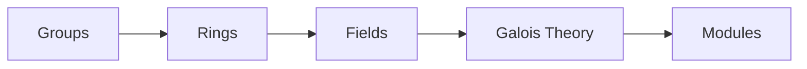

<!-- Generated by tools/build_indexes.py from tools/curriculum.json. Do not edit by hand. -->

# Abstract Algebra

*Structure for its own sake*

[Mathematics](../README.md) › Abstract Algebra

Groups, rings and fields: the axiomatic study of algebraic structure, culminating in Galois theory and the impossibility of solving the quintic by radicals.

## At a glance

| | |
|---|---|
| Topics | 5 (5 complete, 0 draft, 0 planned) |
| Estimated study time | ~62 hours |
| Prerequisites | [00-foundations](../00-foundations/README.md), [08-linear-algebra](../08-linear-algebra/README.md), [12-number-theory](../12-number-theory/README.md) |

## Study order

The numbers are the recommended order. Study a topic only after the ones before it —
the dependency chain below is the shortest safe route through the discipline.

## Topic inventory

| # | Topic | Level | Est. time | Status | Materials |
|---|---|---|---|---|---|
| 1 | [Groups](01-groups/README.md) | Advanced | 14 h | Complete | [Tutorial](01-groups/README.md) · [Exercises](01-groups/exercises.md) · [Solutions](01-groups/solutions.md) |
| 2 | [Rings](02-rings/README.md) | Advanced | 12 h | Complete | [Tutorial](02-rings/README.md) · [Exercises](02-rings/exercises.md) · [Solutions](02-rings/solutions.md) |
| 3 | [Fields](03-fields/README.md) | Advanced | 12 h | Complete | [Tutorial](03-fields/README.md) · [Exercises](03-fields/exercises.md) · [Solutions](03-fields/solutions.md) |
| 4 | [Galois Theory](04-galois-theory/README.md) | Advanced | 14 h | Complete | [Tutorial](04-galois-theory/README.md) · [Exercises](04-galois-theory/exercises.md) · [Solutions](04-galois-theory/solutions.md) |
| 5 | [Modules](05-modules/README.md) | Advanced | 10 h | Complete | [Tutorial](05-modules/README.md) · [Exercises](05-modules/exercises.md) · [Solutions](05-modules/solutions.md) |

### What each topic covers

- **Groups** — Axioms, subgroups, cosets, Lagrange's theorem, homomorphisms and quotients.
- **Rings** — Ideals, quotient rings, integral domains, polynomial rings and UFDs.
- **Fields** — Field extensions, finite fields, algebraic and transcendental elements.
- **Galois Theory** — Galois groups, the fundamental theorem, solvability and the quintic.
- **Modules** — Modules over rings, free modules, structure theory and exact sequences.

## Related disciplines

- [24-advanced-topics](../24-advanced-topics/README.md)
- [15-complex-analysis](../15-complex-analysis/README.md)

## Status key

- **Complete** — tutorial, exercises and full solutions exist and the tutorial meets the
  [authoring standard](../CONTRIBUTING.md).
- **Draft** — some material exists but the topic is not finished.
- **Planned** — identified in the curriculum, not written yet.

Overall progress and the full topic inventory live in [ROADMAP.md](../ROADMAP.md).
