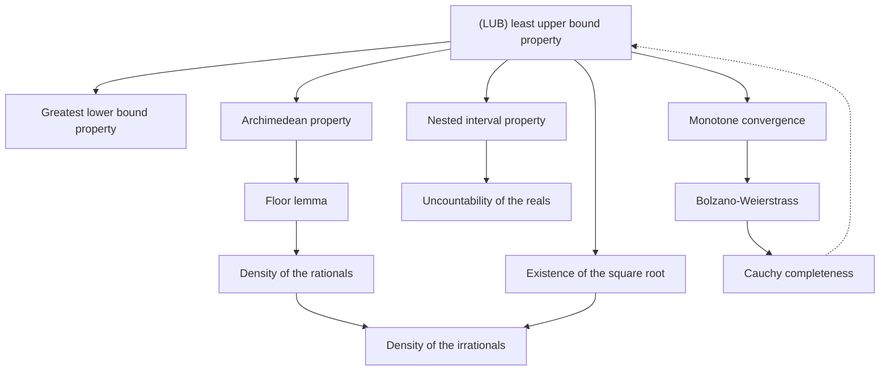

# The Real Numbers and Completeness

> [Mathematics](../../README.md) › [Real Analysis](../README.md) · Level: Advanced · Prerequisites: [Logic](../../00-foundations/02-logic/README.md), [Set Theory](../../00-foundations/03-set-theory/README.md), [Proof Techniques](../../00-foundations/04-proof-techniques/README.md), [Inequalities](../../03-algebra/03-inequalities/README.md), [Radicals and Rational Exponents](../../03-algebra/10-radicals-and-rational-exponents/README.md), [Mathematical Induction](../../09-discrete-mathematics/01-mathematical-induction/README.md), [Limits](../../07-calculus/01-limits/README.md) · Estimated time: 720 min

## 1. Introduction

Every theorem of calculus rests on a property of the real numbers that cannot be seen on a calculator and cannot be proved from the axioms of arithmetic. That property is **completeness**: the real line has no gaps. This tutorial isolates it, states it precisely, proves what follows from it, and shows how the whole of analysis is built on it.

The story starts with a crisis. The Pythagoreans believed that every length was a ratio of whole numbers. Then someone noticed that the diagonal of a unit square has length $d$ with $d^2 = 2$, and that no ratio of integers can produce that length. The proof is short and we give it in Section 7.2. The consequence was not merely that one number was missing from the rationals; it was that the rational line, dense as it looks, is riddled with holes — infinitely many, in fact uncountably many, as Section 7.12 shows.

There are two ways to react to a hole.

* **Fill it by force.** Declare that the number line is a complete ordered field: an ordered field in which every nonempty set that is bounded above has a least upper bound. This is an *axiom*, not a theorem, and it is the definition of $\mathbb{R}$ used in almost every analysis course. What matters is that this axiom is consistent (there exist such objects) and that everything else follows from it.
* **Build it from $\mathbb{Q}$.** Construct an object out of rational data, prove it is a complete ordered field, and then *identify* $\mathbb{R}$ with it. Dedekind's cuts (Section 7.9) and Cantor's Cauchy-sequence construction (Section 7.10) are the two classical constructions. Both are outlined here with their key verifications, because a student should see at least once that the completeness axiom is not a wish.

The intellectual content of the chapter is the same either way, and it is this: **completeness is the only property that distinguishes $\mathbb{R}$ from $\mathbb{Q}$.** Every field and order axiom that $\mathbb{R}$ satisfies, $\mathbb{Q}$ also satisfies. So whenever a theorem about limits, continuity, or convergence is true for $\mathbb{R}$ and false for $\mathbb{Q}$, completeness is the reason. Concretely:

* The sequence $1,\,1.4,\,1.41,\,1.414,\dots$ of rational truncations of $\sqrt{2}$ is Cauchy but has no limit in $\mathbb{Q}$; in $\mathbb{R}$ it converges.
* The set $\{q \in \mathbb{Q} : q^2 < 2\}$ is bounded above in $\mathbb{Q}$ and has no supremum there; in $\mathbb{R}$ its supremum is $\sqrt{2}$.
* Every continuous function on a closed bounded interval attains a maximum — false over $\mathbb{Q}$, where $x \mapsto x^2$ on $\{q : q^2 \le 2\}$ has no largest value.
* The intermediate value theorem fails over $\mathbb{Q}$: the function $f(x) = x^2 - 2$ changes sign between $1$ and $2$ but has no rational zero.

Section 7.13 collects these into a table and explains the *proof architecture*: the least upper bound property implies the monotone convergence theorem, which implies the Bolzano–Weierstrass theorem, which implies Cauchy completeness; and with the Archimedean property, the chain closes back on itself.

Three habits are needed. First, **quantifiers are the content**: "bounded above" means there is one number that dominates the whole set, and "least upper bound" means that among all such numbers there is a smallest. Second, **the existence of a bound is not the existence of a maximum**: most suprema of open sets are not elements of the set. Third, **one counterexample in $\mathbb{Q}$ does not refute a theorem in $\mathbb{R}$**, but it does show exactly which hypothesis is doing the work.

## 2. Prerequisites

**Logic and quantifiers.** You must be able to read $\forall \varepsilon > 0\ \exists N\ \forall n \ge N$ and to negate it correctly as $\exists \varepsilon > 0\ \forall N\ \exists n \ge N$ with the conclusion failing. Almost every proof below is an exercise in moving quantifiers in the right order. See [Logic](../../00-foundations/02-logic/README.md).

**Sets and set-builder notation.** $\{x \in S : P(x)\}$, subsets, unions, intersections, power sets (needed for Cantor's theorem), and the language of injective, surjective and bijective maps. See [Set Theory](../../00-foundations/03-set-theory/README.md).

**Proof techniques.** Direct proof, contrapositive, contradiction, and induction. The Archimedean property and Cantor's theorem are both proved by contradiction, and the well-ordering of $\mathbb{N}$ comes from induction. See [Proof Techniques](../../00-foundations/04-proof-techniques/README.md) and [Mathematical Induction](../../09-discrete-mathematics/01-mathematical-induction/README.md).

**Inequalities and absolute value.** $\lvert x \rvert < \varepsilon$ means $-\varepsilon < x < \varepsilon$; the triangle inequality $\lvert x + y\rvert \le \lvert x\rvert + \lvert y\rvert$; and manipulating inequalities without reversing them accidentally. See [Inequalities](../../03-algebra/03-inequalities/README.md).

**Square roots and radicals.** $\sqrt{2}$ as the nonnegative solution of $x^2 = 2$ presupposes that such a solution exists — which is exactly what Section 7.7 proves. Read [Radicals and Rational Exponents](../../03-algebra/10-radicals-and-rational-exponents/README.md) for the algebraic manipulations; here we supply the existence proof that school algebra takes for granted.

**Informal limits.** Knowing what $\lim_{n\to\infty} a_n = L$ is supposed to mean, and why $\varepsilon$-language replaces "gets arbitrarily close", makes the definitions here feel inevitable rather than arbitrary. See [Limits](../../07-calculus/01-limits/README.md).

**Arithmetic of $\mathbb{Q}$.** A rational is a quotient $p/q$ with $p, q \in \mathbb{Z}$ and $q \ne 0$; every rational has a representation in lowest terms. This is used in the irrationality proof. See [Fractions](../../01-arithmetic/03-fractions/README.md).

## 3. Learning Objectives

By the end of this tutorial you will be able to

1. state the field axioms and the order axioms, and prove the basic consequences ($0 < 1$, $x > 0 \Rightarrow x^{-1} > 0$, $x^2 \ge 0$) from them;
2. explain precisely why $\mathbb{Q}$ is an ordered field that is *not* complete, and exhibit a bounded nonempty subset of $\mathbb{Q}$ with no supremum in $\mathbb{Q}$;
3. state the completeness axiom (least upper bound property) and derive the greatest lower bound property from it;
4. prove the Archimedean property from completeness, and use it to prove that $\inf\{1/n : n \in \mathbb{N}\} = 0$;
5. prove that $\mathbb{Q}$ is dense in $\mathbb{R}$, and that the irrationals are dense as well;
6. prove from the completeness axiom that a positive real number $x$ with $x^2 = 2$ exists, and that it is unique; prove that it is irrational;
7. state and prove the nested interval property, and explain its relation to completeness, the monotone convergence theorem, Bolzano–Weierstrass and Cauchy completeness (with the forward implications proved here and completed in [Sequences and Series](../02-sequences-and-series/README.md));
8. outline Dedekind's construction: define cuts, verify that the cut order is total, that the union of a bounded family of cuts is the least upper bound, and explain how addition and multiplication are defined;
9. outline Cantor's construction of $\mathbb{R}$ from equivalence classes of Cauchy sequences of rationals, and say which axiom is built in and which must be proved;
10. define countable and uncountable sets, prove that $\mathbb{Z}$, $\mathbb{N} \times \mathbb{N}$ and $\mathbb{Q}$ are countable, and prove that the countable union of countable sets is countable;
11. prove Cantor's theorem $\lvert A\rvert < \lvert \mathcal{P}(A)\rvert$ and deduce that there are infinitely many infinite cardinalities;
12. prove that $\mathbb{R}$ is uncountable, both by Cantor's diagonal argument and by nested intervals, and state the continuum hypothesis as an undecidable question rather than a theorem.

## 4. Intuition

**A ladder with missing rungs.** Imagine a ladder whose rungs are the rationals: between any two rungs there are infinitely many others, and you can walk from $0$ to $1$ in steps as small as you like. It feels solid. Now drop a plumb line from the top of an isosceles right triangle with legs $1$; the line passes through a rung that is simply not there. Worse, if you try to *name* the missing rung as "the least rung above the break", you cannot: there is no least rung above the break either. The break has no address in the rational system.

**The best ceiling.** Think of a set $S$ of real numbers as a crowd standing on the number line. An upper bound is a ceiling above the whole crowd. The supremum is the *lowest* ceiling that still clears everyone. Two things can go wrong with a lowest ceiling: it may not exist (if the crowd is infinitely tall, i.e. unbounded), or the space may not have ceilings that can be lowered continuously (which is precisely the failure in $\mathbb{Q}$). Completeness asserts that every nonempty crowd that has some ceiling has a lowest one.

**Why "least" is the operative word.** The existence of *an* upper bound is a weak, local fact. The power comes from the least one: it lets you *approximate from below*, because no smaller number is an upper bound. Nearly every completeness proof in analysis has the same shape: "if the sup were bigger (or smaller) than the claimed value, we could improve it, contradicting leastness." You will see this pattern in the proof that $\sqrt{2}$ exists, in the monotone convergence theorem, and in the intermediate value theorem.

**Dedekind's knife.** Dedekind's idea is to define a real number by the cut it makes in the rationals: the number is the *lower half*. A cut is a set of rationals closed downwards with no largest element. "$\sqrt{2}$" is then simply $\{q \in \mathbb{Q} : q < 0 \text{ or } q^2 < 2\}$ — a perfectly concrete object made of rationals, which happens to have no rational boundary. The real line is the set of all such cuts, and completeness becomes almost a tautology: the sup of a family of cuts is their union.

**Diagonalisation.** Cantor's argument is a machine for producing an object that escapes a given list. Given any list of real numbers, build a number whose $n$-th decimal digit disagrees with the $n$-th digit of the $n$-th number on the list. The new number cannot be on the list. Since the argument works for *every* list, no list can contain all reals: $\mathbb{R}$ is uncountable. The same trick proves that no set surjects onto its power set, and it reappears in computability theory as the proof that the halting problem is undecidable.

## 5. Formal Definition

Everything below takes place in a set $F$ equipped with two operations $+$ and $\cdot$ and a relation $\le$.

**Definition 5.1 (Field axioms).** $(F, +, \cdot)$ is a *field* if for all $x, y, z \in F$:

| | Axiom | Name |
|---|---|---|
| F1 | $x + y = y + x$ | commutativity of $+$ |
| F2 | $(x+y)+z = x+(y+z)$ | associativity of $+$ |
| F3 | there is $0 \in F$ with $x + 0 = x$ | additive identity |
| F4 | there is $-x \in F$ with $x + (-x) = 0$ | additive inverse |
| F5 | $xy = yx$ | commutativity of $\cdot$ |
| F6 | $(xy)z = x(yz)$ | associativity of $\cdot$ |
| F7 | there is $1 \in F$ with $1 \ne 0$ and $1\cdot x = x$ | multiplicative identity |
| F8 | if $x \ne 0$, there is $x^{-1}$ with $x\,x^{-1} = 1$ | multiplicative inverse |
| F9 | $x(y+z) = xy + xz$ | distributivity |

**Definition 5.2 (Order axioms).** A relation $<$ on $F$ is a *total order compatible with the field operations* if for all $x, y, z \in F$:

| | Axiom | Name |
|---|---|---|
| O1 | exactly one of $x < y$, $x = y$, $y < x$ holds | trichotomy |
| O2 | $x < y$ and $y < z$ imply $x < z$ | transitivity |
| O3 | $x < y$ implies $x + z < y + z$ | translation invariance |
| O4 | $x < y$ and $0 < z$ imply $xz < yz$ | scaling by positives |

We write $x \le y$ for "$x < y$ or $x = y$", and $x > y$ for $y < x$.

**Definition 5.3 (Ordered field).** An *ordered field* is a field together with a total order satisfying O1–O4.

Both $\mathbb{Q}$ and $\mathbb{R}$ are ordered fields. So is every subfield of $\mathbb{R}$, such as $\mathbb{Q}(\sqrt{2})$.

**Definition 5.4 (Bounds).** Let $S \subseteq \mathbb{R}$.

* $u \in \mathbb{R}$ is an **upper bound** of $S$ if $\forall s \in S,\ s \le u$.
* $\ell \in \mathbb{R}$ is a **lower bound** of $S$ if $\forall s \in S,\ \ell \le s$.
* $S$ is **bounded above** if it has an upper bound; **bounded below** if it has a lower bound; **bounded** if both.
* $S$ has a **maximum** if there is $m \in S$ with $s \le m$ for all $s \in S$; then $m = \max S$.
* $S$ has a **minimum** if there is $m \in S$ with $m \le s$ for all $s \in S$; then $m = \min S$.

Note that a maximum is an upper bound *that belongs to $S$*. A set can be bounded above without having a maximum: $(0,1)$ is the standard example.

**Definition 5.5 (Supremum and infimum).** Let $S \subseteq \mathbb{R}$ be nonempty.

* $\alpha \in \mathbb{R}$ is the **supremum** (least upper bound) of $S$, written $\alpha = \sup S$, if (i) $\alpha$ is an upper bound of $S$, and (ii) every upper bound $u$ of $S$ satisfies $\alpha \le u$.
* $\beta \in \mathbb{R}$ is the **infimum** (greatest lower bound) of $S$, written $\beta = \inf S$, if (i) $\beta$ is a lower bound of $S$, and (ii) every lower bound $\ell$ of $S$ satisfies $\ell \le \beta$.

Thus $\sup S$ is the *smallest* upper bound and $\inf S$ is the *largest* lower bound. The definition presupposes that a least upper bound exists; existence is exactly what completeness supplies.

**Definition 5.6 (Completeness axiom).** $\mathbb{R}$ is a **complete ordered field**: it is an ordered field satisfying

> **(LUB)** Every nonempty subset $S \subseteq \mathbb{R}$ that is bounded above has a least upper bound $\sup S \in \mathbb{R}$.

This is an axiom. It is not derivable from F1–F9 and O1–O4, because $\mathbb{Q}$ satisfies all thirteen and fails (LUB), as Section 7.2 shows. Sections 7.9 and 7.10 exhibit two models of Definition 5.6, so the axiom system is consistent.

**Definition 5.7 (Countability).** A set $A$ is

* **finite** if $A = \varnothing$ or there is a bijection $A \to \{1, \dots, n\}$ for some $n \in \mathbb{N}$;
* **countably infinite** if there is a bijection $f : \mathbb{N} \to A$;
* **countable** if $A$ is finite or countably infinite (equivalently: $A = \varnothing$, or there is a *surjection* $\mathbb{N} \to A$, as Lemma 7.42 shows);
* **uncountable** if $A$ is not countable.

## 6. Mathematical Notation

| Symbol | Read as | Meaning |
|---|---|---|
| $\mathbb{N}$, $\mathbb{N}_0$ | the naturals | $\{1,2,3,\dots\}$; $\mathbb{N}_0 = \{0,1,2,\dots\}$ |
| $\mathbb{Z}$, $\mathbb{Q}$, $\mathbb{R}$ | integers, rationals, reals | the usual number systems |
| $x < y$, $x \le y$ | $x$ is less than (at most) $y$ | strict / non-strict order |
| $\lvert x\rvert$ | absolute value of $x$ | $\max\{x, -x\}$ |
| $\sup S$ | supremum of $S$ | least upper bound |
| $\inf S$ | infimum of $S$ | greatest lower bound |
| $\max S$, $\min S$ | maximum, minimum | extremum *belonging to* $S$ |
| $[a,b]$, $(a,b)$ | closed, open interval | $\{x : a \le x \le b\}$, $\{x : a < x < b\}$ |
| $\forall, \exists, \exists!$ | for all, there exists, there exists uniquely | quantifiers |
| $\Rightarrow$, $\Leftrightarrow$ | implies, if and only if | logical connectives |
| $\varepsilon, \delta$ | epsilon, delta | arbitrarily small positive numbers |
| $\mathbb{R} \setminus \mathbb{Q}$ | irrational numbers | the complement of $\mathbb{Q}$ in $\mathbb{R}$ |
| $\mathcal{P}(A)$ | power set of $A$ | the set of all subsets of $A$ |
| $\lvert A\rvert$ | cardinality of $A$ | "size", compared via bijections |
| $\aleph_0$ | aleph-null | the cardinality of $\mathbb{N}$ |
| $\mathfrak{c}$ | the continuum | the cardinality of $\mathbb{R}$ |
| $\lvert A\rvert \le \lvert B\rvert$ | cardinal comparison | there is an injection $A \to B$ |
| $\lvert A\rvert < \lvert B\rvert$ | strict cardinal comparison | injection exists, bijection does not |
| $\bigcup_{i\in I} A_i$ | union over an index set | set of elements in some $A_i$ |
| $\blacksquare$ | end of proof | the proof is complete |

**Reading a definition aloud.** "$\alpha = \sup S$" reads: *alpha is the least upper bound of S* — "for every $s$ in $S$, $s \le \alpha$; and for every $u$ with $s \le u$ for all $s \in S$, we have $\alpha \le u$." The second clause is the one students forget.

## 7. Core Concepts

### 7.1 The ordered field axioms and their consequences

Nothing in this subsection uses completeness. Every statement is true in $\mathbb{Q}$ as well, which is the point: these axioms are free.

**Proposition 7.1.** In any field, (a) the additive identity is unique; (b) additive inverses are unique; (c) $x \cdot 0 = 0$ for all $x$; (d) $(-x)y = -(xy)$; (e) if $xy = 0$ then $x = 0$ or $y = 0$.

**Proof.** (a) If $0$ and $0'$ are both additive identities, then $0 = 0 + 0' = 0'$, using F1 and F3.

(b) If $x + y = 0 = x + z$, then
$$
y = y + 0 = y + (x + z) = (y + x) + z = (x + y) + z = 0 + z = z,
$$
using F3, F2, F1, F3.

(c) $x\cdot 0 = x\cdot(0 + 0) = x\cdot 0 + x\cdot 0$ by F3 and F9. Adding $-(x\cdot 0)$ to both sides gives $0 = x \cdot 0$.

(d) $xy + (-x)y = (x + (-x))y = 0 \cdot y = 0$ by F9, F4, (c). By uniqueness of the additive inverse, $(-x)y = -(xy)$.

(e) If $y \ne 0$ then $x = x\cdot 1 = x(y y^{-1}) = (xy)y^{-1} = 0 \cdot y^{-1} = 0$ by F8, F7, F6, (c). $\blacksquare$

**Proposition 7.2.** In any ordered field: (a) $x < y \Leftrightarrow -y < -x$; (b) $x < y$ and $z < 0$ imply $xz > yz$; (c) $x > 0 \Rightarrow x^{-1} > 0$; (d) $x \ne 0 \Rightarrow x^2 > 0$; in particular $1 > 0$; (e) $0 < x < y \Rightarrow 0 < 1/y < 1/x$.

**Proof.** (a) Add $-(x+y)$ to both sides of $x < y$ and use O3 twice.

(b) From $z < 0$ and O3, $0 = z + (-z) < 0 + (-z) = -z$, so $-z > 0$. By O4, $x(-z) < y(-z)$, i.e. $-xz < -yz$ by Proposition 7.1(d). By (a), $yz < xz$.

(c) Suppose $x > 0$ and $x^{-1} \le 0$. If $x^{-1} = 0$ then $1 = x x^{-1} = 0$, contradicting F7. If $x^{-1} < 0$, multiplying $x > 0$ by $x^{-1} < 0$ and using (b) gives $x x^{-1} < 0$, i.e. $1 < 0$. But by (d), which we prove next without using (c), $1 = 1^2 > 0$: contradiction either way.

(d) If $x > 0$ then $x^2 = x\cdot x > x \cdot 0 = 0$ by O4 and Proposition 7.1(c). If $x < 0$ then $-x > 0$ by (a), so $x^2 = (-x)(-x) > 0$ using Proposition 7.1(d) twice. Since $1 \ne 0$ by F7, $1 = 1^2 > 0$.

(e) By (c), $1/y > 0$ and $1/x > 0$. Multiplying $x < y$ by the positive number $1/(xy)$ (using O4 and F5, F6) gives $1/y < 1/x$. $\blacksquare$

**Proposition 7.3.** In any ordered field the elements $1, 1+1, 1+1+1, \dots$ are all distinct and positive. Hence every ordered field contains a copy of $\mathbb{N}$, and by taking negatives and quotients, a copy of $\mathbb{Q}$.

**Proof.** Write $n \cdot 1$ for the $n$-fold sum. Positivity is induction: $1 > 0$, and if $n\cdot 1 > 0$ then $(n+1)\cdot 1 = n\cdot 1 + 1 > 0$. Distinctness: if $m < n$ and $n \cdot 1 = m\cdot 1$, then $(n-m)\cdot 1 = 0$ with $n - m \ge 1$; but $(n-m)\cdot 1 > 0$, a contradiction. The map $n \mapsto n\cdot 1$ is therefore injective; it extends to $\mathbb{Z}$ by $m - n \mapsto m\cdot 1 - n\cdot 1$, which is injective because $m\cdot1 - n\cdot1 = m'\cdot1 - n'\cdot1$ gives $(m+n')\cdot1 = (m'+n)\cdot1$; and to $\mathbb{Q}$ by $p/q \mapsto (p\cdot 1)(q\cdot 1)^{-1}$, which is well defined because $q\cdot 1 \ne 0$. $\blacksquare$

So an ordered field can never be finite, and it always contains $\mathbb{Q}$. In this sense "the rationals are the smallest ordered field", and $\mathbb{R}$ is an extension of $\mathbb{Q}$.

### 7.2 Why $\mathbb{Q}$ is not enough

**Theorem 7.4.** There is no $r \in \mathbb{Q}$ with $r^2 = 2$.

**Proof.** Suppose $r^2 = 2$. Write $r = p/q$ with $p, q \in \mathbb{Z}$, $q \ne 0$, and $\gcd(p,q) = 1$. Then $p^2 = 2q^2$.

* $p^2$ is even, so $p$ is even: if $p = 2k+1$ then $p^2 = 4k^2 + 4k + 1$ is odd.
* Write $p = 2m$. Then $4m^2 = 2q^2$, so $q^2 = 2m^2$.
* The same parity argument gives that $q$ is even.
* Hence $2 \mid \gcd(p,q) = 1$, a contradiction. $\blacksquare$

**Remark 7.5 (a second proof by infinite descent).** If $p^2 = 2q^2$ with $q \ge 1$ chosen minimal, then $p = 2m$ and $q^2 = 2m^2$, so $q^2$ is even, $q = 2n$, and $(q/2)^2 = 2n^2$ gives a solution with smaller positive second coordinate $n = q/2 < q$, contradicting minimality. This is the same argument in a different costume; the descent version makes explicit that a proof by contradiction over $\mathbb{N}$ can always be recast as an induction.

Now we show that the failure is not merely "one number missing". It is a *hole* in the order: a bounded set with no least upper bound.

**Theorem 7.6.** The set
$$
S = \{q \in \mathbb{Q} : q^2 < 2\}
$$
is nonempty, bounded above in $\mathbb{Q}$, and has no least upper bound in $\mathbb{Q}$.

**Proof.** *Nonempty*: $1 \in S$. *Bounded above*: $2$ is an upper bound, since $q \ge 2$ implies $q^2 \ge 4 > 2$ (using Proposition 7.2(d),(e) and $q > 0$).

Suppose, for contradiction, that $u \in \mathbb{Q}$ is a least upper bound of $S$ inside $\mathbb{Q}$. Then $u > 0$ because $1 \in S$ and $u \ge 1$.

*Case $u^2 < 2$.* Let $n \in \mathbb{N}$ be large enough that
$$
\frac{1}{n} < \frac{2 - u^2}{2u + 1}.
$$
Such an $n$ exists by the Archimedean property of $\mathbb{Q}$, which is proved in Proposition 7.8 below and does not use completeness. Then
$$
\left(u + \frac1n\right)^2 = u^2 + \frac{2u}{n} + \frac{1}{n^2} \le u^2 + \frac{2u+1}{n} < u^2 + (2 - u^2) = 2,
$$
using $1/n^2 \le 1/n$. Since $u + 1/n \in \mathbb{Q}$, this element lies in $S$ and exceeds $u$, contradicting that $u$ is an upper bound.

*Case $u^2 > 2$.* Let $n$ be large enough that $1/n < (u^2 - 2)/(2u)$, so $2u/n < u^2 - 2$. Then
$$
\left(u - \frac1n\right)^2 = u^2 - \frac{2u}{n} + \frac{1}{n^2} > u^2 - \frac{2u}{n} > 2 .
$$
For any $q \in S$ we have $q^2 < 2 < (u - 1/n)^2$ with both sides nonnegative, hence $q < u - 1/n$ (if $q \ge u - 1/n > 0$ then squaring preserves the inequality, giving $q^2 \ge (u-1/n)^2 > 2$, contradiction). So $u - 1/n$, a rational smaller than $u$, is also an upper bound of $S$, contradicting leastness.

*Case $u^2 = 2$* is impossible by Theorem 7.4. $\blacksquare$

**Remark 7.7 (what this does and does not say).** $S$ does have a supremum in $\mathbb{R}$ — the number $\sqrt 2$ constructed in Section 7.7 — but that number is not rational. So $\mathbb{Q}$ fails (LUB) precisely by failing to contain the limits that its own order demands. Note also that the proof above is a complete proof inside $\mathbb{Q}$: it never mentions $\mathbb{R}$, only rational arithmetic and the Archimedean property of $\mathbb{Q}$.

**Proposition 7.9 (the Archimedean property is not enough).** $\mathbb{Q}$ is Archimedean (Proposition 7.8) and satisfies F1–F9, O1–O4, yet fails (LUB). Hence (LUB) is independent of those axioms, and no proof of completeness from the field and order axioms alone can exist.

**Proof.** Combine Proposition 7.8 with Theorem 7.6. $\blacksquare$

**Remark (what kind of axiom completeness is).** The field and order axioms are satisfied by $\mathbb{Q}$, by $\mathbb{R}$, and by every field between them such as $\mathbb{Q}(\sqrt 2)$, so they characterise no single object. (LUB) is different in two ways. First, it quantifies over *sets* of reals rather than over individual reals, which makes it a second-order statement; this is why it can express "there are no gaps" at all. Second, it pins the object down completely: any two complete ordered fields are isomorphic as ordered fields (a standard theorem, sketched in the proof of Theorem 7.40). So $\mathbb{R}$ is not merely *a* complete ordered field, it is *the* complete ordered field, and every theorem proved from the axioms holds in every model.

### 7.3 The Archimedean property of $\mathbb{Q}$, for completeness of the argument

Theorem 7.6 used the Archimedean property of $\mathbb{Q}$, so we must prove it without using completeness of $\mathbb{R}$ (otherwise the argument is circular). For $\mathbb{Q}$ the proof is elementary.

**Proposition 7.8 (Archimedean property of $\mathbb{Q}$).** For every $x \in \mathbb{Q}$ there is $n \in \mathbb{N}$ with $n > x$. Consequently, for every $\varepsilon \in \mathbb{Q}$ with $\varepsilon > 0$ there is $n \in \mathbb{N}$ with $1/n < \varepsilon$.

**Proof.** Write $x = p/q$ with $q \ge 1$. If $p \le 0$ take $n = 1$. Otherwise take $n = p + 1$, so $n > p \ge p/q = x$ because $q \ge 1$ and $p \ge 0$. For the consequence, apply the first part to $1/\varepsilon$. $\blacksquare$

The *real* Archimedean property, which does use completeness, is Theorem 7.14. The point of proving the rational version separately is that Theorem 7.6 is a theorem *about $\mathbb{Q}$*, so it may not use facts about $\mathbb{R}$.

### 7.4 Bounded sets, suprema and infima

**Lemma 7.10 (uniqueness of the supremum).** If $S$ has a supremum, it is unique. Likewise for the infimum.

**Proof.** Let $\alpha, \alpha'$ both be least upper bounds. Since $\alpha'$ is an upper bound and $\alpha$ is least, $\alpha \le \alpha'$. Since $\alpha$ is an upper bound and $\alpha'$ is least, $\alpha' \le \alpha$. By trichotomy, $\alpha = \alpha'$. The infimum argument is the mirror image. $\blacksquare$

**Lemma 7.11 (the approximation property).** Let $S \ne \varnothing$ be bounded above with $\alpha = \sup S$. Then for every $\varepsilon > 0$ there is $s \in S$ with $s > \alpha - \varepsilon$. Conversely, if $\alpha$ is an upper bound of $S$ and for every $\varepsilon > 0$ some $s \in S$ satisfies $s > \alpha - \varepsilon$, then $\alpha = \sup S$.

**Proof.** If no $s \in S$ satisfied $s > \alpha - \varepsilon$, then $\alpha - \varepsilon$ would be an upper bound of $S$ strictly smaller than $\alpha$, contradicting that $\alpha$ is the *least* upper bound. Conversely, suppose $\alpha$ is an upper bound with the stated property and $u < \alpha$ is any smaller number. Taking $\varepsilon = \alpha - u > 0$, some $s \in S$ has $s > \alpha - \varepsilon = u$, so $u$ is not an upper bound. Hence $\alpha$ is the least upper bound. $\blacksquare$

Lemma 7.11 is the workhorse of every completeness proof in this chapter: **to show that a candidate is the supremum, show it is an upper bound and that nothing smaller is.**

**Lemma 7.12 (no maximum, or maximum equals supremum).** If $S \ne \varnothing$ is bounded above and $\max S$ exists, then $\sup S = \max S$. If $\sup S \in S$ then $\max S$ exists and equals $\sup S$.

**Proof.** A maximum is an upper bound, and no upper bound can be smaller than an element of $S$. Conversely if $\alpha = \sup S \in S$ then $\alpha$ is an upper bound belonging to $S$. $\blacksquare$

**Theorem 7.13 (greatest lower bound property).** Every nonempty subset $S \subseteq \mathbb{R}$ that is bounded below has an infimum, and
$$
\inf S = -\sup(-S), \qquad \text{where } -S := \{-s : s \in S\}.
$$

**Proof.** Let $S \ne \varnothing$ be bounded below by $\ell$. Then $-S \ne \varnothing$ and is bounded above by $-\ell$, because $s \ge \ell$ implies $-s \le -\ell$. By (LUB), $\alpha = \sup(-S)$ exists. Put $\beta = -\alpha$. For $s \in S$ we have $-s \le \alpha$, hence $s \ge -\alpha = \beta$: so $\beta$ is a lower bound. If $\gamma$ is any lower bound of $S$, then $-\gamma$ is an upper bound of $-S$, so $\alpha \le -\gamma$, i.e. $\gamma \le -\alpha = \beta$. Hence $\beta = \inf S$. $\blacksquare$

### 7.5 The Archimedean property of $\mathbb{R}$

The rationals have no infinitely large elements, and neither do the reals; but for $\mathbb{R}$ this must be *proved*, and the proof is the first real use of completeness.

**Theorem 7.14 (Archimedean property).** For every $x \in \mathbb{R}$ there is $n \in \mathbb{N}$ with $n > x$. Equivalently, $\mathbb{N}$ is not bounded above in $\mathbb{R}$.

**Proof.** Suppose, for contradiction, that $\mathbb{N}$ is bounded above. It is nonempty, so by (LUB) it has a supremum $\alpha = \sup \mathbb{N}$. For every $n \in \mathbb{N}$ we have $n \le \alpha$, and also $n + 1 \in \mathbb{N}$, hence $n + 1 \le \alpha$, i.e. $n \le \alpha - 1$. Therefore $\alpha - 1$ is an upper bound of $\mathbb{N}$. But $\alpha - 1 < \alpha$, contradicting the fact that $\alpha$ is the *least* upper bound. $\blacksquare$

Notice what was used: not the size of $\mathbb{N}$, but the leastness of the supremum. The same proof works in any complete ordered field. In $\mathbb{Q}$ the Archimedean property is true but has the elementary proof of Proposition 7.8; in a non-Archimedean ordered field (Exercise 36) it fails.

**Corollary 7.15.** (a) For every $\varepsilon > 0$ there is $n \in \mathbb{N}$ with $1/n < \varepsilon$.
(b) $\inf\{1/n : n \in \mathbb{N}\} = 0$, and the infimum is not attained.
(c) For every $x \in \mathbb{R}$ there is $n \in \mathbb{Z}$ with $n \le x < n + 1$.

**Proof.** (a) Apply Theorem 7.14 to $1/\varepsilon > 0$, obtaining $n > 1/\varepsilon$, and invert: $1/n < \varepsilon$.

(b) Every $1/n > 0$, so $0$ is a lower bound. Let $\varepsilon > 0$. By (a) there is $n$ with $1/n < \varepsilon$, so $\varepsilon$ is not a lower bound. Hence no positive number is a lower bound, and $0$ is the greatest lower bound. It is not attained because $1/n \ne 0$. (The maximum is $1 = 1/1$, so $\sup\{1/n\} = 1$.)

(c) This is the floor lemma, Lemma 7.19. $\blacksquare$

**Remark 7.16 (what "Archimedean" buys you).** Three consequences recur constantly:

* *Smallness*: given any positive tolerance, some $1/n$ is smaller.
* *No infinite elements*: there is no real number larger than every natural.
* *No infinitesimals*: there is no positive real smaller than every $1/n$. Indeed if $0 < x < 1/n$ for all $n$, then $n < 1/x$ for all $n$, contradicting Theorem 7.14.

The third point is exactly what fails in non-Archimedean ordered fields, where infinitesimals exist. Such fields are studied in model theory and non-standard analysis, but they are never complete as ordered fields (Exercise 36).

### 7.6 Density of $\mathbb{Q}$ in $\mathbb{R}$

Density says that although $\mathbb{Q}$ misses almost all reals (Section 7.12), it is *topologically* spread everywhere: no interval, however short, is free of rationals.

Two order-theoretic lemmas come first.

**Lemma 7.17 (well-ordering of $\mathbb{N}$).** Every nonempty subset of $\mathbb{N}$ has a least element.

**Proof.** Let $\varnothing \ne S \subseteq \mathbb{N}$ and suppose $S$ has no least element. Define
$$
T = \{n \in \mathbb{N} : n < s \text{ for every } s \in S\}.
$$
* $1 \in T$: if $1 \in S$ then $1$ would be the least element of $S$, so $1 \notin S$; and $1 \le s$ for every $s \in \mathbb{N}$, hence $1 < s$ for every $s \in S$.
* If $n \in T$ then $n + 1 \in T$: otherwise there is $s \in S$ with $s \le n+1$. Since $n \in T$ gives $n < s$, we get $n < s \le n+1$, so $s = n+1$; but then $n + 1$ is the least element of $S$, contradiction.

By induction (see [Mathematical Induction](../../09-discrete-mathematics/01-mathematical-induction/README.md)), $T = \mathbb{N}$. Take any $s \in S$ (possible since $S \ne \varnothing$) and put $n = s$; then $n \in T$ gives $s < s$, absurd. Hence $S$ has a least element. $\blacksquare$

**Lemma 7.18 (least element of an integer set bounded below).** Every nonempty subset of $\mathbb{Z}$ that is bounded below has a least element.

**Proof.** Let $\varnothing \ne S \subseteq \mathbb{Z}$ with lower bound $b \in \mathbb{Z}$. Then $S' = \{s - b + 1 : s \in S\}$ is a nonempty subset of $\mathbb{N}$, so it has a least element $m'$ by Lemma 7.17. Then $m = m' + b - 1 \in S$, and for any $s \in S$ the element $s - b + 1 \in S'$ satisfies $s - b + 1 \ge m'$, i.e. $s \ge m$. $\blacksquare$

**Lemma 7.19 (floor).** For every $x \in \mathbb{R}$ there is exactly one $m \in \mathbb{Z}$ with
$$
m \le x < m+1 .
$$
It is written $m = \lfloor x \rfloor$.

**Proof.** *Existence.* The set $A = \{k \in \mathbb{Z} : k > x\}$ is nonempty by Theorem 7.14 (applied to $x$, giving $n > x$ with $n \in \mathbb{N} \subseteq \mathbb{Z}$) and bounded below by $x$. By Lemma 7.18 it has a least element $m_0$. Then $m_0 > x$, and $m_0 - 1 \notin A$, i.e. $m_0 - 1 \le x$. So $m = m_0 - 1$ satisfies $m \le x < m+1$.

*Uniqueness.* If $m \le x < m+1$ and $m' \le x < m'+1$ with $m < m'$, then $m' \ge m+1 > x$, contradicting $m' \le x$. $\blacksquare$

**Theorem 7.20 (density of $\mathbb{Q}$ in $\mathbb{R}$).** If $x, y \in \mathbb{R}$ with $x < y$, then for every $N \in \mathbb{N}$ with $N > 1/(y-x)$ there is $m \in \mathbb{Z}$ such that
$$
x < \frac{m}{N} < y .
$$
In particular there is a rational strictly between $x$ and $y$.

**Proof.** Since $y - x > 0$ and $1/N < y - x$, Lemma 7.19 gives $m = \lfloor Nx \rfloor + 1 \in \mathbb{Z}$. Then
$$
m > Nx \quad\Longrightarrow\quad \frac{m}{N} > x,
$$
and
$$
m \le Nx + 1 < N(y - x) + Nx = Ny \quad\Longrightarrow\quad \frac{m}{N} < y . \qquad \blacksquare
$$

**Corollary 7.21.** Every nonempty open interval $(x, y)$ contains infinitely many rationals.

**Proof.** Apply Theorem 7.20 once to obtain $q_1 \in (x,y)$. Then apply it to $(q_1, y)$ to obtain $q_2 \in (q_1, y)$, then to $(q_2, y)$, and so on. By induction there is a strictly increasing sequence $q_1 < q_2 < \cdots$ inside $(x,y)$, so the interval contains infinitely many distinct rationals. $\blacksquare$

**Corollary 7.22 (rational approximation with prescribed accuracy).** For every $x \in \mathbb{R}$ and every $n \in \mathbb{N}$ there is $q \in \mathbb{Q}$ with $\lvert x - q\rvert < 1/n$. Indeed $q = \lfloor nx \rfloor / n$ satisfies
$$
0 \le x - q = \frac{nx - \lfloor nx\rfloor}{n} < \frac{1}{n}.
$$

Density of the irrationals needs the existence of $\sqrt 2$, so it is postponed to Proposition 7.27.

### 7.7 The existence of $\sqrt 2$

School algebra assumes that $x^2 = 2$ has a positive solution. Over $\mathbb{Q}$ it does not (Theorem 7.4); over $\mathbb{R}$ it does, and here is where completeness earns its keep.

**Lemma 7.23 (uniqueness of the nonnegative square root).** If $a, b \ge 0$ and $a^2 = b^2$, then $a = b$.

**Proof.** $0 = a^2 - b^2 = (a-b)(a+b)$. Since $a + b \ge 0$, if $a + b = 0$ then $a = b = 0$. Otherwise $a + b > 0$, and a product of two reals is zero only if one factor is zero, so $a - b = 0$. $\blacksquare$

**Theorem 7.24 (existence of $\sqrt 2$).** There is a unique $\alpha \ge 0$ with $\alpha^2 = 2$, namely
$$
\alpha = \sup S, \qquad S = \{t \in \mathbb{R} : t \ge 0 \text{ and } t^2 < 2\}.
$$
Moreover $\alpha > 0$, $\alpha^2 = 2$, and $S = [0, \alpha)$.

**Proof.** *$S$ is nonempty*: $0 \in S$. *$S$ is bounded above*: $2$ is an upper bound, because if $t \ge 2$ then $t^2 \ge 4 > 2$ (Proposition 7.2). By (LUB), $\alpha = \sup S$ exists, and $\alpha \ge 1 > 0$ because $1 \in S$.

We rule out the two remaining possibilities for $\alpha^2$.

*Suppose $\alpha^2 < 2$.* Put $\eta = 2 - \alpha^2 > 0$. By Corollary 7.15(a), choose $n \in \mathbb{N}$ with
$$
\frac1n < \frac{\eta}{2\alpha + 1}.
$$
Then, using $1/n^2 \le 1/n$,
$$
\left(\alpha + \frac1n\right)^2 = \alpha^2 + \frac{2\alpha}{n} + \frac{1}{n^2} \le \alpha^2 + \frac{2\alpha + 1}{n} < \alpha^2 + \eta = 2 .
$$
So $\alpha + 1/n \in S$, contradicting the fact that $\alpha$ is an upper bound of $S$.

*Suppose $\alpha^2 > 2$.* Put $\zeta = \alpha^2 - 2 > 0$ and choose $n \in \mathbb{N}$ with $1/n < \zeta/(2\alpha)$, so $2\alpha/n < \zeta$. Then
$$
\left(\alpha - \frac1n\right)^2 = \alpha^2 - \frac{2\alpha}{n} + \frac{1}{n^2} > \alpha^2 - \zeta = 2 .
$$
If $t \in S$ and $t \ge \alpha - 1/n > 0$, then $t^2 \ge (\alpha - 1/n)^2 > 2$, contradicting $t \in S$. Hence every $t \in S$ satisfies $t < \alpha - 1/n$, so $\alpha - 1/n$ is an upper bound of $S$ strictly below $\alpha$: contradiction.

Therefore neither $\alpha^2 < 2$ nor $\alpha^2 > 2$ holds, so $\alpha^2 = 2$. Uniqueness is Lemma 7.23. Finally, if $t \in S$ then $t < \alpha$ (as $\alpha$ is an upper bound and $\alpha \notin S$ because $\alpha^2 = 2$), and if $0 \le t < \alpha$ then $t^2 < \alpha^2 = 2$, so $t \in S$; hence $S = [0,\alpha)$. $\blacksquare$

**Corollary 7.25.** $\sqrt 2$ is irrational, and $\sqrt 2 = \sup\{q \in \mathbb{Q} : q^2 < 2\}$.

**Proof.** Irrationality is Theorem 7.4 applied to the real number $\alpha$ with $\alpha^2 = 2$: if $\alpha$ were rational it would be a rational whose square is $2$. For the second claim, the set $S_{\mathbb{Q}} = \{q \in \mathbb{Q} : q^2 < 2\}$ is contained in $S = [0, \alpha)$, so $\alpha$ is an upper bound. Given $\varepsilon > 0$, Corollary 7.22 gives $q \in \mathbb{Q}$ with $\lvert \alpha - q\rvert < \min\{\varepsilon, \alpha\}$; then $q > 0$ and $q < \alpha$, so $q^2 < \alpha^2 = 2$ and $q \in S_{\mathbb{Q}}$ with $q > \alpha - \varepsilon$. By Lemma 7.11, $\sup S_{\mathbb{Q}} = \alpha$. $\blacksquare$

Together, Theorem 7.6 and Corollary 7.25 say exactly the right thing: the same set of rationals has no supremum *inside* $\mathbb{Q}$ and has supremum $\sqrt 2$ inside $\mathbb{R}$. The hole is filled by adding one point, but there are uncountably many such holes (Section 7.12).

**Remark 7.26 (general $n$-th roots).** The same argument, with $t^n$ in place of $t^2$ and the binomial expansion in place of $(\alpha + 1/n)^2 = \alpha^2 + 2\alpha/n + 1/n^2$, proves that every $a > 0$ has a unique positive $n$-th root. The estimates need the fact that $(\alpha + h)^n - \alpha^n \le h\,C(\alpha)$ for $0 < h \le 1$ and a constant $C(\alpha)$ depending on $\alpha$ and $n$; Exercise 20 asks you to carry this out for $n = 3$.

**Proposition 7.27 (density of the irrationals).** If $x, y \in \mathbb{R}$ with $x < y$, there is an irrational $t$ with $x < t < y$.

**Proof.** By Theorem 7.20 applied to $x/\sqrt 2 < y/\sqrt 2$, choose $q \in \mathbb{Q}$ with $x/\sqrt 2 < q < y/\sqrt 2$. Since $x < y$ and $\sqrt 2 > 0$, at least one of $x, y$ is nonzero, so $q \ne 0$ (if $q = 0$ then $x < 0 < y$ and we could have chosen another rational). Put $t = q\sqrt 2$. Then $x < t < y$. If $t$ were rational, then $\sqrt 2 = t/q$ would be a quotient of rationals with $q \ne 0$, hence rational, contradicting Corollary 7.25. So $t$ is irrational. $\blacksquare$

### 7.8 Equivalent formulations of completeness

Completeness can be phrased in several ways. The implications proved here are one-directional in the order given; the reverse implications are the content of the next topic, and together they form a cycle.

**Theorem 7.28 (nested interval property).** Let $(I_n)_{n \ge 1}$ be closed intervals $I_n = [a_n, b_n]$ with $I_{n+1} \subseteq I_n$ for all $n$. Then $\bigcap_{n \ge 1} I_n \ne \varnothing$. If in addition the lengths satisfy: for every $\varepsilon > 0$ there is $n$ with $b_n - a_n < \varepsilon$, then the intersection consists of exactly one point.

**Proof.** The nesting means $a_n \le a_{n+1} \le b_{n+1} \le b_n$ for all $n$. Let $A = \{a_n : n \ge 1\}$. It is nonempty and bounded above by $b_1$, so $\alpha = \sup A$ exists. For each $n$: $\alpha \ge a_n$ because $\alpha$ is an upper bound of $A$. Also $\alpha \le b_n$: for $m \le n$ we have $a_m \le a_n \le b_n$, and for $m \ge n$ we have $a_m \le b_m \le b_n$; thus $b_n$ is an upper bound of $A$, so $\alpha \le b_n$. Hence $\alpha \in [a_n, b_n]$ for every $n$.

If the lengths are eventually below every $\varepsilon$ and $\alpha, \beta$ both lie in every $I_n$, then $\lvert \alpha - \beta\rvert \le b_n - a_n$ for all $n$. A nonnegative number that is at most every positive number is $0$: given $\varepsilon > 0$, choose $n$ with $b_n - a_n < \varepsilon$; then $\lvert\alpha - \beta\rvert < \varepsilon$. Hence $\alpha = \beta$. $\blacksquare$

**Remark 7.29 (closedness is essential).** The nested open intervals $(0, 1/n)$ have empty intersection: if $x > 0$ lay in all of them, then $x \le 1/n$ for all $n$, i.e. $n \le 1/x$ for all $n$, contradicting Theorem 7.14; and $x \le 0$ lies in none. Dually, the nested closed *unbounded* intervals $[n, \infty)$ have empty intersection, so boundedness is also needed.

**Theorem 7.30 (nested intervals give back the least upper bound property).** Let $F$ be an Archimedean ordered field in which every nested sequence of closed bounded intervals has nonempty intersection. Then every nonempty $S \subseteq F$ that is bounded above has a least upper bound in $F$.

**Proof.** Let $\varnothing \ne S \subseteq F$ be bounded above, choose $a_0 \in S$ and an upper bound $b_0$ of $S$, so $a_0 \le b_0$. Define $(a_n)$ and $(b_n)$ recursively. Given $a_n \in S$ and $b_n$ an upper bound of $S$, put $m_n = (a_n + b_n)/2$ and set
$$
(a_{n+1}, b_{n+1}) =
\begin{cases}
(a_n,\, m_n), & \text{if } m_n \text{ is an upper bound of } S,\\[2pt]
(s_n,\, b_n) \text{ for some } s_n \in S \text{ with } s_n > m_n, & \text{otherwise.}
\end{cases}
$$
The second case is possible because if $m_n$ is not an upper bound of $S$, some element of $S$ exceeds it. By construction each $a_n \in S$, each $b_n$ is an upper bound of $S$, and
$$
b_n - a_n = \frac{b_0 - a_0}{2^n}.
$$
Induction gives $2^n \ge n$, so for every $\varepsilon > 0$ the Archimedean property provides $n$ with $b_n - a_n = (b_0-a_0)/2^n \le (b_0-a_0)/n < \varepsilon$.

By hypothesis there is $\alpha \in \bigcap_n [a_n, b_n]$.

*$\alpha$ is an upper bound of $S$.* Suppose $s \in S$ with $s > \alpha$. Choose $n$ with $b_n - a_n < s - \alpha$. Since $\alpha \ge a_n$, we get $b_n = a_n + (b_n - a_n) < \alpha + (s - \alpha) = s$, so $b_n < s$, contradicting that $b_n$ is an upper bound of $S$.

*$\alpha$ is the least upper bound.* Let $u$ be any upper bound of $S$; then $u \ge a_n$ for all $n$. If $u < \alpha$, choose $n$ with $b_n - a_n < \alpha - u$. Since $a_n \le u < \alpha \le b_n$, we get $\alpha - u \le b_n - a_n < \alpha - u$, a contradiction. Hence $u \ge \alpha$.

So $\alpha = \sup S$. $\blacksquare$

Theorem 7.30 is the reason one often says "completeness = nested intervals": in the presence of the Archimedean property the two are inter-derivable. The remaining characterisations are recorded now and proved in [Sequences and Series](../02-sequences-and-series/README.md), where sequences are available.

**Theorem 7.31 (monotone convergence theorem).** Every nondecreasing sequence in $\mathbb{R}$ that is bounded above converges, and its limit is the supremum of its terms. *Proof strategy*: the supremum exists by (LUB); the approximation property 7.11 produces the $\varepsilon$-threshold. Proved in Section 7.3 of [Sequences and Series](../02-sequences-and-series/README.md).

**Theorem 7.32 (Bolzano–Weierstrass).** Every bounded sequence in $\mathbb{R}$ has a convergent subsequence. *Proof strategy*: every sequence has a monotone subsequence, and a bounded monotone subsequence converges by Theorem 7.31. Proved in Section 7.5 of [Sequences and Series](../02-sequences-and-series/README.md).

**Theorem 7.33 (Cauchy completeness).** Every Cauchy sequence in $\mathbb{R}$ converges. *Proof strategy*: a Cauchy sequence is bounded, so Theorem 7.32 gives a convergent subsequence, and a Cauchy sequence with a convergent subsequence converges to that limit. Conversely, completeness follows from Cauchy completeness together with the Archimedean property. Proved in Section 7.6 of [Sequences and Series](../02-sequences-and-series/README.md).

**Theorem 7.34 (equivalence, summary).** For an ordered field $F$, the following are equivalent:

1. every nonempty subset bounded above has a least upper bound;
2. every nonempty subset bounded below has a greatest lower bound;
3. (with the Archimedean property) every nested sequence of closed bounded intervals has nonempty intersection;
4. (with the Archimedean property) every Cauchy sequence converges;
5. every nondecreasing sequence bounded above converges.

**Proof.** (1) $\Leftrightarrow$ (2) is Theorem 7.13. (1) $\Rightarrow$ (3) is Theorem 7.28, and (3) $\Rightarrow$ (1) is Theorem 7.30. (1) $\Rightarrow$ (5) is Theorem 7.31, proved in the next topic; (5) $\Rightarrow$ (4) and (4) $\Rightarrow$ (1) are proved in Sections 7.5 and 7.6 of [Sequences and Series](../02-sequences-and-series/README.md). The parenthetical Archimedean hypotheses are needed for the implications that run *back* towards (1): the bisection argument of Theorem 7.30 uses them to make halved lengths arbitrarily small, and the derivation of (1) from (4) uses them to show $2^{-n} \to 0$. They cannot be dropped, because $\mathbb{Q}$ is Archimedean but fails (1) (Proposition 7.9), so no implication (3) $\Rightarrow$ (1) can hold in an ordered field that is not Archimedean *without* that hypothesis being used. $\blacksquare$

### 7.9 Dedekind's construction of $\mathbb{R}$

The completeness axiom asserts that a certain object exists. Dedekind's construction *produces* one. The idea is that a real number is determined by the rationals below it.

**Definition 7.35 (Dedekind cut).** A **cut** is a set $\alpha \subseteq \mathbb{Q}$ such that

* **(C1)** $\alpha \ne \varnothing$ and $\alpha \ne \mathbb{Q}$;
* **(C2)** if $q \in \alpha$ and $p \in \mathbb{Q}$ with $p < q$, then $p \in \alpha$;
* **(C3)** $\alpha$ has no largest element: for every $q \in \alpha$ there is $r \in \alpha$ with $r > q$.

Write $\mathbb{R}_D$ for the set of all cuts.

*Examples.* For $q \in \mathbb{Q}$ put $q^{*} = \{p \in \mathbb{Q} : p < q\}$; this is a cut. The set
$$
\gamma = \{q \in \mathbb{Q} : q < 0 \text{ or } q^2 < 2\}
$$
is also a cut: it is nonempty ($0 \in \gamma$) and not all of $\mathbb{Q}$ ($2 \notin \gamma$); it is downward closed (if $q \in \gamma$, $q \ge 0$ and $p < q$, then $p < 0$ or $0 \le p < q$ so $p^2 < q^2 < 2$); and it has no largest element, because for $q \in \gamma$ with $q \ge 0$ the argument of Theorem 7.24 with *rational* $\varepsilon$ produces a rational $r > q$ with $r^2 < 2$, while for $q < 0$ the rational $0$ is larger.

**Definition 7.36 (order on cuts).** For cuts $\alpha, \beta$ define $\alpha \le \beta$ iff $\alpha \subseteq \beta$.

**Lemma 7.37.** $\le$ is a total order on $\mathbb{R}_D$.

**Proof.** Reflexivity and transitivity are immediate from properties of $\subseteq$, and antisymmetry is extensionality: $\alpha \subseteq \beta$ and $\beta \subseteq \alpha$ force $\alpha = \beta$. For totality, suppose $\alpha \not\subseteq \beta$ and pick $q \in \alpha \setminus \beta$. For any $p \in \beta$: if $p \ge q$ then (C2) applied to $\beta$ and $q \le p$ would give $q \in \beta$, contradiction; hence $p < q$, and (C2) applied to $\alpha$ gives $p \in \alpha$. Therefore $\beta \subseteq \alpha$. $\blacksquare$

**Theorem 7.38 (completeness of $\mathbb{R}_D$).** Let $\mathcal{A}$ be a nonempty set of cuts that is bounded above by a cut $\beta$. Then $\gamma = \bigcup_{\alpha \in \mathcal{A}} \alpha$ is a cut and $\gamma = \sup \mathcal{A}$.

**Proof.** *$\gamma$ is a cut.* It is nonempty because $\mathcal{A}$ is nonempty and each of its members is nonempty. It is not $\mathbb{Q}$, because $\gamma \subseteq \beta \ne \mathbb{Q}$. If $q \in \gamma$ and $p < q$, then $q \in \alpha$ for some $\alpha \in \mathcal{A}$, so $p \in \alpha \subseteq \gamma$. If $q \in \gamma$ then $q \in \alpha$ for some $\alpha$ and (C3) gives $r \in \alpha \subseteq \gamma$ with $r > q$.

*$\gamma$ is an upper bound*: $\alpha \subseteq \gamma$ for every $\alpha \in \mathcal{A}$.

*$\gamma$ is least*: if $\delta$ is any upper bound of $\mathcal{A}$ then $\alpha \subseteq \delta$ for all $\alpha$, hence $\gamma = \bigcup \alpha \subseteq \delta$. $\blacksquare$

So (LUB) holds in $\mathbb{R}_D$ — and the proof is a union, which is the conceptual reason Dedekind's construction is the tidiest way to obtain completeness.

**Definition 7.39 (arithmetic on cuts).** For cuts $\alpha, \beta$ set
$$
\alpha + \beta := \{a + b : a \in \alpha,\ b \in \beta\}, \qquad
0^{*} := \{q \in \mathbb{Q} : q < 0\}, \qquad
-\alpha := \{q \in \mathbb{Q} : \exists r \in \mathbb{Q},\ r > 0,\ -q - r \notin \alpha\}.
$$

**Key verifications (outline).**

1. *$\alpha + \beta$ is a cut.* Not all of $\mathbb{Q}$: choose $a_0 \notin \alpha$ and $b_0 \notin \beta$; every $a \in \alpha$ satisfies $a < a_0$ and every $b \in \beta$ satisfies $b < b_0$, so every element of $\alpha+\beta$ is $< a_0 + b_0$, which therefore lies outside. Downward closure: if $t < a + b$ then $t - b < a \in \alpha$, so $t - b \in \alpha$ and $t = (t-b) + b \in \alpha + \beta$. No largest element: replace $a$ by a larger element of $\alpha$.
2. *$0^{*}$ is the additive identity.* $\alpha + 0^{*} \supseteq \alpha$ because $a = a + 0$; and $\alpha + 0^{*} \subseteq \alpha$ because $a + b < a$ when $b < 0$.
3. *Additive inverses.* Both inclusions in $\alpha + (-\alpha) = 0^{*}$ follow from the same observation: $x \in \alpha$ and $y \notin \alpha$ together imply $x < y$. For $\subseteq$, if $a \in \alpha$ and $q \in -\alpha$ with $-q - r \notin \alpha$, then $a < -q - r < -q$, so $a + q < 0$. For $\supseteq$, given $q < 0$ one must produce $a \in \alpha$ and $r > 0$ with $a - q - r \notin \alpha$; since $\alpha$ has no largest element, elements of $\alpha$ approach the "top" of $\alpha$ from below, and adding the positive number $-q$ pushes past it. This is the one fiddly step, and it is where (C3) is indispensable.
4. *Order is compatible.* If $\alpha \le \beta$ then $\alpha + \gamma \le \beta + \gamma$ trivially. Multiplication is defined first for positive cuts by
$$
\alpha\beta := \{q \in \mathbb{Q} : q < ab \text{ for some } a \in \alpha,\ b \in \beta \text{ with } a, b > 0\},
$$
and then extended by sign: $\alpha\beta := -((-\alpha)\beta)$ if $\alpha < 0^{*} \le \beta$, and so on through the four sign cases. The case analysis is long but mechanical; the only subtlety is that multiplying inequalities requires both factors positive, which is exactly why the sign cases are needed.
5. *The rationals embed.* The map $q \mapsto q^{*}$ is injective, preserves addition and multiplication ($p^{*} + q^{*} = (p+q)^{*}$, $p^{*}q^{*} = (pq)^{*}$), and preserves order ($p < q \iff p^{*} < q^{*}$). It identifies $\mathbb{Q}$ with a subfield of $\mathbb{R}_D$.
6. *$\gamma^2 = 2^{*}$.* For the cut $\gamma$ above, one shows $\gamma > 0^{*}$, $\gamma^2 \subseteq 2^{*}$ (if $a, b \in \gamma$ are positive then $a^2 < 2$ and $b^2 < 2$ so $ab < 2$), and $2^{*} \subseteq \gamma^2$ using the approximation argument. Hence $\mathbb{R}_D$ contains a square root of $2$, as it must.

**Theorem 7.40.** $\mathbb{R}_D$, with the order of Definition 7.36 and the operations of Definition 7.39, is a complete ordered field, and it is isomorphic as an ordered field to $\mathbb{R}$.

**Proof.** Points 1–5 verify the axioms F1–F9, O1–O4 and the embedding of $\mathbb{Q}$; Theorem 7.38 verifies (LUB); point 6 is a consistency check. The uniqueness of a complete ordered field up to order-isomorphism is standard: send each $q \in \mathbb{Q}$ to its copy, then send each real $\alpha$ to $\sup\{q^{*} : q < \alpha\}$. We do not need the isomorphism, only the existence of a model, so the details are omitted; see Rudin, *Principles of Mathematical Analysis*, Chapter 1, or Spivak, *Calculus*, Part III. $\blacksquare$

### 7.10 Cantor's construction of $\mathbb{R}$

The second construction starts from the observation that a real number can be *approximated* by rationals, and that two approximations describe the same number when they differ by less and less.

**Definition 7.41.** A sequence $(q_n)$ of rationals is **Cauchy** if for every $\varepsilon \in \mathbb{Q}$ with $\varepsilon > 0$ there is $N$ such that $\lvert q_n - q_m\rvert < \varepsilon$ whenever $m, n \ge N$. Two Cauchy sequences are **equivalent**, written $(q_n) \sim (r_n)$, if $\lvert q_n - r_n\rvert \to 0$ in the sense that for every $\varepsilon > 0$ there is $N$ with $\lvert q_n - r_n\rvert < \varepsilon$ for $n \ge N$. Let
$$
\mathbb{R}_C := \mathcal{C} / \sim, \qquad \mathcal{C} = \{\text{Cauchy sequences in } \mathbb{Q}\}.
$$

**Key verifications (outline).**

1. *$\sim$ is an equivalence relation.* Reflexivity and symmetry are clear; transitivity uses the triangle inequality $\lvert q_n - s_n\rvert \le \lvert q_n - r_n\rvert + \lvert r_n - s_n\rvert$.
2. *Operations are well defined.* If $(q_n), (q_n')$ are Cauchy and $(r_n), (r_n')$ are Cauchy, then $(q_n + r_n)$ and $(q_n r_n)$ are Cauchy: the first from the triangle inequality, the second from $\lvert q_n r_n - q_m r_m\rvert \le \lvert q_n\rvert\,\lvert r_n - r_m\rvert + \lvert r_m\rvert\,\lvert q_n - q_m\rvert$ together with the fact that a Cauchy sequence of rationals is bounded. Replacing $(q_n)$ by an equivalent sequence changes the sum and product by sequences tending to $0$, so $+$ and $\cdot$ descend to $\mathbb{R}_C$.
3. *Order.* Declare $[(q_n)] > 0$ if there is $\delta \in \mathbb{Q}$, $\delta > 0$, with $q_n > \delta$ eventually; the trichotomy of the order requires a small argument (a nonzero class is eventually bounded away from $0$ on one side). This gives O1–O4.
4. *Embedding of $\mathbb{Q}$.* $q \mapsto [(q, q, q, \dots)]$.
5. *Completeness is nearly free.* A Cauchy sequence of classes $(\alpha_k)$ can be represented by a *diagonal* sequence of rationals: choose a rational representative $(q_{k,n})_n$ of $\alpha_k$ and $N_k$ with $\lvert q_{k,n} - q_{k,m}\rvert < 1/k$ for $n, m \ge N_k$, and put $r_k = q_{k,N_k}$. Then $(r_k)$ is Cauchy, and its class is the limit of $(\alpha_k)$.
6. *The least upper bound property is then a theorem*, proved from Cauchy completeness plus the Archimedean property (Section 7.6 of [Sequences and Series](../02-sequences-and-series/README.md)).

The contrast with Dedekind is instructive: the cut construction bakes (LUB) into the definition and has to work for the field operations; the Cauchy construction bakes convergence of Cauchy sequences into the definition and has to work for (LUB).

### 7.11 Countable and uncountable sets

**Lemma 7.42.** A nonempty set $A$ is countable if and only if there is a surjection $\mathbb{N} \to A$.

**Proof.** If $f : \mathbb{N} \to A$ is surjective, define $g : A \to \mathbb{N}$ by letting $g(a)$ be the least $n$ with $f(n) = a$ (Lemma 7.17). If $g(a) = g(a')$ then $a = f(g(a)) = f(g(a')) = a'$, so $g$ is injective and $A$ is in bijection with the subset $g(A) \subseteq \mathbb{N}$. If $g(A)$ is finite then $A$ is finite; if $g(A)$ is infinite, list its elements increasingly as $m_1 < m_2 < \cdots$ (possible by Lemma 7.17 applied repeatedly) and define $h : \mathbb{N} \to A$ by $h(k) = g^{-1}(m_k)$; this is a bijection. Conversely, a bijection $\mathbb{N} \to A$ is a surjection, and a finite set $\{a_1,\dots,a_n\}$ is the image of $\mathbb{N}$ under the map sending $k \le n$ to $a_k$ and $k > n$ to $a_n$. $\blacksquare$

**Lemma 7.43.** Every infinite subset of $\mathbb{N}$ is countably infinite.

**Proof.** Let $S \subseteq \mathbb{N}$ be infinite. Define $s_1 = \min S$ and, recursively, $s_{k+1} = \min(S \setminus \{s_1,\dots,s_k\})$, which exists by Lemma 7.17 because $S$ is infinite. Then $s_1 < s_2 < \cdots$ and every element of $S$ is some $s_k$: if $s \in S$, then $s \ge s_1$ and, by induction, $s$ is among $s_1, \dots, s_s$. So $k \mapsto s_k$ is a bijection $\mathbb{N} \to S$. $\blacksquare$

**Lemma 7.44.** $\mathbb{N} \times \mathbb{N}$ is countably infinite.

**Proof.** Arrange the pairs $(m,n)$ in a triangular array, ordering by the sum $s = m + n$ and, within each sum, by increasing $m$:
$$
(1,1);\quad (1,2),(2,1);\quad (1,3),(2,2),(3,1);\quad (1,4),(2,3),(3,2),(4,1);\ \dots
$$
This lists every pair exactly once: each pair has a definite sum $s$, and there are only finitely many pairs with a given sum, and only finitely many sums before it. Hence the listing defines a bijection $\mathbb{N} \to \mathbb{N}\times\mathbb{N}$. $\blacksquare$

If a formula is wanted, with $\mathbb{N}_0$ indexing,
$$
(m,n) \mapsto \frac{(m+n)(m+n+1)}{2} + n + 1
$$
is a bijection $\mathbb{N}_0 \times \mathbb{N}_0 \to \mathbb{N}$: the diagonal $m + n = s$ has $s+1$ elements and is preceded by $1 + 2 + \cdots + s = s(s+1)/2$ pairs.

**Theorem 7.45 (countable union).** A countable union of countable sets is countable: if $I$ is countable and each $A_i$ ($i \in I$) is countable, then $\bigcup_{i \in I} A_i$ is countable.

**Proof.** It suffices to treat $I = \mathbb{N}$ and each $A_i \ne \varnothing$ countable, since discarding empty sets and replacing a finite or countable index set by a surjection from $\mathbb{N}$ does not change the union (Lemma 7.42). For each $i$ choose a surjection $f_i : \mathbb{N} \to A_i$ (Lemma 7.42). Then
$$
F : \mathbb{N} \times \mathbb{N} \to \bigcup_i A_i, \qquad F(i,j) = f_i(j)
$$
is surjective, and $\mathbb{N}\times\mathbb{N}$ is countable by Lemma 7.44, so the union is countable by Lemma 7.42. $\blacksquare$

Two consequences are worth recording. First, "countable" is closed under finite products, because $\mathbb{N}^k$ is a countable union of countable sets. Second, the *power set* operation escapes countability immediately: even $\mathcal{P}(\mathbb{N})$ is uncountable (Theorem 7.47). So there is no hope of proving $\mathbb{R}$ countable by exhibiting a clever enumeration of decimal expansions — the failure is structural, not a lack of ingenuity.

**Corollary 7.46.** $\mathbb{Z}$ and $\mathbb{Q}$ are countably infinite.

**Proof.** $\mathbb{Z} = \mathbb{N} \cup \{0\} \cup \{-n : n \in \mathbb{N}\}$ is a union of three countable sets. For $\mathbb{Q}$: $\mathbb{Q} = \bigcup_{n \in \mathbb{N}} \{p/n : p \in \mathbb{Z}\}$, a countable union of countable sets (each $\{p/n\}$ is in bijection with $\mathbb{Z}$). Both sets are infinite, and an infinite countable set is countably infinite. $\blacksquare$

**Theorem 7.47 (Cantor).** For every set $A$ there is no surjection $A \to \mathcal{P}(A)$. Hence $\lvert A\rvert < \lvert \mathcal{P}(A)\rvert$ for every $A$.

**Proof.** Let $f : A \to \mathcal{P}(A)$ be any function. Define the diagonal set
$$
D = \{a \in A : a \notin f(a)\} \in \mathcal{P}(A).
$$
If $D = f(a_0)$ for some $a_0 \in A$, then
$$
a_0 \in D \iff a_0 \notin f(a_0) = D,
$$
which is a contradiction. So $D$ is not in the image of $f$, and $f$ is not surjective. The map $a \mapsto \{a\}$ is an injection $A \to \mathcal{P}(A)$, so $\lvert A\rvert \le \lvert\mathcal{P}(A)\rvert$, and equality is impossible; hence $\lvert A\rvert < \lvert \mathcal{P}(A)\rvert$. $\blacksquare$

**Corollary 7.48.** There are infinitely many infinite cardinalities:
$$
\lvert\mathbb{N}\rvert < \lvert\mathcal{P}(\mathbb{N})\rvert < \lvert\mathcal{P}(\mathcal{P}(\mathbb{N}))\rvert < \cdots,
$$
and $\mathcal{P}(\mathbb{N})$ is uncountable.

### 7.12 The uncountability of $\mathbb{R}$

**Theorem 7.49 (uncountability, nested-interval proof).** No sequence $(x_n)_{n\ge1}$ of real numbers can list every real number. In particular $[0,1]$ and $\mathbb{R}$ are uncountable.

**Proof.** Given a sequence $(x_n)$, we construct nested closed intervals $I_n = [a_n, b_n]$ with
$$
I_1 \supseteq I_2 \supseteq \cdots, \qquad x_n \notin I_n, \qquad b_n - a_n \le \left(\tfrac{2}{3}\right)^{n-1}.
$$
Start with $I_0 = [0,1]$. Given $I_{n-1} = [a, b]$ with $a < b$, split it into the three closed subintervals
$$
\left[a, a + \tfrac{b-a}{3}\right], \quad
\left[a + \tfrac{b-a}{3}, a + \tfrac{2(b-a)}{3}\right], \quad
\left[a + \tfrac{2(b-a)}{3}, b\right].
$$
A point lies in at most two of them (only if it is an endpoint), so at least one of the three does not contain $x_n$; take it to be $I_n$. Its length is $(b-a)/3$, which gives the stated bound.

By Theorem 7.28 there is $x \in \bigcap_n I_n$. For each $n$, $x \in I_n$ while $x_n \notin I_n$, so $x \ne x_n$. Hence no term of the sequence equals $x$, and $(x_n)$ is not a listing of $[0,1]$. If $[0,1]$ were countable, Lemma 7.42 would give a sequence listing it — contradiction. Since $[0,1] \subseteq \mathbb{R}$, $\mathbb{R}$ is uncountable too (an uncountable subset of a set forces the set to be uncountable: Exercise 31). $\blacksquare$

**Lemma 7.50 (decimal expansions).** Every $x \in [0,1)$ has a decimal expansion
$$
x = \sum_{n=1}^{\infty} \frac{d_n}{10^n}, \qquad d_n \in \{0,1,\dots,9\},
$$
which is not eventually equal to $9$. Moreover, if $(d_n)$ and $(e_n)$ are two digit sequences that are not eventually $9$ and differ at some index, then they represent different numbers.

**Proof.** *Existence.* Put $d_n = \lfloor 10^n x\rfloor - 10\lfloor 10^{n-1}x\rfloor$, which lies in $\{0,\dots,9\}$. A straightforward induction gives, for every $k \ge 1$,
$$
x = \sum_{n=1}^{k} \frac{d_n}{10^n} + \frac{r_k}{10^k}, \qquad r_k = 10^k x - \lfloor 10^k x\rfloor \in [0, 1).
$$
Hence $0 \le x - \sum_{n\le k} d_n 10^{-n} < 10^{-k}$, and the partial sums converge to $x$. *Not eventually $9$*: if $d_n = 9$ for all $n \ge N$, then the tail of the series is $\sum_{n \ge N} 9\cdot 10^{-n} = 10^{-(N-1)}$, so $x - \sum_{n<N} d_n 10^{-n} = 10^{-(N-1)}$, i.e. $r_{N-1} = 1$, contradicting $r_{N-1} < 1$.

*Injectivity.* Let $(d_n) \ne (e_n)$ and let $N$ be the first index with $d_N \ne e_N$, say $d_N < e_N$. Then
$$
\sum_n \frac{e_n - d_n}{10^n} \ge \frac{1}{10^N} - \sum_{n > N} \frac{9}{10^n} = \frac{1}{10^N} - \frac{1}{10^N} = 0,
$$
where we used $\sum_{n>N} 9\cdot 10^{-n} = 9\cdot 10^{-(N+1)}/(1 - 1/10) = 10^{-N}$. Equality would force $e_n - d_n = 9$ for every $n > N$, i.e. $e$ eventually $9$, which is excluded. So the sum is strictly positive and the two expansions differ. $\blacksquare$

**Theorem 7.51 (Cantor's diagonal argument).** The interval $(0,1)$ is uncountable.

**Proof.** Suppose $(0,1) = \{x_1, x_2, x_3, \dots\}$. For each $n$, write
$$
x_n = 0.c_{n1}c_{n2}c_{n3}\cdots = \sum_{k \ge 1} \frac{c_{nk}}{10^k}
$$
using the expansion of Lemma 7.50, which is not eventually $9$. Define a digit sequence $(d_k)$ by
$$
d_k = \begin{cases} 2, & c_{kk} \ne 2,\\ 3, & c_{kk} = 2,\end{cases}
\qquad\text{and}\qquad y = \sum_{k\ge1} \frac{d_k}{10^k} \in (0,1).
$$
The digits of $y$ lie in $\{2,3\}$, so its expansion is not eventually $9$ and not eventually $0$; by Lemma 7.50 it is the unique expansion of $y$. For each $n$, the $n$-th digit of $y$ satisfies $d_n \ne c_{nn}$, so the expansions of $y$ and $x_n$ differ at index $n$; both are not eventually $9$, so Lemma 7.50 gives $y \ne x_n$. Hence $y \in (0,1)$ is missing from the list, contradicting surjectivity. $\blacksquare$

**Corollary 7.52.** $\mathbb{R}$ is uncountable, $\mathbb{Q}$ is countable, and the set of irrationals is uncountable.

**Proof.** $(0,1) \subseteq \mathbb{R}$ establishes the first claim. If $\mathbb{R}\setminus\mathbb{Q}$ were countable, then $\mathbb{R} = \mathbb{Q} \cup (\mathbb{R}\setminus\mathbb{Q})$ would be a union of two countable sets, hence countable by Theorem 7.45, contradicting the first claim. $\blacksquare$

**Remark 7.53 (cardinal arithmetic and the continuum).** One writes $\lvert\mathbb{N}\rvert = \aleph_0$ and $\lvert\mathbb{R}\rvert = \mathfrak{c}$ (the *continuum*). Binary expansions give an injection $\mathcal{P}(\mathbb{N}) \to \mathbb{R}$ and decimal expansions give an injection $\mathbb{R} \to \mathcal{P}(\mathbb{N})$; the Cantor–Bernstein–Schröder theorem (a standard result of set theory, not proved here) then yields $\mathfrak{c} = \lvert\mathcal{P}(\mathbb{N})\rvert = 2^{\aleph_0}$. Whether any cardinal lies strictly between $\aleph_0$ and $\mathfrak{c}$ is the **continuum hypothesis**; it is independent of the usual axioms of set theory (Gödel 1940, Cohen 1963), so it can be neither proved nor refuted. This is a statement about the limits of the axiomatic method, not a gap in the argument above.

### 7.13 Completeness as the engine of convergence

Every convergence theorem in analysis uses completeness, and it is worth seeing the wiring diagram once before meeting the theorems.

**Theorem 7.54 (what uses what).**

| Result | Where (LUB) enters | Proved |
|---|---|---|
| Archimedean property | supremum of $\mathbb{N}$ would be contradicted | Theorem 7.14 here |
| Density of $\mathbb{Q}$ | Archimedean + floor | Theorem 7.20 here |
| Existence of $\sqrt2$ | supremum of $\{t : t^2 < 2\}$ | Theorem 7.24 here |
| Nested interval property | supremum of the left endpoints | Theorem 7.28 here |
| Monotone convergence theorem | limit is $\sup$ of the terms | Section 7.3 of [Sequences and Series](../02-sequences-and-series/README.md) |
| Bolzano–Weierstrass | monotone subsequence + MCT | Section 7.5 of [Sequences and Series](../02-sequences-and-series/README.md) |
| Cauchy completeness | bounded Cauchy sequence + BW | Section 7.6 of [Sequences and Series](../02-sequences-and-series/README.md) |
| Absolute convergence implies convergence | Cauchy criterion for series | Section 7.8 of [Sequences and Series](../02-sequences-and-series/README.md) |

The pattern is that completeness converts *local information* (a bound here, an approximation there) into *global existence* (a number with a property). That is why no theorem of the form "the limit exists" can be proved in $\mathbb{Q}$, and why every such theorem cites (LUB) somewhere in its ancestry.

### 7.14 The extended real line (bookkeeping for later)

Unbounded sets have no supremum in $\mathbb{R}$, but it is convenient to record *how* they fail. This is pure bookkeeping: no new numbers are created.

**Definition 7.55 (extended real line).** Let $\overline{\mathbb{R}} = \mathbb{R} \cup \{+\infty, -\infty\}$ with the conventions

* $-\infty < x < +\infty$ for every $x \in \mathbb{R}$;
* $\sup S = +\infty$ if $S$ is not bounded above;
* $\sup \varnothing = -\infty$, and $\inf \varnothing = +\infty$;
* $\inf S = -\infty$ if $S$ is not bounded below.

The symbols $+\infty$ and $-\infty$ are **not** real numbers and are not elements of any interval of the form $[a,b]$ with $a, b \in \mathbb{R}$.

**Proposition 7.56.** Every subset of $\overline{\mathbb{R}}$ has a least upper bound in $\overline{\mathbb{R}}$, and every subset has a greatest lower bound.

**Proof.** Let $S \subseteq \overline{\mathbb{R}}$. If $S = \varnothing$, the conventions give the result. If $S$ contains $+\infty$, then $+\infty$ is the only upper bound, so it is the least. Otherwise $S \subseteq \mathbb{R}$. If $S$ is bounded above in $\mathbb{R}$, (LUB) provides $\sup S \in \mathbb{R}$; if not, every real is exceeded by an element of $S$, so $+\infty$ is the least upper bound in $\overline{\mathbb{R}}$. The infimum statement follows by reflecting: $\inf S = -\sup(-S)$. $\blacksquare$

**Remark 7.57 (warning).** Arithmetic in $\overline{\mathbb{R}}$ is only partially defined. Sums such as $(+\infty) + (-\infty)$ and products such as $0 \cdot (+\infty)$ are undefined, and any computation that produces them has made an error. In [Sequences and Series](../02-sequences-and-series/README.md) the extended line is used only to state $\limsup$ and $\liminf$ without case distinctions; all *theorems* about limits are stated for finite limits unless explicitly noted.

## 8. Formulas and Properties

Throughout, $S, T \subseteq \mathbb{R}$ are nonempty and bounded (above for suprema, below for infima), and $-S = \{-s : s \in S\}$, $S + T = \{s + t\}$, $cS = \{cs\}$.

| # | Identity | Hypotheses | One-line reason |
|---|---|---|---|
| 1 | $\sup(-S) = -\inf S$ | $S$ bounded | $u$ is an upper bound of $-S$ iff $-u$ is a lower bound of $S$ |
| 2 | $\inf(-S) = -\sup S$ | $S$ bounded | the same statement read backwards |
| 3 | $\sup(S + T) = \sup S + \sup T$ | both nonempty, bounded above | upper bound is clear; improve by $\varepsilon/2$ on each side |
| 4 | $\sup(cS) = c \sup S$ | $c > 0$ | multiplication by $c > 0$ preserves order and inequalities |
| 5 | $\sup(cS) = c \inf S$ | $c < 0$ | $c < 0$ reverses order, so the sup becomes an inf |
| 6 | $\sup(S \cup T) = \max\{\sup S, \sup T\}$ | both bounded above | an upper bound of the union bounds each part |
| 7 | $\sup(S \cap T) \le \min\{\sup S, \sup T\}$ | $S \cap T \ne \varnothing$ | an upper bound of $S$ bounds the smaller set; equality can fail |
| 8 | $S \subseteq T \Rightarrow \sup S \le \sup T$ | both bounded above | every upper bound of $T$ bounds $S$ |
| 9 | $\forall \varepsilon > 0\ \exists s \in S:\ s > \sup S - \varepsilon$ | $S \ne \varnothing$ bounded above | otherwise $\sup S - \varepsilon$ would be a smaller upper bound |
| 10 | $\sup S = \max S$ | $\sup S \in S$ | a least upper bound inside the set is a maximum |

**Why (3) is true.** Let $\alpha = \sup S$, $\beta = \sup T$. Every $s + t \le \alpha + \beta$, so $\alpha + \beta$ is an upper bound of $S + T$. Given $\varepsilon > 0$, property (9) gives $s > \alpha - \varepsilon/2$ and $t > \beta - \varepsilon/2$, so $s + t > \alpha + \beta - \varepsilon$. Since no smaller number is an upper bound, $\sup(S+T) = \alpha + \beta$ by Lemma 7.11.

**Why (4) is true.** For $c > 0$, $s \le \alpha$ gives $cs \le c\alpha$, so $c\alpha$ bounds $cS$; and if $u$ bounds $cS$ then $u/c$ bounds $S$, so $\alpha \le u/c$, i.e. $c\alpha \le u$. Hence $c\alpha$ is the least upper bound.

**Why (7) can be strict.** Take $S = (0,1) \cup \{5\}$ and $T = (0,2)$. Then $\sup S = 5$, $\sup T = 2$, but $S \cap T = (0,1)$, so $\sup(S\cap T) = 1 < 2 = \min\{5,2\}$. The moral: suprema of intersecting sets have no additive behaviour, because the sets may approach their suprema in different places.

**Why (8) is true.** Every upper bound of $T$ is an upper bound of $S$, so the set of upper bounds of $T$ is contained in that of $S$; the least element of the larger set is $\le$ the least element of the smaller one.

**A monotonicity consequence used constantly.** If $(a_n)$ is a sequence and $S_N = \{a_n : n \ge N\}$, then $S_1 \supseteq S_2 \supseteq \cdots$ and therefore, by (8),
$$
\sup S_1 \ge \sup S_2 \ge \sup S_3 \ge \cdots .
$$
This is the definition of $\limsup$ in [Sequences and Series](../02-sequences-and-series/README.md): the tail suprema decrease monotonically.

## 9. Step-by-Step Examples

### Example 9.1 (easy): a set defined by a formula

Find $\sup S$ and $\inf S$ for $S = \{2 - 1/n^2 : n \in \mathbb{N}\}$, and decide whether they are attained.

**Solution.** For $n = 1$ the element is $2 - 1 = 1$; as $n$ grows, $1/n^2$ decreases, so $2 - 1/n^2$ increases. We prove:

*$\inf S = 1 = \min S$.* For every $n \ge 1$ we have $n^2 \ge 1$, so $1/n^2 \le 1$, so $2 - 1/n^2 \ge 1$. The value $1$ is attained at $n = 1$. Hence $1$ is a lower bound belonging to $S$, so $\inf S = \min S = 1$ (Lemma 7.12 applied to $-S$, or directly).

*$\sup S = 2$, not attained.* Every element is $< 2$, so $2$ is an upper bound. Given $\varepsilon > 0$, choose $n \in \mathbb{N}$ with $1/n < \varepsilon$ (Corollary 7.15); then also $1/n^2 \le 1/n < \varepsilon$, so $2 - 1/n^2 \in S$ exceeds $2 - \varepsilon$. By Lemma 7.11, $\sup S = 2$. It is not attained because $1/n^2 \ne 0$.

### Example 9.2 (easy): a two-variable set

Determine $\sup$ and $\inf$ of $A = \{1/m + 1/n : m, n \in \mathbb{N}\}$.

**Solution.** Every element is positive, so $0$ is a lower bound. Given $\varepsilon > 0$, choose $n$ with $1/n < \varepsilon/2$ and take $m = n$; then $2/n < \varepsilon$, so $0$ is not a lower bound below any positive $\varepsilon$. Hence $\inf A = 0$, and it is not attained because $1/m + 1/n > 0$.

For the supremum: $1/m \le 1$ and $1/n \le 1$, so every element is $\le 2$; and $2 = 1/1 + 1/1 \in A$. So $\sup A = \max A = 2$.

Note the method: to find a supremum, look for the largest element; to find an infimum that is not attained, prove the lower bound and then rule out every larger candidate with an explicit choice.

### Example 9.3 (easy–medium): sup of a union

Let $A = \{1 - 1/n : n \in \mathbb{N}\}$ and $B = \{1 + 1/n : n \in \mathbb{N}\}$. Compute $\sup(A \cup B)$, $\inf(A \cup B)$, $\sup(A \cap B)$.

**Solution.** $\sup A = 1$ (not attained), $\inf A = 0$ (attained), $\sup B = 2$ (attained at $n=1$), $\inf B = 1$ (not attained). By property (6), $\sup(A\cup B) = \max\{1,2\} = 2$; by the infimum analogue, $\inf(A \cup B) = \min\{0, 1\} = 0$. Now $A \cap B$: $1 - 1/m = 1 + 1/n$ forces $-1/m = 1/n$, impossible for positive $m,n$. So $A \cap B = \varnothing$ and $\sup(A\cap B)$ is undefined. This is a reminder that property (7) needs the intersection to be nonempty.

### Example 9.4 (medium): a set with no infimum in $\mathbb{Q}$

Show that $T = \{q \in \mathbb{Q} : q > 0 \text{ and } q^2 > 2\}$ has no infimum in $\mathbb{Q}$, but that $\inf T = \sqrt 2$ in $\mathbb{R}$.

**Solution.** *$T$ is nonempty and bounded below*: $2 \in T$, and $1$ is a lower bound because $q < 1$ gives $q^2 < 1 < 2$ (for $q > 0$).

*No infimum in $\mathbb{Q}$.* Suppose $v \in \mathbb{Q}$ is a lower bound of $T$ and the greatest one. Since $1$ is a lower bound, $v \ge 1 > 0$. Also $v \notin T$: if $v \in T$ then $v^2 > 2$, and choosing $k$ large enough that $(v/(1+1/k))^2 > 2$ produces an element $v/(1+1/k) \in T$ smaller than $v$, contradicting that $v$ is a lower bound. Since $v > 0$ and $v \notin T$, we must have $v^2 \le 2$.

*If $v^2 < 2$*: choose $n$ with $1/n < (2 - v^2)/(2v+1)$, so that $(v + 1/n)^2 < 2$. Then every $q \in T$ satisfies $q > v + 1/n$: if $q \le v + 1/n$ then $q > 0$ gives $q^2 \le (v+1/n)^2 < 2$, contradicting $q \in T$. Hence $v + 1/n$ is a lower bound of $T$ that is larger than $v$, contradicting that $v$ is the greatest lower bound.

*If $v^2 > 2$*: then $v \in T$, contradicting $v \notin T$.

So $v^2 = 2$, impossible for rational $v$ by Theorem 7.4. In $\mathbb{R}$, $\sqrt 2$ is a lower bound ($q \in T$ gives $q > 0$ and $q^2 > 2 = (\sqrt2)^2$, hence $q > \sqrt 2$), and for $\varepsilon > 0$ the number $\sqrt2 + \varepsilon$ lies in $T$ provided $(\sqrt 2+\varepsilon)^2 > 2$, which holds automatically. Hence $\inf T = \sqrt 2$.

### Example 9.5 (medium): a maximum in an unfamiliar setting

Prove that every nonempty subset of $\mathbb{N}$ that is bounded above has a maximum.

**Solution.** Let $\varnothing \ne S \subseteq \mathbb{N}$ be bounded above by $M \in \mathbb{R}$. Let
$$
T = \{n \in \mathbb{N} : n \ge s \text{ for every } s \in S\}
$$
be the set of natural upper bounds of $S$. It is nonempty: by Theorem 7.14 choose $k \in \mathbb{N}$ with $k > M$; then $k > s$ for all $s \in S$, so $k \in T$. By Lemma 7.17, $T$ has a least element $m$. Since $m \in T$, $m \ge s$ for all $s \in S$. Since $m \ge 1$ and $m - 1 \notin T$, there is $s_0 \in S$ with $s_0 > m - 1$, i.e. $s_0 \ge m$ (both integers). Hence $m \in S$ and $m = \max S$. $\blacksquare$

### Example 9.6 (medium–hard): scaling a set

Let $S \ne \varnothing$ be bounded and let $c \in \mathbb{R}$. Prove
$$
\sup(cS) = \begin{cases} c \sup S, & c \ge 0,\\ c \inf S, & c < 0.\end{cases}
$$

**Solution.** The case $c = 0$ is $cS = \{0\}$, whose supremum is $0$. For $c > 0$ see the proof of property (4) in Section 8. For $c < 0$: write $c = -d$ with $d > 0$. Then $cS = -dS$, so by property (1) and the positive case,
$$
\sup(cS) = \sup(-(dS)) = -\inf(dS) = -(d \inf S) = c \inf S ,
$$
using $\inf(dS) = d\inf S$ for $d > 0$ (the mirror of property (4): multiply the inequality $s \ge \inf S$ by $d$). $\blacksquare$

### Example 9.7 (hard): a supremum defined by an inequality

Let $S = \{x \in \mathbb{R} : x^2 + x < 1\}$. Prove that $\sup S = \frac{\sqrt 5 - 1}{2}$ and that the supremum is not attained.

**Solution.** Completing the square,
$$
x^2 + x = \left(x + \tfrac12\right)^2 - \tfrac14 ,
$$
so $x^2 + x < 1 \iff \left(x + \tfrac12\right)^2 < \tfrac54$. Let $\rho = \sqrt 5/2 > 0$, which exists by the method of Theorem 7.24 (applied to $5/4$ instead of $2$). Then the condition is $\lvert x + \tfrac12\rvert < \rho$, i.e.
$$
-\frac12 - \frac{\sqrt5}{2} < x < -\frac12 + \frac{\sqrt 5}{2} = \frac{\sqrt 5 - 1}{2}.
$$
So $S$ is the open interval $\left(-\frac{1+\sqrt5}{2},\, \frac{\sqrt5-1}{2}\right)$.

Its supremum is $\alpha = (\sqrt5 - 1)/2$: every $x \in S$ satisfies $x < \alpha$, so $\alpha$ is an upper bound; and for $\varepsilon > 0$ the number $x = \alpha - \min\{\varepsilon/2, (\alpha - \beta)/2\}$, where $\beta = -(1+\sqrt5)/2$ is the left endpoint, satisfies $x \in S$ and $x > \alpha - \varepsilon$. Hence $\sup S = \alpha$ by Lemma 7.11. It is not attained, since $x = \alpha$ gives $\left(x+\frac12\right)^2 = \frac54$, i.e. $x^2 + x = 1$, which is not $< 1$. $\blacksquare$

### Example 9.8 (hard): an irrationality proof using the field structure

Prove that $\sqrt 2 + \sqrt 3$ is irrational.

**Solution.** Both square roots exist and are positive by Theorem 7.24 and its analogue for $\sqrt 3$. Suppose $s = \sqrt2 + \sqrt3 \in \mathbb{Q}$. Squaring,
$$
s^2 = 2 + 3 + 2\sqrt 6 = 5 + 2\sqrt 6, \qquad\text{so}\qquad \sqrt 6 = \frac{s^2 - 5}{2} \in \mathbb{Q}.
$$
Write $\sqrt 6 = p/q$ in lowest terms with $q \ge 1$. Then $p^2 = 6q^2$, so $p^2$ is even, hence $p$ is even, say $p = 2r$. Then $4r^2 = 6q^2$, i.e. $2r^2 = 3q^2$. So $3q^2$ is even, hence $q$ is even. Thus $2 \mid \gcd(p,q)$, contradicting lowest terms. Therefore $s \notin \mathbb{Q}$. $\blacksquare$

Note the shape: reduce an unfamiliar irrationality to a familiar one by *algebra inside $\mathbb{Q}$*, then invoke the parity argument.

### Example 9.9 (hard): a completeness argument with a parameter

Let $a > 0$ and $S_a = \{x \in \mathbb{R} : x > 0 \text{ and } x^2 < a\}$. Prove that $\sup S_a$ exists and that $(\sup S_a)^2 = a$.

**Solution.** $S_a \ne \varnothing$ (it contains $\min\{1, a\}/2 > 0$, whose square is $< a$; check both cases). It is bounded above by $\max\{1, a\}$: if $x > \max\{1,a\}$ then $x^2 > a$. Let $\alpha = \sup S_a > 0$.

If $\alpha^2 < a$: put $\eta = a - \alpha^2 > 0$ and choose $n$ with $1/n < \eta/(2\alpha + 1)$; then $(\alpha + 1/n)^2 \le \alpha^2 + (2\alpha+1)/n < a$, so $\alpha + 1/n \in S_a$, contradiction.

If $\alpha^2 > a$: put $\zeta = \alpha^2 - a > 0$ and choose $n$ with $2\alpha/n < \zeta$; then $(\alpha - 1/n)^2 > \alpha^2 - 2\alpha/n > a$, so every $x \in S_a$ satisfies $x < \alpha - 1/n$ (an $x \ge \alpha - 1/n > 0$ would have $x^2 > a$), making $\alpha - 1/n$ a smaller upper bound: contradiction.

Hence $\alpha^2 = a$. $\blacksquare$

### Example 9.10 (hard): suprema and finite subsets

Let $S \ne \varnothing$ be bounded above. Prove that
$$
\sup S = \sup\{\sup F : F \subseteq S \text{ finite, } F \ne \varnothing\}.
$$

**Solution.** Write $\mathcal{F}$ for the set of nonempty finite subsets of $S$, and $\beta = \sup\{\sup F : F \in \mathcal{F}\}$. The set of numbers in braces is nonempty (pick any $s \in S$ and $F = \{s\}$) and bounded above by $\sup S$, because a finite $F \subseteq S$ has $\sup F \le \sup S$.

*$\beta \le \sup S$*: this is the boundedness just noted, together with the definition of $\beta$ as the least upper bound.

*$\sup S \le \beta$*: every $s \in S$ lies in the finite set $\{s\}$, so $s = \sup\{s\} \le \beta$. Hence $\beta$ is an upper bound of $S$, and $\sup S$ is the *least* upper bound.

Therefore $\beta = \sup S$. (The argument uses only the definition of supremum; the content is that a supremum can be approximated by finite information, which is the idea behind compactness arguments.) $\blacksquare$

## 10. Visual Explanations

**The dependency structure of the chapter.** Every arrow is a proved implication (the dashed arrows are proved in the next topic).

**What survives when completeness is dropped.** The table separates the axioms shared with $\mathbb{Q}$ from the one that is not.

| Statement | Holds in $\mathbb{Q}$? | Holds in $\mathbb{R}$? | Reason |
|---|---|---|---|
| Field axioms F1–F9 | yes | yes | definition |
| Order axioms O1–O4 | yes | yes | definition |
| $x > 0 \Rightarrow x^{-1} > 0$ | yes | yes | Proposition 7.2 |
| Archimedean property | yes | yes | Propositions 7.8, 7.14 |
| Density of $\mathbb{Q}$ in itself | yes | yes | Theorem 7.20 |
| Every nonempty bounded set has a sup | **no** | yes | Theorem 7.6, axiom (LUB) |
| $\exists x,\ x^2 = 2$ | **no** | yes | Theorems 7.4, 7.24 |
| Nested closed bounded intervals meet | **no** | yes | Theorem 7.28 |
| Cauchy sequences converge | **no** | yes | Theorem 7.33 |
| Countable | yes | **no** | Corollary 7.46, Theorem 7.49 |

**The three ways to say "no gaps".** Reading the table's rows together: a bounded-above set has a sup $\iff$ nested intervals meet $\iff$ Cauchy sequences converge (given the Archimedean property). Each formulation is convenient in a different context — sup for algebra and order, nested intervals for the uncountability proof, Cauchy for constructing completions of general metric spaces.

## 11. Common Mistakes

1. **Confusing $\sup S$ with $\max S$.** Every maximum is a supremum, but not conversely: $\sup(0,1) = 1 \notin (0,1)$. A supremum may exist when no maximum does, and then it is *not* an element of the set. Writing "let $x = \sup S$, then $x \in S$" is the single most common error in the chapter.

2. **Assuming every bounded set has a supremum in every ordered field.** This is exactly what fails in $\mathbb{Q}$ (Theorem 7.6). Completeness is an axiom about $\mathbb{R}$; statements about $\mathbb{Q}$ must be proved inside $\mathbb{Q}$.

3. **Proving "$\alpha$ is *an* upper bound" and stopping.** Leastness needs an argument: either exhibit, for each $\varepsilon > 0$, an element above $\alpha - \varepsilon$ (Lemma 7.11), or show that any smaller number fails to be an upper bound.

4. **Applying the Archimedean property to the wrong object.** "Choose $n$ with $1/n < \varepsilon$" is legitimate because $\varepsilon > 0$ is a fixed real. "Choose $n$ with $1/n < \alpha^2 - 2$" requires $\alpha^2 - 2 > 0$; if $\alpha^2 = 2$ no such $n$ exists. Many incorrect proofs of the existence of $\sqrt2$ quietly divide by zero at this point.

5. **Using $\sqrt{ab} = \sqrt a\sqrt b$ before $\sqrt{\phantom{a}}$ is defined.** In this chapter $\sqrt2$ is *constructed*, so arguments may not presuppose its algebraic properties. Once Theorem 7.24 is proved, the usual rules follow, but the order of presentation matters.

6. **Reversing an inequality when multiplying by a negative number.** In the proof of Theorem 7.6, multiplying by $1/n > 0$ preserves the inequality; multiplying by $-1$ does not. The same slip makes $\sup(cS) = c\sup S$ "true" for $c < 0$, which is false (Example 9.6).

7. **Thinking density of $\mathbb{Q}$ implies countability of $\mathbb{R}$.** Density is about *order* (every interval meets the set); countability is about *cardinality*. $\mathbb{Q}$ is dense and countable; $\mathbb{R}$ is not countable (Theorem 7.51).

8. **Treating $0.999\ldots$ as a number different from $1$.** The decimal expansion is not unique; Lemma 7.50 selects the expansion that is not eventually $9$, and in that convention $0.999\ldots$ simply is not a valid expansion of $1$. Without this convention, Cantor's diagonal argument has a gap.

9. **Believing a bijection can be built from "the same size" intuition.** Two sets have the same cardinality only when an explicit bijection (or a pair of injections plus Cantor–Bernstein) is produced. $\mathbb{N}$ and $\mathbb{Q}$ look very different in size but are equinumerous; $\mathbb{R}$ and $\mathbb{R}^2$ are equinumerous despite the dimension change.

10. **Misreading "uncountable" as "contains an interval".** Uncountability is a cardinality statement. The Cantor set is uncountable and contains no interval.

## 12. Applications

**Numerical root finding.** The bisection method is Theorem 7.30 turned into an algorithm: keep a bracketing interval $[a_n, b_n]$ with a sign change and halve it. Completeness guarantees the nested intervals have a common point, and that point is the root. The error after $n$ steps is at most $(b_0 - a_0)/2^n$, so about $3.3$ decimal digits per $10$ iterations. Every floating-point bisection routine is a numerical realisation of the least upper bound property.

**Floating-point arithmetic.** IEEE-754 numbers are a *finite* set of rationals, hence not complete and not even closed under addition in the naive sense. Understanding that the reals are the mathematical model, while floats are a discrete approximation, explains phenomena such as catastrophic cancellation and the failure of "$\sum 1/n$ converges because the terms shrink". The gap between $\mathbb{Q}$ and $\mathbb{R}$ is, numerically, the gap between a float and a real.

**Least upper bounds in optimisation and statistics.** The supremum of a set of achievable values is the natural notion of "best possible" when the optimum is not attained: the least-squares problem may have an infimum that is approached but never reached on an open feasible set. Duality theory in linear programming is built on separating a set from a point by a hyperplane, which is a supremum argument.

**Sup norms and approximation theory.** The uniform distance between functions is $\lVert f - g\rVert_\infty = \sup_x \lvert f(x) - g(x)\rvert$. Best uniform approximation (Chebyshev approximation) asks for the infimum of this quantity over a family; the existence of a best approximant is a compactness argument whose first ingredient is completeness.

**Cantor's diagonal argument in computer science.** Theorem 7.47 is the abstract form of the halting problem: if programs could be enumerated and every decision problem solved, one could diagonalise out of the enumeration. The recursion theorem and Gödel's incompleteness theorems use the same diagonal construction.

**Measure theory and probability.** A probability measure is defined on a $\sigma$-algebra and is required to be *countably* additive; the countable/uncountable distinction (Theorem 7.45) is exactly what makes countable additivity a meaningful and non-vacuous requirement. The existence of non-measurable sets (Vitali) uses the axiom of choice together with the uncountability of $\mathbb{R}$.

**Signal processing and Fourier analysis.** Convergence of Fourier series is convergence in a complete space ($L^2$), where completeness is the statement that Cauchy sequences of waveforms have limits — the mathematical content of "every reasonable signal has a Fourier expansion".

## 13. Exercises

The problem set is in [exercises.md](exercises.md): 36 problems in four bands, from sup/inf computations to the construction of $\mathbb{R}$ and Cantor's theorem. Complete worked solutions are in [solutions.md](solutions.md).

## 14. Solutions

Full solutions, with every $\varepsilon$ and every logical step displayed, are in [solutions.md](solutions.md). Attempt the exercises before opening it; several problems have more than one natural approach, and the solutions comment on the alternatives.

## 15. Summary

* $\mathbb{R}$ is characterised as the **unique complete ordered field**: field axioms F1–F9, order axioms O1–O4, and (LUB).
* $\mathbb{Q}$ satisfies all the field and order axioms but not (LUB): the set $\{q : q^2 < 2\}$ is bounded above with no least upper bound in $\mathbb{Q}$ (Theorem 7.6), and no rational squares to $2$ (Theorem 7.4).
* $\sup S$ is the *least* upper bound; it need not belong to $S$. The approximation property — for every $\varepsilon > 0$ some $s \in S$ exceeds $\sup S - \varepsilon$ — is the standard tool for proving a candidate is the supremum.
* (LUB) implies the greatest lower bound property, the Archimedean property, the nested interval property, the existence of $\sqrt 2$, density of $\mathbb{Q}$ and of the irrationals, and — via the monotone convergence theorem and Bolzano–Weierstrass — Cauchy completeness.
* Conversely, in an Archimedean ordered field, nested intervals and Cauchy completeness each imply (LUB), so the formulations are equivalent.
* Dedekind's cuts and Cantor's Cauchy-sequence construction both build a model of $\mathbb{R}$ from $\mathbb{Q}$; completeness is the axiom either way, but each construction shows it is consistent.
* $\mathbb{N} \times \mathbb{N}$, $\mathbb{Z}$ and $\mathbb{Q}$ are countable; a countable union of countable sets is countable; $\mathcal{P}(A)$ is always strictly larger than $A$ (Cantor); $\mathbb{R}$ is uncountable, by nested intervals or by the diagonal argument.
* Completeness is the engine: every existence theorem for limits in analysis traces back to it.

## 16. Further Learning

**Next in this discipline.** [Sequences and Series](../02-sequences-and-series/README.md) develops the $\varepsilon$-$N$ theory that this chapter prepares: monotone convergence, Bolzano–Weierstrass, Cauchy sequences, limsup and liminf, and the convergence tests for series. The nested-interval and bisection arguments of Section 7.8 reappear there as the proofs of Theorems 7.6, 7.14 and 7.20.

**Where completeness is used next.** The intermediate value and extreme value theorems are proved by applying (LUB) to a set of points; both live in the continuity chapter of this discipline (see the [Real Analysis index](../README.md) for the current ordering). The topology of $\mathbb{R}$ — open and closed sets, compactness, Heine–Borel — is developed in [Topology](../../17-topology/README.md), where the nested interval property becomes "$\mathbb{R}$ is compact".

**Where the constructions lead.** Dedekind cuts generalise to the construction of the real closure of an ordered field; Cauchy completion generalises to the completion of any metric space and, further, to uniform spaces. [Vector Spaces](../../08-linear-algebra/04-vector-spaces/README.md) supplies the algebraic language (fields, homomorphisms) used in Section 7.9. [Complex Analysis](../../15-complex-analysis/README.md) starts from $\mathbb{C} = \mathbb{R}^2$ with a multiplication, and its completeness is inherited from $\mathbb{R}^2$ with the Euclidean metric. [Advanced Topics](../../24-advanced-topics/README.md) is the place to look for set theory beyond the continuum hypothesis.

**Standard references.**

* W. Rudin, *Principles of Mathematical Analysis*, 3rd ed., Chapters 1–3 — the canonical treatment; the construction of $\mathbb{R}$ is in the appendix of Chapter 1.
* T. Tao, *Analysis I*, 3rd ed., Chapters 5–6 — Dedekind cuts done slowly and completely, with all the verifications.
* M. Spivak, *Calculus*, 4th ed., Part III — a beautiful, unhurried chapter on the least upper bound property and its consequences.
* S. Abbott, *Understanding Analysis*, 2nd ed., Chapter 1 — the most accessible treatment, with the nested-interval proof of uncountability.
* R. Dedekind, *Stetigkeit und irrationale Zahlen* (1872) — the original construction, still readable.
* G. Cantor, "Über eine Eigenschaft des Inbegriffes aller reellen algebraischen Zahlen" (1874) — the first proof that $\mathbb{R}$ is uncountable, by nested intervals rather than diagonals.

