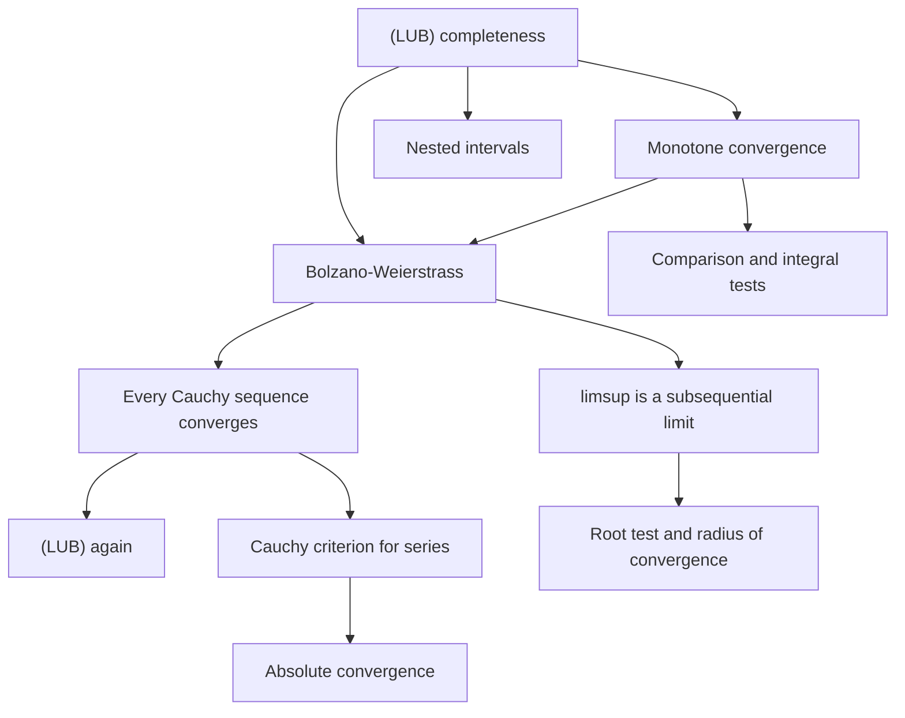

# Sequences and Series of Real Numbers

> [Mathematics](../../README.md) › [Real Analysis](../README.md) · Level: Advanced · Prerequisites: [The Real Numbers and Completeness](../01-real-numbers-and-completeness/README.md), [Limits](../../07-calculus/01-limits/README.md), [Sequences and Series](../../06-precalculus/05-sequences-and-series/README.md), [Mathematical Induction](../../09-discrete-mathematics/01-mathematical-induction/README.md), [Inequalities](../../03-algebra/03-inequalities/README.md) · Estimated time: 720 min

## 1. Introduction

A sequence is a list that never ends; a series is a sum that never ends. Both are defined by limits, and this chapter builds the theory of those limits from the completeness axiom proved in [The Real Numbers and Completeness](../01-real-numbers-and-completeness/README.md). Everything here is a theorem with hypotheses: "the limit exists" is never assumed, and "the terms get small" is never accepted as a proof of convergence.

Zeno's paradox is the oldest statement of the problem. To walk a distance of one metre you must first walk half, then a quarter, then an eighth; the infinitely many stages seem to require infinite time, yet the walk is completed. The resolution is that the *partial sums*
$$
\frac12,\quad \frac12 + \frac14 = \frac34,\quad \frac78,\quad \frac{15}{16},\ \dots
$$
approach $1$, and "the sum of the series is $1$" means nothing more than "the sequence of partial sums converges to $1$". That definition, and only that definition, is what makes the infinite sum meaningful.

The chapter has four movements.

1. **Sequences and $\varepsilon$-$N$.** The definition of $a_n \to L$ quantifies over all $\varepsilon > 0$, so every proof must produce an $N$ for a *given* $\varepsilon$, and every proof of divergence must exhibit an $\varepsilon$ that no $N$ can handle. The algebra of limits, the squeeze theorem and the order-comparison rules are proved from the definition and then used freely.
2. **The three great existence theorems.** The monotone convergence theorem, the Bolzano–Weierstrass theorem and Cauchy completeness are all consequences of (LUB), and each is equivalent to it in the presence of the Archimedean property. They are the reason a limit can be *proved to exist* without being computed.
3. **The measure of oscillation.** $\limsup$ and $\liminf$ record the eventual ceiling and floor of a sequence. They always exist (in the extended line), they detect convergence ($\limsup = \liminf$), and they turn statements about subsequences into inequalities.
4. **Series.** Convergence of $\sum a_n$ is convergence of the partial sums. Absolute convergence is stronger and better behaved; conditional convergence is where the surprises live — the alternating harmonic series converges, its positive and negative parts both diverge, and rearranging it can produce any sum you like (Riemann's theorem).

The distinction between the first two movements and the last is a distinction between *existence* and *computation*. Analysis can prove that a limit exists long before anyone can write it down in closed form; conversely, a numerical table of a million terms proves nothing. Learning to tell which of these two activities you are doing is most of the skill of the subject.

A warning that runs through the whole chapter: **a sequence can be bounded without converging** ($(-1)^n$), **can converge without being monotone** ($(-1)^n/n$), **can have terms tending to zero without its series converging** ($\sum 1/n$), and **can converge while $\sum\lvert a_n\rvert$ diverges** ($\sum (-1)^n/n$). Every one of these four phenomena is a counterexample to a plausible but false converse, and each is treated below.

## 2. Prerequisites

**Suprema, infima and completeness.** The least upper bound property is the engine of this chapter. You need the definition of $\sup S$ and $\inf S$, the approximation property (for every $\varepsilon > 0$ there is $s \in S$ with $s > \sup S - \varepsilon$), the Archimedean property, and the nested interval property. All are in [The Real Numbers and Completeness](../01-real-numbers-and-completeness/README.md).

**$\varepsilon$-$\delta$ thinking.** The passage from "for all $\varepsilon$ there is $\delta$" to "for all $\varepsilon$ there is $N$" is purely notational, but the *habit* of writing the quantifiers in the right order is not. See [Limits](../../07-calculus/01-limits/README.md).

**Absolute value and the triangle inequality.** $\lvert x + y\rvert \le \lvert x\rvert + \lvert y\rvert$, and its corollary $\lvert\lvert x\rvert - \lvert y\rvert\rvert \le \lvert x - y\rvert$, are used in almost every estimate. See [Inequalities](../../03-algebra/03-inequalities/README.md).

**Induction and recursion.** Sequences defined by $a_{n+1} = f(a_n)$ are analysed by induction; the estimate $2^n \ge n$ and Bernoulli's inequality $(1+x)^n \ge 1 + nx$ for $x \ge -1$ are proved this way. See [Mathematical Induction](../../09-discrete-mathematics/01-mathematical-induction/README.md).

**Geometric series.** For $\lvert q\rvert < 1$, $\sum_{k=0}^{n} q^k = (1 - q^{n+1})/(1-q)$ and the infinite sum is $1/(1-q)$. This is the model to which every convergence test compares. See [Sequences and Series](../../06-precalculus/05-sequences-and-series/README.md).

**The Riemann integral (for the integral test only).** The comparison $f(k+1) \le \int_k^{k+1} f \le f(k)$ for a nonincreasing $f$ uses the integral as an area, together with additivity and monotonicity. See [Integrals](../../07-calculus/06-integrals/README.md). Every other test in this chapter uses only the algebra of inequalities.

**Factorials and binomial coefficients.** $n! = 1\cdot 2 \cdots n$, $\binom{n}{k} = n!/(k!(n-k)!)$, and the binomial theorem. Used in the ratio and root tests and in the analysis of $(1 + 1/n)^n$.

## 3. Learning Objectives

By the end of this tutorial you will be able to

1. state the $\varepsilon$-$N$ definition of convergence and use it to prove limits and to prove non-convergence;
2. prove that limits are unique, that convergent sequences are bounded, and that a bounded sequence need not converge;
3. prove the sum, product and quotient rules for limits from the definition, including the eventual lower bound used in the quotient rule;
4. state and prove the squeeze theorem and the order-comparison theorem, and use them to evaluate limits without $\varepsilon$ estimates;
5. state and prove the monotone convergence theorem, and use it (with induction) to show that recursively defined sequences converge;
6. define subsequences, prove that convergence passes to subsequences, and prove the monotone subsequence lemma;
7. state and prove the Bolzano–Weierstrass theorem and use it to prove that a bounded sequence has a convergent subsequence with a prescribed property;
8. define Cauchy sequences, prove that convergent sequences are Cauchy, and prove that $\mathbb{R}$ is Cauchy complete; explain why $\mathbb{Q}$ is not;
9. prove that Cauchy completeness and the least upper bound property are equivalent in an Archimedean ordered field;
10. define $\limsup$ and $\liminf$, prove that $\limsup = \liminf$ characterises convergence, and compute both for oscillating sequences;
11. state and prove the Cauchy criterion for series, the comparison, ratio, root, integral and alternating series tests, and use each with its hypotheses checked;
12. prove that absolute convergence implies convergence, that $\sum 1/n$ diverges, that rearranging a conditionally convergent series can change its sum (Riemann's theorem), and compute the radius of convergence of a power series by the root test.

## 4. Intuition

**"Eventually" is the whole idea.** A limit statement says that the *tail* of the sequence is close to $L$; finitely many bad terms at the start are irrelevant. Every definition in this chapter is a precise version of "for all sufficiently large $n$". The phrase "eventually" (meaning: for all $n \ge$ some $N$) makes the logic manageable: it behaves like "for all but finitely many", so it is preserved by addition, multiplication, maximum, and division by nonzero constants, but *not* by operations that look at infinitely many indices.

**The tolerance game.** You are the analyst; an adversary chooses a tolerance $\varepsilon$. You must respond with an index $N$ such that every later term is within $\varepsilon$ of $L$. If you have a strategy that wins for every $\varepsilon$, the limit is $L$. Proving *divergence* means exhibiting one $\varepsilon$ against which the adversary can always defeat you.

**Subsequences are windows.** A subsequence looks at infinitely many terms but ignores the rest. If the whole sequence converges, every window shows the same limit. If you can find two windows showing different limits, the sequence diverges — this is the standard method for showing that $\sin n$ and $(-1)^n$ have no limit.

**Cauchy is convergence without a candidate.** To prove $a_n \to L$ you must know $L$ in advance. Cauchy's criterion says that a sequence converges iff its terms eventually huddle together: $\lvert a_n - a_m\rvert < \varepsilon$ for all $m, n \ge N$. This is checkable from the sequence alone, and it is the definition that generalises to metric spaces, where there is no "L" to guess.

**$\limsup$ is the eventual ceiling.** Take the supremum of the tail $\{a_n, a_{n+1}, \dots\}$ and let $n$ grow. The sequence of tail suprema decreases (or stays infinite), so it has a limit — the largest value that the sequence keeps returning to. $\liminf$ is the eventual floor. A sequence converges exactly when the ceiling and the floor meet.

**Series are towers of partial sums.** Everything about $\sum a_n$ is a statement about $S_N = a_1 + \cdots + a_N$. The terms $a_n$ are *differences* of the tower's heights: $a_n = S_n - S_{n-1}$. That is why $a_n \to 0$ is necessary but nowhere near sufficient — the tower can still grow without bound while each new brick is tiny.

**Tests are comparisons with a geometric series.** The ratio and root tests work by proving $\lvert a_n\rvert$ eventually beats $q^n$ for some $q < 1$; the comparison test uses a known convergent series directly; the integral test compares a sum with an area. Each has a distinct range of applicability, and the boundary case (limit $1$) is always inconclusive for a reason: the geometric series is exactly the borderline object.

## 5. Formal Definition

**Definition 5.1 (sequence).** A **sequence of real numbers** is a function $a : \mathbb{N} \to \mathbb{R}$; we write $a_n$ for $a(n)$ and $(a_n)_{n\ge1}$, or just $(a_n)$, for the sequence.

**Definition 5.2 (convergence).** A sequence $(a_n)$ **converges** to $L \in \mathbb{R}$ if
$$
\forall \varepsilon > 0\ \exists N \in \mathbb{N}\ \forall n \ge N :\quad \lvert a_n - L\rvert < \varepsilon .
$$
We write $a_n \to L$ or $\lim_{n\to\infty} a_n = L$. If no such $L$ exists, the sequence **diverges**.

**Definition 5.3 (boundedness, monotonicity).** The sequence $(a_n)$ is **bounded** if there is $M \ge 0$ with $\lvert a_n\rvert \le M$ for all $n$; **bounded above** if there is $U$ with $a_n \le U$ for all $n$; **bounded below** similarly. It is **nondecreasing** if $a_n \le a_{n+1}$ for all $n$, **nonincreasing** if $a_n \ge a_{n+1}$ for all $n$, and **monotone** if it is one of these. It is **strictly increasing** if $a_n < a_{n+1}$ for all $n$.

**Definition 5.4 (subsequence).** A **subsequence** of $(a_n)$ is a sequence $(a_{n_k})_{k \ge 1}$ where $n_1 < n_2 < n_3 < \cdots$ is a strictly increasing sequence of natural numbers.

**Definition 5.5 (Cauchy sequence).** A sequence $(a_n)$ is **Cauchy** if
$$
\forall \varepsilon > 0\ \exists N \in \mathbb{N}\ \forall m, n \ge N :\quad \lvert a_n - a_m\rvert < \varepsilon .
$$

**Definition 5.6 (limsup and liminf).** For a sequence $(a_n)$ put
$$
s_n := \sup\{a_k : k \ge n\} \in (-\infty, +\infty], \qquad i_n := \inf\{a_k : k \ge n\} \in [-\infty, +\infty).
$$
The sequence $(s_n)$ is nonincreasing and $(i_n)$ is nondecreasing (in the extended sense of Definition 7.55 of [The Real Numbers and Completeness](../01-real-numbers-and-completeness/README.md)), so their limits exist in $[-\infty, +\infty]$; define
$$
\limsup_{n\to\infty} a_n := \lim_{n\to\infty} s_n = \inf_{n \ge 1} s_n, \qquad
\liminf_{n\to\infty} a_n := \lim_{n\to\infty} i_n = \sup_{n \ge 1} i_n .
$$
For bounded sequences both are finite real numbers, and that is the only case used in this tutorial unless stated otherwise.

**Definition 5.7 (series).** Let $(a_n)$ be a sequence. The **partial sums** are
$$
S_N := \sum_{n=1}^{N} a_n, \qquad N \ge 1 .
$$
The **series** $\sum_{n=1}^{\infty} a_n$ **converges** if the sequence $(S_N)$ converges; its **sum** is then $\lim_{N\to\infty} S_N$, also written $\sum_{n=1}^{\infty} a_n$. If $(S_N)$ diverges, the series diverges.

**Definition 5.8 (absolute and conditional convergence).** The series $\sum a_n$ **converges absolutely** if $\sum \lvert a_n\rvert$ converges. It **converges conditionally** if $\sum a_n$ converges but $\sum \lvert a_n\rvert$ diverges.

**Definition 5.9 (rearrangement).** A **rearrangement** of $\sum a_n$ is a series $\sum b_n$ where $b_n = a_{\sigma(n)}$ for a bijection $\sigma : \mathbb{N} \to \mathbb{N}$.

## 6. Mathematical Notation

| Symbol | Read as | Meaning |
|---|---|---|
| $(a_n)_{n\ge1}$ | the sequence $a$ sub $n$ | a function $\mathbb{N} \to \mathbb{R}$ |
| $a_n \to L$ | $a_n$ tends to $L$ | convergence in the sense of Definition 5.2 |
| $\lim_{n\to\infty} a_n$ | limit as $n$ tends to infinity | the value $L$, if it exists |
| $\lvert a_n - L\rvert < \varepsilon$ | the distance is less than epsilon | the tolerance condition |
| $\forall \varepsilon > 0\ \exists N$ | for every epsilon there is an $N$ | order of quantifiers is essential |
| $n \ge N$ | $n$ from $N$ onwards | the tail of the sequence |
| $(a_{n_k})_{k\ge1}$ | subsequence | indices $n_1 < n_2 < \cdots$ |
| $\limsup a_n$, $\overline{\lim}\,a_n$ | limit superior | eventual ceiling |
| $\liminf a_n$, $\underline{\lim}\,a_n$ | limit inferior | eventual floor |
| $\sum_{n=1}^{\infty} a_n$ | the series | limit of partial sums |
| $S_N$ | $N$-th partial sum | $\sum_{n=1}^N a_n$ |
| $\sum \lvert a_n\rvert < \infty$ | absolutely convergent | the series of absolute values converges |
| $a_n \sim b_n$ | asymptotically equivalent | $a_n/b_n \to 1$ |
| $a_n = O(b_n)$ | big-O | $\lvert a_n\rvert \le C\lvert b_n\rvert$ eventually |
| $a_n = o(b_n)$ | little-o | $a_n/b_n \to 0$ |
| $\lvert q\rvert < 1$ | modulus of $q$ less than one | the geometric ratio condition |
| $\infty$ | infinity | a limit symbol, never a real number |
| $\varepsilon, N$ | epsilon, $N$ | tolerance and threshold |

**Reading the definition aloud.** "$a_n \to L$" reads: *for every $\varepsilon > 0$ there is $N$ such that for all $n \ge N$, the distance from $a_n$ to $L$ is less than $\varepsilon$*. The negation, used to prove divergence, is
$$
\exists \varepsilon > 0\ \forall N \in \mathbb{N}\ \exists n \ge N :\quad \lvert a_n - L\rvert \ge \varepsilon .
$$

## 7. Core Concepts

### 7.1 Sequences and the $\varepsilon$-$N$ definition

**Example 7.1 (the model proof).** $\dfrac1n \to 0$.

Let $\varepsilon > 0$. By the Archimedean property choose $N \in \mathbb{N}$ with $N > 1/\varepsilon$. For every $n \ge N$,
$$
\left\lvert \frac1n - 0\right\rvert = \frac1n \le \frac1N < \varepsilon .
$$
So the definition holds with this $N$.

Notice the three parts of every such proof: (i) an explicit $N$ depending on $\varepsilon$; (ii) the algebra estimating the distance; (iii) the statement that the estimate holds for *all* $n \ge N$.

**Example 7.2.** $\dfrac{2n+1}{n+3} \to 2$.

Given $\varepsilon > 0$ we must make $\left\lvert\frac{2n+1}{n+3} - 2\right\rvert$ small. Compute:
$$
\frac{2n+1}{n+3} - 2 = \frac{2n + 1 - 2n - 6}{n+3} = \frac{-5}{n+3}, \qquad\text{so}\qquad \left\lvert \frac{2n+1}{n+3} - 2\right\rvert = \frac{5}{n+3} \le \frac5n .
$$
Choose $N > 5/\varepsilon$; then $n \ge N$ gives $5/n \le 5/N < \varepsilon$. Hence the limit is $2$.

**Example 7.3 (divergence).** The sequence $a_n = (-1)^n$ diverges.

Suppose $a_n \to L$. Take $\varepsilon = 1$; there is $N$ with $\lvert (-1)^n - L\rvert < 1$ for all $n \ge N$. Taking an even $n \ge N$ gives $\lvert 1 - L\rvert < 1$, so $0 < L < 2$. Taking an odd $n \ge N$ gives $\lvert -1 - L\rvert < 1$, so $-2 < L < 0$. No real $L$ satisfies both. Hence the sequence diverges (by the negation displayed in Section 6).

**Theorem 7.4 (uniqueness of the limit).** A sequence has at most one limit.

**Proof.** Suppose $a_n \to L$ and $a_n \to M$ with $L \ne M$. Put $\varepsilon = \lvert L - M\rvert/2 > 0$. Choose $N_1$ with $\lvert a_n - L\rvert < \varepsilon$ for $n \ge N_1$ and $N_2$ with $\lvert a_n - M\rvert < \varepsilon$ for $n \ge N_2$. For $n \ge \max\{N_1, N_2\}$,
$$
\lvert L - M\rvert \le \lvert L - a_n\rvert + \lvert a_n - M\rvert < 2\varepsilon = \lvert L - M\rvert ,
$$
a contradiction. $\blacksquare$

**Theorem 7.5 (convergent implies bounded).** Every convergent sequence is bounded.

**Proof.** Let $a_n \to L$. With $\varepsilon = 1$ there is $N$ such that $\lvert a_n - L\rvert < 1$ for all $n \ge N$, hence $\lvert a_n\rvert \le \lvert L\rvert + 1$ for those $n$ (triangle inequality). Put
$$
M = \max\{\lvert a_1\rvert, \lvert a_2\rvert, \dots, \lvert a_{N-1}\rvert, \lvert L\rvert + 1\},
$$
a maximum of finitely many real numbers, so $M < \infty$. Then $\lvert a_n\rvert \le M$ for every $n$. $\blacksquare$

The converse is false: $a_n = (-1)^n$ is bounded and divergent (Example 7.3). Boundedness is a *necessary* condition, useful for proving divergence and for the product rule below.

**Lemma 7.6 (eventual sign).** If $a_n \to L$ with $L > 0$, then there is $N$ with $a_n > L/2 > 0$ for all $n \ge N$. Similarly, if $L < 0$ then $a_n < L/2 < 0$ eventually.

**Proof.** Take $\varepsilon = L/2 > 0$. For $n \ge N$, $\lvert a_n - L\rvert < L/2$, so $a_n > L - L/2 = L/2$. The negative case follows by applying the positive case to $-a_n \to -L > 0$. $\blacksquare$

### 7.2 The algebra of limits

**Theorem 7.7 (sums and scalar multiples).** If $a_n \to L$ and $b_n \to M$, then
$$
a_n + b_n \to L + M, \qquad a_n - b_n \to L - M, \qquad c\,a_n \to cL \ \text{ for every } c \in \mathbb{R}.
$$

**Proof.** Let $\varepsilon > 0$.

*Sum.* Choose $N_1$ with $\lvert a_n - L\rvert < \varepsilon/2$ for $n \ge N_1$ and $N_2$ with $\lvert b_n - M\rvert < \varepsilon/2$ for $n \ge N_2$. For $n \ge N = \max\{N_1,N_2\}$,
$$
\lvert (a_n + b_n) - (L+M)\rvert \le \lvert a_n - L\rvert + \lvert b_n - M\rvert < \frac\varepsilon2 + \frac\varepsilon2 = \varepsilon .
$$
*Difference.* Apply the sum rule to $a_n$ and $-b_n$, using the scalar rule below with $c = -1$.

*Scalar.* If $c = 0$ the sequence is constantly $0$. Otherwise choose $N$ with $\lvert a_n - L\rvert < \varepsilon/\lvert c\rvert$ for $n \ge N$; then $\lvert c a_n - cL\rvert = \lvert c\rvert\,\lvert a_n - L\rvert < \varepsilon$. $\blacksquare$

**Theorem 7.8 (product).** If $a_n \to L$ and $b_n \to M$, then $a_n b_n \to LM$.

**Proof.** The trick is to add and subtract the cross term:
$$
a_nb_n - LM = (a_n - L)(b_n - M) + L(b_n - M) + M(a_n - L).
$$
Let $\varepsilon > 0$. By Theorem 7.5 both sequences are bounded, so
$$
A := \max\left\{1,\ \lvert L\rvert,\ \sup_{n\ge1}\lvert a_n\rvert\right\} < \infty, \qquad
B := \max\left\{1,\ \lvert M\rvert,\ \sup_{n\ge1}\lvert b_n\rvert\right\} < \infty ,
$$
and $\lvert L\rvert \le A$, $\lvert a_n\rvert \le A$, $\lvert M\rvert \le B$, $\lvert b_n\rvert \le B$ for every $n$.

Choose $N$ so large that for all $n \ge N$,
$$
\lvert a_n - L\rvert < \min\left\{\frac{\varepsilon}{3B},\ \sqrt{\frac{\varepsilon}{3}}\right\},
\qquad
\lvert b_n - M\rvert < \min\left\{\frac{\varepsilon}{3A},\ \sqrt{\frac{\varepsilon}{3}}\right\}.
$$
Then for $n \ge N$, the triangle inequality applied to the decomposition above gives
$$
\lvert a_nb_n - LM\rvert \le \underbrace{\lvert a_n - L\rvert\,\lvert b_n - M\rvert}_{<\,\varepsilon/3}
+ \underbrace{\lvert L\rvert\,\lvert b_n - M\rvert}_{\le\, A\cdot\frac{\varepsilon}{3A}}
+ \underbrace{\lvert M\rvert\,\lvert a_n - L\rvert}_{\le\, B\cdot\frac{\varepsilon}{3B}} < \varepsilon . \qquad \blacksquare
$$

**Theorem 7.9 (quotient).** If $a_n \to L$, $b_n \to M$ with $M \ne 0$ and $b_n \ne 0$ for all $n$, then $a_n/b_n \to L/M$.

**Proof.** By Lemma 7.6 applied to the sequence $\lvert b_n\rvert$, which converges to $\lvert M\rvert > 0$ by Theorem 7.12 below, there is $N_0$ with
$$
\lvert b_n\rvert > \frac{\lvert M\rvert}{2} \quad \text{for } n \ge N_0 .
$$
For such $n$,
$$
\left\lvert \frac{1}{b_n} - \frac{1}{M}\right\rvert = \frac{\lvert M - b_n\rvert}{\lvert b_n\rvert\,\lvert M\rvert} \le \frac{2}{\lvert M\rvert^2}\,\lvert b_n - M\rvert .
$$
Given $\varepsilon > 0$, choose $N \ge N_0$ with $\lvert b_n - M\rvert < \varepsilon\lvert M\rvert^2/2$ for $n \ge N$; then $\lvert 1/b_n - 1/M\rvert < \varepsilon$. So $1/b_n \to 1/M$, and the product rule (Theorem 7.8) applied to $a_n$ and $1/b_n$ gives $a_n/b_n \to L/M$. $\blacksquare$

**Theorem 7.10 (squeeze).** Suppose $a_n \le c_n \le b_n$ for all $n \ge N_0$, and $a_n \to L$, $b_n \to L$. Then $c_n \to L$.

**Proof.** Let $\varepsilon > 0$. Choose $N \ge N_0$ with $\lvert a_n - L\rvert < \varepsilon$ and $\lvert b_n - L\rvert < \varepsilon$ for $n \ge N$. Then for $n \ge N$,
$$
L - \varepsilon < a_n \le c_n \le b_n < L + \varepsilon ,
$$
so $\lvert c_n - L\rvert < \varepsilon$. $\blacksquare$

**Theorem 7.11 (order is preserved in the limit).** Suppose $a_n \le b_n$ eventually (for all $n \ge N_0$), $a_n \to L$ and $b_n \to M$. Then $L \le M$.

**Proof.** Suppose $L > M$ and put $\varepsilon = (L - M)/2 > 0$. Choose $N \ge N_0$ with $\lvert a_n - L\rvert < \varepsilon$ and $\lvert b_n - M\rvert < \varepsilon$. Then
$$
a_n > L - \varepsilon = \frac{L+M}{2} = M + \varepsilon > b_n ,
$$
contradicting $a_n \le b_n$. Hence $L \le M$. $\blacksquare$

Note that strict inequality is *not* preserved: $0 < 1/n$ for all $n$, but the limit is $0$.

**Theorem 7.12 (absolute values and powers).** If $a_n \to L$ then $\lvert a_n\rvert \to \lvert L\rvert$. If moreover $k \in \mathbb{N}$ is fixed, then $a_n^k \to L^k$. If $a_n \ge 0$ for all $n$ and $a_n \to L$, then $\sqrt{a_n} \to \sqrt{L}$.

**Proof.** $\lvert\lvert a_n\rvert - \lvert L\rvert\rvert \le \lvert a_n - L\rvert$ by the reverse triangle inequality, which gives the first claim. The second follows from the product rule by induction on $k$. For the third: since $a_n \ge 0$ and $a_n \to L$, Theorem 7.11 gives $L \ge 0$. If $L = 0$, given $\varepsilon > 0$ choose $N$ with $a_n < \varepsilon^2$; then $\sqrt{a_n} < \varepsilon$. If $L > 0$, then
$$
\lvert\sqrt{a_n} - \sqrt L\rvert = \frac{\lvert a_n - L\rvert}{\sqrt{a_n} + \sqrt L} \le \frac{\lvert a_n - L\rvert}{\sqrt L},
$$
so $\sqrt{a_n} \to \sqrt L$. $\blacksquare$

### 7.3 The monotone convergence theorem

**Theorem 7.13 (monotone convergence).** Let $(a_n)$ be nondecreasing and bounded above. Then $(a_n)$ converges, and
$$
\lim_{n\to\infty} a_n = \sup\{a_n : n \ge 1\}.
$$

**Proof.** Let $S = \{a_n : n \ge 1\}$, which is nonempty (it contains $a_1$) and bounded above. By (LUB), $L = \sup S$ exists. Let $\varepsilon > 0$. By the approximation property (Lemma 7.11 of [The Real Numbers and Completeness](../01-real-numbers-and-completeness/README.md)) there is $N$ with $a_N > L - \varepsilon$. Since $(a_n)$ is nondecreasing, for every $n \ge N$,
$$
L - \varepsilon < a_N \le a_n \le L ,
$$
where the last inequality holds because $L$ is an upper bound of $S$. Hence $\lvert a_n - L\rvert < \varepsilon$ for $n \ge N$. $\blacksquare$

**Theorem 7.14 (the nonincreasing version).** Let $(a_n)$ be nonincreasing and bounded below. Then $(a_n)$ converges, and $\lim a_n = \inf\{a_n : n \ge 1\}$.

**Proof.** The sequence $(-a_n)$ is nondecreasing and bounded above, so by Theorem 7.13 it converges to $\sup\{-a_n\} = -\inf\{a_n\}$. By the scalar rule (Theorem 7.7), $a_n = -(-a_n) \to -\bigl(-\inf\{a_n\}\bigr) = \inf\{a_n\}$. $\blacksquare$

Theorem 7.13 is the most-used existence theorem in analysis: it turns "bounded and monotone" into "convergent" without any computation.

**Example 7.15 (Newton's iteration for $\sqrt2$).** Define $a_1 = 2$ and
$$
a_{n+1} = \frac12\left(a_n + \frac{2}{a_n}\right).
$$
Then $(a_n)$ converges to $\sqrt 2$.

**Proof.** *Positivity.* By induction $a_n > 0$ for all $n$.

*Lower bound.* By the arithmetic–geometric mean inequality — for $x, y > 0$, $\frac{x+y}{2} \ge \sqrt{xy}$, because $(\sqrt x - \sqrt y)^2 \ge 0$ — applied to $x = a_n$ and $y = 2/a_n$,
$$
a_{n+1} = \frac{a_n + 2/a_n}{2} \ge \sqrt{a_n \cdot \frac{2}{a_n}} = \sqrt 2 \qquad (n \ge 1).
$$
So $a_n \ge \sqrt2$ for all $n \ge 2$.

*Decrease.* For $a_n \ge \sqrt2$,
$$
a_{n+1} \le a_n \iff \frac{a_n + 2/a_n}{2} \le a_n \iff \frac{2}{a_n} \le a_n \iff a_n^2 \ge 2 ,
$$
which holds. Hence $(a_n)_{n \ge 2}$ is nonincreasing and bounded below by $\sqrt 2$.

By Theorem 7.14 the sequence converges; let $L = \lim a_n$. Then $L \ge \sqrt2 > 0$, and the recursion gives, using the algebra of limits,
$$
L = \frac12\left(L + \frac{2}{L}\right) \implies 2L = L + \frac2L \implies L^2 = 2 \implies L = \sqrt 2 . \qquad \blacksquare
$$
The last step uses $L > 0$, so that $L^2 = 2$ has the unique positive solution $\sqrt2$ (Theorem 7.24 of [The Real Numbers and Completeness](../01-real-numbers-and-completeness/README.md)).

**Example 7.16 (the number $e$).** The sequence $e_n = \left(1 + \frac1n\right)^n$ converges.

**Proof.** *Bounded above.* By the binomial theorem and $\binom nk / n^k \le 1/k!$,
$$
e_n = \sum_{k=0}^{n}\binom nk \frac{1}{n^k} \le \sum_{k=0}^{n}\frac{1}{k!}
\le 1 + 1 + \frac12 + \frac14 + \cdots + \frac{1}{2^{n-1}} < 3 ,
$$
where $k! \ge 2^{k-1}$ for $k \ge 1$ was used.

*Increasing.* Apply the AM–GM inequality to the $n+1$ positive numbers consisting of $n$ copies of $\left(1 + \frac1n\right)$ and one copy of $1$:
$$
\left[\left(1+\frac1n\right)^n \cdot 1\right]^{1/(n+1)}
\le \frac{n\left(1+\frac1n\right) + 1}{n+1} = \frac{n+2}{n+1} = 1 + \frac{1}{n+1}.
$$
Raising to the power $n+1$ gives $e_n \le \left(1 + \frac{1}{n+1}\right)^{n+1} = e_{n+1}$.

By Theorem 7.13 the sequence converges; its limit is denoted $e$. $\blacksquare$

### 7.4 Subsequences

**Lemma 7.17.** If $n_1 < n_2 < \cdots$ are natural numbers, then $n_k \ge k$ for every $k$.

**Proof.** Induction on $k$. For $k = 1$, $n_1 \ge 1$. If $n_k \ge k$ then $n_{k+1} > n_k \ge k$, so $n_{k+1} \ge k+1$ (integers). $\blacksquare$

**Theorem 7.18 (limits pass to subsequences).** If $a_n \to L$, then every subsequence $(a_{n_k})$ also converges to $L$.

**Proof.** Let $\varepsilon > 0$ and choose $N$ with $\lvert a_n - L\rvert < \varepsilon$ for $n \ge N$. By Lemma 7.17, for $k \ge N$ we have $n_k \ge k \ge N$, hence $\lvert a_{n_k} - L\rvert < \varepsilon$. $\blacksquare$

So a sequence with two subsequences having different limits diverges. This is how oscillation is detected in practice.

**Theorem 7.19 (a converse).** Let $(a_n)$ be a sequence and $L \in \mathbb{R}$. Suppose that *every* subsequence of $(a_n)$ has a further subsequence converging to $L$. Then $a_n \to L$.

**Proof.** Suppose $a_n \not\to L$. By the negation in Section 6 there is $\varepsilon > 0$ such that for every $N$ some $n \ge N$ has $\lvert a_n - L\rvert \ge \varepsilon$. Choose such indices recursively:
$$
n_1 \ge 1 \text{ with } \lvert a_{n_1} - L\rvert \ge \varepsilon, \qquad
n_{k+1} > n_k \text{ with } \lvert a_{n_{k+1}} - L\rvert \ge \varepsilon .
$$
Then $(a_{n_k})$ is a subsequence all of whose terms satisfy $\lvert a_{n_k} - L\rvert \ge \varepsilon$. Every subsequence of *this* subsequence also has all terms at distance $\ge \varepsilon$ from $L$, so none converges to $L$ — contradicting the hypothesis. Hence $a_n \to L$. $\blacksquare$

**Lemma 7.20 (monotone subsequence lemma).** Every sequence of real numbers has a monotone subsequence.

**Proof.** Call an index $n$ a **peak** if $a_n \ge a_m$ for every $m > n$, i.e. $a_n$ is at least as large as all later terms.

*Case 1: infinitely many peaks.* List them as $n_1 < n_2 < \cdots$. Since $n_1$ is a peak and $n_2 > n_1$, $a_{n_1} \ge a_{n_2}$; since $n_2$ is a peak and $n_3 > n_2$, $a_{n_2} \ge a_{n_3}$; and so on. So $(a_{n_k})$ is nonincreasing.

*Case 2: finitely many peaks.* Choose $n_1$ larger than every peak. Then $n_1$ is not a peak, so there is $n_2 > n_1$ with $a_{n_2} > a_{n_1}$. Since $n_2 > n_1$ is also not a peak, there is $n_3 > n_2$ with $a_{n_3} > a_{n_2}$; continuing gives a strictly increasing subsequence.

Either way a monotone subsequence exists. $\blacksquare$

### 7.5 The Bolzano–Weierstrass theorem

**Theorem 7.21 (Bolzano–Weierstrass).** Every bounded sequence in $\mathbb{R}$ has a convergent subsequence.

**Proof.** Let $(a_n)$ be bounded. By Lemma 7.20 it has a monotone subsequence $(a_{n_k})$, which is also bounded (being a subsequence of a bounded sequence). If it is nondecreasing it converges by Theorem 7.13, if nonincreasing by Theorem 7.14. $\blacksquare$

**Corollary 7.22 (limsup and liminf are subsequential limits).** Let $(a_n)$ be bounded and let $s = \limsup a_n$, $i = \liminf a_n$. Then there are subsequences with $a_{n_k} \to s$ and $a_{m_k} \to i$. Moreover $i \le s$, and $a_n \to L$ if and only if $i = s = L$.

**Proof.** Write $s_n = \sup\{a_k : k \ge n\}$; we know $s_n \downarrow s$ and $s_n \ge s$ for all $n$.

*Construction.* Let $k \ge 1$. Since $s_n \to s$, choose $N_k$ with $s_n < s + 1/k$ for $n \ge N_k$. Choose $n_k \ge \max\{N_k, m_{k-1}+1\}$ (with $m_0 = 0$), and then, since $s_{n_k} = \sup\{a_m : m \ge n_k\} \ge s > s - 1/k$, choose $m_k \ge n_k$ with $a_{m_k} > s - 1/k$ (approximation property). Also $a_{m_k} \le s_{m_k} \le s_{n_k} < s + 1/k$ because $m_k \ge n_k$ and the tail suprema decrease. Hence $\lvert a_{m_k} - s\rvert < 1/k$, so $a_{m_k} \to s$. The argument for $i$ is the mirror image (or apply the result to $-a_n$).

*Comparison.* For every $n$, $i_n \le s_n$ because the infimum of a set is at most its supremum; passing to the limit and using Theorem 7.11 gives $i \le s$.

*Convergence criterion.* If $a_n \to L$, then given $\varepsilon > 0$ the tail lies in $(L - \varepsilon, L + \varepsilon)$, so $L - \varepsilon \le i_n \le s_n \le L + \varepsilon$ for large $n$, hence $L - \varepsilon \le i \le s \le L + \varepsilon$; as $\varepsilon$ is arbitrary, $i = s = L$. Conversely, if $i = s = L$, then for $\varepsilon > 0$ there is $N$ with $s_N < L + \varepsilon$ and $i_N > L - \varepsilon$; for $n \ge N$,
$$
L - \varepsilon < i_N \le a_n \le s_N < L + \varepsilon ,
$$
so $\lvert a_n - L\rvert < \varepsilon$ and $a_n \to L$. $\blacksquare$

**Corollary 7.23 (bounded sequences with one subsequential limit converge).** If $(a_n)$ is bounded and every convergent subsequence of $(a_n)$ has the same limit $L$, then $a_n \to L$.

**Proof.** By Corollary 7.22 a subsequence converges to $\limsup a_n$, so $\limsup a_n = L$; similarly $\liminf a_n = L$. By the criterion in Corollary 7.22, $a_n \to L$. $\blacksquare$

### 7.6 Cauchy sequences and Cauchy completeness

**Theorem 7.24 (convergent implies Cauchy).** If $a_n \to L$ then $(a_n)$ is Cauchy.

**Proof.** Let $\varepsilon > 0$ and choose $N$ with $\lvert a_n - L\rvert < \varepsilon/2$ for $n \ge N$. For $m, n \ge N$,
$$
\lvert a_n - a_m\rvert \le \lvert a_n - L\rvert + \lvert L - a_m\rvert < \frac\varepsilon2 + \frac\varepsilon2 = \varepsilon . \qquad \blacksquare
$$

**Theorem 7.25 (Cauchy implies bounded).** Every Cauchy sequence is bounded.

**Proof.** Take $\varepsilon = 1$ and let $N$ be as in Definition 5.5. For $n \ge N$,
$$
\lvert a_n\rvert \le \lvert a_n - a_N\rvert + \lvert a_N\rvert < 1 + \lvert a_N\rvert .
$$
Hence $\lvert a_n\rvert \le \max\{\lvert a_1\rvert, \dots, \lvert a_{N-1}\rvert, 1 + \lvert a_N\rvert\}$ for all $n$. $\blacksquare$

**Theorem 7.26 (Cauchy with a convergent subsequence converges).** If $(a_n)$ is Cauchy and some subsequence satisfies $a_{n_k} \to L$, then $a_n \to L$.

**Proof.** Let $\varepsilon > 0$. Choose $N_1$ with $\lvert a_n - a_m\rvert < \varepsilon/2$ for $m, n \ge N_1$, and $K$ with $\lvert a_{n_k} - L\rvert < \varepsilon/2$ for $k \ge K$. Choose $k \ge K$ with $n_k \ge N_1$ (possible since $n_k \ge k$). For every $n \ge N_1$,
$$
\lvert a_n - L\rvert \le \lvert a_n - a_{n_k}\rvert + \lvert a_{n_k} - L\rvert < \frac\varepsilon2 + \frac\varepsilon2 = \varepsilon . \qquad \blacksquare
$$

**Theorem 7.27 (Cauchy completeness of $\mathbb{R}$).** Every Cauchy sequence of real numbers converges.

**Proof.** Let $(a_n)$ be Cauchy. By Theorem 7.25 it is bounded, so by Bolzano–Weierstrass (Theorem 7.21) it has a convergent subsequence. By Theorem 7.26 the whole sequence converges to that limit. $\blacksquare$

**Theorem 7.28 (Cauchy completeness implies the least upper bound property).** Let $F$ be an Archimedean ordered field in which every Cauchy sequence converges. Then every nonempty $S \subseteq F$ that is bounded above has a least upper bound in $F$.

**Proof.** Let $\varnothing \ne S \subseteq F$ be bounded above, choose $a_0 \in S$ and an upper bound $b_0$, and bisect as in Theorem 7.30 of [The Real Numbers and Completeness](../01-real-numbers-and-completeness/README.md): given $a_n \in S$ and an upper bound $b_n$, put $m_n = (a_n + b_n)/2$ and set
$$
(a_{n+1}, b_{n+1}) =
\begin{cases}
(a_n,\, m_n), & m_n \text{ an upper bound of } S,\\
(s,\, b_n) \text{ with } s \in S,\ s > m_n, & \text{otherwise.}
\end{cases}
$$
Then $b_n - a_n \le (b_0 - a_0)/2^n$, and for $m > n$,
$$
\lvert a_m - a_n\rvert \le b_n - a_n \le \frac{b_0 - a_0}{2^n},
$$
so $(a_n)$ is Cauchy (given $\varepsilon > 0$, use the Archimedean property and $2^n \ge n$ to find $n$ with $(b_0-a_0)/n < \varepsilon$). By hypothesis $a_n \to \alpha$ for some $\alpha \in F$; also $b_n - a_n \to 0$, so $b_n \to \alpha$.

*$\alpha$ is an upper bound of $S$:* if $s \in S$ with $s > \alpha$, choose $n$ with $b_n - a_n < s - \alpha$; then $b_n = a_n + (b_n - a_n) < \alpha + (s - \alpha) = s$, contradicting that $b_n$ is an upper bound.

*$\alpha$ is least:* if $u$ is an upper bound of $S$ then $a_n \le u$ for all $n$, so $\alpha = \lim a_n \le u$ (Theorem 7.11).

Hence $\alpha = \sup S$. $\blacksquare$

**Remark 7.29 ($\mathbb{Q}$ is not Cauchy complete).** Let $q_n$ be the truncation of $\sqrt2$ to $n$ decimal places,
$$
q_1 = 1.4,\quad q_2 = 1.41,\quad q_3 = 1.414,\quad \dots
$$
Then $\lvert q_n - q_m\rvert \le 10^{-\min\{m,n\}}$, so $(q_n)$ is Cauchy in $\mathbb{Q}$ (the estimate uses only rational arithmetic). If it converged to $q \in \mathbb{Q}$, then by the product rule $q_n^2 \to q^2$; on the other hand $0 \le 2 - q_n^2 < 3\cdot 10^{-n}$ (because $0 \le \sqrt2 - q_n < 10^{-n}$ and $\sqrt 2 + q_n < 3$), so $q_n^2 \to 2$. Uniqueness of limits (Theorem 7.4) forces $q^2 = 2$, which is impossible for rational $q$ by Theorem 7.4 of [The Real Numbers and Completeness](../01-real-numbers-and-completeness/README.md). So Cauchy sequences need not converge in $\mathbb{Q}$; Theorem 7.27 is a theorem about $\mathbb{R}$.

### 7.7 Limsup and liminf

Recall Definition 5.6: $s_n = \sup\{a_k : k \ge n\}$ decreases to $\limsup a_n$, and $i_n = \inf\{a_k : k \ge n\}$ increases to $\liminf a_n$. For bounded sequences all these numbers are finite.

**Theorem 7.30 (properties of limsup and liminf).** Let $(a_n)$ and $(b_n)$ be bounded sequences and $c \in \mathbb{R}$.

1. $\liminf a_n \le \limsup a_n$.
2. $\limsup(-a_n) = -\liminf a_n$ and $\liminf(-a_n) = -\limsup a_n$.
3. $\limsup(a_n + b_n) \le \limsup a_n + \limsup b_n$, and $\liminf(a_n + b_n) \ge \liminf a_n + \liminf b_n$.
4. If $c \ge 0$ then $\limsup(ca_n) = c\,\limsup a_n$; if $c < 0$ then $\limsup(ca_n) = c\,\liminf a_n$.
5. If $a_n \le b_n$ eventually, then $\limsup a_n \le \limsup b_n$ and $\liminf a_n \le \liminf b_n$.
6. $\limsup a_n$ is the largest subsequential limit of $(a_n)$ and $\liminf a_n$ the smallest.

**Proof.** Write $s_n = \sup_{k\ge n}a_k$, $i_n = \inf_{k\ge n}a_k$, $S_n = \sup_{k\ge n}b_k$, $I_n = \inf_{k\ge n}b_k$; recall $s_n \downarrow \limsup a_n$, $i_n \uparrow \liminf a_n$.

1. $i_n \le s_n$ for every $n$ because an infimum is at most a supremum. Pass to the limit (Theorem 7.11).

2. For any nonempty set $T$, $\sup(-T) = -\inf T$ (property 1 of Section 8 in [The Real Numbers and Completeness](../01-real-numbers-and-completeness/README.md)). Apply this to the tail $T = \{a_k : k \ge n\}$: $-s_n = -\!\sup T = \inf(-T) = \inf\{-a_k : k \ge n\}$, which is the $n$-th tail infimum of $(-a_n)$. Its limit is $\liminf(-a_n)$, so $-\limsup a_n = \liminf(-a_n)$; replacing $a_n$ by $-a_n$ gives the other identity.

3. For $k \ge n$, $a_k + b_k \le s_n + S_n$, so $\sup_{k \ge n}(a_k + b_k) \le s_n + S_n$. Taking $n \to \infty$ and using the sum rule,
$$
\limsup(a_n+b_n) = \lim_n \sup_{k\ge n}(a_k+b_k) \le \lim_n (s_n + S_n) = \limsup a_n + \limsup b_n .
$$
The $\liminf$ statement follows by applying this to $-a_n$, $-b_n$ and part 2.

4. For $c \ge 0$ and $k \ge n$, $c a_k \le c s_n$, and every $c s_n$ is an upper bound; moreover the least upper bound is attained: $\sup_{k \ge n} c a_k = c \sup_{k\ge n} a_k = c s_n$ (property 4 of Section 8 there). Taking limits gives $\limsup(ca_n) = c \limsup a_n$. For $c < 0$, write $c = -d$ with $d > 0$; then $ca_n = -da_n$ and by parts 2 and 4, $\limsup(ca_n) = -\liminf(da_n) = -d\liminf a_n = c\liminf a_n$.

5. If $a_k \le b_k$ for all $k \ge n_0$ and $n \ge n_0$, then $s_n \le S_n$; pass to the limit.

6. Corollary 7.22 shows that $\limsup a_n$ is attained as the limit of a subsequence. If $a_{n_k} \to L$ is any convergent subsequence, then $a_{n_k} \le s_{n_k}$ and $s_{n_k} \to \limsup a_n$ as $k \to \infty$ (a subsequence of a convergent sequence), so $L \le \limsup a_n$ by Theorem 7.11. The statement for $\liminf$ follows by applying this to $-a_n$. $\blacksquare$

**Example 7.31.** Let $a_n = (-1)^n\left(1 + \frac1n\right)$. Compute the tail suprema: for even $n$ the term $+\left(1+1/n\right)$ is positive and decreasing, and for odd $n$ the term $-\left(1+1/n\right)$ is negative. Thus
$$
s_n = \max\left\{1 + \frac{1}{n'} : n' \ge n,\ n' \text{ even}\right\} = \begin{cases} 1 + \frac1n, & n \text{ even},\\[2pt] 1 + \frac{1}{n+1}, & n \text{ odd},\end{cases}
$$
and in both cases $s_n \to 1$, so $\limsup a_n = 1$. Similarly $i_n \to -1$, so $\liminf a_n = -1$. Since these differ, the sequence diverges (Corollary 7.22), in agreement with the two subsequences $a_{2k} \to 1$ and $a_{2k-1} \to -1$.

### 7.8 Series: the Cauchy criterion and absolute convergence

**Example 7.32 (geometric series).** For $q \in \mathbb{R}$ with $\lvert q\rvert < 1$,
$$
\sum_{n=0}^{\infty} q^n = \frac{1}{1-q};
$$
for $\lvert q\rvert \ge 1$ the series diverges.

**Proof.** The identity $(1-q)(1 + q + \cdots + q^N) = 1 - q^{N+1}$ gives the partial sums
$$
S_N = \frac{1 - q^{N+1}}{1-q} \quad (q \ne 1).
$$
If $\lvert q\rvert < 1$ then $q^{N+1} \to 0$: writing $\lvert q\rvert = 1/(1+h)$ with $h > 0$, Bernoulli's inequality gives $(1+h)^n \ge 1 + nh \to \infty$, so $\lvert q\rvert^n \le 1/(1+nh) \to 0$. Hence $S_N \to 1/(1-q)$. If $\lvert q\rvert \ge 1$ then $\lvert q^n\rvert \ge 1$, so the terms do not tend to $0$ and the series diverges by the term test (Corollary 7.34 below). $\blacksquare$

**Theorem 7.33 (Cauchy criterion for series).** The series $\sum a_n$ converges if and only if
$$
\forall \varepsilon > 0\ \exists N\ \forall m > n \ge N:\quad \left\lvert \sum_{k=n+1}^{m} a_k\right\rvert < \varepsilon .
$$

**Proof.** For $m > n$, $S_m - S_n = \sum_{k=n+1}^m a_k$. So the displayed condition says exactly that the sequence of partial sums $(S_N)$ is Cauchy. By Theorem 7.27 a Cauchy sequence of reals converges, and by Theorem 7.24 every convergent sequence is Cauchy. $\blacksquare$

**Corollary 7.34 (term test).** If $\sum a_n$ converges, then $a_n \to 0$.

**Proof.** With the notation above, $a_n = S_n - S_{n-1}$ for $n \ge 2$, and $S_n \to L$, $S_{n-1} \to L$, so $a_n \to L - L = 0$ by Theorem 7.7. $\blacksquare$

The converse fails dramatically: $\sum 1/n$ diverges although $1/n \to 0$ (Theorem 7.39).

**Theorem 7.35 (absolute convergence implies convergence).** If $\sum \lvert a_n\rvert$ converges, then $\sum a_n$ converges, and
$$
\left\lvert \sum_{n=1}^{\infty} a_n\right\rvert \le \sum_{n=1}^{\infty}\lvert a_n\rvert .
$$

**Proof.** Let $\varepsilon > 0$. Applying the Cauchy criterion (Theorem 7.33) to the convergent series $\sum\lvert a_n\rvert$ gives $N$ such that $\sum_{k=n+1}^{m}\lvert a_k\rvert < \varepsilon$ for $m > n \ge N$. By the triangle inequality,
$$
\left\lvert \sum_{k=n+1}^{m} a_k\right\rvert \le \sum_{k=n+1}^{m}\lvert a_k\rvert < \varepsilon ,
$$
so $\sum a_n$ satisfies the Cauchy criterion and converges. The inequality follows from $\lvert S_N\rvert \le \sum_{n\le N}\lvert a_n\rvert$ and Theorem 7.11 applied to the convergent sequence of partial sums. $\blacksquare$

**Theorem 7.36 (comparison test).** Suppose $0 \le a_n \le b_n$ for all $n \ge N_0$.
(a) If $\sum b_n$ converges, then $\sum a_n$ converges and $\sum a_n \le \sum b_n$.
(b) If $\sum a_n$ diverges, then $\sum b_n$ diverges.

**Proof.** The partial sums $A_N = \sum_{n\le N} a_n$ are nondecreasing (the terms are $\ge 0$) and bounded above by $\sum_{n=1}^{\infty} b_n$ (for $N \ge N_0$, the comparison is termwise). By the monotone convergence theorem (Theorem 7.13) $(A_N)$ converges. The bound on the sum follows from Theorem 7.11. Part (b) is the contrapositive of (a). $\blacksquare$

**Theorem 7.37 (limit comparison test).** Let $a_n, b_n > 0$ and suppose $a_n/b_n \to c$ with $0 < c < \infty$. Then $\sum a_n$ converges if and only if $\sum b_n$ converges.

**Proof.** Choose $N$ with $c/2 < a_n/b_n < 2c$ for $n \ge N$. Then
$$
\frac{c}{2}\,b_n < a_n < 2c\,b_n \quad (n \ge N).
$$
If $\sum b_n$ converges, comparison with $2c\sum b_n$ gives convergence of $\sum a_n$; if $\sum a_n$ converges, comparison with $(c/2)\sum b_n$ gives convergence of $\sum b_n$. $\blacksquare$

**Theorem 7.38 (harmonic series).** $\displaystyle\sum_{n=1}^{\infty} \frac1n$ diverges.

**Proof.** The partial sums are nondecreasing, so by Theorem 7.13 it suffices to show they are unbounded. Group the terms into blocks whose lengths double:
$$
S_{2^N} = 1 + \frac12 + \left(\frac13 + \frac14\right) + \left(\frac15 + \cdots + \frac18\right) + \cdots + \left(\frac{1}{2^{N-1}+1} + \cdots + \frac{1}{2^N}\right).
$$
The block from $2^{k-1}+1$ to $2^k$ contains $2^{k-1}$ terms, each at least $1/2^k$, so its sum is at least $1/2$. Hence
$$
S_{2^N} \ge 1 + \frac{N}{2},
$$
which is unbounded. $\blacksquare$

*Second proof (integral test, Theorem 7.41).* For $f(x) = 1/x$ we have $\int_1^N f = \ln N \to \infty$, and the integral test shows that a divergence of the integrals forces divergence of the series. The grouping proof is included first because it uses nothing but arithmetic.

### 7.9 The convergence tests

**Theorem 7.39 (ratio test).** Let $(a_n)$ satisfy $a_n \ne 0$ for all $n \ge N_0$.
(a) If there are $N \ge N_0$ and $q$ with $0 < q < 1$ such that $\lvert a_{n+1}/a_n\rvert \le q$ for all $n \ge N$, then $\sum a_n$ converges absolutely.
(b) If $\lvert a_{n+1}/a_n\rvert \ge 1$ for all $n \ge N_0$, then $\sum a_n$ diverges.
In particular, if $L = \lim_n \lvert a_{n+1}/a_n\rvert$ exists, then the series converges absolutely when $L < 1$ and diverges when $L > 1$.

**Proof.** (a) By induction, $\lvert a_n\rvert \le \lvert a_N\rvert\, q^{n-N}$ for $n \ge N$: the case $n = N$ is equality, and the step multiplies the bound by $\lvert a_{n+1}/a_n\rvert \le q$. Since $\sum q^{n-N}$ converges (Example 7.32), the comparison test (Theorem 7.36) gives convergence of $\sum\lvert a_n\rvert$.

(b) Then $\lvert a_n\rvert \ge \lvert a_{N_0}\rvert > 0$ for all $n \ge N_0$, so $a_n \not\to 0$ and the series diverges by Corollary 7.34.

The limit form follows by taking $q$ with $L < q < 1$ (then the ratio is eventually $\le q$) or by noting the ratio is eventually $\ge 1$. $\blacksquare$

**Example 7.40 (the ratio test is inconclusive when $L = 1$).** For $a_n = 1/n$ and $a_n = 1/n^2$ the ratio is $n/(n+1) \to 1$ and $n^2/(n+1)^2 \to 1$ respectively, yet $\sum 1/n$ diverges (Theorem 7.38) while $\sum 1/n^2$ converges (Corollary 7.43). So no conclusion can be drawn from $L = 1$.

**Theorem 7.41 (root test).** Let $\rho = \limsup_{n\to\infty}\lvert a_n\rvert^{1/n}$.
(a) If $\rho < 1$, then $\sum a_n$ converges absolutely.
(b) If $\rho > 1$, then $\sum a_n$ diverges.
(c) If $\rho = 1$, no conclusion can be drawn.

**Proof.** (a) Choose $q$ with $\rho < q < 1$. Since $\rho = \inf_n s_n$ where $s_n = \sup_{k\ge n}\lvert a_k\rvert^{1/k}$, there is $N$ with $s_N < q$; then $\lvert a_n\rvert^{1/n} \le s_N < q$ for all $n \ge N$, i.e. $\lvert a_n\rvert < q^n$. Geometric comparison (Theorem 7.36) gives absolute convergence.

(b) If $\rho > 1$ then $\lvert a_n\rvert^{1/n} > 1$ for infinitely many $n$ (otherwise $\lvert a_n\rvert^{1/n} \le 1$ eventually and $\rho \le 1$); for those $n$, $\lvert a_n\rvert > 1$ and $a_n \not\to 0$, so the series diverges by Corollary 7.34.

(c) Both $\sum 1/n$ and $\sum 1/n^2$ have $\rho = 1$. This uses the standard limit $n^{1/n} \to 1$: writing $n^{1/n} = 1 + h_n$ with $h_n \ge 0$, the binomial theorem gives $n = (1+h_n)^n \ge \binom n2 h_n^2 = \frac{n(n-1)}{2}h_n^2$, hence $h_n^2 \le 2/(n-1) \to 0$ and $h_n \to 0$. Then $\lvert a_n\rvert^{1/n} = (n^{-1})^{1/n} = 1/n^{1/n} \to 1$ for the first series, and $(n^{-2})^{1/n} = (n^{1/n})^{-2} \to 1$ for the second. $\blacksquare$

**Theorem 7.42 (integral test).** Let $f : [1, \infty) \to [0,\infty)$ be continuous and nonincreasing. Then
$$
\sum_{n=1}^{\infty} f(n) \ \text{converges} \iff \left\{\int_1^N f(x)\,dx : N \ge 1\right\} \text{ is bounded above.}
$$

**Proof.** For $k \ge 1$ and $x \in [k, k+1]$ we have $f(k+1) \le f(x) \le f(k)$ because $f$ is nonincreasing. Integrating over $[k,k+1]$ (monotonicity and additivity of the integral),
$$
f(k+1) \le \int_k^{k+1} f(x)\,dx \le f(k).
$$
Summing for $k = 1, \dots, N-1$ and using additivity,
$$
\sum_{k=2}^{N} f(k) \le \int_1^N f(x)\,dx \le \sum_{k=1}^{N-1} f(k).
$$
Hence, with $S_N = \sum_{k=1}^N f(k)$,
$$
S_N \le f(1) + \int_1^N f \quad\text{and}\quad \int_1^N f \le S_{N-1} .
$$
So $(S_N)$ is bounded above iff the integrals are bounded above. Since $f \ge 0$, $(S_N)$ is nondecreasing; by the monotone convergence theorem it converges iff it is bounded above. $\blacksquare$

**Corollary 7.43 ($p$-series).** For $p \in \mathbb{R}$,
$$
\sum_{n=1}^{\infty}\frac{1}{n^p} \ \text{converges} \iff p > 1 .
$$

**Proof.** If $p \le 0$ then $1/n^p \not\to 0$, so the series diverges by the term test. Let $p > 0$ and $f(x) = x^{-p}$, which is continuous and nonincreasing on $[1,\infty)$. For $p \ne 1$,
$$
\int_1^N x^{-p}\,dx = \frac{N^{1-p} - 1}{1-p},
$$
which is bounded in $N$ exactly when $1 - p < 0$, i.e. $p > 1$. For $p = 1$, $\int_1^N x^{-1}dx = \ln N$, unbounded. Apply Theorem 7.42. $\blacksquare$

**Theorem 7.44 (alternating series test, Leibniz).** Let $(b_n)$ be nonincreasing with $b_n \ge 0$ for all $n$ and $b_n \to 0$. Then
$$
\sum_{n=1}^{\infty} (-1)^{n+1} b_n
$$
converges. If $S$ is its sum and $S_N$ the $N$-th partial sum, then
$$
\lvert S - S_N\rvert \le b_{N+1} .
$$

**Proof.** Write $E_n = S_{2n}$ and $O_n = S_{2n+1}$.

*Even partial sums increase.*
$$
E_n = (b_1 - b_2) + (b_3 - b_4) + \cdots + (b_{2n-1} - b_{2n}),
$$
and each bracket is $\ge 0$ because $(b_n)$ is nonincreasing; hence $E_{n+1} - E_n = b_{2n+1} - b_{2n+2} \ge 0$.

*Even partial sums are bounded above.* Regrouping,
$$
E_n = b_1 - (b_2 - b_3) - (b_4 - b_5) - \cdots - (b_{2n-2} - b_{2n-1}) - b_{2n} \le b_1 .
$$
By the monotone convergence theorem, $E_n \to E$ for some $E \le b_1$.

*Odd partial sums.* $O_n = E_n + b_{2n+1} \to E + 0 = E$ by the sum rule and $b_n \to 0$.

*Conclusion.* Every even partial sum equals some $E_n$ and every odd partial sum equals some $O_n$, and both sequences converge to $E$; hence $S_N \to E$ (given $\varepsilon$, choose $N$ beyond the thresholds for both subsequences).

*Error bound.* Since $(E_n)$ increases to $E$ and $(O_n)$ decreases to $E$ (because $O_{n+1} - O_n = b_{2n+3} - b_{2n+2} \le 0$), we have $S_{2n} \le E \le S_{2n+1}$ and $S_{2n+2} \le E \le S_{2n+1}$ for all $n$. In either parity, $E$ lies between $S_N$ and $S_{N+1}$, so
$$
\lvert E - S_N\rvert \le \lvert S_{N+1} - S_N\rvert = b_{N+1} . \qquad \blacksquare
$$

**Corollary 7.45 (alternating harmonic series).** $\displaystyle\sum_{n=1}^{\infty}\frac{(-1)^{n+1}}{n}$ converges, and its sum $S$ satisfies $\tfrac12 \le S \le \tfrac56$.

**Proof.** Take $b_n = 1/n$, which is nonincreasing, positive, and tends to $0$; Theorem 7.44 applies. The sum is not absolutely convergent because $\sum 1/n$ diverges (Theorem 7.38), so the series is conditionally convergent. The bound follows from $S_2 \le S \le S_3$, i.e. $\tfrac12 \le S \le 1 - \tfrac12 + \tfrac13 = \tfrac56$. $\blacksquare$

### 7.10 Rearrangements and Riemann's theorem

**Theorem 7.46 (absolute convergence is rearrangement-invariant).** If $\sum a_n$ converges absolutely with sum $S$, then every rearrangement $\sum a_{\sigma(n)}$ converges, and its sum is $S$.

**Proof.** Let $\varepsilon > 0$. Since $\sum\lvert a_n\rvert$ converges, choose $N$ with
$$
\sum_{n > N}\lvert a_n\rvert < \frac{\varepsilon}{2}
$$
(possible by the Cauchy criterion applied to the tails). Choose $M \ge N$ such that
$$
\{1, 2, \dots, N\} \subseteq \{\sigma(1), \sigma(2), \dots, \sigma(M)\},
$$
which exists because $\sigma$ is a bijection, so each of $1, \dots, N$ appears somewhere in the list $\sigma(1), \sigma(2), \dots$.

For $m \ge M$, let $T_m = \sum_{n=1}^{m} a_{\sigma(n)}$ and $S_N = \sum_{n=1}^N a_n$. The terms of $T_m$ consist of all $a_1, \dots, a_N$ together with some terms $a_k$ with $k > N$ (every index appearing in $T_m$ but not in $\{1,\dots,N\}$ is $> N$). Hence
$$
T_m - S_N = \sum_{k \in K} a_k, \qquad K \subseteq \{n \in \mathbb{N} : n > N\} .
$$
Therefore
$$
\lvert T_m - S\rvert \le \lvert T_m - S_N\rvert + \lvert S_N - S\rvert \le \sum_{k \in K}\lvert a_k\rvert + \sum_{k > N}\lvert a_k\rvert < \frac{\varepsilon}{2} + \frac{\varepsilon}{2} = \varepsilon .
$$
So the rearranged partial sums converge to $S$. $\blacksquare$

**Theorem 7.47 (Riemann's rearrangement theorem, stated).** Let $\sum a_n$ converge conditionally, and put
$$
P := \sum_{a_n > 0} a_n, \qquad Q := \sum_{a_n < 0} a_n
$$
(series taken over the positive and the negative terms only). Then $P = +\infty$ and $Q = -\infty$, and for every pair $\alpha \le \beta$ in $[-\infty, +\infty]$ there is a rearrangement $\sigma$ such that
$$
\liminf_{m\to\infty} \sum_{n=1}^{m} a_{\sigma(n)} = \alpha, \qquad \limsup_{m\to\infty}\sum_{n=1}^{m} a_{\sigma(n)} = \beta .
$$
In particular, for every $L \in \mathbb{R}$ there is a rearrangement with sum $L$, and there are rearrangements that diverge to $+\infty$, to $-\infty$, and that oscillate.

*Why the positive and negative parts diverge.* If both $\sum_{a_n>0} a_n$ and $\sum_{a_n<0}\lvert a_n\rvert$ converged, then $\sum\lvert a_n\rvert = \sum_{a_n>0}a_n + \sum_{a_n<0}\lvert a_n\rvert$ would converge, contradicting conditional convergence. If exactly one of them converged, then $\sum a_n = \sum_{a_n>0}a_n - \sum_{a_n<0}\lvert a_n\rvert$ would diverge (one finite, one infinite), contradicting convergence. So both diverge.

*Why the greedy construction works.* Take positive terms until the partial sum exceeds $\beta$ (possible because the positive series diverges), then negative terms until the partial sum drops below $\alpha$ (possible because the negative part diverges), and repeat. Each overshoot is bounded by the last term used, and the terms tend to $0$ ($a_n \to 0$ by the term test), so the partial sums eventually stay within $[\alpha - \delta, \beta + \delta]$ for every $\delta>0$ and touch both levels infinitely often. This forces $\limsup = \beta$ and $\liminf = \alpha$. A complete write-up is in Rudin, *Principles of Mathematical Analysis*, Theorem 3.54. The construction is carried out in full for one example in Example 7.48.

**Example 7.48 (a divergent rearrangement of the alternating harmonic series).** Let $\sum a_n$ be the alternating harmonic series, $a_{2k-1} = 1/(2k-1)$, $a_{2k} = -1/(2k)$. Rearrange it by the following algorithm: take positive terms until the partial sum first exceeds $1$, then negative terms until the partial sum first drops below $0$, then positive terms until it first exceeds $1$ again, and so on. Then the rearranged partial sums do not converge.

**Proof.** *The positive terms diverge.* $\sum_{k\ge1}\frac{1}{2k-1} \ge \sum_{k\ge1}\frac{1}{2k} = \infty$ by Theorem 7.38. The magnitudes of the negative terms also form the harmonic series and diverge.

*The stages are finite and there are infinitely many of them.* Starting a positive stage at a partial sum $\le 1$, finitely many positive terms suffice to exceed $1$ (the positive series diverges). Starting a negative stage at a partial sum $\ge 0$, finitely many negative terms suffice to drop below $0$. Since each stage uses at least one term and the supply of terms is infinite, there are infinitely many stages.

*The partial sums stay bounded.* During a stage, the partial sum moves monotonically towards the threshold and overshoots it by less than the last term added, which is at most $1$. Hence every partial sum lies between $-1$ and $2$.

*Oscillation.* At the end of each positive stage the partial sum is $> 1$; at the end of each negative stage it is $< 0$. Both happen for arbitrarily large indices, so $\limsup \ge 1$ and $\liminf \le 0$. Since $\limsup \ne \liminf$, the rearranged series diverges. $\blacksquare$

*Remark.* By Theorem 7.47 the same series can also be rearranged to converge to any prescribed $L$: choose the thresholds $L + \delta$ and $L - \delta$ instead of $1$ and $0$.

### 7.11 Power series preview

**Definition 7.49.** A **power series** is a series of the form $\sum_{n=0}^{\infty} c_n x^n$ with $c_n \in \mathbb{R}$ and $x \in \mathbb{R}$.

**Theorem 7.50 (radius of convergence).** Let $\rho = \limsup_n \lvert c_n\rvert^{1/n} \in [0,\infty]$, and put
$$
R := \begin{cases} 1/\rho, & 0 < \rho < \infty,\\ \infty, & \rho = 0,\\ 0, & \rho = \infty .\end{cases}
$$
Then $\sum c_n x^n$ converges absolutely for every $x$ with $\lvert x\rvert < R$ and diverges for every $x$ with $\lvert x\rvert > R$.

**Proof.** For $x \ne 0$ put $a_n = c_n x^n$, so that $\lvert a_n\rvert^{1/n} = \lvert x\rvert\,\lvert c_n\rvert^{1/n}$. By property 4 of Theorem 7.30,
$$
\limsup_n \lvert a_n\rvert^{1/n} = \lvert x\rvert \limsup_n \lvert c_n\rvert^{1/n} = \lvert x\rvert \rho .
$$
If $\lvert x\rvert < R$ then $\lvert x\rvert\rho < 1$ (with the evident conventions when $\rho = 0$ or $\rho = \infty$), so the root test gives absolute convergence. If $\lvert x\rvert > R$ then $\lvert x\rvert\rho > 1$ and the root test gives divergence. For $x = 0$ the series is just $c_0$. $\blacksquare$

**Example 7.51.** (a) $\sum x^n$ has $R = 1$; at $x = 1$ it diverges, at $x = -1$ it diverges too (terms do not tend to $0$).
(b) $\sum x^n/n$ has $R = 1$; at $x = 1$ it diverges (harmonic), at $x = -1$ it converges (Corollary 7.45). So the behaviour *on* the circle of convergence depends on the series.
(c) $\sum x^n/n!$ has $R = \infty$: indeed $1/(n!)^{1/n} \to 0$, since $n! \ge (n/2)^{n/2}$ gives $(n!)^{1/n} \ge \sqrt{n/2} \to \infty$.
(d) $\sum n!\,x^n$ has $R = 0$: $(n!)^{1/n} \to \infty$ by the same estimate.

Theorem 7.50 is only a preview. Inside the interval of convergence a power series defines a function that can be differentiated and integrated term by term; that theory belongs to later chapters of this discipline (see the [Real Analysis index](../README.md)) and to [Complex Analysis](../../15-complex-analysis/README.md), where the same series are studied with complex $x$.

## 8. Formulas and Properties

**8.1 Algebra of limits** (Theorems 7.7–7.12). Hypotheses: $a_n \to L$, $b_n \to M$, all limits finite.

| Rule | Conclusion | Where the proof uses the hypothesis |
|---|---|---|
| sum | $a_n + b_n \to L + M$ | triangle inequality, $\varepsilon/2$ split |
| scalar | $c\,a_n \to cL$ | division by $\lvert c\rvert$ (or trivial if $c=0$) |
| product | $a_nb_n \to LM$ | boundedness of a convergent sequence |
| quotient | $a_n/b_n \to L/M$ | eventual $\lvert b_n\rvert > \lvert M\rvert/2$, needs $M \ne 0$ |
| absolute value | $\lvert a_n\rvert \to \lvert L\rvert$ | reverse triangle inequality |
| powers | $a_n^k \to L^k$ | induction on $k$ |
| roots | $\sqrt{a_n} \to \sqrt L$ | needs $a_n \ge 0$; rationalise |
| squeeze | $a_n \le c_n \le b_n$, both ends $\to L$ | order and $\varepsilon$-window |
| order | $a_n \le b_n$ eventually $\Rightarrow L \le M$ | contradiction with $\varepsilon = (L-M)/2$ |

**8.2 The convergence tests.** Each row states the hypotheses that must be checked and the reason the test works.

| Test | Hypotheses | Conclusion | Mechanism |
|---|---|---|---|
| term | — | $\sum a_n$ converges $\Rightarrow a_n \to 0$ | $a_n = S_n - S_{n-1}$ |
| Cauchy | — | $\sum a_n$ converges $\iff$ $\lvert\sum_{n<k\le m}a_k\rvert < \varepsilon$ eventually | partial sums are Cauchy |
| absolute | $\sum\lvert a_n\rvert < \infty$ | $\sum a_n$ converges | triangle inequality |
| comparison | $0 \le a_n \le b_n$, $\sum b_n < \infty$ | $\sum a_n < \infty$ | partial sums monotone bounded |
| limit comparison | $a_n, b_n > 0$, $a_n/b_n \to c \in (0,\infty)$ | both converge or both diverge | two-sided comparison |
| ratio | $\lvert a_{n+1}/a_n\rvert \le q < 1$ eventually | absolute convergence | geometric bound $\lvert a_n\rvert \le Cq^n$ |
| root | $\limsup\lvert a_n\rvert^{1/n} < 1$ | absolute convergence | $\lvert a_n\rvert < q^n$ eventually |
| integral | $f \ge 0$ continuous nonincreasing | $\sum f(n) < \infty \iff \int_1^N f$ bounded | $f(k+1) \le \int_k^{k+1} f \le f(k)$ |
| $p$-series | — | $\sum n^{-p} < \infty \iff p > 1$ | integral test |
| alternating | $b_n \downarrow 0$ | $\sum(-1)^{n+1}b_n$ converges, error $\le b_{N+1}$ | nested even/odd partial sums |

**8.3 Standard limits.** Each is proved in the text or is an exercise.

| Limit | Value | Reason |
|---|---|---|
| $1/n$ | $0$ | Archimedean property (Example 7.1) |
| $q^n$ for $\lvert q\rvert < 1$ | $0$ | Bernoulli: $\lvert q\rvert = 1/(1+h)$, $(1+h)^n \ge 1+nh$ |
| $n^{1/n}$ | $1$ | binomial theorem, Theorem 7.41(c) |
| $(1+1/n)^n$ | $e$ (increasing, bounded by $3$) | Example 7.16 |
| $n^k/q^n$ for $q > 1$ | $0$ | ratio test style; exponential beats polynomial |
| $q^n/n!$ | $0$ | ratio $\to 0$; factorial beats exponential |

**8.4 Inequalities used constantly.**

* Bernoulli: $(1+x)^n \ge 1 + nx$ for $x \ge -1$, $n \in \mathbb{N}$.
* AM–GM: $\frac{x+y}{2} \ge \sqrt{xy}$ for $x, y \ge 0$, with equality iff $x = y$.
* Triangle: $\lvert x + y\rvert \le \lvert x\rvert + \lvert y\rvert$; reverse form $\lvert\lvert x\rvert - \lvert y\rvert\rvert \le \lvert x - y\rvert$.
* $2^n \ge n$ and $n! \ge 2^{n-1}$ for $n \ge 1$; $n! \ge (n/2)^{n/2}$.
* For $0 \le a \le b$: $a^2 \le b^2$ and $\sqrt a \le \sqrt b$.

## 9. Step-by-Step Examples

### Example 9.1 (easy): an $\varepsilon$-$N$ proof with a linear numerator

Prove from the definition that $\dfrac{3n+2}{n-5} \to 3$.

**Solution.** We must estimate the distance for $n > 5$. Compute
$$
\frac{3n+2}{n-5} - 3 = \frac{3n + 2 - 3n + 15}{n-5} = \frac{17}{n-5}.
$$
For $n \ge 10$ we have $n - 5 \ge n/2$, so
$$
\left\lvert \frac{3n+2}{n-5} - 3\right\rvert = \frac{17}{n-5} \le \frac{34}{n}.
$$
Given $\varepsilon > 0$, choose $N = \max\{10, \lceil 34/\varepsilon\rceil\}$ (ceiling exists by Lemma 7.19 of [The Real Numbers and Completeness](../01-real-numbers-and-completeness/README.md)). For $n \ge N$, $\lvert(3n+2)/(n-5) - 3\rvert \le 34/n \le 34/N \le \varepsilon$. So the limit is $3$.

*Strategy note.* The only decisions are (i) restricting to $n > 5$ so the denominator is positive, and (ii) simplifying the denominator from below by $n/2$ so that the bound depends on $n$ alone.

### Example 9.2 (easy–medium): a difference of square roots

Prove that $\sqrt{n+1} - \sqrt n \to 0$.

**Solution.** Rationalise:
$$
\sqrt{n+1} - \sqrt n = \frac{(n+1) - n}{\sqrt{n+1} + \sqrt n} = \frac{1}{\sqrt{n+1} + \sqrt n} \le \frac{1}{2\sqrt n} \le \frac{1}{\sqrt n}.
$$
Given $\varepsilon > 0$, choose $N > 1/\varepsilon^2$; for $n \ge N$, $\sqrt{n+1} - \sqrt n \le 1/\sqrt n \le 1/\sqrt N < \varepsilon$. Since the quantity is positive, its absolute value is itself, and the limit is $0$.

### Example 9.3 (medium): a recursive sequence by the monotone convergence theorem

Let $a_1 = 1$ and $a_{n+1} = \sqrt{2 + a_n}$. Prove that $(a_n)$ converges and find the limit.

**Solution.** *Bounded above by $2$.* Induction: $a_1 = 1 \le 2$; if $a_n \le 2$ then $a_{n+1} = \sqrt{2+a_n} \le \sqrt 4 = 2$.

*Increasing.* $a_{n+1} \ge a_n \iff \sqrt{2+a_n} \ge a_n \iff 2 + a_n \ge a_n^2$ (both sides nonnegative) $\iff (2-a_n)(1+a_n) \ge 0$, which holds because $0 \le a_n \le 2$.

By Theorem 7.13 the sequence converges; let $L = \lim a_n \ge 0$. Passing to the limit in $a_{n+1} = \sqrt{2+a_n}$ using the sum rule, the root rule (Theorem 7.12) and Theorem 7.18 (a subsequence — here the shifted sequence — has the same limit),
$$
L = \sqrt{2+L} \implies L^2 = 2 + L \implies L^2 - L - 2 = 0 \implies (L-2)(L+1) = 0 .
$$
Since $L \ge 0$, $L = 2$.

### Example 9.4 (medium): limsup and liminf

Compute $\limsup a_n$ and $\liminf a_n$ for $a_n = 1 + (-1)^n + \frac1n$, and decide whether the sequence converges.

**Solution.** For even $n = 2k$, $a_n = 2 + 1/(2k) \to 2$ and every even term exceeds $2$. For odd $n = 2k-1$, $a_n = 1/(2k-1) \to 0$ and every odd term is positive.

The tail supremum is attained at the even terms:
$$
s_n = \max_{k \ge n}\left(1 + (-1)^k + \frac1k\right) = 2 + \frac{1}{n'} \quad \text{with } n' = \text{smallest even integer} \ge n,
$$
so $s_n \to 2$ and $\limsup a_n = 2$. Similarly the tail infimum is $1/n''$ with $n''$ the smallest odd integer $\ge n$, so $\liminf a_n = 0$. Since $0 \ne 2$, the sequence diverges; indeed $a_{2k} \to 2$ and $a_{2k-1} \to 0$ are two subsequences with different limits (Theorem 7.18).

### Example 9.5 (medium): a telescoping series

Prove that $\displaystyle\sum_{n=1}^{\infty}\frac{1}{n(n+1)}$ converges and compute its sum.

**Solution.** Partial fractions:
$$
\frac{1}{n(n+1)} = \frac{1}{n} - \frac{1}{n+1}.
$$
Hence the partial sums telescope:
$$
S_N = \sum_{n=1}^{N}\left(\frac1n - \frac1{n+1}\right) = 1 - \frac{1}{N+1},
$$
because all intermediate terms cancel. Therefore $S_N \to 1$, and the series converges with sum $1$.

*Remark.* The same computation gives the comparison $1/n^2 \le 1/(n(n-1))$ for $n \ge 2$, hence
$$
\sum_{n=1}^{N}\frac{1}{n^2} \le 1 + \sum_{n=2}^{N}\left(\frac{1}{n-1} - \frac1n\right) = 1 + 1 - \frac1N < 2,
$$
which proves that $\sum 1/n^2$ converges and its sum is at most $2$ — without evaluating it.

### Example 9.6 (medium–hard): the ratio test

Prove that $\displaystyle\sum_{n=1}^{\infty}\frac{n^2}{2^n}$ converges.

**Solution.** Let $a_n = n^2/2^n > 0$. Then
$$
\frac{a_{n+1}}{a_n} = \frac{(n+1)^2}{2^{n+1}}\cdot\frac{2^n}{n^2} = \frac12\left(\frac{n+1}{n}\right)^2 = \frac12\left(1 + \frac1n\right)^2 \longrightarrow \frac12 .
$$
By the limit form of the ratio test (Theorem 7.39), since $\tfrac12 < 1$ the series converges absolutely. Concretely, for $n \ge 4$ the ratio is at most $\tfrac12(5/4)^2 = 25/32 < 1$, so $a_n \le a_4 (25/32)^{n-4}$ and comparison with a geometric series applies.

### Example 9.7 (hard): an alternating series and its error

Prove that $\displaystyle\sum_{n=1}^{\infty}\frac{(-1)^{n+1}}{\sqrt n}$ converges, that it does not converge absolutely, and estimate the error of $S_{100}$.

**Solution.** *Convergence.* Let $b_n = 1/\sqrt n$. Then $b_n > 0$, $b_n \to 0$, and $b_{n+1} < b_n$ because $\sqrt{n+1} > \sqrt n$. By the alternating series test (Theorem 7.44) the series converges. The error bound gives
$$
\lvert S - S_{100}\rvert \le b_{101} = \frac{1}{\sqrt{101}} < \frac{1}{10}.
$$

*Not absolutely convergent.* $\sum 1/\sqrt n$ diverges by the $p$-series test with $p = \tfrac12 \le 1$ (Corollary 7.43). Hence the series is conditionally convergent.

### Example 9.8 (hard): the integral test

Show that $\displaystyle\sum_{n=2}^{\infty}\frac{1}{n(\ln n)^2}$ converges while $\displaystyle\sum_{n=2}^{\infty}\frac{1}{n\ln n}$ diverges.

**Solution.** Both series start at $n = 2$ so that $\ln n > 0$. Let $f(x) = 1/(x(\ln x)^p)$ for $p > 0$; it is positive, continuous, and decreasing for $x \ge 2$ (its derivative is negative). Substituting $u = \ln x$, $du = dx/x$,
$$
\int_2^N \frac{dx}{x(\ln x)^p} = \int_{\ln 2}^{\ln N} u^{-p}\,du =
\begin{cases}
\dfrac{(\ln N)^{1-p} - (\ln 2)^{1-p}}{1-p}, & p \ne 1,\\[2mm]
\ln(\ln N) - \ln(\ln 2), & p = 1.
\end{cases}
$$
For $p = 2$ this is bounded (it increases to $1/\ln 2$), so the first series converges by Theorem 7.42. For $p = 1$ it equals $\ln(\ln N) \to \infty$, so the integrals are unbounded and the second series diverges by Theorem 7.42.

*Moral.* The boundary between convergence and divergence is not "how fast the terms decrease" but whether the cumulative area stays finite; $\ln\ln N$ grows without bound, slowly but surely.

### Example 9.9 (hard): a divergence that needs the boundedness of $n^{1/n}$

Prove that $\displaystyle\sum_{n=1}^{\infty}\frac{1}{n^{1+1/n}}$ diverges.

**Solution.** *Step 1: $n^{1/n}$ is bounded.* By Theorem 7.41(c) we know $n^{1/n} \to 1$; a convergent sequence is bounded (Theorem 7.5), so there is $C \ge 1$ with $n^{1/n} \le C$ for all $n$.

*Step 2: comparison with the harmonic series.* For every $n$,
$$
\frac{1}{n^{1+1/n}} = \frac{1}{n\cdot n^{1/n}} \ge \frac{1}{C\,n}.
$$
Since $\sum 1/n$ diverges (Theorem 7.38), the comparison test in the form "if $\sum a_n$ diverges and $a_n \le b_n$ then $\sum b_n$ diverges" gives divergence of $\sum 1/(Cn) = (1/C)\sum 1/n$, and hence of $\sum 1/n^{1+1/n}$.

*Why this is not obvious.* The terms satisfy $1/n^{1+1/n} \sim 1/n$ *asymptotically*, and asymptotic equivalence alone does not decide convergence; here the pointwise inequality $n^{1/n} \le C$ converts the asymptotic statement into a proof.

## 10. Visual Explanations

**Which theorem implies which.** Solid arrows are proved in this chapter; the arrow from (LUB) enters from the previous topic.

**The four classical false converses.**

| Statement | True? | Counterexample |
|---|---|---|
| convergent $\Rightarrow$ bounded | yes (Theorem 7.5) | — |
| bounded $\Rightarrow$ convergent | **no** | $a_n = (-1)^n$ |
| $\sum a_n$ converges $\Rightarrow$ $\sum\lvert a_n\rvert$ converges | **no** | $\sum(-1)^{n+1}/n$ |
| $a_n \to 0$ $\Rightarrow$ $\sum a_n$ converges | **no** | $\sum 1/n$ |
| $\sum a_n$ converges $\Rightarrow$ every rearrangement has the same sum | **no** | Theorem 7.47 |

**Growth hierarchy.** For $n \to \infty$, with $a > 0$ and $q > 1$,
$$
\ln n \ \ll\ n^{a} \ \ll\ q^{n} \ \ll\ n! \ \ll\ n^{n}.
$$
Each "$\ll$" means the ratio of the right quantity to the left tends to $+\infty$; the two middle comparisons are the reason the ratio and root tests succeed on $q^n$ and $n!$ but fail at the boundary.

## 11. Common Mistakes

1. **Choosing $N$ after seeing $n$.** The definition requires $N$ to depend only on $\varepsilon$. A "proof" that picks $N = n$ is circular; a valid proof produces a bound like $34/n \le 34/N < \varepsilon$.

2. **Proving the inequality in the wrong direction.** To show $\lvert a_n - L\rvert < \varepsilon$ one must *simplify the left side downwards*, i.e. replace it by something larger that is still $<\varepsilon$. Replacing the error by a smaller quantity proves nothing.

3. **Assuming bounded $\Rightarrow$ convergent.** Boundedness plus monotonicity gives convergence (Theorem 7.13); boundedness alone gives only Bolzano–Weierstrass, i.e. *some* convergent subsequence.

4. **Applying the algebra of limits when one limit does not exist.** The rule $a_n + b_n \to L + M$ requires both limits to exist. Writing $\lim(\sin n - \sin n) = \lim\sin n - \lim\sin n$ is meaningless because $\sin n$ has no limit.

5. **Using $a_n \to 0$ as a convergence test for series.** It is necessary, not sufficient (Theorem 7.38 is the counterexample). For an alternating series the extra hypothesis $b_n \downarrow 0$ is what makes it sufficient.

6. **Forgetting the hypotheses in the ratio test.** The test requires a *strict* geometric bound $q < 1$ eventually. "The ratio is less than $1$ for every $n$" is not enough: $a_n = 1/n$ has ratio $n/(n+1) < 1$ and diverges.

7. **Computing $\limsup$ as $\lim$ of a subsequence that looks biggest.** One must take the supremum over the whole tail; for $a_n = 1 + (-1)^n + 1/n$, the even terms give $2$ and the odd terms give $0$, and $\limsup$ is the larger of the two subsequential limits — not the limit of an arbitrary subsequence.

8. **Treating a Cauchy sequence as automatically convergent.** This is true in $\mathbb{R}$ (Theorem 7.27) and false in $\mathbb{Q}$ (Remark 7.29); it is a theorem about the completeness of the ambient space, not a definition.

9. **Rearranging a conditionally convergent series.** Finite sums can be reordered freely; infinite sums cannot. Theorem 7.46 shows the reordering is safe exactly when the series converges absolutely.

10. **Believing that convergence at the endpoints follows from the radius of convergence.** Theorem 7.50 says nothing when $\lvert x\rvert = R$; Example 7.51(b) shows that one endpoint can converge while the other diverges.

## 12. Applications

**Numerical approximation.** Every floating-point evaluation of $\sin$, $\exp$ or $\log$ uses a truncated power series; the error term is exactly the alternating-series remainder $b_{N+1}$ of Theorem 7.44 or the Lagrange remainder of Taylor's theorem. Knowing the error bound is what separates a computation from a guess.

**Signal processing.** A discrete signal is a sequence; filters are linear operations on sequences; convergence of the Fourier series of a signal is convergence in a complete space. The distinction between absolute and conditional convergence corresponds to the difference between stable (summable) and merely oscillating responses.

**Probability and statistics.** A probability distribution on $\mathbb{N}$ is a sequence $p_n \ge 0$ with $\sum p_n = 1$; expectations are series $\sum n\,p_n$, and the law of large numbers is a statement about convergence of sequences of random variables. The harmonic series appears in the "coupon collector" and "record" problems.

**Computer science.** The running time of an algorithm is a sequence in $n$; asymptotic notation $O$, $o$, $\sim$ is defined through limits (Section 6). Amortised analysis uses series (for example, the geometric series behind dynamic arrays). The divergence of the harmonic series is the reason a "random permutation" search takes $\Theta(n\log n)$ comparisons.

**Physics.** Zeno's paradox, geometric series for resistances and for radioactive decay, and the divergence of the harmonic series behind the "olbers paradox" style arguments about infinite sums. In quantum mechanics, perturbation series are frequently only conditionally convergent, and the order of summation matters — a physical instance of Riemann's theorem.

**Finance.** The present value of a perpetuity is a geometric series $\sum C/(1+r)^n = C/r$; the convergence condition $r > 0$ is exactly the ratio test. Loan amortisation is a finite truncation, and the difference between the two is the tail bound.

## 13. Exercises

The problem set is in [exercises.md](exercises.md): 38 problems in four bands, from $\varepsilon$-$N$ computations to Cauchy completeness, limsup arithmetic, the convergence tests and rearrangements. Complete solutions are in [solutions.md](solutions.md).

## 14. Solutions

Full worked solutions, with every estimate and every hypothesis check, are in [solutions.md](solutions.md). Several problems have a "second approach" remark, and the solutions flag the mistakes listed in Section 11 where they are most likely to occur.

## 15. Summary

* $a_n \to L$ means: for every $\varepsilon > 0$ there is $N$ with $\lvert a_n - L\rvert < \varepsilon$ for all $n \ge N$. Limits are unique; convergent sequences are bounded; bounded sequences need not converge.
* The algebra of limits — sums, scalars, products, quotients, absolute values, roots — is proved from the definition, with boundedness supplying the product estimate and an eventual lower bound supplying the quotient estimate.
* The monotone convergence theorem turns bounded monotonicity into convergence, with limit equal to the supremum (or infimum) of the terms. It is (LUB) in disguise and powers the analysis of recursive sequences.
* Every sequence has a monotone subsequence; hence every bounded sequence has a convergent subsequence (Bolzano–Weierstrass).
* Cauchy sequences are exactly the convergent sequences in $\mathbb{R}$; this is equivalent to completeness in the presence of the Archimedean property, and it fails in $\mathbb{Q}$.
* $\limsup$ and $\liminf$ always exist in the extended line; they are the largest and smallest subsequential limits, and $\limsup = \liminf$ is equivalent to convergence.
* A series converges iff its partial sums are Cauchy. Absolute convergence implies convergence; the harmonic series shows that $a_n \to 0$ is not enough; the alternating harmonic series shows that conditional convergence is genuinely weaker.
* Comparison, limit comparison, ratio, root, integral and alternating tests each convert the problem into a comparison with a geometric series or an integral; each has a boundary case where it gives no information.
* Absolutely convergent series can be rearranged freely; conditionally convergent series cannot, and Riemann's theorem says that every real number is the sum of some rearrangement.

## 16. Further Learning

**Next in this discipline.** The tools developed here are applied to functions in the continuity chapter (see the [Real Analysis index](../README.md)): sequential continuity, the intermediate value theorem (a supremum argument on sequences) and the extreme value theorem (Bolzano–Weierstrass). The completeness results are used again in [Metric Spaces](../../17-topology/README.md), where Cauchy sequences and completeness are defined in an abstract setting.

**Companions.** [The Real Numbers and Completeness](../01-real-numbers-and-completeness/README.md) supplies the least upper bound property and the constructions of $\mathbb{R}$. [Limits](../../07-calculus/01-limits/README.md) develops the parallel theory for functions of a real variable. [Complex Analysis](../../15-complex-analysis/README.md) starts with power series and shows that differentiability in $\mathbb{C}$ forces absolute convergence of Taylor series — a striking contrast with the real case.

**Standard references.**

* W. Rudin, *Principles of Mathematical Analysis*, 3rd ed., Chapter 3 — sequences, series, limsup, and Riemann's rearrangement theorem (Theorem 3.54).
* T. Tao, *Analysis I*, 3rd ed., Chapters 6–7 — sequences and series with every $\varepsilon$ written out.
* S. Abbott, *Understanding Analysis*, 2nd ed., Chapters 2–3 — the most readable treatment of the tests and of rearrangements.
* K. Knopp, *Theory and Application of Infinite Series* — the classical reference for the tests and for condensation methods.
* G. H. Hardy, *A Course of Pure Mathematics*, Chapters 4–5 — historical treatment with many examples.

