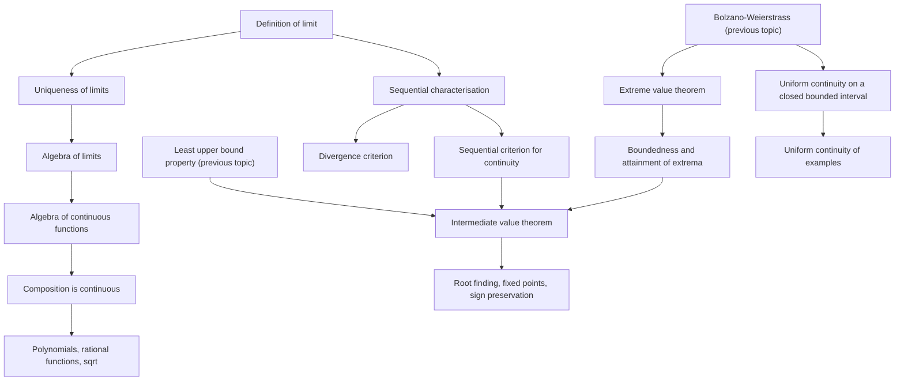

# Continuity and Limits of Functions

> [Mathematics](../../README.md) › [Real Analysis](../README.md) · Level: Advanced · Prerequisites: [The Real Numbers and Completeness](../01-real-numbers-and-completeness/README.md), [Logic](../../00-foundations/02-logic/README.md), [Set Theory](../../00-foundations/03-set-theory/README.md), [Proof Techniques](../../00-foundations/04-proof-techniques/README.md), [Inequalities](../../03-algebra/03-inequalities/README.md), [Limits](../../07-calculus/01-limits/README.md) · Estimated time: 720 min

## 1. Introduction

A function is *continuous* if its graph can be drawn without lifting the pen. That sentence is a picture, not a definition, and it is wrong in a way that matters: it silently assumes that "drawing" and "lifting" have precise meanings, and it gives no purchase on questions such as *how* continuous a function is, or which theorems survive when continuity is weakened. This chapter replaces the picture with a definition built from inequalities, and then extracts from that definition the two great existence theorems of one-variable analysis: the intermediate value theorem and the extreme value theorem.

The plan is a sequence of translations.

* A **limit** $\lim_{x \to a} f(x) = L$ says: no matter how tight a tolerance $\varepsilon$ you demand on the output, there is a neighbourhood of $a$ (of radius $\delta$) inside which every output is within $\varepsilon$ of $L$. The order of the quantifiers — $\forall \varepsilon \exists \delta$ — is the entire content. Reversing them produces a strictly weaker and useless notion.
* **Continuity at a point** says the limit exists *and equals the value of the function there*. The punctured neighbourhood in the limit definition is replaced by a full neighbourhood, so the value at $a$ is forced to agree with the nearby values.
* **Uniform continuity** moves the choice of $\delta$ before the point: one $\delta$ must serve every pair of points simultaneously. Continuity is a local promise made separately at each point; uniform continuity is a single global promise.
* **Compactness** — for intervals, being closed and bounded — is the hypothesis that converts the local promise into the global one, and the mechanism that turns "arbitrarily close" into "attained".

Two structural facts organise everything below. First, limits and continuity can be tested with *sequences*: $\lim_{x\to a} f(x) = L$ exactly when every sequence $x_n \to a$ (with $x_n \ne a$) is mapped to a sequence $f(x_n) \to L$. This is not a convenience. It lets every theorem about sequences proved in [The Real Numbers and Completeness](../01-real-numbers-and-completeness/README.md) — Bolzano–Weierstrass above all — be applied to functions, and those applications are precisely the proofs of the intermediate value and extreme value theorems. Second, the theorems of this chapter are the first place where completeness of $\mathbb{R}$ becomes visible in calculus rather than in the construction of numbers. Over $\mathbb{Q}$ the function $f(x) = x^2 - 2$ changes sign between $1$ and $2$ and has no zero; over $\mathbb{R}$ it has one. The intermediate value theorem is a completeness theorem in disguise.

Historically, the $\varepsilon$-$\delta$ definition is due to Bolzano (1817) and was made standard by Weierstrass in the 1860s; Cauchy had used infinitesimals and, in places, confused continuity with uniform continuity. The distinction is not pedantry: Cauchy's 1821 proof that a series of continuous functions has a continuous sum is false without uniform convergence, and the counterexamples of Abel and later Seidel forced the modern definitions. Section 7.11 shows exactly where the compactness hypothesis earns its keep.

By the end you should be able to look at a function such as $x \mapsto x \sin(1/x)$ or $x \mapsto 1/x$ and say immediately: where it is continuous, whether a limit exists at a given point, whether it is uniformly continuous on a given interval, and which theorem would be needed to prove it. Section 9 works seven examples in increasing order of difficulty, from a linear function to a function continuous at exactly one point.

## 2. Prerequisites

**The real numbers and completeness.** The least upper bound property, the Archimedean property, density of $\mathbb{Q}$, the nested interval property and the Bolzano–Weierstrass theorem are all used below. The two proofs that matter most are the intermediate value theorem (which applies the least upper bound property to a set of points) and the extreme value theorem (which applies Bolzano–Weierstrass to a sequence of near-maximisers). See [The Real Numbers and Completeness](../01-real-numbers-and-completeness/README.md), in particular Theorems 7.28 and 7.32 there.

**Sequences.** Convergence of a real sequence is used constantly. That topic is the second of this discipline; until it is written, the single definition needed is recalled in Section 5.7, and the two elementary facts about convergent sequences that we use (boundedness, and the behaviour of subsequences) are proved in Section 7.9 as Lemmas 7.14 and 7.15. Nothing else from the theory of sequences is assumed.

**Logic and quantifiers.** You must be able to negate $\forall \varepsilon > 0\ \exists \delta > 0\ \forall x$ correctly, as $\exists \varepsilon > 0\ \forall \delta > 0\ \exists x$. Nearly every proof here begins by writing down the negation of the statement being disproved. See [Logic](../../00-foundations/02-logic/README.md).

**Sets, intervals and functions.** Notation such as $f[A] = \{f(x) : x \in A\}$, restrictions $f|_A$, and intervals $[a,b]$, $(a,b)$ is used throughout. See [Set Theory](../../00-foundations/03-set-theory/README.md).

**Proof techniques.** Proof by contradiction and proof by contrapositive are both essential: the sequential characterisation is proved by contrapositive, and the uniform continuity theorem on compact intervals is proved by contradiction. See [Proof Techniques](../../00-foundations/04-proof-techniques/README.md).

**Inequalities and absolute value.** The triangle inequality, the reverse triangle inequality $\lvert\lvert u\rvert - \lvert v\rvert\rvert \le \lvert u - v\rvert$, and the ability to solve $\lvert x - a\rvert < \delta$ for $x$ are the working tools. See [Inequalities](../../03-algebra/03-inequalities/README.md).

**Informal calculus.** Knowing the graphs of $x^2$, $1/x$, $\sin x$, $\lvert x\rvert$ and the floor function, and having seen limits treated informally, makes the definitions feel like a tightening of something familiar rather than a new subject. See [Limits](../../07-calculus/01-limits/README.md) and [Continuity](../../07-calculus/02-continuity/README.md).

## 3. Learning Objectives

By the end of this tutorial you will be able to

1. state the $\varepsilon$-$\delta$ definition of $\lim_{x \to a} f(x) = L$, and prove from the definition that a given linear, quadratic, rational or radical function has a given limit;
2. explain why a limit at a point requires that point to be a *cluster point* of the domain, and prove that limits are unique;
3. prove the sequential characterisation of limits in both directions, and use it to show that a limit does not exist by exhibiting two sequences with different image limits;
4. prove the algebra of limits (sum, product, quotient) and the squeeze theorem, and use them to compute limits without returning to $\varepsilon$;
5. define one-sided limits and prove that the two-sided limit exists exactly when both one-sided limits exist and agree;
6. define continuity at a point and on a set, prove the equivalence of the $\varepsilon$-$\delta$ and sequential formulations, and prove that compositions and algebraic combinations of continuous functions are continuous;
7. state and prove the intermediate value theorem from the least upper bound property, and apply it to root finding and fixed points;
8. state and prove the extreme value theorem using Bolzano–Weierstrass, including the boundedness step;
9. define uniform continuity, decide for specific functions and intervals whether it holds, and prove that continuity on a closed bounded interval implies uniform continuity;
10. state the structure theorem for discontinuities of monotone functions and explain why the discontinuities of such a function form a countable set;
11. distinguish carefully between continuity at a point, continuity on a set, uniform continuity, and Lipschitz continuity, with examples separating each pair of notions.

## 4. Intuition

**Limits as a tolerance game.** Two engineers specify a part. The designer says: the output must be within $\varepsilon$ of the target $L$. The machinist replies: then I need the input to be within $\delta$ of $a$. The limit statement $\lim_{x\to a} f(x) = L$ says the machinist can *always* answer, for every tolerance $\varepsilon > 0$, with some $\delta > 0$. The machinist is not required to produce the best $\delta$, only a working one; and the answer may depend on $\varepsilon$ and on $a$, but not on anything else.

The punctured condition $0 < \lvert x - a \rvert$ expresses a second engineering fact: the value of $f$ *at* $a$ is irrelevant to the limit. A machine may be unbolted at the target position; what matters is behaviour nearby. This is why $\lim_{x\to 1}(x^2-1)/(x-1)$ exists although the formula is undefined at $x=1$.

**Continuity as a promise kept.** Continuity at $a$ adds the requirement that the value at $a$ equals the limit. The graph has no hole and no jump at $a$. Notice that this is a *local* property: it constrains $f$ only in a neighbourhood of $a$, and a function can be continuous at one point and discontinuous at every other point (Example 9.7).

**Uniform continuity as one promise for the whole interval.** Continuity at each point $a$ gives a function $\delta(\varepsilon, a)$: a personal $\delta$ for each point. On $(0,1)$ the function $1/x$ needs a smaller and smaller $\delta$ as $a$ approaches $0$, and no single $\delta$ works for all points. Uniform continuity is the demand that a single $\delta(\varepsilon)$ works everywhere. On a closed bounded interval there is nowhere for the function to "escape to", and the extreme value theorem machinery forces uniformity.

**Why compactness appears.** A continuous function on a closed bounded interval cannot blow up (no vertical asymptote inside) and cannot oscillate infinitely fast near a point (the interval has no boundary point outside it to hide near). Both statements are consequences of Bolzano–Weierstrass: any attempt to produce a point where boundedness or uniformity fails produces a convergent sequence, whose limit lies in the interval, where continuity forbids the failure.

**The intermediate value theorem as a completeness statement.** The bisection method works because a sign change cannot disappear without a zero. In $\mathbb{Q}$ it can: $x^2 - 2$ changes sign between $1$ and $2$ and there is no rational zero. What the IVT adds to "obvious" is the existence of the point $c$; and that existence is exactly a supremum of a set of reals.

## 5. Formal Definition

Throughout, $A \subseteq \mathbb{R}$, $f : A \to \mathbb{R}$, and $a \in \mathbb{R}$. Intervals are as in [MATHEMATICAL_NOTATION.md](../../MATHEMATICAL_NOTATION.md).

**Definition 5.1 (cluster point).** A point $a \in \mathbb{R}$ is a **cluster point** (or *limit point*, or *accumulation point*) of $A$ if every punctured neighbourhood of $a$ meets $A$:
$$
\forall \delta > 0\ \exists x \in A \quad\text{with}\quad 0 < \lvert x - a\rvert < \delta .
$$
Equivalently (Exercise 1), $a$ is a cluster point of $A$ if and only if there is a sequence $(x_n)$ in $A$ with $x_n \ne a$ for all $n$ and $x_n \to a$.

Every point of an interval is a cluster point of that interval. An isolated point of $A$ — a point $a \in A$ with some $(a-\delta, a+\delta) \cap A = \{a\}$ — is not a cluster point. The point $0$ is a cluster point of $\{1/n : n \in \mathbb{N}\}$ but is not an element of that set.

**Definition 5.2 (limit of a function).** Let $a$ be a cluster point of $A$, and let $L \in \mathbb{R}$. We say that **the limit of $f$ at $a$ is $L$**, written
$$
\lim_{x \to a} f(x) = L,
$$
if
$$
\forall \varepsilon > 0\ \exists \delta > 0\ \forall x \in A \quad \bigl(0 < \lvert x - a\rvert < \delta \ \Rightarrow\ \lvert f(x) - L\rvert < \varepsilon\bigr).
$$
If no such $L$ exists we say the limit **does not exist**. Note that $f(a)$ plays no role and need not be defined. The requirement that $a$ be a cluster point is what makes the definition non-vacuous: otherwise every $L$ would satisfy it.

**Definition 5.3 (one-sided limits).** Let $a$ be a cluster point of $A \cap (a, \infty)$. Then
$$
\lim_{x \to a^+} f(x) = L \quad :\Longleftrightarrow\quad \forall \varepsilon > 0\ \exists \delta > 0\ \forall x \in A\ \bigl(a < x < a + \delta \Rightarrow \lvert f(x) - L\rvert < \varepsilon\bigr).
$$
The **left limit** $\lim_{x \to a^-} f(x) = L$ is defined symmetrically with $a - \delta < x < a$, assuming $a$ is a cluster point of $A \cap (-\infty, a)$.

**Definition 5.4 (continuity at a point).** Let $a \in A$. Then $f$ is **continuous at $a$** if
$$
\forall \varepsilon > 0\ \exists \delta > 0\ \forall x \in A \quad \bigl(\lvert x - a\rvert < \delta \ \Rightarrow\ \lvert f(x) - f(a)\rvert < \varepsilon\bigr).
$$
If $a$ is a cluster point of $A$, this is equivalent to $\lim_{x \to a} f(x) = f(a)$. If $a$ is an isolated point of $A$, every $f$ is continuous at $a$: the only $x \in A$ with $\lvert x - a\rvert$ small is $x = a$ itself, and then $\lvert f(x) - f(a)\rvert = 0$. This degenerate case is a useful test of whether a definition has been understood.

**Definition 5.5 (continuity on a set).** $f$ is **continuous on $B \subseteq A$** if it is continuous at every point of $B$. We write $C(B)$ for the set of continuous real functions on $B$ and $C[a,b]$ for continuity on the closed interval.

*Warning.* "Continuous on $B$" refers to the function with domain $A$ restricted to points of $B$; it does **not** mean that $f$ extends continuously to the closure of $B$. The function $1/x$ is continuous on $(0,1)$ and has no continuous extension to $[0,1]$.

**Definition 5.6 (uniform continuity).** $f$ is **uniformly continuous on $A$** if
$$
\forall \varepsilon > 0\ \exists \delta > 0\ \forall x, y \in A \quad \bigl(\lvert x - y\rvert < \delta \ \Rightarrow\ \lvert f(x) - f(y)\rvert < \varepsilon\bigr).
$$
The only difference from continuity is the position of the quantifier $\forall x, y$: here $\delta$ is chosen before $x$ and $y$, so a single $\delta$ must serve every pair. Compare Definition 5.4, where $\delta$ may depend on the point.

**Definition 5.7 (sequence convergence, recalled).** A sequence $(x_n)_{n \ge 1}$ of reals **converges to** $L \in \mathbb{R}$, written $x_n \to L$, if
$$
\forall \varepsilon > 0\ \exists N \in \mathbb{N}\ \forall n \ge N \quad \lvert x_n - L\rvert < \varepsilon .
$$
This is the definition from the [previous topic](../01-real-numbers-and-completeness/README.md) and will be developed systematically in the planned *Sequences and Series* topic of this discipline. Only the definition and the two lemmas of Section 7.9 are used here.

**Definition 5.8 (bounded function).** $f : A \to \mathbb{R}$ is **bounded** if there is $M \in \mathbb{R}$ with $\lvert f(x)\rvert \le M$ for all $x \in A$; it is **bounded above** if $f[A]$ is bounded above, and similarly below.

## 6. Mathematical Notation

| Symbol | Read as | Meaning here |
|---|---|---|
| $\lim_{x \to a} f(x) = L$ | the limit of $f$ at $a$ is $L$ | Definition 5.2; $f(a)$ irrelevant |
| $\lim_{x \to a^+} f(x)$ | right limit at $a$ | $x$ approaches through values $> a$ |
| $\lim_{x \to a^-} f(x)$ | left limit at $a$ | $x$ approaches through values $< a$ |
| $\forall \varepsilon > 0\ \exists \delta > 0$ | for every epsilon there is a delta | the order is the content |
| $\lvert x - a\rvert < \delta$ | $x$ is within delta of $a$ | open interval $(a-\delta, a+\delta)$ |
| $0 < \lvert x - a\rvert < \delta$ | $x$ is near $a$ but not equal to it | punctured neighbourhood |
| $f[A]$ | image of $A$ under $f$ | $\{f(x) : x \in A\}$ |
| $f \circ g$ | $f$ composed with $g$ | $(f \circ g)(x) = f(g(x))$ |
| $C(A)$, $C[a,b]$ | continuous functions on $A$ | Definition 5.5 |
| $f \in C^1$ | continuously differentiable | derivative exists and is continuous; used from the next topic |
| $\sup S$, $\inf S$ | supremum, infimum | from the previous topic |
| $\lvert x \rvert$ | absolute value | distance to $0$ |
| $\lfloor x \rfloor$ | floor of $x$ | greatest integer $\le x$ |
| $x \to a$ | $x$ tends to $a$ | approach, never equality |
| $x_n \to L$ | $x_n$ converges to $L$ | Definition 5.7 |
| $\varepsilon, \delta$ | epsilon, delta | arbitrary positive tolerances |
| $\blacksquare$ | end of proof | the argument is complete |

Reading a limit aloud: "for every epsilon greater than zero there exists delta greater than zero such that for all $x$ in the domain, if $x$ is within delta of $a$ but not equal to $a$, then $f(x)$ is within epsilon of $L$."

## 7. Core Concepts

### 7.1 Limits from first principles, and uniqueness

Every $\varepsilon$-$\delta$ proof has the same skeleton. You are given $\varepsilon > 0$. You must produce $\delta > 0$ such that the implication holds. The way to find $\delta$ is to work backwards: start from the target inequality $\lvert f(x) - L\rvert < \varepsilon$, use algebra to estimate $\lvert f(x) - L\rvert$ in terms of $\lvert x - a\rvert$, and then read off the bound on $\lvert x - a\rvert$. The final write-up reverses the order: choose $\delta$, then verify.

For a linear function this is exact. To prove $\lim_{x \to a}(mx + c) = ma + c$ with $m \ne 0$, note
$$
\lvert (mx + c) - (ma + c)\rvert = \lvert m\rvert\,\lvert x - a\rvert < \lvert m\rvert \delta,
$$
so $\delta := \varepsilon/\lvert m\rvert$ works. For a quadratic the estimate must be local: near $a = 2$,
$$
\lvert x^2 - 4\rvert = \lvert x - 2\rvert\,\lvert x + 2\rvert,
$$
and the factor $\lvert x+2\rvert$ is not bounded on $\mathbb{R}$, but it is bounded if we first insist that $\lvert x - 2\rvert < 1$, which forces $\lvert x + 2\rvert < 5$. Then $\delta := \min\{1, \varepsilon/5\}$ works. This two-step device — *first make the variable bounded, then make the product small* — is the standard technique, and it recurs in Sections 9.1–9.2.

**Proposition 7.1 (uniqueness of limits).** *Let $a$ be a cluster point of $A$ and $f : A \to \mathbb{R}$. If $\lim_{x\to a} f(x) = L$ and $\lim_{x \to a} f(x) = L'$, then $L = L'$.*

*Proof.* Let $\varepsilon > 0$. By the definition with tolerance $\varepsilon/2$ there are $\delta_1, \delta_2 > 0$ such that
$$
0 < \lvert x - a\rvert < \delta_1 \Rightarrow \lvert f(x) - L\rvert < \tfrac{\varepsilon}{2},
\qquad
0 < \lvert x - a\rvert < \delta_2 \Rightarrow \lvert f(x) - L'\rvert < \tfrac{\varepsilon}{2}.
$$
Let $\delta := \min\{\delta_1, \delta_2\}$. Because $a$ is a cluster point of $A$, there exists $x \in A$ with $0 < \lvert x - a\rvert < \delta$. For this $x$ the triangle inequality gives
$$
\lvert L - L'\rvert \le \lvert L - f(x)\rvert + \lvert f(x) - L'\rvert < \tfrac{\varepsilon}{2} + \tfrac{\varepsilon}{2} = \varepsilon .
$$
Since $\varepsilon > 0$ was arbitrary and $\lvert L - L'\rvert$ does not depend on $\varepsilon$, $\lvert L - L'\rvert = 0$, that is $L = L'$. $\blacksquare$

The cluster-point hypothesis is used at exactly one place: to guarantee that the set over which the two estimates hold simultaneously is nonempty. Without it the definition is vacuously satisfied by every $L$ and uniqueness fails.

**Lemma 7.2 (limits are locally bounded).** *If $\lim_{x \to a} f(x) = L$, then there are $\delta > 0$ and $M \ge 0$ with $\lvert f(x)\rvert \le M$ for all $x \in A$ satisfying $0 < \lvert x - a\rvert < \delta$.*

*Proof.* Apply the definition with $\varepsilon = 1$: there is $\delta > 0$ such that $\lvert f(x) - L\rvert < 1$, hence $\lvert f(x)\rvert < \lvert L\rvert + 1$, whenever $0 < \lvert x - a\rvert < \delta$. Take $M := \lvert L\rvert + 1$. $\blacksquare$

### 7.2 The sequential characterisation of limits

Limits of functions and limits of sequences look like different subjects. They are not: the function limit is equivalent to the statement that *every* approximating sequence is mapped to a convergent sequence. This is the single most useful theorem of the chapter, because it transfers the whole machinery of sequences — in particular Bolzano–Weierstrass — to functions.

**Theorem 7.3 (sequential characterisation of limits).** *Let $a$ be a cluster point of $A$ and $L \in \mathbb{R}$. The following are equivalent.*

*(i) $\lim_{x \to a} f(x) = L$.*

*(ii) For every sequence $(x_n)$ in $A$ with $x_n \ne a$ for all $n$ and $x_n \to a$, the image sequence satisfies $f(x_n) \to L$.*

*Proof.* **(i) $\Rightarrow$ (ii).** Let $(x_n)$ be such a sequence and let $\varepsilon > 0$. Choose $\delta > 0$ as in Definition 5.2. Since $x_n \to a$ there is $N$ with $\lvert x_n - a\rvert < \delta$ for all $n \ge N$. For such $n$ we have $x_n \in A$, $0 < \lvert x_n - a\rvert < \delta$, hence $\lvert f(x_n) - L\rvert < \varepsilon$. Therefore $f(x_n) \to L$.

**(ii) $\Rightarrow$ (i).** We prove the contrapositive. Suppose (i) fails. Writing out the negation of Definition 5.2 gives
$$
\exists \varepsilon > 0\ \forall \delta > 0\ \exists x \in A \quad\text{with}\quad 0 < \lvert x - a\rvert < \delta \ \text{and}\ \lvert f(x) - L\rvert \ge \varepsilon .
$$
Apply this with $\delta = 1/n$ for $n \in \mathbb{N}$ and call the resulting point $x_n$. Then $x_n \in A$, $x_n \ne a$, $\lvert x_n - a\rvert < 1/n$, so $x_n \to a$; but $\lvert f(x_n) - L\rvert \ge \varepsilon$ for every $n$, so $f(x_n)$ does not converge to $L$. Thus (ii) fails. $\blacksquare$

**Corollary 7.4 (divergence criterion).** *Let $a$ be a cluster point of $A$. If there are sequences $(x_n)$ and $(y_n)$ in $A \setminus \{a\}$ with $x_n \to a$, $y_n \to a$, $f(x_n) \to L_1$ and $f(y_n) \to L_2$ where $L_1 \ne L_2$, then $\lim_{x\to a} f(x)$ does not exist. Likewise, if some such sequence has $f(x_n)$ divergent, the limit does not exist.*

*Proof.* If the limit existed, equal to $L$, Theorem 7.3 would give $f(x_n) \to L$ and $f(y_n) \to L$. A sequence has at most one limit (Lemma 7.15(c) below), so $L = L_1 = L_2$, contradicting $L_1 \ne L_2$. $\blacksquare$

The classical application is $f(x) = \sin(1/x)$ at $a = 0$. Take $x_n = 1/(2n\pi)$, so $f(x_n) = 0$ for all $n$; take $y_n = 1/(2n\pi + \pi/2)$, so $f(y_n) = 1$ for all $n$. Both sequences tend to $0$, and the image limits $0$ and $1$ differ. Hence the limit does not exist — no estimate, no inequality, just two sequences. Compare this with trying to negate the definition by hand, which requires exhibiting, for every $\delta$, a point where the oscillation exceeds a fixed $\varepsilon$.

The same technique decides continuity. Later, in the differentiation topic, the sequential characterisation is what makes the proof of the chain rule and of the inverse function formula painless: continuity of a composition is a statement about sequences.

### 7.3 Algebra of limits

Once a limit is known to exist, we should never have to return to $\varepsilon$ again. The following theorem is the licence to calculate.

**Theorem 7.5 (algebra of limits).** *Let $a$ be a cluster point of $A$, and let $f, g : A \to \mathbb{R}$ with $\lim_{x\to a} f(x) = L$ and $\lim_{x \to a} g(x) = M$. Then*

*(a) $\lim_{x\to a}\bigl(f(x) + g(x)\bigr) = L + M$;*

*(b) $\lim_{x\to a} c\,f(x) = cL$ for every $c \in \mathbb{R}$;*

*(c) $\lim_{x\to a} f(x)g(x) = LM$;*

*(d) if $M \ne 0$, then $a$ is a cluster point of $A_0 := \{x \in A : g(x) \ne 0\}$ and $\lim_{x \to a} f(x)/g(x) = L/M$.*

*Proof.* **(a)** Let $\varepsilon > 0$. Choose $\delta_1, \delta_2 > 0$ so that $\lvert f(x) - L\rvert < \varepsilon/2$ when $0 < \lvert x-a\rvert < \delta_1$ and $\lvert g(x) - M\rvert < \varepsilon/2$ when $0 < \lvert x-a\rvert < \delta_2$. With $\delta := \min\{\delta_1,\delta_2\}$ and $0 < \lvert x-a\rvert < \delta$,
$$
\lvert (f(x)+g(x)) - (L+M)\rvert \le \lvert f(x)-L\rvert + \lvert g(x)-M\rvert < \varepsilon .
$$

**(b)** If $c = 0$ both sides are $0$ and the claim is immediate. If $c \ne 0$, take $\delta$ from the definition with tolerance $\varepsilon/\lvert c\rvert$; then $\lvert cf(x) - cL\rvert = \lvert c\rvert\lvert f(x)-L\rvert < \varepsilon$.

**(c)** Write
$$
f(x)g(x) - LM = f(x)\bigl(g(x)-M\bigr) + M\bigl(f(x)-L\bigr).
$$
By Lemma 7.2 there are $\delta_1 > 0$ and $C \ge 0$ with $\lvert f(x)\rvert \le C$ whenever $0 < \lvert x-a\rvert < \delta_1$. Let $\varepsilon > 0$. Choose $\delta_2$ so that $\lvert g(x)-M\rvert < \varepsilon/(2(C+1))$ and $\delta_3$ so that $\lvert f(x)-L\rvert < \varepsilon/(2(\lvert M\rvert+1))$ on the respective punctured neighbourhoods. For $0 < \lvert x-a\rvert < \delta := \min\{\delta_1,\delta_2,\delta_3\}$,
$$
\lvert f(x)g(x)-LM\rvert \le C\cdot\frac{\varepsilon}{2(C+1)} + \lvert M\rvert\cdot\frac{\varepsilon}{2(\lvert M\rvert+1)} < \frac{\varepsilon}{2} + \frac{\varepsilon}{2} = \varepsilon .
$$
(The $+1$ in the denominators avoids dividing by zero when $C = 0$ or $M = 0$.)

**(d)** First, $a$ is a cluster point of $A_0$: since $g(x) \to M \ne 0$, taking $\varepsilon = \lvert M\rvert/2$ gives $\delta_1 > 0$ with $\lvert g(x) - M\rvert < \lvert M\rvert/2$, hence $\lvert g(x)\rvert > \lvert M\rvert/2 > 0$, for $0 < \lvert x-a\rvert < \delta_1$; and a cluster point of $A$ has points of $A$ in every punctured neighbourhood, all of which lie in $A_0$ once the radius is below $\delta_1$.

Next we prove $\lim_{x\to a} 1/g(x) = 1/M$. For $x \in A_0$ with $0 < \lvert x-a\rvert < \delta_1$,
$$
\left\lvert \frac{1}{g(x)} - \frac{1}{M}\right\rvert = \frac{\lvert M - g(x)\rvert}{\lvert g(x)\rvert\,\lvert M\rvert} \le \frac{2}{\lvert M\rvert^2}\,\lvert g(x) - M\rvert .
$$
Given $\varepsilon > 0$, choose $\delta_2 > 0$ such that $\lvert g(x)-M\rvert < \varepsilon\lvert M\rvert^2/2$ on the punctured $\delta_2$-neighbourhood; then the left side is $< \varepsilon$ for $0 < \lvert x-a\rvert < \min\{\delta_1,\delta_2\}$. Finally apply (c) to $f$ and $1/g$. $\blacksquare$

**Theorem 7.6 (squeeze theorem).** *Let $a$ be a cluster point of $A$ and suppose there is $\delta_0 > 0$ with*
$$
g(x) \le f(x) \le h(x) \qquad \text{for all } x \in A,\ 0 < \lvert x - a\rvert < \delta_0 .
$$
*If $\lim_{x\to a} g(x) = \lim_{x \to a} h(x) = L$, then $\lim_{x \to a} f(x) = L$.*

*Proof.* Let $\varepsilon > 0$. Choose $\delta_1, \delta_2 > 0$ such that $\lvert g(x)-L\rvert < \varepsilon$ on the punctured $\delta_1$-neighbourhood and $\lvert h(x)-L\rvert < \varepsilon$ on the punctured $\delta_2$-neighbourhood. Put $\delta := \min\{\delta_0,\delta_1,\delta_2\}$. For $0 < \lvert x-a\rvert < \delta$,
$$
L - \varepsilon < g(x) \le f(x) \le h(x) < L + \varepsilon ,
$$
so $\lvert f(x) - L\rvert < \varepsilon$. $\blacksquare$

### 7.4 One-sided limits

**Theorem 7.7 (two-sided limit from one-sided limits).** *Let $f$ be defined on an open interval containing $a$, except possibly at $a$ itself. Then $\lim_{x\to a} f(x) = L$ if and only if both one-sided limits exist and equal $L$.*

*Proof.* If the two-sided limit is $L$, restricting to $x > a$ (respectively $x < a$) in the same $\delta$ shows each one-sided limit is $L$.

Conversely, suppose $\lim_{x\to a^+} f(x) = \lim_{x\to a^-} f(x) = L$, and let $\varepsilon > 0$. Choose $\delta^+ > 0$ working for $x \in (a, a+\delta^+)$ and $\delta^- > 0$ working for $x \in (a-\delta^-, a)$. With $\delta := \min\{\delta^+,\delta^-\}$, any $x$ with $0 < \lvert x - a\rvert < \delta$ satisfies either $a < x < a+\delta \le a+\delta^+$ or $a - \delta \ge a - \delta^- > x > a-\delta^-$; in both cases $\lvert f(x)-L\rvert < \varepsilon$. $\blacksquare$

The floor function $\lfloor \cdot \rfloor$ illustrates the failure mode. At an integer $k$, $\lim_{x\to k^-}\lfloor x\rfloor = k-1$ and $\lim_{x \to k^+}\lfloor x\rfloor = k$. The one-sided limits exist but differ, so the two-sided limit does not exist (and $\lfloor\cdot\rfloor$ is discontinuous at every integer, continuous elsewhere).

### 7.5 Continuity at a point and on a set

**Theorem 7.8 (sequential criterion for continuity).** *Let $f : A \to \mathbb{R}$ and $a \in A$. Then $f$ is continuous at $a$ if and only if for every sequence $(x_n)$ in $A$ with $x_n \to a$ we have $f(x_n) \to f(a)$.*

*Proof.* The proof is that of Theorem 7.3 with every occurrence of $0 < \lvert x - a\rvert$ replaced by $\lvert x - a\rvert$.

*($\Rightarrow$)* Given $\varepsilon > 0$, choose $\delta > 0$ from Definition 5.4; for $n \ge N$ we have $\lvert x_n - a\rvert < \delta$, hence $\lvert f(x_n)-f(a)\rvert < \varepsilon$.

*($\Leftarrow$)* Suppose $f$ is not continuous at $a$. Then there is $\varepsilon > 0$ such that for every $\delta > 0$ there is $x \in A$ with $\lvert x - a\rvert < \delta$ and $\lvert f(x)-f(a)\rvert \ge \varepsilon$. Taking $\delta = 1/n$ gives $x_n \in A$ with $\lvert x_n - a\rvert < 1/n$ but $\lvert f(x_n)-f(a)\rvert \ge \varepsilon$; then $x_n \to a$ while $f(x_n) \not\to f(a)$. $\blacksquare$

Notice that this proof covers isolated points automatically: if $a$ is isolated then any sequence in $A$ converging to $a$ is eventually equal to $a$, so $f(x_n) \to f(a)$ holds, and indeed every function is continuous there.

**Theorem 7.9 (algebra of continuous functions).** *Let $f, g : A \to \mathbb{R}$ be continuous at $a \in A$. Then $f + g$, $cf$ (for $c \in \mathbb{R}$) and $fg$ are continuous at $a$; and $f/g$ is continuous at $a$ provided $g(a) \ne 0$ (with domain $A \cap \{x : g(x) \ne 0\}$).*

*Proof.* If $a$ is a cluster point of the relevant domain, these are exactly Theorem 7.5(a)–(d) with $L = f(a)$ and $M = g(a)$, noting that for $f/g$ the value at $a$ is $f(a)/g(a)$ and that $a$ remains a cluster point of the smaller domain by the argument in Theorem 7.5(d). If $a$ is isolated, every function on that domain is continuous at $a$, so the claims hold trivially. $\blacksquare$

### 7.6 Composition, and the standard continuous functions

**Theorem 7.10 (continuity of a composition).** *Let $g : A \to \mathbb{R}$ with $g[A] \subseteq B$, and $f : B \to \mathbb{R}$. If $g$ is continuous at $a \in A$ and $f$ is continuous at $g(a) \in B$, then $f \circ g$ is continuous at $a$.*

*Proof.* Let $\varepsilon > 0$. Since $f$ is continuous at $g(a)$ there is $\eta > 0$ such that for all $y \in B$,
$$
\lvert y - g(a)\rvert < \eta \ \Rightarrow\ \lvert f(y) - f(g(a))\rvert < \varepsilon .
$$
Since $g$ is continuous at $a$ there is $\delta > 0$ such that for all $x \in A$,
$$
\lvert x - a\rvert < \delta \ \Rightarrow\ \lvert g(x) - g(a)\rvert < \eta .
$$
For such $x$, put $y := g(x) \in B$; then $\lvert y - g(a)\rvert < \eta$, hence $\lvert f(g(x)) - f(g(a))\rvert < \varepsilon$. $\blacksquare$

The order of the choices matters: $\eta$ is chosen first, from $f$'s tolerance, and $\delta$ second, from $g$'s. Reversing them is the classic error discussed in Section 11.

**Corollary 7.11 (the standard continuous functions).** *(a) Every polynomial is continuous on $\mathbb{R}$. (b) Every rational function $p(x)/q(x)$ is continuous at every point where $q \ne 0$. (c) $x \mapsto \lvert x\rvert$ is continuous on $\mathbb{R}$. (d) $x \mapsto \sqrt x$ is continuous on $[0,\infty)$.*

*Proof.* (a) The constant function $1$ and the identity $x \mapsto x$ are continuous (take $\delta = \varepsilon$ for the identity), and the polynomials are built from them by sums and products, using Theorem 7.9 repeatedly (formally, by induction on the degree).

(b) A rational function is a quotient of polynomials; apply Theorem 7.9 with $g = q$.

(c) By the reverse triangle inequality, $\bigl\lvert\,\lvert x\rvert - \lvert a\rvert\,\bigr\rvert \le \lvert x - a\rvert$, so $\delta = \varepsilon$ works at every $a$.

(d) For $x, a \ge 0$,
$$
\bigl(\sqrt x - \sqrt a\bigr)^2 \le \bigl(\sqrt x - \sqrt a\bigr)\bigl(\sqrt x + \sqrt a\bigr) = x - a \le \lvert x - a\rvert ,
$$
where the first inequality uses $\sqrt x - \sqrt a \le \sqrt x + \sqrt a$. Hence $\lvert \sqrt x - \sqrt a\rvert \le \sqrt{\lvert x-a\rvert}$, and $\delta := \varepsilon^2$ gives continuity at every $a \ge 0$ (including $a = 0$, where the formula reads $\sqrt x < \varepsilon$ for $x < \varepsilon^2$). $\blacksquare$

### 7.7 The intermediate value theorem

**Theorem 7.12 (intermediate value theorem, IVT).** *Let $f : [a,b] \to \mathbb{R}$ be continuous with $f(a) < f(b)$, and let $y$ satisfy $f(a) < y < f(b)$. Then there exists $c \in (a,b)$ with $f(c) = y$.*

*Proof.* Define
$$
S := \{x \in [a,b] : f(x) < y\} .
$$
The set $S$ is nonempty because $a \in S$, and it is bounded above by $b$. By the least upper bound property of $\mathbb{R}$ (see [The Real Numbers and Completeness](../01-real-numbers-and-completeness/README.md)), $c := \sup S$ exists and $a \le c \le b$. We show $f(c) = y$ by excluding the two alternatives.

*Suppose $f(c) < y$.* Then $c \ne b$, because $f(b) > y$. Let $\varepsilon := y - f(c) > 0$. Continuity of $f$ at $c$ gives $\delta > 0$ such that $\lvert f(x) - f(c)\rvert < \varepsilon$ for all $x \in [a,b]$ with $\lvert x - c\rvert < \delta$; for such $x$, $f(x) < f(c) + \varepsilon = y$. Choose
$$
x_0 := c + \min\Bigl\{\tfrac{\delta}{2},\ \tfrac{b-c}{2}\Bigr\} .
$$
Then $x_0 \in (c, b] \subseteq [a,b]$, $\lvert x_0 - c\rvert < \delta$, so $f(x_0) < y$, i.e. $x_0 \in S$. But $x_0 > c = \sup S$, which is impossible since $c$ is an upper bound of $S$.

*Suppose $f(c) > y$.* Then $c \ne a$, because $f(a) < y$. Let $\varepsilon := f(c) - y > 0$ and choose $\delta > 0$ with $f(x) > f(c) - \varepsilon = y$ for all $x \in [a,b]$ with $\lvert x - c\rvert < \delta$. Every $s \in S$ satisfies $s \le c - \delta/2$: indeed, $s \le c$ because $c$ is an upper bound of $S$, and if $s > c - \delta/2$ then $\lvert s - c\rvert < \delta/2 < \delta$, which would give $f(s) > y$, contradicting $s \in S$. Hence $c - \delta/2$ is an upper bound of $S$ strictly smaller than $c$, contradicting the leastness of $c$.

Both alternatives are impossible, so $f(c) = y$. Since $f(a) \ne y \ne f(b)$, we have $c \in (a,b)$. $\blacksquare$

The case $f(a) > f(b)$ follows by applying the theorem to $-f$, and the general statement is: *a continuous function on an interval takes every value between the values at the endpoints*. The theorem is false over $\mathbb{Q}$: $f(x) = x^2 - 2$ is "continuous" in the sense of the rational order, changes sign between $1$ and $2$, and has no rational zero. The proof above fails there because $\sup S$ need not exist in $\mathbb{Q}$ — this is the sharpest illustration of the role of completeness.

**Corollary 7.13 (images of intervals and fixed points).** *(a) If $I \subseteq \mathbb{R}$ is an interval and $f$ is continuous on $I$, then $f[I]$ is an interval. (b) If $f : [0,1] \to [0,1]$ is continuous, then $f$ has a fixed point: there is $c \in [0,1]$ with $f(c) = c$.*

*Proof.* (a) Recall that a set $J \subseteq \mathbb{R}$ is an interval exactly when $u, v \in J$ and $u < w < v$ imply $w \in J$. Let $u < w < v$ with $u, v \in f[I]$; write $u = f(x)$, $v = f(y)$ with $x, y \in I$ and $x \ne y$. If $x < y$, then $f$ restricted to $[x,y]$ is continuous with $f(x) = u < w < v = f(y)$, so Theorem 7.12 provides $c \in (x,y)$ with $f(c) = w$; hence $w \in f[I]$. If $y < x$, apply the same argument on $[y,x]$ with the roles of $u$ and $v$ exchanged (equivalently, apply Theorem 7.12 to $-f$). Hence $f[I]$ is an interval.

(b) The function $g(x) := f(x) - x$ is continuous on $[0,1]$ by Theorem 7.9. Since $0 \le f(0)$, $g(0) \ge 0$, and since $f(1) \le 1$, $g(1) \le 0$. If $g(0) = 0$ or $g(1) = 0$ we are done. Otherwise $g(1) < 0 < g(0)$, and Theorem 7.12 applied to $g$ on $[0,1]$ (with the sign convention reversed) gives $c \in (0,1)$ with $g(c) = 0$, i.e. $f(c) = c$. $\blacksquare$

**Corollary 7.14 (sign preservation).** *If $f$ is continuous at $a$ and $f(a) > 0$, then there is $\delta > 0$ such that $f(x) > f(a)/2 > 0$ for all $x \in A$ with $\lvert x - a\rvert < \delta$. The analogous statement holds for $f(a) < 0$.*

*Proof.* Take $\varepsilon := f(a)/2$ in Definition 5.4: then $f(x) > f(a) - f(a)/2 = f(a)/2$ whenever $\lvert x-a\rvert < \delta$. $\blacksquare$

This little result is used constantly later — to prove that a continuous nonvanishing function has constant sign, that a denominator stays away from zero near a point, and that a function positive at a point is positive on a neighbourhood.

### 7.8 The extreme value theorem

The extreme value theorem says that a continuous function on $[a,b]$ attains a largest and a smallest value. Both halves — *bounded* and *attained* — need proof, and both use Bolzano–Weierstrass, so we first record two elementary facts about sequences.

**Lemma 7.15 (sequence facts).** *(a) Every convergent sequence is bounded. (b) If $x_n \to L$ and $(x_{n_k})$ is a subsequence, then $x_{n_k} \to L$. (c) A sequence has at most one limit.*

*Proof.* (a) Let $x_n \to L$. With $\varepsilon = 1$ choose $N$ such that $\lvert x_n - L\rvert < 1$ for $n \ge N$. Then $\lvert x_n\rvert \le \lvert L\rvert + 1$ for $n \ge N$, and
$$
M := \max\bigl\{\lvert x_1\rvert, \dots, \lvert x_{N-1}\rvert, \lvert L\rvert + 1\bigr\}
$$
bounds the whole sequence (for $N = 1$ the maximum is over the single number $\lvert L\rvert+1$).

(b) Given $\varepsilon > 0$, choose $N$ with $\lvert x_n - L\rvert < \varepsilon$ for $n \ge N$. Since $n_k \ge k$ (proved by induction: $n_1 \ge 1$ and $n_{k+1} > n_k$), for $k \ge N$ we have $n_k \ge k \ge N$, hence $\lvert x_{n_k} - L\rvert < \varepsilon$.

(c) If $x_n \to L$ and $x_n \to L'$, then for $\varepsilon > 0$ and $n$ large, $\lvert L - L'\rvert \le \lvert L - x_n\rvert + \lvert x_n - L'\rvert < 2\varepsilon$; hence $L = L'$. $\blacksquare$

**Theorem 7.16 (continuity on $[a,b]$ implies boundedness).** *If $f$ is continuous on the closed bounded interval $[a,b]$, then $f$ is bounded on $[a,b]$.*

*Proof.* Suppose not. Then for every $n \in \mathbb{N}$ there is $x_n \in [a,b]$ with $\lvert f(x_n)\rvert > n$. By the Bolzano–Weierstrass theorem (Theorem 7.32 of [The Real Numbers and Completeness](../01-real-numbers-and-completeness/README.md)) the bounded sequence $(x_n)$ has a convergent subsequence $x_{n_k} \to c$. Since $a \le x_{n_k} \le b$ for all $k$, passing to the limit gives $a \le c \le b$, so $c \in [a,b]$ and $f$ is continuous at $c$. Hence $f(x_{n_k}) \to f(c)$ by Theorem 7.8, so the sequence $(f(x_{n_k}))$ is bounded by Lemma 7.15(a). But $\lvert f(x_{n_k})\rvert > n_k \ge k$, so it is unbounded. Contradiction. $\blacksquare$

**Theorem 7.17 (extreme value theorem, EVT).** *If $f$ is continuous on $[a,b]$, then there exist $u, v \in [a,b]$ with*
$$
f(u) = \min_{x \in [a,b]} f(x), \qquad f(v) = \max_{x \in [a,b]} f(x).
$$

*Proof.* By Theorem 7.16 the set $f[[a,b]]$ is bounded and nonempty, so $M := \sup f[[a,b]]$ exists. By the approximation property of suprema (Lemma 7.11 of [The Real Numbers and Completeness](../01-real-numbers-and-completeness/README.md)), for each $n \in \mathbb{N}$ there is $x_n \in [a,b]$ with
$$
M - \frac{1}{n} < f(x_n) \le M .
$$
Bolzano–Weierstrass gives a subsequence $x_{n_k} \to v$, and $v \in [a,b]$ as in Theorem 7.16. By continuity, $f(x_{n_k}) \to f(v)$. On the other hand $M - 1/n_k < f(x_{n_k}) \le M$ with $1/n_k \to 0$, so $f(x_{n_k}) \to M$ (squeeze for sequences: given $\varepsilon>0$ choose $k$ with $1/n_k < \varepsilon$). Uniqueness of limits (Lemma 7.15(c)) gives $f(v) = M$, which is therefore a maximum, attained at $v$. Applying the same argument to $-f$ (continuous by Theorem 7.9) gives $u \in [a,b]$ with $-f(u) = \sup(-f[[a,b]]) = -\inf f[[a,b]]$, i.e. $f(u) = \min f[[a,b]]$. $\blacksquare$

Neither hypothesis can be dropped. On $(0,1)$ the function $f(x) = x$ is continuous and bounded, but attains neither supremum nor infimum. On $(0,1)$ the function $f(x) = 1/x$ is continuous and unbounded. On $[0,1]$ the function $f(x) = x$ for $x<1$ and $f(1) = 0$ is bounded but has no maximum, and it is discontinuous exactly at the point where the maximum would have to be attained. On $[0,\infty)$ the function $x \mapsto x$ is continuous and unbounded.

### 7.9 Uniform continuity

Continuity at each point $a$ gives a $\delta$ that may depend on $a$. Uniform continuity forbids that dependence. Write the two statements side by side:

$$
\begin{aligned}
\text{continuous on } A:\quad & \forall a \in A\ \forall \varepsilon > 0\ \exists \delta > 0\ \forall x \in A\ (\lvert x-a\rvert<\delta \Rightarrow \lvert f(x)-f(a)\rvert<\varepsilon),\\
\text{uniformly continuous on } A:\quad & \forall \varepsilon > 0\ \exists \delta > 0\ \forall a, x \in A\ (\lvert x-a\rvert<\delta \Rightarrow \lvert f(x)-f(a)\rvert<\varepsilon).
\end{aligned}
$$

The only difference is the position of $\forall a$: on the left it precedes $\exists \delta$, on the right it follows it. Uniform continuity is strictly stronger.

**Examples that are uniformly continuous.**

* $f(x) = mx + c$ on $\mathbb{R}$: $\delta = \varepsilon/\lvert m\rvert$ for $m \ne 0$, any $\delta$ for $m = 0$.
* $f(x) = x^2$ on $[0,2]$: $\lvert x^2 - y^2\rvert = \lvert x+y\rvert\,\lvert x-y\rvert \le 4\lvert x-y\rvert$, so $\delta = \varepsilon/4$.
* $f(x) = \sqrt x$ on $[0,\infty)$: from Corollary 7.11(d), $\lvert\sqrt x - \sqrt y\rvert \le \sqrt{\lvert x-y\rvert}$, so $\delta = \varepsilon^2$. Note that the derivative of $\sqrt x$ is unbounded near $0$ — uniform continuity does not require a bounded derivative, only that the function cannot oscillate or steepen without limit.
* Any **Lipschitz** function, i.e. any $f$ with $\lvert f(x)-f(y)\rvert \le L\lvert x-y\rvert$ for all $x,y$: take $\delta = \varepsilon/L$ (if $L>0$). Both examples above are of this type on their intervals ($\sqrt\cdot$ is not Lipschitz on $[0,\infty)$; check: $\lvert\sqrt x - 0\rvert \le L x$ fails as $x \to 0$ for any $L$). So "Lipschitz" is stronger than "uniformly continuous" and implies it.

**Examples that are not uniformly continuous.**

* $f(x) = x^2$ on $\mathbb{R}$: with $x_n = n$ and $y_n = n + 1/n$, $\lvert x_n - y_n\rvert = 1/n \to 0$ but $\lvert f(x_n)-f(y_n)\rvert = 2 + 1/n^2 \ge 2$.
* $f(x) = 1/x$ on $(0,1)$: with $x_n = 1/n$, $y_n = 1/(n+1)$, $\lvert x_n-y_n\rvert = 1/(n(n+1)) \to 0$ while $\lvert f(x_n)-f(y_n)\rvert = \lvert n - (n+1)\rvert = 1$.
* $f(x) = \sin(1/x)$ on $(0,1)$: with $x_n = 1/(2n\pi)$ and $y_n = 1/(2n\pi + \pi/2)$, the distance tends to $0$ but the values are $0$ and $1$.
* $f(x) = x\sin(1/x)$ on $(0,1)$ *is* uniformly continuous (it extends continuously to $[0,1]$ by setting $f(0)=0$); this shows that oscillation alone is not the obstruction — unbounded oscillation *amplitude* is. Section 9.5 makes this precise via Theorem 7.18.

Every example of failure has the same shape: two sequences whose distance tends to $0$ but whose images stay apart. This is precisely the negation of Definition 5.6, and it is worth writing out:
$$
\exists \varepsilon > 0\ \forall \delta > 0\ \exists x, y \in A \quad\text{with}\quad \lvert x - y\rvert < \delta \ \text{and}\ \lvert f(x)-f(y)\rvert \ge \varepsilon .
$$

**Theorem 7.18 (continuity on a compact interval implies uniform continuity).** *If $f$ is continuous on the closed bounded interval $[a,b]$, then $f$ is uniformly continuous on $[a,b]$.*

*Proof.* Suppose $f$ is not uniformly continuous. Then there is $\varepsilon > 0$ such that for every $\delta > 0$ there exist $x, y \in [a,b]$ with
$$
\lvert x - y\rvert < \delta \quad\text{and}\quad \lvert f(x) - f(y)\rvert \ge \varepsilon .
$$
Applying this with $\delta = 1/n$ produces sequences $(x_n)$ and $(y_n)$ in $[a,b]$ with $\lvert x_n - y_n\rvert < 1/n$ and $\lvert f(x_n)-f(y_n)\rvert \ge \varepsilon$ for all $n$. By Bolzano–Weierstrass, $(x_n)$ has a subsequence $x_{n_k} \to c \in [a,b]$. Since
$$
\lvert y_{n_k} - c\rvert \le \lvert y_{n_k} - x_{n_k}\rvert + \lvert x_{n_k} - c\rvert < \frac{1}{n_k} + \lvert x_{n_k}-c\rvert \xrightarrow[k\to\infty]{} 0 ,
$$
also $y_{n_k} \to c$. Continuity at $c$ gives $f(x_{n_k}) \to f(c)$ and $f(y_{n_k}) \to f(c)$, hence
$$
\lvert f(x_{n_k}) - f(y_{n_k})\rvert \le \lvert f(x_{n_k}) - f(c)\rvert + \lvert f(c) - f(y_{n_k})\rvert \xrightarrow[k\to\infty]{} 0 ,
$$
which contradicts $\lvert f(x_{n_k})-f(y_{n_k})\rvert \ge \varepsilon > 0$ for all $k$. Therefore $f$ is uniformly continuous. $\blacksquare$

The theorem fails on intervals that are not closed and bounded, and the same proof pinpoints why: the limit point $c$ produced by Bolzano–Weierstrass must belong to the domain, and the two sequences must stay inside it. On $(0,1)$ the sequences $x_n = 1/n$ escape to $0 \notin (0,1)$; on $[0,\infty)$ the sequence $x_n = n$ escapes to infinity. Theorem 7.18 is the first theorem of the course in which compactness does real work; it reappears in [Metric Spaces](../README.md) as "continuous images of compact sets are compact" and, in the theory of differential equations, as the reason a continuous coefficient on a closed bounded interval yields existence and uniqueness of solutions.

### 7.10 Discontinuities of monotone functions (stated)

Monotone functions can be badly discontinuous — the floor function has a jump at every integer — but their discontinuities are highly structured. The following theorem is stated here; the proof is outlined and the details are Exercise 29.

**Theorem 7.20 (structure of monotone discontinuities).** *Let $f : (a,b) \to \mathbb{R}$ be nondecreasing, and for $c \in (a,b)$ write*
$$
f(c^-) := \sup\{f(x) : a < x < c\}, \qquad f(c^+) := \inf\{f(x) : c < x < b\} .
$$
*Then:*

*(a) both $f(c^-)$ and $f(c^+)$ exist in $\mathbb{R}$, and $f(c^-) \le f(c) \le f(c^+)$;*

*(b) $f$ is continuous at $c$ if and only if $f(c^-) = f(c) = f(c^+)$; otherwise $f$ has a **jump** at $c$ of size $f(c^+)-f(c^-) > 0$;*

*(c) the set $D$ of discontinuity points of $f$ is at most countable; more precisely, for every $n \in \mathbb{N}$ the set*
$$
D_n := \Bigl\{c \in (a,b) : f(c^+) - f(c^-) \ge \tfrac{1}{n}\Bigr\}
$$
*has at most $n\bigl(f(b^-)-f(a^+)\bigr) + 1$ points in any compact subinterval of $(a,b)$, and $D = \bigcup_{n \ge 1} D_n$.*

*Sketch.* For (a), the set $\{f(x) : x < c\}$ is nonempty and bounded above by $f(c)$, so its supremum exists by completeness; similarly the infimum on the right. For (b), if the one-sided limits agree with $f(c)$, then given $\varepsilon$ the two one-sided estimates combine into $\lvert f(x)-f(c)\rvert < \varepsilon$ on a full neighbourhood; conversely continuity forces both one-sided limits to equal $f(c)$. For (c), the jump sizes of a monotone function are summable in the following weak sense: on a compact subinterval $[\alpha,\beta]$ and for a finite set $c_1 < \cdots < c_m$ of points of $D_n$, the intervals $(f(c_j^-), f(c_j^+))$ are pairwise disjoint subintervals of $(f(\alpha), f(\beta))$, each of length at least $1/n$, so $m/n \le f(\beta) - f(\alpha)$; hence $m \le n(f(\beta)-f(\alpha))$. A countable union of finite sets is at most countable, which gives the result. A full proof of the countability step belongs to the planned *Sequences and Series* topic.

The practical content is that *monotone functions have only jump discontinuities, and only countably many of them*. Functions with oscillatory discontinuities, such as $\sin(1/x)$ at $0$, are necessarily non-monotone near the discontinuity.

### 7.11 Limits at infinity and infinite limits

Two more limit conventions are needed later, in the differentiation topic and in integration.

**Definition 7.21.** Let $f$ be defined on $(M_0, \infty)$. Then $\lim_{x\to\infty} f(x) = L$ if
$$
\forall \varepsilon > 0\ \exists M \ge M_0\ \forall x > M \quad \lvert f(x)-L\rvert < \varepsilon .
$$
The definition for $x \to -\infty$ replaces $x > M$ by $x < -M$.

**Definition 7.22.** Let $a$ be a cluster point of $A$. Then $\lim_{x\to a} f(x) = +\infty$ if
$$
\forall R > 0\ \exists \delta > 0\ \forall x \in A \quad \bigl(0 < \lvert x-a\rvert < \delta \Rightarrow f(x) > R\bigr).
$$
Similarly $\lim_{x\to a} f(x) = -\infty$ with $f(x) < -R$, and the one-sided and at-infinity variants are defined analogously.

With these conventions, $\lim_{x\to\infty} 1/x = 0$, $\lim_{x\to 0} 1/x^2 = +\infty$, and $\lim_{x\to 0^+} \log x = -\infty$. Note that $+\infty$ is a symbol describing divergence, not a real number; the algebra of limits (Theorem 7.5) does not apply to it, and expressions such as $\infty - \infty$ are undefined rather than equal to something.

### 7.12 The hierarchy of continuity notions

| Notion | Definition quantifiers | Implication | Converse fails |
|---|---|---|---|
| Continuity at a point | $\forall \varepsilon \exists \delta(a,\varepsilon) \forall x$ near $a$ | — | — |
| Continuity on $A$ | continuous at every $a \in A$ | — | — |
| Uniform continuity on $A$ | $\forall \varepsilon \exists \delta(\varepsilon) \forall x,y \in A$ | implies continuity on $A$ | $1/x$ on $(0,1)$ |
| Lipschitz on $A$ | $\lvert f(x)-f(y)\rvert \le L\lvert x-y\rvert$ | implies uniform continuity | $\sqrt x$ on $[0,\infty)$ |
| $C^1$ on $[a,b]$ | $f'$ exists and is continuous | implies Lipschitz (MVT) | $x^{1/3}$ on $[-1,1]$ |

The last two rows use the derivative; the implications are proved in [Differentiation](../04-differentiation/README.md) using the mean value theorem. For now, the table should be read as a map of how much regularity each hypothesis buys, and why "continuous" alone is not enough for numerical work: a continuous function on a compact interval has a modulus of continuity, but it need not be Lipschitz, so error estimates of the form "output error $\le L \times$ input error" require an extra hypothesis.

## 8. Formulas and Properties

All limits below are as $x \to a$ with $a$ a cluster point of the common domain of the functions involved, and all functions are real-valued.

| # | Statement | Hypotheses | One-line reason |
|---|---|---|---|
| 1 | If the limit exists, it is unique | $a$ cluster point | two $\varepsilon/2$ estimates at a common point $x$ (Prop. 7.1) |
| 2 | $\lim f = L \iff$ every $x_n \to a$, $x_n \ne a$, has $f(x_n)\to L$ | $a$ cluster point | Theorem 7.3 |
| 3 | $\lim (f+g) = L+M$ | both limits exist | triangle inequality with $\varepsilon/2$ |
| 4 | $\lim (fg) = LM$ | both limits exist | add and subtract $f(x)M$; use local boundedness |
| 5 | $\lim f/g = L/M$ | $M \ne 0$, $g \ne 0$ near $a$ | $1/g$ estimate with $\lvert g\rvert > \lvert M\rvert/2$ |
| 6 | $g \le f \le h \Rightarrow \lim f = L$ | $\lim g = \lim h = L$ | squeeze (Thm 7.6) |
| 7 | $\lim_{x\to a}f = L \iff \lim_{x\to a^\pm}f = L$ | $f$ defined on a two-sided neighbourhood | Theorem 7.7 |
| 8 | $f$ continuous at $a \iff$ every $x_n\to a$ has $f(x_n)\to f(a)$ | $a \in A$ | Theorem 7.8 |
| 9 | Sums, products, quotients of continuous functions are continuous | quotient: denominator $\ne 0$ | Theorem 7.9 |
| 10 | $f \circ g$ is continuous at $a$ | $g$ at $a$, $f$ at $g(a)$ | Theorem 7.10 |
| 11 | Continuous on $[a,b]$ $\Rightarrow$ bounded | closed bounded interval | Bolzano–Weierstrass (Thm 7.16) |
| 12 | Continuous on $[a,b]$ $\Rightarrow$ attains max and min | closed bounded interval | sup + near-maximisers + BW (Thm 7.17) |
| 13 | Continuous on $[a,b]$ $\Rightarrow$ takes all intermediate values | closed bounded interval | sup of $\{x : f(x) < y\}$ (Thm 7.12) |
| 14 | Continuous on $[a,b]$ $\Rightarrow$ uniformly continuous | closed bounded interval | contradiction + BW (Thm 7.18) |
| 15 | $\lvert f\rvert$ continuous | $f$ continuous | reverse triangle inequality |
| 16 | $\sqrt f$ continuous | $f$ continuous, $f \ge 0$ | composition with $\sqrt{\cdot}$ |

**Why (4) needs local boundedness.** The naive estimate
$$
\lvert f(x)g(x)-LM\rvert \le \lvert f(x)\rvert\lvert g(x)-M\rvert + \lvert M\rvert\lvert f(x)-L\rvert
$$
contains the factor $\lvert f(x)\rvert$, which is not known to be bounded. Lemma 7.2 supplies a bound near $a$, and that is the only reason the proof is not a one-liner.

**Why (14) is not a trivial consequence of continuity.** Continuity gives, for each $a$, a number $\delta(\varepsilon,a) > 0$. Uniform continuity requires $\inf_{a \in [a,b]} \delta(\varepsilon,a) > 0$. An infimum of positive numbers can be zero, and on non-compact intervals it often is: for $f(x) = 1/x$ on $(0,1)$ one computes $\delta(\varepsilon,a) \approx \varepsilon a^2$, whose infimum is $0$. Theorem 7.18 says that on a closed bounded interval this cannot happen. The proof is not a construction of $\delta$ but a compactness argument: if the infimum were zero, a sequence of bad pairs would converge, and continuity at the limit point would be violated.

**Why (13) uses the supremum and not the maximum.** The set $S = \{x : f(x) < y\}$ need not contain its supremum, and $c = \sup S$ is generally not a point where $f(c) < y$; the two-case argument in Theorem 7.12 is exactly the compensation. Trying to prove the IVT by "walking along the graph until it crosses" is the intuition, and it is correct, but the walk is an algorithm (bisection) whose convergence is itself a completeness statement.

**A derivative-free monotonicity criterion used in the examples.** If $u < v$ then $u^3 < v^3$ and $u < v$, hence $u^3 + u < v^3 + v$; so $x \mapsto x^3 + x$ is strictly increasing. For $0 \le u < v$ this follows from $v^3 - u^3 = (v-u)(v^2 + uv + u^2) > 0$; for $u < 0 \le v$ it follows from $u^3 < 0 \le v^3$ and $u < v$; for $u < v \le 0$ apply the first case to $-v < -u$ and use oddness. Strict monotonicity plus the IVT gives uniqueness of roots (Section 9.6).

## 9. Step-by-Step Examples

### Example 9.1 (easy): a linear limit from the definition

Prove from Definition 5.2 that $\lim_{x \to 3}(4x - 5) = 7$.

**Scratch work.** We need $\lvert(4x-5) - 7\rvert = 4\lvert x-3\rvert < \varepsilon$, which holds as soon as $\lvert x-3\rvert < \varepsilon/4$. So take $\delta = \varepsilon/4$.

**Proof.** Let $\varepsilon > 0$ and set $\delta := \varepsilon/4$. For every $x \in \mathbb{R}$ with $0 < \lvert x - 3\rvert < \delta$,
$$
\lvert (4x-5) - 7\rvert = \lvert 4x - 12\rvert = 4\lvert x - 3\rvert < 4\cdot\frac{\varepsilon}{4} = \varepsilon .
$$
Hence $\lim_{x\to 3}(4x-5) = 7$ by Definition 5.2. $\blacksquare$

Note that the value $f(3) = 7$ played no role; the same computation proves the limit of any function agreeing with $4x-5$ off $x=3$.

### Example 9.2 (easy): a quadratic limit with a preliminary bound

Prove that $\lim_{x \to 2} x^2 = 4$.

**Scratch work.** $\lvert x^2 - 4\rvert = \lvert x-2\rvert\,\lvert x+2\rvert$. The second factor is harmless if $x$ stays near $2$: if $\lvert x - 2\rvert < 1$ then $1 < x < 3$, so $\lvert x + 2\rvert = x+2 < 5$. Thus $\lvert x^2-4\rvert < 5\lvert x-2\rvert$, and it suffices to have $\lvert x-2\rvert < \varepsilon/5$.

**Proof.** Let $\varepsilon > 0$ and set $\delta := \min\{1, \varepsilon/5\}$. For $0 < \lvert x-2\rvert < \delta$ we have $\lvert x+2\rvert = x + 2 < 3 + 2 = 5$ (because $x < 3$) and therefore
$$
\lvert x^2 - 4\rvert = \lvert x-2\rvert\,\lvert x+2\rvert < \frac{\varepsilon}{5}\cdot 5 = \varepsilon .
$$
Hence $\lim_{x\to 2} x^2 = 4$. $\blacksquare$

The choice $\delta \le 1$ is not cosmetic: without a bound on $\lvert x+2\rvert$ the factor grows with $x$, and no fixed $\delta$ would control the product for all $x$. This "bound first, then shrink" pattern is the standard technique for polynomial limits and reappears in every proof where the difference quotient has a variable factor.

### Example 9.3 (easy–medium): a removable discontinuity

Compute $\lim_{x\to 3}\dfrac{x-3}{x^2-9}$ and decide whether the function can be defined at $x=3$ so as to be continuous there.

**Solution.** For $x \ne 3$,
$$
\frac{x-3}{x^2-9} = \frac{x-3}{(x-3)(x+3)} = \frac{1}{x+3}.
$$
The cancellation is legitimate because $x \ne 3$, and this is exactly the situation contemplated by Definition 5.2, where the punctured condition $0 < \lvert x-3\rvert$ excludes the bad point. The function $x \mapsto 1/(x+3)$ is a rational function with denominator nonzero at $3$, hence continuous at $3$ by Corollary 7.11(b), so
$$
\lim_{x\to 3}\frac{x-3}{x^2-9} = \frac{1}{6}.
$$
The original function is undefined at $3$ but has a limit there; defining $f(3) := 1/6$ makes it continuous at $3$ by Theorem 7.9/Definition 5.4, since then $f(x) = 1/(x+3)$ on the whole domain. $\blacksquare$

The moral: a limit constrains the punctured neighbourhood only, so algebraic simplification off the point is always legitimate, and it is the standard route to computing limits of quotients.

### Example 9.4 (medium): squeeze and divergence at the same point

Show that $\lim_{x\to 0} x\sin(1/x) = 0$ and that $\lim_{x\to 0}(1/x)\sin(1/x)$ does not exist.

**Solution (first limit).** For $x \ne 0$ we have $\lvert\sin(1/x)\rvert \le 1$, hence
$$
0 \le \left\lvert x\sin\frac1x\right\rvert \le \lvert x\rvert .
$$
Take $g(x) := 0$ and $h(x) := \lvert x\rvert$; both have limit $0$ at $0$ (for $h$, take $\delta = \varepsilon$). By the squeeze theorem (Theorem 7.6), $\lim_{x\to 0} x\sin(1/x) = 0$. Equivalently, in one line: given $\varepsilon > 0$, take $\delta := \varepsilon$; then $\lvert x\sin(1/x)\rvert \le \lvert x\rvert < \varepsilon$ for $0 < \lvert x\rvert < \delta$.

**Solution (second limit).** Let $x_n := 1/(2n\pi)$ and $y_n := 1/(2n\pi + \pi/2)$. Then $x_n \to 0$, $y_n \to 0$, and both are nonzero. But
$$
\frac{1}{x_n}\sin\frac{1}{x_n} = 2n\pi \cdot \sin(2n\pi) = 0,
\qquad
\frac{1}{y_n}\sin\frac{1}{y_n} = \Bigl(2n\pi + \frac{\pi}{2}\Bigr)\sin\Bigl(2n\pi + \frac{\pi}{2}\Bigr) = 2n\pi + \frac{\pi}{2} \to \infty .
$$
The first image sequence is constant $0$ and the second is unbounded, so by Corollary 7.4 the limit does not exist (in $\mathbb{R}$). $\blacksquare$

The two functions differ by the factor $x$; multiplying by $x$ kills the oscillation, multiplying by $1/x$ amplifies it. This is the cleanest illustration that "bounded times small is small" requires the bounded factor to be bounded and the other factor to tend to zero — and that a limit can fail by oscillation (bounded, no limit) as well as by unboundedness.

### Example 9.5 (medium–hard): uniform continuity via an extension

Prove that $f : (0,1] \to \mathbb{R}$, $f(x) = x\sin(1/x)$, is uniformly continuous.

**Solution.** Extend $f$ to $[0,1]$ by $f(0) := 0$. The extension is continuous at every point of $(0,1]$ by Theorem 7.9 (product of the continuous identity and the composition $\sin\circ(1/x)$, with $1/x$ continuous and nonzero on $(0,1]$), and at $0$ by Example 9.4: $\lvert f(x) - f(0)\rvert = \lvert x\sin(1/x)\rvert \le \lvert x\rvert \to 0$. Hence the extension, call it $F$, is continuous on the closed bounded interval $[0,1]$. By Theorem 7.18, $F$ is uniformly continuous on $[0,1]$. Restricted to $(0,1]$, uniform continuity is inherited: the defining condition quantifies over pairs in the smaller set, so it holds there too. $\blacksquare$

The strategy — *extend to a compact interval, then invoke Theorem 7.18* — is the standard way to prove uniform continuity of functions on bounded intervals. It is also a proof that $f$ has a continuous extension; the converse statement, that uniform continuity on $(a,b)$ forces the existence of one-sided limits at $a$ and $b$, is Exercise 27.

### Example 9.6 (medium–hard): a root located by the intermediate value theorem

Show that $p(x) = x^3 + x - 1$ has exactly one real root, and locate it in an interval of length $1/4$.

**Solution.** *Existence.* $p$ is a polynomial, hence continuous on $\mathbb{R}$ by Corollary 7.11(a). We have $p(0) = -1 < 0$ and $p(1) = 1 + 1 - 1 = 1 > 0$. By the IVT (Theorem 7.12) applied on $[0,1]$ with $y = 0$, there is $c \in (0,1)$ with $p(c) = 0$.

*Uniqueness.* Suppose $u < v$ and $p(u) = p(v) = 0$. As noted in Section 8, $x \mapsto x^3$ and $x \mapsto x$ are both strictly increasing, so $u^3 < v^3$ and $u < v$, hence $p(u) = u^3 + u - 1 < v^3 + v - 1 = p(v)$, contradicting $p(u) = p(v)$. (Equivalently: a strictly increasing function is injective.) Hence there is at most one root.

*Localisation.* Evaluate at the midpoints:
$$
p\Bigl(\frac12\Bigr) = \frac18 + \frac12 - 1 = -\frac38 < 0,
\qquad
p\Bigl(\frac34\Bigr) = \frac{27}{64} + \frac{3}{4} - 1 = \frac{27}{64} - \frac{16}{64} = \frac{11}{64} > 0 .
$$
Since $p(1/2) < 0 < p(3/4)$, the IVT gives a root in $(1/2, 3/4)$, an interval of length $1/4$. $\blacksquare$

Each bisection step halves the interval, so after $n$ steps the root is known to within $2^{-n-1}$; this is the algorithm discussed in Section 12. Note that no derivative was used: the IVT and monotonicity sufficed, and the derivative-based proof of monotonicity comes in the next topic.

### Example 9.7 (hard): a function continuous at exactly one point

Define $f : \mathbb{R} \to \mathbb{R}$ by
$$
f(x) := \begin{cases} x, & x \in \mathbb{Q},\\ 0, & x \notin \mathbb{Q}. \end{cases}
$$
Prove that $f$ is continuous at $0$ and discontinuous at every other point.

**Solution.** *At $0$.* For every real $x$, $\lvert f(x)\rvert \le \lvert x\rvert$: if $x$ is rational this is equality, and if $x$ is irrational then $f(x) = 0$. Given $\varepsilon > 0$, take $\delta := \varepsilon$; then $\lvert x - 0\rvert < \delta$ gives $\lvert f(x) - f(0)\rvert = \lvert f(x)\rvert \le \lvert x\rvert < \varepsilon = f(0) + \varepsilon$ (and $f(0) = 0$ because $0 \in \mathbb{Q}$). So $f$ is continuous at $0$ — by the squeeze theorem, since $- \lvert x\rvert \le f(x) \le \lvert x\rvert$.

*At a rational $a \ne 0$.* Here $f(a) = a \ne 0$. Use the sequential criterion (Theorem 7.8). By the density of the irrationals in $\mathbb{R}$ (Proposition 7.27 of [The Real Numbers and Completeness](../01-real-numbers-and-completeness/README.md)), for each $n$ there is an irrational $t_n$ with $\lvert t_n - a\rvert < 1/n$. Then $t_n \to a$ and $f(t_n) = 0$ for all $n$, so $f(t_n) \to 0 \ne a = f(a)$. Hence $f$ is discontinuous at $a$.

*At an irrational $a \ne 0$.* Here $f(a) = 0$. By the density of $\mathbb{Q}$ (Theorem 7.20 of the same topic), for each $n$ there is a rational $q_n$ with $\lvert q_n - a\rvert < 1/n$ and, refining if necessary, $q_n \ne 0$; then $q_n \to a$ while $f(q_n) = q_n \to a \ne 0 = f(a)$. Hence $f$ is discontinuous at $a$.

Therefore the set of continuity points of $f$ is exactly $\{0\}$. $\blacksquare$

This example shows that continuity is a *pointwise* property and that "the graph looks like two lines" is misleading: between any two rationals there are irrationals and conversely, so the graph is dense in the union of the line $y = x$ and the axis $y = 0$, yet the function is continuous at only one point. It also shows the power of the sequential criterion: a direct $\varepsilon$-$\delta$ argument at each irrational point would be painful, whereas the two-sequence argument is two lines. Compare Thomae's function (Exercise 31), which is continuous at every irrational and discontinuous at every rational — the opposite pattern, and a genuinely harder proof.

## 10. Visual Explanations

**The logical architecture of the chapter.** Every arrow is a proved implication; the two inputs from the previous topic are marked.

**Continuity versus uniform continuity on standard intervals.** The entry "yes (T)" means it follows from Theorem 7.18 rather than from a direct estimate.

| Function | $(0,1)$ | $[0,1]$ | $[1,\infty)$ | $\mathbb{R}$ |
|---|---|---|---|---|
| $x$ | yes | yes | yes | yes |
| $x^2$ | yes (T) | yes (T) | no | no |
| $1/x$ | no | undefined at $0$ | yes (T) | undefined at $0$ |
| $\sqrt x$ | yes (T) | yes (T) | yes | undefined for $x<0$ |
| $\sin(1/x)$ | no | undefined at $0$ | yes (T) | undefined at $0$ |
| $x\sin(1/x)$ | yes (extend, then T) | yes (T) | yes (T) | yes |
| $\lfloor x\rfloor$ | yes (T) | no (jumps) | yes (T) | no |

**Which hypothesis does what.** Reading the table row by row explains why the hypotheses of the three big theorems cannot be weakened.

| Theorem | Closedness used? | Boundedness used? | Continuity used? | Failure if a hypothesis is dropped |
|---|---|---|---|---|
| IVT (Thm 7.12) | yes ($c \in [a,b]$) | yes (sup exists) | yes | $f(x)=1/x$ on $(0,1)$: $f(1/2)<0<f(1)$ type sign change without a zero is impossible here, but on $\mathbb{Q}$ it happens |
| Boundedness (Thm 7.16) | yes | yes | yes | $f(x)=1/x$ on $(0,1)$ |
| EVT (Thm 7.17) | yes | yes | yes | $f(x)=x$ on $(0,1)$: bounded, no maximum |
| Uniform continuity (Thm 7.18) | yes | yes | yes | $f(x)=1/x$ on $(0,1)$ |
| Algebra of limits (Thm 7.5) | — | — | local boundedness | quotient with $M=0$: $1/x$ at $0$ |

## 11. Common Mistakes

1. **Reversing the quantifiers.** "For every $\delta$ there is $\varepsilon$" is not continuity; it is satisfied by every bounded function. The tell-tale sign of a wrong proof is a $\delta$ chosen before $\varepsilon$, or a $\delta$ that depends on $x$ in a uniform continuity argument.

2. **Requiring $f(a)$ in the definition of a limit.** If a proof uses $f(a)$ to establish $\lim_{x\to a} f(x)$, it is proving continuity rather than a limit, and it fails for functions undefined at $a$ — the very case (removable discontinuities) where limits are most useful.

3. **Forgetting that $a$ must be a cluster point.** Writing "let $L$ be the limit" at an isolated point of the domain is meaningless: at an isolated point every $L$ satisfies the definition vacuously, so uniqueness fails. Continuity at an isolated point, by contrast, is automatic.

4. **Treating continuity on a set as uniform continuity.** "Each point has its own $\delta$" is exactly what continuity gives. Theorem 7.18 converts it into a single $\delta$ only because the interval is closed and bounded; on $(0,1)$ the conversion is false.

5. **Cancelling without recording the restriction.** In $\dfrac{x^2-1}{x-1} = x+1$ the equality holds only for $x \ne 1$. It is legitimate for computing the limit (Definition 5.2 ignores the point) and illegitimate for computing the function's value or for claiming continuity at $1$.

6. **Assuming a continuous function attains its bounds.** Continuity on $(0,1)$ gives neither boundedness nor attainment; continuity on $[0,1]$ gives both. Writing "let $x_0$ be the point where $f$ is minimal" without a closed bounded interval is an unproved existence claim.

7. **Using the IVT to conclude a root is unique.** The IVT gives existence only. Uniqueness requires an extra argument (strict monotonicity, or a sign argument on the derivative — but the derivative is not available in this chapter).

8. **Concluding "no limit" from oscillation alone.** $\sin(1/x)$ has no limit at $0$, but $x\sin(1/x)$ does. Oscillation must be combined with an amplitude argument; the divergence criterion needs two sequences with *different* (or divergent) image limits.

9. **Reversing the order of choice in the composition proof.** To prove $f \circ g$ continuous, $\eta$ must be chosen from $f$'s continuity at $g(a)$ *before* $\delta$ is chosen from $g$'s continuity at $a$. Choosing $\delta$ first gives an estimate of $\lvert g(x) - g(a)\rvert$ in terms of an unrelated tolerance.

10. **Believing that $\lvert f\rvert$ continuous implies $f$ continuous.** It does not: $f(x) = 1$ for $x \ge 0$ and $f(x) = -1$ for $x<0$ has $\lvert f\rvert$ constant, yet $f$ jumps at $0$. (The converse, $f$ continuous $\Rightarrow \lvert f\rvert$ continuous, is true.)

11. **Applying Theorem 7.18 to a half-open interval.** Continuity on $[a,b)$ does not imply uniform continuity: $f(x) = 1/(1-x)$ on $[0,1)$ is continuous and not uniformly continuous. The hypothesis is a *closed bounded* interval.

## 12. Applications

**Root finding and the bisection method.** Theorem 7.12 is an existence theorem, but its proof is an algorithm. Keep a bracketing interval $[a_n,b_n]$ with $f(a_n)$ and $f(b_n)$ of opposite signs, evaluate at the midpoint, and replace one endpoint. The interval length halves each step, so after $n$ steps the root is located to within $(b-a)/2^n$: ten iterations buy about three decimal digits. The guarantee that a root exists is completeness, and the guarantee that the algorithm converges is the nested interval property. Every robust root finder in a numerical library (including the fallback of Brent's method) contains this loop.

**Existence proofs in economics and engineering.** The IVT is the standard tool for showing that a market clears: if excess demand is negative at price $p_1$ and positive at $p_2$, continuity of demand and supply in price gives an equilibrium price in $(p_1,p_2)$. The same argument shows that two continuous curves in the plane must meet if their relative position changes sign — used to prove the existence of intersections of supply and demand curves, of isoquants, and of trajectories in control problems.

**Fixed points and iterative solvers.** Corollary 7.13(b) is the simplest fixed point theorem. It guarantees that a continuous map of an interval into itself has a fixed point, which is the hypothesis behind many iterative schemes; the *contraction* strengthening (which gives uniqueness and geometric convergence) appears in [Metric Spaces](../README.md) as the contraction mapping principle and is the basis of Picard iteration for differential equations.

**Computer graphics and animation.** Designers specify curves by control points and demand that the resulting spline be continuous, and often that its derivative be continuous ($C^1$) or its second derivative too ($C^2$). The distinction between $C^0$, $C^1$ and $C^2$ is exactly the hierarchy of Section 7.12: continuity of the function, of its derivative, and of its second derivative. A $C^0$ but not $C^1$ join is visible as a corner; a $C^1$ but not $C^2$ join is invisible in shape but causes a jump in curvature, which is why vehicle trajectories and camera paths use $C^2$ splines.

**Signal processing and sampling.** A continuous signal can oscillate between samples; the sampling theorem is the statement that a band-limited signal is determined by its samples. Without a uniform bound on the oscillation — a modulus of continuity — sampling cannot approximate the signal, which is the practical content of the failure of uniform continuity in the examples of Section 7.9: the function $\sin(1/x)$ varies by $1$ on intervals of length tending to $0$, so no finite sampling rate captures it near $0$.

**Floating-point arithmetic.** Continuity is the mathematical justification for the belief that small input errors produce small output errors. Rounding introduces an input perturbation of relative size about $2^{-53}$; if $f$ is Lipschitz with constant $L$ near the computed point, the output error is at most $L$ times that. If $f$ is merely continuous, no such bound exists, and the computed value can be arbitrarily wrong for a fixed machine precision — the phenomenon of ill-conditioning, quantified in [Numerical Analysis](../../19-numerical-analysis/README.md) by the condition number $\lvert xf'(x)/f(x)\rvert$.

**Physics and the intermediate value theorem.** "At some time the temperature was exactly $20$ degrees" is an IVT argument: temperature is a continuous function of time, and it was below $20$ in the morning and above $20$ at noon. The physical assumption is continuity; the mathematical content is the existence of the time. Similar arguments establish that a projectile crossing a height must pass through every intermediate height, and that a stretched string has a point of zero displacement if its ends are displaced in opposite directions.

**Machine learning and optimisation.** The extreme value theorem is the reason a continuous loss on a compact parameter set has a minimiser, and hence the reason "the minimum exists" can be asserted before any algorithm is run. When the parameter set is not compact — as in most neural network training — the theorem does not apply, and indeed the infimum need not be attained. Recognising which hypothesis fails is often the whole content of a convergence proof.

## 13. Exercises

The problem set is in [exercises.md](exercises.md): 36 problems in four bands, beginning with direct $\varepsilon$-$\delta$ computations and ending with Thomae's function, a continuous image characterisation, and a construction of a function continuous at exactly one point. All but a handful are proofs; the computational problems ask for a proof that the computed limit is correct.

## 14. Solutions

Complete worked solutions, with every quantifier choice displayed, are in [solutions.md](solutions.md). Attempt the problems first: several solutions present a second approach (an $\varepsilon$-$\delta$ proof and a sequential proof, for instance) and remark on which is shorter.

## 15. Summary

* $\lim_{x\to a} f(x) = L$ means $\forall \varepsilon>0\ \exists \delta>0\ \forall x \in A\,(0<\lvert x-a\rvert<\delta \Rightarrow \lvert f(x)-L\rvert<\varepsilon)$; the point $a$ must be a cluster point of the domain, and $f(a)$ is irrelevant.
* Limits are unique; they are locally bounded; and they obey the algebra of Theorem 7.5, including the quotient rule under $M \ne 0$.
* The sequential characterisation (Theorem 7.3) is equivalent to the $\varepsilon$-$\delta$ definition and is the main tool for proving that limits fail to exist.
* $f$ is continuous at $a$ when $\lim_{x\to a} f(x) = f(a)$; equivalently when $x_n \to a$ implies $f(x_n) \to f(a)$. Sums, products, quotients and compositions of continuous functions are continuous.
* Continuity on a closed bounded interval implies boundedness (Theorem 7.16), attainment of extrema (Theorem 7.17) and uniform continuity (Theorem 7.18); all three proofs use Bolzano–Weierstrass.
* The intermediate value theorem (Theorem 7.12) is proved from the least upper bound property applied to $S = \{x : f(x) < y\}$; it implies that continuous images of intervals are intervals and that continuous self-maps of $[0,1]$ have fixed points.
* Uniform continuity is strictly stronger than continuity; the standard counterexamples are $1/x$, $x^2$ and $\sin(1/x)$ on intervals where the obstruction is a missing endpoint or an escape to infinity.
* Monotone functions have only jump discontinuities, and at most countably many of them (Theorem 7.20, stated).
* Continuity is a local promise, uniform continuity a global one, and compactness the bridge between them.

## 16. Further Learning

**Next in this discipline.** [Differentiation](../04-differentiation/README.md) adds the derivative, proves that differentiability implies continuity, and uses the extreme value theorem of this chapter (via Fermat's lemma) to prove Rolle's theorem and the mean value theorem. The sequential characterisation proved here is used there to prove the chain rule and the inverse function formula.

**The sequence theory behind the proofs.** The planned *Sequences and Series* topic of this discipline develops monotone convergence, Bolzano–Weierstrass, Cauchy sequences and limsup/liminf systematically. The two lemmas of Section 7.8 are the only fragments used here, but the Cauchy criterion for functions (Exercise 27) is much cleaner once Cauchy sequences have been treated properly.

**Topology.** [Topology](../../17-topology/README.md) recasts this chapter: continuity becomes "preimages of open sets are open", Theorem 7.16 becomes "the continuous image of a compact set is compact", and Theorem 7.18 becomes "a continuous function on a compact metric space is uniformly continuous". The theorem that a continuous bijection on a compact space has continuous inverse (Exercise 36 in spirit) is the topological form of the monotonicity result.

**Where the theorems are used.** [Differential Equations](../../16-differential-equations/README.md) uses the contraction mapping principle and the extreme value theorem to prove existence of solutions. [Numerical Analysis](../../19-numerical-analysis/README.md) quantifies the bisection method and the conditioning of function evaluation. [Optimisation](../../18-optimization/README.md) starts from the EVT and asks what replaces compactness in infinite dimensions.

**Standard references.**

* W. Rudin, *Principles of Mathematical Analysis*, 3rd ed., Chapter 4 — limits, continuity, uniform continuity, and the compactness proofs in their natural generality.
* W. Spivak, *Calculus*, 4th ed., Chapters 5–8 — the IVT is proved three times, with three different constructions of the supremum; the discussion of why the theorems fail over $\mathbb{Q}$ is unsurpassed.
* S. Abbott, *Understanding Analysis*, 2nd ed., Chapter 4 — the clearest treatment of the $\varepsilon$-$\delta$ definitions, with many diagrams.
* T. Tao, *Analysis I*, 3rd ed., Chapter 9 — limits of functions developed from the sequence definition, which makes the parallel with sequences explicit.
* K. Weierstrass, lectures of the 1860s (published posthumously) — the origin of the $\varepsilon$-$\delta$ formulation; and B. Bolzano, *Rein analytischer Beweis* (1817), for the first proof of the intermediate value theorem.
