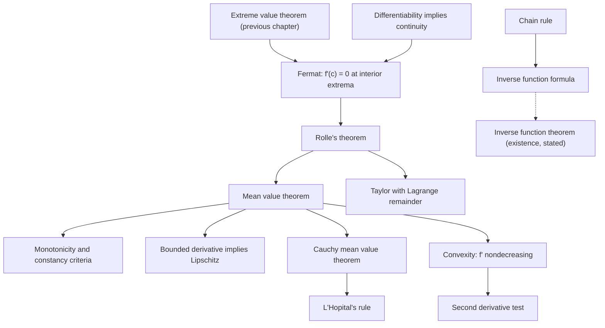

# Differentiation

> [Mathematics](../../README.md) › [Real Analysis](../README.md) · Level: Advanced · Prerequisites: [Continuity and Limits of Functions](../03-continuity-and-limits/README.md), [The Real Numbers and Completeness](../01-real-numbers-and-completeness/README.md), [Logic](../../00-foundations/02-logic/README.md), [Proof Techniques](../../00-foundations/04-proof-techniques/README.md), [Inequalities](../../03-algebra/03-inequalities/README.md), [Derivatives](../../07-calculus/03-derivatives/README.md) · Estimated time: 720 min

## 1. Introduction

The derivative is the first genuinely *quantitative* tool of analysis. Continuity tells us that a function has no jumps; differentiability tells us that, at each point, the function is indistinguishable from a straight line to first order, and it supplies the slope of that line. Everything in this chapter flows from that single idea: a function is differentiable at $a$ when the difference quotient
$$
\frac{f(x)-f(a)}{x-a}
$$
has a limit as $x \to a$, and the limit is $f'(a)$.

Three questions organise the chapter.

* **What does differentiability buy?** More than continuity: it gives a linear approximation, and hence error estimates, monotonicity criteria, and the mean value theorem. Theorem 7.1 shows that differentiability implies continuity; the converse fails, and the standard witness is $\lvert x\rvert$ at $0$. More subtly, the derivative need not be continuous even when it exists everywhere: $x^2\sin(1/x)$ is differentiable at every point and its derivative has no limit at $0$ (Section 7.12). This is the historical reason the definition of the derivative is a limit of quotients and not "the coefficient of the linear term in a Taylor expansion".
* **What is the mean value theorem for?** It converts information about $f'$ — a *local* object — into information about $f$ — a *global* object. If $f' \ge 0$ then $f$ is nondecreasing; if $f' = 0$ then $f$ is constant; if $\lvert f'\rvert \le M$ then $f$ is Lipschitz with constant $M$. The proof is Rolle's theorem, and Rolle's theorem is the extreme value theorem of the previous chapter applied to an interior extremum. The chain of dependencies is short and worth memorising: *completeness $\to$ EVT $\to$ Fermat $\to$ Rolle $\to$ MVT $\to$ everything else*.
* **How far can the local-to-global passage be pushed?** Taylor's theorem is the higher-order version: $n$ derivatives at a point determine the function up to an error controlled by the $(n+1)$-st derivative on the interval. Cauchy's mean value theorem is the two-function version, and it yields L'Hôpital's rule. Convexity is the order-theoretic version: the sign of $f''$ determines the shape of the graph, and the second derivative test is the first term of that correspondence.

The chapter is deliberately conservative about what is proved and what is stated. Everything one-variable and elementary is proved in full: the algebra of derivatives, the chain rule, Rolle, the mean value theorem, Cauchy's mean value theorem, L'Hôpital's rule in both the $0/0$ and $\infty/\infty$ forms, Taylor's theorem with the Lagrange remainder, the convexity criterion, the second derivative test, and the derivative formula for an inverse function. The *existence* part of the inverse function theorem is stated but not proved, because its natural proof is a compactness argument better done in [Topology](../../17-topology/README.md); Darboux's theorem is stated, with the standard remark that derivatives have the intermediate value property even when they are discontinuous.

Two warnings before beginning. First, the derivative is a limit, so every proof in this chapter is ultimately an $\varepsilon$-$\delta$ argument, but after the first two sections we almost never write one: the algebra of limits and the theorems of the previous chapter do the work. Second, the hypotheses of the mean value theorem are not decorative. Rolle's theorem fails on $(0,1)$ for $f(x) = x$ (no interior critical point), and the conclusion of the mean value theorem fails on $[0,1]$ for $f(x) = \lvert x\rvert$ (not differentiable at the interior point $0$). Section 11 collects the standard errors.

## 2. Prerequisites

**Limits and continuity.** The definition of $\lim_{x\to a} f(x)$, the sequential characterisation, the algebra of limits, compositions of continuous functions, the intermediate value theorem, the extreme value theorem and uniform continuity are all used, most of them in the proofs of Sections 7.5–7.9. See [Continuity and Limits of Functions](../03-continuity-and-limits/README.md); the numbering there is cited explicitly when a result is invoked.

**Completeness and sequences.** Suprema, the Archimedean property, Bolzano–Weierstrass and Cauchy completeness underlie the EVT and the sequential arguments. See [The Real Numbers and Completeness](../01-real-numbers-and-completeness/README.md).

**Informal differentiation.** The power rule, the derivatives of $\sin$, $\cos$, $\exp$ and $\log$, and the interpretation of $f'(a)$ as a slope and as an instantaneous rate are assumed as motivation; they are *derived* here from the definition, so the reader who has seen them only informally is not at a disadvantage. See [Derivatives](../../07-calculus/03-derivatives/README.md) and [Differentiation Rules](../../07-calculus/04-differentiation-rules/README.md).

**Inequalities.** The triangle inequality, the ability to bound a product by bounding each factor, and the technique of splitting $\varepsilon$ into $\varepsilon/2 + \varepsilon/2$. See [Inequalities](../../03-algebra/03-inequalities/README.md).

**Logic and proof.** Proof by contradiction (used for the failure of differentiability), proof by induction (used for the $n$-th derivative of $x^n$ and for Taylor's theorem), and the correct negation of a limit statement. See [Logic](../../00-foundations/02-logic/README.md) and [Proof Techniques](../../00-foundations/04-proof-techniques/README.md).

**The standard functions.** Continuity of polynomials, rational functions and $\sqrt{\cdot}$ (Corollary 7.11 of the previous chapter) is used constantly. For the trigonometric examples, $\lvert\sin t\rvert \le \lvert t\rvert$ and the addition formulae are used; these belong to elementary trigonometry.

## 3. Learning Objectives

By the end of this tutorial you will be able to

1. compute a derivative from the definition, including at a point where the formula is piecewise, and decide differentiability at a point by comparing one-sided difference quotients;
2. prove that differentiability at a point implies continuity there, and give examples showing the converse fails;
3. prove the sum, product, reciprocal and quotient rules from the definition, and use them fluently;
4. prove the chain rule rigorously, including the case in which the inner function is constant near the point;
5. state and prove Fermat's interior extremum lemma, Rolle's theorem and the mean value theorem, and explain exactly where the extreme value theorem enters;
6. derive the standard consequences of the mean value theorem: constancy from $f' = 0$, monotonicity from the sign of $f'$, and Lipschitz bounds from a bound on $\lvert f'\rvert$;
7. state Darboux's theorem and explain why it does not require $f'$ to be continuous;
8. state Cauchy's mean value theorem and prove L'Hôpital's rule in the $0/0$ and $\infty/\infty$ forms, checking the hypotheses in every application;
9. derive Taylor's theorem with the Lagrange remainder and use it to bound approximation errors;
10. define convexity, prove that $f$ is convex if and only if $f'$ is nondecreasing, deduce the criterion $f'' \ge 0$, and prove the second derivative test;
11. state the inverse function theorem and prove the formula $(f^{-1})'(y) = 1/f'(f^{-1}(y))$ from it;
12. define uniform differentiability, prove that $C^1$ functions on compact intervals are uniformly differentiable, and explain the example $x^2\sin(1/x)$.

## 4. Intuition

**The derivative as a magnifying glass.** Zoom into the graph of a differentiable function at a point. The more you zoom, the straighter the graph looks, and the slope it approaches is $f'(a)$. This is not a metaphor: the statement
$$
f(x) = f(a) + f'(a)(x-a) + o(x-a)
$$
says precisely that the error in the linear approximation is smaller than linear. For a non-differentiable function such as $\lvert x\rvert$ at $0$, zooming never straightens the corner: the left slope stays $-1$ and the right slope stays $+1$, no matter the magnification.

**The derivative as sensitivity.** If $f$ maps an input to an output, $f'(a)$ is the multiplier that converts a small input error into an output error: $\Delta f \approx f'(a)\Delta x$. This is the origin of the condition number $\lvert x f'(x)/f(x)\rvert$ in numerical analysis, and of the chain rule's ubiquity: sensitivities compose by multiplication, which is why the chain rule is a product.

**Why the mean value theorem is visually obvious but analytically deep.** "Somewhere the tangent is parallel to the chord" looks obvious: slide the chord upwards until it last touches the graph. The last contact point is an extremum of the shifted function, and at an interior extremum the derivative vanishes. The two sentences that make this rigorous are (i) the last contact point exists — that is the extreme value theorem, hence completeness — and (ii) the derivative vanishes at an interior extremum — that is Fermat's lemma. Everything else is algebra.

**Why Taylor's theorem is the right generalisation.** The mean value theorem says a function is determined to zeroth order by its value at $a$, with an error controlled by $f'$. Taylor's theorem says it is determined to $n$-th order by the first $n$ derivatives at $a$, with an error controlled by $f^{(n+1)}$ on the interval. The error term is not optional: it is the only part of the statement that contains global information, and without it the "Taylor polynomial" would be a formal object with no relation to $f$.

**Convexity as a shape.** A convex function bends upwards: every chord lies above the graph, and every tangent lies below it. The derivative of a convex function is nondecreasing, so the slope increases as you move right. The second derivative, when it exists, is the rate at which the slope increases; this is why $f'' \ge 0$ characterises convexity, and why $f''(c) > 0$ at a critical point forces a minimum.

## 5. Formal Definition

Throughout, $I \subseteq \mathbb{R}$ is an interval with nonempty interior, $f : I \to \mathbb{R}$, and $a$ is an interior point of $I$ unless stated otherwise.

**Definition 5.1 (derivative at a point).** The function $f$ is **differentiable at $a$** if the limit
$$
f'(a) := \lim_{x \to a} \frac{f(x) - f(a)}{x - a}
$$
exists in $\mathbb{R}$. The number $f'(a)$ is the **derivative of $f$ at $a$**. Equivalently, writing $h := x - a$,
$$
f'(a) = \lim_{h \to 0} \frac{f(a+h) - f(a)}{h}.
$$
The quotient is the **difference quotient**; its geometric meaning is the slope of the secant line through $(a, f(a))$ and $(x, f(x))$, and the limit is the slope of the tangent line.

**Definition 5.2 (one-sided derivatives).** If the right-hand limit
$$
f'_+(a) := \lim_{h \to 0^+} \frac{f(a+h)-f(a)}{h}
$$
exists, it is the **right derivative** at $a$; the **left derivative** $f'_-(a)$ is defined analogously with $h \to 0^-$. By Theorem 7.7 of [Continuity and Limits of Functions](../03-continuity-and-limits/README.md), $f$ is differentiable at $a$ if and only if both one-sided derivatives exist and are equal, and then $f'(a) = f'_+(a) = f'_-(a)$.

**Definition 5.3 (differentiable on a set; $C^1$).** $f$ is **differentiable on $I$** if it is differentiable at every interior point of $I$. The function $x \mapsto f'(x)$ is the **derivative** of $f$. If $f'$ is itself continuous on $I$, then $f$ is **continuously differentiable**, written $f \in C^1(I)$.

**Definition 5.4 (higher derivatives).** If $f'$ is differentiable at $a$, its derivative is $f''(a)$, the **second derivative**. Inductively, $f^{(n)}$ denotes the $n$-th derivative, defined wherever $f^{(n-1)}$ is differentiable, with the conventions $f^{(0)} := f$ and $f^{(1)} := f'$. We write $f \in C^n(I)$ if $f^{(n)}$ exists and is continuous on $I$.

**Definition 5.5 (uniform differentiability).** $f$ is **uniformly differentiable on $A$** if $f$ is differentiable at every point of $A$ and
$$
\forall \varepsilon > 0\ \exists \delta > 0\ \forall x, y \in A \quad \Bigl(0 < \lvert x-y\rvert < \delta \ \Rightarrow\ \Bigl\lvert \frac{f(x)-f(y)}{x-y} - f'(x) \Bigr\rvert < \varepsilon\Bigr).
$$
The point is that $\delta$ does not depend on $x$: the linear approximation must be good *uniformly* over the set. Compare Definitions 5.4 and 5.6 of the previous chapter: this is to differentiability what uniform continuity is to continuity. Section 7.12 develops the notion and shows where it fails.

**Definition 5.6 (Lipschitz).** $f : A \to \mathbb{R}$ is **$L$-Lipschitz** on $A$ if
$$
\lvert f(x) - f(y)\rvert \le L\lvert x - y\rvert \qquad \text{for all } x, y \in A .
$$
Every Lipschitz function is uniformly continuous (take $\delta = \varepsilon/L$). The mean value theorem gives the standard sufficient condition: if $f$ is differentiable with $\lvert f'\rvert \le L$ on an interval, then $f$ is $L$-Lipschitz there.

**Definition 5.7 (local extremum).** $f$ has a **local maximum** at $c$ if there is $\delta > 0$ such that $f(x) \le f(c)$ for all $x \in I$ with $\lvert x-c\rvert < \delta$; a **strict** local maximum requires $f(x) < f(c)$ for $x \ne c$ in that neighbourhood. Local minima and strict local minima are defined with the inequalities reversed. A **global** maximum on $I$ requires $f(x) \le f(c)$ for all $x \in I$.

## 6. Mathematical Notation

| Symbol | Read as | Meaning here |
|---|---|---|
| $f'(a)$ | f prime of a | derivative at $a$, Definition 5.1 |
| $\dfrac{df}{dx}\Big|_{x=a}$ | d f by d x at a | the same number as $f'(a)$ |
| $\dfrac{f(x)-f(a)}{x-a}$ | difference quotient | slope of the secant |
| $h \to 0$ | h tends to zero | the increment form of the limit |
| $f'_+(a)$, $f'_-(a)$ | right, left derivative | one-sided difference quotients |
| $f^{(n)}$ | n-th derivative | Definition 5.4 |
| $C^n(I)$ | functions with continuous n-th derivative | $C^1$ = continuously differentiable |
| $f \circ g$ | composition | $(f\circ g)(x) = f(g(x))$ |
| $(f^{-1})'(y)$ | derivative of the inverse at $y$ | $1/f'(f^{-1}(y))$, Proposition 7.23 |
| $o(h)$ | little-o | a quantity with $o(h)/h \to 0$ |
| $O(h)$ | big-O | bounded by a constant times $\lvert h\rvert$ |
| $f''(c) > 0$ | second derivative positive | upward curvature; local minimum if $f'(c)=0$ |
| $\lambda$ | lambda | an intermediate slope in Darboux/Cauchy MVT |
| $R_n(x)$ | remainder of order n | $f(x) - \sum_{k=0}^{n} f^{(k)}(a)(x-a)^k/k!$ |
| $\xi, c$ | xi, c | points supplied by Rolle/MVT, strictly between the endpoints |

Reading $f'(a)$ aloud: "the limit, as $x$ tends to $a$, of $f(x)$ minus $f(a)$, divided by $x$ minus $a$."

## 7. Core Concepts

### 7.1 Differentiating from the definition

The definition is a limit of quotients, so the first examples must be done by hand. Three patterns cover almost everything at this stage: expand and cancel, rationalise, and use the algebra of limits.

**$f(x) = x^2$ at $a$.** For $x \ne a$,
$$
\frac{x^2-a^2}{x-a} = \frac{(x-a)(x+a)}{x-a} = x + a \longrightarrow 2a,
$$
so $f'(a) = 2a$. The cancellation is legitimate because $x \ne a$, exactly as in the limit computations of the previous chapter.

**$f(x) = 1/x$ at $a \ne 0$.** For $x \ne a$,
$$
\frac{1/x - 1/a}{x-a} = \frac{a - x}{xa(x-a)} = -\frac{1}{xa} \longrightarrow -\frac{1}{a^2},
$$
using continuity of $x \mapsto -1/(xa)$ at $a \ne 0$. Hence $(1/x)' = -1/x^2$ on $\mathbb{R}\setminus\{0\}$.

**$f(x) = \sqrt x$ at $a > 0$.** Rationalise:
$$
\frac{\sqrt x - \sqrt a}{x-a} = \frac{1}{\sqrt x + \sqrt a} \longrightarrow \frac{1}{2\sqrt a},
$$
again by continuity of the reciprocal. At $a = 0$ the quotient equals $1/\sqrt x \to +\infty$, so $\sqrt\cdot$ is not differentiable at $0$; this is the vertical tangent phenomenon.

**$f(x) = \lvert x\rvert$ at $0$.** The right quotient is $(h-0)/h = 1$ for $h>0$, the left quotient is $(-h-0)/h = -1$ for $h<0$. The one-sided derivatives exist and differ, so by Theorem 7.7 of [Continuity and Limits of Functions](../03-continuity-and-limits/README.md) the derivative does not exist at $0$. Everywhere else $\lvert x\rvert$ is differentiable, with derivative $1$ on $(0,\infty)$ and $-1$ on $(-\infty,0)$.

**$f(x) = x^n$ for $n \in \mathbb{N}$.** The binomial theorem gives
$$
\frac{(a+h)^n - a^n}{h} = \sum_{k=1}^{n}\binom{n}{k}a^{n-k}h^{k-1} \longrightarrow na^{n-1},
$$
since every term with $k \ge 2$ carries a factor $h$. Alternatively, and more economically, prove $(x^n)' = nx^{n-1}$ by induction using the product rule (Section 7.2).

**Theorem 7.1 (differentiability implies continuity).** *If $f$ is differentiable at $a$, then $f$ is continuous at $a$.*

*Proof.* For $x$ in the domain with $x \ne a$, write
$$
f(x) - f(a) = \frac{f(x)-f(a)}{x-a}\,(x-a).
$$
By hypothesis the first factor tends to $f'(a)$ as $x \to a$, and the second tends to $0$ (the identity function is continuous). By the product rule for limits (Theorem 7.5(c) of [Continuity and Limits of Functions](../03-continuity-and-limits/README.md)),
$$
\lim_{x\to a}\bigl(f(x)-f(a)\bigr) = f'(a)\cdot 0 = 0,
$$
so $f(x) \to f(a)$ by the sum rule. Hence $f$ is continuous at $a$. $\blacksquare$

The converse is false, with $\lvert x\rvert$ at $0$ as the standard witness: continuity is a statement about the *size* of the increment, differentiability about its *shape* — whether it is asymptotically linear. The Weierstrass function is continuous everywhere and differentiable nowhere; Section 7.12 exhibits a function that is differentiable everywhere with a discontinuous derivative, which is the subtlest of the three phenomena.

### 7.2 Algebra of derivatives

**Theorem 7.2 (linearity).** *If $f, g$ are differentiable at $a$ and $c \in \mathbb{R}$, then $f+g$ and $cf$ are differentiable at $a$, with*
$$
(f+g)'(a) = f'(a)+g'(a), \qquad (cf)'(a) = c\,f'(a).
$$

*Proof.* Both are immediate from the algebra of limits applied to the difference quotients:
$$
\frac{(f+g)(x)-(f+g)(a)}{x-a} = \frac{f(x)-f(a)}{x-a} + \frac{g(x)-g(a)}{x-a} \longrightarrow f'(a)+g'(a),
$$
and the second is Theorem 7.5(b) of the previous chapter applied to the quotient of $f$. $\blacksquare$

**Theorem 7.3 (product rule).** *If $f, g$ are differentiable at $a$, then $fg$ is differentiable at $a$ and*
$$
(fg)'(a) = f'(a)g(a) + f(a)g'(a).
$$

*Proof.* The identity
$$
f(x)g(x) - f(a)g(a) = f(x)\bigl(g(x)-g(a)\bigr) + g(a)\bigl(f(x)-f(a)\bigr)
$$
is the "add and subtract $f(x)g(a)$" trick. Divide by $x-a$:
$$
\frac{(fg)(x)-(fg)(a)}{x-a} = f(x)\,\frac{g(x)-g(a)}{x-a} + g(a)\,\frac{f(x)-f(a)}{x-a}.
$$
As $x \to a$, we have $f(x) \to f(a)$ by Theorem 7.1, the first difference quotient tends to $g'(a)$, the second to $f'(a)$, and $g(a)$ is constant. The product and sum rules for limits give the claim. $\blacksquare$

**Theorem 7.4 (reciprocal and quotient).** *Let $g$ be differentiable at $a$ with $g(a) \ne 0$. Then $1/g$ is differentiable at $a$ and*
$$
\Bigl(\frac1g\Bigr)'(a) = -\frac{g'(a)}{g(a)^2}.
$$
*If in addition $f$ is differentiable at $a$, then $f/g$ is differentiable at $a$ and*
$$
\Bigl(\frac fg\Bigr)'(a) = \frac{f'(a)g(a) - f(a)g'(a)}{g(a)^2}.
$$

*Proof.* Since $g$ is continuous at $a$ (Theorem 7.1) and $g(a) \ne 0$, Corollary 7.14 of the previous chapter gives $\delta > 0$ with $g(x) \ne 0$ for $\lvert x-a\rvert < \delta$; so $1/g$ is defined near $a$. For such $x \ne a$,
$$
\frac{1/g(x) - 1/g(a)}{x-a}
= \frac{g(a)-g(x)}{g(x)g(a)(x-a)}
= -\frac{1}{g(x)g(a)}\cdot\frac{g(x)-g(a)}{x-a}.
$$
As $x\to a$, $g(x) \to g(a) \ne 0$, so $1/(g(x)g(a)) \to 1/g(a)^2$; the difference quotient tends to $g'(a)$. The product rule for limits gives $-g'(a)/g(a)^2$. The quotient formula follows by applying the product rule to $f \cdot (1/g)$:
$$
\Bigl(f\cdot\frac1g\Bigr)'(a) = f'(a)\frac{1}{g(a)} + f(a)\Bigl(-\frac{g'(a)}{g(a)^2}\Bigr) = \frac{f'(a)g(a)-f(a)g'(a)}{g(a)^2}. \qquad \blacksquare
$$

**Corollary (polynomials and rational functions).** For $n \in \mathbb{N}$, $(x^n)' = nx^{n-1}$; more generally every polynomial is differentiable on $\mathbb{R}$ with the expected derivative, and every rational function is differentiable wherever its denominator is nonzero.

*Proof.* Induct on $n$: the case $n = 1$ is $(x)' = 1$ from the definition, and if $(x^n)' = nx^{n-1}$ then the product rule gives $(x^{n+1})' = (x^n\cdot x)' = nx^{n-1}\cdot x + x^n\cdot 1 = (n+1)x^n$. Polynomials are finite sums of constant multiples of powers (Theorem 7.2), and quotients are covered by Theorem 7.4. $\blacksquare$

### 7.3 The chain rule

The naive proof of the chain rule,
$$
\frac{f(g(x))-f(g(a))}{x-a} = \frac{f(g(x))-f(g(a))}{g(x)-g(a)}\cdot\frac{g(x)-g(a)}{x-a},
$$
has a defect: the first factor is undefined when $g(x) = g(a)$, which can happen for infinitely many $x$ arbitrarily close to $a$ (for instance when $g$ is constant on a neighbourhood). The following proof repairs this by defining the first factor at $y = g(a)$ as well.

**Theorem 7.5 (chain rule).** *Let $g$ be differentiable at $a$ and $f$ differentiable at $b := g(a)$. Then $f \circ g$ is differentiable at $a$ and*
$$
(f \circ g)'(a) = f'\bigl(g(a)\bigr)\,g'(a).
$$

*Proof.* Let $J$ be an open interval around $b$ contained in the domain of $f$. Define $\varphi : J \to \mathbb{R}$ by
$$
\varphi(y) := \begin{cases} \dfrac{f(y)-f(b)}{y-b}, & y \ne b,\\[8pt] f'(b), & y = b. \end{cases}
$$
The assumption that $f$ is differentiable at $b$ says exactly that $\lim_{y\to b}\varphi(y) = f'(b) = \varphi(b)$, i.e. that $\varphi$ is continuous at $b$ (Theorem 7.8 of the previous chapter).

For every $y \in J$, including $y = b$, the identity
$$
f(y) - f(b) = \varphi(y)\,(y-b)
$$
holds: for $y \ne b$ it is the definition of $\varphi(y)$, and for $y = b$ both sides are $0$.

For $x$ in the domain of $g$ with $x \ne a$, put $y := g(x)$. Then
$$
\frac{(f\circ g)(x)-(f\circ g)(a)}{x-a}
= \frac{f(y)-f(b)}{x-a}
= \varphi(y)\,\frac{g(x)-g(a)}{x-a}.
$$
Since $g$ is differentiable at $a$, it is continuous at $a$ (Theorem 7.1), so $y = g(x) \to g(a) = b$ as $x \to a$. Since $\varphi$ is continuous at $b$, Theorem 7.10 of the previous chapter gives $\varphi(g(x)) \to \varphi(b) = f'(b)$. The second factor tends to $g'(a)$ by hypothesis. The product rule for limits therefore yields
$$
\lim_{x\to a}\frac{(f\circ g)(x)-(f\circ g)(a)}{x-a} = f'(b)\,g'(a) = f'\bigl(g(a)\bigr)g'(a). \qquad \blacksquare
$$

The proof has a useful by-product: it shows that the derivative is the coefficient in the first-order expansion $f(y) = f(b) + \varphi(y)(y-b)$ with $\varphi$ continuous at $b$. This "Carathéodory characterisation" is the cleanest way to handle compositions, and it reappears in the proof of the inverse function formula in Section 7.11.

**Example.** $( \sin(x^2) )' = \cos(x^2)\cdot 2x$; $((3x+1)^5)' = 5(3x+1)^4\cdot 3$; and for $f$ differentiable, $(f(x)^2)' = 2f(x)f'(x)$.

### 7.4 Fermat's lemma

**Theorem 7.6 (Fermat).** *Let $f$ be defined on an interval $I$ and let $c$ be an interior point of $I$. If $f$ has a local extremum at $c$ and $f$ is differentiable at $c$, then $f'(c) = 0$.*

*Proof.* Suppose first that $c$ is a local maximum: there is $\delta > 0$ with $(c-\delta, c+\delta) \subseteq I$ and $f(x) \le f(c)$ for $\lvert x - c\rvert < \delta$. For $0 < h < \delta$,
$$
\frac{f(c+h)-f(c)}{h} \le 0,
$$
so the right-hand limit satisfies $f'_+(c) \le 0$. For $-\delta < h < 0$ the numerator is $\le 0$ and the denominator is $< 0$, so the quotient is $\ge 0$, and the left-hand limit satisfies $f'_-(c) \ge 0$. Since $f$ is differentiable at $c$, both one-sided derivatives equal $f'(c)$; hence $0 \le f'(c) \le 0$, i.e. $f'(c) = 0$. The case of a local minimum is the same with all inequalities reversed, or follows by applying the result to $-f$. $\blacksquare$

The interior hypothesis is essential: $f(x) = x$ on $[0,1]$ has its extrema at the endpoints, where the derivative is $1$. The differentiability hypothesis is essential too: $f(x) = \lvert x\rvert$ has a local (indeed global) minimum at $0$ and is not differentiable there.

### 7.5 Rolle's theorem and the mean value theorem

**Theorem 7.7 (Rolle).** *Let $f$ be continuous on $[a,b]$, differentiable on $(a,b)$, and suppose $f(a) = f(b)$. Then there exists $c \in (a,b)$ with $f'(c) = 0$.*

*Proof.* By the extreme value theorem (Theorem 7.17 of [Continuity and Limits of Functions](../03-continuity-and-limits/README.md)), $f$ attains a maximum $M$ and a minimum $m$ on $[a,b]$.

If $M = m$ then $f$ is constant, so $f'(c) = 0$ for every $c \in (a,b)$.

Otherwise $M > m$. Since $f(a) = f(b)$, the two values $f(a)$ and $f(b)$ cannot be both the maximum and the minimum; at least one of $M$, $m$ is different from $f(a) = f(b)$, and the point $c$ where that value is attained is not an endpoint. Hence $c \in (a,b)$ and $f$ has a local extremum at the interior point $c$. Since $f$ is differentiable at $c$, Fermat's lemma (Theorem 7.6) gives $f'(c) = 0$. $\blacksquare$

**Theorem 7.8 (mean value theorem, MVT).** *Let $f$ be continuous on $[a,b]$ and differentiable on $(a,b)$. Then there exists $c \in (a,b)$ with*
$$
f'(c) = \frac{f(b)-f(a)}{b-a}.
$$

*Proof.* Define
$$
h(x) := f(x) - f(a) - \frac{f(b)-f(a)}{b-a}(x-a), \qquad x \in [a,b].
$$
Then $h$ is continuous on $[a,b]$ and differentiable on $(a,b)$ (difference of $f$ and a linear function). Moreover
$$
h(a) = f(a)-f(a)-0 = 0, \qquad h(b) = f(b)-f(a)-\bigl(f(b)-f(a)\bigr) = 0,
$$
so $h(a) = h(b)$. By Rolle's theorem there is $c \in (a,b)$ with $h'(c) = 0$. Since
$$
h'(x) = f'(x) - \frac{f(b)-f(a)}{b-a},
$$
this gives the claim. $\blacksquare$

Geometrically, the MVT says that somewhere the tangent is parallel to the chord. Analytically, it says that the *average rate of change* over $[a,b]$ is attained as an *instantaneous rate of change* somewhere inside. The proof's device — subtract the chord to reduce to Rolle — is the standard trick for turning a statement about a slope into a statement about a derivative at an extremum.

The two hypotheses cannot be dropped. $f(x) = x$ on $(0,1)$ has no interior critical point, so Rolle's conclusion fails on the open interval; $f(x) = \lvert x\rvert$ on $[-1,1]$ satisfies $f(-1)=f(1)$ and has no $c$ with $f'(c) = 0$, because it is not differentiable at the only candidate $0$. For the MVT, $f(x) = \lvert x\rvert$ on $[0,1]$ has average slope $1$ but derivative $\pm 1$ on the two halves, never $1$: the theorem fails because $f$ is not differentiable at $0 \in (0,1)$.

### 7.6 Consequences of the mean value theorem

**Theorem 7.9 (monotonicity and constancy).** *Let $f$ be continuous on $[a,b]$ and differentiable on $(a,b)$.*

*(i) If $f'(x) = 0$ for all $x \in (a,b)$, then $f$ is constant on $[a,b]$.*

*(ii) If $f'(x) \ge 0$ for all $x \in (a,b)$, then $f$ is nondecreasing on $[a,b]$; if $f'(x) > 0$ for all $x$, then $f$ is strictly increasing.*

*(iii) If $f'(x) \le 0$ (respectively $< 0$) for all $x$, then $f$ is nonincreasing (respectively strictly decreasing).*

*Proof.* (i) Let $x < y$ in $[a,b]$. By the MVT applied on $[x,y]$ there is $c \in (x,y)$ with $f(y)-f(x) = f'(c)(y-x) = 0$. Hence $f(x) = f(y)$; since $x,y$ were arbitrary, $f$ is constant.

(ii) With $x<y$ and $c \in (x,y)$ as above, $f(y)-f(x) = f'(c)(y-x) \ge 0$, so $f(x) \le f(y)$. If $f' > 0$ then $f'(c) > 0$ and $y - x > 0$, so the difference is strictly positive. Part (iii) is the same with signs reversed. $\blacksquare$

**Corollary 7.10 (bounded derivative implies Lipschitz).** *If $f$ is continuous on an interval $I$ and differentiable in its interior with $\lvert f'(x)\rvert \le M$ there, then*
$$
\lvert f(x)-f(y)\rvert \le M\lvert x-y\rvert \qquad \text{for all } x, y \in I .
$$
*Hence $f$ is uniformly continuous on $I$.*

*Proof.* For $x < y$ in $I$, the MVT gives $c \in (x,y)$ with $f(y)-f(x) = f'(c)(y-x)$; taking absolute values and using $\lvert f'(c)\rvert \le M$ gives the inequality. Uniform continuity follows with $\delta := \varepsilon/M$ if $M > 0$, and trivially if $M = 0$. $\blacksquare$

The converse of Corollary 7.10 is false: $f(x) = x^{1/3}$ is uniformly continuous on $[-1,1]$ (it is continuous on a compact interval, so Theorem 7.18 of the previous chapter applies) but its derivative $x^{-2/3}/3$ is unbounded near $0$. Uniform continuity does not require a bounded derivative; it requires only that the function cannot steepen without limit on the set.

### 7.7 Darboux's theorem (stated)

**Theorem 7.11 (Darboux).** *Let $f$ be differentiable on $[a,b]$ and suppose $f'(a) < \lambda < f'(b)$. Then there exists $c \in (a,b)$ with $f'(c) = \lambda$. The same holds with the inequalities reversed, and with $f'(a)$ and $f'(b)$ replaced by the one-sided derivatives if $f$ is defined on a half-open interval.*

In words: *a derivative has the intermediate value property, even if it is not continuous.* This is surprising because the intermediate value theorem is a theorem about continuous functions, and $f'$ need not be continuous. The standard example is
$$
f(x) = \begin{cases} x^2\sin\dfrac1x, & x \ne 0,\\ 0, & x = 0,\end{cases}
\qquad
f'(x) = \begin{cases} 2x\sin\dfrac1x - \cos\dfrac1x, & x \ne 0,\\ 0, & x = 0,\end{cases}
$$
whose derivative exists everywhere but has no limit as $x \to 0$ (Section 7.12). Darboux's theorem nevertheless guarantees that on $[0, 1/\pi]$ the derivative takes every value between $f'(0) = 0$ and $f'(1/\pi) = 0 + 1 = 1$; and indeed $\cos(1/x)$ oscillates through every value in $[-1,1]$.

The proof of Darboux's theorem is not given here because it is an application of the extreme value theorem to the auxiliary function $g(x) := f(x) - \lambda x$, whose derivative $g' = f' - \lambda$ changes sign at the endpoints; the argument is sketched in Exercise 23, and a full proof appears in [Metric Spaces](../06-metric-spaces/README.md) alongside the general theory of derivatives. What matters for this chapter is the following corollary, which is used in the inverse function theorem.

**Corollary 7.12.** *Let $f$ be differentiable on an interval $I$ and suppose $f'(x) \ne 0$ for all $x \in I$. Then $f'$ has constant sign on $I$; consequently, by Theorem 7.9, $f$ is strictly monotone on $I$.*

*Proof.* If $f'$ took both a positive value at $u$ and a negative value at $v$, Darboux's theorem (applied on the interval with endpoints $u,v$) would give $c$ with $f'(c) = 0$, contrary to the hypothesis. Hence $f'$ is either everywhere positive or everywhere negative, and Theorem 7.9 gives strict monotonicity. $\blacksquare$

### 7.8 Cauchy's mean value theorem and L'Hôpital's rule

**Theorem 7.13 (Cauchy's mean value theorem).** *Let $f, g$ be continuous on $[a,b]$ and differentiable on $(a,b)$. Then there is $c \in (a,b)$ with*
$$
\bigl(f(b)-f(a)\bigr)g'(c) = \bigl(g(b)-g(a)\bigr)f'(c).
$$
*If moreover $g'(x) \ne 0$ for all $x \in (a,b)$ and $g(b) \ne g(a)$, then*
$$
\frac{f(b)-f(a)}{g(b)-g(a)} = \frac{f'(c)}{g'(c)} .
$$

*Proof.* Define
$$
h(x) := \bigl(f(b)-f(a)\bigr)g(x) - \bigl(g(b)-g(a)\bigr)f(x).
$$
Then $h$ is continuous on $[a,b]$ and differentiable on $(a,b)$, and
$$
h(b) - h(a) = \bigl(f(b)-f(a)\bigr)\bigl(g(b)-g(a)\bigr) - \bigl(g(b)-g(a)\bigr)\bigl(f(b)-f(a)\bigr) = 0 .
$$
By Rolle's theorem there is $c \in (a,b)$ with $h'(c) = 0$, i.e.
$$
\bigl(f(b)-f(a)\bigr)g'(c) - \bigl(g(b)-g(a)\bigr)f'(c) = 0 ,
$$
which is the first identity. If $g' \ne 0$ on $(a,b)$ then $g(b) \ne g(a)$ by Rolle (otherwise $g'$ would vanish somewhere), and dividing the identity by $g'(c)(g(b)-g(a))$ — both nonzero — gives the second form. $\blacksquare$

The MVT is the case $g(x) = x$. Note that the conclusion is *not* obtained by applying the MVT separately to $f$ and $g$: the two resulting points $c_f$ and $c_g$ need not coincide, and Cauchy's theorem says a common point exists for this particular combination.

**Theorem 7.14 (L'Hôpital's rule, $0/0$ form).** *Let $-\infty < a < b \le +\infty$, let $f, g$ be continuous at $a$ with $f(a) = g(a) = 0$, differentiable on $(a,b)$ with $g'(x) \ne 0$ there, and suppose that*
$$
\lim_{x\to a^+}\frac{f'(x)}{g'(x)} = L \in \mathbb{R}.
$$
*Then $g(x) \ne 0$ for $x \in (a,b)$ and*
$$
\lim_{x\to a^+}\frac{f(x)}{g(x)} = L .
$$
*The same statement holds for $x \to a^-$ and hence, when both one-sided limits exist, for $x \to a$.*

*Proof.* Let $x \in (a,b)$. Apply Cauchy's mean value theorem to $f$ and $g$ on $[a,x]$: both are continuous on $[a,x]$ and differentiable on $(a,x)$, so there is $c_x \in (a,x)$ with
$$
\bigl(f(x)-f(a)\bigr)g'(c_x) = \bigl(g(x)-g(a)\bigr)f'(c_x).
$$
Since $f(a) = g(a) = 0$,
$$
f(x)\,g'(c_x) = g(x)\,f'(c_x).
$$
*$g(x) \ne 0$:* if $g(x) = 0$ then $g(a) = g(x) = 0$, and Rolle's theorem on $[a,x]$ would give $\xi \in (a,x)$ with $g'(\xi) = 0$, contrary to hypothesis. So $g(x) \ne 0$. Also $g'(c_x) \ne 0$ by hypothesis. Dividing the displayed identity by $g(x)g'(c_x)$,
$$
\frac{f(x)}{g(x)} = \frac{f'(c_x)}{g'(c_x)} .
$$
Now let $\varepsilon > 0$. Choose $\delta_1 > 0$ with $\delta_1 \le b - a$ such that
$$
\left\lvert \frac{f'(t)}{g'(t)} - L \right\rvert < \varepsilon \qquad \text{for } a < t < a+\delta_1 .
$$
For $a < x < a+\delta_1$ we have $a < c_x < x < a + \delta_1$, so by the quotient identity
$$
\left\lvert \frac{f(x)}{g(x)} - L \right\rvert = \left\lvert \frac{f'(c_x)}{g'(c_x)} - L \right\rvert < \varepsilon .
$$
This is exactly the definition of the right-hand limit. $\blacksquare$

**Theorem 7.15 (L'Hôpital's rule, $\infty/\infty$ form).** *Let $-\infty < a < b \le +\infty$, let $f, g$ be differentiable on $(a,b)$ with $g'(x) \ne 0$ there, suppose $\lim_{x\to a^+} g(x) = +\infty$ (or $-\infty$), and suppose*
$$
\lim_{x\to a^+}\frac{f'(x)}{g'(x)} = L \in \mathbb{R}.
$$
*Then $\lim_{x\to a^+} f(x)/g(x) = L$.*

*Proof.* Let $\varepsilon > 0$; we may assume $\varepsilon \le 1$. Choose $c \in (a,b)$ such that
$$
\left\lvert \frac{f'(t)}{g'(t)} - L \right\rvert < \frac{\varepsilon}{2} \qquad \text{for all } t \in (a,c).
$$
Fix this $c$. For $x \in (a,c)$, Cauchy's mean value theorem on $[x,c]$ gives $\xi \in (x,c)$ with
$$
\frac{f(c)-f(x)}{g(c)-g(x)} = \frac{f'(\xi)}{g'(\xi)} =: R_x, \qquad \lvert R_x - L\rvert < \frac{\varepsilon}{2},
$$
where division by $g(c)-g(x)$ is legitimate because $g(c) = g(x)$ would force $g'$ to vanish on $(x,c)$ by Rolle. Solving for $f(x)$,
$$
f(x) = f(c) - R_x\bigl(g(c)-g(x)\bigr) = R_x\,g(x) + \bigl(f(c) - R_x\,g(c)\bigr),
$$
hence
$$
\frac{f(x)}{g(x)} = R_x + \frac{f(c)-R_x\,g(c)}{g(x)} .
$$
Since $\lvert R_x\rvert \le \lvert L\rvert + 1/2$ for all such $x$, the numerator is bounded in absolute value by
$$
K := \lvert f(c)\rvert + \Bigl(\lvert L\rvert + \frac12\Bigr)\lvert g(c)\rvert .
$$
Because $\lvert g(x)\rvert \to +\infty$, there is $\delta > 0$ with $\delta \le c - a$ and $\lvert g(x)\rvert > 2K/\varepsilon$ for $a < x < a+\delta$. For such $x$,
$$
\left\lvert \frac{f(x)}{g(x)} - L \right\rvert \le \lvert R_x - L\rvert + \frac{K}{\lvert g(x)\rvert} < \frac{\varepsilon}{2} + \frac{\varepsilon}{2} = \varepsilon . \qquad \blacksquare
$$

Both forms require the hypotheses to be checked, and the most common error is to apply the rule when the quotient $f'/g'$ has no limit (in which case the rule gives no information, although $f/g$ may still have one) or when the indeterminacy is not of the required type. Section 9.6 works an example where the hypotheses are verified one by one.

**Example.** $\displaystyle\lim_{x\to 0}\frac{\sin x}{x}$: here $f(x) = \sin x$, $g(x) = x$, $f(0)=g(0)=0$, $g'(x) = 1 \ne 0$, and $f'(x)/g'(x) = \cos x \to 1$. The rule gives the limit $1$. This is legitimate at this point in the course because the derivative of $\sin$ is assumed from elementary calculus and the limit being computed is not used in its derivation; in a fully self-contained development of the trigonometric functions one proves $\sin x/x \to 1$ first and derives $(\sin)' = \cos$ from it.

### 7.9 Taylor's theorem with the Lagrange remainder

**Theorem 7.16 (Taylor).** *Let $n \in \mathbb{N}_0$, let $I$ be an interval, $a \in I$, and let $f : I \to \mathbb{R}$ be $n$ times continuously differentiable on $I$ with $f^{(n+1)}$ existing on the interior of $I$. Then for every $x \in I$ with $x \ne a$ there exists $c$ strictly between $a$ and $x$ such that*
$$
f(x) = \sum_{k=0}^{n}\frac{f^{(k)}(a)}{k!}(x-a)^k + \frac{f^{(n+1)}(c)}{(n+1)!}(x-a)^{n+1}.
$$

*Proof.* Fix $x \ne a$ and define the Taylor polynomial
$$
P(t) := \sum_{k=0}^{n}\frac{f^{(k)}(a)}{k!}(t-a)^k .
$$
Let $M \in \mathbb{R}$ be defined by
$$
f(x) = P(x) + M(x-a)^{n+1},
\qquad\text{i.e.}\qquad
M := \frac{f(x)-P(x)}{(x-a)^{n+1}} .
$$
Now set
$$
\varphi(t) := f(t) - P(t) - M(t-a)^{n+1}
$$
on the closed interval $J$ with endpoints $a$ and $x$. Then $\varphi$ is continuous on $J$ and $n+1$ times differentiable in its interior, and
$$
\varphi(a) = f(a) - f(a) - 0 = 0, \qquad \varphi(x) = f(x) - P(x) - M(x-a)^{n+1} = 0 .
$$
We claim that for $k = 0, 1, \dots, n$,
$$
\varphi^{(k)}(a) = 0 .
$$
Indeed, $P$ is a polynomial of degree at most $n$ whose derivatives at $a$ reproduce those of $f$: differentiating $P(t) = \sum_{k=0}^n \frac{f^{(k)}(a)}{k!}(t-a)^k$ term by term gives $P^{(k)}(a) = f^{(k)}(a)$ for $k \le n$. And the $(n+1)$-st power term has vanishing $k$-th derivative at $t = a$ for every $k \le n$. Hence $\varphi^{(k)}(a) = f^{(k)}(a) - f^{(k)}(a) - 0 = 0$.

We now apply Rolle's theorem iteratively on the interval $J$:

* $\varphi(a) = \varphi(x) = 0$, so there is $x_1$ strictly between $a$ and $x$ with $\varphi'(x_1) = 0$.
* $\varphi'(a) = 0 = \varphi'(x_1)$, so there is $x_2$ strictly between $a$ and $x_1$ with $\varphi''(x_2) = 0$.
* Continuing, for $k = 1, \dots, n$ we obtain $x_k$ with $\varphi^{(k)}(x_k) = 0$, and since also $\varphi^{(k)}(a) = 0$ (for $k \le n$), Rolle gives $x_{k+1}$ strictly between $a$ and $x_k$ with $\varphi^{(k+1)}(x_{k+1}) = 0$.

At the end we have $c := x_{n+1}$ with $\varphi^{(n+1)}(c) = 0$. But $P$ has degree at most $n$, so $P^{(n+1)} \equiv 0$, and the $(n+1)$-st derivative of $M(t-a)^{n+1}$ is $M(n+1)!$. Therefore
$$
0 = \varphi^{(n+1)}(c) = f^{(n+1)}(c) - M(n+1)!,
\qquad\text{so}\qquad
M = \frac{f^{(n+1)}(c)}{(n+1)!}.
$$
Substituting this value of $M$ into the defining equation $f(x) = P(x) + M(x-a)^{n+1}$ gives the stated formula. $\blacksquare$

**Remainder notation and the standard estimate.** Write
$$
R_n(x) := f(x) - \sum_{k=0}^{n}\frac{f^{(k)}(a)}{k!}(x-a)^k
= \frac{f^{(n+1)}(c)}{(n+1)!}(x-a)^{n+1}.
$$
If $\lvert f^{(n+1)}(t)\rvert \le B$ for all $t$ between $a$ and $x$, then
$$
\lvert R_n(x)\rvert \le \frac{B}{(n+1)!}\lvert x-a\rvert^{n+1} .
$$
For $n = 0$ the theorem reads $f(x) = f(a) + f'(c)(x-a)$, which is exactly the mean value theorem. Taylor's theorem is therefore the MVT applied $n+1$ times, and the Lagrange remainder is the price paid for not knowing where the intermediate point is.

**Example.** With $a = 0$, $f(x) = e^x$ and $n = 2$: for every $x \ne 0$ there is $c$ between $0$ and $x$ with
$$
e^x = 1 + x + \frac{x^2}{2} + \frac{e^c}{6}x^3 .
$$
For $0 < x < 1$ this gives $1 + x + x^2/2 < e^x < 1 + x + x^2/2 + ex^3/6$, because $1 < e^c < e$ — a two-sided numerical bound obtained without any integration.

### 7.10 Convexity and the second derivative test

**Definition 7.17 (convex function).** Let $I$ be an interval. A function $f : I \to \mathbb{R}$ is **convex** if
$$
f\bigl((1-t)x + ty\bigr) \le (1-t)f(x) + t f(y)
\qquad \text{for all } x, y \in I \text{ and } t \in [0,1].
$$
It is **strictly convex** if the inequality is strict for $x \ne y$ and $t \in (0,1)$. It is **concave** if $-f$ is convex.

Geometrically: the chord joining $(x,f(x))$ to $(y,f(y))$ lies on or above the graph. Convexity is an order-and-average condition; it does not mention derivatives, but for differentiable functions it is equivalent to monotonicity of the derivative.

**Lemma 7.18 (three-slope inequality).** *If $f$ is convex on $I$ and $x < z < y$ in $I$, then*
$$
\frac{f(z)-f(x)}{z-x} \le \frac{f(y)-f(x)}{y-x} \le \frac{f(y)-f(z)}{y-z} .
$$

*Proof.* Write $t := \dfrac{z-x}{y-x} \in (0,1)$, so that $z = (1-t)x + ty$ and $1-t = \dfrac{y-z}{y-x}$. Convexity gives
$$
f(z) \le (1-t)f(x) + tf(y).
$$
Subtract $f(x)$ from both sides:
$$
f(z)-f(x) \le t\bigl(f(y)-f(x)\bigr) = \frac{z-x}{y-x}\bigl(f(y)-f(x)\bigr),
$$
which is the first inequality after dividing by $z-x > 0$. Subtract $f(z)$ from both sides instead:
$$
0 \le (1-t)\bigl(f(x)-f(y)\bigr) + \bigl(f(y)-f(z)\bigr),
$$
i.e. $f(y)-f(z) \ge (1-t)(f(y)-f(x)) = \dfrac{y-z}{y-x}(f(y)-f(x))$, which is the second inequality after dividing by $y-z>0$. $\blacksquare$

**Theorem 7.19 (convexity is monotonicity of the derivative).** *Let $f$ be differentiable on an interval $I$. Then $f$ is convex if and only if $f'$ is nondecreasing on $I$. Moreover $f$ is strictly convex if and only if $f'$ is strictly increasing.*

*Proof.* **(Convex $\Rightarrow$ $f'$ nondecreasing.)** Let $x < y$ in $I$ and choose $z$ with $x < z < y$. By Lemma 7.18,
$$
\frac{f(z)-f(x)}{z-x} \le \frac{f(y)-f(x)}{y-x} \le \frac{f(y)-f(z)}{y-z}.
$$
Let $z \downarrow x$: the left-hand quotient is the difference quotient of $f$ at $x$ with positive increment $z-x$, so it tends to $f'(x)$ (the right derivative, which equals $f'(x)$). Hence $f'(x) \le \dfrac{f(y)-f(x)}{y-x}$. Let $z \uparrow y$: the right-hand quotient tends to $f'(y)$ (left derivative), so $\dfrac{f(y)-f(x)}{y-x} \le f'(y)$. Combining, $f'(x) \le f'(y)$. (If $y$ is an endpoint of $I$ where only a one-sided derivative exists, apply the same argument at interior points and pass to the limit, or appeal to the definition at the endpoint.)

**(Monotone $f'$ $\Rightarrow$ convex.)** Let $x < z < y$ in $I$. By the MVT there are $\xi_1 \in (x,z)$ and $\xi_2 \in (z,y)$ with
$$
f(z)-f(x) = f'(\xi_1)(z-x), \qquad f(y)-f(z) = f'(\xi_2)(y-z).
$$
Since $\xi_1 < z < \xi_2$ and $f'$ is nondecreasing, $f'(\xi_1) \le f'(z) \le f'(\xi_2)$. Therefore
$$
\frac{f(z)-f(x)}{z-x} = f'(\xi_1) \le f'(z) \le f'(\xi_2) = \frac{f(y)-f(z)}{y-z} .
$$
This is the chain of inequalities
$$
\frac{f(z)-f(x)}{z-x} \le \frac{f(y)-f(z)}{y-z},
$$
which rearranges (multiply by $(z-x)(y-z) > 0$) to
$$
\bigl(f(z)-f(x)\bigr)(y-z) \le \bigl(f(y)-f(z)\bigr)(z-x),
$$
and after expanding and collecting the terms containing $f(z)$,
$$
f(z)(y-x) \le f(x)(y-z) + f(y)(z-x).
$$
Divide by $y-x$ and put $t := (z-x)/(y-x) \in (0,1)$: then $(y-z)/(y-x) = 1-t$ and the inequality becomes $f((1-t)x+ty) \le (1-t)f(x)+tf(y)$, which is convexity. If $f'$ is strictly increasing, the middle inequality is strict, and the same computation gives strict convexity. $\blacksquare$

**Corollary 7.20 ($f'' \ge 0$ implies convex).** *If $f$ is twice differentiable on $I$ and $f''(x) \ge 0$ for all $x \in I$, then $f$ is convex. If $f''(x) > 0$ for all $x$, then $f$ is strictly convex.*

*Proof.* By Theorem 7.9(ii) applied to the function $f'$, the condition $f'' \ge 0$ means $f'$ is nondecreasing (strictly increasing if $f'' > 0$). Theorem 7.19 then gives convexity (strict convexity). $\blacksquare$

**Theorem 7.21 (second derivative test).** *Let $f$ be differentiable on an open interval containing $c$, with $f'(c) = 0$ and $f''(c)$ existing.*

*(a) If $f''(c) > 0$, then $f$ has a strict local minimum at $c$.*

*(b) If $f''(c) < 0$, then $f$ has a strict local maximum at $c$.*

*(c) If $f''(c) = 0$, no conclusion can be drawn.*

*Proof.* (a) By definition,
$$
f''(c) = \lim_{x\to c}\frac{f'(x)-f'(c)}{x-c} = \lim_{x\to c}\frac{f'(x)}{x-c} > 0 .
$$
Take $\varepsilon := f''(c)/2 > 0$. There is $\delta > 0$ such that
$$
0 < \lvert x-c\rvert < \delta \ \Rightarrow\ \frac{f'(x)}{x-c} > \varepsilon > 0 .
$$
For $c < x < c+\delta$ the denominator is positive, so $f'(x) > 0$; for $c-\delta < x < c$ the denominator is negative, so $f'(x) < 0$. By Theorem 7.9, $f$ is strictly decreasing on $[c-\delta, c]$ and strictly increasing on $[c, c+\delta]$. Hence for $0 < \lvert x-c\rvert < \delta$,
$$
f(x) > f(c),
$$
so $c$ is a strict local minimum. (At $x = c$ the difference is zero, and at every other nearby point it is positive.)

(b) Apply (a) to $-f$, whose second derivative at $c$ is $-f''(c) > 0$.

(c) The three functions $f(x) = x^4$, $f(x) = -x^4$ and $f(x) = x^3$ all satisfy $f'(0) = f''(0) = 0$; the first has a strict minimum at $0$, the second a strict maximum, and the third neither (it is strictly increasing). So the sign of $f''$ at a critical point, when it vanishes, carries no information. $\blacksquare$

### 7.11 The inverse function theorem

**Theorem 7.22 (inverse function theorem, stated).** *Let $I$ be an open interval, $a \in I$, and let $f : I \to \mathbb{R}$ be continuously differentiable with $f'(a) \ne 0$. Then there exist open intervals $J$ around $a$ and $K$ around $f(a)$ such that*

*(i) $f$ maps $J$ bijectively onto $K$;*

*(ii) the inverse $g : K \to J$ is continuous;*

*(iii) $g$ is differentiable on $K$, and for every $y \in K$,*
$$
g'(y) = \frac{1}{f'\bigl(g(y)\bigr)} .
$$

The existence of the intervals $J$ and $K$, and the continuity of the inverse, are not proved here: the standard proof uses the intermediate value theorem to get injectivity on a small interval and a compactness argument to get the continuity of the inverse, and it is cleaner in the setting of [Metric Spaces](../06-metric-spaces/README.md). What we prove — and what is used in computation — is the *formula* for the derivative of the inverse, which is a corollary of the chain rule and the algebra of limits.

**Proposition 7.23 (derivative of the inverse).** *Assume the conclusions (i)–(ii) of Theorem 7.22. Then $g$ is differentiable on $K$ and $g'(y) = 1/f'(g(y))$ for every $y \in K$.*

*Proof.* Fix $y_0 \in K$ and put $x_0 := g(y_0) \in J$, so that $f(x_0) = y_0$. For $y \in K$ with $y \ne y_0$, put $x := g(y)$. Since $g$ is injective, $x \ne x_0$, and since $f(x) = y$ and $f(x_0) = y_0$,
$$
\frac{g(y)-g(y_0)}{y-y_0} = \frac{x-x_0}{f(x)-f(x_0)} = \frac{1}{\dfrac{f(x)-f(x_0)}{x-x_0}} .
$$
As $y \to y_0$, continuity of $g$ at $y_0$ gives $x = g(y) \to g(y_0) = x_0$. The difference quotient of $f$ at $x_0$ tends to $f'(x_0)$, which is nonzero by hypothesis. By the quotient rule for limits (Theorem 7.5(d) of [Continuity and Limits of Functions](../03-continuity-and-limits/README.md)), the reciprocal tends to $1/f'(x_0)$. Hence $g'(y_0)$ exists and equals $1/f'(g(y_0))$. $\blacksquare$

In Leibniz notation the formula reads $\dfrac{dx}{dy} = 1\Big/\dfrac{dy}{dx}$, which is the familiar "flip the derivative" rule. The hypothesis $f'(a) \ne 0$ is indispensable: $f(x) = x^3$ is a bijection of $\mathbb{R}$ onto $\mathbb{R}$ with $f'(0) = 0$, and its inverse $g(y) = y^{1/3}$ has no derivative at $0$ (the difference quotient $(h^{1/3}-0)/h = h^{-2/3}$ diverges).

### 7.12 Uniform differentiability, and a derivative that is not continuous

Differentiability at every point of a set does not imply that the linear approximation is *uniformly* good: the rate at which the secant slope converges to the derivative may deteriorate from point to point. Definition 5.5 makes the stronger demand precise, and the following proposition identifies the standard sufficient condition.

**Proposition 7.24 ($C^1$ on a compact interval implies uniformly differentiable).** *Let $f$ be continuously differentiable on $[a,b]$. Then $f$ is uniformly differentiable on $[a,b]$.*

*Proof.* Let $\varepsilon > 0$. Since $f'$ is continuous on the compact interval $[a,b]$, it is uniformly continuous there (Theorem 7.18 of [Continuity and Limits of Functions](../03-continuity-and-limits/README.md)). Choose $\delta > 0$ such that $\lvert f'(u)-f'(v)\rvert < \varepsilon$ whenever $u, v \in [a,b]$ and $\lvert u-v\rvert < \delta$. Now let $x, y \in [a,b]$ with $0 < \lvert x-y\rvert < \delta$. By the mean value theorem applied on the interval with endpoints $x$ and $y$, there is $\xi$ strictly between them with
$$
\frac{f(x)-f(y)}{x-y} = f'(\xi).
$$
Since $\lvert\xi - x\rvert < \lvert x-y\rvert < \delta$, uniform continuity gives $\lvert f'(\xi)-f'(x)\rvert < \varepsilon$, hence
$$
\left\lvert \frac{f(x)-f(y)}{x-y} - f'(x)\right\rvert = \lvert f'(\xi)-f'(x)\rvert < \varepsilon .
$$
This $\delta$ depends only on $\varepsilon$, so $f$ is uniformly differentiable. $\blacksquare$

**Example 7.25 (differentiable everywhere, derivative discontinuous).** Define
$$
f(x) := \begin{cases} x^2\sin\dfrac1x, & x \ne 0,\\[4pt] 0, & x = 0.\end{cases}
$$
*Differentiability off $0$:* $x^2$ and $\sin(1/x)$ are differentiable on $\mathbb{R}\setminus\{0\}$, so the product rule and the chain rule give
$$
f'(x) = 2x\sin\frac1x - \cos\frac1x, \qquad x \ne 0 .
$$
*Differentiability at $0$:*
$$
\frac{f(h)-f(0)}{h} = \frac{h^2\sin(1/h)}{h} = h\sin\frac1h \longrightarrow 0
$$
by the squeeze theorem (Section 9.4 of the previous chapter), since $\lvert h \sin(1/h)\rvert \le \lvert h\rvert$. Hence $f'(0) = 0$ and $f$ is differentiable on $\mathbb{R}$.

*$f'$ is discontinuous at $0$:* the term $2x\sin(1/x) \to 0$ as $x \to 0$, but $\cos(1/x)$ has no limit at $0$ (two sequences: $\cos(2n\pi) = 1$ and $\cos((2n+1)\pi) = -1$). Hence $f'(x)$ has no limit at $0$, while $f'(0) = 0$. So $f$ is differentiable but not continuously differentiable.

**Example 7.26 (differentiable but not uniformly differentiable).** The function
$$
F(x) := \begin{cases} x^2\sin\dfrac{1}{x^2}, & x \ne 0,\\[4pt] 0, & x = 0,\end{cases}
$$
is differentiable on $\mathbb{R}$ but not uniformly differentiable on any interval containing $0$. Indeed, for $x \ne 0$,
$$
F'(x) = 2x\sin\frac{1}{x^2} - \frac{2}{x}\cos\frac{1}{x^2},
$$
and at $x_n := 1/\sqrt{2n\pi}$ we have $\sin(1/x_n^2) = \sin(2n\pi) = 0$ and $\cos(1/x_n^2) = 1$, so
$$
F(x_n) = 0, \qquad F'(x_n) = -\frac{2}{x_n} \longrightarrow -\infty .
$$
Put $y_n := x_n + x_n^2$, so that $0 < y_n - x_n = x_n^2 \to 0$. Then
$$
\left\lvert \frac{F(y_n)-F(x_n)}{y_n-x_n}\right\rvert = \frac{\lvert F(y_n)\rvert}{x_n^2} \le \frac{y_n^2}{x_n^2} = (1+x_n)^2 \le 4
$$
for $n$ large. Consequently
$$
\left\lvert \frac{F(y_n)-F(x_n)}{y_n-x_n} - F'(x_n)\right\rvert \ge \lvert F'(x_n)\rvert - 4 \longrightarrow +\infty,
$$
so for $\varepsilon = 1$ no $\delta > 0$ can satisfy Definition 5.5: the pairs $(x_n,y_n)$ have arbitrarily small separation and violate the estimate. Hence $F$ is not uniformly differentiable near $0$, although it is differentiable everywhere.

The two examples separate three notions: $C^1$ (Example 7.25 is not), differentiability everywhere (both examples are), and uniform differentiability (Example 7.26 is not, while Proposition 7.24 shows $C^1$ on a compact interval is enough).

## 8. Formulas and Properties

**Derivatives of the standard functions.** Each entry is proved from Definition 5.1 together with the rules of Section 7.2–7.3; the trigonometric and exponential entries use the addition formulae and the limits $\sin h/h \to 1$, $(e^h-1)/h \to 1$ from elementary calculus.

| $f(x)$ | $f'(x)$ | Valid on | Reason |
|---|---|---|---|
| $c$ | $0$ | $\mathbb{R}$ | difference quotient $0$ |
| $x$ | $1$ | $\mathbb{R}$ | quotient $= 1$ |
| $x^n$, $n \in \mathbb{N}$ | $nx^{n-1}$ | $\mathbb{R}$ | induction with the product rule |
| $x^{-n}$, $n \in \mathbb{N}$ | $-nx^{-n-1}$ | $x \ne 0$ | reciprocal rule |
| $\sqrt x$ | $\dfrac{1}{2\sqrt x}$ | $x > 0$ | rationalise; fails at $0$ |
| $\lvert x\rvert$ | $\operatorname{sign} x$ | $x \ne 0$ | one-sided quotients differ at $0$ |
| $\sin x$ | $\cos x$ | $\mathbb{R}$ | addition formula, $\sin h/h \to 1$ |
| $\cos x$ | $-\sin x$ | $\mathbb{R}$ | addition formula |
| $\tan x$ | $\sec^2 x$ | $\cos x \ne 0$ | quotient rule |
| $e^x$ | $e^x$ | $\mathbb{R}$ | $(e^h-1)/h \to 1$ |
| $\ln x$ | $\dfrac1x$ | $x > 0$ | inverse function formula |
| $x^\alpha$, $\alpha \in \mathbb{R}$ | $\alpha x^{\alpha-1}$ | $x>0$ | $x^\alpha = e^{\alpha\ln x}$ and the chain rule |

**Rules of differentiation.**

| Rule | Statement | Hypotheses | Why it is true |
|---|---|---|---|
| Linearity | $(f+cg)' = f' + cg'$ | both differentiable | add the difference quotients |
| Product | $(fg)' = f'g + fg'$ | both differentiable | add and subtract $f(x)g(a)$ |
| Reciprocal | $(1/g)' = -g'/g^2$ | $g(a) \ne 0$ | common denominator $g(x)g(a)$ |
| Quotient | $(f/g)' = (f'g-fg')/g^2$ | $g(a) \ne 0$ | product rule applied to $f\cdot(1/g)$ |
| Chain | $(f\circ g)' = f'(g)\,g'$ | $g$ diff. at $a$, $f$ diff. at $g(a)$ | auxiliary $\varphi$ continuous at $g(a)$ |
| Inverse | $(f^{-1})' = 1/(f'\circ f^{-1})$ | $f' \ne 0$, inverse differentiable | flip the difference quotient |

**The mean value family.**

| Result | Hypothesis on $f$ | Conclusion | Depends on |
|---|---|---|---|
| Fermat (Thm 7.6) | interior extremum, differentiable at $c$ | $f'(c)=0$ | one-sided quotients and order |
| Rolle (Thm 7.7) | continuous $[a,b]$, differentiable $(a,b)$, $f(a)=f(b)$ | $\exists c$, $f'(c)=0$ | EVT + Fermat |
| MVT (Thm 7.8) | continuous $[a,b]$, differentiable $(a,b)$ | $f(b)-f(a) = f'(c)(b-a)$ | Rolle applied to $f$ minus the chord |
| Cauchy MVT (Thm 7.13) | $f,g$ continuous, differentiable | $(f(b)-f(a))g'(c)=(g(b)-g(a))f'(c)$ | Rolle applied to a combination |
| Taylor (Thm 7.16) | $f \in C^n$, $f^{(n+1)}$ exists | remainder $f^{(n+1)}(c)(x-a)^{n+1}/(n+1)!$ | Rolle applied $n+1$ times |

**Why the mean value theorem is the engine.** Each of the following is one line from the MVT: $f'=0 \Rightarrow f$ constant; $f' \ge 0 \Rightarrow f$ nondecreasing; $\lvert f'\rvert \le M \Rightarrow f$ is $M$-Lipschitz; $f' = g' \Rightarrow f-g$ constant; $\lvert f(b)-f(a)\rvert \le \sup\lvert f'\rvert\cdot(b-a)$. The point is that the MVT is the only general tool in one-variable analysis that converts a pointwise hypothesis on the derivative into an inequality between values of the function.

**Why Taylor's remainder has the form it does.** The polynomial $P_n$ is the unique polynomial of degree $\le n$ whose derivatives at $a$ agree with those of $f$ up to order $n$. Whatever is left over must therefore have a zero of order $n+1$ at $a$; the Lagrange form says that this remainder equals the $(n+1)$-st derivative at some interior point times $(x-a)^{n+1}/(n+1)!$ — the exact analogue of the MVT, which is the case $n=0$. Dividing the remainder by $(x-a)^{n+1}$ and applying Rolle $n+1$ times is the proof of Section 7.9.

## 9. Step-by-Step Examples

### Example 9.1 (easy): a derivative from the definition, and the tangent line

Let $f(x) = \dfrac{x}{x+1}$ on $(-1,\infty)$. Compute $f'(1)$ from Definition 5.1, and find the tangent line at $x = 1$.

**Solution.** First $f(1) = 1/2$. For $x \ne 1$, $x \ne -1$,
$$
\frac{f(x)-f(1)}{x-1}
= \frac{\dfrac{x}{x+1} - \dfrac12}{x-1}
= \frac{\dfrac{2x - (x+1)}{2(x+1)}}{x-1}
= \frac{x-1}{2(x+1)(x-1)}
= \frac{1}{2(x+1)} .
$$
The cancellation is legitimate because $x \ne 1$. The remaining expression is a rational function with nonzero denominator at $x = 1$, hence continuous there (Corollary 7.11(b) of the previous chapter), so
$$
f'(1) = \lim_{x\to 1}\frac{1}{2(x+1)} = \frac{1}{4}.
$$
The tangent line at $(1, 1/2)$ is
$$
y = \frac12 + \frac14(x-1) = \frac{x}{4} + \frac14 .
$$
$\blacksquare$

### Example 9.2 (easy): differentiability at a junction point

Let
$$
f(x) = \begin{cases} x^2, & x \le 1,\\ 2x-1, & x > 1,\end{cases}
\qquad
g(x) = \begin{cases} x^2, & x \le 1,\\ 3x-2, & x > 1.\end{cases}
$$
Decide whether $f$ and $g$ are differentiable at $1$.

**Solution.** Both functions are built from polynomials on each side, so both are differentiable at every point other than $1$; only the junction needs checking.

*Continuity first.* $f(1) = 1$ and $\lim_{x\to 1^+}(2x-1) = 1$, so $f$ is continuous at $1$. Similarly for $g$: $g(1) = 1$ and $\lim_{x\to 1^+}(3x-2) = 1$. Neither function has a jump, so continuity does not decide the question.

*One-sided derivatives.* The left-hand difference quotient at $1$ is, for both functions, that of $x^2$:
$$
f'_-(1) = g'_-(1) = \lim_{h\to 0^-}\frac{(1+h)^2 - 1}{h} = \lim_{h\to 0^-}(2+h) = 2 .
$$
The right-hand quotients are those of the linear pieces:
$$
f'_+(1) = \lim_{h\to 0^+}\frac{(2(1+h)-1) - 1}{h} = \lim_{h\to 0^+}\frac{2h}{h} = 2,
\qquad
g'_+(1) = \lim_{h\to 0^+}\frac{(3(1+h)-2)-1}{h} = 3 .
$$
Hence $f'_-(1) = f'_+(1) = 2$, so $f$ is differentiable at $1$ with $f'(1) = 2$. For $g$ the one-sided derivatives differ ($2 \ne 3$), so $g$ is not differentiable at $1$: the graph has a corner, although it has no jump.

The general recipe: *continuity at the junction is necessary but not sufficient; the two one-sided difference quotients must agree.* $\blacksquare$

### Example 9.3 (medium): chain rule and quotient rule together

Differentiate
$$
f(x) = \sqrt{\frac{1+x}{1-x}}, \qquad -1 < x < 1 .
$$

**Solution.** Write $f = \sqrt{u}$ with $u = \dfrac{1+x}{1-x}$. On $(-1,1)$ we have $u > 0$, so $\sqrt{\cdot}$ is differentiable at $u$ (Corollary: $( \sqrt y)' = 1/(2\sqrt y)$ for $y>0$), and $u$ is a quotient of polynomials with positive denominator. The chain rule (Theorem 7.5) gives
$$
f'(x) = \frac{1}{2\sqrt{u(x)}}\cdot u'(x).
$$
By the quotient rule,
$$
u'(x) = \frac{(1)\cdot(1-x) - (1+x)\cdot(-1)}{(1-x)^2} = \frac{1-x+1+x}{(1-x)^2} = \frac{2}{(1-x)^2} .
$$
Therefore
$$
f'(x) = \frac{1}{2\sqrt{\dfrac{1+x}{1-x}}}\cdot\frac{2}{(1-x)^2}
= \frac{1}{(1-x)^2}\sqrt{\frac{1-x}{1+x}}
= \frac{1}{(1-x)^{3/2}(1+x)^{1/2}} ,
$$
where the last step uses $\sqrt{(1-x)/(1+x)} = (1-x)^{1/2}/(1+x)^{1/2}$ for $x \in (-1,1)$ and collects the powers of $1-x$.

**Check at $x = 0$.** The formula gives $f'(0) = 1$. Directly, $f(x) = (1+x)^{1/2}(1-x)^{-1/2} = (1+x)^{1/2}(1 + x/2 + O(x^2))$, so $f(x) \approx 1 + x/2 + x/2 = 1 + x$ to first order; the slope at $0$ is indeed $1$. $\blacksquare$

The example is worth redoing with logarithmic differentiation: $\ln f = \frac12\ln(1+x) - \frac12\ln(1-x)$, so $f'/f = \frac{1}{2(1+x)} + \frac{1}{2(1-x)} = \frac{1}{(1-x)(1+x)}$, giving $f' = f/(1-x^2) = \dfrac{1}{(1-x)^{3/2}(1+x)^{1/2}}$. The two answers agree, as they must.

### Example 9.4 (medium): inequalities from the mean value theorem

Prove that for every $x > 0$,
$$
\sin x < x,
$$
and that for every $x \ne 0$,
$$
e^x > 1 + x .
$$

**Solution (sine).** If $x > \pi/2$, then $\sin x \le 1 < \pi/2 < x$, so the claim holds. Otherwise $0 < x \le \pi/2$. Apply the MVT to $f(t) = \sin t$ on $[0,x]$: there is $c \in (0,x)$ with
$$
\sin x - \sin 0 = (\cos c)(x - 0), \qquad\text{i.e.}\qquad \sin x = x\cos c .
$$
Since $0 < c < x \le \pi/2$, we have $\cos c < 1$ (strictly, because $\cos$ is strictly decreasing on $[0,\pi/2]$), and $x > 0$, so $\sin x = x\cos c < x$.

**Solution (exponential).** Let $x > 0$. The MVT on $[0,x]$ gives $c \in (0,x)$ with
$$
e^x - e^0 = e^c(x-0), \qquad\text{i.e.}\qquad e^x = 1 + xe^c .
$$
Since $c > 0$, $e^c > 1$, and $x > 0$, so $xe^c > x$ and $e^x > 1+x$.

Let $x < 0$. The MVT on $[x,0]$ gives $c \in (x,0)$ with
$$
e^0 - e^x = e^c(0-x) = -xe^c, \qquad\text{i.e.}\qquad e^x = 1 + xe^c .
$$
Now $c < 0$, so $e^c < 1$, and $x < 0$; multiplying the inequality $e^c < 1$ by the negative number $x$ reverses it: $xe^c > x$. Hence $e^x = 1 + xe^c > 1 + x$. $\blacksquare$

*Moral.* The sign of $x$ decides which way the inequality on $e^c$ is used; multiplying an inequality by a negative number is the step where most errors occur. The same technique proves $\ln(1+x) < x$ for $x>0$ and $\ln(1+x) \le x$ for $x > -1$ (Exercise 18).

### Example 9.5 (medium–hard): a cubic, its monotonicity, and the exact number of roots

Let $f(x) = x^3 - 3x + 1$. Determine the intervals of monotonicity, the local extrema, and the number of real roots.

**Solution.** *Derivative and critical points.*
$$
f'(x) = 3x^2 - 3 = 3(x-1)(x+1).
$$
This vanishes exactly at $x = \pm 1$, is positive on $(-\infty,-1)$ and $(1,\infty)$, and negative on $(-1,1)$. By Theorem 7.9, $f$ is strictly increasing on $(-\infty,-1]$, strictly decreasing on $[-1,1]$, and strictly increasing on $[1,\infty)$.

*Extreme values.* $f(-1) = -1 + 3 + 1 = 3$ is a local maximum, $f(1) = 1 - 3 + 1 = -1$ is a local minimum. (The second derivative test agrees: $f''(x) = 6x$, so $f''(-1) = -6 < 0$ and $f''(1) = 6 > 0$.)

*Ends of the interval.* $f(x) = x^3(1 - 3/x^2 + 1/x^3) \to +\infty$ as $x \to +\infty$ and $\to -\infty$ as $x \to -\infty$.

*Counting roots.* There are three monotonicity intervals and each contains exactly one root:

* On $(-\infty,-1]$ the function increases from $-\infty$ to $3$, so it crosses zero exactly once. A location: $f(-2) = -8+6+1 = -1 < 0$ and $f(-1) = 3 > 0$, so the root lies in $(-2,-1)$ by the IVT.
* On $[-1,1]$ the function decreases from $3$ to $-1$, so it crosses zero exactly once; since $f(0) = 1 > 0$ and $f(1) = -1 < 0$, the root lies in $(0,1)$.
* On $[1,\infty)$ the function increases from $-1$ to $+\infty$, so it crosses zero exactly once; since $f(1) = -1 <0$ and $f(2) = 8-6+1 = 3 > 0$, the root lies in $(1,2)$.

Hence $f$ has exactly three real roots, one in each of $(-2,-1)$, $(0,1)$ and $(1,2)$. $\blacksquare$

The structure of the argument is worth isolating: *monotonicity on each interval gives at most one root per interval (injectivity), and the intermediate value theorem gives at least one (sign change).* Neither theorem alone suffices, and neither needs the exact locations.

### Example 9.6 (medium–hard): L'Hôpital's rule with every hypothesis checked

Compute
$$
\lim_{x\to 0}\frac{x - \sin x}{x^3}.
$$

**Solution.** Let $f(x) := x - \sin x$ and $g(x) := x^3$ on $(-1,1)$, and let $a := 0$.

*Hypotheses of Theorem 7.14.* Both functions are differentiable (indeed $C^\infty$) on $(-1,1)$; $f(0) = 0 - 0 = 0$ and $g(0) = 0$; $g'(x) = 3x^2 \ne 0$ for $x \ne 0$. So the rule applies provided $\lim_{x\to 0} f'(x)/g'(x)$ exists.

*First application.*
$$
\frac{f'(x)}{g'(x)} = \frac{1-\cos x}{3x^2} .
$$
This is again a $0/0$ quotient at $0$: $1-\cos 0 = 0$ and $3\cdot 0^2 = 0$. Set $f_1(x) := 1-\cos x$, $g_1(x) := 3x^2$. Then $g_1'(x) = 6x \ne 0$ for $x \ne 0$, and
$$
\frac{f_1'(x)}{g_1'(x)} = \frac{\sin x}{6x} .
$$
*Second application.* This is again $0/0$ at $0$; with $f_2 = \sin x$, $g_2 = 6x$: $g_2' = 6 \ne 0$, and
$$
\frac{f_2'(x)}{g_2'(x)} = \frac{\cos x}{6} \longrightarrow \frac{1}{6} \qquad (x \to 0),
$$
by continuity of $\cos$. Working backwards, $\lim f_1'/g_1' = 1/6$, then $\lim f'/g' = 1/6$, then $\lim f/g = 1/6$. Hence
$$
\lim_{x\to 0}\frac{x-\sin x}{x^3} = \frac16 .
$$
$\blacksquare$

**Two cautions.**

1. L'Hôpital's rule is not a definition of the derivative and cannot be used to derive $(\sin)' = \cos$ without circularity. Here it is used only to *evaluate* a limit whose ingredients are already known.
2. If $f'/g'$ has no limit, the rule says nothing. For instance $\lim_{x\to\infty}(x+\sin x)/x = 1$ exists, but $(x+\sin x)'/x' = 1 + \cos x$ has no limit as $x \to \infty$; L'Hôpital's rule is simply inapplicable, not contradictory. The correct argument is to divide: $1 + \sin x/x \to 1$.

### Example 9.7 (hard): Taylor's theorem with a Lagrange remainder

Prove that for every $x$ with $\lvert x\rvert \le 1$,
$$
\left\lvert \sin x - x + \frac{x^3}{6}\right\rvert \le \frac{\lvert x\rvert^5}{120} .
$$

**Solution.** Take $a = 0$, $n = 4$ and $f = \sin$ in Theorem 7.16. The derivatives of $\sin$ at $0$ are
$$
f(0) = 0,\quad f'(0) = 1,\quad f''(0) = 0,\quad f'''(0) = -1,\quad f^{(4)}(0) = 0,\quad f^{(5)}(x) = \cos x .
$$
Hence the Taylor polynomial of order $4$ is
$$
P_4(x) = 0 + 1\cdot x + \frac{0}{2}x^2 + \frac{-1}{6}x^3 + \frac{0}{24}x^4 = x - \frac{x^3}{6},
$$
and the Lagrange remainder is
$$
R_4(x) = \frac{f^{(5)}(c)}{5!}x^5 = \frac{\cos c}{120}x^5
$$
for some $c$ strictly between $0$ and $x$. Since $\lvert\cos c\rvert \le 1$,
$$
\left\lvert \sin x - x + \frac{x^3}{6}\right\rvert = \lvert R_4(x)\rvert \le \frac{\lvert x\rvert^5}{120} .
$$
For $\lvert x\rvert \le 1$ this is at most $1/120 \approx 0.0083$. $\blacksquare$

**Consistency check.** The same expansion gives $\sin x = x - x^3/6 + O(x^5)$, hence
$$
\frac{x-\sin x}{x^3} = \frac{x - (x - x^3/6 + O(x^5))}{x^3} = \frac16 + O(x^2) \longrightarrow \frac16,
$$
in agreement with Example 9.6. Taylor's theorem is often the fastest way to compute such limits, provided the order of the expansion is chosen large enough to make the leading term visible.

## 10. Visual Explanations

**The proof architecture of the chapter.** Solid arrows are implications proved in this chapter; the dotted arrow marks a theorem that is stated but not proved here.

**How much regularity each notion demands.** The table lists, for each class of functions, whether it implies the next; the last column names a witness that separates the row from the row below.

| Class | Implies | Witness separating it from the next class |
|---|---|---|
| Differentiable at $a$ | continuous at $a$ | $\lvert x\rvert$ at $0$ is continuous and not differentiable |
| Differentiable on $I$ | continuous on $I$ | same example |
| $C^1$ on $I$ | differentiable on $I$ | $x^2\sin(1/x)$ is differentiable with discontinuous derivative |
| Uniformly differentiable on $[a,b]$ | differentiable there | $x^2\sin(1/x^2)$ is differentiable but not uniformly so |
| Lipschitz on $I$ | uniformly continuous | $\sqrt x$ on $[0,\infty)$ |
| Bounded derivative on $I$ | Lipschitz | $x^{1/3}$ has unbounded derivative and is not Lipschitz, yet is uniformly continuous |

**Which hypothesis does what in the mean value theorem.** The table shows what fails when each hypothesis is dropped, using the two canonical counterexamples.

| Theorem | Continuity on $[a,b]$ | Differentiability on $(a,b)$ | $f(a)=f(b)$ | Counterexample if dropped |
|---|---|---|---|---|
| Rolle | needed | needed | needed | $f(x) = x$ on $[0,1]$ has no critical point |
| MVT | needed | needed | not needed (MVT is general) | $f(x)=\lvert x\rvert$ on $[-1,1]$: no $c$ with $f'(c)=0$ |
| Cauchy MVT | needed for both | needed for both | not needed | apply MVT to $f$ and $g$ separately: the two points need not coincide |
| Taylor ($n=0$) | needed | needed | not needed | reduces to the MVT |

## 11. Common Mistakes

1. **Using the derivative to prove continuity at a point where differentiability is not yet known.** The implication goes one way. "Since $f$ is continuous, $f$ is differentiable" is false, and so is "since $f$ has a limit, $f$ is differentiable".

2. **Differentiating a piecewise function across the junction by differentiating each formula.** One must check that the *values* agree (continuity) and that the two *one-sided difference quotients* agree. Example 9.2 shows a continuous function whose one-sided derivatives differ; its derivative at the junction does not exist.

3. **Forgetting that the chain rule needs differentiability of $f$ at $g(a)$, not merely at $a$.** A composition can fail to be differentiable because the outer function has a corner, as with $\sqrt{1-\cos x}$ at points where $\cos x = 1$.

4. **Dividing by $g(x)-g(a)$ in the chain rule proof.** This is illegitimate when $g$ is constant near $a$. The proof in Section 7.3 defines the auxiliary $\varphi$ precisely to avoid it; reproducing the naive proof loses marks even when the theorem is true.

5. **Applying Rolle's theorem on an open interval.** The EVT needs a *closed bounded* interval; on $(0,1)$ the function $x \mapsto x$ has no critical point and Rolle's conclusion fails. Likewise, the MVT needs continuity on $[a,b]$ and differentiability on $(a,b)$, both strictly.

6. **Concluding $f$ is constant from $f' = 0$ on a disconnected set.** On $(0,1)\cup(2,3)$, a function with zero derivative everywhere can take different constants on the two components. The theorem is stated for an *interval*.

7. **Treating $f'>0$ as necessary for strict monotonicity.** $f(x) = x^3$ is strictly increasing on $\mathbb{R}$ and $f'(0) = 0$. The implication "$f' > 0 \Rightarrow$ strictly increasing" is true; its converse is false.

8. **Using L'Hôpital's rule without checking the indeterminate form.** Applying it to $\dfrac{x+1}{x+2}$ as $x \to 0$ gives $f'/g' = 1/1 = 1$, whereas the quotient tends to $1/2$. The rule is invalid here because $f(0) = 1 \ne 0$; the hypotheses $f(a)=g(a)=0$ (or both infinite) are not optional.

9. **Applying L'Hôpital when $f'/g'$ does not exist.** The rule is an implication: if the limit of $f'/g'$ exists (or is $\pm\infty$), then the limit of $f/g$ equals it. No information flows in the other direction.

10. **Writing $f(x) \approx P_n(x)$ without the remainder.** The Lagrange remainder is the only part of Taylor's theorem that gives an *error bound*; without it the expansion is a formal statement about derivatives at a point and says nothing about values away from $a$. The bound requires control of $f^{(n+1)}$ on the whole interval, not just at $a$.

11. **Believing $f''(c) = 0$ settles the second derivative test.** $x^4$, $-x^4$ and $x^3$ at $0$ show that the test is inconclusive; one must examine higher derivatives or the sign of $f'$.

12. **Applying the inverse function theorem without $f'(a) \ne 0$.** $x^3$ at $0$ is a bijection with $f'(0)=0$, and its inverse is not differentiable at $0$. The formula $1/f'$ is not merely undefined; the conclusion fails.

## 12. Applications

**Newton's method and root finding.** The iteration
$$
x_{n+1} = x_n - \frac{f(x_n)}{f'(x_n)}
$$
is the derivative turned into an algorithm: replace $f$ by its tangent line at $x_n$ and solve the linear equation exactly. Near a simple root ($f'(r) \ne 0$), Taylor's theorem with the Lagrange remainder gives the error recursion $e_{n+1} \approx \frac{f''(r)}{2f'(r)}e_n^2$ — quadratic convergence, doubling the number of correct digits each step. The hypothesis $f'(r) \ne 0$ is exactly the hypothesis of the inverse function theorem, and the failure case $f'(r)=0$ is why multiple roots destroy the quadratic rate.

**Error propagation and conditioning.** If $y = f(x)$ and $x$ is measured with error $\Delta x$, then $\Delta y \approx f'(x)\Delta x$. The *relative* error amplification is the condition number $\lvert x f'(x)/f(x)\rvert$: it is $1$ for $f(x)=x$, $n$ for $x^n$, and huge for $f(x) = \ln x$ near $x=1$. This is the derivative doing its job as a sensitivity multiplier; [Numerical Analysis](../../19-numerical-analysis/README.md) develops the consequences for algorithm design.

**Optimisation.** The first-order condition $f'(x) = 0$ (Fermat) and the second-order test $f''(x) > 0$ are the one-dimensional core of [Optimisation](../../18-optimization/README.md). Convexity gives the global version: for a convex $f$, every critical point is a global minimum, which is why convex problems are tractable and non-convex ones are not. The inequality $f(y) \ge f(x) + f'(x)(y-x)$ — a tangent lies below the graph — is the variational form of convexity used throughout machine learning.

**Physics and kinematics.** Velocity is the derivative of position and acceleration the derivative of velocity; the mean value theorem then says that the average velocity over a time interval is attained as an instantaneous velocity, which is the mean value theorem in its original Newtonian form. Taylor's theorem is the mathematical content of the linear and quadratic approximations used in the small-oscillation analysis of pendulums: $\sin\theta \approx \theta - \theta^3/6$, with an error controlled by $\theta^5/120$.

**Economics and marginal analysis.** Marginal cost is the derivative of total cost, marginal revenue the derivative of revenue, and profit maximisation sets $MR = MC$ — Fermat's theorem applied to the profit function. The second-order condition distinguishes maxima from minima; convexity of the cost function is the assumption behind increasing marginal costs.

**Differential equations.** A differential equation asserts a relation between a function and its derivatives; the derivative is the object of study, and the inverse function theorem and the mean value theorem are the standard local tools for existence and uniqueness. The contraction mapping argument behind Picard iteration uses the Lipschitz condition of Corollary 7.10, with the constant supplied by a bound on the derivative.

**Numerical differentiation and floating point.** The approximation $f'(x) \approx (f(x+h)-f(x))/h$ has truncation error about $h\lvert f''\rvert/2$ and rounding error about $2\epsilon_{\text{mach}}\lvert f\rvert/h$; the total is minimised at $h \approx \sqrt{\epsilon_{\text{mach}}}$, giving about half the machine precision. This is a direct consequence of the definition of the derivative as a limit: taking $h$ smaller is not always better, because the limit is being approximated in floating point.

**Computer graphics and animation.** Smooth interpolation uses cubic Hermite splines, which prescribe values *and derivatives* at the control points; the derivative data determines the tangent direction of the curve, and $C^1$ joins are the condition that the two one-sided derivatives agree at a junction — the same condition as in Example 9.2, applied to each coordinate.

## 13. Exercises

The problem set is in [exercises.md](exercises.md): 36 problems in four bands, from differentiation from the definition and one-sided derivative computations to the inverse function formula, Taylor error bounds, and a Gronwall-type argument showing that $\lvert f'\rvert \le \lvert f\rvert$ with $f(0)=0$ forces $f \equiv 0$. Every computational problem asks for the derivative to be justified by a named rule.

## 14. Solutions

Complete worked solutions are in [solutions.md](solutions.md), including the verification of the hypotheses in every application of L'Hôpital's rule or Taylor's theorem, and second proofs where a problem admits them.

## 15. Summary

* $f'(a) = \lim_{x\to a}(f(x)-f(a))/(x-a)$; differentiability at $a$ implies continuity at $a$, and the converse fails ($\lvert x\rvert$ at $0$).
* Sums, constant multiples, products, reciprocals, quotients and compositions of differentiable functions are differentiable, with the rules of Section 7.2–7.3; the chain rule is proved with an auxiliary function continuous at $g(a)$, which handles the case $g(x)=g(a)$.
* Fermat's lemma: an interior extremum of a differentiable function is a critical point.
* Rolle's theorem and the mean value theorem follow from the extreme value theorem and Fermat's lemma; the MVT is the tool that converts pointwise information about $f'$ into global information about $f$.
* Consequences: $f'=0$ on an interval implies $f$ is constant; $f'\ge 0$ implies nondecreasing; $\lvert f'\rvert\le M$ implies $M$-Lipschitz, hence uniform continuity.
* Darboux's theorem: derivatives have the intermediate value property even when they are discontinuous; consequently $f'\ne 0$ on an interval forces $f$ to be strictly monotone.
* Cauchy's mean value theorem yields L'Hôpital's rule in the $0/0$ and $\infty/\infty$ forms; both proofs reduce the quotient to a Cauchy MVT estimate and then use the definition of the limit.
* Taylor's theorem with the Lagrange remainder is the MVT iterated $n+1$ times; the remainder controls the error of the Taylor polynomial and supplies numerical bounds.
* Convexity is equivalent to monotonicity of $f'$; $f''\ge 0$ is sufficient for convexity; the second derivative test classifies critical points when $f''(c)\ne 0$ and is inconclusive when $f''(c)=0$.
* The inverse function theorem is stated; the derivative formula $(f^{-1})'(y) = 1/f'(f^{-1}(y))$ is proved from it and requires $f'\ne 0$.
* Uniform differentiability is strictly stronger than differentiability and weaker than $C^1$ only off compact sets: $C^1$ on $[a,b]$ implies uniformly differentiable there, and $x^2\sin(1/x)$ is differentiable everywhere with a discontinuous derivative.

## 16. Further Learning

**Next in this discipline.** [Riemann Integration](../05-riemann-integration/README.md) uses the mean value theorem to prove the fundamental theorem of calculus and Taylor's theorem to estimate quadrature errors. The convexity material of Section 7.10 is the one-dimensional case of the convex analysis used in [Optimisation](../../18-optimization/README.md).

**Topology and several variables.** [Topology](../../17-topology/README.md) proves the inverse function theorem in its proper setting and generalises the extreme value theorem to compact metric spaces. The multivariable chain rule, the implicit function theorem and the inverse function theorem for maps $\mathbb{R}^n \to \mathbb{R}^n$ belong to a course in multivariable analysis; the one-variable formula of Section 7.11 is the $n=1$ case.

**Differential equations.** [Differential Equations](../../16-differential-equations/README.md) uses the Lipschitz condition of Corollary 7.10 for existence and uniqueness, and Taylor expansions for the derivation of numerical integrators (Euler, Runge–Kutta).

**Standard references.**

* W. Rudin, *Principles of Mathematical Analysis*, 3rd ed., Chapter 5 — the mean value theorem, L'Hôpital's rule and Taylor's theorem, with the proofs given here.
* M. Spivak, *Calculus*, 4th ed., Part III — the best account of the logical dependencies among Rolle, MVT, Cauchy MVT and Taylor, and of why the derivative need not be continuous.
* S. Abbott, *Understanding Analysis*, 2nd ed., Chapter 5 — many counterexamples, including the functions of Section 7.12.
* T. Tao, *Analysis I*, 3rd ed., Chapter 10 — a careful treatment of the derivative as a limit and of the chain rule via the Carathéodory characterisation.
* C. H. Edwards, *The Historical Development of the Calculus* — on the evolution of the derivative from Newton's fluxions to Weierstrass's limits.
