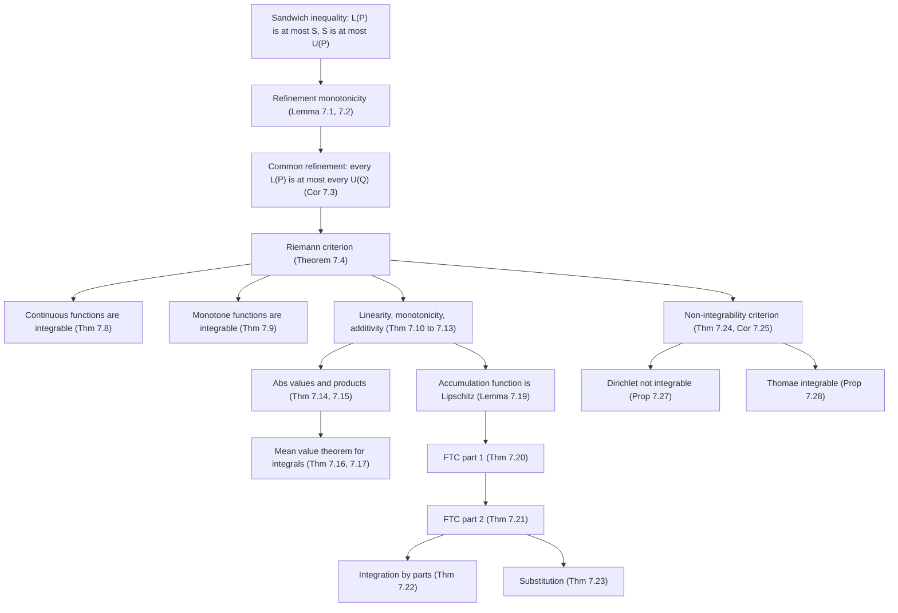
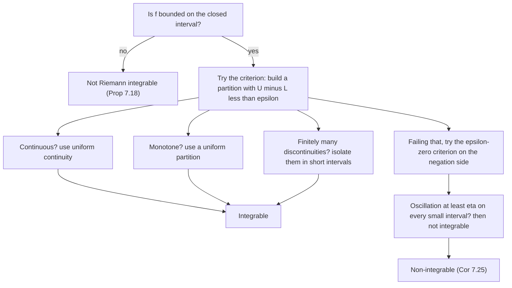

# Riemann Integration

> [Mathematics](../../README.md) › [Real Analysis](../README.md) · Level: Advanced · Prerequisites: [Logic](../../00-foundations/02-logic/README.md), [Set Theory](../../00-foundations/03-set-theory/README.md), [Proof Techniques](../../00-foundations/04-proof-techniques/README.md), [The Real Numbers and Completeness](../01-real-numbers-and-completeness/README.md), [Limits](../../07-calculus/01-limits/README.md), [Continuity](../../07-calculus/02-continuity/README.md), [Integrals](../../07-calculus/06-integrals/README.md), [The Fundamental Theorem of Calculus](../../07-calculus/07-fundamental-theorem-of-calculus/README.md) · Estimated time: 720 min

## 1. Introduction

The integral was invented twice, for two different reasons, and the two inventions turned out to describe the same object.

The first invention is **geometric**. Take a non-negative function $f$ on an interval $[a,b]$ and ask for the area of the region between its graph and the horizontal axis. The region is curved, so it has no immediate formula. The strategy of exhaustion, going back to Archimedes, is to trap the region between finitely many rectangles: rectangles that all fit inside give a lower estimate, rectangles that all contain the region give an upper estimate. If the two estimates can be made to differ by less than any prescribed $\varepsilon$, the area exists and is their common limit. That is the whole idea of this chapter, and §7.2–§7.4 turn it into a theorem.

The second invention is **analytic**. Riemann's habilitation thesis of 1854 asked when a function can be represented by a trigonometric series, and was forced to introduce the condition $\sum_i \omega_i \Delta x_i \to 0$ (where $\omega_i$ is the oscillation of $f$ on the $i$-th interval) as the exact hypothesis under which the coefficients of such a series can be computed by integration. Riemann's condition is not a definition of area at all; it is a criterion for a certain limit of finite sums to exist. Darboux, in 1875, reformulated it in terms of the supremum of lower sums and the infimum of upper sums, and that reformulation — the **Darboux criterion** — is what is proved in Theorem 7.4.

That the two inventions agree is a theorem, not a definition, and it is proved in §7.5. The agreement is not vacuous: there are bounded functions for which the lower and upper integrals differ, so the notion of "area under the graph" genuinely fails. The most famous is Dirichlet's function, which is $1$ on the rationals and $0$ on the irrationals (§7.19). It is bounded, it is defined everywhere, and it has no Riemann integral. This is not a defect of the proof technique; it is a defect of the definition, and repairing it is the whole point of Lebesgue's theory of measure, sketched as motivation in §7.20.

Three further ideas organise the chapter.

* **Squeezing.** Integrability is always established the same way: exhibit, for each $\varepsilon$, a partition whose upper and lower sums differ by less than $\varepsilon$. Every integrability theorem below is a recipe for building such a partition, either from uniform continuity (continuous functions, §7.6) or from monotonicity (§7.7).
* **Structure.** The set of integrable functions is a vector space closed under products and absolute values, and the integral is linear, monotone and additive over subintervals (§7.8–§7.12). These are not conveniences: they are what makes the integral computable, and each is proved from the Darboux criterion.
* **The inverse relationship with differentiation.** The fundamental theorem (§7.14–§7.15) says that integration and differentiation are inverse operations, under hypotheses that must be checked. Part 1 differentiates an integral and needs only continuity of the integrand at the point in question. Part 2 integrates a derivative and needs the derivative to be Riemann integrable — a hypothesis that is *not* automatic, as §7.20 shows.

A warning about the word "integral". In elementary calculus, $\int_a^b f$ is computed by finding an antiderivative. Here it is defined as a supremum of lower sums, and antiderivatives appear only in §7.15, as a *consequence*. Until then, every integral in this chapter is evaluated by estimating sums. This is slower, and it is the only way to see why the fundamental theorem is true rather than assumed.

## 2. Prerequisites

**The completeness axiom and suprema.** Every definition below uses $\sup$ and $\inf$ over the uncountable set of values of $f$ on a subinterval, and the Riemann criterion compares a supremum with an infimum. You must be fluent in the $\varepsilon$-characterisation: $s = \sup A$ if and only if $s$ is an upper bound and for every $\varepsilon>0$ there is $a \in A$ with $a > s - \varepsilon$. See [The Real Numbers and Completeness](../01-real-numbers-and-completeness/README.md), §7.4.

**Bounded sets and the Archimedean property.** The Archimedean property supplies the integer $n$ in every "take a uniform partition with $n$ pieces so fine that …" argument, and it is used again to prove that the mesh of a partition can be made small.

**Logic and quantifier manipulation.** Integrability is a statement of the form $\forall \varepsilon > 0\ \exists P$. Its negation — the criterion for *non*-integrability, §7.18 — is $\exists \varepsilon_0 > 0\ \forall P$, and recognising that shape is half of every non-integrability proof. See [Logic](../../00-foundations/02-logic/README.md) and [Proof Techniques](../../00-foundations/04-proof-techniques/README.md).

**Sets, functions and images.** Partitions are finite sets; the mesh is a maximum over a finite index set; the substitution theorem uses images $\varphi([a,b])$. See [Set Theory](../../00-foundations/03-set-theory/README.md) and [Relations and Functions](../../00-foundations/05-relations-and-functions/README.md).

**Inequalities and absolute value.** The estimate $\lvert f(t)\rvert \le B$ is used to bound the effect of refining a partition, and the reverse triangle inequality supplies $\bigl\lvert \lvert f\rvert - \lvert g\rvert\bigr\rvert \le \lvert f - g\rvert$. See [Inequalities](../../03-algebra/03-inequalities/README.md).

**Limits and continuity.** The $\varepsilon$–$\delta$ definition of continuity at a point drives the proof of the fundamental theorem, part 1. Continuity on a closed interval is used through two theorems: the extreme value theorem (a continuous function on $[a,b]$ attains a maximum and a minimum) and the uniform continuity theorem (a continuous function on $[a,b]$ is uniformly continuous). Both are proved from compactness in [Continuity](../../07-calculus/02-continuity/README.md) and again, in the general setting, in [Metric Spaces](../06-metric-spaces/README.md). See also [Limits](../../07-calculus/01-limits/README.md).

**Riemann sums as seen in calculus.** You should already have met $\sum_{i=1}^n f(t_i)\Delta x_i$ and the slogan "the integral is the limit of Riemann sums". This chapter keeps the slogan but proves the equivalence of the two definitions (§7.5) rather than assuming it. See [Integrals](../../07-calculus/06-integrals/README.md).

**The mean value theorem for derivatives.** Integration by parts and part 2 of the fundamental theorem are proved by applying the MVT on each subinterval. See [Applications of Derivatives](../../07-calculus/05-applications-of-derivatives/README.md) and [The Fundamental Theorem of Calculus](../../07-calculus/07-fundamental-theorem-of-calculus/README.md).

**Induction and finite sums.** Every partition argument ends with a finite sum, and the uniform-partition computations in §9 use the identities $\sum_{k=1}^{n} k = n(n+1)/2$ and $\sum_{k=1}^{n} k^2 = n(n+1)(2n+1)/6$. See [Mathematical Induction](../../09-discrete-mathematics/01-mathematical-induction/README.md).

## 3. Learning Objectives

By the end of this tutorial you will be able to

1. define a partition, its mesh, a tagged partition, and a Riemann sum; state both the Darboux and the Riemann definitions of integrability;
2. prove that refining a partition increases lower sums and decreases upper sums, and deduce that every lower sum is at most every upper sum;
3. prove the Riemann criterion — a bounded $f$ is integrable if and only if for every $\varepsilon>0$ there is a partition with $U(f,P) - L(f,P) < \varepsilon$ — and use its negation to prove non-integrability;
4. prove that every continuous function on $[a,b]$ is integrable, and that every monotone function on $[a,b]$ is integrable;
5. compute lower and upper sums for explicit functions and partitions, and evaluate integrals from the definition for polynomials;
6. prove linearity, monotonicity, additivity over subintervals, and the inequality $\bigl\lvert\int_a^b f\bigr\rvert \le \int_a^b \lvert f\rvert$;
7. state and prove the mean value theorem for integrals, in both its plain and its weighted form;
8. state and prove both parts of the fundamental theorem of calculus, with the exact hypotheses each requires;
9. prove integration by parts and the substitution (change of variable) formula in the Riemann setting;
10. explain why the Dirichlet function is not Riemann integrable, why Thomae's function is, and why pointwise convergence does not pass through the integral — the failure that motivates measure theory.

## 4. Intuition

### 4.1 Trapping an area between staircases

Imagine a hilly plot of land of width $b-a$, whose height above a straight road is $f(x)$. You want its area. You have no formula, but you can measure.

Place a finite set of vertical fences at $a = x_0 < x_1 < \cdots < x_n = b$. In each strip you have two cheap options. You can build a flat-roofed box whose roof touches the *lowest* point of the hill in that strip: it fits under the hill, so the boxes together understate the area. Or you can build a box whose roof touches the *highest* point: it contains the strip, so the boxes together overstate the area. The first total is $L(f,P)$, the second is $U(f,P)$, and always $L(f,P) \le U(f,P)$.

Now add more fences. Each new fence splits one strip into two. Splitting can only raise the low roof (the minimum over a smaller interval is at least the minimum over the larger one) and only lower the high roof. So **refining improves both estimates**:

$$P \subseteq Q \;\Longrightarrow\; L(f,P) \le L(f,Q) \le U(f,Q) \le U(f,P).$$

The lower estimates climb, the upper estimates descend, and they can never cross: any lower sum is below any upper sum. Two monotone quantities separated by a gap either meet or leave a gap. If they meet — if the supremum of all lower sums equals the infimum of all upper sums — the area exists. If they leave a gap, "the area" of the region is simply not defined by this method, and something is genuinely wrong with the region.

### 4.2 Why "mesh → 0" is the right limit

A partition can have many pieces and still be useless: one enormous strip hides an entire mountain range. What controls the error is not the *number* of fences but the *widest* strip. That is why the fundamental limit in Riemann's definition is taken over partitions whose **mesh** $\lVert P\rVert = \max_i \Delta x_i$ tends to $0$, and it is why the proof that "mesh small" implies "sums close" (Lemma 7.5.1) is the technical heart of the equivalence of the two definitions.

### 4.3 The dynamical picture

Here is a second, equivalent image, which explains why integrals appear in physics and probability. Let $f$ be a rate: litres per second, joules per metre, probability per unit length. Over a tiny interval of length $h$, the amount delivered is approximately $f(x)h$, and the error is $o(h)$ if $f$ is continuous. To get the total over $[a,b]$, add the tiny contributions: $\sum f(t_i)\Delta x_i$. The integral is the exact total, and its additivity over subintervals (§7.10) is the statement that a total over $[a,c]$ plus a total over $[c,b]$ is the total over $[a,b]$ — the bookkeeping identity that makes the accumulation function in the fundamental theorem work.

### 4.4 What can go wrong

Two functions expose the boundary of the theory.

* The **Dirichlet function** $\mathbf{1}_{\mathbb{Q}}$ equals $1$ on the rationals and $0$ on the irrationals. Every strip of positive length contains both kinds of point, so every low roof is $0$ and every high roof is the full width: the lower integral is $0$, the upper is $b-a$. No amount of refinement helps, because refinement cannot remove the alternation. The gap is permanent.
* **Thomae's function** equals $1/q$ at a rational $p/q$ in lowest terms and $0$ at every irrational. It is discontinuous at every rational and continuous at every irrational — as badly behaved as Dirichlet's function in that sense — yet it *is* Riemann integrable, with integral $0$ (Proposition 7.28). The reason: the points where the function is large are sparse. For each $\varepsilon$, only finitely many rationals have $1/q \ge \varepsilon$, and those can be buried in strips of arbitrarily small total width.

The contrast between these two functions is the best single guide to what Riemann integrability means: it is a statement about how much *room* the bad points occupy, not about how many there are. Making "room" precise — measure — is the content of Lebesgue's theory.

## 5. Formal Definition

Throughout, $a < b$ are real numbers and $f : [a,b] \to \mathbb{R}$ is a function. We write $\Delta x_i = x_i - x_{i-1}$.

**Definition 5.1 (Partition).** A *partition* of $[a,b]$ is a finite set $P = \{x_0, x_1, \dots, x_n\}$ with

$$a = x_0 < x_1 < \cdots < x_n = b .$$

The *subintervals* of $P$ are $I_i = [x_{i-1}, x_i]$ for $i = 1, \dots, n$, and their lengths are $\Delta x_i = x_i - x_{i-1} > 0$. The *mesh* (or *norm*) of $P$ is

$$\lVert P \rVert = \max\{\Delta x_1, \dots, \Delta x_n\}.$$

The set of all partitions of $[a,b]$ is denoted $\mathcal{P}[a,b]$.

**Definition 5.2 (Refinement).** If $P, Q \in \mathcal{P}[a,b]$ and $P \subseteq Q$ as sets, then $Q$ is a *refinement* of $P$. The *common refinement* of $P$ and $Q$ is $P \cup Q$.

**Definition 5.3 (Darboux sums).** Let $f$ be bounded on $[a,b]$ and let $P \in \mathcal{P}[a,b]$. For each $i$ put

$$m_i(f,P) = \inf_{t \in I_i} f(t), \qquad M_i(f,P) = \sup_{t \in I_i} f(t) .$$

The *lower* and *upper Darboux sums* of $f$ with respect to $P$ are

$$L(f,P) = \sum_{i=1}^{n} m_i(f,P)\,\Delta x_i, \qquad U(f,P) = \sum_{i=1}^{n} M_i(f,P)\,\Delta x_i .$$

When $f$ and $P$ are clear from context we write $m_i, M_i, L(P), U(P)$.

**Definition 5.4 (Lower and upper integrals).** With $f$ bounded on $[a,b]$,

$$\underline{\int_a^b} f = \sup_{P \in \mathcal{P}[a,b]} L(f,P), \qquad \overline{\int_a^b} f = \inf_{P \in \mathcal{P}[a,b]} U(f,P) .$$

These are real numbers: the set of lower sums is nonempty and bounded above by $U(f,P_0)$ for any one $P_0$, so completeness gives a supremum; dually for the infimum.

**Definition 5.5 (Riemann integrable — Darboux form).** A bounded function $f$ on $[a,b]$ is *Riemann integrable* if

$$\underline{\int_a^b} f = \overline{\int_a^b} f ,$$

and that common value is the *Riemann integral*, written $\int_a^b f$ or $\int_a^b f(x)\,dx$.

**Definition 5.6 (Tagged partition and Riemann sum).** A *tagged partition* of $[a,b]$ is a partition $P = \{x_0,\dots,x_n\}$ together with a choice of *tags* $t_i \in I_i = [x_{i-1}, x_i]$ for each $i$. The corresponding *Riemann sum* is

$$S(f,P,(t_i)) = \sum_{i=1}^{n} f(t_i)\,\Delta x_i .$$

**Definition 5.7 (Riemann integrable — Riemann form).** A function $f$ on $[a,b]$ is *Riemann integrable in Riemann's sense* with integral $I$ if there is a real number $I$ such that

$$\forall \varepsilon > 0\ \exists \delta > 0 : \quad \lVert P\rVert < \delta \ \text{and every choice of tags}\ \Longrightarrow\ \lvert S(f,P,(t_i)) - I\rvert < \varepsilon .$$

Note that Definition 5.7 mentions no boundedness assumption; it is a theorem (§7.13) that the functions satisfying it are exactly the bounded functions satisfying Definition 5.5, with the same value of the integral.

**Definition 5.8 (Step function).** A function $s : [a,b] \to \mathbb{R}$ is a *step function* if there is a partition $P = \{x_0,\dots,x_n\}$ and constants $c_1,\dots,c_n$ with $s(t) = c_i$ for all $t \in (x_{i-1}, x_i)$ and all $i$. (The values at the partition points are irrelevant, and we may set them at will.)

**Definition 5.9 (Oscillation).** For a bounded $f$ on a set $I \subseteq \mathbb{R}$, the *oscillation* of $f$ on $I$ is

$$\omega(f,I) = \sup_{t \in I} f(t) - \inf_{t \in I} f(t) .$$

Thus $U(f,P) - L(f,P) = \sum_i \omega(f,I_i)\,\Delta x_i$.

**Conventions.** For any $a$ and any $f$ we set $\int_a^a f = 0$, and for $a < b$ we set $\int_b^a f = -\int_a^b f$. These are conventions, chosen so that additivity (Theorem 7.12) holds without case distinctions.

## 6. Mathematical Notation

| Symbol | Read as | Meaning |
|---|---|---|
| $P = \{x_0, \dots, x_n\}$ | a partition | a finite increasing sequence from $a$ to $b$ |
| $I_i = [x_{i-1}, x_i]$ | the $i$-th subinterval | one strip of the partition |
| $\Delta x_i$ | delta $x$ sub $i$ | $x_i - x_{i-1}$, the width of $I_i$ |
| $\lVert P\rVert$ | the mesh (norm) of $P$ | the largest of the widths $\Delta x_i$ |
| $m_i(f,P)$ | lower value on $I_i$ | $\inf_{I_i} f$ |
| $M_i(f,P)$ | upper value on $I_i$ | $\sup_{I_i} f$ |
| $L(f,P)$ | lower Darboux sum | $\sum_i m_i \Delta x_i$ |
| $U(f,P)$ | upper Darboux sum | $\sum_i M_i \Delta x_i$ |
| $\underline{\int_a^b} f$ | lower integral | $\sup_P L(f,P)$ |
| $\overline{\int_a^b} f$ | upper integral | $\inf_P U(f,P)$ |
| $\int_a^b f$, $\int_a^b f(x)\,dx$ | Riemann integral of $f$ over $[a,b]$ | the common value when it exists |
| $\mathcal{P}[a,b]$ | the set of partitions | all finite increasing sequences from $a$ to $b$ |
| $t_i$ | tag | a chosen point in $I_i$ |
| $S(f,P,(t_i))$ | Riemann sum | $\sum_i f(t_i)\Delta x_i$ |
| $\mathbf{1}_{A}$ | indicator of $A$ | $1$ on $A$ and $0$ off $A$ |
| $\mathbf{1}_{\mathbb{Q}}$ | Dirichlet function | $1$ at rationals, $0$ at irrationals |
| $\omega(f,I)$ | oscillation of $f$ on $I$ | $\sup_I f - \inf_I f = M_I - m_I$ |
| $B$ or $M$ | a bound | a number with $\lvert f\rvert \le B$ on $[a,b]$ |
| $\mathcal{R}[a,b]$ | the integrable functions | $\{f : f$ is Riemann integrable on $[a,b]\}$ |

## 7. Core Concepts

### 7.1 Partitions and Darboux sums: the first observations

Fix $a<b$ and a bounded $f:[a,b]\to\mathbb{R}$. For every partition $P$ and every $i$,

$$m_i(f,P) \le f(t) \le M_i(f,P) \quad \text{for all } t \in I_i,$$

so multiplying by $\Delta x_i > 0$ and summing gives the single most-used inequality of the chapter:

$$L(f,P) \le \sum_{i=1}^{n} f(t_i)\,\Delta x_i \le U(f,P), \qquad L(f,P) \le U(f,P).$$

We call the pair of inequalities above the **sandwich inequality**. The first says the lower sum is a genuine lower bound for *every* Riemann sum of that partition, and the upper sum a genuine upper bound. Every "the integral lies between the sums" argument in this chapter is an instance of it.

Two cautions. First, $L(f,P)$ and $U(f,P)$ depend on $f$ being **bounded**: if $f$ is unbounded on some $I_i$, then $m_i = -\infty$ or $M_i = +\infty$ and the sums are meaningless. Second, the sums depend strongly on $P$: with $P = \{0,\tfrac12, 1\}$ and $f(x) = x$ on $[0,1]$ we get $L = 0\cdot\tfrac12 + \tfrac12\cdot\tfrac12 = \tfrac14$ and $U = \tfrac12\cdot\tfrac12 + 1\cdot\tfrac12 = \tfrac34$, whereas the single interval $P_0 = \{0,1\}$ gives $L = 0$ and $U = 1$. Refinement moves both estimates toward the same number.

### 7.2 Refinement monotonicity

**Lemma 7.1 (adding one point).** Let $f$ be bounded on $[a,b]$, let $P \in \mathcal{P}[a,b]$ and let $Q = P \cup \{c\}$ where $c \in [a,b]$. Then

$$L(f,P) \le L(f,Q) \qquad \text{and} \qquad U(f,Q) \le U(f,P).$$

*Proof.* If $c \in P$ there is nothing to prove, so assume $c \in (x_{k-1}, x_k)$ for some $k$. All terms of the two sums agree except the $k$-th, which in $Q$ is replaced by two terms. Write

$$m' = \inf_{[x_{k-1},c]} f, \qquad m'' = \inf_{[c,x_k]} f, \qquad m_k = \inf_{[x_{k-1},x_k]} f .$$

Since $[x_{k-1},c] \subseteq I_k$ and $[c,x_k] \subseteq I_k$, an infimum over a smaller set is at least as large: $m' \ge m_k$ and $m'' \ge m_k$. Hence

$$m'(c - x_{k-1}) + m''(x_k - c) \ge m_k(c - x_{k-1}) + m_k(x_k - c) = m_k\,\Delta x_k,$$

which is exactly $L(f,Q) \ge L(f,P)$. The argument for upper sums is the same with $\sup$ and reversed inequalities: $M' \le M_k$ and $M'' \le M_k$, so

$$M'(c - x_{k-1}) + M''(x_k - c) \le M_k\,\Delta x_k,$$

that is $U(f,Q) \le U(f,P)$. $\blacksquare$

**Lemma 7.2 (refining in general).** If $P, Q \in \mathcal{P}[a,b]$ and $P \subseteq Q$, then

$$L(f,P) \le L(f,Q) \le U(f,Q) \le U(f,P).$$

*Proof.* Write $Q = P \cup \{c_1,\dots,c_r\}$ and let $Q_j = P \cup \{c_1,\dots,c_j\}$ for $j = 0,\dots,r$, so $Q_0 = P$ and $Q_r = Q$. Each $Q_j$ is obtained from $Q_{j-1}$ by adding one point, so Lemma 7.1 applied $r$ times gives

$$L(f,P) = L(f,Q_0) \le L(f,Q_1) \le \cdots \le L(f,Q_r) = L(f,Q),$$

and likewise $U(f,Q) \le \cdots \le U(f,P)$. The middle inequality $L(f,Q) \le U(f,Q)$ is the sandwich inequality. $\blacksquare$

Lemma 7.2 is the geometric statement that adding fences improves both staircases. It has an immediate and crucial consequence: the two families of numbers are separated.

### 7.3 Common refinements and the inequality between the integrals

**Corollary 7.3.** Let $f$ be bounded on $[a,b]$ and let $P, Q \in \mathcal{P}[a,b]$. Then

$$L(f,P) \le U(f,Q).$$

Consequently

$$\underline{\int_a^b} f \;\le\; \overline{\int_a^b} f .$$

*Proof.* Let $R = P \cup Q$. By Lemma 7.2, $L(f,P) \le L(f,R)$ and $U(f,R) \le U(f,Q)$, while $L(f,R) \le U(f,R)$ by the sandwich inequality. Chaining,

$$L(f,P) \le L(f,R) \le U(f,R) \le U(f,Q).$$

For the second claim, fix $Q$. The inequality just proved says that $U(f,Q)$ is an upper bound of the set of *all* lower sums, so the least upper bound of that set is at most $U(f,Q)$:

$$\underline{\int_a^b} f = \sup_{P} L(f,P) \le U(f,Q) \qquad \text{for every } Q .$$

Now $\underline{\int_a^b} f$ is a lower bound for the set of all upper sums, so it is at most that set's infimum:

$$\underline{\int_a^b} f \le \inf_{Q} U(f,Q) = \overline{\int_a^b} f . \qquad \blacksquare$$

So the lower integral never exceeds the upper integral, and equality is exactly what integrability demands.

### 7.4 The Riemann criterion

The definition of integrability quantifies over *all* partitions, which is unusable in practice. The following theorem replaces it by a single partition per $\varepsilon$. It is the most frequently used result in the chapter.

**Theorem 7.4 (Riemann criterion / Darboux criterion).** A bounded function $f$ on $[a,b]$ is Riemann integrable if and only if for every $\varepsilon>0$ there exists a partition $P \in \mathcal{P}[a,b]$ with

$$U(f,P) - L(f,P) < \varepsilon .$$

*Proof.*

**(⇒)** Suppose $f$ is integrable and let $I = \int_a^b f$. Let $\varepsilon > 0$. Since $I = \sup_P L(f,P)$, the number $I - \varepsilon/2$ is not an upper bound for the lower sums, so there is $P_1$ with $L(f,P_1) > I - \varepsilon/2$. Since $I = \inf_P U(f,P)$, there is $P_2$ with $U(f,P_2) < I + \varepsilon/2$. Let $P = P_1 \cup P_2$. By Lemma 7.2, $L(f,P) \ge L(f,P_1)$ and $U(f,P) \le U(f,P_2)$, hence

$$U(f,P) - L(f,P) \le U(f,P_2) - L(f,P_1) < \left(I + \tfrac{\varepsilon}{2}\right) - \left(I - \tfrac{\varepsilon}{2}\right) = \varepsilon .$$

**(⇐)** Suppose every $\varepsilon > 0$ admits $P$ with $U(f,P) - L(f,P) < \varepsilon$. Since $L(f,P) \le \underline{\int_a^b} f \le \overline{\int_a^b} f \le U(f,P)$ by the definitions and Corollary 7.3,

$$0 \le \overline{\int_a^b} f - \underline{\int_a^b} f \le U(f,P) - L(f,P) < \varepsilon .$$

The left-hand side is a fixed non-negative number smaller than every positive $\varepsilon$, hence it is $0$. Therefore the two integrals are equal and $f$ is integrable. $\blacksquare$

**How to use it.** To prove that a specific $f$ is integrable, you must produce, for each $\varepsilon$, a partition whose upper and lower sums differ by less than $\varepsilon$. There are exactly two systematic ways to do that in this chapter: take a partition fine enough that the *oscillation on every subinterval* is small (continuous case, §7.6), or take a partition fine enough that the *total variation* is small (monotone case, §7.7).

**How to use its negation.** To prove that $f$ is *not* integrable, you must exhibit $\varepsilon_0>0$ such that $U(f,P) - L(f,P) \ge \varepsilon_0$ for **every** partition. Theorem 7.24 records this, and §7.19 carries it out twice.

### 7.5 The two definitions of the integral agree

The Darboux definition quantifies over partitions alone; Riemann's definition quantifies over partitions *and tags*, and controls them by the mesh. They agree, and the proof needs the following quantitative statement: refining a partition changes the sums by an amount controlled by the mesh.

**Lemma 7.5 (quantitative effect of one point).** Let $\lvert f\rvert \le B$ on $[a,b]$, let $P \in \mathcal{P}[a,b]$ and let $Q = P \cup \{c\}$ with $c \in [a,b]$. Then

$$0 \le U(f,P) - U(f,Q) \le 2B\lVert P\rVert, \qquad 0 \le L(f,Q) - L(f,P) \le 2B\lVert P\rVert .$$

*Proof.* By Lemma 7.1 both differences are non-negative. For the upper bound, take $c \in (x_{k-1},x_k)$, and let $M', M''$ be the suprema of $f$ on $[x_{k-1},c]$ and $[c,x_k]$. Then

$$U(f,P) - U(f,Q) = M_k\Delta x_k - M'(c - x_{k-1}) - M''(x_k - c) = (M_k - M')(c-x_{k-1}) + (M_k - M'')(x_k - c).$$

Because $-B \le M', M'' \le M_k \le B$, each bracket lies in $[0, 2B]$, so

$$U(f,P) - U(f,Q) \le 2B\bigl[(c - x_{k-1}) + (x_k - c)\bigr] = 2B\,\Delta x_k \le 2B\lVert P\rVert .$$

The lower-sum estimate is identical with $m' - m_k \in [0,2B]$ and $m'' - m_k \in [0,2B]$. $\blacksquare$

**Lemma 7.6 (quantitative effect of $r$ points).** Let $\lvert f\rvert \le B$, let $P \in \mathcal{P}[a,b]$, and let $R$ be a finite subset of $[a,b]$ with $r$ elements. Then

$$0 \le U(f,P) - U(f, P\cup R) \le 2Br\lVert P\rVert, \qquad 0 \le L(f,P\cup R) - L(f,P) \le 2Br\lVert P\rVert .$$

*Proof.* Add the points of $R$ one at a time and apply Lemma 7.5. The mesh only decreases when a point is added, so each step contributes at most $2B\lVert P\rVert$; there are at most $r$ steps. $\blacksquare$

**Theorem 7.7 (equivalence of the Darboux and Riemann definitions).** Let $f:[a,b]\to\mathbb{R}$ be bounded and let $I \in \mathbb{R}$. Then $f$ is Riemann integrable in Riemann's sense (Definition 5.7) with integral $I$ if and only if $f$ is Riemann integrable in the Darboux sense (Definition 5.5) with $\int_a^b f = I$.

*Proof.*

**(Darboux ⇒ Riemann.)** Assume $f$ is Darboux integrable with integral $I$. Let $\varepsilon>0$ and put $B = \sup_{[a,b]}\lvert f\rvert + 1 > 0$. By Theorem 7.4 choose $P_0 \in \mathcal{P}[a,b]$ with $U(f,P_0) - L(f,P_0) < \varepsilon/2$. Let $r$ be the number of points of $P_0$ and let

$$\delta = \frac{\varepsilon}{8Br} \quad (\text{if } r = 0 \text{ take any } \delta>0).$$

Let $P$ be any partition with $\lVert P\rVert < \delta$, with arbitrary tags $t_i$. Put $R = P_0$ in Lemma 7.6; since $P \cup P_0$ refines both $P$ and $P_0$,

$$U(f,P) \le U(f, P\cup P_0) + 2Br\lVert P\rVert \le U(f,P_0) + \tfrac{\varepsilon}{4}, \qquad L(f,P) \ge L(f,P_0) - \tfrac{\varepsilon}{4}.$$

Therefore, using the sandwich inequality and the fact that $L(f,P_0) \le I \le U(f,P_0)$,

$$U(f,P) - L(f,P) \le \bigl[U(f,P_0) - L(f,P_0)\bigr] + \tfrac{\varepsilon}{2} < \varepsilon .$$

Since $L(f,P) \le S(f,P,(t_i)) \le U(f,P)$ and also $L(f,P) \le I \le U(f,P)$, both $S$ and $I$ lie in the interval $[L(f,P), U(f,P)]$ of length less than $\varepsilon$. Hence $\lvert S(f,P,(t_i)) - I\rvert < \varepsilon$. As $\varepsilon$ was arbitrary, Definition 5.7 holds with this $I$.

**(Riemann ⇒ Darboux.)** Assume Definition 5.7 holds with integral $I$. Let $\varepsilon>0$ and let $\delta>0$ be the number supplied by Definition 5.7 for the tolerance $\varepsilon/2$. Let $P \in \mathcal{P}[a,b]$ be any partition with $\lVert P\rVert < \delta$ and with $n \ge 1$ intervals. For each $i$ choose a tag $t_i \in I_i$ with

$$f(t_i) > M_i(f,P) - \frac{\varepsilon}{2(b-a)};$$

such a tag exists because $M_i = \sup_{I_i} f$. Let $S_U$ be the corresponding Riemann sum. Then

$$U(f,P) - S_U = \sum_{i=1}^n \bigl(M_i - f(t_i)\bigr)\Delta x_i < \frac{\varepsilon}{2(b-a)}\sum_{i=1}^n \Delta x_i = \frac{\varepsilon}{2},$$

so $U(f,P) < S_U + \varepsilon/2 < I + \varepsilon/2 + \varepsilon/2 = I + \varepsilon$, since $\lvert S_U - I\rvert < \varepsilon/2$. The same argument with tags $s_i$ satisfying $f(s_i) < m_i + \varepsilon/(2(b-a))$ gives a Riemann sum $S_L$ with $S_L - L(f,P) < \varepsilon/2$, hence $L(f,P) > I - \varepsilon$. Thus for every $\varepsilon>0$ there is a partition with

$$I - \varepsilon < L(f,P) \le U(f,P) < I + \varepsilon .$$

Hence $\overline{\int_a^b} f \le I + \varepsilon$ and $\underline{\int_a^b} f \ge I - \varepsilon$ for every $\varepsilon$, so both integrals equal $I$ by Corollary 7.3. $\blacksquare$

From now on we use whichever definition is convenient, and write $\mathcal{R}[a,b]$ for the set of Riemann integrable functions on $[a,b]$.

### 7.6 Continuous functions are integrable

**Theorem 7.8.** If $f:[a,b]\to\mathbb{R}$ is continuous, then $f \in \mathcal{R}[a,b]$.

*Proof.* Let $\varepsilon>0$. A continuous function on the closed bounded interval $[a,b]$ is uniformly continuous, so there is $\delta>0$ such that

$$x, y \in [a,b],\ \lvert x - y\rvert < \delta \ \Longrightarrow\ \lvert f(x) - f(y)\rvert < \frac{\varepsilon}{b-a}.$$

(Uniform continuity is proved in [Continuity](../../07-calculus/02-continuity/README.md); [Metric Spaces](../06-metric-spaces/README.md) gives the general statement that a continuous function on a compact metric space is uniformly continuous.)

Let $P$ be any partition of $[a,b]$ with $\lVert P\rVert < \delta$; for instance a uniform partition with $n > (b-a)/\delta$ pieces. Fix $i$. For any $s,t \in I_i$ we have $\lvert s - t\rvert \le \Delta x_i < \delta$, hence $\lvert f(s) - f(t)\rvert < \varepsilon/(b-a)$. Taking the supremum over $s$ and the infimum over $t$,

$$M_i(f,P) - m_i(f,P) \le \frac{\varepsilon}{b-a}.$$

(Here $M_i$ and $m_i$ are finite because $f$ is continuous on the compact interval $I_i$, so the extreme value theorem applies; and the estimate passes to the supremum because it holds for all pairs.) Therefore

$$U(f,P) - L(f,P) = \sum_{i=1}^n \bigl(M_i - m_i\bigr)\Delta x_i \le \frac{\varepsilon}{b-a}\sum_{i=1}^n \Delta x_i = \varepsilon .$$

The Riemann criterion (Theorem 7.4) applies, so $f$ is integrable. $\blacksquare$

Note what the proof does *not* say: it does not produce a formula for the integral, only its existence. Values are computed either from the definition (§9) or from the fundamental theorem (§7.15).

### 7.7 Monotone functions are integrable

**Theorem 7.9.** If $f:[a,b]\to\mathbb{R}$ is monotone, then $f \in \mathcal{R}[a,b]$.

*Proof.* Suppose first that $f$ is increasing. If $f(a) = f(b)$ then $f$ is constant and integrable with integral $f(a)(b-a)$ (or directly: $U - L = 0$ for every $P$). Otherwise $D := f(b) - f(a) > 0$. Let $\varepsilon > 0$ and choose $n \in \mathbb{N}$ with

$$\frac{D(b-a)}{n} < \varepsilon .$$

Let $P = \{a, a + h, a + 2h, \dots, b\}$ with $h = (b-a)/n$. On $I_i = [x_{i-1}, x_i]$ an increasing function has infimum $f(x_{i-1})$ (attained at the left endpoint) and supremum $f(x_i)$ (attained at the right endpoint). Hence

$$U(f,P) - L(f,P) = \sum_{i=1}^n \bigl(f(x_i) - f(x_{i-1})\bigr)h = h\sum_{i=1}^n\bigl(f(x_i) - f(x_{i-1})\bigr) = h\bigl(f(b) - f(a)\bigr) = \frac{(b-a)D}{n} < \varepsilon,$$

where the sum telescopes. By Theorem 7.4, $f$ is integrable. If $f$ is decreasing, apply the result to $-f$, which is increasing, and use Theorem 7.10 below (or repeat the computation with $m_i = f(x_i)$, $M_i = f(x_{i-1})$; the telescoping sum is the same). $\blacksquare$

A monotone function may have infinitely many discontinuities — a jump at every rational, say — and Theorem 7.9 says this is harmless. What matters is that the jumps cannot be *spread out*: their total size is at most $f(b)-f(a)$.

### 7.8 Linearity

**Theorem 7.10 (scalar multiples).** Let $f \in \mathcal{R}[a,b]$ and $c \in \mathbb{R}$. Then $cf \in \mathcal{R}[a,b]$ and

$$\int_a^b cf = c\int_a^b f .$$

*Proof.* If $c = 0$ both sides vanish. Suppose $c>0$. For every subinterval $I$ of every partition, $\sup_I (cf) = c\sup_I f$ and $\inf_I (cf) = c\inf_I f$ (multiplying by a positive constant preserves the order and the sup/inf). Hence for every $P$,

$$L(cf,P) = c\,L(f,P), \qquad U(cf,P) = c\,U(f,P).$$

Taking suprema and infima over $P$ and using that $c>0$,

$$\underline{\int_a^b} cf = \sup_P cL(f,P) = c\sup_P L(f,P) = c\int_a^b f, \qquad \overline{\int_a^b} cf = \inf_P cU(f,P) = c\int_a^b f .$$

So $cf$ is integrable with integral $c\int_a^b f$.

Suppose $c<0$. Then $\sup_I (cf) = c\inf_I f$ and $\inf_I (cf) = c\sup_I f$, because multiplying by a negative number reverses inequalities. Hence

$$L(cf,P) = c\,U(f,P), \qquad U(cf,P) = c\,L(f,P),$$

and now the sup/inf swap because $c<0$:

$$\underline{\int_a^b} cf = \sup_P cU(f,P) = c\inf_P U(f,P) = c\int_a^b f, \qquad \overline{\int_a^b} cf = \inf_P cL(f,P) = c\sup_P L(f,P) = c\int_a^b f .$$

Again the two integrals agree and equal $c\int_a^b f$. $\blacksquare$

**Theorem 7.11 (sums).** If $f, g \in \mathcal{R}[a,b]$ then $f+g \in \mathcal{R}[a,b]$ and

$$\int_a^b (f+g) = \int_a^b f + \int_a^b g .$$

*Proof.* On any set $I$, $\sup_I(f+g) \le \sup_I f + \sup_I g$ (the right side is an upper bound for $f+g$) and $\inf_I(f+g) \ge \inf_I f + \inf_I g$. Therefore, for every partition $P$,

$$U(f+g,P) \le U(f,P) + U(g,P), \qquad L(f+g,P) \ge L(f,P) + L(g,P).$$

We refer to this pair as the **sum estimates**.

Let $\varepsilon > 0$. By Theorem 7.4 choose $P_f$ with $U(f,P_f) - L(f,P_f) < \varepsilon$ and $P_g$ with $U(g,P_g) - L(g,P_g) < \varepsilon$, and let $P = P_f \cup P_g$. By Lemma 7.2, both differences are still $< \varepsilon$ for $P$. Using the sum estimates,

$$U(f+g,P) - L(f+g,P) \le \bigl[U(f,P) - L(f,P)\bigr] + \bigl[U(g,P) - L(g,P)\bigr] < 2\varepsilon .$$

So $f+g$ is integrable by Theorem 7.4. For the value, the sum estimates and Lemma 7.2 give

$$\int_a^b (f+g) \le U(f+g,P) \le U(f,P) + U(g,P) < L(f,P) + L(g,P) + 2\varepsilon \le \int_a^b f + \int_a^b g + 2\varepsilon,$$

and symmetrically

$$\int_a^b (f+g) \ge L(f+g,P) \ge L(f,P) + L(g,P) > U(f,P) + U(g,P) - 2\varepsilon \ge \int_a^b f + \int_a^b g - 2\varepsilon .$$

Since $\varepsilon>0$ is arbitrary, the two integrals are equal. $\blacksquare$

Theorems 7.10 and 7.11 say that $\mathcal{R}[a,b]$ is a real vector space and that $f \mapsto \int_a^b f$ is a linear functional on it.

### 7.9 Monotonicity

**Theorem 7.12 (monotonicity).** If $f, g \in \mathcal{R}[a,b]$ and $f(t) \le g(t)$ for all $t \in [a,b]$, then

$$\int_a^b f \le \int_a^b g .$$

*Proof.* For every partition $P$ and every $i$, $m_i(f,P) \le m_i(g,P)$ because $f \le g$ pointwise. Multiplying by $\Delta x_i>0$ and summing, $L(f,P) \le L(g,P)$ for every $P$. Taking suprema over $P$ and using the integrability of both functions,

$$\int_a^b f = \sup_P L(f,P) \le \sup_P L(g,P) = \int_a^b g . \qquad \blacksquare$$

**Corollary (integration preserves inequalities and bounds).** If $f \in \mathcal{R}[a,b]$ and $m \le f \le M$ on $[a,b]$, then

$$m(b-a) \le \int_a^b f \le M(b-a).$$

*Proof.* Apply Theorem 7.12 to the constant functions $m$ and $M$, whose integrals are $m(b-a)$ and $M(b-a)$ (Theorem 7.9 or direct computation from the definition). $\blacksquare$

### 7.10 Additivity over subintervals

**Theorem 7.13 (additivity).** Let $a < c < b$ and $f:[a,b]\to\mathbb{R}$ be bounded.

1. If $f \in \mathcal{R}[a,b]$, then $f \in \mathcal{R}[u,v]$ for every subinterval $[u,v]\subseteq[a,b]$.
2. If $f \in \mathcal{R}[a,c]$ and $f \in \mathcal{R}[c,b]$, then $f \in \mathcal{R}[a,b]$ and

$$\int_a^b f = \int_a^c f + \int_c^b f .$$

*Proof.*

**(1)** Let $\varepsilon>0$ and let $P$ be a partition of $[a,b]$ with $U(f,P) - L(f,P) < \varepsilon$ (Theorem 7.4). Replace $P$ by $P' = P \cup \{u, v\}$; by Lemma 7.2, $U(f,P') - L(f,P') \le U(f,P) - L(f,P) < \varepsilon$. Restrict $P'$ to $[u,v]$: this gives a partition $P''$ of $[u,v]$. The sums over $[u,v]$ are sums of some of the terms of the sums over $[a,b]$, and all remaining terms are non-negative (each $\omega_i \Delta x_i \ge 0$). Hence

$$U(f,P'') - L(f,P'') \le U(f,P') - L(f,P') < \varepsilon,$$

so $f \in \mathcal{R}[u,v]$ by Theorem 7.4.

**(2)** Let $\varepsilon>0$ and choose partitions $P_1$ of $[a,c]$ and $P_2$ of $[c,b]$ with $U(f,P_1) - L(f,P_1) < \varepsilon$ and $U(f,P_2) - L(f,P_2) < \varepsilon$. Then $P = P_1 \cup P_2$ is a partition of $[a,b]$ and, because the subintervals of $P$ are exactly those of $P_1$ together with those of $P_2$,

$$U(f,P) - L(f,P) = \bigl[U(f,P_1) - L(f,P_1)\bigr] + \bigl[U(f,P_2) - L(f,P_2)\bigr] < 2\varepsilon,$$

so $f \in \mathcal{R}[a,b]$ by Theorem 7.4.

For the value, put $A = \int_a^c f + \int_c^b f$ and let $P$ be any partition of $[a,b]$ that *contains* $c$; write $P_1 = P \cap [a,c]$ and $P_2 = P \cap [c,b]$. Then

$$L(f,P) = L(f,P_1) + L(f,P_2) \le \int_a^c f + \int_c^b f = A, \qquad U(f,P) = U(f,P_1) + U(f,P_2) \ge A .$$

Every partition of $[a,b]$ can be refined to one containing $c$, and refinement only increases lower sums and decreases upper sums (Lemma 7.2). Hence

$$\int_a^b f = \sup_{P} L(f,P) = \sup_{P \ni c} L(f,P) \le A, \qquad \int_a^b f = \inf_{P} U(f,P) = \inf_{P \ni c} U(f,P) \ge A .$$

Therefore $\int_a^b f = A$. $\blacksquare$

Part (1) says integrability is inherited by subintervals; part (2) says that the integral is finitely additive as a function of the interval. With the conventions $\int_a^a f = 0$ and $\int_b^a f = -\int_a^b f$, the identity $\int_a^b f = \int_a^c f + \int_c^b f$ holds for all orderings of $a,b,c$ (checking the cases is Exercise 7).

### 7.11 Absolute values and products

**Theorem 7.14.** If $f \in \mathcal{R}[a,b]$ then $\lvert f\rvert \in \mathcal{R}[a,b]$ and

$$\left\lvert \int_a^b f \right\rvert \le \int_a^b \lvert f\rvert .$$

*Proof.* For $s,t$ in a set $I$, the reverse triangle inequality gives

$$\bigl\lvert \lvert f(s)\rvert - \lvert f(t)\rvert \bigr\rvert \le \lvert f(s) - f(t)\rvert \le M_I(f) - m_I(f),$$

so $\omega(\lvert f\rvert, I) \le \omega(f,I)$ (the left side is the supremum of $\lvert\lvert f(s)\rvert - \lvert f(t)\rvert\rvert$ over $s,t \in I$). Therefore, for every partition $P$,

$$U(\lvert f\rvert,P) - L(\lvert f\rvert,P) = \sum_i \omega(\lvert f\rvert, I_i)\Delta x_i \le \sum_i \omega(f,I_i)\Delta x_i = U(f,P) - L(f,P).$$

Choosing $P$ with the right side $< \varepsilon$ proves $\lvert f\rvert \in \mathcal{R}[a,b]$ by Theorem 7.4.

For the inequality, $-\lvert f\rvert \le f \le \lvert f\rvert$ pointwise. By Theorem 7.12 and Theorem 7.10,

$$-\int_a^b \lvert f\rvert = \int_a^b (-\lvert f\rvert) \le \int_a^b f \le \int_a^b \lvert f\rvert,$$

which is exactly $\bigl\lvert \int_a^b f\bigr\rvert \le \int_a^b \lvert f\rvert$. $\blacksquare$

**Theorem 7.15 (products).** If $f, g \in \mathcal{R}[a,b]$ then $fg \in \mathcal{R}[a,b]$.

*Proof.* Both functions are bounded; let $B>0$ be a common bound, $\lvert f\rvert \le B$ and $\lvert g\rvert \le B$. For $s,t$ in a set $I$,

$$\lvert f(s)g(s) - f(t)g(t)\rvert \le \lvert f(s)\rvert\,\lvert g(s) - g(t)\rvert + \lvert g(t)\rvert\,\lvert f(s) - f(t)\rvert \le B\bigl(\omega(g,I) + \omega(f,I)\bigr),$$

so $\omega(fg,I) \le B(\omega(f,I) + \omega(g,I))$. Hence for every partition $P$,

$$U(fg,P) - L(fg,P) \le B\bigl[U(f,P) - L(f,P)\bigr] + B\bigl[U(g,P) - L(g,P)\bigr],$$

and choosing $P$ so that both brackets are $< \varepsilon$ (Lemma 7.2 with a common refinement) gives $U(fg,P) - L(fg,P) < 2B\varepsilon$. Theorem 7.4 applies. $\blacksquare$

### 7.12 The mean value theorem for integrals

**Theorem 7.16 (mean value theorem for integrals).** If $f:[a,b]\to\mathbb{R}$ is continuous, then there exists $c \in [a,b]$ with

$$\int_a^b f = f(c)\,(b-a).$$

*Proof.* By the extreme value theorem, $f$ attains a minimum $m$ and a maximum $M$ on $[a,b]$, so $m \le f(t) \le M$ for all $t$. By the corollary to Theorem 7.12,

$$m(b-a) \le \int_a^b f \le M(b-a), \qquad\text{so}\qquad m \le \frac{1}{b-a}\int_a^b f \le M .$$

The number $\frac{1}{b-a}\int_a^b f$ lies between two values of the continuous function $f$; by the intermediate value theorem there is $c \in [a,b]$ with $f(c)$ equal to it. $\blacksquare$

The number $\frac{1}{b-a}\int_a^b f$ is the **average value** of $f$ on $[a,b]$, and the theorem says a continuous function attains its average.

**Theorem 7.17 (weighted mean value theorem).** If $f:[a,b]\to\mathbb{R}$ is continuous, $g \in \mathcal{R}[a,b]$, and $g \ge 0$ on $[a,b]$, then there exists $c \in [a,b]$ with

$$\int_a^b f g = f(c)\int_a^b g .$$

*Proof.* Let $m$ and $M$ be the minimum and maximum of $f$, attained by the extreme value theorem. Since $g \ge 0$, we have $mg \le fg \le Mg$ pointwise; by Theorem 7.12 and Theorem 7.10,

$$m\int_a^b g = \int_a^b mg \le \int_a^b fg \le \int_a^b Mg = M\int_a^b g .$$

If $\int_a^b g = 0$ then $\int_a^b fg = 0$, and the identity $\int_a^b fg = f(c)\int_a^b g$ holds for every $c \in [a,b]$. If $\int_a^b g > 0$, divide by it to get $m \le \bigl(\int_a^b fg\bigr)\big/\bigl(\int_a^b g\bigr) \le M$, and apply the intermediate value theorem. $\blacksquare$

### 7.13 Boundedness is necessary

The Darboux definition only makes sense for bounded functions, so one might suspect that the general Riemann definition (Definition 5.7) admits unbounded functions. It does not.

**Proposition 7.18.** If $f:[a,b]\to\mathbb{R}$ is unbounded, then no real number $I$ satisfies Definition 5.7. Hence every Riemann integrable function on $[a,b]$ is bounded.

*Proof.* Let $P = \{x_0,\dots,x_n\}$ be any partition. Since $[a,b]$ is the union of the finitely many intervals $I_i$, and a finite union of sets on which $f$ is bounded is bounded, $f$ is unbounded on at least one $I_k$. Let $\delta>0$ be arbitrary and suppose $\lVert P\rVert < \delta$. Because $f$ is unbounded on $I_k$ we can choose a tag $t_k \in I_k$ with

$$\lvert f(t_k)\rvert > \frac{\lvert I\rvert + 1 + \sum_{i \ne k}\lvert f(t_i)\rvert \Delta x_i}{\Delta x_k},$$

where the tags $t_i$ for $i \neq k$ are chosen arbitrarily. Then

$$\lvert S(f,P,(t_i))\rvert \ge \lvert f(t_k)\rvert\Delta x_k - \sum_{i\ne k}\lvert f(t_i)\rvert\Delta x_i > \lvert I\rvert + 1 .$$

So for every $\delta>0$ there is a tagged partition with mesh $<\delta$ whose Riemann sum is more than $1$ away from $I$. Hence no $I$ satisfies the definition. $\blacksquare$

Consequently, the two definitions describe the same class of functions: the bounded Riemann integrable ones (Theorem 7.7).

### 7.14 The fundamental theorem of calculus, part 1

Let $f \in \mathcal{R}[a,b]$. The **accumulation function** of $f$ based at $a$ is

$$F(x) = \int_a^x f(t)\,dt, \qquad x \in [a,b],$$

which is meaningful by Theorem 7.13(1). Before differentiating $F$ we record that it is not merely continuous but Lipschitz.

**Lemma 7.19.** Let $f \in \mathcal{R}[a,b]$ with $\lvert f\rvert \le B$ on $[a,b]$. Then $F(x) = \int_a^x f$ satisfies

$$\lvert F(x) - F(y)\rvert \le B\,\lvert x - y\rvert \qquad \text{for all } x,y \in [a,b].$$

In particular $F$ is uniformly continuous.

*Proof.* Suppose $x<y$. By Theorem 7.13, $\int_a^y f = \int_a^x f + \int_x^y f$, so $F(y) - F(x) = \int_x^y f$. By Theorem 7.14 and Theorem 7.12, applied to $\lvert f\rvert \le B$ on $[x,y]$,

$$\lvert F(y) - F(x)\rvert = \left\lvert\int_x^y f\right\rvert \le \int_x^y \lvert f\rvert \le \int_x^y B = B(y-x).$$

For $y<x$ the same computation with the roles exchanged gives $\lvert F(x)-F(y)\rvert \le B(x-y)$. $\blacksquare$

**Theorem 7.20 (fundamental theorem of calculus, part 1).** Let $f \in \mathcal{R}[a,b]$ and let $x_0 \in (a,b)$. If $f$ is continuous at $x_0$, then $F(x) = \int_a^x f$ is differentiable at $x_0$ and

$$F'(x_0) = f(x_0).$$

If $f$ is continuous at $a$ (respectively at $b$), the right-hand (respectively left-hand) derivative of $F$ at that endpoint exists and equals $f(a)$ (respectively $f(b)$).

*Proof.* Let $h \ne 0$ with $x_0 + h \in [a,b]$. By additivity,

$$F(x_0+h) - F(x_0) = \int_{x_0}^{x_0+h} f(t)\,dt,$$

where the integral is oriented: for $h<0$ it is $-\int_{x_0+h}^{x_0} f$. Also, for any constant $k$, $\int_{x_0}^{x_0+h} k\,dt = kh$. Take $k = f(x_0)$ and subtract:

$$\frac{F(x_0+h) - F(x_0)}{h} - f(x_0) = \frac{1}{h}\int_{x_0}^{x_0+h}\bigl(f(t) - f(x_0)\bigr)\,dt .$$

Let $\varepsilon>0$. Continuity of $f$ at $x_0$ gives $\delta>0$ such that $\lvert t - x_0\rvert < \delta$ implies $\lvert f(t) - f(x_0)\rvert < \varepsilon$. For $0 < \lvert h\rvert < \delta$ every $t$ between $x_0$ and $x_0+h$ satisfies $\lvert t - x_0\rvert < \delta$, so by Theorem 7.14 applied to the interval with endpoints $x_0$ and $x_0+h$,

$$\left\lvert \frac{F(x_0+h)-F(x_0)}{h} - f(x_0)\right\rvert \le \frac{1}{\lvert h\rvert}\left\lvert \int_{x_0}^{x_0+h}\varepsilon\,dt\right\rvert = \frac{1}{\lvert h\rvert}\cdot \varepsilon\lvert h\rvert = \varepsilon .$$

Hence the difference quotient tends to $f(x_0)$ as $h \to 0$. The endpoint statement is the same computation restricted to $h>0$ at $a$ and $h<0$ at $b$. $\blacksquare$

Three remarks.

* The hypothesis is continuity of $f$ *at the point* $x_0$, not on all of $[a,b]$; integrability on $[a,b]$ is all that is needed elsewhere.
* $F$ is always continuous by Lemma 7.19, even when $f$ is merely integrable. Differentiability can fail exactly where $f$ is discontinuous: §9.3 exhibits a step function whose accumulation function has a corner.
* The theorem is the statement that $\frac{d}{dx}\int_a^x f = f(x)$: differentiation undoes integration.

### 7.15 The fundamental theorem of calculus, part 2

**Theorem 7.21 (fundamental theorem of calculus, part 2).** Let $f \in \mathcal{R}[a,b]$. Suppose $F:[a,b]\to\mathbb{R}$ is continuous on $[a,b]$, differentiable on $(a,b)$, and satisfies $F'(x) = f(x)$ for all $x \in (a,b)$. Then

$$\int_a^b f(x)\,dx = F(b) - F(a).$$

*Proof.* Let $P = \{x_0,\dots,x_n\}$ be any partition of $[a,b]$. On each $I_i = [x_{i-1}, x_i]$, $F$ is continuous on the closed interval and differentiable on the open interval, so the mean value theorem for derivatives provides $c_i \in (x_{i-1}, x_i)$ with

$$F(x_i) - F(x_{i-1}) = F'(c_i)\,\Delta x_i = f(c_i)\,\Delta x_i .$$

Since $m_i(f,P) \le f(c_i) \le M_i(f,P)$ and $\Delta x_i>0$,

$$m_i(f,P)\,\Delta x_i \le F(x_i) - F(x_{i-1}) \le M_i(f,P)\,\Delta x_i .$$

Summing over $i$ telescopes the middle terms:

$$L(f,P) \le \sum_{i=1}^{n}\bigl(F(x_i) - F(x_{i-1})\bigr) = F(b) - F(a) \le U(f,P).$$

This holds for **every** partition $P$. Taking the supremum of the left inequality and the infimum of the right one, and using integrability,

$$\int_a^b f \le F(b) - F(a) \le \int_a^b f . \qquad \blacksquare$$

**Corollary (uniqueness of the antiderivative up to a constant).** If $F$ and $G$ are antiderivatives of $f$ on an interval, then $F - G$ is constant.

*Proof.* $(F-G)' = 0$ on the interval, and a function with zero derivative on an interval is constant (mean value theorem). $\blacksquare$

Theorem 7.21 is the reason the symbol $\int_a^b f$ can be computed at all. It also shows precisely what can go wrong: the hypothesis is that $F' = f$ *and* that $f$ is Riemann integrable. The second is not automatic. The function $F(x) = x^2\sin(1/x^2)$ for $x \ne 0$, $F(0)=0$, is differentiable everywhere, but its derivative is unbounded near $0$ and therefore (Proposition 7.18) not Riemann integrable on $[-1,1]$; the identity $\int_{-1}^1 F' = F(1) - F(-1)$ is meaningless for the Riemann integral. Recovering it requires the improper or the Lebesgue integral.

### 7.16 Integration by parts

**Theorem 7.22 (integration by parts).** Let $f, g$ be continuously differentiable on $[a,b]$. Then

$$\int_a^b f(x)\,g'(x)\,dx = f(b)g(b) - f(a)g(a) - \int_a^b f'(x)\,g(x)\,dx .$$

*Proof.* The product rule gives $(fg)' = f'g + fg'$ on $(a,b)$. Since $f'$ and $g'$ are continuous and $f$, $g$ are continuous, $f'g$ and $fg'$ are continuous, hence Riemann integrable by Theorem 7.8; so is $(fg)'$, and $fg$ is an antiderivative of it. Theorem 7.21 applied to $fg$ gives

$$\int_a^b \bigl(f'g + fg'\bigr) = (fg)(b) - (fg)(a).$$

By linearity (Theorems 7.10 and 7.11), $\int_a^b f'g + \int_a^b fg' = f(b)g(b) - f(a)g(a)$, which is the claimed identity after rearranging. $\blacksquare$

The formula is usually remembered as

$$\int_a^b u\,dv = \bigl[uv\bigr]_a^b - \int_a^b v\,du .$$

### 7.17 Substitution

**Theorem 7.23 (change of variables).** Let $\varphi:[a,b]\to\mathbb{R}$ be continuously differentiable and let $f$ be continuous on an interval $J$ containing $\varphi([a,b])$. Then $f(\varphi(t))\varphi'(t)$ is continuous on $[a,b]$ and

$$\int_a^b f\bigl(\varphi(t)\bigr)\,\varphi'(t)\,dt = \int_{\varphi(a)}^{\varphi(b)} f(u)\,du,$$

where the right-hand integral is oriented, so it equals $-\int_{\varphi(b)}^{\varphi(a)} f$ when $\varphi(b) < \varphi(a)$.

*Proof.* Fix $u_0 \in J$ and define $F(u) = \int_{u_0}^u f$ for $u \in J$. Since $f$ is continuous on $J$, Theorem 7.20 gives $F'(u) = f(u)$ for $u$ in the interior of $J$.

Let $G(t) = F(\varphi(t))$. By the chain rule, $G$ is differentiable on $(a,b)$ with

$$G'(t) = F'(\varphi(t))\,\varphi'(t) = f(\varphi(t))\,\varphi'(t),$$

which is continuous on $[a,b]$, hence integrable. Theorem 7.21 applied to $G$ on $[a,b]$ gives

$$\int_a^b f(\varphi(t))\,\varphi'(t)\,dt = G(b) - G(a) = F(\varphi(b)) - F(\varphi(a)).$$

On the other hand, Theorem 7.21 applied to $F$ on the interval with endpoints $\varphi(a)$ and $\varphi(b)$ (with the orientation convention) gives

$$\int_{\varphi(a)}^{\varphi(b)} f(u)\,du = F(\varphi(b)) - F(\varphi(a)).$$

The two right-hand sides are equal, so the two integrals are equal. $\blacksquare$

**Remark.** The proof only uses that $\varphi$ is differentiable with $\varphi'$ Riemann integrable and that $f$ is continuous: then $f\circ\varphi$ is continuous, $\varphi'$ is integrable, and the product $f(\varphi)\varphi'$ is integrable by Theorem 7.15, after which the same computation with Theorem 7.21 applies. The $C^1$ hypothesis is the one that is easy to check, and it is the one used in practice.

### 7.18 A criterion for non-integrability

**Theorem 7.24 ($\varepsilon_0$ criterion).** Let $f$ be bounded on $[a,b]$. Then $f$ is **not** Riemann integrable if and only if there exists $\varepsilon_0 > 0$ such that

$$U(f,P) - L(f,P) \ge \varepsilon_0 \qquad \text{for every } P \in \mathcal{P}[a,b].$$

*Proof.* This is the negation of Theorem 7.4. Formally, Theorem 7.4 says

$$\forall \varepsilon>0\ \exists P:\ U(f,P)-L(f,P) < \varepsilon,$$

whose negation is

$$\exists \varepsilon_0>0\ \forall P:\ U(f,P)-L(f,P) \ge \varepsilon_0 . \qquad \blacksquare$$

**Corollary 7.25 (a practical test).** Let $f$ be bounded on $[a,b]$. Suppose there exist $\eta>0$ and $\delta>0$ such that **every** interval $J \subseteq [a,b]$ with $0 < \lvert J\rvert < \delta$ satisfies

$$\omega(f,J) = \sup_J f - \inf_J f \ \ge\ \eta .$$

Then $f$ is not Riemann integrable on $[a,b]$.

*Proof.* Let $P$ be an arbitrary partition of $[a,b]$ and let $P_\delta$ be a partition with $\lVert P_\delta\rVert < \delta$ (for instance a uniform partition with $n > (b-a)/\delta$ pieces). Put $R = P \cup P_\delta$. Then $R$ refines $P_\delta$, so $\lVert R\rVert \le \lVert P_\delta\rVert < \delta$; hence every subinterval $J$ of $R$ has length $0 < \lvert J \rvert < \delta$ and therefore $\omega(f,J) \ge \eta$. Consequently

$$U(f,R) - L(f,R) = \sum_{J \in R} \omega(f,J)\,\lvert J\rvert \ \ge\ \eta\sum_{J\in R}\lvert J\rvert = \eta(b-a) .$$

Since $R$ refines $P$, Lemma 7.2 gives $U(f,P) - L(f,P) \ge U(f,R) - L(f,R) \ge \eta(b-a)$. So the $\varepsilon_0$ criterion holds with $\varepsilon_0 = \eta(b-a)$, and $f$ is not integrable. $\blacksquare$

The test says: if the oscillation is bounded below on *every* small interval, refinement cannot help, because refinement always produces small intervals and every one of them is bad.

### 7.19 Two decisive examples

**Lemma 7.26 (step functions).** Every step function on $[a,b]$ is Riemann integrable. If $s = c_i$ on $(x_{i-1}, x_i)$ for a partition $P_0 = \{x_0,\dots,x_n\}$, then

$$\int_a^b s = \sum_{i=1}^{n} c_i\,\Delta x_i .$$

*Proof.* Let $B = \max_i \lvert c_i\rvert$; if $B = 0$ then $s \equiv 0$ and the claims are immediate, so assume $B>0$. Put $k = n+1$, the number of points of $P_0$. Given $\varepsilon>0$, let $Q$ be any partition refining $P_0$ with $\lVert Q\rVert < \varepsilon/(2Bk)$. By Lemma 7.6 with $P = P_0$ and $R$ the extra points of $Q$,

$$U(s,Q) - L(s,Q) \le 2B\,k\,\lVert Q\rVert < \varepsilon,$$

so $s$ is integrable by Theorem 7.4. Moreover each subinterval of $Q$ has its interior inside a single $(x_{i-1}, x_i)$, where $s \equiv c_i$; hence $\sup$ and $\inf$ of $s$ over that subinterval are both $c_i$. It follows that $L(s,Q) = U(s,Q) = \sum_i c_i \Delta x_i$ for every refinement $Q$ of $P_0$. Therefore

$$\sum_i c_i\Delta x_i = L(s,Q) \le \int_a^b s \le U(s,Q) = \sum_i c_i \Delta x_i . \qquad \blacksquare$$

**Proposition 7.27 (Dirichlet's function is not integrable).** Let $[a,b]$ be a nondegenerate interval and let

$$D(x) = \begin{cases} 1, & x \in \mathbb{Q}, \\ 0, & x \notin \mathbb{Q}. \end{cases}$$

Then $D \notin \mathcal{R}[a,b]$; its lower integral is $0$ and its upper integral is $b-a$.

*Proof.* Let $P$ be any partition of $[a,b]$ into $n$ subintervals, each of positive length. Every interval of positive length contains a rational and an irrational number (density of $\mathbb{Q}$ and of its complement, proved in [The Real Numbers and Completeness](../01-real-numbers-and-completeness/README.md), §7.6). Hence on each $I_i$ the function $D$ takes both values $0$ and $1$, so $m_i = 0$ and $M_i = 1$. Therefore

$$L(D,P) = \sum_{i=1}^n 0\cdot\Delta x_i = 0, \qquad U(D,P) = \sum_{i=1}^n 1\cdot\Delta x_i = b-a .$$

Since this holds for every $P$, the lower integral is $0$ and the upper integral is $b-a \ne 0$. $\blacksquare$

The same conclusion follows from Corollary 7.25 with $\eta = 1$ and any $\delta>0$, since $\omega(D,J) = 1$ for every nondegenerate $J$.

**Proposition 7.28 (Thomae's function is integrable).** Define $T:[0,1]\to\mathbb{R}$ by

$$T(x) = \begin{cases} \dfrac{1}{q}, & x = \dfrac{p}{q} \text{ in lowest terms with } p,q \in \mathbb{N}_0,\ q \ge 1,\\[2mm] 0, & x \notin \mathbb{Q}. \end{cases}$$

Then $T \in \mathcal{R}[0,1]$ and $\int_0^1 T = 0$. Nevertheless $T$ is discontinuous at every rational point of $[0,1]$.

*Proof.* First, $0 \le T \le 1$. Fix $\varepsilon > 0$ and consider the set

$$S_\varepsilon = \{x \in [0,1] : T(x) \ge \varepsilon\} .$$

If $x = p/q$ in lowest terms with $T(x) = 1/q \ge \varepsilon$, then $q \le 1/\varepsilon$, and for each such $q$ there are at most $q+1$ values of $p$ with $0 \le p \le q$. Hence $S_\varepsilon$ is finite; let $N = \lvert S_\varepsilon\rvert$ and $B=1$.

If $N = 0$ then $T < \varepsilon$ everywhere and any partition gives $U(T,P) \le \varepsilon$.

Otherwise, choose disjoint closed intervals $J_1,\dots,J_N \subseteq [0,1]$, each containing exactly one point of $S_\varepsilon$ in its interior, with total length $\sum_j \lvert J_j\rvert < \varepsilon$. Let $P$ be a partition of $[0,1]$ whose points include $0$, $1$ and all endpoints of the $J_j$. Its subintervals are of two kinds:

* those contained in some $J_j$: at most $2N$ of them (two per interval, plus the intervals themselves), and on each the oscillation of $T$ is at most $1$, so their total contribution to $U - L$ is at most $1\cdot\sum_j\lvert J_j\rvert < \varepsilon$;
* those containing no point of $S_\varepsilon$: on such a subinterval $I$ we have $0 \le T < \varepsilon$ throughout, so $\omega(T,I) \le \varepsilon$, and the total contribution is at most $\varepsilon \sum \lvert I\rvert \le \varepsilon$.

Hence $U(T,P) - L(T,P) < 2\varepsilon$, and $T$ is integrable by Theorem 7.4. Since $L(T,P) \ge 0$ for every $P$, we get $0 \le \int_0^1 T \le U(T,P) < 2\varepsilon$ for every $\varepsilon$, so $\int_0^1 T = 0$.

Finally, at a rational $x_0 = p/q$ the value is $1/q > 0$, while irrational points arbitrarily close to $x_0$ have value $0$ (density of the irrationals). So $T$ is discontinuous at $x_0$. $\blacksquare$

The contrast with Proposition 7.27 is the central lesson of the chapter. Both functions are discontinuous on a dense set; $T$ is even discontinuous at every rational, exactly as $D$ is. What distinguishes them is that the set where $T$ exceeds a fixed positive level is *finite*, while the set where $D$ exceeds $1/2$ is everything. Riemann integrability is a statement about the size of the level sets, not about the number of discontinuities.

### 7.20 The limits of the Riemann integral

The Riemann integral behaves well under *uniform* convergence and badly under pointwise convergence.

**Proposition 7.29 (pointwise convergence does not pass to the limit).** Enumerate the rationals of $[0,1]$ as $q_1, q_2, q_3, \dots$ and let

$$f_n(x) = \begin{cases} 1, & x \in \{q_1,\dots,q_n\}, \\ 0, & \text{otherwise.} \end{cases}$$

Then each $f_n$ is Riemann integrable with $\int_0^1 f_n = 0$, and $f_n(x) \to D(x)$ for every $x \in [0,1]$, where $D$ is Dirichlet's function.

*Proof.* Each $f_n$ is a step function (its partition has the points $q_1,\dots,q_n$ and possibly $0$ and $1$), so $f_n$ is integrable by Lemma 7.26 and $\int_0^1 f_n = 0$ by the same lemma. For a rational $x = q_k$, $f_n(x) = 1$ for all $n \ge k$; for an irrational $x$, $f_n(x) = 0$ for all $n$. So the pointwise limit is $D$, which is not integrable by Proposition 7.27. $\blacksquare$

So $\int_0^1 f_n = 0$ for every $n$, the limit function exists everywhere, and "$\lim \int f_n = \int \lim f_n$" fails in the worst way: the right-hand side does not exist. No subsequence can do better, since the limit is the same for every subsequence. This is the failure that Lebesgue's dominated convergence theorem repairs, at the price of replacing the Riemann integral by the Lebesgue integral.

**Theorem 7.30 (uniform convergence passes to the limit).** Let $f_n \in \mathcal{R}[a,b]$ and suppose $f_n \to f$ uniformly on $[a,b]$. Then $f \in \mathcal{R}[a,b]$ and

$$\int_a^b f = \lim_{n\to\infty}\int_a^b f_n .$$

*Proof.* Since $(f_n)$ converges uniformly, it is uniformly Cauchy; in particular $f$ is bounded: choose $N_0$ with $\lvert f(t) - f_{N_0}(t)\rvert \le 1$ for all $t$, and bound $f_{N_0}$ by some $B$. So $\lvert f\rvert \le B+1$.

Let $\varepsilon>0$ (recall $a<b$, so $b-a>0$). Choose $n$ with

$$\lvert f_n(t) - f(t)\rvert < \frac{\varepsilon}{3(b-a)} \qquad \text{for all } t \in [a,b].$$

For every set $I \subseteq [a,b]$ this gives $\lvert \sup_I f - \sup_I f_n\rvert \le \varepsilon/(3(b-a))$ and the same for infima, because the suprema of two functions differing by at most $\eta$ pointwise differ by at most $\eta$. Hence, for every partition $P$,

$$\lvert U(f,P) - U(f_n,P)\rvert \le \frac{\varepsilon}{3}, \qquad \lvert L(f,P) - L(f_n,P)\rvert \le \frac{\varepsilon}{3}.$$

Choose $P$ with $U(f_n,P) - L(f_n,P) < \varepsilon/3$ (Theorem 7.4). Then

$$U(f,P) - L(f,P) \le \bigl[U(f_n,P) - L(f_n,P)\bigr] + \frac{2\varepsilon}{3} < \varepsilon,$$

so $f$ is integrable. Finally, by Theorem 7.14 and monotonicity,

$$\left\lvert \int_a^b f - \int_a^b f_n\right\rvert = \left\lvert\int_a^b (f - f_n)\right\rvert \le \int_a^b \lvert f - f_n\rvert \le \frac{\varepsilon}{3(b-a)}(b-a) = \frac{\varepsilon}{3} < \varepsilon .$$

So the integrals converge to $\int_a^b f$. $\blacksquare$

**Remark 7.31 (what measure theory repairs).** Two limitations of the Riemann integral motivate the next theory.

1. *Only a small class of functions is integrable.* Lebesgue's criterion — stated here without proof, since its proof belongs to measure theory — characterises Riemann integrability exactly: a bounded $f$ on $[a,b]$ is Riemann integrable if and only if its set of discontinuities has Lebesgue measure zero. The Riemann integral therefore already integrates every bounded function whose discontinuities are negligible in the sense of measure, including Thomae's function and every bounded function with countably many discontinuities; it fails only when the discontinuities occupy positive measure, as for $D$.
2. *The convergence theorems fail.* Proposition 7.29 shows that pointwise limits of integrable functions need not be integrable, and even when the limit exists and is integrable, the integrals need not converge (Exercise 33 gives such an example). The Lebesgue integral is complete in the relevant sense: it is closed under pointwise limits of dominated sequences, which is what makes it the right tool for Fourier series, probability and partial differential equations.

The Riemann integral remains useful: it is elementary, constructive, and sufficient for continuous integrands, which is what computation needs. It is the *theory of integration* that requires more.

## 8. Formulas and Properties

The table collects every result of §7 with its hypotheses. "CI" abbreviates "continuous on $[a,b]$"; "$\mathcal{R}$" abbreviates "Riemann integrable on $[a,b]$"; $B$ is a bound for $\lvert f\rvert$.

| Result | Statement | Hypotheses | Why it is true |
|---|---|---|---|
| Sandwich inequality | $L(f,P) \le S(f,P,(t_i)) \le U(f,P)$ | $f$ bounded, $P$ a partition | termwise $m_i \le f(t_i) \le M_i$, then multiply by $\Delta x_i>0$ |
| Lemma 7.1 | adding a point raises $L$, lowers $U$ | $f$ bounded | infimum over a smaller interval is larger; supremum is smaller |
| Corollary 7.3 | $L(f,P) \le U(f,Q)$ for all $P,Q$; lower $\le$ upper integral | $f$ bounded | pass through a common refinement; then sup/inf |
| Theorem 7.4 | $f \in \mathcal{R} \iff \forall\varepsilon \exists P: U-L<\varepsilon$ | $f$ bounded | definition of sup and inf, plus Corollary 7.3 |
| Theorem 7.7 | Darboux and Riemann definitions agree | $f$ bounded | Lemma 7.6 controls the effect of a small mesh |
| Theorem 7.8 | continuous $\Rightarrow$ integrable | $f$ continuous on $[a,b]$ | uniform continuity makes every oscillation $< \varepsilon/(b-a)$ |
| Theorem 7.9 | monotone $\Rightarrow$ integrable | $f$ monotone on $[a,b]$ | uniform partition: $U-L = \frac{b-a}{n}(f(b)-f(a))$ |
| Theorem 7.10 | $\int cf = c\int f$ | $f \in \mathcal{R}$, $c \in \mathbb{R}$ | $\sup(cf) = c\sup f$ for $c>0$, and the reverse for $c<0$ |
| Theorem 7.11 | $\int (f+g) = \int f + \int g$ | $f,g \in \mathcal{R}$ | $\sup(f+g) \le \sup f + \sup g$; squeeze with $\varepsilon$ |
| Theorem 7.12 | $f \le g \Rightarrow \int f \le \int g$ | $f,g \in \mathcal{R}$ | $m_i(f) \le m_i(g)$ termwise |
| Theorem 7.13 | integrability on $[a,b] \iff$ on $[a,c]$ and $[c,b]$; integrals add | $f$ bounded | split a partition at $c$; the sums are additive |
| Theorem 7.14 | $\lvert f\rvert \in \mathcal{R}$, $\lvert\int f\rvert \le \int\lvert f\rvert$ | $f \in \mathcal{R}$ | $\omega(\lvert f\rvert,I) \le \omega(f,I)$; then $-\lvert f\rvert \le f \le \lvert f\rvert$ |
| Theorem 7.15 | $fg \in \mathcal{R}$ | $f, g \in \mathcal{R}$ (bounded) | $\omega(fg,I) \le B(\omega(f,I)+\omega(g,I))$ |
| Theorem 7.16 | $\int_a^b f = f(c)(b-a)$ for some $c$ | $f$ continuous | average lies between min and max; IVT |
| Theorem 7.17 | $\int fg = f(c)\int g$ for some $c$ | $f$ continuous, $g \in \mathcal{R}$, $g\ge0$ | $mg \le fg \le Mg$; IVT |
| Proposition 7.18 | unbounded $\Rightarrow$ not integrable | — | tags in one interval can force arbitrarily large sums |
| Theorem 7.20 | $F' = f$ where $f$ is continuous | $f \in \mathcal{R}$, $f$ continuous at $x_0$ | difference quotient $=$ average of $f-f(x_0)$ over a short interval |
| Theorem 7.21 | $\int_a^b f = F(b)-F(a)$ | $f \in \mathcal{R}$, $F' = f$, $F$ continuous | MVT on each subinterval, then squeeze |
| Theorem 7.22 | $\int fg' = [fg] - \int f'g$ | $f,g \in C^1[a,b]$ | product rule $+$ Theorem 7.21 |
| Theorem 7.23 | $\int_a^b f(\varphi)\varphi' = \int_{\varphi(a)}^{\varphi(b)} f$ | $\varphi \in C^1$, $f$ continuous | chain rule applied to $F\circ\varphi$, then Theorem 7.21 |
| Theorem 7.24 | non-integrability $\iff \exists\varepsilon_0\forall P: U-L\ge\varepsilon_0$ | $f$ bounded | negation of Theorem 7.4 |
| Corollary 7.25 | oscillation $\ge \eta$ on all small intervals $\Rightarrow$ not integrable | $f$ bounded | refine any partition to mesh $<\delta$ |
| Proposition 7.27 | $D = \mathbf{1}_{\mathbb{Q}}$ is not integrable | — | $m_i=0$, $M_i=1$ on every interval |
| Proposition 7.28 | Thomae's $T$ is integrable, $\int T = 0$ | — | only finitely many points have $T \ge \varepsilon$ |
| Proposition 7.29 | pointwise limit of integrable functions need not be integrable | — | $f_n \to D$ pointwise |
| Theorem 7.30 | uniform convergence preserves integrability and integrals | $f_n \in \mathcal{R}$, $f_n \to f$ uniformly | uniform bound on $\lvert f-f_n\rvert$ |

**The algebra of $\mathcal{R}[a,b]$.** By Theorems 7.8–7.15, $\mathcal{R}[a,b]$ is a real vector space containing all continuous functions and all monotone functions, closed under products and absolute values, and $\int_a^b$ is a positive linear functional on it: linear, and $f \ge 0 \Rightarrow \int f \ge 0$.

**Which hypothesis does the work.** Three questions are worth keeping separate.

* *Is $f$ bounded?* If not, nothing in the Darboux theory applies (Proposition 7.18).
* *Is $f$ continuous, or monotone?* Either is a sufficient condition for integrability, and neither implies the other.
* *Is $F$ an antiderivative of an integrable $f$?* Only then may Theorem 7.21 be used. Having an antiderivative that is hard to write down is irrelevant; having a derivative that is not integrable breaks the theorem.

## 9. Step-by-Step Examples

### Example 9.1 (easy): $f(x) = x$ on $[0,1]$ from the definition

Take the uniform partition $P_n = \{0, \tfrac1n, \tfrac2n, \dots, 1\}$, so $\Delta x_i = \tfrac1n$ for all $i$. On $I_i = [\tfrac{i-1}{n}, \tfrac{i}{n}]$ the function $f(x)=x$ is increasing, so

$$m_i = \frac{i-1}{n}, \qquad M_i = \frac{i}{n}.$$

Hence

$$L(f,P_n) = \sum_{i=1}^{n}\frac{i-1}{n}\cdot\frac1n = \frac{1}{n^2}\sum_{i=1}^n (i-1) = \frac{1}{n^2}\cdot\frac{n(n-1)}{2} = \frac{n-1}{2n},$$

$$U(f,P_n) = \sum_{i=1}^{n}\frac{i}{n}\cdot\frac1n = \frac{1}{n^2}\sum_{i=1}^n i = \frac{1}{n^2}\cdot\frac{n(n+1)}{2} = \frac{n+1}{2n}.$$

Therefore $U(f,P_n) - L(f,P_n) = \frac{1}{n}$, which is $< \varepsilon$ as soon as $n > 1/\varepsilon$. By Theorem 7.4, $f$ is integrable, and since

$$\frac{n-1}{2n} = L(f,P_n) \le \int_0^1 f \le U(f,P_n) = \frac{n+1}{2n}$$

for every $n$, and both bounds tend to $\tfrac12$, the integral is $\tfrac12$. This agrees with the familiar $\int_0^1 x\,dx = \tfrac12$, now proved rather than assumed.

### Example 9.2 (easy–medium): $f(x) = x^2$ on $[0,1]$ from the definition

With the same uniform partition $P_n$, the function $x \mapsto x^2$ is increasing, so $m_i = \bigl(\tfrac{i-1}{n}\bigr)^2$ and $M_i = \bigl(\tfrac{i}{n}\bigr)^2$. Using $\sum_{k=1}^{n}k^2 = \tfrac{n(n+1)(2n+1)}{6}$,

$$L(f,P_n) = \frac{1}{n^3}\sum_{i=1}^{n}(i-1)^2 = \frac{1}{n^3}\sum_{k=0}^{n-1}k^2 = \frac{(n-1)n(2n-1)}{6n^3},$$

$$U(f,P_n) = \frac{1}{n^3}\sum_{i=1}^{n}i^2 = \frac{n(n+1)(2n+1)}{6n^3}.$$

Then

$$U(f,P_n) - L(f,P_n) = \frac{1}{6n^3}\Bigl[n(n+1)(2n+1) - (n-1)n(2n-1)\Bigr] = \frac{n\bigl[(n+1)(2n+1)-(n-1)(2n-1)\bigr]}{6n^3},$$

and the bracket is $(2n^2+3n+1) - (2n^2-3n+1) = 6n$, so the difference equals $\frac{6n^2}{6n^3} = \frac1n \to 0$. Hence $x^2$ is integrable on $[0,1]$. Moreover

$$L(f,P_n) = \frac{2n^2-3n+1}{6n^2} \longrightarrow \frac13, \qquad U(f,P_n) = \frac{2n^2+3n+1}{6n^2}\longrightarrow \frac13,$$

so $\int_0^1 x^2\,dx = \tfrac13$. Note how the computation produces the value: it is squeezed between two sequences of sums, not obtained from an antiderivative.

### Example 9.3 (medium): a step function and the failure of differentiability

Let $f:[0,2]\to\mathbb{R}$ be given by $f(x) = 1$ for $x \in [0,1)$ and $f(x) = 2$ for $x \in [1,2]$. Take the partition $P_0 = \{0,1,2\}$; then $m_1 = M_1 = 1$ and $m_2 = M_2 = 2$, because the values at the single point $x=1$ do not affect the infimum or supremum over an interval of positive length. Hence $L(f,P_0) = 1\cdot 1 + 2\cdot 1 = 3 = U(f,P_0)$, so by the sandwich inequality with $\varepsilon = 0$ the function is integrable with integral $3$; Lemma 7.26 gives the same conclusion.

Now compute the accumulation function $F(x) = \int_0^x f$ from additivity:

$$F(x) = \int_0^x f = \begin{cases} x, & 0 \le x \le 1, \\ 1 + 2(x-1) = 2x - 1, & 1 \le x \le 2. \end{cases}$$

$F$ is continuous at $x=1$ (both formulas give $1$), consistent with Lemma 7.19. But the left-hand derivative at $1$ is $1$ and the right-hand derivative is $2$, so $F'(1)$ does not exist. Theorem 7.20 does not apply at $x=1$ because $f$ is not continuous there. This is exactly the advertised behaviour: integrating a function with a jump produces a function with a corner.

### Example 9.4 (medium): a Dirichlet-type function that is not integrable

Let $g:[0,1]\to\mathbb{R}$ be defined by $g(x) = x$ when $x \in \mathbb{Q}$ and $g(x) = 0$ when $x \notin \mathbb{Q}$. We show $g \notin \mathcal{R}[0,1]$.

For any partition $P = \{x_0,\dots,x_n\}$, every $I_i$ contains an irrational, where $g = 0$, so $m_i(g,P) = 0$ and

$$L(g,P) = 0 .$$

Every $I_i$ also contains a rational $r$ with $g(r) = r \le x_i$, and the point $x_i$ itself is a supremum candidate, so $M_i(g,P) = x_i$. (Indeed $g \le x$ everywhere and $g(x_i) = x_i$ if $x_i$ is rational; if $x_i$ is irrational, rationals $r \uparrow x_i$ give $g(r) \to x_i$.) Hence

$$U(g,P) = \sum_{i=1}^{n} x_i\,\Delta x_i .$$

Now compare $x_i$ with the midpoint of $I_i$: since $x_i \ge \tfrac{x_{i-1}+x_i}{2}$,

$$U(g,P) \ge \sum_{i=1}^{n}\frac{x_{i-1}+x_i}{2}\,\Delta x_i = \frac12\sum_{i=1}^{n}\bigl(x_i^2 - x_{i-1}^2\bigr) = \frac12\bigl(1^2 - 0^2\bigr) = \frac12,$$

where the middle equality uses $(x_{i-1}+x_i)(x_i - x_{i-1}) = x_i^2 - x_{i-1}^2$. Therefore

$$U(g,P) - L(g,P) \ge \frac12 \qquad \text{for every } P,$$

and Theorem 7.24 with $\varepsilon_0 = \tfrac12$ shows that $g$ is not integrable. Notice that the lower sums give nothing at all here: non-integrability is detected entirely by the upper sums staying away from $0$.

### Example 9.5 (medium–hard): the mean value theorem for integrals, twice

**(a)** For $f(x) = x^2$ on $[0,3]$ we have $\int_0^3 x^2\,dx = 9$ (by Theorem 7.21 with $F(x) = x^3/3$, or by the method of Example 9.2). The average value is $\frac{9}{3} = 3$, so Theorem 7.16 promises $c \in [0,3]$ with $c^2 = 3$, namely $c = \sqrt 3 \approx 1.732$, which indeed lies in $[0,3]$. Checking: $f(\sqrt3)\cdot 3 = 3\cdot 3 = 9$. ✓

**(b)** Now take the weight $g(x) = x \ge 0$ on $[0,3]$ with the same $f$. Compute

$$\int_0^3 f g = \int_0^3 x^3\,dx = \frac{3^4}{4} = \frac{81}{4}, \qquad \int_0^3 g = \int_0^3 x\,dx = \frac{9}{2}.$$

Theorem 7.17 promises $c \in [0,3]$ with $f(c) = \dfrac{81/4}{9/2} = \dfrac{81}{4}\cdot\dfrac{2}{9} = \dfrac{9}{2}$. So $c^2 = \tfrac92$ and $c = \tfrac{3}{\sqrt2} = \tfrac{3\sqrt2}{2} \approx 2.121$, which lies in $[0,3]$. ✓ The weighted average is larger than the unweighted one, as it must be: the weight $g(x)=x$ emphasises the right half of the interval, where $x^2$ is larger.

**(c)** Continuity is essential in (a). For the step function $f = \mathbf{1}_{[0,1/2]}$ on $[0,1]$ we have $\int_0^1 f = \tfrac12$, so the average value is $\tfrac12$, but $f$ only takes the values $0$ and $1$: there is no $c$ with $f(c) = \tfrac12$. Theorem 7.16 fails without continuity, and the intermediate value theorem is exactly what is missing.

### Example 9.6 (hard): substitution and integration by parts, verified

**(a)** Compute $I = \int_0^1 x\,e^{x^2}\,dx$ with Theorem 7.23. Let $\varphi(t) = t^2$, so $\varphi'(t) = 2t$ and $\varphi([0,1]) = [0,1]$. Then $x e^{x^2} = \tfrac12\, e^{\varphi(t)}\varphi'(t)$, so

$$I = \frac12\int_0^1 e^{\varphi(t)}\varphi'(t)\,dt = \frac12\int_{\varphi(0)}^{\varphi(1)} e^{u}\,du = \frac12\int_0^1 e^u\,du = \frac12\bigl(e - 1\bigr).$$

*Check by differentiation:* $\frac{d}{dx}\bigl[\tfrac12 e^{x^2}\bigr] = x e^{x^2}$, and $\tfrac12 e^{1} - \tfrac12 e^{0} = \tfrac12(e-1)$. ✓ The hypotheses hold: $f(u) = e^u$ is continuous on $\mathbb{R} \supseteq \varphi([0,1])$ and $\varphi$ is $C^1$.

**(b)** Compute $J = \int_0^{\pi/2} x\cos x\,dx$ with Theorem 7.22, taking $f(x)=x$ and $g'(x) = \cos x$, so $g(x) = \sin x$ and $f'(x)=1$. Then

$$J = \Bigl[x\sin x\Bigr]_0^{\pi/2} - \int_0^{\pi/2} 1\cdot\sin x\,dx = \frac{\pi}{2}\cdot 1 - 0 - \Bigl[-\cos x\Bigr]_0^{\pi/2} = \frac{\pi}{2} - \bigl(0 + 1\bigr) = \frac{\pi}{2} - 1 .$$

*Sanity check:* $x\cos x \ge 0$ on $[0,\pi/2]$, so $J>0$; and $\pi/2 - 1 \approx 0.571 > 0$. ✓ A crude bound: $x \le \pi/2$ gives $J \le \tfrac{\pi}{2}\int_0^{\pi/2}\cos x = \tfrac{\pi}{2}$, which is consistent.

### Example 9.7 (hard): Thomae's function in full

This is Proposition 7.28 carried out as a computation, because the construction of the partition is the part that students find hardest.

Let $T$ be Thomae's function on $[0,1]$ and take $\varepsilon = 0.1$. Then

$$S_{0.1} = \{x : T(x) \ge 0.1\} = \left\{x = \frac pq : q \le 10\right\} \cap [0,1],$$

the set of rationals in $[0,1]$ whose denominator in lowest terms is at most $10$. This set is finite: for each $q \in \{1,\dots,10\}$ there are at most $q+1$ admissible numerators $p$, hence at most $\sum_{q=1}^{10}(q+1) = 65$ points in total.

Choose disjoint closed intervals around these points of total length less than $0.1$ — say $65$ intervals each of length $0.001$. Let $P$ contain $0,1$ and all $130$ endpoints. On each subinterval inside one of these small intervals, the oscillation of $T$ is at most $1$ (since $0 \le T \le 1$), and the total length of such subintervals is less than $0.1$, contributing less than $0.1$ to $U - L$. On every other subinterval, $T < 0.1$ everywhere, so the oscillation there is at most $0.1$, contributing at most $0.1 \cdot 1 = 0.1$. Hence

$$U(T,P) - L(T,P) < 0.2 .$$

The same construction with $\varepsilon$ in place of $0.1$ gives $U - L < 2\varepsilon$, which is the proof of integrability. And since $0 \le L(T,P) \le \int_0^1 T \le U(T,P) < 2\varepsilon$ for every $\varepsilon$, the integral is $0$. The function is nonzero at every rational, so this is not the integral of a function that is "mostly zero" in an obvious sense — it is zero off a set of measure zero, which is the precise statement, and measure is the subject that makes it precise.

## 10. Visual Explanations

### 10.1 How the results depend on one another

Everything in §7 descends from two geometric facts — the sandwich inequality and refinement monotonicity — plus completeness of $\mathbb{R}$.

Read the diagram as a proof plan: to reach the fundamental theorem you need the accumulation function's Lipschitz property, which needs additivity, which needs the criterion, which needs common refinements.

### 10.2 Which functions are integrable

The inclusions below are strict; each strictness is witnessed by a named function.

| Class | Integrable? | Witness of strictness |
|---|---|---|
| Continuous on $[a,b]$ | yes (Theorem 7.8) | $\mathbf{1}_{[0,1/2]}$ is integrable but not continuous |
| Monotone on $[a,b]$ | yes (Theorem 7.9) | $x \mapsto x(1-x)$ is continuous but not monotone on $[0,1]$ |
| Bounded with finitely many discontinuities | yes (Lemma 7.26 covers step functions; refine between the jumps) | Thomae's function has infinitely many discontinuities and is still integrable |
| Bounded with discontinuities of measure zero | yes (Lebesgue's criterion) | Dirichlet's function has discontinuities of measure $1$ and is not integrable |
| Bounded, discontinuities of positive measure | no (Lebesgue's criterion) | $\mathbf{1}_{\mathbb{Q}}$ |
| Unbounded | never (Proposition 7.18) | $f(x) = 1/x$ on $(0,1]$ extended by $f(0)=0$ |

### 10.3 A decision procedure

### 10.4 Refinement at work

For $f(x) = x^2$ on $[0,1]$ and uniform partitions, Example 9.2 gives the following numbers. The gap shrinks exactly like $1/n$, while both estimates converge to $\tfrac13$.

| $n$ | $L(f,P_n)$ | $U(f,P_n)$ | $U - L$ |
|---|---|---|---|
| $1$ | $0$ | $1$ | $1$ |
| $2$ | $0.125$ | $0.625$ | $0.5$ |
| $4$ | $0.21875$ | $0.46875$ | $0.25$ |
| $10$ | $0.285$ | $0.385$ | $0.1$ |
| $100$ | $0.32835$ | $0.33835$ | $0.01$ |

The table is the Riemann criterion in numerical form: a partition whose gap is below $\varepsilon$ certifies the value to within $\varepsilon$.

## 11. Common Mistakes

1. **Confusing "integral exists" with "an antiderivative exists".** The Riemann integral is defined by sums. Theorem 7.21 is a theorem *about* integrals, valid only when $F' = f$ and $f$ is integrable. A function can be integrable with no elementary antiderivative (most continuous functions are), and a derivative can exist without being integrable (§7.15).

2. **Believing that more pieces means a better partition.** The error is controlled by the mesh, not the count. The partition $\{0, 0.001, 0.002, \dots, 0.999, 1\}$ has $1000$ pieces and mesh $0.001$; the partition $\{0, 0.999, 1\}$ has two pieces, one of them tiny, and mesh $0.999$. Example 9.4 exploits exactly this: $U(g,P) \ge \tfrac12$ for every partition, however fine.

3. **Using $M_i - m_i < \varepsilon$ without checking that the sup and inf exist.** On a subinterval $I_i$, $\sup_{I_i} f$ is finite only because $f$ is bounded and $I_i$ is nonempty. If $f$ is unbounded, the Darboux sums are not real numbers, and Proposition 7.18 is the right statement.

4. **Forgetting the factor $(b-a)$ in the continuous case.** Uniform continuity gives $\lvert f(s)-f(t)\rvert < \varepsilon/(b-a)$, and then the sum of $\Delta x_i$ supplies the factor. Writing $\lvert f(s)-f(t)\rvert<\varepsilon$ leads to $U-L < \varepsilon(b-a)$, which is not $< \varepsilon$.

5. **Claiming $\int fg = \int f \cdot \int g$.** There is no product rule for integrals. What is true is Theorem 7.15 (the product is integrable) and integration by parts (Theorem 7.22), which is a different statement.

6. **Applying Theorem 7.21 when $f$ is not integrable.** For instance $\int_0^1 1/x^2\,dx = [-1/x]_0^1 = \infty$: the symbol $\int_0^1$ here is an improper integral, not a Riemann integral, because $1/x^2$ is unbounded on $(0,1]$ and hence not Riemann integrable there (Proposition 7.18). Writing the antiderivative does not create an integral.

7. **Reversing the inequalities.** Refinement: $L$ increases, $U$ decreases. So $L(f,P) \le L(f,Q)$ when $Q$ refines $P$, and $U(f,Q) \le U(f,P)$. Getting this backwards makes Lemma 7.2 look false.

8. **Using a single partition to prove integrability.** "$U(f,P)-L(f,P)$ is small for my favourite $P$" proves nothing; the criterion requires one partition *per* $\varepsilon$, and the negation requires *all* partitions to be bad. See Theorem 7.24.

9. **Assuming a pointwise limit of integrable functions is integrable.** Proposition 7.29 is a counterexample with the simplest possible functions: indicators of finite sets converging to $\mathbf{1}_{\mathbb{Q}}$. Uniform convergence is the hypothesis that works (Theorem 7.30).

10. **Treating $\int_a^b f$ as positive when $f$ changes sign.** The integral is a signed quantity; only $\int\lvert f\rvert$ is the "area". The inequality in Theorem 7.14 is the precise relationship, and it is an inequality, not an identity.

## 12. Applications

**Motion and total distance.** If $v(t)$ is the velocity of a particle, then $\int_a^b v$ is the displacement and $\int_a^b \lvert v\rvert$ is the distance travelled. The distinction is exactly the distinction between $\int f$ and $\int\lvert f\rvert$ in Theorem 7.14, and it is why the theorem is an inequality: cancellations of opposite-signed velocity reduce the displacement.

**Work and impulse.** A force $F(x)$ moving a body from $a$ to $b$ does work $\int_a^b F$. For a spring obeying Hooke's law, $F(x) = -kx$, the work done against the spring is $\int_0^d kx\,dx = \tfrac12 kd^2$, obtained here from Theorem 7.21 rather than from a table of antiderivatives. Impulse is $\int F\,dt = \Delta p$, the same statement for momentum.

**Probability.** A probability density $f \ge 0$ with $\int_{-\infty}^{\infty} f = 1$ describes a continuous distribution; the probability of an interval is $\int_a^b f$, and the expectation is $\int x f(x)\,dx$. The mean value theorem for integrals (Theorem 7.16) says that a continuous density has a point where the density equals its average over an interval, which is why "average density" arguments are legitimate.

**Numerical quadrature.** The Darboux sums are algorithms: $L(f,P)$ and $U(f,P)$ are computable lower and upper bounds, and their gap is a certified error bar. The midpoint and trapezoid rules are Riemann-type sums, and their error analysis (Simpson's rule has error of order $h^4$) is a refinement of the estimates in §7.5 and §7.6. See [Numerical Analysis](../../19-numerical-analysis/README.md).

**Fourier coefficients.** Riemann introduced his integral precisely to define $a_n = \frac{1}{\pi}\int_{-\pi}^{\pi} f(x)\cos nx\,dx$ for a function that need not be continuous. The convergence theory of these integrals is where the limitations of §7.20 first became urgent: pointwise convergence of the partial sums cannot be obtained by interchanging limits and integrals without a dominated convergence theorem.

**Arc length and volumes.** Lengths of curves and volumes of solids of revolution are defined as suprema of lengths of inscribed polygons and sums of volumes of cylinders — the same exhaustion principle, and their existence theorems are Riemann-type criteria in disguise.

**Economics.** Consumer surplus is the area between a demand curve and a price line, $\int_{p_0}^{p_{\max}} D(p)\,dp$, and total cost is the integral of marginal cost. Both assume the curves are integrable, which for monotone demand curves is Theorem 7.9.

**Computer graphics and signal processing.** Rendering and filtering compute weighted averages of sampled signals: pixel coverage is the integral of an indicator function, and anti-aliasing is the replacement of a point sample by an integral over the pixel. Discrete approximations are Riemann sums, and their accuracy is governed by the mesh, not the sample count.

## 13. Exercises

The problem set is in [exercises.md](exercises.md): **36 problems** in four levels.

* **Beginner (1–10)** — computing Darboux sums for explicit functions and partitions, checking refinement monotonicity numerically, and proving the simplest consequences of the definition.
* **Intermediate (11–20)** — linearity, monotonicity, additivity and the non-integrability criterion, each proved from scratch; simple Dirichlet-type examples; the mean value theorem for integrals and its failure without continuity.
* **Advanced (21–30)** — the integrability of continuous and monotone functions, Thomae's function, the fundamental theorem in both directions with its endpoint statements, integration by parts and substitution, and product integrability.
* **Challenge (31–36)** — uniform convergence and its limits, approximation of integrable functions by continuous ones, the "mesh-small" version of the criterion, and a function whose derivative is not Riemann integrable.

Numbering runs continuously from 1 to 36. Every problem is solvable with §5–§7 and the prerequisite material; §9 is not needed for any of them.

## 14. Solutions

Full worked solutions are in [solutions.md](solutions.md), with the same numbering.

Each solution states the strategy first — which theorem is being applied and why it is applicable — then carries out every step. Proof problems receive complete proofs, computations are checked against independent estimates (sign, size, monotonicity), and the traps built into the problems are flagged in place. Several problems have a second solution by a different route; those are marked as such.

## 15. Summary

* A **partition** splits $[a,b]$ into finitely many strips; its **mesh** is the widest strip. The **lower sum** $L(f,P)$ uses the infimum on each strip, the **upper sum** $U(f,P)$ the supremum, and always $L(f,P) \le S(f,P,(t_i)) \le U(f,P)$ for every choice of tags.
* **Refinement monotonicity:** if $Q$ refines $P$ then $L(f,P) \le L(f,Q) \le U(f,Q) \le U(f,P)$. Hence every lower sum is at most every upper sum, and the lower integral is at most the upper integral.
* **Riemann criterion:** a bounded $f$ is integrable if and only if for every $\varepsilon>0$ there is a partition with $U(f,P)-L(f,P) < \varepsilon$. Its negation (Theorem 7.24) is the tool for proving non-integrability.
* **Sufficient conditions:** continuity (via uniform continuity) and monotonicity (via a telescoping sum) each imply integrability. A step function is integrable with the obvious integral.
* **Structure:** $\mathcal{R}[a,b]$ is a vector space closed under products and absolute values; the integral is linear, monotone, and additive over subintervals, and $\bigl\lvert\int f\bigr\rvert \le \int\lvert f\rvert$.
* **Mean value theorems:** for continuous $f$, $\int_a^b f = f(c)(b-a)$ for some $c$; with a non-negative integrable weight $g$, $\int fg = f(c)\int g$.
* **FTC part 1:** if $f$ is integrable and continuous at $x_0$, then $\frac{d}{dx}\int_a^x f = f(x)$ at $x_0$. The accumulation function is always Lipschitz when $f$ is bounded.
* **FTC part 2:** if $F' = f$ and $f$ is integrable, then $\int_a^b f = F(b)-F(a)$.
* **Parts and substitution** follow from the product and chain rules together with FTC part 2; both require $C^1$ hypotheses in their clean form.
* **Limitations:** $\mathbf{1}_{\mathbb{Q}}$ is not integrable though $T$ is; pointwise limits of integrable functions need not be integrable, and integrals need not converge; uniform convergence is sufficient. These failures motivate measure theory.

## 16. Further Learning

* [Metric Spaces](../06-metric-spaces/README.md) — the next topic. Continuity and compactness are treated there in the generality that makes the uniform continuity used in Theorem 7.8 a special case of a theorem about compact metric spaces.
* [Techniques of Integration](../../07-calculus/08-techniques-of-integration/README.md) — the computational side of Theorems 7.21–7.23: partial fractions, trigonometric substitutions, and numerical quadrature.
* [The Fundamental Theorem of Calculus](../../07-calculus/07-fundamental-theorem-of-calculus/README.md) — the same theorem in its first, computational form, with the emphasis on evaluation rather than on existence.
* [Numerical Analysis](../../19-numerical-analysis/README.md) — quadrature rules, their error bounds, and why the mesh controls accuracy.
* [Differential Equations](../../16-differential-equations/README.md) — where the integral is used to rewrite a differential equation as an integral equation, and where the passage from $F' = f$ to $F$ is the existence theorem.
* [Topology](../../17-topology/README.md) — open covers, compactness and continuity without a metric, the setting in which the hypotheses of §7.6 and §7.8 are recognised as compactness arguments.
* Standard texts for the material of this chapter: Walter Rudin, *Principles of Mathematical Analysis* (Chapter 6) for a terse treatment; Terence Tao, *Analysis I* (Chapter 11) for a construction from the definition with many exercises; Stephen Abbott, *Understanding Analysis* (Chapter 7) for the motivation and the counterexamples; Russell Gordon, *Real Analysis: A First Course*, for the historical route from Riemann to Darboux and the oscillations.
