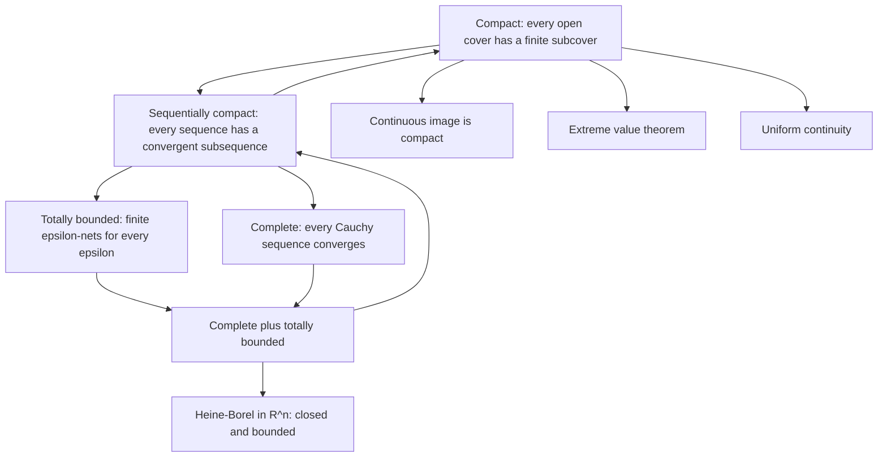
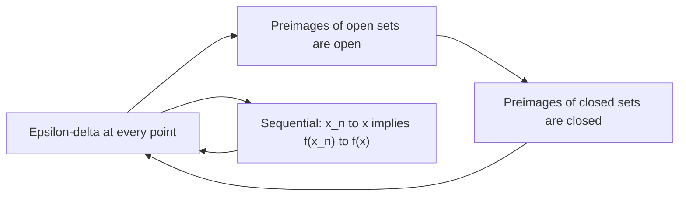

# Metric Spaces

> [Mathematics](../../README.md) › [Real Analysis](../README.md) · Level: Advanced · Prerequisites: [Logic](../../00-foundations/02-logic/README.md), [Set Theory](../../00-foundations/03-set-theory/README.md), [Relations and Functions](../../00-foundations/05-relations-and-functions/README.md), [The Real Numbers and Completeness](../01-real-numbers-and-completeness/README.md), [Limits](../../07-calculus/01-limits/README.md), [Continuity](../../07-calculus/02-continuity/README.md), [Riemann Integration](../05-riemann-integration/README.md) · Estimated time: 720 min

## 1. Introduction

Everything in analysis so far has used one number: the distance between two real numbers, $\lvert x - y\rvert$. Limits, continuity, Cauchy sequences, compactness of $[a,b]$ — all were phrased in terms of it. But almost none of the proofs used anything about $\mathbb{R}$ beyond three properties of that distance:

* $d(x,y) = 0$ exactly when $x = y$;
* $d(x,y) = d(y,x)$;
* $d(x,z) \le d(x,y) + d(y,z)$.

This chapter takes those three properties as axioms and rebuilds the theory. The gain is not abstraction for its own sake. The same theorems then apply to $\mathbb{R}^n$ with any of several distances, to spaces of functions with the supremum distance, to spaces of sequences, to the rationals with a $p$-adic distance in which every triangle is isosceles, and to graphs with the shortest-path distance. The proofs are usually *shorter* than in $\mathbb{R}$, because the triangle inequality is the only tool available.

The plan is a tour of the concepts that analysis needs, each with its proofs:

* **Open and closed sets** (§7.3–§7.5). These are the sets that respect the notion of closeness. Open balls are open; arbitrary unions and finite intersections of open sets are open; finite unions and arbitrary intersections of closed sets are closed. The asymmetry between "arbitrary" and "finite" is real and is exhibited by a counterexample.
* **Closure, interior, boundary** (§7.5), and the **sequential characterisation** of the closure (§7.6): a point is in the closure of $A$ exactly when a sequence from $A$ converges to it. This is the bridge that lets $\varepsilon$-arguments be replaced by sequence arguments.
* **Continuity** (§7.7), in three equivalent forms: $\varepsilon$-$\delta$, sequential, and "preimages of open sets are open". The third is the one that survives into topology, where there are no distances at all.
* **Completeness and Baire** (§7.8–§7.9). A Cauchy sequence is one whose terms eventually crowd together; a space is complete when every such sequence has a limit. $\mathbb{R}$, $\mathbb{R}^n$ and $C[a,b]$ with the supremum metric are complete; $\mathbb{Q}$ and $(0,1)$ are not. The **Baire category theorem** — a complete space is not the union of countably many nowhere dense sets — is the deepest consequence, and it proves in one line that $\mathbb{R}$ is uncountable and that there exist continuous functions differentiable nowhere.
* **Compactness** (§7.10). For metric spaces three definitions coincide: every open cover has a finite subcover, every sequence has a convergent subsequence, and the space is complete and totally bounded. The proof of the equivalence is the technical peak of the chapter, and it is what makes the extreme value theorem and uniform continuity true.
* **The contraction mapping principle** (§7.11) and **connectedness** (§7.12). The first is the standard tool for existence and uniqueness of solutions of equations, including differential equations; the second is the property that forces the intermediate value theorem.

A warning about terminology. In a metric space the words *open* and *closed* are not opposites: a set may be both (every subset of a discrete space), neither ($[0,1)$ in $\mathbb{R}$), or one and not the other. What is true is that a set is closed exactly when its complement is open. Every theorem below is stated with the quantifiers explicit, because the difference between "for every $x$ there is an $r$" and "there is an $r$ that works for every $x$" is the difference between continuity and uniform continuity, and between compactness and mere boundedness.

## 2. Prerequisites

**Sets, functions and images.** Unions and intersections over arbitrary index sets (including uncountable ones), complements, and the set operations $f^{-1}[B]$ and $f[A]$. The preimage commutes with unions and complements; the image does not. See [Set Theory](../../00-foundations/03-set-theory/README.md) and [Relations and Functions](../../00-foundations/05-relations-and-functions/README.md).

**Quantifiers and proof technique.** Almost every statement here has the form $\forall \varepsilon>0\ \exists \delta>0 \ \forall x$, and almost every proof of a negative statement negates it correctly. See [Logic](../../00-foundations/02-logic/README.md).

**The completeness of $\mathbb{R}$.** The least upper bound property is used to prove that $\mathbb{R}$ is complete, that closed bounded intervals are compact, and that $\mathbb{R}$ is connected. See [The Real Numbers and Completeness](../01-real-numbers-and-completeness/README.md).

**Limits and continuity in $\mathbb{R}$.** The $\varepsilon$–$\delta$ definition, the algebra of limits, and the equivalence of continuity with sequential continuity in $\mathbb{R}$ are the models that get generalised. See [Limits](../../07-calculus/01-limits/README.md) and [Continuity](../../07-calculus/02-continuity/README.md).

**Suprema and infima of bounded sets.** Open balls are defined by strict inequalities, and closures are computed with suprema of distances. See [Inequalities](../../03-algebra/03-inequalities/README.md).

**Vector spaces and norms.** The examples on $\mathbb{R}^n$ use coordinates; the inequalities $\lVert x\rVert_\infty \le \lVert x\rVert_2 \le \lVert x\rVert_1 \le n\lVert x\rVert_\infty$ are proved by squaring and summing. See [Linear Algebra](../../08-linear-algebra/README.md).

**Uniform convergence.** The completeness of $C[a,b]$ with the supremum metric is the statement that a uniformly Cauchy sequence of continuous functions has a continuous limit. See [Riemann Integration](../05-riemann-integration/README.md) §7.20 for the same circle of ideas, and [Continuity](../../07-calculus/02-continuity/README.md) for uniform continuity.

**The mean value theorem.** Used once, in the contraction mapping application to differential equations, to convert a differential equation into an integral equation. See [Applications of Derivatives](../../07-calculus/05-applications-of-derivatives/README.md) and [The Fundamental Theorem of Calculus](../../07-calculus/07-fundamental-theorem-of-calculus/README.md).

## 3. Learning Objectives

By the end of this tutorial you will be able to

1. state the three metric axioms and verify them for the Euclidean, taxicab, supremum, discrete and $p$-adic distances;
2. prove that open balls are open, and that arbitrary unions and finite intersections of open sets are open, with a counterexample for infinite intersections;
3. prove the dual statements for closed sets, and show that closed balls and finite sets are closed;
4. compute interiors, closures and boundaries, and prove that the interior is the largest open subset and the closure the smallest closed superset;
5. prove the sequential characterisation of the closure and deduce that a set is closed exactly when it contains the limits of its sequences;
6. prove the equivalence of the $\varepsilon$-$\delta$, sequential and preimage-of-open formulations of continuity, and use each in examples;
7. define Cauchy sequences and completeness, prove that $\mathbb{R}^n$ and $C[a,b]$ (supremum metric) are complete, and exhibit incomplete spaces;
8. state and prove the Baire category theorem, and use it to show that $\mathbb{R}$ is uncountable and that $\mathbb{Q}$ is not a countable intersection of open sets;
9. prove the equivalence of compactness, sequential compactness and "complete and totally bounded" in metric spaces, including the Lebesgue number lemma;
10. prove the contraction mapping principle and apply it to the Picard iteration for an initial value problem;
11. define connectedness, prove that $\mathbb{R}$ and its intervals are connected, and that continuous images of connected sets are connected.

## 4. Intuition

### 4.1 What a metric remembers

A metric is a machine that answers the question "how far apart are these two points?" for every pair. It does not know what a point *is*, what a straight line is, or which direction is north. Everything topological — which points are near which, which sets are open, which sequences converge — can be read off the answers.

That is why the same theorems hold in wildly different settings. In $\mathbb{R}^2$ with the taxicab metric, the distance between two points is the length of a shortest path along the grid of streets; the "balls" are diamonds, not discs. In the discrete metric, distinct points are always at distance $1$, so every set is open and the only convergent sequences are eventually constant. In the $p$-adic metric on $\mathbb{Q}$, two rationals are close when their difference is divisible by a high power of $p$; the balls are both open and closed, and every triangle is isosceles.

Each of these spaces satisfies the same three axioms, so each inherits the same theorems. What changes is the geometry, and the geometry is exactly what the examples are for.

### 4.2 Open sets: membership is a neighbourhood affair

A set is **open** when every one of its points has some room around it: a small ball, entirely inside the set. The point of the definition is that it is *local* — it can be checked one point at a time, and the radius may depend on the point.

Think of an open set as a region without a skin: whichever point you stand at, you can walk a little in any direction and stay inside. A **closed** set is the opposite kind of thing: it contains its own skin, that is, it contains every limit of its own sequences. A closed interval $[a,b]$ is closed; the half-open $[a,b)$ is neither open (near $b$ there is no room) nor closed (the sequence $b - 1/n$ escapes it).

The complement relationship is exact: $A$ is open if and only if $X \setminus A$ is closed. That single fact converts every theorem about open sets into one about closed sets, with unions and intersections exchanged.

### 4.3 Completeness: no holes

A Cauchy sequence is one whose terms eventually become arbitrarily close *to each other*; nothing is said about a limit. In $\mathbb{R}$ every Cauchy sequence converges, and this is the content of completeness. In $\mathbb{Q}$ the sequence of decimal truncations of $\sqrt2$ is Cauchy but has no rational limit — the rational line has a hole exactly where the limit should be. In $(0,1)$ with the usual distance the sequence $1/n$ is Cauchy and has no limit *in the space*, although it has one in $\mathbb{R}$: completeness is a property of the space, not of the sequence.

Completeness is not a topological property: $(0,1)$ and $\mathbb{R}$ are homeomorphic, but only one of them is complete. It depends on the metric, which is why the same set $C[0,1]$ is complete with the supremum metric and incomplete with the $L^1$ metric (§9.5).

### 4.4 Compactness: finite information suffices

Compactness is the abstraction of "closed and bounded" for $\mathbb{R}^n$, but it is not the same thing: in a general metric space, bounded and closed sets can fail to be compact. The right intuition is **finiteness up to arbitrary precision**: a space is compact when, for every $\varepsilon>0$, finitely many balls of radius $\varepsilon$ cover it (total boundedness), and when no points are missing at the limit (completeness). Both conditions are needed and neither implies the other.

The payoff is that on a compact space, a continuous function is automatically uniformly continuous and automatically attains its extrema, because "for every point there is a radius" can be converted into "there is one radius that works for all points" by extracting a finite subcover. Every compactness argument in analysis has this shape.

### 4.5 Contractions: the geometry of iteration

A contraction shrinks distances by a fixed factor $q<1$. In a complete space, iterating a contraction from any starting point produces a Cauchy sequence, and its limit is the unique fixed point. This is the simplest existence theorem in analysis, and it is astonishingly effective: it proves the inverse function theorem, the existence and uniqueness of solutions of ordinary differential equations (Picard–Lindelöf, §7.11), the convergence of Newton's method under suitable hypotheses, and the existence of solutions of many integral equations. The picture is a spiral: each application of the map moves every pair of points closer, so the whole space is squeezed toward one point.

## 5. Formal Definition

**Definition 5.1 (Metric space).** A *metric* on a set $X$ is a function $d : X \times X \to \mathbb{R}$ such that for all $x,y,z \in X$:

* **(M1) definiteness:** $d(x,y) = 0$ if and only if $x = y$;
* **(M2) symmetry:** $d(x,y) = d(y,x)$;
* **(M3) triangle inequality:** $d(x,z) \le d(x,y) + d(y,z)$.

The pair $(X,d)$ is a *metric space*. When the metric is clear from context we write $X$ for $(X,d)$ and $d(x,y)$ for the distance.

**Definition 5.2 (Open ball, closed ball, sphere).** For $x \in X$ and $r>0$,

$$B_r(x) = \{y \in X : d(x,y) < r\}, \qquad \overline{B}_r(x) = \{y \in X : d(x,y) \le r\}, \qquad S_r(x) = \{y : d(x,y)=r\}.$$

These are the *open ball*, *closed ball* and *sphere* of radius $r$ about $x$. A set $N \subseteq X$ is a *neighbourhood* of $x$ if there is $r>0$ with $B_r(x) \subseteq N$.

**Definition 5.3 (Open set).** $U \subseteq X$ is *open* if for every $x \in U$ there is $r>0$ with $B_r(x) \subseteq U$. The family of open sets is the *topology* induced by $d$.

**Definition 5.4 (Closed set).** $F \subseteq X$ is *closed* if its complement $X \setminus F$ is open.

**Definition 5.5 (Interior, closure, boundary).** Let $A \subseteq X$.

* The *interior* of $A$ is $A^{\circ} = \{x \in A : \exists r>0,\ B_r(x) \subseteq A\}$.
* The *closure* of $A$ is $\overline{A} = \{x \in X : \forall r>0,\ B_r(x) \cap A \ne \varnothing\}$.
* The *boundary* of $A$ is $\partial A = \overline{A} \cap \overline{X \setminus A}$.

**Definition 5.6 (Limit point).** $x$ is a *limit point* (accumulation point) of $A$ if for every $r>0$, $B_r(x) \cap (A \setminus \{x\}) \ne \varnothing$. The set of limit points of $A$ is denoted $A'$.

**Definition 5.7 (Convergence).** A sequence $(x_n)$ in $X$ *converges* to $x \in X$ if for every $\varepsilon>0$ there is $N$ with $d(x_n,x) < \varepsilon$ for all $n \ge N$. We write $x_n \to x$.

**Definition 5.8 (Continuity).** Let $(X,d)$ and $(Y,\rho)$ be metric spaces and $f : X \to Y$. Then $f$ is *continuous at $x_0 \in X$* if

$$\forall \varepsilon>0\ \exists \delta>0\ \forall x \in X:\ d(x,x_0) < \delta \Longrightarrow \rho(f(x),f(x_0)) < \varepsilon .$$

$f$ is *continuous* if it is continuous at every point of $X$. It is *uniformly continuous* if the $\delta$ can be chosen independently of $x_0$: $\forall\varepsilon>0\ \exists\delta>0\ \forall x,y:\ d(x,y)<\delta \Rightarrow \rho(f(x),f(y))<\varepsilon$. $f$ is *Lipschitz* with constant $L$ if $\rho(f(x),f(y)) \le L\,d(x,y)$ for all $x,y$. A bijection $f$ with $f$ and $f^{-1}$ continuous is a *homeomorphism*; a bijection with $d(x,y) = \rho(f(x),f(y))$ is an *isometry*.

**Definition 5.9 (Cauchy sequence and completeness).** $(x_n)$ is *Cauchy* if

$$\forall \varepsilon>0\ \exists N\ \forall m,n \ge N:\ d(x_m,x_n) < \varepsilon .$$

$(X,d)$ is *complete* if every Cauchy sequence in $X$ converges to a point of $X$.

**Definition 5.10 (Diameter and boundedness).** The *diameter* of $A \subseteq X$ is $\operatorname{diam} A = \sup\{d(x,y) : x,y \in A\}$, with $\operatorname{diam}\varnothing = 0$. $A$ is *bounded* if $\operatorname{diam} A < \infty$.

**Definition 5.11 (Total boundedness).** $(X,d)$ is *totally bounded* if for every $\varepsilon>0$ there are finitely many points $y_1,\dots,y_m \in X$ with $X = \bigcup_{j=1}^m B_\varepsilon(y_j)$. Such a finite set is an *$\varepsilon$-net*.

**Definition 5.12 (Compactness).** $(X,d)$ is *compact* if every open cover has a finite subcover: whenever $X = \bigcup_{i\in I} U_i$ with each $U_i$ open, there are $i_1,\dots,i_k$ with $X = U_{i_1}\cup\cdots\cup U_{i_k}$. It is *sequentially compact* if every sequence in $X$ has a subsequence converging to a point of $X$.

**Definition 5.13 (Contraction).** $T : X \to X$ is a *contraction* if there is $q \in [0,1)$ with $d(Tx,Ty) \le q\,d(x,y)$ for all $x,y \in X$. A point $x$ with $Tx = x$ is a *fixed point*.

**Definition 5.14 (Connectedness).** $X$ is *connected* if it admits no *separation*: no pair $U,V$ of nonempty, disjoint, open subsets with $X = U \cup V$. Equivalently, the only subsets of $X$ that are both open and closed (*clopen*) are $\varnothing$ and $X$. $X$ is *path-connected* if for all $p,q \in X$ there is a continuous $\gamma:[0,1]\to X$ with $\gamma(0)=p$ and $\gamma(1)=q$.

## 6. Mathematical Notation

| Symbol | Read as | Meaning |
|---|---|---|
| $(X,d)$ | the metric space $X$ with metric $d$ | a set with a distance function |
| $d(x,y)$ | distance from $x$ to $y$ | a non-negative real number |
| $B_r(x)$ | open ball of radius $r$ about $x$ | $\{y : d(x,y)<r\}$ |
| $\overline{B}_r(x)$ | closed ball | $\{y : d(x,y)\le r\}$ |
| $S_r(x)$ | sphere | $\{y : d(x,y) = r\}$ |
| $A^{\circ}$ | interior of $A$ | largest open subset of $A$ |
| $\overline{A}$ | closure of $A$ | smallest closed superset of $A$ |
| $\partial A$ | boundary of $A$ | $\overline{A}\cap\overline{X\setminus A}$ |
| $A'$ | derived set | the set of limit points of $A$ |
| $X \setminus A$, $A^{\complement}$ | complement of $A$ | points of $X$ not in $A$ |
| $x_n \to x$ | $x_n$ converges to $x$ | $d(x_n,x)\to 0$ |
| $\operatorname{diam} A$ | diameter | $\sup\{d(x,y) : x,y\in A\}$ |
| $\lVert\cdot\rVert_p$ | the $p$-norm on $\mathbb{R}^n$ | $(\sum_i \lvert x_i\rvert^p)^{1/p}$ |
| $d_1, d_2, d_\infty$ | taxicab, Euclidean, supremum metrics | see §7.2 |
| $\rho$ | a second metric | used when two spaces are in play |
| $C[a,b]$ | continuous functions on $[a,b]$ | with $d_\infty(f,g)=\sup\lvert f-g\rvert$ |
| $\ell^2$ | square-summable sequences | $d(x,y) = (\sum_n \lvert x_n-y_n\rvert^2)^{1/2}$ |
| $\lvert x\rvert_p$ | $p$-adic absolute value | $\lvert p^n u/v\rvert_p = p^{-n}$ |
| $\operatorname{id}_X$ | identity map | $x \mapsto x$ |

## 7. Core Concepts

### 7.1 The axioms and their first consequences

Two facts follow from (M1)–(M3) alone and are used constantly.

**Lemma 7.1.** In a metric space $(X,d)$, for all $x,y,z \in X$:

1. $d(x,y) \ge 0$;
2. $\bigl\lvert d(x,z) - d(y,z)\bigr\rvert \le d(x,y)$ (the *reverse triangle inequality*).

*Proof.*

1. By (M1), $d(x,x) = 0$. By (M3) with $z = x$, $0 = d(x,x) \le d(x,y) + d(y,x) = 2d(x,y)$ by (M2). Hence $d(x,y) \ge 0$.
2. By (M3), $d(x,z) \le d(x,y) + d(y,z)$, so $d(x,z) - d(y,z) \le d(x,y)$. Interchanging $x$ and $y$ and using (M2), $d(y,z) - d(x,z) \le d(y,x) = d(x,y)$. Two inequalities of the form $\pm(a-b) \le c$ are equivalent to $\lvert a-b\rvert \le c$. $\blacksquare$

Part 2 says that the function $x \mapsto d(x,z)$ is Lipschitz with constant $1$; it is the reason distance functions are continuous (§7.7) and the reason closed balls are closed (§7.4).

### 7.2 The standard examples

**(a) Euclidean space.** On $\mathbb{R}^n$, $d_2(x,y) = \bigl(\sum_{i=1}^n (x_i-y_i)^2\bigr)^{1/2}$. (M1) and (M2) are immediate; (M3) is the triangle inequality for the Euclidean norm, which follows from the Cauchy–Schwarz inequality $\lvert\langle u,v\rangle\rvert \le \lVert u\rVert\lVert v\rVert$. Balls are round discs and spheres are round spheres.

**(b) Taxicab metric.** On $\mathbb{R}^n$, $d_1(x,y) = \sum_{i=1}^n \lvert x_i - y_i\rvert$. The triangle inequality is the scalar one applied coordinatewise and summed. In $\mathbb{R}^2$ a ball is a diamond with vertices on the axes: $B_1(0) = \{(x,y) : \lvert x\rvert + \lvert y\rvert < 1\}$.

**(c) Supremum metric.** On $\mathbb{R}^n$, $d_\infty(x,y) = \max_i \lvert x_i - y_i\rvert$. Balls are cubes. The triangle inequality follows from $\lvert x_i - z_i\rvert \le \lvert x_i-y_i\rvert + \lvert y_i-z_i\rvert \le d_\infty(x,y)+d_\infty(y,z)$ for every $i$, then taking the maximum.

These three metrics are *Lipschitz equivalent* on $\mathbb{R}^n$: for all $x,y$,

$$d_\infty(x,y) \le d_2(x,y) \le d_1(x,y) \le n\,d_\infty(x,y).$$

The first inequality is termwise; the second follows by squaring; the third from $\lvert x_i-y_i\rvert \le d_\infty(x,y)$ summed over $n$ terms. Consequently the three metrics have the *same* open sets, the same convergent sequences and the same continuous functions — a fact worth remembering, because it means that in $\mathbb{R}^n$ one may choose whichever metric makes an estimate easiest.

**(d) Discrete metric.** On any set $X$, $d(x,y) = 0$ if $x=y$ and $d(x,y)=1$ otherwise. All three axioms are immediate (for (M3), note that the left side is at most $1$ and the right side is $0$ only when all three points coincide). Then $B_r(x) = \{x\}$ for $0<r\le1$ and $B_r(x) = X$ for $r>1$. Every subset is open, and every subset is closed.

**(e) $p$-adic metric (mentioned).** Fix a prime $p$. Every nonzero rational $r$ can be written uniquely as $r = p^n\,a/b$ with $n \in \mathbb{Z}$ and $p \nmid ab$; set $\lvert r\rvert_p = p^{-n}$ and $\lvert 0\rvert_p = 0$. Then $d_p(x,y) = \lvert x-y\rvert_p$ is a metric on $\mathbb{Q}$, and it satisfies the *strong triangle inequality*

$$d_p(x,z) \le \max\{d_p(x,y), d_p(y,z)\},$$

because $\lvert u+v\rvert_p \le \max\{\lvert u\rvert_p,\lvert v\rvert_p\}$ (if two rationals are both divisible by $p^n$, so is their sum). A metric with this property is called *ultrametric*. Two consequences: every triangle is isosceles with the two longer sides equal, and every ball is both open and closed. The $p$-adic metric is the standard example of a metric space whose geometry defeats every Euclidean intuition, and $\mathbb{Q}$ with $d_p$ is not complete.

**(f) Railway metric.** On $\mathbb{R}$, $d(x,y) = \lvert x-y\rvert$ if $x$ and $y$ lie on the same ray from the origin (that is, $xy \ge 0$), and $d(x,y) = \lvert x\rvert + \lvert y\rvert$ otherwise. Travelling between two points on different sides of $0$ must pass through the origin. The triangle inequality is a case check; the interesting feature is that the "line" from $-1$ to $1$ is not straight.

**(g) Graph metric.** On the vertex set of a connected graph, let $d(u,v)$ be the number of edges in a shortest path from $u$ to $v$. The triangle inequality is the statement that concatenating shortest paths gives a walk, which is at least as long as a shortest path. Balls are the sets reachable in at most $r$ steps.

**(h) Product metric.** If $(X,d_X)$ and $(Y,d_Y)$ are metric spaces, then $d\bigl((x_1,y_1),(x_2,y_2)\bigr) = \max\{d_X(x_1,x_2), d_Y(y_1,y_2)\}$ is a metric on $X\times Y$; so is the sum. Both give the product topology.

**(i) Function spaces.** On the set $C[a,b]$ of continuous real functions, $d_\infty(f,g) = \sup_{t\in[a,b]}\lvert f(t)-g(t)\rvert$ is a metric (the supremum is finite because $\lvert f-g\rvert$ is continuous on a compact interval). Also $d_1(f,g) = \int_a^b \lvert f-g\rvert$ is a metric on $C[a,b]$, since $\int\lvert f-g\rvert = 0$ with $f-g$ continuous forces $f = g$. These two metrics are *not* Lipschitz equivalent, and $C[a,b]$ is complete for the first but not for the second (§7.8, §9.5).

**(j) Sequence spaces.** On $\ell^2 = \{(x_n) : \sum_n x_n^2 < \infty\}$, $d(x,y) = \bigl(\sum_n (x_n-y_n)^2\bigr)^{1/2}$ is a metric (Minkowski's inequality in infinitely many coordinates). On the space of bounded sequences, $d_\infty(x,y) = \sup_n\lvert x_n-y_n\rvert$ is a metric.

**(k) Subspaces.** If $(X,d)$ is a metric space and $A \subseteq X$, then $d$ restricted to $A\times A$ is a metric on $A$, the *subspace metric*. Balls in $A$ are intersections of balls in $X$ with $A$: $B^A_r(x) = B^X_r(x)\cap A$. Openness in $A$ and in $X$ differ: $[0,1)$ is open in $[0,1]$ but not in $\mathbb{R}$.

**(l) Pseudo-metrics.** If (M1) is weakened to "$d(x,x)=0$ and $d(x,y)=d(y,x)$" without requiring $d(x,y)=0 \Rightarrow x=y$, the result is a *pseudo-metric*. Example: $d(f,g) = \int_a^b\lvert f-g\rvert$ on the set of all Riemann integrable functions is a pseudo-metric, because a function that is nonzero at finitely many points has integral $0$ and is not the zero function. Quotienting by the relation $d(f,g)=0$ recovers a metric.

### 7.3 Open sets

**Lemma 7.2 (balls are open).** For every $x \in X$ and $r>0$, the open ball $B_r(x)$ is an open set.

*Proof.* Let $y \in B_r(x)$, so that $\varepsilon := r - d(x,y) > 0$. We claim $B_\varepsilon(y) \subseteq B_r(x)$. Indeed, if $z \in B_\varepsilon(y)$ then by the triangle inequality

$$d(x,z) \le d(x,y) + d(y,z) < d(x,y) + \varepsilon = r,$$

so $z \in B_r(x)$. Hence every point of $B_r(x)$ has a ball around it inside $B_r(x)$, which is the definition of openness. $\blacksquare$

**Theorem 7.3 (the topology axioms).** The family $\mathcal{T}$ of open subsets of $(X,d)$ satisfies

* **(O1)** $\varnothing \in \mathcal{T}$ and $X \in \mathcal{T}$;
* **(O2)** if $\{U_i\}_{i\in I}$ is any family of open sets, then $\bigcup_{i\in I}U_i$ is open;
* **(O3)** if $U_1,\dots,U_k$ are open, then $U_1\cap\cdots\cap U_k$ is open.

*Proof.*

**(O1)** The condition "for every $x \in \varnothing$ there is $r>0$ with $B_r(x)\subseteq\varnothing$" is vacuously true, so $\varnothing$ is open. For $X$: given $x \in X$, any $r>0$ has $B_r(x) \subseteq X$.

**(O2)** Let $U = \bigcup_i U_i$ and $x \in U$. Then $x \in U_j$ for some $j$; since $U_j$ is open there is $r>0$ with $B_r(x) \subseteq U_j \subseteq U$. So $U$ is open.

**(O3)** It suffices to treat $k=2$ and iterate. Let $x \in U_1\cap U_2$. Since $U_1$ is open there is $r_1>0$ with $B_{r_1}(x)\subseteq U_1$, and since $U_2$ is open there is $r_2>0$ with $B_{r_2}(x)\subseteq U_2$. Put $r = \min\{r_1,r_2\} > 0$; then $B_r(x) \subseteq U_1\cap U_2$. $\blacksquare$

The asymmetry in (O2)–(O3) is essential: **arbitrary** unions are allowed, but only **finite** intersections. In $\mathbb{R}$,

$$\bigcap_{n=1}^{\infty}\Bigl(-\frac1n, \frac1n\Bigr) = \{0\},$$

which is not open. Each factor is open, the intersection is not. There is no similar failure for unions, because a point in a union belongs to one member, and openness is a pointwise condition.

### 7.4 Closed sets

**Proposition 7.4 (basic closed sets).** In a metric space $(X,d)$:

1. every closed ball $\overline{B}_r(x)$ is closed;
2. every singleton $\{x\}$ is closed;
3. every finite set is closed.

*Proof.*

1. It suffices to show that the complement is open. Let $y \notin \overline{B}_r(x)$, i.e. $d(x,y) > r$, and put $\varepsilon = d(x,y) - r>0$. For $z \in B_\varepsilon(y)$, the reverse triangle inequality gives
 $$d(x,z) \ge d(x,y) - d(y,z) > d(x,y) - \varepsilon = r,$$
 so $z \notin \overline{B}_r(x)$. Hence $B_\varepsilon(y) \subseteq X\setminus\overline{B}_r(x)$, and the complement is open.
2. $X\setminus\{x\} = \bigcup_{y \ne x}B_{d(x,y)/2}(y)$: indeed $x \notin B_{d(x,y)/2}(y)$ because $d(y,x) = d(x,y) > d(x,y)/2$, and every $y\ne x$ lies in its own ball. A union of open balls is open by Lemma 7.2 and (O2).
3. A finite union of closed sets is closed by Theorem 7.5 below, applied to the singletons. $\blacksquare$

**Theorem 7.5 (the dual axioms).** The family of closed subsets of $(X,d)$ satisfies

* **(C1)** $\varnothing$ and $X$ are closed;
* **(C2)** the union of finitely many closed sets is closed;
* **(C3)** the intersection of an arbitrary family of closed sets is closed.

Moreover, $(X,d)$ is *Hausdorff*: distinct points have disjoint open neighbourhoods.

*Proof.* (C1)–(C3) follow from (O1)–(O3) by De Morgan's laws, since $X\setminus\bigcup_i F_i = \bigcap_i(X\setminus F_i)$ and $X\setminus\bigcap_i F_i = \bigcup_i(X\setminus F_i)$: the complement of a finite union is a finite intersection of open sets, and the complement of an arbitrary intersection is an arbitrary union of open sets. For the Hausdorff property, let $x \ne y$ and put $r = d(x,y)/3 > 0$; then $B_r(x)\cap B_r(y) = \varnothing$, because a point $z$ in both would give $d(x,y) \le d(x,z)+d(z,y) < 2r < d(x,y)$. $\blacksquare$

Again the asymmetry is real: an **arbitrary union** of closed sets need not be closed. In $\mathbb{R}$,

$$\bigcup_{n=1}^{\infty}\Bigl[\frac1n, 1\Bigr] = (0,1],$$

which is not closed, since the sequence $1/n$ lies in it and converges to $0 \notin (0,1]$.

The Hausdorff property has an immediate consequence used below: **limits are unique**. If $x_n \to x$ and $x_n \to y$ with $x \ne y$, the disjoint balls $B_r(x)$, $B_r(y)$ would each have to contain all sufficiently late terms, which is impossible.

### 7.5 Interior, closure and boundary

**Proposition 7.6 (the interior is the largest open subset, the closure the smallest closed superset).** Let $A \subseteq X$.

1. $A^{\circ}$ is open and equals the union of all open subsets of $A$. Hence $A$ is open if and only if $A = A^{\circ}$.
2. $\overline{A}$ is closed and equals the intersection of all closed supersets of $A$. Hence $A$ is closed if and only if $A = \overline{A}$.

*Proof.*

1. Let $x \in A^{\circ}$ and let $r>0$ with $B_r(x)\subseteq A$. For every $y \in B_r(x)$ we have $B_{r-d(x,y)}(y)\subseteq B_r(x)\subseteq A$ (the same computation as in Lemma 7.2), so $y \in A^{\circ}$. Hence $B_r(x)\subseteq A^{\circ}$ and $A^{\circ}$ is open. If $O \subseteq A$ is open and $x \in O$, then there is $r>0$ with $B_r(x)\subseteq O\subseteq A$, so $x \in A^{\circ}$; thus every open subset of $A$ lies in $A^{\circ}$, while $A^{\circ}$ itself is open. Therefore $A^{\circ}$ is the union of all open subsets of $A$, and it is the largest one. Finally $A$ open means $A$ is an open subset of $A$, hence $A \subseteq A^{\circ}$, and since always $A^{\circ}\subseteq A$, equality holds. Conversely $A = A^{\circ}$ is open.
2. First, $X\setminus\overline{A}$ is open. If $x \notin \overline{A}$, there is $r>0$ with $B_r(x)\cap A = \varnothing$; then for $y \in B_r(x)$ the ball $B_{r-d(x,y)}(y)$ lies inside $B_r(x)$ and so misses $A$, whence $y \notin \overline{A}$. Thus $B_r(x) \subseteq X\setminus\overline{A}$. So $\overline{A}$ is closed. Next, let $F \supseteq A$ be closed and let $x \in X\setminus F$. Since $X\setminus F$ is open there is $r>0$ with $B_r(x)\subseteq X\setminus F \subseteq X\setminus A$, so $B_r(x)\cap A = \varnothing$ and $x \notin \overline{A}$. Therefore $\overline{A}\subseteq F$: the closure is contained in every closed superset. Since $\overline{A}$ is itself a closed superset, it is the smallest one. Finally $A$ closed means $\overline{A}\subseteq A$ (as $\overline{A}$ is contained in the closed set $A$), and since $A\subseteq\overline{A}$ always, $A = \overline{A}$. $\blacksquare$

**Proposition 7.7 (working descriptions of the closure).** For $A \subseteq X$ and $x \in X$, the following are equivalent: (i) $x \in \overline{A}$; (ii) $B_r(x)\cap A \ne\varnothing$ for every $r>0$; (iii) $x \in A$ or $x \in A'$. Hence $\overline{A} = A \cup A'$.

*Proof.* (i)⇔(ii) is the definition of the closure. (iii)⇒(ii): if $x \in A$ then $x \in B_r(x)\cap A$; if $x \in A'$ then $B_r(x)\cap(A\setminus\{x\})\ne\varnothing$. (ii)⇒(iii): suppose $x \notin A$; then $B_r(x)\cap A \ne\varnothing$ means $B_r(x)\cap(A\setminus\{x\})\ne\varnothing$, so $x \in A'$. $\blacksquare$

**Proposition 7.8 (boundary).** Let $A \subseteq X$. Then

1. $\partial A = \overline{A}\setminus A^{\circ}$, and $\overline{A} = A^{\circ}\cup\partial A$ with the two sets disjoint;
2. $\partial A$ is closed;
3. $\partial A = \varnothing$ if and only if $A$ is both open and closed.

*Proof.*

1. Complementation exchanges interior and closure: $X\setminus A^{\circ} = \overline{X\setminus A}$ (the complement of the largest open set inside $A$ is the smallest closed set containing $X\setminus A$). Hence
 $$\partial A = \overline{A}\cap\overline{X\setminus A} = \overline{A}\cap(X\setminus A^{\circ}) = \overline{A}\setminus A^{\circ}.$$
 Since $A^{\circ}\subseteq\overline{A}$, the decomposition $\overline{A} = A^{\circ}\cup(\overline{A}\setminus A^{\circ})$ is a disjoint union.
2. It is the intersection of two closed sets.
3. If $A$ is clopen then $\overline{A} = A = A^{\circ}$, so $\partial A = \varnothing$. Conversely, if $\partial A=\varnothing$ then $\overline{A} = A^{\circ}$, which is open and closed (it is the interior of $A$ and also the closure of $A$), and $A^{\circ}\subseteq A\subseteq\overline{A}$ forces $A = A^{\circ} = \overline{A}$, so $A$ is clopen. $\blacksquare$

### 7.6 Limit points and the sequential characterisation

**Theorem 7.9 (closure is sequential closure).** Let $A \subseteq X$ and $x \in X$. Then $x \in \overline{A}$ if and only if there is a sequence $(x_n)$ with $x_n \in A$ for all $n$ and $x_n \to x$.

*Proof.*

**(⇒)** Suppose $x \in \overline{A}$. For each $n \in \mathbb{N}$, the ball $B_{1/n}(x)$ meets $A$; choose $x_n \in A \cap B_{1/n}(x)$. Then $d(x_n,x) < 1/n \to 0$, so $x_n \to x$.

**(⇐)** Suppose $x_n \in A$ and $x_n \to x$. Let $r>0$; convergence gives $N$ with $x_N \in B_r(x)$, so $B_r(x)\cap A \ne\varnothing$. As $r$ was arbitrary, $x \in \overline{A}$. $\blacksquare$

The same argument with $A\setminus\{x\}$ shows: $x \in A'$ if and only if there is a sequence in $A\setminus\{x\}$ converging to $x$.

**Corollary 7.10 (closed = sequentially closed).** $A$ is closed if and only if every sequence in $A$ that converges in $X$ has its limit in $A$.

*Proof.* If $A$ is closed and $x_n \in A$ with $x_n \to x$, then $x \in \overline{A} = A$ by Theorem 7.9. Conversely, suppose $A$ has the stated property and let $x \in \overline{A}$. By Theorem 7.9 there is a sequence in $A$ converging to $x$, so by hypothesis $x \in A$; hence $\overline{A}\subseteq A$, i.e. $A$ is closed. $\blacksquare$

This corollary is the reason metric spaces are comfortable: closed sets can be *tested by sequences*, so every $\varepsilon$-argument has a sequential counterpart. In a general topological space this fails; it holds here because balls of radius $1/n$ form a countable local base at each point.

### 7.7 Continuity

**Theorem 7.11 (three equivalent definitions).** Let $(X,d)$ and $(Y,\rho)$ be metric spaces and $f:X\to Y$. The following are equivalent.

1. $f$ is continuous (Definition 5.8).
2. $f^{-1}[V]$ is open in $X$ for every open $V \subseteq Y$.
3. $f^{-1}[F]$ is closed in $X$ for every closed $F \subseteq Y$.
4. $x_n \to x$ in $X$ implies $f(x_n) \to f(x)$ in $Y$.

*Proof.*

**(1)⇒(2)** Let $V\subseteq Y$ be open and $x \in f^{-1}[V]$. Then $f(x)\in V$, and $V$ is open, so there is $\varepsilon>0$ with $B_\varepsilon(f(x))\subseteq V$. By continuity at $x$ there is $\delta>0$ with $f\bigl[B_\delta(x)\bigr]\subseteq B_\varepsilon(f(x))\subseteq V$, i.e. $B_\delta(x)\subseteq f^{-1}[V]$. So $f^{-1}[V]$ is open.

**(2)⇒(3)** Let $F\subseteq Y$ be closed. Then $Y\setminus F$ is open and $f^{-1}[Y\setminus F] = X\setminus f^{-1}[F]$ is open by (2), so $f^{-1}[F]$ is closed.

**(3)⇒(4)** Suppose $x_n\to x$ and $f(x_n)\not\to f(x)$. Then there is $\varepsilon>0$ such that $\rho(f(x_n),f(x))\ge\varepsilon$ for infinitely many $n$; passing to that subsequence we may assume it holds for all $n$. The set $F = \{y \in Y : \rho(y,f(x))\ge\varepsilon\}$ is closed (its complement is the open ball $B_\varepsilon(f(x))$). Each $x_n$ lies in $f^{-1}[F]$, which is closed by (3), so its limit $x$ lies in $f^{-1}[F]$ by Corollary 7.10. But $f(x)\notin F$ since $\rho(f(x),f(x)) = 0 < \varepsilon$ — a contradiction.

**(4)⇒(1)** Suppose $f$ is not continuous at some $x \in X$. Then there is $\varepsilon>0$ such that for every $\delta>0$ there is $y$ with $d(y,x)<\delta$ but $\rho(f(y),f(x))\ge\varepsilon$. Taking $\delta = 1/n$ gives $x_n$ with $d(x_n,x)<1/n$ and $\rho(f(x_n),f(x))\ge\varepsilon$. Then $x_n \to x$ but $f(x_n)\not\to f(x)$, contradicting (4). $\blacksquare$

**Proposition 7.12 (composition and isometries).** Let $f:X\to Y$ and $g:Y\to Z$ be continuous. Then $g\circ f$ is continuous. Every isometry is continuous and injective; an isometry onto $Y$ is a homeomorphism.

*Proof.* For (2)⇒(2) of Theorem 7.11: if $W\subseteq Z$ is open then $(g\circ f)^{-1}[W] = f^{-1}\bigl[g^{-1}[W]\bigr]$, an open set because $g^{-1}[W]$ is open and $f$ pulls back open sets to open sets. For an isometry, $\rho(f(x),f(x')) = d(x,x')$, so taking $\delta = \varepsilon$ proves continuity; injectivity is immediate from (M1), and the inverse is again an isometry. $\blacksquare$

*Caution.* A continuous bijection need not have a continuous inverse. The identity map from $\mathbb{R}$ with the discrete metric to $\mathbb{R}$ with the usual metric is a continuous bijection (every set is open in the discrete space, so every preimage is open) whose inverse is not continuous.

**Proposition 7.13 (continuity at a point, local form).** $f$ is continuous at $x_0$ if and only if for every $\varepsilon>0$ the set $f^{-1}\bigl[B_\varepsilon(f(x_0))\bigr]$ is a neighbourhood of $x_0$.

*Proof.* The condition says precisely that for every $\varepsilon>0$ there is $\delta>0$ with $B_\delta(x_0)\subseteq f^{-1}[B_\varepsilon(f(x_0))]$, i.e. $f[B_\delta(x_0)]\subseteq B_\varepsilon(f(x_0))$, which is Definition 5.8. $\blacksquare$

### 7.8 Completeness

**Lemma 7.14.** In any metric space:

1. every convergent sequence is Cauchy;
2. every Cauchy sequence is bounded.

*Proof.*

1. If $x_n \to x$ and $\varepsilon>0$, choose $N$ with $d(x_n,x)<\varepsilon/2$ for $n\ge N$. Then for $m,n\ge N$, $d(x_m,x_n)\le d(x_m,x)+d(x,x_n) < \varepsilon$.
2. Let $(x_n)$ be Cauchy. Taking $\varepsilon = 1$ gives $N$ with $d(x_m,x_n)<1$ whenever $m,n\ge N$. Let $R = \max\{1, d(x_N,x_1),\dots,d(x_N,x_N)\}$, which is a maximum of finitely many numbers. Then $d(x_N,x_n)\le R$ for all $n$: for $n\le N$ by definition of $R$, and for $n>N$ because $d(x_N,x_n)<1\le R$. Hence the whole sequence lies in $\overline{B}_{R+1}(x_N)$. $\blacksquare$

The converse of part 1 fails: $x_n = 1/n$ is Cauchy in $(0,1)$ but does not converge there. That is exactly the distinction completeness measures.

**Proposition 7.15.** If a Cauchy sequence has a convergent subsequence, then the whole sequence converges, to the same limit.

*Proof.* Let $(x_n)$ be Cauchy and $x_{n_k}\to x$. Let $\varepsilon>0$. Choose $K$ with $d(x_{n_k},x)<\varepsilon/2$ for $k\ge K$, and $N$ with $d(x_m,x_n)<\varepsilon/2$ for $m,n\ge N$. For $n\ge\max\{N, n_K\}$,

$$d(x_n,x)\le d(x_n,x_{n_K}) + d(x_{n_K},x) < \frac{\varepsilon}{2}+\frac{\varepsilon}{2} = \varepsilon . \qquad \blacksquare$$

**Theorem 7.16 ($\mathbb{R}^n$ is complete).** For each $n$, $\mathbb{R}^n$ with the Euclidean metric is complete. So is $\mathbb{R}^n$ with $d_1$ or $d_\infty$, by Lipschitz equivalence.

*Proof.* Let $(x^{(m)})_{m\ge1}$ be Cauchy in $(\mathbb{R}^n,d_2)$, and write $x^{(m)} = (x_1^{(m)},\dots,x_n^{(m)})$. For each coordinate $i$,

$$\bigl\lvert x_i^{(m)} - x_i^{(l)}\bigr\rvert \le d_2\bigl(x^{(m)},x^{(l)}\bigr),$$

because the sum of squares includes the $i$-th square. Hence each coordinate sequence $(x_i^{(m)})_m$ is Cauchy in $\mathbb{R}$, and $\mathbb{R}$ is complete (the least upper bound property is equivalent to the convergence of Cauchy sequences; see [The Real Numbers and Completeness](../01-real-numbers-and-completeness/README.md)), so $x_i^{(m)}\to x_i$ for some $x_i$. Put $x = (x_1,\dots,x_n)$. Given $\varepsilon>0$, choose $M$ with $\lvert x_i^{(m)}-x_i\rvert < \varepsilon/\sqrt n$ for all $m\ge M$ and all $i = 1,\dots,n$ (finitely many conditions, so one $M$ works). Then

$$d_2\bigl(x^{(m)},x\bigr)^2 = \sum_{i=1}^n \bigl(x_i^{(m)}-x_i\bigr)^2 < n\cdot\frac{\varepsilon^2}{n} = \varepsilon^2,$$

so $x^{(m)}\to x$. $\blacksquare$

**Theorem 7.17 ($C[a,b]$ with the supremum metric is complete).** Let $C[a,b]$ be the set of continuous real functions on $[a,b]$ with $d_\infty(f,g) = \sup_{t\in[a,b]}\lvert f(t)-g(t)\rvert$. Then $(C[a,b],d_\infty)$ is complete.

*Proof.* Let $(f_n)$ be Cauchy. For each fixed $t$, $\lvert f_n(t)-f_m(t)\rvert\le d_\infty(f_n,f_m)$, so $(f_n(t))_n$ is Cauchy in $\mathbb{R}$ and converges; define $f(t) = \lim_n f_n(t)$.

*The convergence is uniform.* Let $\varepsilon>0$ and choose $N$ with $d_\infty(f_n,f_m)<\varepsilon/2$ for $m,n\ge N$. For $n\ge N$ and any $t$, letting $m\to\infty$ in $\lvert f_n(t)-f_m(t)\rvert\le\varepsilon/2$ gives

$$\lvert f_n(t)-f(t)\rvert \le \frac{\varepsilon}{2} \qquad \text{for all } t,$$

so $\sup_t\lvert f_n-f\rvert\le\varepsilon/2<\varepsilon$ for $n\ge N$: $f_n\to f$ uniformly.

*The limit is continuous.* Let $t_0\in[a,b]$ and $\varepsilon>0$. Choose $n$ with $\sup_t\lvert f_n-f\rvert<\varepsilon/3$ and $\delta>0$ with $\lvert f_n(t)-f_n(t_0)\rvert<\varepsilon/3$ for $\lvert t-t_0\rvert<\delta$ (possible because $f_n$ is continuous). Then for such $t$,

$$\lvert f(t)-f(t_0)\rvert \le \lvert f(t)-f_n(t)\rvert + \lvert f_n(t)-f_n(t_0)\rvert + \lvert f_n(t_0)-f(t_0)\rvert < \frac{\varepsilon}{3}+\frac{\varepsilon}{3}+\frac{\varepsilon}{3} = \varepsilon .$$

So $f\in C[a,b]$, and $d_\infty(f_n,f)\to0$. $\blacksquare$

**Incomplete spaces.** Three standard examples, each important.

* $\mathbb{Q}$ with the usual metric. The decimal truncations $1, 1.4, 1.41, 1.414, \dots$ of $\sqrt2$ form a Cauchy sequence with no rational limit.
* $(0,1)$ with the usual metric: $x_n = 1/n$ is Cauchy and would have to converge to $0\notin(0,1)$.
* $C[0,1]$ with the metric $d_1(f,g) = \int_0^1\lvert f-g\rvert$: see §9.5 for a Cauchy sequence without a continuous limit.

Completeness is a property of the *metric*, not of the underlying set: $(0,1)$ and $\mathbb{R}$ are homeomorphic, but only one is complete. Every metric space embeds isometrically into a complete one, its *completion*, constructed from equivalence classes of Cauchy sequences — the same construction by which $\mathbb{R}$ is built from $\mathbb{Q}$. This is stated here for orientation; the construction is carried out in [The Real Numbers and Completeness](../01-real-numbers-and-completeness/README.md) §7.10 in the special case of $\mathbb{Q}$.

### 7.9 The Baire category theorem

**Definitions.** A set $N\subseteq X$ is *nowhere dense* if its closure has empty interior, i.e. $({\overline N})^{\circ} = \varnothing$. A set is *meagre* (or *of first category*) if it is a countable union of nowhere dense sets. A set is *residual* (or *comeagre*) if its complement is meagre. A set is *dense* if its closure is $X$.

**Theorem 7.18 (Baire category theorem).** Let $(X,d)$ be a complete nonempty metric space and let $(U_n)_{n\in\mathbb{N}}$ be open dense subsets of $X$. Then $\bigcap_n U_n$ is dense in $X$. Equivalently, a countable union of nowhere dense subsets of $X$ has empty interior; in particular a complete nonempty metric space is not meagre in itself.

*Proof.* Let $W\subseteq X$ be open and nonempty; we must find a point of $W\cap\bigcap_n U_n$.

Since $U_1$ is dense and $W$ is a nonempty open set, $U_1\cap W$ is nonempty and open. Choose $x_1\in U_1\cap W$ and $r_1\in(0,1)$ with

$$\overline{B}_{r_1}(x_1)\subseteq U_1\cap W .$$

(Here and below we shrink the radius so that the *closed* ball is contained; this is possible because $U_1\cap W$ is open.)

Inductively, given $x_n$ and $r_n$, the set $U_{n+1}\cap B_{r_n}(x_n)$ is nonempty and open (nonempty because $U_{n+1}$ is dense and $B_{r_n}(x_n)$ is a nonempty open set). Choose $x_{n+1}$ in it and $r_{n+1}\in(0,r_n/2)$ with

$$\overline{B}_{r_{n+1}}(x_{n+1})\subseteq U_{n+1}\cap B_{r_n}(x_n).$$

The sequence $(x_n)$ is Cauchy: for $m>n$, the point $x_m$ lies in $\overline{B}_{r_{n+1}}(x_{n+1})\subseteq B_{r_n}(x_n)$ whenever $m\ge n+1$, so $d(x_m,x_n)<r_n<2^{1-n}\to0$. By completeness there is $x$ with $x_n\to x$.

For each $n\ge1$ and each $m\ge n+1$ we have $x_m\in\overline{B}_{r_n}(x_n)$, and closed balls are closed (Proposition 7.4), so $x\in\overline{B}_{r_n}(x_n)\subseteq U_n\cap W$. Hence $x\in W\cap\bigcap_n U_n$. Therefore the intersection meets every nonempty open set, which is density. $\blacksquare$

**Corollary 7.19 (two classical applications).**

1. $\mathbb{R}$ is uncountable.
2. $\mathbb{Q}$ is not a countable intersection of open subsets of $\mathbb{R}$ (it is not a $G_\delta$).

*Proof.*

1. Suppose $\mathbb{R} = \{x_1,x_2,\dots\}$. Each $U_n = \mathbb{R}\setminus\{x_n\}$ is open (singletons are closed) and dense (a ball $B_r(x)$ is infinite, so it contains points other than $x_n$). By Theorem 7.18, $\bigcap_n U_n$ is dense, hence nonempty. But $\bigcap_n U_n = \mathbb{R}\setminus\{x_1,x_2,\dots\} = \varnothing$. Contradiction.
2. Suppose $\mathbb{Q} = \bigcap_n U_n$ with $U_n$ open in $\mathbb{R}$. Each $U_n\supseteq\mathbb{Q}$ is dense, since $\mathbb{Q}$ is dense. Then $\mathbb{R}\setminus\mathbb{Q} = \bigcup_n(\mathbb{R}\setminus U_n)$ is a countable union of closed sets, each with empty interior (as $U_n$ is dense). So $\mathbb{R}\setminus\mathbb{Q}$ is meagre. And $\mathbb{Q} = \bigcup_{q\in\mathbb{Q}}\{q\}$ is a countable union of singletons, each nowhere dense, so $\mathbb{Q}$ is meagre. Hence $\mathbb{R} = \mathbb{Q}\cup(\mathbb{R}\setminus\mathbb{Q})$ is meagre, contradicting Theorem 7.18. $\blacksquare$

**Application: continuous functions differentiable nowhere.** In the complete space $C[0,1]$ with $d_\infty$, let

$$E_n = \Bigl\{f\in C[0,1] : \exists x\in[0,1]\ \forall y\in[0,1],\ \lvert f(y)-f(x)\rvert\le n\lvert y-x\rvert\Bigr\}.$$

Each $E_n$ is closed (a uniform limit of functions in $E_n$ lies in $E_n$, by passing to a subsequence of the witnessing points $x_k$ and letting $k\to\infty$). Each $E_n$ has empty interior: given $f\in E_n$ and $\varepsilon>0$, add to $f$ a sawtooth function of amplitude less than $\varepsilon$ and slope larger than $2n$ on a very short scale; the result is continuous, within $\varepsilon$ of $f$, and its difference quotients exceed $n$ at some point of every interval short enough, so it is not in $E_n$. By Theorem 7.18, $\bigcup_n E_n$ is meagre, so its complement — the set of continuous functions that are differentiable at *no* point — is residual, hence dense and nonempty. This is Banach's 1931 argument; Weierstrass's 1872 explicit example came first, but Baire's theorem explains why such functions are the rule rather than the exception.

### 7.10 Compactness

Throughout, $(X,d)$ is a metric space.

**Theorem 7.20 (compact $\Rightarrow$ sequentially compact).** If $X$ is compact then every sequence in $X$ has a convergent subsequence.

*Proof.* Let $(x_n)$ be a sequence in $X$ with no convergent subsequence. Then no $x\in X$ is a limit of a subsequence, so for each $x$ there is $r_x>0$ such that $B_{r_x}(x)$ contains $x_n$ for only finitely many $n$: otherwise, for each $k$ choose $n_k > n_{k-1}$ with $x_{n_k}\in B_{1/k}(x)$, and then $x_{n_k}\to x$, a convergent subsequence.

The family $\{B_{r_x}(x)\}_{x\in X}$ is an open cover of $X$. By compactness it has a finite subcover $B_{r_{x_1}}(x_1),\dots,B_{r_{x_m}}(x_m)$. Each of these balls contains only finitely many terms of the sequence, so their union contains only finitely many terms. But their union is $X$, which contains all the infinitely many terms $x_n$ — a contradiction. $\blacksquare$

**Theorem 7.21 (sequentially compact $\Rightarrow$ totally bounded).** If $X$ is sequentially compact then for every $\varepsilon>0$ there is a finite $\varepsilon$-net.

*Proof.* Suppose some $\varepsilon>0$ admits no finite $\varepsilon$-net. Build a sequence recursively: choose any $x_1$; having chosen $x_1,\dots,x_{n-1}$ with pairwise distances $\ge\varepsilon$, the finite set $\{x_1,\dots,x_{n-1}\}$ cannot be an $\varepsilon$-net, so there is $x_n$ with $d(x_n,x_i)\ge\varepsilon$ for all $i<n$. The resulting sequence has all pairwise distances $\ge\varepsilon$, so no subsequence is Cauchy, hence no subsequence converges (a convergent sequence is Cauchy). That contradicts sequential compactness. $\blacksquare$

**Theorem 7.22 (sequentially compact $\Rightarrow$ complete).** If $X$ is sequentially compact then every Cauchy sequence in $X$ converges.

*Proof.* A Cauchy sequence has a convergent subsequence by sequential compactness, and a Cauchy sequence with a convergent subsequence converges by Proposition 7.15. $\blacksquare$

**Theorem 7.23 (complete $+$ totally bounded $\Rightarrow$ sequentially compact).** If $X$ is complete and totally bounded, then every sequence has a convergent subsequence.

*Proof.* Let $(x_n)$ be a sequence. We construct subsequences $\bigl(x^{(k)}_n\bigr)_{n}$ recursively, each a subsequence of the previous one, such that all terms of $\bigl(x^{(k)}_n\bigr)_n$ lie in a ball of radius $1/k$.

Start with $x^{(0)}_n = x_n$. Given $\bigl(x^{(k-1)}_n\bigr)$, cover $X$ by finitely many balls of radius $1/k$ (total boundedness). The terms of $\bigl(x^{(k-1)}_n\bigr)$ are infinitely many, so some ball $B_{1/k}(y_k)$ contains infinitely many of them; let $\bigl(x^{(k)}_n\bigr)$ enumerate those terms in their original order.

Let $y_k = x^{(k)}_k$ (the diagonal sequence). For $m\ge k$ and $n\ge k$, both $y_m$ and $y_n$ are terms of $\bigl(x^{(k)}_n\bigr)$, hence both lie in $B_{1/k}(y_k)$; so

$$d(y_m,y_n) \le d(y_m,y_k)+d(y_k,y_n) < \frac1k+\frac1k = \frac{2}{k}.$$

Given $\varepsilon>0$, take $k>2/\varepsilon$: then $d(y_m,y_n)<\varepsilon$ for $m,n\ge k$, so $(y_k)$ is Cauchy. Completeness gives convergence. $\blacksquare$

**Lemma 7.24 (Lebesgue number lemma).** Let $X$ be sequentially compact and let $\{U_i\}_{i\in I}$ be an open cover of $X$. Then there is $\varepsilon>0$ such that every ball $B_\varepsilon(x)$ is contained in some $U_i$. Such an $\varepsilon$ is a *Lebesgue number* of the cover.

*Proof.* Suppose no $\varepsilon$ works. Then for every $n$ there is $x_n$ such that $B_{1/n}(x_n)$ is contained in no $U_i$. By sequential compactness a subsequence $x_{n_k}\to x$. Since $\{U_i\}$ covers, $x\in U_j$ for some $j$; since $U_j$ is open, $B_r(x)\subseteq U_j$ for some $r>0$. Choose $k$ large enough that $d(x_{n_k},x)<r/2$ and $1/n_k<r/2$. Then for any $y$ with $d(y,x_{n_k})<1/n_k$,

$$d(y,x)\le d(y,x_{n_k})+d(x_{n_k},x)<\frac{r}{2}+\frac{r}{2}=r,$$

so $B_{1/n_k}(x_{n_k})\subseteq B_r(x)\subseteq U_j$, contradicting the choice of $x_{n_k}$. $\blacksquare$

**Theorem 7.25 (sequentially compact $\Rightarrow$ compact).** If $X$ is sequentially compact then every open cover has a finite subcover.

*Proof.* Let $\{U_i\}_{i\in I}$ be an open cover. By Lemma 7.24 it has a Lebesgue number $\varepsilon>0$. By Theorem 7.21, $X$ is totally bounded, so there are $y_1,\dots,y_m$ with $X = \bigcup_{j=1}^m B_{\varepsilon/2}(y_j)$. For each $j$ the ball $B_\varepsilon(y_j)$ is contained in some $U_{i(j)}$ (Lebesgue property, applied to the point $y_j$). Since $B_{\varepsilon/2}(y_j)\subseteq B_\varepsilon(y_j)\subseteq U_{i(j)}$,

$$X = \bigcup_{j=1}^m B_{\varepsilon/2}(y_j)\subseteq\bigcup_{j=1}^m U_{i(j)},$$

a finite subcover. $\blacksquare$

**Theorem 7.26 (the three characterisations of compactness).** For a metric space $(X,d)$, the following are equivalent.

1. $X$ is compact: every open cover has a finite subcover.
2. $X$ is sequentially compact: every sequence has a convergent subsequence.
3. $X$ is complete and totally bounded.

*Proof.* (1)⇒(2) is Theorem 7.20. (2)⇒(3) is Theorems 7.21 and 7.22. (3)⇒(2) is Theorem 7.23. (2)⇒(1) is Theorem 7.25. $\blacksquare$

**Theorem 7.27 (Heine–Borel, and its failure in general metric spaces).** A subset $K\subseteq\mathbb{R}^n$ is compact if and only if it is closed and bounded.

*Proof.* (⇒) If $K$ is compact, it is sequentially compact, hence bounded: the balls $B_1(x)$, $x\in K$, cover $K$, so finitely many of them cover it, and a finite union of bounded sets is bounded. And $K$ is closed: if $x_n\in K$ and $x_n\to x$, sequential compactness gives a subsequence converging to some $y\in K$, and limits are unique, so $x = y\in K$.

(⇐) Suppose $K$ is closed and bounded, say $K\subseteq[-R,R]^n$. The cube $[-R,R]^n$ is totally bounded (grid it by finitely many small cubes of side $<\varepsilon/\sqrt n$) and complete (it is closed in $\mathbb{R}^n$, which is complete). A closed subset of a complete space is complete, and a subset of a totally bounded space is totally bounded. Hence $K$ is complete and totally bounded, so compact by Theorem 7.26. $\blacksquare$

*Warning.* In a general metric space, closed and bounded does **not** imply compact. An infinite set with the discrete metric is closed and bounded (diameter $1$) but not compact: the cover by singletons has no finite subcover. The equivalence in Theorem 7.27 uses the geometry of $\mathbb{R}^n$ through total boundedness, not merely boundedness.

**Theorem 7.28 (continuous images of compact sets are compact).** If $f:X\to Y$ is continuous and $X$ is compact, then $f(X)$ is compact.

*Proof.* Let $\{V_i\}$ be an open cover of $f(X)$ by sets open in $Y$. Then $\{f^{-1}[V_i]\}$ is an open cover of $X$ by Theorem 7.11, so finitely many of them cover $X$: $X = \bigcup_{j=1}^k f^{-1}[V_{i_j}]$. Applying $f$, $f(X)\subseteq\bigcup_j V_{i_j}$. $\blacksquare$

**Theorem 7.29 (extreme value theorem).** If $X$ is a nonempty compact metric space and $f:X\to\mathbb{R}$ is continuous, then $f$ attains a maximum and a minimum.

*Proof.* By Theorem 7.28, $f(X)$ is a compact subset of $\mathbb{R}$, hence closed and bounded by Theorem 7.27. Let $M = \sup f(X)\in\mathbb{R}$. Since $M$ is the supremum, there are $x_n\in X$ with $f(x_n)\to M$, so $M\in\overline{f(X)} = f(X)$; hence $M = f(x_0)$ for some $x_0$. The minimum is handled by applying the result to $-f$. $\blacksquare$

**Theorem 7.30 (continuous on compact $\Rightarrow$ uniformly continuous).** If $X$ is compact and $f:X\to Y$ is continuous, then $f$ is uniformly continuous.

*Proof.* Let $\varepsilon>0$. For each $x\in X$, continuity at $x$ gives $\delta_x>0$ with $f\bigl[B_{2\delta_x}(x)\bigr]\subseteq B_{\varepsilon/2}(f(x))$. The balls $B_{\delta_x}(x)$ cover $X$; by compactness finitely many of them cover: $X = \bigcup_{j=1}^m B_{\delta_{x_j}}(x_j)$. Put $\delta = \min\{\delta_{x_1},\dots,\delta_{x_m}\}>0$.

Now let $x,y\in X$ with $d(x,y)<\delta$. Choose $j$ with $x\in B_{\delta_{x_j}}(x_j)$. Then $d(y,x_j)\le d(y,x)+d(x,x_j)<\delta+\delta_{x_j}\le 2\delta_{x_j}$, so both $f(x)$ and $f(y)$ lie in $B_{\varepsilon/2}(f(x_j))$, and

$$d\bigl(f(x),f(y)\bigr)\le d\bigl(f(x),f(x_j)\bigr)+d\bigl(f(x_j),f(y)\bigr)<\frac{\varepsilon}{2}+\frac{\varepsilon}{2}=\varepsilon . \qquad \blacksquare$$

The compactness hypothesis is essential: $f(x) = x^2$ on $\mathbb{R}$ is continuous but not uniformly continuous, and $f(x) = 1/x$ on $(0,1)$ is continuous but not uniformly continuous.

### 7.11 The contraction mapping principle

**Theorem 7.31 (Banach fixed point theorem).** Let $(X,d)$ be a complete nonempty metric space and let $T:X\to X$ be a contraction with constant $q\in[0,1)$. Then $T$ has exactly one fixed point $x^{*}$, and for every $x_0\in X$ the sequence $x_{n+1} = T(x_n)$ converges to $x^{*}$. Moreover, for every $n\ge1$,

$$d(x_n,x^{*}) \le \frac{q^n}{1-q}\,d(x_1,x_0), \qquad d(x_n,x^{*}) \le \frac{q}{1-q}\,d(x_n,x_{n-1}).$$

*Proof.*

**Uniqueness.** If $Tx = x$ and $Ty = y$, then $d(x,y) = d(Tx,Ty)\le q\,d(x,y)$, so $(1-q)d(x,y)\le0$. Since $1-q>0$ and $d\ge0$, $d(x,y)=0$ and $x=y$.

**The iterates are Cauchy.** By induction, $d(x_{n+1},x_n)\le q^n d(x_1,x_0)$: it holds for $n=0$, and $d(x_{n+1},x_n) = d(Tx_n,Tx_{n-1})\le q\,d(x_n,x_{n-1})\le q\cdot q^{n-1}d(x_1,x_0)$. For $m>n$, the triangle inequality and the geometric series give

$$d(x_m,x_n)\le\sum_{k=n}^{m-1}d(x_{k+1},x_k)\le\sum_{k=n}^{m-1}q^k\,d(x_1,x_0)\le \frac{q^n}{1-q}\,d(x_1,x_0)\longrightarrow0 .$$

So $(x_n)$ is Cauchy; by completeness it converges to some $x^{*}$.

**The limit is a fixed point.** A contraction is Lipschitz with constant $q<1$, hence continuous (take $\delta = \varepsilon$ if $q\le1$). Therefore $T x^{*} = T\bigl(\lim x_n\bigr) = \lim T x_n = \lim x_{n+1} = x^{*}$.

**Error estimates.** Let $m\to\infty$ in the inequality $d(x_m,x_n)\le\frac{q^n}{1-q}d(x_1,x_0)$; since $d(\cdot,x_n)$ is continuous in the second variable (Lemma 7.1), $d(x^{*},x_n)\le\frac{q^n}{1-q}d(x_1,x_0)$. For the second estimate, note that $d(x_{k+1},x_k)\le q^{k-n+1}d(x_n,x_{n-1})$ for every $k\ge n-1$ by iterating the contraction inequality, so

$$d(x_n,x^{*})\le\sum_{k=n}^{\infty}d(x_{k+1},x_k)\le d(x_n,x_{n-1})\sum_{j=1}^{\infty}q^{j} = \frac{q}{1-q}\,d(x_n,x_{n-1}). \qquad \blacksquare$$

The theorem is constructive: it produces the fixed point *and* an algorithm with a certified error bound. That is why it is a workhorse in numerical analysis.

**Application: Picard–Lindelöf.** Consider the initial value problem

$$y'(t) = f\bigl(t,y(t)\bigr), \qquad y(t_0) = y_0,$$

where $f:[t_0-a,t_0+a]\times[y_0-b,y_0+b]\to\mathbb{R}$ is continuous and *Lipschitz in its second variable*: there is $L>0$ with

$$\bigl\lvert f(t,u)-f(t,v)\bigr\rvert\le L\lvert u-v\rvert$$

for all $(t,u),(t,v)$ in the rectangle. Let $M = \sup\lvert f\rvert$ on the rectangle and choose $\delta>0$ with

$$\delta \le a, \qquad M\delta\le b, \qquad L\delta<1 .$$

**Theorem 7.32 (Picard–Lindelöf, local existence and uniqueness).** Under these hypotheses there is exactly one continuously differentiable $y:[t_0-\delta,t_0+\delta]\to[y_0-b,y_0+b]$ with $y(t_0)=y_0$ and $y' = f(t,y)$.

*Proof.* A continuous $y$ with values in $[y_0-b,y_0+b]$ solves the problem if and only if it satisfies the integral equation

$$y(t) = y_0 + \int_{t_0}^{t} f\bigl(s,y(s)\bigr)\,ds \qquad \text{for } \lvert t-t_0\rvert\le\delta,$$

by Theorems 7.20 and 7.21 of [Riemann Integration](../05-riemann-integration/README.md) (part 1 gives differentiability of the right side; part 2 recovers the integral from the derivative).

Let $X = C[t_0-\delta,t_0+\delta]$ with the supremum metric, which is complete by Theorem 7.17, and let $Y\subseteq X$ be the closed ball of radius $b$ around the constant function $y_0$. A closed subset of a complete space is complete, so $Y$ is complete.

Define $T$ on $Y$ by $(Ty)(t) = y_0 + \int_{t_0}^t f(s,y(s))\,ds$. Then $T$ maps $Y$ into $Y$: for $y\in Y$, $\lvert (Ty)(t)-y_0\rvert\le M\lvert t-t_0\rvert\le M\delta\le b$. And $T$ is a contraction with constant $L\delta<1$:

$$\bigl\lvert (Ty)(t)-(Tz)(t)\bigr\rvert \le \int_{t_0}^{t}\bigl\lvert f(s,y(s))-f(s,z(s))\bigr\rvert\,ds \le L\delta\,\sup\lvert y-z\rvert ,$$

so $d_\infty(Ty,Tz)\le L\delta\,d_\infty(y,z)$. By Theorem 7.31, $T$ has a unique fixed point in $Y$; that fixed point is the unique solution. $\blacksquare$

**Example.** For $y' = y$, $y(0)=1$, the map is $(Ty)(t) = 1+\int_0^t y$. Starting from $y_0\equiv1$, Picard iteration gives

$$y_0 = 1, \quad y_1 = 1+t, \quad y_2 = 1+t+\frac{t^2}{2}, \quad \dots, \quad y_n(t) = \sum_{k=0}^{n}\frac{t^k}{k!},$$

which converges uniformly on $[-\delta,\delta]$ to $e^t$ — the fixed point — for every $\delta<1$, since $L = 1$. The error estimate of Theorem 7.31 gives $\lvert y_n(t)-e^t\rvert\le\frac{q^n}{1-q}\,d_\infty(y_1,y_0) = \frac{\delta^{n+1}}{1-\delta}$ on $[-\delta,\delta]$ with $q = \delta$, while the actual error is the much smaller tail $\delta^{n+1}/(n+1)!$ of the exponential series: the contraction estimate is valid but far from sharp. The same principle proves the inverse function theorem, the implicit function theorem, and convergence of Newton's method; see [Further Learning](#16-further-learning).

### 7.12 Connectedness

**Proposition 7.33 ($\mathbb{R}$ and its intervals are connected).** $\mathbb{R}$ is connected, and so is every interval in $\mathbb{R}$ (with the subspace metric).

*Proof.* Suppose $\mathbb{R} = U\cup V$ is a separation: $U,V$ nonempty, disjoint, open. Pick $u\in U$, $v\in V$; assume without loss of generality $u<v$. The set $S = [u,v]\cap U$ is nonempty and bounded above by $v$, so $s := \sup S$ exists. Since $U$ is closed (its complement $V$ is open) and $s$ is a limit of points of $S\subseteq U$, we have $s\in U$. Hence $s\ne v$ (as $v\in V$ and $U\cap V=\varnothing$), so $s<v$. But $U$ is open, so there is $r>0$ with $(s-r,s+r)\subseteq U$; then $s+\min(r/2, (v-s)/2)\in S$, contradicting the definition of $s$ as an upper bound. Hence no separation exists.

For an interval $J$ with endpoints $\alpha<\beta$: the same argument with $S = [u,v]\cap U\cap J$ works, since $J$ is an interval and contains $[u,v]$ whenever $u,v\in J$. $\blacksquare$

**Theorem 7.34 (continuous images of connected sets are connected).** If $X$ is connected and $f:X\to Y$ is continuous, then $f(X)$ is connected.

*Proof.* Suppose $f(X) = U\cup V$ with $U,V$ nonempty, disjoint and open *in $f(X)$* — that is, $U = f(X)\cap U'$ and $V = f(X)\cap V'$ for open $U',V'\subseteq Y$. Then $X = f^{-1}[U']\cup f^{-1}[V']$, both sets are open by Theorem 7.11, they are nonempty (as $U,V\ne\varnothing$), and they are disjoint. That is a separation of $X$, contradicting connectedness. $\blacksquare$

**Corollary (intermediate value theorem).** If $f:[a,b]\to\mathbb{R}$ is continuous and $f(a)<\gamma<f(b)$, then $f(c)=\gamma$ for some $c\in[a,b]$. Indeed $[a,b]$ is connected, so $f([a,b])$ is a connected subset of $\mathbb{R}$, and a connected subset of $\mathbb{R}$ is an interval, hence contains $\gamma$.

**Proposition 7.35 (path-connected $\Rightarrow$ connected).** If $X$ is path-connected then $X$ is connected.

*Proof.* Suppose $X = U\cup V$ is a separation and pick $p\in U$, $q\in V$. By path-connectedness there is a continuous $\gamma:[0,1]\to X$ with $\gamma(0)=p$, $\gamma(1)=q$. Then $\gamma^{-1}[U]$ and $\gamma^{-1}[V]$ are nonempty, disjoint, open subsets of $[0,1]$ whose union is $[0,1]$, contradicting the connectedness of $[0,1]$ (Proposition 7.33). $\blacksquare$

The converse fails: the *topologist's sine curve* $\{(x,\sin(1/x)) : 0<x\le1\}\cup(\{0\}\times[-1,1])$ is connected but not path-connected (§9.7). Connectedness is a weaker and more robust notion than path-connectedness, which is why it is the one that generalises to arbitrary topological spaces.

## 8. Formulas and Properties

The table collects the main results with their exact hypotheses. "Complete" abbreviates "complete metric space"; $B_r(x)$ is an open ball.

| Result | Statement | Hypotheses | Why it is true |
|---|---|---|---|
| Lemma 7.1 | $d \ge 0$; $\lvert d(x,z)-d(y,z)\rvert \le d(x,y)$ | metric axioms | triangle inequality applied twice |
| Lemma 7.2 | $B_r(x)$ is open | metric axioms | shrink the radius by $d(x,y)$ |
| Theorem 7.3 | arbitrary unions, finite intersections of open sets are open | metric axioms | openness is checked pointwise |
| Proposition 7.4 | closed balls, singletons, finite sets are closed | metric axioms | complement is a union of open balls |
| Theorem 7.5 | finite unions, arbitrary intersections of closed sets are closed; $X$ is Hausdorff | metric axioms | De Morgan; balls of radius $d(x,y)/3$ |
| Proposition 7.6 | $A^{\circ}$ largest open subset; $\overline{A}$ smallest closed superset | metric axioms | definitions plus the radius-shrinking computation |
| Proposition 7.7 | $\overline A = A\cup A'$ | metric axioms | every ball meets $A$ iff it meets $A\setminus\{x\}$ when $x\notin A$ |
| Proposition 7.8 | $\partial A = \overline A\setminus A^{\circ}$ is closed; $\partial A=\varnothing$ iff $A$ clopen | metric axioms | complementation swaps interior and closure |
| Theorem 7.9 | $x\in\overline A$ iff a sequence in $A$ converges to $x$ | metric space (countable local base) | pick $x_n\in B_{1/n}(x)\cap A$ |
| Corollary 7.10 | $A$ closed iff sequentially closed | metric space | Theorem 7.9 |
| Theorem 7.11 | continuous $\iff$ preimages of open are open $\iff$ preimages of closed are closed $\iff$ sequential | two metric spaces | the only nontrivial step is (1)⇒(2) and (3)⇒(4) |
| Proposition 7.12 | compositions of continuous maps are continuous; isometries are homeomorphisms | — | preimage of a preimage |
| Lemma 7.14 | convergent $\Rightarrow$ Cauchy; Cauchy $\Rightarrow$ bounded | metric axioms | triangle inequality; take $\varepsilon=1$ |
| Proposition 7.15 | Cauchy $+$ convergent subsequence $\Rightarrow$ convergent | metric space | split $\varepsilon$ in two |
| Theorem 7.16 | $\mathbb{R}^n$ is complete | completeness of $\mathbb{R}$ | coordinatewise Cauchy |
| Theorem 7.17 | $C[a,b]$ with $d_\infty$ is complete | — | uniformly Cauchy $\Rightarrow$ uniform limit, which is continuous |
| Theorem 7.18 | countable intersection of open dense sets is dense | complete, nonempty | nested closed balls with radii $\to0$ |
| Corollary 7.19 | $\mathbb{R}$ uncountable; $\mathbb{Q}$ is not $G_\delta$ | completeness of $\mathbb{R}$ | otherwise $\mathbb{R}$ would be meagre |
| Theorem 7.20 | compact $\Rightarrow$ sequentially compact | — | otherwise each point has a ball with finitely many terms |
| Theorem 7.21 | sequentially compact $\Rightarrow$ totally bounded | — | greedy construction of an $\varepsilon$-separated sequence |
| Theorem 7.22 | sequentially compact $\Rightarrow$ complete | — | Proposition 7.15 |
| Theorem 7.23 | complete $+$ totally bounded $\Rightarrow$ sequentially compact | — | diagonal subsequence, Cauchy by $2/k$ |
| Lemma 7.24 | Lebesgue number exists | sequentially compact $+$ open cover | otherwise a sequence defeats every $1/n$ |
| Theorem 7.25 | sequentially compact $\Rightarrow$ compact | — | Lebesgue number plus a finite $\varepsilon$-net |
| Theorem 7.26 | compact $\iff$ sequentially compact $\iff$ complete and totally bounded | metric space | Theorems 7.20–7.25 |
| Theorem 7.27 | $K\subseteq\mathbb{R}^n$ compact $\iff$ closed and bounded | $\mathbb{R}^n$ | total boundedness of a bounded box |
| Theorem 7.28 | continuous image of compact is compact | continuity | pull back the cover |
| Theorem 7.29 | continuous real function on compact attains extrema | continuity, compactness | the image is closed and bounded |
| Theorem 7.30 | continuous on compact $\Rightarrow$ uniformly continuous | continuity, compactness | finite subcover of the balls $B_{\delta_x}(x)$ |
| Theorem 7.31 | contraction on a complete space has a unique fixed point; error bounds | complete, $q<1$ | geometric series, then completeness |
| Theorem 7.32 | local existence and uniqueness for $y'=f(t,y)$ | $f$ continuous and Lipschitz in $y$ | contraction on $C[t_0-\delta,t_0+\delta]$ with $L\delta<1$ |
| Proposition 7.33 | $\mathbb{R}$ and its intervals are connected | completeness of $\mathbb{R}$ | supremum of $[u,v]\cap U$ |
| Theorem 7.34 | continuous image of connected is connected | continuity | pull back a separation |
| Proposition 7.35 | path-connected $\Rightarrow$ connected | — | pull back a separation to $[0,1]$ |

**The logical landscape.** In a metric space the implications run

$$\text{compact} \iff \text{sequentially compact} \iff \bigl(\text{complete} + \text{totally bounded}\bigr) \Longrightarrow \text{complete}, \ \text{bounded}.$$

Neither completeness nor boundedness alone gives compactness: $\mathbb{R}$ is complete but not bounded; an infinite discrete space is bounded (diameter $1$) and complete but not totally bounded, hence not compact. Total boundedness is the ingredient that prevents "spreading out", and completeness prevents "holes".

## 9. Step-by-Step Examples

### Example 9.1 (easy): the discrete metric

Let $X$ be any set and $d(x,y) = 0$ if $x=y$, $d(x,y)=1$ otherwise.

*Metric axioms.* (M1) is built in. (M2) is clear since the definition is symmetric. For (M3), let $x,y,z\in X$. If $x=z$ the left side is $0$ and the right side is $\ge0$. If $x\ne z$, the left side is $1$, and $x\ne z$ forces $x\ne y$ or $y\ne z$ (if both were equal to each other they would equal $x$), so the right side is at least $1$. ✓

*Balls.* If $0<r\le1$ then $B_r(x) = \{y : d(x,y)<r\} = \{x\}$, since every other point is at distance exactly $1\not<r$. If $r>1$ then $B_r(x) = X$. So every ball of radius at most $1$ is a singleton.

*Open and closed sets.* For any $A\subseteq X$ and $x\in A$, $B_1(x) = \{x\}\subseteq A$; hence **every** subset is open. By complementation, every subset is also closed. So in this space the words open and closed carry no information, which shows that they are not opposites.

*Convergence.* If $x_n\to x$ then for $\varepsilon = 1/2$ there is $N$ with $d(x_n,x)<1/2$, i.e. $d(x_n,x)=0$, i.e. $x_n = x$ for all $n\ge N$. So the only convergent sequences are the eventually constant ones, and their limits are unique.

*Compactness.* If $X$ is infinite, then $X$ is bounded (diameter $1$) and closed (as a subset of itself), but the cover by the open sets $\{x\}$, $x\in X$, has no finite subcover. This is the standard counterexample to "closed and bounded implies compact" outside $\mathbb{R}^n$.

### Example 9.2 (easy–medium): a bounded metric giving the same topology

On $\mathbb{R}$ define $d(x,y) = \dfrac{\lvert x-y\rvert}{1+\lvert x-y\rvert}$.

*Metric axioms.* (M1) and (M2) are immediate. For (M3), put $s = \lvert x-y\rvert$, $t = \lvert y-z\rvert$, so $\lvert x-z\rvert\le s+t$. The function $\varphi(u) = u/(1+u)$ is increasing on $[0,\infty)$ because $\varphi'(u) = 1/(1+u)^2>0$. Hence

$$d(x,z) = \varphi(\lvert x-z\rvert)\le\varphi(s+t) = \frac{s+t}{1+s+t} = \frac{s}{1+s+t} + \frac{t}{1+s+t} \le \frac{s}{1+s} + \frac{t}{1+t} = d(x,y)+d(y,z). \qquad ✓$$

Note what makes this work: the last inequality uses $1+s+t\ge 1+s$ and $1+s+t\ge1+t$, so each fraction can only increase.

*Boundedness.* $d(x,y)<1$ for all $x,y$, so $(\mathbb{R},d)$ has diameter at most $1$.

*Same convergent sequences.* Since $d(x,y)\le\lvert x-y\rvert$, convergence in $\lvert\cdot\rvert$ implies convergence in $d$. Conversely, if $d(x_n,x)\to0$, then for all large $n$ we have $d(x_n,x)<\tfrac12$, and then $\lvert x_n-x\rvert = \dfrac{d(x_n,x)}{1-d(x_n,x)}<2d(x_n,x)\to0$. So the two metrics have exactly the same convergent sequences.

*Same open sets.* By Theorem 7.11 (equivalence of (2) and (4)), two metrics on a set with the same convergent sequences have the same open sets. Alternatively, directly: $d(x,y)<r \iff \lvert x-y\rvert < r/(1-r)$ for $0<r<1$, so every $d$-ball contains a Euclidean ball and conversely. The metrics are *not* Lipschitz equivalent (no constant $C$ has $\lvert x-y\rvert\le C d(x,y)$ for all $x,y$), yet they define the same topology — a warning that Lipschitz equivalence is stronger than topological equivalence.

### Example 9.3 (medium): interior, closure and boundary in $\mathbb{R}$

Let $A = (0,1]\cup\{2\}\subseteq\mathbb{R}$ with the usual metric.

*Interior.* $A^{\circ} = (0,1)$. Indeed, for $x\in(0,1)$ take $r = \min(x, 1-x)>0$; then $B_r(x) = (x-r,x+r)\subseteq(0,1)\subseteq A$. For $x=1$ every ball $(1-r,1+r)$ contains points $>1$ outside $A$, so $1\notin A^{\circ}$. For $x=2$ every ball contains points $\ne2$, so $2\notin A^{\circ}$. Hence $A^{\circ} = (0,1)$.

*Closure.* $\overline{A} = [0,1]\cup\{2\}$. Points of $A$ are in the closure. The point $0$ is a limit of $1/n\in A$, so $0\in\overline{A}$; no other point outside $A$ is a limit: if $x\notin[0,1]\cup\{2\}$ then $x$ has a ball disjoint from $A$.

*Boundary.* $\partial A = \overline{A}\setminus A^{\circ} = \{0,1,2\}$. Each of these points has balls meeting both $A$ and its complement: near $0$ and near $1$ this is clear, and near $2$ the point $2$ itself is in $A$ while nearby points are not.

*Cross-check with the definition:* $\overline{X\setminus A} = \mathbb{R}\setminus A^{\circ} = (-\infty,0]\cup[1,\infty)$, and intersecting with $\overline{A} = [0,1]\cup\{2\}$ gives $\{0,1,2\}$ ✓.

*Contrast.* For $A = \mathbb{Q}$ we get $A^{\circ} = \varnothing$ (no ball consists of rationals), $\overline{A} = \mathbb{R}$ (density of $\mathbb{Q}$) and $\partial A = \mathbb{R}$. In particular $\partial\mathbb{Q} = \mathbb{R}$: the boundary can be the whole space.

### Example 9.4 (medium): closures computed by sequences

**(a)** Let $A = \{1/n : n\in\mathbb{N}\}\subseteq\mathbb{R}$. We show $\overline{A} = A\cup\{0\}$. Every point of $A$ lies in $\overline A$. The sequence $1/n$ converges to $0$, so $0\in\overline A$ by Theorem 7.9. If $x\notin A\cup\{0\}$, put $r = \min\bigl(\{\lvert x\rvert/2\}\cup\{\lvert x - 1/n\rvert : 1/n > \lvert x\rvert/2\}\bigr)$. The set is finite and all its elements are positive, so $r>0$, and $B_r(x)\cap A = \varnothing$; hence $x\notin\overline A$. Therefore $\overline A = A\cup\{0\}$.

**(b)** In the same space, $A$ is *not* closed (it does not contain its limit $0$) and *not* open (no ball around $1/2$ stays inside $A$). So a set can be neither.

**(c)** A set whose boundary equals itself. Take $A = C$, the middle-thirds Cantor set, in $X=\mathbb{R}$. It is closed (its complement is a union of open intervals) and has empty interior (it contains no interval), so $\overline C = C$ and $C^{\circ} = \varnothing$, whence $\partial C = \overline C\setminus C^{\circ} = C$. So a closed set with empty interior is its own boundary. Contrast this with $A=\mathbb{Q}$: there $\partial A = \mathbb{R}$, the whole space.

### Example 9.5 (medium–hard): $C[0,1]$ with the $L^1$ metric is not complete

For $n\ge2$ define $f_n:[0,1]\to\mathbb{R}$ by

$$f_n(t) = \begin{cases} 0, & 0\le t\le \tfrac12-\tfrac1n,\\[1mm] \dfrac{n}{2}\bigl(t-\tfrac12+\tfrac1n\bigr), & \tfrac12-\tfrac1n\le t\le\tfrac12,\\[1mm] 1, & \tfrac12\le t\le1 .\end{cases}$$

Each $f_n$ is continuous (it is piecewise linear and the pieces agree at the junctions), and $0\le f_n\le1$.

*Cauchy in $d_1$.* For $n<m$, $f_n$ and $f_m$ differ only on $[\tfrac12-\tfrac1n,\tfrac12]$, a set of length $\tfrac1n$, and there the difference is at most $1$. Hence

$$d_1(f_n,f_m) = \int_0^1\lvert f_n-f_m\rvert \le \frac1n\longrightarrow 0 .$$

So $(f_n)$ is Cauchy in $(C[0,1],d_1)$.

*No continuous limit.* Let $g = \mathbf{1}_{[1/2,1]}$, which is not continuous. We have

$$d_1(f_n,g) = \int_{1/2-1/n}^{1/2}\bigl(1-f_n(t)\bigr)dt \le \frac{1}{2}\cdot\frac1n\longrightarrow0 .$$

Suppose $f\in C[0,1]$ satisfied $d_1(f_n,f)\to0$. Then by the triangle inequality for integrals,

$$d_1(f,g)\le d_1(f,f_n)+d_1(f_n,g)\longrightarrow 0,$$

so $\int_0^1\lvert f-g\rvert = 0$. Now let $x<\tfrac12$. Since $\lvert f-g\rvert = \lvert f\rvert$ on $[0,x]$,

$$0\le\int_0^x\lvert f\rvert\le\int_0^1\lvert f-g\rvert = 0 .$$

The function $\lvert f\rvert$ is continuous and has zero integral over $[0,x]$, so $f = 0$ on $[0,x]$; as $x<\tfrac12$ was arbitrary, $f=0$ on $[0,\tfrac12)$. Similarly, for $x>\tfrac12$, $\int_x^1\lvert f-1\rvert = 0$ forces $f=1$ on $(\tfrac12,1]$. But then $\lim_{t\to1/2^-}f(t) = 0$ while $f(t) = 1$ for $t>\tfrac12$, so $f$ is not continuous at $\tfrac12$ — contradicting $f\in C[0,1]$.

Hence the Cauchy sequence has no limit in $(C[0,1],d_1)$: the space is **not complete**. The same set with the supremum metric *is* complete (Theorem 7.17). Completeness is a property of the metric, not of the underlying set of points.

### Example 9.6 (hard): the contraction principle applied to $x = \cos x$

Let $X = [0,1]$ with the usual metric, which is complete (closed subset of $\mathbb{R}$), and $T(x) = \cos x$.

*$T$ maps $X$ into $X$.* For $x\in[0,1]$, $\cos x\in[\cos1,1]\subseteq[0,1]$ since $\cos 1\approx0.5403>0$.

*$T$ is a contraction.* By the mean value theorem, for $x,y\in[0,1]$ there is $c$ between them with $\cos x-\cos y = -\sin(c)(x-y)$, so

$$\lvert Tx-Ty\rvert = \lvert\sin c\rvert\,\lvert x-y\rvert\le \sin(1)\,\lvert x-y\rvert,$$

because $\lvert\sin c\rvert\le\sin1$ for $c\in[0,1]$ (as $\sin$ increases on $[0,\pi/2]$ and $1<\pi/2$). Thus $q=\sin1\approx0.8415<1$.

By Theorem 7.31 there is exactly one solution of $x=\cos x$ in $[0,1]$, and it is the limit of the iterates from any starting point. Start at $x_0 = 0$:

| $n$ | $x_n$ | $\lvert x_n - x_{n-1}\rvert$ | bound $\frac{q}{1-q}\lvert x_n-x_{n-1}\rvert$ |
|---|---|---|---|
| 1 | $1$ | $1$ | $5.31$ |
| 2 | $0.5403$ | $0.4597$ | $2.44$ |
| 3 | $0.8576$ | $0.3173$ | $1.68$ |
| 4 | $0.6543$ | $0.2033$ | $1.08$ |
| 5 | $0.7935$ | $0.1392$ | $0.739$ |
| 6 | $0.7014$ | $0.0921$ | $0.489$ |
| 7 | $0.7638$ | $0.0624$ | $0.331$ |
| $8$ | $0.7221$ | $0.0417$ | $0.222$ |

The true root is $x^{*}\approx0.739085$; at $n=8$ the error is about $0.017$, comfortably inside the certified bound $0.222$. Note how the bound decreases by the factor $q\approx0.8415$ at each step, as Theorem 7.31 predicts, while the actual error decreases by roughly the same factor once the iterates are close. This is the typical behaviour of a contraction: linear convergence with ratio $q$, which is slow but completely reliable — no derivative information, no initial guess beyond $x_0\in X$.

### Example 9.7 (hard): the topologist's sine curve

Let

$$S = \Bigl\{\bigl(x,\sin\tfrac1x\bigr) : 0<x\le1\Bigr\}\cup\bigl(\{0\}\times[-1,1]\bigr)\subseteq\mathbb{R}^2 .$$

**(a) $S$ is connected.** Let $G = \{(x,\sin(1/x)) : 0<x\le1\}$, the graph of the continuous function $h(x)=\sin(1/x)$ on $(0,1]$. The interval $(0,1]$ is connected (Proposition 7.33), and $G$ is its image under the continuous map $x\mapsto(x,\sin(1/x))$, so $G$ is connected by Theorem 7.34.

We claim $S = \overline{G}$. Certainly $G\subseteq S$ and $S$ is closed (its complement is open: points with $x>0$ off the graph have a neighbourhood missing $S$ by continuity of $h$, and points with $x<0$ are at positive distance from $S$). If $(0,y)\in S$ and $r>0$, choose $k$ large and $x_k$ with $1/x_k = \pi/2+2\pi k$ and $x_k<r$; then $(x_k,1)\in G\cap B_r(0,y)$ provided also $\lvert 1-y\rvert<r$, and choosing the branch $1/x_k = 3\pi/2+2\pi k$ gives $(x_k,-1)$; between two such branch values the function $\sin(1/x)$ attains every value in $[-1,1]$ on the intervening interval of $x$'s (intermediate value theorem). Hence every ball around $(0,y)$ meets $G$, so $(0,y)\in\overline G$. Therefore $S=\overline G$.

Finally, **the closure of a connected set is connected**: if $\overline G = U\cup V$ were a separation, then $G\cap U$ and $G\cap V$ would be disjoint, relatively open, nonempty subsets of $G$ covering it (each of $U,V$ meets the dense set $G$), contradicting the connectedness of $G$. Hence $S$ is connected.

**(b) $S$ is not path-connected.** Suppose $\gamma = (\gamma_1,\gamma_2):[0,1]\to S$ is continuous with $\gamma(0) = (0,0)$ and $\gamma(1) = (1,\sin1)$; in particular $\gamma_1(1)=1>0$. Let $A = \{t\in[0,1] : \gamma_1(t)>0\}$, which is nonempty and relatively open, and put $t_0 = \inf A$. Then $\gamma_1(t_0)=0$ by continuity, and $\gamma_1>0$ on $(t_0,1]$. On that interval $\gamma$ must lie in the graph part of $S$, so

$$\gamma_2(t) = \sin\frac{1}{\gamma_1(t)}, \qquad t\in(t_0,1].$$

For each $k$ large, the continuous function $\gamma_1$ takes the value $a_k := 1/(\pi/2+2\pi k)$ somewhere in $(t_0,1]$ and the value $b_k := 1/(3\pi/2+2\pi k)$ somewhere in $(t_0,1]$ (intermediate value theorem, since $\gamma_1$ starts at $0$ and ends at $1$). At those points $\gamma_2 = \sin(\pi/2+2\pi k) = 1$ and $\gamma_2 = \sin(3\pi/2+2\pi k) = -1$ respectively. Both $a_k,b_k\to0$ as $k\to\infty$, so the corresponding parameters tend to $t_0$. Hence along a sequence $s_k\to t_0$ we have $\gamma_2(s_k) = 1$ and along another sequence $t_k\to t_0$ we have $\gamma_2(t_k) = -1$; but $\gamma_2$ is continuous at $t_0$, so both sequences would have to converge to $\gamma_2(t_0)$, which is impossible.

Therefore no path joins $(0,0)$ to $(1,\sin1)$: $S$ is connected but not path-connected.

## 10. Visual Explanations

### 10.1 The web of implications

The two vertical implications on the left are Theorems 7.21 and 7.22; the return arrows are Theorems 7.23 and 7.25. Reading the cycle is the proof of Theorem 7.26.

### 10.2 Which examples have which properties

| Space | Complete? | Compact? | Connected? | Notes |
|---|---|---|---|---|
| $\mathbb{R}$ with $d(x,y)=\lvert x-y\rvert$ | yes | no | yes | complete but unbounded |
| $[a,b]$ with the usual metric | yes | yes | yes | Heine–Borel |
| $(0,1)$ with the usual metric | no | no | yes | $1/n$ is Cauchy without limit |
| $\mathbb{Q}$ with the usual metric | no | no | no | decimals of $\sqrt2$; two clopen halves |
| $\mathbb{R}^n$ with $d_1,d_2$ or $d_\infty$ | yes | no | yes (for $n\ge1$) | metrics are Lipschitz equivalent |
| infinite set, discrete metric | yes | no | no | every subset is clopen |
| $C[0,1]$ with $d_\infty$ | yes | no | yes | Theorem 7.17; not compact ($x^n$) |
| $C[0,1]$ with $d_1$ | no | no | yes | Example 9.5 |
| $\mathbb{Q}$ with $d_p$ | no | no | no | every ball is clopen |

Each "no" in the compactness column is witnessed by an explicit sequence without a convergent subsequence or an open cover without a finite subcover; the exercises ask for several of them.

### 10.3 Three ways to say "continuous"

The horizontal cycle is the content of Theorem 7.11. In practice: $\varepsilon$-$\delta$ is used for estimates, the preimage formulation for gluing and for topology, and the sequential formulation for counterexamples (exhibit a sequence that converges while its image does not).

### 10.4 What compactness buys

| Statement | On a general metric space | On a compact metric space |
|---|---|---|
| continuous $\Rightarrow$ bounded | false ($f(x)=x$ on $\mathbb{R}$) | true (Theorem 7.28, 7.27) |
| continuous $\Rightarrow$ attains extrema | false ($f(x)=x$ on $\mathbb{R}$) | true (Theorem 7.29) |
| continuous $\Rightarrow$ uniformly continuous | false ($1/x$ on $(0,1)$) | true (Theorem 7.30) |
| closed and bounded $\Rightarrow$ compact | false (infinite discrete space) | true if the space is $\mathbb{R}^n$ (Theorem 7.27) |
| every sequence has a convergent subsequence | false ($x_n=n$) | true (Theorem 7.20) |

## 11. Common Mistakes

1. **Treating "open" and "closed" as opposites.** They are not: $\varnothing$ and $X$ are both, $[0,1)$ in $\mathbb{R}$ is neither, and in a discrete space every set is both. The only correct duality is "closed means the complement is open".

2. **Assuming a union of closed sets is closed, or an intersection of open sets is open.** Only *finite* unions of closed sets and *finite* intersections of open sets are safe. The counterexamples are $\bigcup_n[1/n,1] = (0,1]$ and $\bigcap_n(-1/n,1/n) = \{0\}$.

3. **Forgetting that the radius may depend on the point.** A set is open if every point has *some* ball inside it; the radius need not be uniform. If a uniform radius exists, the set is called *uniformly open* — a much stronger and rarely satisfied condition. Confusing the two is the same error as confusing continuity with uniform continuity.

4. **Using sequences in a space where they do not suffice.** The equivalence "closed iff sequentially closed" (Corollary 7.10) holds in metric spaces because of the countable local base $B_{1/n}(x)$. It fails in general topological spaces. Since this chapter is about metric spaces, sequences are always legitimate here — but the reason should be known.

5. **Believing bounded plus closed implies compact.** True in $\mathbb{R}^n$ (Theorem 7.27), false in general: an infinite set with the discrete metric is closed and bounded but not compact. The correct characterisation is complete plus totally bounded.

6. **Confusing "Cauchy" with "convergent".** Every convergent sequence is Cauchy; the converse is exactly completeness. In $\mathbb{Q}$ the sequence of truncations of $\sqrt2$ is Cauchy and does not converge; in $(0,1)$ the sequence $1/n$ is Cauchy and does not converge *in the space*.

7. **Forgetting that completeness depends on the metric.** $(0,1)$ and $\mathbb{R}$ are homeomorphic; $C[0,1]$ is complete for $d_\infty$ and incomplete for $d_1$. Completeness is not preserved by homeomorphism, only by *uniform* homeomorphism.

8. **Applying the contraction principle to a map that only shrinks locally.** The hypothesis $d(Tx,Ty)\le q\,d(x,y)$ with a *fixed* $q<1$ must hold for all pairs. The map $x\mapsto x - x^3/3$ on $[0,1]$ has $T'(0)=1$ and is not a contraction, although its iterates may converge; and $x\mapsto\sqrt{x^2+1}$ shrinks distances between nearby points but not globally.

9. **Assuming the closure of a connected set is connected without proof — or assuming the converse.** The closure *is* connected (used in §9.7), and so is the continuous image; but connected does not imply path-connected (the topologist's sine curve), and $A$ connected does not imply $A^{\circ}$ connected.

10. **Using Baire's theorem in a space that is not complete.** The conclusion fails in $\mathbb{Q}$: the sets $U_n = \mathbb{Q}\setminus\{q_n\}$ are open and dense, yet their intersection is empty. Completeness (or local compactness) is a hypothesis, not a convenience.

## 12. Applications

**Existence and uniqueness of solutions.** The contraction mapping principle proves the Picard–Lindelöf theorem (Theorem 7.32): an initial value problem with a Lipschitz right-hand side has exactly one local solution. The same argument applies to integral equations, to boundary value problems, and to Volterra equations; it is the standard first existence theorem in the theory of differential equations. See [Differential Equations](../../16-differential-equations/README.md).

**Numerical iteration.** The error estimate of Theorem 7.31 is a certified convergence rate: at each step the error is at most $\frac{q}{1-q}$ times the last increment. Newton's method converges quadratically but only locally and only under hypotheses; the contraction principle converges linearly but globally and unconditionally on a complete invariant set. Example 9.6 is a case where the slow, reliable method is the right one.

**Inverse and implicit function theorems.** Both are proved by applying the contraction principle to a map on a space of functions: solving $f(x)=y$ for $x$ is a fixed point problem for $x \mapsto x - A^{-1}(f(x)-y)$. The completeness of the space of continuous (or differentiable) functions, and the closedness of the set on which the contraction acts, are exactly the hypotheses needed.

**Uniform convergence and function spaces.** $C[a,b]$ with the supremum metric is a complete metric space, which makes it the natural home for existence theorems and for approximation theory (Stone–Weierstrass, best approximation). The metric $d_\infty$ encodes uniform convergence, and completeness is the statement that the space has no holes.

**Data analysis and clustering.** Distances on data sets — Euclidean, taxicab, cosine, edit distance on strings, shortest path on a graph — are metrics, and clustering algorithms rely on the triangle inequality for their correctness guarantees. When the triangle inequality fails (as it does for some similarity measures), nearest-neighbour methods can silently return wrong answers.

**Networks and routing.** The shortest-path distance on a connected graph is a metric, which is why routing protocols can compare path lengths and why the triangle inequality guarantees that no detour improves a shortest route. Distances on trees lead to the *four-point condition*, a metric characterisation of tree metrics.

**Probability and statistics.** The total variation distance, the Wasserstein distance and the Prokhorov metric on spaces of measures are metrics; completeness and compactness of these spaces give the existence of optimal couplings and the convergence of empirical measures. This is the analytic backbone of modern statistics.

**Quantum mechanics and number theory.** Hilbert space with the norm distance is a complete metric space, which is exactly the setting for spectral theory; and the $p$-adic metric turns $\mathbb{Q}$ into a space where analysis can be done, giving the $p$-adic numbers $\mathbb{Q}_p$ as its completion. Both are examples of the same three axioms doing very different work.

## 13. Exercises

The problem set is in [exercises.md](exercises.md): **36 problems** in four levels.

* **Beginner (1–12)** — verifying the metric axioms for explicit distances, describing balls, deciding openness and closedness in $\mathbb{R}$ and in the discrete and subspace metrics.
* **Intermediate (13–24)** — proofs of the algebra of open and closed sets, closures and boundaries computed two ways, sequential characterisations, continuity criteria, and simple completeness arguments.
* **Advanced (25–31)** — Baire's theorem and its applications, the compactness equivalences in detail, the contraction principle with error estimates, connectedness of $\mathbb{R}$ and its consequences.
* **Challenge (32–36)** — the topologist's sine curve, non-completeness phenomena, compactness without total boundedness, the completion of a metric space, and a fixed point theorem with a weaker hypothesis.

Numbering runs continuously from 1 to 36. Every problem is solvable from §5–§7 and the prerequisites; the challenge problems ask for longer constructions, not for extra theory.

## 14. Solutions

Full worked solutions are in [solutions.md](solutions.md), with the same numbering.

Each solution states the strategy first, then carries out every step. Proof problems receive complete proofs; examples are checked against the definitions rather than against intuition, and the common pitfalls are flagged where they occur. Several problems have a second solution by a different route.

## 15. Summary

* A **metric** satisfies definiteness, symmetry and the triangle inequality. It induces **open balls**, hence a **topology**, on any set.
* **Open sets** are those containing a ball around each of their points; **closed sets** are their complements. Arbitrary unions and finite intersections of open sets are open; finite unions and arbitrary intersections of closed sets are closed. Metric spaces are **Hausdorff**, so limits are unique.
* The **interior** $A^{\circ}$ is the largest open subset of $A$, the **closure** $\overline A$ the smallest closed superset, and the **boundary** $\partial A = \overline A\setminus A^{\circ}$ measures the skin. $A$ is open iff $A=A^{\circ}$, closed iff $A=\overline A$, clopen iff $\partial A=\varnothing$.
* **Sequences suffice:** $x\in\overline A$ iff some sequence from $A$ converges to $x$, and $A$ is closed iff it contains all limits of its sequences.
* **Continuity** has three equivalent forms: $\varepsilon$-$\delta$, preimages of open sets are open, and sequential. Composition preserves continuity; a continuous bijection need not have a continuous inverse.
* **Completeness:** every Cauchy sequence converges. $\mathbb{R}^n$ and $C[a,b]$ with $d_\infty$ are complete; $\mathbb{Q}$, $(0,1)$ and $C[0,1]$ with $d_1$ are not. Completeness is a metric, not a topological, property.
* **Baire:** in a complete nonempty metric space, a countable intersection of open dense sets is dense. Consequences: $\mathbb{R}$ is uncountable, $\mathbb{Q}$ is not $G_\delta$, and continuous nowhere-differentiable functions are generic.
* **Compactness** in metric spaces is equivalent to sequential compactness and to "complete plus totally bounded". On compact spaces, continuous functions are bounded, attain extrema, and are uniformly continuous; continuous images of compact sets are compact.
* **Contraction mapping principle:** a contraction on a complete nonempty space has a unique fixed point, reached by iteration from any starting point, with an explicit geometric error bound. It proves local existence and uniqueness for $y'=f(t,y)$.
* **Connectedness:** $\mathbb{R}$ and its intervals are connected; continuous images of connected sets are connected (hence the intermediate value theorem); path-connected implies connected, but not conversely.

## 16. Further Learning

* [Topology](../../17-topology/README.md) — the same material without a metric: open sets as primitive, compactness and connectedness as the central notions, and the theorems of Urysohn and Tietze.
* [Riemann Integration](../05-riemann-integration/README.md) — where uniform continuity and completeness of $C[a,b]$ were used in the proof that continuous functions are integrable.
* [Continuity](../../07-calculus/02-continuity/README.md) — the $\mathbb{R}$-specific versions of §7.7 and §7.10, with the intermediate value and extreme value theorems in their classical form.
* [Differential Equations](../../16-differential-equations/README.md) — Picard–Lindelöf in context, linear systems, and the qualitative theory that follows from it.
* [Numerical Analysis](../../19-numerical-analysis/README.md) — the contraction principle as a convergence theorem for iterative methods, and Newton's method with its quadratic error bound.
* [Complex Analysis](../../15-complex-analysis/README.md) — completeness and compactness in $\mathbb{C}$, where they underlie the Cauchy integral theory.
* Standard texts: Walter Rudin, *Principles of Mathematical Analysis* (Chapters 2–3) for compactness and continuity; James Munkres, *Topology* (Chapters 2–3) for the general setting; Stephen Abbott, *Understanding Analysis* (Chapter 8) for Baire category with motivation; Walter Rudin, *Real and Complex Analysis* for the contraction principle in analysis; Michael Reed and Barry Simon, *Methods of Modern Mathematical Physics I* (Chapter 1) for metric spaces in mathematical physics.

