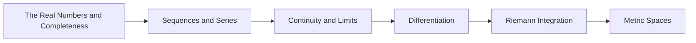

<!-- Generated by tools/build_indexes.py from tools/curriculum.json. Do not edit by hand. -->

# Real Analysis

*Calculus made rigorous*

[Mathematics](../README.md) › Real Analysis

Completeness, limits, continuity, differentiation, integration and metric spaces. The subject where you learn why the theorems of calculus are true — and when they fail.

## At a glance

| | |
|---|---|
| Topics | 6 (0 complete, 1 draft, 5 planned) |
| Estimated study time | ~72 hours |
| Prerequisites | [00-foundations](../00-foundations/README.md), [07-calculus](../07-calculus/README.md) |

## Study order

The numbers are the recommended order. Study a topic only after the ones before it —
the dependency chain below is the shortest safe route through the discipline.

## Topic inventory

| # | Topic | Level | Est. time | Status | Materials |
|---|---|---|---|---|---|
| 1 | [The Real Numbers and Completeness](01-real-numbers-and-completeness/README.md) | Advanced | 12 h | Draft | [Tutorial](01-real-numbers-and-completeness/README.md) · [Exercises](01-real-numbers-and-completeness/exercises.md) |
| 2 | Sequences and Series | Advanced | 12 h | Planned | — |
| 3 | Continuity and Limits | Advanced | 12 h | Planned | — |
| 4 | Differentiation | Advanced | 12 h | Planned | — |
| 5 | Riemann Integration | Advanced | 12 h | Planned | — |
| 6 | Metric Spaces | Advanced | 12 h | Planned | — |

### What each topic covers

- **The Real Numbers and Completeness** — Ordered fields, supremum, Dedekind cuts and Cantor's construction.
- **Sequences and Series** — Convergence, subsequences, Cauchy sequences and absolute convergence.
- **Continuity and Limits** — Epsilon-delta, compactness arguments and the intermediate value theorem.
- **Differentiation** — The derivative, the mean value theorem, Taylor's theorem and convexity.
- **Riemann Integration** — Partitions, the Riemann criterion, the fundamental theorem and improper integrals.
- **Metric Spaces** — Open and closed sets, completeness, compactness and the contraction principle.

## Related disciplines

- [15-complex-analysis](../15-complex-analysis/README.md)
- [17-topology](../17-topology/README.md)
- [24-advanced-topics](../24-advanced-topics/README.md)

## Status key

- **Complete** — tutorial, exercises and full solutions exist and the tutorial meets the
  [authoring standard](../CONTRIBUTING.md).
- **Draft** — some material exists but the topic is not finished.
- **Planned** — identified in the curriculum, not written yet.

Overall progress and the full topic inventory live in [ROADMAP.md](../ROADMAP.md).
