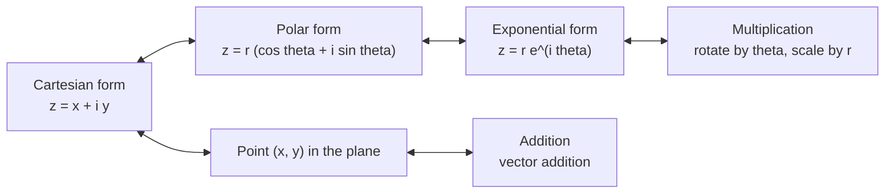
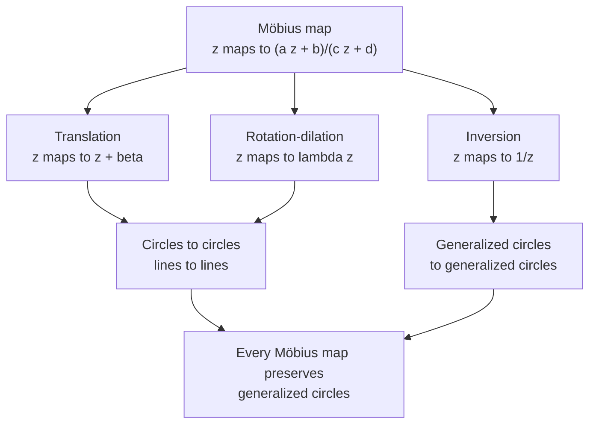

# Complex Numbers and Geometry

> [Mathematics](../../README.md) › [Complex Analysis](../README.md) · Level: Advanced · Prerequisites: [Complex Numbers](../../03-algebra/13-complex-numbers/README.md), [Inequalities](../../03-algebra/03-inequalities/README.md), [The Unit Circle](../../05-trigonometry/02-unit-circle/README.md), [Trigonometric Identities](../../05-trigonometry/03-trigonometric-identities/README.md), [Limits](../../07-calculus/01-limits/README.md), [Matrices](../../08-linear-algebra/02-matrices/README.md), [Linear Transformations](../../08-linear-algebra/05-linear-transformations/README.md) · Estimated time: 540 min

## 1. Introduction

The algebra sequence introduces $\mathbb{C}$ as the smallest field containing $\mathbb{R}$ in which $x^2+1=0$ has a root. That definition is complete but silent about geometry. This tutorial supplies the geometry. The central discovery of Wessel, Argand and Gauss is that $z = x+iy$ can be read as the point $(x,y)$ of the plane, and that the two operations then have exact geometric meanings:

* **addition is translation** by the vector $(x,y)$;
* **multiplication is rotation and scaling**, by the angle $\arg z$ and the factor $\lvert z\rvert$.

Once multiplication is geometric, plane geometry becomes algebra and algebra becomes geometry: the triangle inequality is a statement about side lengths, De Moivre's theorem says that angles add under powers, and the $n$-th roots of a number form a regular $n$-gon (Sections 7.1–7.5).

The second half of the tutorial studies the maps that respect this geometry. A **Möbius transformation** (fractional linear map) is

$$z \mapsto \frac{az+b}{cz+d}, \qquad ad-bc \ne 0.$$

These maps form a group under composition, almost a group of $2\times2$ matrices — the composition rule is matrix multiplication. Their decisive property is that **they send circles and straight lines to circles and straight lines**. A line is best regarded as a circle through an extra point $\infty$; adjoining that point gives the **Riemann sphere** $\mathbb{C}\cup\{\infty\}$, which is topologically a sphere. Section 7.10 constructs the sphere by stereographic projection, Section 7.11 proves that the construction is a homeomorphism, and Section 7.12 previews the applications.

Why does a student of analysis care? Because complex analysis is built on exactly these maps. The derivative of a holomorphic function is a complex number, and multiplication by that number is a rotation-dilation: this is conformality, the subject of [Analytic Functions](../02-analytic-functions/README.md). The cross-ratio classifies quadruples of points up to Möbius equivalence and is the first conformal invariant. The extended plane is the natural domain of $z\mapsto 1/z$, and the sphere is the reason the theory of meromorphic functions is cleaner than the theory of rational functions on the line.

Three habits make the subject easy. **Draw the picture:** every identity below has a geometric reading that suggests its proof. **Track the argument modulo $2\pi$:** almost every error in this subject comes from treating a multi-valued quantity as single-valued. **Allow $\infty$ as a point:** refusing to do so creates a special case in every theorem about Möbius maps.

## 2. Prerequisites

**Complex arithmetic.** Fluency with $z = a+bi$, conjugation $\bar z = a-bi$, modulus $\lvert z\rvert = \sqrt{a^2+b^2}$, the identity $z\bar z = \lvert z\rvert^2$, and division by rationalising the denominator. See [Complex Numbers](../../03-algebra/13-complex-numbers/README.md); Section 7.1 is a compressed review that fixes the notation.

**Inequalities.** The real triangle inequality, the meaning of $\lvert x\rvert < \varepsilon$, and proving inequalities by squaring after checking both sides are non-negative. See [Inequalities](../../03-algebra/03-inequalities/README.md).

**Trigonometry.** The addition formulas for $\cos$ and $\sin$ are used in every proof about polar form; you also need values at multiples of $\pi/6$ and $\pi/4$, periodicity, and the fact that $\cos\theta = 1$ exactly when $\theta \in 2\pi\mathbb{Z}$. See [The Unit Circle](../../05-trigonometry/02-unit-circle/README.md) and [Trigonometric Identities](../../05-trigonometry/03-trigonometric-identities/README.md).

**Limits and continuity.** Only the definition of limit along paths and the elementary limit laws; the theory is developed in [Limits](../../07-calculus/01-limits/README.md) and in [Analytic Functions](../02-analytic-functions/README.md).

**Matrices.** A $2\times2$ real matrix acts on the plane, matrix multiplication composes linear maps, and invertibility is equivalent to a non-zero determinant. This models the Möbius group in Section 7.6; see [Matrices](../../08-linear-algebra/02-matrices/README.md) and [Linear Transformations](../../08-linear-algebra/05-linear-transformations/README.md).

**Sets and maps.** Injections, surjections, bijections, composition, and images of sets; see [Set Theory](../../00-foundations/03-set-theory/README.md).

## 3. Learning Objectives

By the end of this tutorial you will be able to

1. state the field axioms for $\mathbb{C}$ and verify them from the definition of $\mathbb{C}$ as $\mathbb{R}^2$ with a multiplication;
2. prove the conjugation identities and use them to compute inverses and quotients;
3. prove the triangle inequality, the reverse triangle inequality and the parallelogram law, with the equality case characterised;
4. convert between Cartesian, polar and exponential forms, and explain the sense in which $\arg$ is defined modulo $2\pi$;
5. prove that multiplication by $re^{i\theta}$ is rotation by $\theta$ composed with dilation by $r$;
6. state and prove De Moivre's theorem and the formula for the $n$ distinct $n$-th roots;
7. describe $\mu_n$ as the vertices of a regular $n$-gon and prove that its elements sum to $0$ and multiply to $(-1)^{n+1}$;
8. define Möbius transformations, prove that they form a group, and compute with the matrix correspondence;
9. prove that a Möbius transformation maps generalized circles to generalized circles and find images in concrete cases;
10. define the cross-ratio, prove its invariance, and use it to decide concyclicity;
11. write the stereographic projection formulas in both directions and prove that $\mathbb{C}_\infty$ is homeomorphic to $S^2$;
12. explain the roles of complex multiplication in rotations, alternating current and conformal fluid flow.

## 4. Intuition

Imagine the streets of a city drawn on transparent film. Sliding the film is **addition**: every point moves by the same vector. Pinning the film at one point, turning it and shrinking or enlarging it is **multiplication**: every point is rotated by the same angle and scaled by the same factor. These are the two motions of the plane that fix the origin, and the whole tutorial follows from taking that sentence literally.

The phrase "rotated and scaled" hides the essential point. A rotation followed by a scaling **preserves angles**, and it preserves their orientation: clockwise stays clockwise. Reflections reverse angles. Complex multiplication never reflects. This is why the algebra of $\mathbb{C}$ is the algebra of orientation-preserving similarities, and why conjugation — which does reflect — is not multiplication by a complex number.

Now adjoin a single point at infinity, where all directions meet. Straight lines, seen from that point, close up into circles: a receding railway appears to converge, and a traveller who passed the horizon would return from the opposite direction. A map $(az+b)/(cz+d)$ is a composition of translations, rotations, scalings and the inversion $z\mapsto 1/z$; inversion turns the plane inside out about the unit circle. Since each ingredient sends circles to circles, so does every composite. That is the whole content of the circle-preservation theorem.

The sphere is not merely an analogy. Stand a sphere on the plane, put a light at the north pole, and look at shadows. Every point except the north pole casts exactly one shadow, and every point of the plane is the shadow of exactly one point. The north pole has no shadow, so it is $\infty$. Distance on the sphere is a genuine metric on $\mathbb{C}\cup\{\infty\}$ in which "far away" means "close to the north pole". This is the precise sense in which the complex plane plus infinity is a sphere.

## 5. Formal Definition

**Definition 5.1** (complex numbers). Let $\mathbb{C} = \mathbb{R}^2$ as a set, with elements $(a,b)$, and define

$$(a,b)+(c,d) := (a+c,\,b+d), \qquad (a,b)\cdot(c,d) := (ac-bd,\,ad+bc).$$

The pair $(0,0)$ is the additive identity and $(1,0)$ the multiplicative identity.

**Theorem 5.2.** With these operations $\mathbb{C}$ is a field.

*Proof.* Every axiom except the existence of multiplicative inverses is checked coordinate by coordinate from the field axioms of $\mathbb{R}$. If $z = (a,b)\ne(0,0)$, put $w := (a,-b)/(a^2+b^2)$. Then $zw = ((a^2+b^2)/(a^2+b^2),\,(-ab+ba)/(a^2+b^2)) = (1,0)$. Uniqueness follows because $w = w(zw') = (wz)w' = w'$. $\blacksquare$

**Definition 5.3** (Cartesian form). Put $i := (0,1)$, so $i^2 = (-1,0)$. Every element factors uniquely as $(a,b) = a + bi$ with $a,b\in\mathbb{R}$. Define $\operatorname{Re}z := a$ and $\operatorname{Im}z := b$; a number with $b = 0$ is identified with the real number $a$, so $\mathbb{R}\subseteq\mathbb{C}$ is a subfield.

**Definition 5.4** (conjugate and modulus). For $z = a+bi$, set $\bar z := a-bi$ and $\lvert z\rvert := \sqrt{a^2+b^2}$.

**Definition 5.5** (argument). For $z\ne0$, a real $\theta$ is an **argument** of $z$ if $z = \lvert z\rvert(\cos\theta+i\sin\theta)$. The set of all such $\theta$ is $\arg z$; the **principal argument** $\operatorname{Arg}z$ is the unique element of $\arg z$ in $(-\pi,\pi]$. The argument of $0$ is undefined.

That every $z\ne0$ has an argument, and that any two differ by a multiple of $2\pi$, is proved in Lemma 7.7.

**Definition 5.6** ($n$-th roots of unity). For $n\in\mathbb{N}$, let $\mu_n := \{z : z^n = 1\}$.

**Definition 5.7** (extended complex plane). Adjoin a symbol $\infty\notin\mathbb{C}$ and set $\mathbb{C}_\infty := \mathbb{C}\cup\{\infty\}$. The topology is defined in Section 7.10 by stereographic projection; arithmetic conventions are in Definition 7.34.

**Definition 5.8** (Möbius transformation). A **Möbius transformation** is a map $T:\mathbb{C}_\infty\to\mathbb{C}_\infty$,

$$T(z) := \frac{az+b}{cz+d}, \qquad ad-bc \ne 0, \quad a,b,c,d\in\mathbb{C},$$

with $T(\infty) := a/c$ if $c\ne0$, $T(\infty):=\infty$ if $c = 0$, and $T(-d/c):=\infty$ if $c\ne0$. The number $ad-bc$ is the **determinant**.

**Definition 5.9** (generalized circle). A **generalized circle** in $\mathbb{C}_\infty$ is a non-empty set of the form $\{z : A\lvert z\rvert^2+Bz+\bar B\bar z+C = 0\}$, with $A,C\in\mathbb{R}$, $B\in\mathbb{C}$, not all coefficients zero, together with $\infty$ when $A = 0$. When $A = 0$ it is a line; when $A\ne0$ it is a circle (possibly a point, by Lemma 7.25).

**Definition 5.10** (cross-ratio). For distinct $z_1,z_2,z_3,z_4\in\mathbb{C}_\infty$,

$$(z_1,z_2;z_3,z_4) := \frac{(z_1-z_3)(z_2-z_4)}{(z_1-z_4)(z_2-z_3)},$$

deleting the two factors containing any $z_j = \infty$; for example $(\infty,z_2;z_3,z_4) = (z_2-z_4)/(z_2-z_3)$.

**Definition 5.11** (stereographic projection). Let $S^2 := \{(X,Y,Z)\in\mathbb{R}^3 : X^2+Y^2+Z^2 = 1\}$ and $N := (0,0,1)$. Define $\sigma:S^2\setminus\{N\}\to\mathbb{C}$ by

$$\sigma(X,Y,Z) := \frac{X}{1-Z} + i\,\frac{Y}{1-Z}.$$

## 6. Mathematical Notation

| Symbol | Read as | Meaning |
|---|---|---|
| $\mathbb{C}$, $\mathbb{C}_\infty$ | the complex numbers; the extended plane | $\{a+bi\}$; $\mathbb{C}\cup\{\infty\}$ |
| $i$ | i | $(0,1)$, with $i^2 = -1$ |
| $\operatorname{Re}z$, $\operatorname{Im}z$ | real part, imaginary part | the coordinates $a$, $b$ in $z = a+bi$ |
| $\bar z$ | z bar, conjugate | $a-bi$ |
| $\lvert z\rvert$ | modulus | $\sqrt{a^2+b^2}$, the distance to $0$ |
| $\arg z$, $\operatorname{Arg}z$ | argument, principal argument | the set $\theta+2\pi\mathbb{Z}$; its element in $(-\pi,\pi]$ |
| $e^{i\theta}$ | e to the i theta | shorthand for $\cos\theta+i\sin\theta$, justified in Proposition 7.9 |
| $\mu_n$ | the $n$-th roots of unity | $\{z : z^n = 1\}$ |
| $\theta \equiv \varphi \pmod{2\pi}$ | congruent modulo $2\pi$ | $\theta-\varphi\in2\pi\mathbb{Z}$ |
| $(z_1,z_2;z_3,z_4)$ | cross-ratio | the quotient of Definition 5.10 |
| $T(z) = \frac{az+b}{cz+d}$ | Möbius map | a fractional linear transformation |
| $\operatorname{GL}_2(\mathbb{C})$, $\operatorname{PGL}_2(\mathbb{C})$ | general and projective general linear groups | invertible matrices; matrices modulo scalar multiples |
| $S^2$, $N$, $\sigma$ | the sphere, north pole, stereographic projection | Definition 5.11 |
| $\lvert z-w\rvert$ | distance from $z$ to $w$ | Euclidean distance of the corresponding points |

Two conventions, read aloud. "$z = re^{i\theta}$" is read "z equals r e to the i theta" and **is not a new operation**: it abbreviates $r(\cos\theta+i\sin\theta)$, and Proposition 7.7 justifies it by proving the exponential law. And a statement about $\arg z$ is a statement about a set, or about a value determined only modulo $2\pi$; "$\arg z = \pi/4$" means that one argument equals $\pi/4$, never that the sets are equal.

## 7. Core Concepts

### 7.1 Arithmetic and Conjugation, Reviewed

Write $z = a+bi$ and $w = c+di$ with $a,b,c,d\in\mathbb{R}$. Addition is coordinatewise, $z+w = (a+c)+(b+d)i$, which is the parallelogram rule for vectors. Multiplication is

$$zw = (ac-bd)+(ad+bc)i,$$

obtained by expanding and replacing $i^2$ by $-1$. Subtraction is addition of $-w$, and division is multiplication by $w^{-1}$, computed by rationalising.

**Proposition 7.2** (conjugation). For all $z,w\in\mathbb{C}$: (i) $\overline{z+w} = \bar z+\bar w$; (ii) $\overline{zw} = \bar z\,\bar w$; (iii) $\overline{\bar z} = z$; (iv) $z+\bar z = 2\operatorname{Re}z$ and $z-\bar z = 2i\operatorname{Im}z$; (v) $z\in\mathbb{R}$ if and only if $z = \bar z$.

*Proof.* Write $z = a+bi$, $w = c+di$. (i) is immediate. For (ii), $zw = (ac-bd)+(ad+bc)i$, so $\overline{zw} = (ac-bd)-(ad+bc)i$, while $\bar z\bar w = (a-bi)(c-di) = (ac-bd)+(-ad-bc)i$. Equal. (iii) is immediate from the definition; (iv) is $z+\bar z = 2a$ and $z-\bar z = 2bi$; (v) follows from $z = \bar z \iff 2bi = 0$. $\blacksquare$

**Proposition 7.3** (modulus and inverse). For all $z,w\in\mathbb{C}$: (i) $z\bar z = \lvert z\rvert^2$; (ii) $\lvert\bar z\rvert = \lvert z\rvert$, and $\lvert z\rvert = 0$ only for $z = 0$; (iii) if $z\ne0$ then $z^{-1} = \bar z/\lvert z\rvert^2$; (iv) $\lvert\operatorname{Re}z\rvert\le\lvert z\rvert$ and $\lvert\operatorname{Im}z\rvert\le\lvert z\rvert$.

*Proof.* (i) $(a+bi)(a-bi) = a^2+b^2$. (ii) Immediate from the definition. (iii) $z\cdot\bar z/\lvert z\rvert^2 = 1$, and inverses are unique. (iv) $a^2\le a^2+b^2$, and similarly for $b$. $\blacksquare$

**Example 7.4** (a quotient with a check). Compute $(3-2i)/(1+4i)$:

$$\frac{3-2i}{1+4i} = \frac{(3-2i)(1-4i)}{(1+4i)(1-4i)} = \frac{3-12i-2i+8i^2}{17} = \frac{-5-14i}{17} = -\frac{5}{17}-\frac{14}{17}i.$$

The check uses Proposition 7.3: $\lvert -5-14i\rvert/17 = \sqrt{221}/17 = \sqrt{13\cdot17}/17 = \sqrt{13}/\sqrt{17}$, which equals $\lvert 3-2i\rvert/\lvert 1+4i\rvert$. Correct.

### 7.2 Modulus and the Triangle Inequality

The modulus is the distance to the origin, and $\lvert z-w\rvert$ is the distance between points: indeed $\lvert(a+bi)-(c+di)\rvert = \sqrt{(a-c)^2+(b-d)^2}$. Thus $\mathbb{C}$ with this distance is the Euclidean plane.

**Proposition 7.5** (triangle inequality). For all $z,w\in\mathbb{C}$,

$$\lvert z+w\rvert \le \lvert z\rvert+\lvert w\rvert.$$

If $w\ne0$, equality holds exactly when $z = \lambda w$ for some real $\lambda\ge0$. If $w = 0$, equality holds always.

*Proof.* Expand:

$$\lvert z+w\rvert^2 = (z+w)(\bar z+\bar w) = \lvert z\rvert^2+\lvert w\rvert^2+2\operatorname{Re}(z\bar w) \le \lvert z\rvert^2+\lvert w\rvert^2+2\lvert z\rvert\lvert w\rvert = (\lvert z\rvert+\lvert w\rvert)^2,$$

because $\operatorname{Re}\zeta\le\lvert\zeta\rvert$ (Proposition 7.3). Taking square roots gives the inequality. Equality forces $\operatorname{Re}(z\bar w) = \lvert z\bar w\rvert$, which for a complex number $\zeta$ means $\operatorname{Im}\zeta = 0$ and $\operatorname{Re}\zeta\ge0$: writing $\zeta = p+qi$, the equation $p = \sqrt{p^2+q^2}$ gives $q = 0$ and $p\ge0$. So $z\bar w = \mu\ge0$ real. If $w\ne0$, multiply by $w/\lvert w\rvert^2$ to get $z = \lambda w$ with $\lambda = \mu/\lvert w\rvert^2\ge0$. Conversely $z = \lambda w$ with $\lambda\ge0$ gives equality immediately. $\blacksquare$

Geometrically: a straight segment is the shortest path, and equality means the two displacements point the same way.

**Proposition 7.6** (reverse triangle inequality). For all $z,w$, $\bigl\lvert\lvert z\rvert-\lvert w\rvert\bigr\rvert\le\lvert z-w\rvert$.

*Proof.* Apply Proposition 7.5 to $z = (z-w)+w$: $\lvert z\rvert\le\lvert z-w\rvert+\lvert w\rvert$, so $\lvert z\rvert-\lvert w\rvert\le\lvert z-w\rvert$. Interchanging $z$ and $w$ gives the opposite inequality. $\blacksquare$

**Proposition 7.7** (parallelogram law). For all $z,w$,

$$\lvert z+w\rvert^2+\lvert z-w\rvert^2 = 2\lvert z\rvert^2+2\lvert w\rvert^2.$$

*Proof.* Expanding as above, $\lvert z+w\rvert^2 = \lvert z\rvert^2+\lvert w\rvert^2+2\operatorname{Re}(z\bar w)$ and $\lvert z-w\rvert^2 = \lvert z\rvert^2+\lvert w\rvert^2-2\operatorname{Re}(z\bar w)$; adding gives the identity. $\blacksquare$

The identity says that the squared diagonals of the parallelogram with sides $z$ and $w$ sum to twice the squared sides. It characterises Euclidean norms among norms, which is why $\mathbb{C}$ is a two-dimensional real inner-product space (see [Inner Product Spaces](../../08-linear-algebra/08-inner-product-spaces/README.md)).

### 7.3 Argument, Polar Form and Exponential Form

A non-zero point is determined by its distance $r$ and direction $\theta$. Converting that into algebra requires the parametrisation of the unit circle and its uniqueness up to a full turn.

**Lemma 7.7** (existence and uniqueness of the argument). Let $z\ne0$ and $r = \lvert z\rvert$. There is $\theta\in\mathbb{R}$ with $z = r(\cos\theta+i\sin\theta)$; if $\theta,\varphi$ both work, then $\theta-\varphi\in2\pi\mathbb{Z}$.

*Proof.* Write $z = a+bi$, so $(a/r)^2+(b/r)^2 = 1$. The point $(a/r,b/r)$ lies on the unit circle, and the parametrisation established in [The Unit Circle](../../05-trigonometry/02-unit-circle/README.md) gives $\theta$ with $a/r = \cos\theta$, $b/r = \sin\theta$. For uniqueness, $\cos(\theta-\varphi) = \cos\theta\cos\varphi+\sin\theta\sin\varphi = \cos^2\theta+\sin^2\theta = 1$, and $\cos x = 1$ only for $x\in2\pi\mathbb{Z}$; hence $\theta-\varphi\in2\pi\mathbb{Z}$. $\blacksquare$

Thus $\arg z = \{\operatorname{Arg}z+2\pi k : k\in\mathbb{Z}\}$, a coset of $2\pi\mathbb{Z}$. All statements about arguments are statements modulo $2\pi$, written $\theta\equiv\varphi\pmod{2\pi}$.

**Definition 7.8** (polar and exponential form). For $z\ne0$ with $r = \lvert z\rvert$ and $\theta\in\arg z$,

$$z = r(\cos\theta+i\sin\theta) =: re^{i\theta}.$$

The notation is a definition here; it becomes the genuine exponential at $i\theta$ in [Analytic Functions](../02-analytic-functions/README.md), where Euler's formula proves the two meanings agree.

**Proposition 7.9** (moduli multiply, arguments add). If $z = re^{i\theta}$ and $w = se^{i\varphi}$ with $r,s>0$, then $zw = rse^{i(\theta+\varphi)}$ and $z/w = (r/s)e^{i(\theta-\varphi)}$. Consequently $\lvert zw\rvert = \lvert z\rvert\lvert w\rvert$ and $\arg(zw)\equiv\arg z+\arg w\pmod{2\pi}$.

*Proof.* By the addition formulas,

$$(\cos\theta+i\sin\theta)(\cos\varphi+i\sin\varphi) = (\cos\theta\cos\varphi-\sin\theta\sin\varphi)+i(\sin\theta\cos\varphi+\cos\theta\sin\varphi) = \cos(\theta+\varphi)+i\sin(\theta+\varphi).$$

Multiplying by $rs>0$ gives the product formula. For the quotient, $se^{i\varphi}\cdot s^{-1}e^{-i\varphi} = e^{i0} = 1$, so $w^{-1} = s^{-1}e^{-i\varphi}$; multiplying gives the result. $\blacksquare$

**Proposition 7.10** (geometric meaning of multiplication). For $z = re^{i\theta}\ne0$, the map $M_z(w) := zw$ is the composition of rotation by $\theta$ about $0$ with dilation of ratio $r$ about $0$. It is a bijection with $\lvert zw_1-zw_2\rvert = r\lvert w_1-w_2\rvert$, and its inverse is $M_{1/z}$.

*Proof.* Proposition 7.9 gives $zw = r\lvert w\rvert e^{i(\theta+\arg w)}$: the modulus of $w$ is multiplied by $r$ and the argument increased by $\theta$. That is exactly "rotate by $\theta$, then dilate by $r$". The distance identity follows from $\lvert z(w_1-w_2)\rvert = \lvert z\rvert\lvert w_1-w_2\rvert$, and $M_z\circ M_{1/z} = M_1 = \mathrm{id}$. $\blacksquare$

Division is the inverse operation: dividing by $w = se^{i\varphi}$ divides the modulus by $s$ and subtracts $\varphi$ from the argument, so it rotates by $-\varphi$ and scales by $1/s$. In particular, multiplication and division by a non-zero complex number are the only orientation-preserving similarities of the plane that fix $0$, and every direct similarity is a composition of such a map with a translation.

In matrix form, $z = a+bi$ acts as $\begin{pmatrix}a&-b\\ b&a\end{pmatrix}$ on column vectors: multiplication by $z$ is this matrix. Its determinant is $a^2+b^2>0$, so it preserves orientation. Conjugation corresponds to $\begin{pmatrix}a&b\\ b&-a\end{pmatrix}$, of determinant $-(a^2+b^2)<0$: a reflection.

**Example 7.11** (multiplication rotates and scales). With $z = 1+i = \sqrt2e^{i\pi/4}$ and $w = 1+i\sqrt3 = 2e^{i\pi/3}$,

$$zw = 2\sqrt2\,e^{7\pi i/12}.$$

Directly, $(1+i)(1+i\sqrt3) = (1-\sqrt3)+i(1+\sqrt3)$, whose modulus squared is $(1-\sqrt3)^2+(1+\sqrt3)^2 = 8$, and whose argument is $\pi/4+\pi/3 = 7\pi/12$, in the second quadrant as the signs require.

### 7.4 Powers, De Moivre's Theorem and Roots

**Proposition 7.12** (De Moivre). For every $\theta\in\mathbb{R}$ and $n\in\mathbb{Z}$,

$$(\cos\theta+i\sin\theta)^n = \cos(n\theta)+i\sin(n\theta).$$

*Proof.* For $n = 0$ both sides are $1$. For $n\ge1$ use induction: the case $n = 1$ is trivial, and Proposition 7.9 gives

$$(\cos\theta+i\sin\theta)^{n+1} = \bigl(\cos n\theta+i\sin n\theta\bigr)(\cos\theta+i\sin\theta) = \cos((n+1)\theta)+i\sin((n+1)\theta).$$

For $n<0$, put $m = -n>0$. The number $\cos(m\theta)-i\sin(m\theta)$ multiplies $\cos(m\theta)+i\sin(m\theta)$ to $1$, so it is the inverse, and $(\cos\theta+i\sin\theta)^n = \cos(m\theta)-i\sin(m\theta) = \cos(n\theta)+i\sin(n\theta)$. $\blacksquare$

For $z = re^{i\theta}$ this reads $z^n = r^ne^{in\theta}$: powers raise the modulus to the power and multiply the angle.

**Proposition 7.13** ($n$-th roots). Let $w = \rho e^{i\varphi}$ with $\rho>0$ and $n\in\mathbb{N}$. The solutions of $z^n = w$ are exactly

$$z_k = \rho^{1/n}\exp\!\left(i\,\frac{\varphi+2\pi k}{n}\right), \qquad k = 0,1,\dots,n-1,$$

and they are distinct.

*Proof.* Write $z = re^{i\theta}$ with $r>0$. Then $z^n = r^ne^{in\theta}$. If $z^n = \rho e^{i\varphi}$, taking moduli gives $r^n = \rho$, hence $r = \rho^{1/n}$; dividing gives $e^{i(n\theta-\varphi)} = 1$, so by Lemma 7.7 $n\theta-\varphi = 2\pi k$ for some $k\in\mathbb{Z}$, i.e. $\theta = (\varphi+2\pi k)/n$. Conversely each $z_k$ satisfies $z_k^n = \rho e^{i(\varphi+2\pi k)} = \rho e^{i\varphi}$, by De Moivre and periodicity. If $0\le k,l\le n-1$ and $z_k = z_l$, then $(k-l)/n\in\mathbb{Z}$; but $\lvert k-l\rvert\le n-1$, so $k = l$. Every integer $k$ is congruent modulo $n$ to one of $0,\dots,n-1$, and adding $n$ to $k$ adds $2\pi$ to the angle, so there are no others. $\blacksquare$

**Corollary 7.14** (geometry of the roots). The $n$ solutions of $z^n = w$ are the vertices of a regular $n$-gon centred at $0$, on the circle of radius $\rho^{1/n}$, with consecutive vertices separated by the angle $2\pi/n$.

*Proof.* All roots have modulus $\rho^{1/n}$. Moreover $z_{k+1}/z_k = e^{2\pi i/n}$, so by Proposition 7.10 each vertex is obtained from the previous one by the same rotation. $\blacksquare$

**Example 7.15** (cube roots of $8i$). Here $\rho = 8$, $\varphi = \pi/2$, so $z_k = 2e^{i(\pi/2+2\pi k)/3}$: $z_0 = 2e^{i\pi/6} = \sqrt3+i$, $z_1 = 2e^{5\pi i/6} = -\sqrt3+i$, $z_2 = 2e^{3\pi i/2} = -2i$. Check $(\sqrt3+i)^2 = 2+2\sqrt3\,i$, and multiplying by $\sqrt3+i$ gives $2\sqrt3+2i+6i+2\sqrt3i^2 = 8i$. Their sum is $0$.

### 7.5 Roots of Unity and Their Geometry

**Proposition 7.16** (structure of $\mu_n$). Let $n\ge1$ and $\omega := e^{2\pi i/n}$. Then $\mu_n = \{1,\omega,\dots,\omega^{n-1}\}$, these $n$ numbers are distinct, and $\mu_n$ is a cyclic subgroup of $\mathbb{C}^\times$ of order $n$ generated by $\omega$.

*Proof.* Apply Proposition 7.13 with $w = 1$ and $\rho = 1$: the solutions are $\omega^k$, $k = 0,\dots,n-1$, and they are distinct. If $z,w\in\mu_n$ then $(zw)^n = z^nw^n = 1$ and $(z^{-1})^n = (z^n)^{-1} = 1$, so $\mu_n$ is a subgroup; since it has $n$ elements and $\omega$ generates it, it is cyclic of order $n$. $\blacksquare$

**Proposition 7.17** (sums of roots of unity). For $n\ge2$ and $\omega = e^{2\pi i/n}$, $\sum_{k=0}^{n-1}\omega^k = 0$. More generally, for any integer $j$, $\sum_{k=0}^{n-1}\omega^{jk} = 0$ if $n\nmid j$, and $=n$ if $n\mid j$.

*Proof.* Since $\omega^n = 1$ and $\omega\ne1$, the geometric series gives $\sum_{k=0}^{n-1}\omega^k = (\omega^n-1)/(\omega-1) = 0$. For general $j$ put $\eta := \omega^j$; then $\eta^n = 1$, and $\eta = 1$ exactly when $e^{2\pi ij/n} = 1$, i.e. when $n\mid j$ (Lemma 7.7). If $\eta\ne1$ the same geometric-series computation gives $0$; if $\eta = 1$ every term is $1$ and the sum is $n$. $\blacksquare$

Geometrically, the centroid of the vertices of a regular $n$-gon inscribed in the unit circle is the centre.

**Proposition 7.18** (product of roots of unity). For $n\in\mathbb{N}$, $\prod_{k=0}^{n-1}\omega^k = (-1)^{n+1}$.

*Proof.* Pair $\omega^k$ with $\omega^{n-k}$; each pair multiplies to $1$. For odd $n$ the unpaired term is $\omega^0 = 1$, giving $1 = (-1)^{n+1}$. For even $n$ the middle term $k = n/2$ is paired with itself and equals $\omega^{n/2} = e^{\pi i} = -1$, giving $-1 = (-1)^{n+1}$. Alternatively, Vieta on $z^n-1 = \prod_k(z-\omega^k)$: the constant term gives $\prod_k\omega^k = (-1)^{n+1}$. $\blacksquare$

**Proposition 7.19** (the regular $n$-gon). The points of $\mu_n$ are the vertices of the regular $n$-gon inscribed in the unit circle with one vertex at $1$; the map $z\mapsto\omega z$ is a symmetry.

*Proof.* Corollary 7.14 with $w = 1$, $\rho = 1$ gives the vertices at angles $2\pi k/n$. Since $\omega\mu_n = \mu_n$, multiplication by $\omega$ permutes the polygon, giving the rotation symmetry. $\blacksquare$

**Example 7.20** (the pentagon). For $n = 5$, $\omega+\omega^4 = 2\cos(2\pi/5)$ and $\omega^2+\omega^3 = 2\cos(4\pi/5)$; since the sum of all five roots is zero, $1+2\cos(2\pi/5)+2\cos(4\pi/5) = 0$. With $c = \cos(2\pi/5)$ and $\cos(4\pi/5) = 2c^2-1$ this gives $4c^2+2c-1 = 0$, so $c = (\sqrt5-1)/4$. The side length of the regular pentagon inscribed in the unit circle is $\lvert1-\omega\rvert = 2\sin(\pi/5) = \sqrt{(5-\sqrt5)/2}$, an expression in square roots only — the algebraic reason the regular pentagon is constructible.

### 7.6 Möbius Transformations: Definition and Group Structure

The condition $ad-bc\ne0$ is exactly non-degeneracy. If $ad-bc = 0$ and $c\ne0$, then either $d = 0$, in which case $bc = 0$ and $c\ne0$ give $b = 0$, so $(az+b)/(cz+d) = a/c$ is constant, or $d\ne0$, in which case $a = bc/d$ and $(az+b)/(cz+d) = b/d$ is constant; if $c = 0$ then $ad = 0$ forces $a = 0$. Conversely, if $ad-bc\ne0$ and $(az_1+b)/(cz_1+d) = (az_2+b)/(cz_2+d)$, cross-multiplication gives $(ad-bc)(z_1-z_2) = 0$, so the map is injective.

**Proposition 7.21** (composition is matrix multiplication). For $A = \begin{pmatrix}a&b\\ c&d\end{pmatrix}$ let $T_A(z) := (az+b)/(cz+d)$. For matrices with non-zero determinant, $T_A\circ T_B = T_{AB}$.

*Proof.* Put $B = \begin{pmatrix}a'&b'\\ c'&d'\end{pmatrix}$ and $w = T_B(z)$. Then

$$T_A(w) = \frac{a\,\dfrac{a'z+b'}{c'z+d'}+b}{c\,\dfrac{a'z+b'}{c'z+d'}+d} = \frac{(aa'+bc')z+(ab'+bd')}{(ca'+dc')z+(cb'+dd')} = T_{AB}(z),$$

and the conventions at $\infty$ extend the identity to the extended plane. $\blacksquare$

**Proposition 7.22** (the Möbius group). Möbius transformations form a group under composition, isomorphic to $\operatorname{PGL}_2(\mathbb{C}) = \operatorname{GL}_2(\mathbb{C})/\mathbb{C}^\times$.

*Proof.* Composition is associative, $T_I$ is the identity, and if $\det A\ne0$ then $T_A\circ T_{A^{-1}} = T_I$, so every element is invertible. The map $A\mapsto T_A$ is a homomorphism by Proposition 7.21. Its kernel: $T_A(z) = z$ for all $z$ forces $b/d = 0$ (put $z = 0$), $a/c = \infty$ (put $z = \infty$), hence $b = c = 0$, and then $a = d$; so the kernel is the set of non-zero scalar matrices. The first isomorphism theorem gives the stated isomorphism. $\blacksquare$

**Theorem 7.23** (three points determine a Möbius map). Given distinct $z_1,z_2,z_3$ and distinct $w_1,w_2,w_3$ in $\mathbb{C}_\infty$, there is exactly one Möbius $T$ with $T(z_j) = w_j$.

*Proof.* Define

$$S(z) := (z,z_1;z_2,z_3) = \frac{(z-z_2)(z_1-z_3)}{(z-z_3)(z_1-z_2)}, \qquad R(w) := \frac{(w-w_2)(w_1-w_3)}{(w-w_3)(w_1-w_2)}.$$

Both are Möbius maps, and $S(z_1) = 1$, $S(z_2) = 0$, $S(z_3) = \infty$, likewise $R(w_j) = 1,0,\infty$. Then $T := R^{-1}\circ S$ satisfies $T(z_j) = w_j$, proving existence. For uniqueness it suffices to show that a Möbius map fixing $1,0,\infty$ is the identity: $U(0) = 0$ gives $b = 0$; $U(\infty) = \infty$ gives $c = 0$; $U(1) = 1$ then gives $a = d$, so $U(z) = z$. If $T_1,T_2$ both work, $R\circ T_1\circ S^{-1}$ and $R\circ T_2\circ S^{-1}$ both fix $1,0,\infty$, hence both are the identity, so $T_1 = T_2$. $\blacksquare$

**Example 7.24** (a three-point map). Find $T$ with $T(0) = i$, $T(1) = 0$, $T(\infty) = 1$. Write $T(z) = (az+b)/(cz+d)$. Then $a/c = 1$ gives $a = c$; $b/d = i$ gives $b = id$; and $(a+b)/(c+d) = 0$ gives $a = -b = -id$. With $d = 1$: $a = c = -i$, $b = i$,

$$T(z) = \frac{-iz+i}{-iz+1} = \frac{i(1-z)}{1-iz}.$$

Check: $T(0) = i$, $T(1) = 0$, $T(\infty) = (-i)/(-i) = 1$; the determinant is $-i-1\ne0$.

### 7.7 What Möbius Transformations Do to Lines and Circles

The main theorem is that Möbius maps permute circles and lines. The efficient proof encodes "circle or line" in one algebraic equation and checks the claim for three generating maps.

**Lemma 7.25** (generalized circles in normal form). Let $A,C\in\mathbb{R}$ and $B\in\mathbb{C}$, not all zero. The set $C_0 := \{z : A\lvert z\rvert^2+Bz+\bar B\bar z+C = 0\}$ is empty, a point, a circle, or a line. If $A = 0$ and $B\ne0$ it is a line; if $A\ne0$ it is the circle with centre $-\bar B/A$ and radius $\sqrt{\lvert B\rvert^2-AC}/\lvert A\rvert$ when $\lvert B\rvert^2-AC\ge0$, a point when the quantity is $0$, and empty when it is negative.

*Proof.* Since $Bz+\bar B\bar z = 2\operatorname{Re}(Bz)$, the equation is real. If $A = 0$ it reads $2\operatorname{Re}(Bz)+C = 0$; with $B = p+qi$ and $z = x+iy$ this is $2(px-qy)+C = 0$, a line with non-zero normal $(p,-q)$. If $A\ne0$, divide by $A$ and complete the square:

$$\left\lvert z+\frac{\bar B}{A}\right\rvert^2 = \lvert z\rvert^2+2\operatorname{Re}\!\left(\frac{Bz}{A}\right)+\frac{\lvert B\rvert^2}{A^2} = \frac{\lvert B\rvert^2-AC}{A^2},$$

using the original equation for the last step. The right side is real, so the set is a circle, a point, or empty according to its sign. $\blacksquare$

**Lemma 7.26** (inversion preserves generalized circles). The map $J(z) = 1/z$, with $J(0) = \infty$ and $J(\infty) = 0$, sends generalized circles onto generalized circles.

*Proof.* Put $w = 1/z$, so $z = 1/w$. For $w\ne0$,

$$0 = A\lvert z\rvert^2+Bz+\bar B\bar z+C = \frac{A}{\lvert w\rvert^2}+\frac{B}{w}+\frac{\bar B}{\bar w}+C.$$

Multiplying by $\lvert w\rvert^2 = w\bar w\ne0$ gives $A+B\bar w+\bar Bw+C\lvert w\rvert^2 = 0$, again of the same form, with coefficients $(A',B',C') = (C,\bar B,A)$. By Lemma 7.25 the image is a generalized circle. A circle through $0$ has $C = 0$, so $A' = 0$ and its image is a line through $\infty$. $\blacksquare$

**Theorem 7.27** (Möbius maps preserve generalized circles). Every Möbius transformation maps generalized circles bijectively onto generalized circles.

*Proof.* Every Möbius map is a composition of translations $z\mapsto z+\beta$, rotations-dilations $z\mapsto\lambda z$ ($\lambda\ne0$) and the inversion $z\mapsto1/z$: if $c = 0$ then $T(z) = (a/d)z+b/d$; if $c\ne0$ then polynomial division gives $T(z) = a/c+\bigl((bc-ad)/c\bigr)/(cz+d)$, a composition of these three types. Translations and rotations-dilations are similarities, hence send circles to circles and lines to lines; inversion does so by Lemma 7.26. A composition inherits the property, and each generator is bijective with inverse of the same type, so the image is the whole target generalized circle. $\blacksquare$

**Corollary 7.28** (circles through the pole become lines). Let $T(z) = (az+b)/(cz+d)$ with $c\ne0$ and pole $z_0 := -d/c$. A generalized circle $C$ maps to a straight line exactly when $z_0\in C$; otherwise its image is a circle.

*Proof.* Write $T = \Phi\circ J\circ\Psi$ with $\Psi(z) = cz+d$, $J(w) = 1/w$ and $\Phi(w) = a/c+\bigl((bc-ad)/c\bigr)w$. The similarities $\Psi,\Phi$ preserve the type "circle" versus "line", and $J$ turns a generalized circle into a line exactly when that circle passes through $0$ (Lemma 7.26, case $C' = 0$). Now $\Psi(C)$ passes through $0$ exactly when $z_0\in C$. $\blacksquare$

**Proposition 7.29** (which side maps where). Let $C$ be a generalized circle and $T$ a Möbius map. The two components of $\mathbb{C}_\infty\setminus C$ map onto the two components of $\mathbb{C}_\infty\setminus T(C)$, and the image of a component is determined by testing one point.

*Proof.* A Möbius map is a homeomorphism of $\mathbb{C}_\infty$ (Theorem 7.40). A homeomorphism sends connected sets to connected sets and preserves separation, so each component maps into a component of the complement of $T(C)$; since $T$ is onto, both components are hit. A component is determined by any one of its points, so testing $z_0$ identifies the image. $\blacksquare$

**Example 7.30** (three concrete images). (i) Under $z\mapsto1/z$ the unit circle maps onto itself, since $\lvert1/z\rvert = 1$, and the interior maps to the exterior. (ii) The circle $\lvert z-1\rvert = 1$ satisfies $\lvert z\rvert^2 = 2\operatorname{Re}z$; substituting $z = 1/w$ and multiplying by $\lvert w\rvert^2$ gives $1 = 2\operatorname{Re}w$, the line $\operatorname{Re}w = 1/2$. (iii) For $T(z) = 1/(z-1)$ the pole $z = 1$ lies on the unit circle; writing $w = 1/(z-1)$, so $z = 1+1/w$, the condition $\lvert z\rvert = 1$ becomes $\lvert w+1\rvert^2 = \lvert w\rvert^2$, i.e. $2\operatorname{Re}w+1 = 0$, the line $\operatorname{Re}w = -1/2$.

### 7.8 The Cross-Ratio

Three points determine a Möbius map; four cannot be prescribed arbitrarily, and the obstruction is a single number.

**Proposition 7.31** (invariance of the cross-ratio). For distinct $z_1,z_2,z_3,z_4\in\mathbb{C}_\infty$ and any Möbius $T$,

$$(Tz_1,Tz_2;Tz_3,Tz_4) = (z_1,z_2;z_3,z_4).$$

*Proof.* Define $g(z) := (z,z_2;z_3,z_4) = (z-z_3)(z_2-z_4)/((z-z_4)(z_2-z_3))$. Then $g$ is Möbius with $g(z_2) = 1$, $g(z_3) = 0$, $g(z_4) = \infty$. Likewise $h(w) := (w,Tz_2;Tz_3,Tz_4)$ is Möbius with $h(Tz_2) = 1$, $h(Tz_3) = 0$, $h(Tz_4) = \infty$. Hence $h\circ T$ sends $z_2,z_3,z_4$ to $1,0,\infty$, so by Theorem 7.23 it equals $g$. Evaluating at $z_1$ gives $h(Tz_1) = g(z_1)$, which is the claim. $\blacksquare$

**Theorem 7.32** (concyclicity criterion). Four distinct points $z_1,z_2,z_3,z_4\in\mathbb{C}_\infty$ lie on a common generalized circle if and only if $(z_1,z_2;z_3,z_4)\in\mathbb{R}$.

*Proof.* With $g$ as above, $g(z_2) = 1$, $g(z_3) = 0$, $g(z_4) = \infty$, all on $\mathbb{R}_\infty$. By Theorem 7.27, $g^{-1}(\mathbb{R}_\infty)$ is a generalized circle $\Gamma$ through $z_2,z_3,z_4$, and $z\in\Gamma\iff g(z)\in\mathbb{R}_\infty\iff(z,z_2;z_3,z_4)\in\mathbb{R}_\infty$. A generalized circle is determined by three of its points: two distinct circles meet in at most two points, a line meets a circle in at most two, and two distinct lines in at most one. Hence $\Gamma$ is the unique generalized circle through $z_2,z_3,z_4$, and $z_1$ lies on it exactly when the cross-ratio is real. $\blacksquare$

**Example 7.33** (concyclic and non-concyclic quadruples). For $1,i,-1,-i$, all on the unit circle,

$$(1,i;-1,-i) = \frac{(1+1)(i+i)}{(1+i)(i+1)} = \frac{4i}{2i} = 2\in\mathbb{R}.$$

For $0,1,i,1+2i$,

$$(0,1;i,1+2i) = \frac{(0-i)(1-1-2i)}{(0-1-2i)(1-i)} = \frac{(-i)(-2i)}{(-1-2i)(1-i)} = \frac{-2}{-3-i} = \frac{3-i}{5}\notin\mathbb{R},$$

so these four points are neither concyclic nor collinear.

### 7.9 The Extended Complex Plane

**Definition 7.34** (arithmetic with infinity). For $z\in\mathbb{C}$ and $z\ne0$:

$$\infty+z = z+\infty = \infty, \quad \infty\cdot z = z\cdot\infty = \infty, \quad \frac{z}{\infty} = 0, \quad \frac{z}{0} = \infty, \quad \frac{\infty}{0} = \infty, \quad \infty\cdot\infty = \infty.$$

The expressions $\infty-\infty$, $0\cdot\infty$, $0/0$ and $\infty/\infty$ are undefined. These are conventions, not a field structure; their purpose is to let $T(z) = (az+b)/(cz+d)$ be written without case distinctions.

**Proposition 7.35** (generators). Every Möbius transformation is a finite composition of translations $z\mapsto z+\beta$, rotations-dilations $z\mapsto\lambda z$ with $\lambda\ne0$, and the inversion $z\mapsto1/z$. Each generator is a bijection of $\mathbb{C}_\infty$; hence every Möbius map is a bijection of $\mathbb{C}_\infty$.

*Proof.* The decomposition is displayed in the proof of Theorem 7.27. Bijectivity of translations and rotations-dilations is clear, with inverses $z\mapsto z-\beta$ and $z\mapsto\lambda^{-1}z$; inversion satisfies $J\circ J = \mathrm{id}$, with $J(0) = \infty$ and $J(\infty) = 0$. Compositions of bijections are bijections. $\blacksquare$

### 7.10 Stereographic Projection

Give $\mathbb{C}_\infty$ the topology transported from $S^2$: a set $U$ is open when $\sigma^{-1}(U)$ is open in $S^2$, where $\sigma(N) := \infty$. Equivalently, a set containing $\infty$ is open exactly when it contains $\{\lvert z\rvert>R\}\cup\{\infty\}$ for some $R>0$ and its intersection with $\mathbb{C}$ is open. Indeed the cap $\{Z>1-\varepsilon\}$ corresponds to $\{\lvert z\rvert^2 > (2-\varepsilon)/\varepsilon\}$, so the basic neighbourhoods of $\infty$ are the exteriors of large circles. In particular $z_n\to\infty$ if and only if $\lvert z_n\rvert\to\infty$.

**Proposition 7.36** (formulas in both directions). For $P = (X,Y,Z)\in S^2\setminus\{N\}$,

$$\sigma(P) = \frac{X}{1-Z}+i\,\frac{Y}{1-Z}.$$

Conversely, for $z = x+iy\in\mathbb{C}$,

$$\sigma^{-1}(z) = \left(\frac{2x}{1+\lvert z\rvert^2},\ \frac{2y}{1+\lvert z\rvert^2},\ \frac{\lvert z\rvert^2-1}{1+\lvert z\rvert^2}\right).$$

*Proof.* The line through $N$ and $P$ is $N+t(P-N) = (tX,tY,1+t(Z-1))$; it meets $Z = 0$ at $t = 1/(1-Z)$, giving the first formula. For the second, the line through $N$ and $(x,y,0)$ is $(tx,ty,1-t)$; it meets the sphere where $t^2(x^2+y^2)+(1-t)^2 = 1$, i.e. $t^2(\lvert z\rvert^2+1)-2t = 0$. The non-zero root is $t = 2/(1+\lvert z\rvert^2)$, and substitution gives the stated coordinates. $\blacksquare$

**Proposition 7.37** (bijection). Extending $\sigma$ by $\bar\sigma(N) := \infty$ gives a bijection $\bar\sigma:S^2\to\mathbb{C}_\infty$.

*Proof.* The formulas of Proposition 7.36 are mutually inverse between $S^2\setminus\{N\}$ and $\mathbb{C}$; adding $N\mapsto\infty$ gives a bijection onto $\mathbb{C}_\infty$. $\blacksquare$

**Theorem 7.38** (circles on the sphere are generalized circles in the plane). Under $\bar\sigma$, circles on $S^2$ correspond exactly to generalized circles in $\mathbb{C}_\infty$.

*Proof.* A circle on $S^2$ is the intersection with a plane $\alpha X+\beta Y+\gamma Z = \delta$ meeting the sphere in more than one point. Substituting Proposition 7.36 and writing $r^2 = \lvert z\rvert^2$,

$$\frac{2\alpha x+2\beta y+\gamma(r^2-1)}{1+r^2} = \delta \;\Longleftrightarrow\; (\gamma-\delta)r^2+2\alpha x+2\beta y-(\gamma+\delta) = 0.$$

This is $A\lvert z\rvert^2+Bz+\bar B\bar z+C = 0$ with $A = \gamma-\delta$, $B = \alpha-i\beta$, $C = -(\gamma+\delta)$, hence a generalized circle by Lemma 7.25. The plane passes through $N$ exactly when $\gamma = \delta$, and then $A = 0$, so the image is a line — as it must be, since $N$ corresponds to $\infty$. Conversely, given $(A,B,C)$ with $A,C$ real, the choices $\gamma = (A-C)/2$, $\delta = -(A+C)/2$, $\alpha = \operatorname{Re}B$, $\beta = -\operatorname{Im}B$ produce a plane whose intersection with $S^2$ projects to the given generalized circle. $\blacksquare$

### 7.11 Why $\mathbb{C}\cup\{\infty\}$ Is a Sphere

**Proposition 7.39** (chordal metric). For $z,w\in\mathbb{C}$ define

$$d(z,w) := \frac{2\lvert z-w\rvert}{\sqrt{(1+\lvert z\rvert^2)(1+\lvert w\rvert^2)}}, \qquad d(z,\infty) := \frac{2}{\sqrt{1+\lvert z\rvert^2}}, \qquad d(\infty,\infty) := 0.$$

Then $d$ is a metric on $\mathbb{C}_\infty$ and equals the Euclidean distance between the corresponding points of $S^2$.

*Proof.* Since $\bar\sigma$ is a bijection, transporting Euclidean distance gives a metric; it remains to verify the formulas. Let $P = \sigma^{-1}(z)$, $Q = \sigma^{-1}(w)$ be unit vectors. Then $\lvert P-Q\rvert^2 = 2-2P\cdot Q$, and Proposition 7.36 gives

$$P\cdot Q = \frac{4(xu+yv)+(r^2-1)(s^2-1)}{(1+r^2)(1+s^2)},$$

where $r^2 = \lvert z\rvert^2$ and $s^2 = \lvert w\rvert^2$. Hence

$$\lvert P-Q\rvert^2 = \frac{2(1+r^2)(1+s^2)-8(xu+yv)-2(r^2-1)(s^2-1)}{(1+r^2)(1+s^2)} = \frac{4(r^2+s^2-2xu-2yv)}{(1+r^2)(1+s^2)} = \frac{4\lvert z-w\rvert^2}{(1+r^2)(1+s^2)},$$

because the numerator expands to $2(1+r^2+s^2+r^2s^2)-8(xu+yv)-2(r^2s^2-r^2-s^2+1) = 4r^2+4s^2-8(xu+yv)$. For $w = \infty$, $\lvert P-N\rvert^2 = 2-2Z = 2-2(r^2-1)/(1+r^2) = 4/(1+r^2)$. $\blacksquare$

Consequences: $d\le2$ always, with $d(0,\infty) = 2$; and $d(z_n,\infty)\to0$ exactly when $\lvert z_n\rvert\to\infty$.

**Theorem 7.40** ($\mathbb{C}_\infty$ is a sphere). The map $\bar\sigma:S^2\to\mathbb{C}_\infty$ is a homeomorphism. Hence $\mathbb{C}_\infty$ is compact, connected, Hausdorff and second countable.

*Proof.* By Proposition 7.37, $\bar\sigma$ is a bijection, and by Proposition 7.39 it preserves distances, so $\bar\sigma$ and $\bar\sigma^{-1}$ are continuous. A continuous bijection with continuous inverse is a homeomorphism. The sphere is closed and bounded in $\mathbb{R}^3$, hence compact; it is path-connected, hence connected; and as a metric subspace it is Hausdorff and second countable. All these properties are topological. $\blacksquare$

**Corollary 7.41** (one-point compactification). $\mathbb{C}$ is an open dense subset of $\mathbb{C}_\infty$ whose complement is the single point $\infty$; $\mathbb{C}_\infty$ is the one-point compactification of $\mathbb{C}$, unique up to homeomorphism fixing $\mathbb{C}$.

*Proof.* A basic neighbourhood of $\infty$ is $\{\infty\}\cup\{\lvert z\rvert>R\}$ by the description at the start of Section 7.10, so it meets $\mathbb{C}$; hence $\mathbb{C}$ is dense. Also $\mathbb{C} = \mathbb{C}_\infty\setminus\{\infty\}$ is open. For uniqueness, if $X$ is compact Hausdorff, contains $\mathbb{C}$ as a dense open subset and $X\setminus\mathbb{C} = \{\omega\}$, then the identity on $\mathbb{C}$, extended by $\omega\mapsto\infty$, is a continuous bijection from compact $X$ to Hausdorff $\mathbb{C}_\infty$, hence a homeomorphism: continuity at $\omega$ follows because the complement in $\mathbb{C}_\infty$ of a neighbourhood of $\infty$ is compact, hence closed in $X$. $\blacksquare$

Why a sphere rather than another surface: removing one point from a closed surface leaves a space homeomorphic to $\mathbb{R}^2$ only for $S^2$. A punctured torus retracts onto a wedge of two circles and is not simply connected, whereas $\mathbb{C}\cong\mathbb{R}^2$ is simply connected. Among closed surfaces, only the sphere qualifies.

### 7.12 Applications

**Rotations in two dimensions.** Multiplication by $e^{i\theta}$ is rotation by $\theta$, and composing rotations adds angles (Proposition 7.9). A rotation about an arbitrary centre $a$ is $z\mapsto a+e^{i\theta}(z-a)$. In computer graphics and robotics, orientations are stored as unit complex numbers, and composition is complex multiplication. The position of a planar arm with links $\ell_j$ and joint angles $\theta_j$ is $z = \sum_j \ell_j\exp\bigl(i\sum_{k\le j}\theta_k\bigr)$, the forward-kinematics formula.

**Alternating current.** A sinusoid $V_0\cos(\omega t+\varphi)$ is encoded by the **phasor** $\hat V = V_0e^{i\varphi}$. Differentiation multiplies the phasor by $i\omega$, so inductors have impedance $i\omega L$ and capacitors $1/(i\omega C)$; impedances in series add and Ohm's law becomes $\hat V = Z\hat I$. The average power into $Z = R+iX$ is $\tfrac12\lvert\hat I\rvert^2R$, depending only on the real part. Three-phase systems use the phasors $1,\omega,\omega^2$ with $\omega = e^{2\pi i/3}$, which sum to zero by Proposition 7.17 — the reason the neutral current vanishes in a balanced load.

**Fluid flow.** For a two-dimensional incompressible irrotational flow the complex potential $\Omega = \phi+i\psi$ is holomorphic; streamlines are the level curves of $\psi$ and equipotentials those of $\phi$, meeting at right angles. Uniform flow past a cylinder is generated by $\Omega(z) = U(z+a^2/z)$, whose imaginary part vanishes on $\lvert z\rvert = a$. The Joukowski map $w = z+a^2/z$ deforms the circle into an aerofoil profile. The analytic background is in [Analytic Functions](../02-analytic-functions/README.md), the differential equations in [Differential Equations](../../16-differential-equations/README.md).

**Hyperbolic geometry.** The upper half-plane with metric $ds = \lvert dz\rvert/\operatorname{Im}z$ is a model of the hyperbolic plane, and its orientation-preserving isometries are the Möbius maps with real coefficients and positive determinant. The disc model is obtained by $z\mapsto(z-i)/(z+i)$ (Example 9.9). This is the gateway to Kleinian groups and the modular group.

**Number theory and computation.** The Gaussian integers $\mathbb{Z}[i]$ form a Euclidean domain; the two-squares identity $(a^2+b^2)(c^2+d^2) = (ac-bd)^2+(ad+bc)^2$ is $\lvert zw\rvert = \lvert z\rvert\lvert w\rvert$. The discrete Fourier transform evaluates polynomials at the $n$-th roots of unity, and the fast Fourier transform exploits the multiplicative structure of $\mu_n$; Proposition 7.17 is the identity behind invertibility of the transform.

## 8. Formulas and Properties

| Formula | Hypotheses | Why it is true |
|---|---|---|
| $z\bar z = \lvert z\rvert^2$ | all $z$ | expansion in coordinates; Prop. 7.3 |
| $z^{-1} = \bar z/\lvert z\rvert^2$ | $z\ne0$ | multiply $z$ by $\bar z$; Prop. 7.3 |
| $\overline{z+w} = \bar z+\bar w$, $\overline{zw} = \bar z\bar w$ | all $z,w$ | conjugation is a field automorphism; Prop. 7.2 |
| $\lvert zw\rvert = \lvert z\rvert\lvert w\rvert$ | all $z,w$ | $\lvert zw\rvert^2 = z\bar z\,w\bar w$; Prop. 7.9 |
| $\lvert z+w\rvert\le\lvert z\rvert+\lvert w\rvert$ | all $z,w$ | expand $\lvert z+w\rvert^2$ and use $\operatorname{Re}\zeta\le\lvert\zeta\rvert$; Prop. 7.5 |
| equality in the triangle inequality | $w\ne0$ | iff $z = \lambda w$, $\lambda\ge0$; Prop. 7.5 |
| $\bigl\lvert\lvert z\rvert-\lvert w\rvert\bigr\rvert\le\lvert z-w\rvert$ | all $z,w$ | apply the triangle inequality twice; Prop. 7.6 |
| $\lvert z+w\rvert^2+\lvert z-w\rvert^2 = 2\lvert z\rvert^2+2\lvert w\rvert^2$ | all $z,w$ | expand both squares; Prop. 7.7 |
| $\lvert z_1-z_2\rvert^2 = \lvert z_1\rvert^2+\lvert z_2\rvert^2-2\operatorname{Re}(z_1\bar z_2)$ | all $z_1,z_2$ | expansion; used for loci |
| $z = re^{i\theta}$ | $z\ne0$ | Lemma 7.7 and Definition 7.8 |
| $e^{i\theta}e^{i\varphi} = e^{i(\theta+\varphi)}$ | $\theta,\varphi\in\mathbb{R}$ | addition formulas; Prop. 7.9 |
| $(\cos\theta+i\sin\theta)^n = \cos n\theta+i\sin n\theta$ | $n\in\mathbb{Z}$ | induction plus the product formula; Prop. 7.12 |
| $z^n = w$ has exactly $n$ roots | $w\ne0$, $n\in\mathbb{N}$ | modulus and argument comparison; Prop. 7.13 |
| $\sum_{k=0}^{n-1}\omega^k = 0$ | $n\ge2$, $\omega = e^{2\pi i/n}$ | geometric series; Prop. 7.17 |
| $\prod_{k=0}^{n-1}\omega^k = (-1)^{n+1}$ | $n\in\mathbb{N}$ | pairing or Vieta; Prop. 7.18 |
| $T_A\circ T_B = T_{AB}$ | $\det A,\det B\ne0$ | matrix multiplication; Prop. 7.21 |
| Möbius maps form a group $\cong\operatorname{PGL}_2(\mathbb{C})$ | — | kernel consists of scalar matrices; Prop. 7.22 |
| unique Möbius map sending $z_j\mapsto w_j$ | both triples distinct | cross-ratio construction; Thm. 7.23 |
| $A\lvert z\rvert^2+Bz+\bar B\bar z+C = 0$ is a circle or line | $A,C$ real, not all zero | completing the square; Lemma 7.25 |
| Möbius maps send generalized circles to generalized circles | — | translation, dilation, inversion; Thm. 7.27 |
| pole on $C$ implies image is a line | $c\ne0$, pole $-d/c$ | inversion of a circle through $0$; Cor. 7.28 |
| $(Tz_1,Tz_2;Tz_3,Tz_4) = (z_1,z_2;z_3,z_4)$ | $T$ Möbius | three-point uniqueness; Prop. 7.31 |
| cross-ratio real $\iff$ four points concyclic or collinear | points distinct | Theorem 7.32 |
| $\sigma(X,Y,Z) = \frac{X+iY}{1-Z}$ | $Z\ne1$ | line from the north pole; Prop. 7.36 |
| $\sigma^{-1}(z) = \left(\frac{2x}{1+\lvert z\rvert^2},\frac{2y}{1+\lvert z\rvert^2},\frac{\lvert z\rvert^2-1}{1+\lvert z\rvert^2}\right)$ | $z = x+iy$ | line–sphere intersection; Prop. 7.36 |
| $d(z,w) = \frac{2\lvert z-w\rvert}{\sqrt{(1+\lvert z\rvert^2)(1+\lvert w\rvert^2)}}$ | $z,w\in\mathbb{C}$ | Euclidean distance of projections; Prop. 7.39 |
| $d(z,\infty) = \frac{2}{\sqrt{1+\lvert z\rvert^2}}$ | $z\in\mathbb{C}$ | distance to the north pole; Prop. 7.39 |

## 9. Step-by-Step Examples

**Example 9.1** (a fifth power via polar form). Compute $(2-2i)^5$. Here $r = \sqrt{4+4} = 2\sqrt2$ and, since the point is in the fourth quadrant with $\tan\theta = -1$, $\theta = -\pi/4$. By De Moivre,

$$(2-2i)^5 = (2\sqrt2)^5e^{-5\pi i/4} = 128\sqrt2\,e^{3\pi i/4} = 128\sqrt2\left(-\frac{\sqrt2}{2}+i\frac{\sqrt2}{2}\right) = -128+128i,$$

where $3\pi/4$ is the principal argument. *Check:* $(2-2i)^2 = -8i$, so $(2-2i)^4 = -64$ and $(2-2i)^5 = -64(2-2i) = -128+128i$.

**Example 9.2** (fourth roots). Solve $z^4 = -16$. Since $-16 = 16e^{i\pi}$,

$$z_k = 2\exp\!\left(i\frac{\pi+2\pi k}{4}\right), \qquad k = 0,1,2,3,$$

so the roots are $\sqrt2+i\sqrt2$, $-\sqrt2+i\sqrt2$, $-\sqrt2-i\sqrt2$, $\sqrt2-i\sqrt2$. *Check:* $(\sqrt2+i\sqrt2)^2 = 2(1+i)^2 = 4i$ and $(4i)^2 = -16$. Their sum is zero, matching the vanishing $z^3$ coefficient of $z^4+16$.

**Example 9.3** (a locus). Describe $S = \{z : \lvert z-2i\rvert = \lvert z+1\rvert\}$. With $z = x+iy$,

$$x^2+(y-2)^2 = (x+1)^2+y^2 \;\Longleftrightarrow\; -4y+4 = 2x+1 \;\Longleftrightarrow\; 2x+4y = 3.$$

So $S$ is the line $y = \tfrac34-\tfrac12x$. *Check:* the midpoint $-\tfrac12+i$ of the segment from $-1$ to $2i$ satisfies the equation, and the line is perpendicular to that segment (direction $(2,-1)$ versus $(1,2)$).

**Example 9.4** (image of a circle). Find the image of $\lvert z\rvert = 1$ under $T(z) = (z-1)/(z+1)$. From $w(z+1) = z-1$ we get $z = (1+w)/(1-w)$. Then

$$\lvert z\rvert = 1 \iff \lvert 1+w\rvert = \lvert 1-w\rvert \iff 1+2\operatorname{Re}w+\lvert w\rvert^2 = 1-2\operatorname{Re}w+\lvert w\rvert^2 \iff \operatorname{Re}w = 0.$$

The image is the imaginary axis, as Corollary 7.28 predicts since the pole $-1$ lies on the circle. Testing $z = 0$ gives $T(0) = -1$, so the interior maps to the left half-plane. *Check:* $T(i) = (i-1)/(i+1) = i$, on the axis.

**Example 9.5** (testing concyclicity). Are $0,1,2,i$ concyclic or collinear? Compute

$$(0,1;2,i) = \frac{(0-2)(1-i)}{(0-i)(1-2)} = \frac{-2(1-i)}{i} = \frac{-2+2i}{i} = 2+2i,$$

using $1/i = -i$: $(-2+2i)(-i) = 2i+2 = 2+2i$. This is not real, so by Theorem 7.32 the four points lie on no common circle or line.

**Example 9.6** (stereographic coordinates). For $z = 2i$, Proposition 7.36 gives

$$\sigma^{-1}(2i) = \left(0,\ \frac{4}{5},\ \frac{3}{5}\right),$$

which is on the sphere since $16/25+9/25 = 1$. The chordal distance from $0$ is predicted to be $d(0,2i) = 2\cdot2/\sqrt{1\cdot5} = 4/\sqrt5$; directly from the points $(0,0,-1)$ and $(0,\tfrac45,\tfrac35)$,

$$\sqrt{\left(\tfrac45\right)^2+\left(\tfrac35+1\right)^2} = \sqrt{\tfrac{16}{25}+\tfrac{64}{25}} = \frac{4}{\sqrt5}.$$

**Example 9.7** (rotation about a point). Rotate $3+i$ by $\pi/3$ about $1+2i$. The displacement is $z-a = 2-i$, and

$$e^{i\pi/3}(2-i) = \left(\frac12+i\frac{\sqrt3}{2}\right)(2-i) = \left(1+\frac{\sqrt3}{2}\right)+i\left(\sqrt3-\frac12\right).$$

Adding $a = 1+2i$ gives $z' = \left(2+\frac{\sqrt3}{2}\right)+i\left(\frac32+\sqrt3\right)$. *Check:* $\lvert z'-a\rvert^2 = (1+\sqrt3/2)^2+(\sqrt3-1/2)^2 = 5 = \lvert 2-i\rvert^2$, as rotation requires.

**Example 9.8** (an AC circuit). A series circuit has $R = 4\,\Omega$, $X_L = 3\,\Omega$ and $X_C = 6\,\Omega$, with voltage phasor $\hat V = 20$ V. Then $Z = 4+i(3-6) = 4-3i$ and

$$\hat I = \frac{\hat V}{Z} = \frac{20(4+3i)}{25} = 3.2+2.4i.$$

The amplitude is $\lvert\hat I\rvert = \sqrt{10.24+5.76} = 4$ A and the phase is $\arctan(0.75)\approx36.87^\circ$; the current leads the voltage, as expected in a capacitive circuit. *Check:* $(3.2+2.4i)(4-3i) = 12.8+7.2 = 20$.

**Example 9.9** (half-plane to disc). Let $f(z) = (z-i)/(z+i)$. With $z = x+iy$,

$$\lvert f(z)\rvert<1 \iff \lvert z-i\rvert^2<\lvert z+i\rvert^2 \iff x^2+(y-1)^2<x^2+(y+1)^2 \iff y>0.$$

So $f$ maps the upper half-plane into the unit disc; since $z = i(1+w)/(1-w)$ is defined for every $\lvert w\rvert<1$ and the same computation read backwards gives $\operatorname{Im}z>0$, the map is onto. If $y = 0$ then $\lvert f(z)\rvert = 1$; the real line maps onto the unit circle, and $f(\infty) = 1$ accounts for the missing point. *Check:* $f(i) = 0$, $f(0) = -1$, $f(2i) = 1/3$.

## 10. Visual Explanations

The four descriptions of a non-zero complex number, and what each is good for:

Why Möbius maps preserve circles:

The sphere–plane dictionary under stereographic projection:

| Object on $S^2$ | Object in $\mathbb{C}_\infty$ | Reason |
|---|---|---|
| North pole $N$ | $\infty$ | definition of $\bar\sigma$ |
| South pole | $0$ | Proposition 7.36 |
| Equator $Z = 0$ | unit circle $\lvert z\rvert = 1$ | $Z = 0\iff\lvert z\rvert^2 = 1$ |
| Upper hemisphere $Z>0$ | exterior $\lvert z\rvert>1$ | $Z = (\lvert z\rvert^2-1)/(\lvert z\rvert^2+1)$ |
| Lower hemisphere $Z<0$ | interior $\lvert z\rvert<1$ | same formula |
| Circle through $N$ | straight line | Theorem 7.38, case $\gamma = \delta$ |
| Circle not through $N$ | circle | Theorem 7.38, case $\gamma\ne\delta$ |

## 11. Common Mistakes

**1. Treating $\arg$ as a function.** Writing $\arg(zw) = \arg z+\arg w$ as numbers is false; the correct statement is modulo $2\pi$. Track congruences, or fix a branch and carry correction terms.

**2. Forgetting that there are $n$ $n$-th roots.** In $\mathbb{R}$, $\sqrt9$ means $3$. In $\mathbb{C}$, "the square root" is ambiguous: $z^4 = -16$ has four solutions. Use Proposition 7.13 and list $k = 0,\dots,n-1$.

**3. Writing inequalities between complex numbers.** $z<w$ and "$i>0$" are meaningless: $\mathbb{C}$ is not ordered. Only real quantities — $\lvert z\rvert$, $\operatorname{Re}z$, $\operatorname{Im}z$ — may be compared.

**4. Assuming $\lvert z+w\rvert = \lvert z\rvert+\lvert w\rvert$.** This holds only when $z,w$ point the same way. For instance $\lvert1+i\rvert = \sqrt2\ne2$.

**5. Dividing incorrectly.** The correct identity is $1/w = \bar w/\lvert w\rvert^2$; multiplying by the numerator's conjugate instead of the denominator's gives a wrong answer. Check with $w\cdot(1/w) = 1$.

**6. Losing the point at infinity.** The map $z\mapsto1/z$ sends $\lvert z-1\rvert = 1$ to a line, not a circle, because the circle passes through the pole $0$. Always ask whether the circle contains the pole.

**7. Confusing the cross-ratio with a symmetric function.** Its value depends on the order of the points. Fix the convention of Definition 5.10 and substitute carefully.

**8. Treating $\infty$ as a number.** $\infty-\infty$ and $0\cdot\infty$ are undefined (Definition 7.34). Use limits when such expressions would arise.

**9. Thinking two points determine a Möbius map.** The group has three complex parameters (four matrix entries modulo scaling); only three points determine an element (Theorem 7.23).

**10. Forgetting that stereographic projection misses the north pole.** The formula is undefined at $N$; the separate definition $\bar\sigma(N) = \infty$ is what makes the map surjective.

## 12. Applications

**Rotations and robotics.** Every planar orientation is a unit complex number and every direct motion is $z\mapsto az+b$ with $\lvert a\rvert = 1$. A long composition of rotations costs one complex multiplication rather than a matrix product. Forward kinematics of a planar arm, inverse kinematics, and orientation interpolation in animation all reduce to this algebra.

**Electrical engineering.** The phasor method turns linear circuits into complex algebra: impedances $R$, $i\omega L$ and $1/(i\omega C)$ add in series, and $\hat V = Z\hat I$. Average power is $\tfrac12\lvert\hat I\rvert^2R$, depending only on the real part, which is why $R$ is called resistance and $X$ reactance. Balanced three-phase systems use the cube roots of unity, whose sum is zero.

**Fluid dynamics.** The complex potential $\Omega = \phi+i\psi$ of a two-dimensional ideal flow is holomorphic. Uniform flow past a cylinder comes from $\Omega(z) = U(z+a^2/z)$; the Joukowski map $w = z+a^2/z$ produces aerofoil profiles. Conformal invariance of Laplace's equation is the underlying reason, developed in [Analytic Functions](../02-analytic-functions/README.md) and applied in [Differential Equations](../../16-differential-equations/README.md).

**Hyperbolic geometry.** The upper half-plane with $ds = \lvert dz\rvert/\operatorname{Im}z$ models the hyperbolic plane; its orientation-preserving isometries are Möbius maps with real coefficients and positive determinant. The disc model follows via Example 9.9.

**Number theory and computation.** The Gaussian integers $\mathbb{Z}[i]$ form a Euclidean domain, and $(a^2+b^2)(c^2+d^2) = (ac-bd)^2+(ad+bc)^2$ is $\lvert zw\rvert = \lvert z\rvert\lvert w\rvert$. The FFT evaluates polynomials at roots of unity and exploits the group structure of $\mu_n$; Proposition 7.17 guarantees invertibility.

## 13. Exercises

The problem set contains **36 exercises**:

* **Beginner (1–12):** arithmetic, conjugates, moduli, arguments, powers of $i$, polar conversion, simple loci, cube roots of unity.
* **Intermediate (13–24):** triangle-inequality computations, fourth and square roots, rotations, images under inversion, cross-ratios, stereographic coordinates.
* **Advanced (25–31):** proofs of the triangle inequality and its equality case, the parallelogram law, sums and products of roots of unity, invariance of the cross-ratio, circle preservation, the group law.
* **Challenge (32–36):** the three-point theorem, disc automorphisms, a map determined by its action on the real line, sequential compactness of $\mathbb{C}_\infty$, and a regular-polygon construction.

Attempt every problem on paper before opening [solutions.md](solutions.md).

## 14. Solutions

Complete worked solutions for all 36 exercises are in [solutions.md](solutions.md). Each names the strategy, carries out every step, and ends with an independent check where one is available.

## 15. Summary

* $\mathbb{C}$ is $\mathbb{R}^2$ with $(a,b)(c,d) = (ac-bd,ad+bc)$; it is a field, and $i = (0,1)$ satisfies $i^2 = -1$.
* Conjugation is a field automorphism of order two, and $z\bar z = \lvert z\rvert^2$ gives $z^{-1} = \bar z/\lvert z\rvert^2$.
* $\lvert z-w\rvert$ is the Euclidean distance; the triangle inequality holds with equality exactly when the displacements point the same way.
* The reverse triangle inequality and parallelogram law follow by expanding squares.
* Every $z\ne0$ has an argument, unique modulo $2\pi$; polar and exponential forms are the same object.
* Multiplication multiplies moduli and adds arguments: it is rotation composed with dilation, with matrix $\begin{pmatrix}a&-b\\ b&a\end{pmatrix}$.
* De Moivre computes powers; $z^n = w\ne0$ has $n$ roots forming a regular $n$-gon.
* $\mu_n$ is cyclic of order $n$, its elements sum to $0$, and their product is $(-1)^{n+1}$.
* Möbius transformations form a group isomorphic to $\operatorname{PGL}_2(\mathbb{C})$, and three points determine a unique element.
* Möbius maps send generalized circles to generalized circles; a circle through the pole becomes a line.
* The cross-ratio is Möbius-invariant, and four points are concyclic or collinear exactly when it is real.
* The extended plane is the one-point compactification of $\mathbb{C}$ and is homeomorphic to $S^2$ via stereographic projection, with chordal metric $d(z,w) = 2\lvert z-w\rvert/\sqrt{(1+\lvert z\rvert^2)(1+\lvert w\rvert^2)}$.
* The geometry of $\mathbb{C}$ underlies rotations, AC circuits, conformal flow, hyperbolic geometry and the FFT.

## 16. Further Learning

The natural sequel is [Analytic Functions](../02-analytic-functions/README.md), which uses this geometry to define the complex derivative, derive the Cauchy–Riemann equations, and prove that holomorphic functions are analytic and conformal. The topology of the extended plane is developed systematically in [Topology](../../17-topology/README.md). The differential equations of circuits and fluids are treated in [Differential Equations](../../16-differential-equations/README.md).

Standard references:

* Tristan Needham, *Visual Complex Analysis* — the geometric viewpoint of Sections 7.3–7.8, with outstanding figures.
* Lars Ahlfors, *Complex Analysis* — the classical rigorous account, including the spherical metric.
* John B. Conway, *Functions of One Complex Variable* — a careful modern treatment with more topology.
* Hans Schwerdtfeger, *Geometry of Complex Numbers* — a dedicated account of circle preservation and the cross-ratio.
* Alan F. Beardon, *The Geometry of Discrete Groups* — Möbius maps as hyperbolic isometries.
