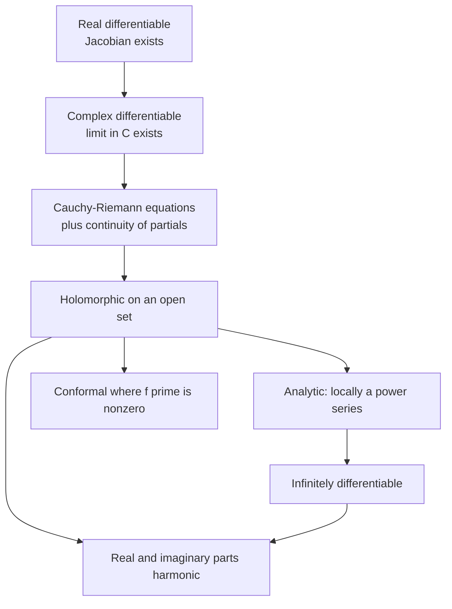
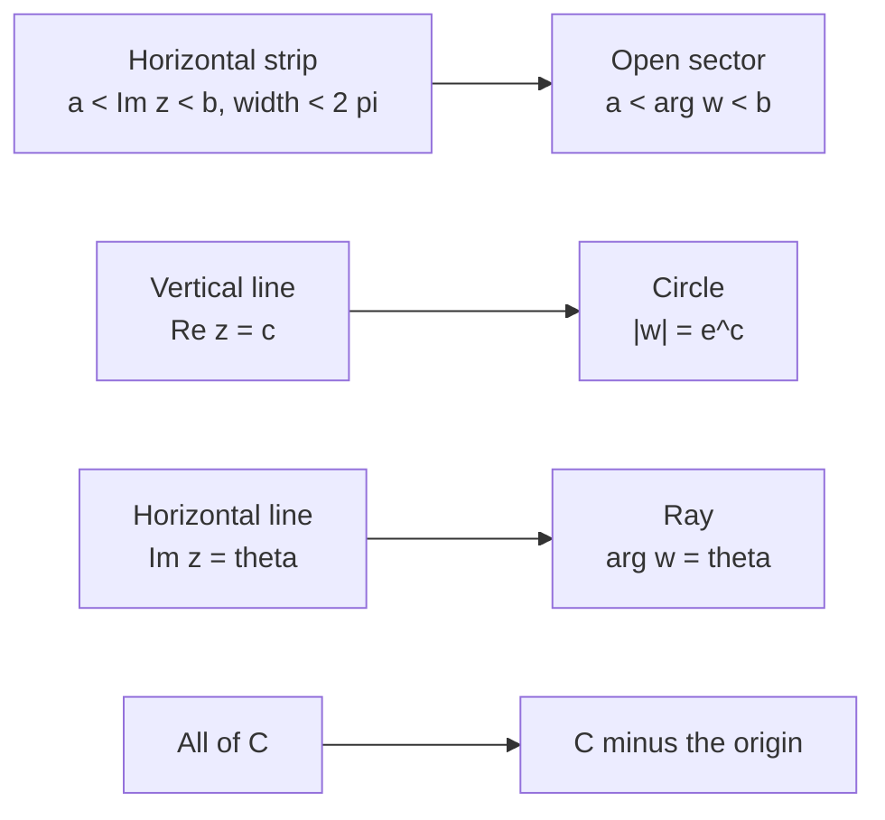

# Analytic Functions

> [Mathematics](../../README.md) › [Complex Analysis](../README.md) · Level: Advanced · Prerequisites: [Complex Numbers and Geometry](../01-complex-numbers-and-geometry/README.md), [Limits](../../07-calculus/01-limits/README.md), [Continuity](../../07-calculus/02-continuity/README.md), [Derivatives](../../07-calculus/03-derivatives/README.md), [Differentiation Rules](../../07-calculus/04-differentiation-rules/README.md), [Sequences and Series](../../06-precalculus/05-sequences-and-series/README.md), [Real Sequences and Series](../../14-real-analysis/02-sequences-and-series/README.md), [Exponential and Logarithmic Functions](../../03-algebra/12-exponential-and-logarithmic-functions/README.md), [Trigonometric Identities](../../05-trigonometry/03-trigonometric-identities/README.md) · Estimated time: 660 min

## 1. Introduction

The derivative of a real function is defined by a limit in which the input may approach from two directions only, left and right. In the complex plane there are infinitely many directions, and the definition of the complex derivative is written in exactly the same way:

$$f'(z_0) = \lim_{h\to0}\frac{f(z_0+h)-f(z_0)}{h}, \qquad h\in\mathbb{C}.$$

The apparent similarity is deceptive. Requiring this single limit to exist for *all* complex $h$ imposes two real equations on the four partial derivatives of $f = u+iv$ — the **Cauchy–Riemann equations** — and those equations are so restrictive that a once-differentiable complex function is automatically infinitely differentiable, representable by a power series, angle-preserving wherever its derivative is non-zero, and determined globally by its values on any set with an accumulation point. None of this is true for real functions: $x\mapsto x^2\sin(1/x)$ is differentiable but not continuously so, and smooth real functions need not be analytic.

This tutorial builds that chain of consequences from the definition. Section 7.1 defines the derivative and proves the elementary rules. Section 7.2 derives the Cauchy–Riemann equations as a *necessary* condition, and Section 7.3 proves a *partial converse*: if the partial derivatives are continuous and satisfy the equations, the complex derivative exists. Section 7.4 collects examples, and Section 7.5 explains exactly where the extra strength comes from: a real-differentiable map is approximated by an arbitrary real-linear map, while a complex-differentiable map is approximated by multiplication by one complex number, which is a rotation combined with a scaling.

The consequences occupy the rest of the tutorial. Section 7.6 shows that the real and imaginary parts of a holomorphic function are **harmonic**, and constructs a harmonic conjugate on a disc. Section 7.7 proves that a holomorphic map with non-zero derivative is **conformal** — it preserves angles and scales lengths locally. Section 7.8 connects differentiability with **power series**: every power series is holomorphic inside its disc of convergence, and (the deep direction, proved in [Complex Integration](../README.md#topic-inventory)) every holomorphic function is locally a power series. Sections 7.9–7.11 develop the **elementary functions** — exponential, logarithm, trigonometric and hyperbolic — from their power series or from the exponential, and Section 7.12 proves Euler's formula and Euler's identity.

Two warnings. First, "analytic" has two meanings in common use: representable by a convergent power series, and complex-differentiable on an open set. For complex functions the two coincide (Theorem 7.21), which is why the words are used interchangeably; this is a theorem, not a definition. Second, the logarithm cannot be defined as a single continuous function on $\mathbb{C}\setminus\{0\}$; every treatment of $\log$ in this tutorial is a statement about a **branch** on a restricted domain, and the multi-valuedness is not a technicality but the source of the interesting phenomena.

## 2. Prerequisites

**Complex numbers and geometry.** Modulus, argument, polar form, conjugation, the triangle inequality, and the geometry of multiplication. See [Complex Numbers and Geometry](../01-complex-numbers-and-geometry/README.md) and, for the algebra, [Complex Numbers](../../03-algebra/13-complex-numbers/README.md).

**Limits and continuity in one variable.** The $\varepsilon$–$\delta$ definition, limit laws, the algebra of continuous functions, and the intermediate value theorem. See [Limits](../../07-calculus/01-limits/README.md) and [Continuity](../../07-calculus/02-continuity/README.md).

**Real differentiation.** The definition of the derivative, the product, quotient and chain rules, the mean value theorem, and partial derivatives. See [Derivatives](../../07-calculus/03-derivatives/README.md) and [Differentiation Rules](../../07-calculus/04-differentiation-rules/README.md).

**Series.** Convergence of series of non-negative terms, the ratio and root tests, absolute convergence, and the geometric series. See [Sequences and Series](../../06-precalculus/05-sequences-and-series/README.md) and, for proofs, [Real Sequences and Series](../../14-real-analysis/02-sequences-and-series/README.md).

**Exponential, logarithm and trigonometry.** The real functions $e^x$, $\ln x$, $\sin x$, $\cos x$, their addition formulas, and the identity $e^{i\theta} = \cos\theta+i\sin\theta$ as used geometrically. See [Exponential and Logarithmic Functions](../../03-algebra/12-exponential-and-logarithmic-functions/README.md) and [Trigonometric Identities](../../05-trigonometry/03-trigonometric-identities/README.md).

**Linear maps.** A $2\times2$ real matrix, its determinant, and the interpretation of a linear map as a combination of rotation, scaling and reflection. See [Linear Transformations](../../08-linear-algebra/05-linear-transformations/README.md).

## 3. Learning Objectives

By the end of this tutorial you will be able to

1. state the definition of the complex derivative and prove that differentiability implies continuity;
2. derive the Cauchy–Riemann equations from the definition, and prove the converse under continuity of the partial derivatives;
3. decide whether a given function is complex-differentiable at a point, on a set, or nowhere;
4. explain precisely why complex differentiability is stronger than real differentiability, in terms of linear approximation and in terms of the number of real equations imposed;
5. prove that a holomorphic function with zero derivative on a domain is constant;
6. prove that the real and imaginary parts of a holomorphic function are harmonic, and construct a harmonic conjugate on a disc;
7. prove that a holomorphic map with non-zero derivative is conformal, and compute its local scaling and rotation;
8. compute radii of convergence and differentiate power series term by term;
9. state the equivalence of holomorphic and analytic, and outline where the hard direction is proved;
10. define $e^z$ and prove its algebraic and periodicity properties;
11. define branches of $\log z$, compute with the principal branch, and explain why no global branch exists;
12. define $\sin z$, $\cos z$, $\sinh z$, $\cosh z$ and prove their identities, periods, zeros and unboundedness;
13. prove Euler's formula and Euler's identity from the power series.

## 4. Intuition

For a real function, the derivative is the slope of the tangent line. For a complex function, the derivative is a **complex number**, and a complex number does two things at once: it rotates and it scales. The statement "$f$ is complex-differentiable at $z_0$ with derivative $f'(z_0)$" therefore means:

> near $z_0$, the map $f$ looks like the map $h\mapsto f(z_0)+f'(z_0)h$ — rotate by $\arg f'(z_0)$, scale by $\lvert f'(z_0)\rvert$, then translate.

This is a much stronger statement than real differentiability, where the approximation may shear, stretch differently in different directions, and even reflect. A general real-linear map of the plane is described by four numbers; a rotation-scaling is described by two (an angle and a factor). The two missing degrees of freedom are exactly the two Cauchy–Riemann equations.

The consequence is a kind of rigidity that has no real analogue. If a complex function is differentiable once on an open set, the Cauchy–Riemann equations force its partial derivatives to be differentiable too, and iterating gives infinite differentiability; the function then equals its Taylor series. Because the local model is always a rotation-scaling, small circles are mapped to small circles (up to higher-order distortion), so angles between curves are preserved. This is why complex analysis is the natural language of two-dimensional potential theory and of conformal mapping: a holomorphic function is a coordinate change that preserves the shape of infinitesimal regions.

The logarithm illustrates the global subtlety. Locally, $\log$ is the inverse of $\exp$, and $\exp$ is a local bijection wherever its derivative $e^z$ is non-zero — which is everywhere. But globally $\exp$ is periodic with period $2\pi i$, so it wraps the plane around the origin infinitely often, and the inverse cannot be single-valued. The multi-valuedness of $\arg z$ is precisely the statement that going once around the origin adds $2\pi$ to the angle. Every "branch" of the logarithm is a choice of a consistent angle on a domain that does not encircle the origin.

## 5. Formal Definition

**Definition 5.1** (complex derivative). Let $\Omega\subseteq\mathbb{C}$ be open, $f:\Omega\to\mathbb{C}$, and $z_0\in\Omega$. The function $f$ is **complex-differentiable at $z_0$** if the limit

$$f'(z_0) := \lim_{h\to0}\frac{f(z_0+h)-f(z_0)}{h}$$

exists in $\mathbb{C}$, the limit being taken over all complex $h\ne0$ with $z_0+h\in\Omega$. The number $f'(z_0)$ is the **derivative** of $f$ at $z_0$.

**Definition 5.2** (holomorphic, entire). $f$ is **holomorphic on the open set** $\Omega$ if $f'(z_0)$ exists for every $z_0\in\Omega$. A function holomorphic on all of $\mathbb{C}$ is **entire**.

**Definition 5.3** (Cauchy–Riemann equations). Write $f = u+iv$ with $u,v:\Omega\to\mathbb{R}$. The **Cauchy–Riemann equations** at a point where the partial derivatives exist are

$$u_x = v_y, \qquad u_y = -v_x.$$

**Definition 5.4** (harmonic function and harmonic conjugate). A function $u:\Omega\to\mathbb{R}$ of class $C^2$ is **harmonic** if $u_{xx}+u_{yy} = 0$ on $\Omega$. A **harmonic conjugate** of $u$ is a function $v:\Omega\to\mathbb{R}$ such that $u+iv$ is holomorphic, equivalently such that $u_x = v_y$ and $u_y = -v_x$.

**Definition 5.5** (conformal). Let $f$ be defined on a neighbourhood of $z_0$ and differentiable at $z_0$. Then $f$ is **conformal at $z_0$** if $f'(z_0)\ne0$ and $f$ preserves oriented angles between curves through $z_0$. A map is conformal on a domain if it is conformal at every point.

The definition is shown in Theorem 7.18 to be equivalent, for differentiable maps, to the condition $f'(z_0)\ne0$ together with the local rotation-scaling behaviour.

**Definition 5.6** (analytic). $f$ is **analytic** (or **holomorphic in the analytic sense**) on an open set $\Omega$ if every point of $\Omega$ has a neighbourhood on which $f$ is the sum of a convergent power series $\sum_{n\ge0}a_n(z-z_0)^n$.

**Definition 5.7** (exponential). For $z\in\mathbb{C}$,

$$e^z := \sum_{n=0}^{\infty}\frac{z^n}{n!}.$$

**Definition 5.8** (logarithm and branch). A **branch of the logarithm** on a domain $\Omega\subseteq\mathbb{C}\setminus\{0\}$ is a continuous function $\ell:\Omega\to\mathbb{C}$ with $e^{\ell(z)} = z$ for all $z\in\Omega$. The **principal logarithm** is

$$\operatorname{Log}z := \ln\lvert z\rvert + i\operatorname{Arg}z, \qquad z\in\mathbb{C}\setminus(-\infty,0].$$

**Definition 5.9** (trigonometric and hyperbolic functions). For $z\in\mathbb{C}$,

$$\sin z := \frac{e^{iz}-e^{-iz}}{2i}, \quad \cos z := \frac{e^{iz}+e^{-iz}}{2}, \quad \sinh z := \frac{e^{z}-e^{-z}}{2}, \quad \cosh z := \frac{e^{z}+e^{-z}}{2}.$$

## 6. Mathematical Notation

| Symbol | Read as | Meaning |
|---|---|---|
| $f'(z_0)$, $\dfrac{df}{dz}$ | f prime at z zero | the complex derivative of Definition 5.1 |
| $\Omega$ | Omega | an open subset of $\mathbb{C}$ (the domain of a function) |
| $u$, $v$ | u and v | real and imaginary parts, $f = u+iv$ |
| $u_x$, $u_y$ | u sub x, u sub y | partial derivatives with respect to $x$ and $y$ |
| $u_{xx}+u_{yy}$ | the Laplacian of u | often written $\Delta u$ |
| $\operatorname{Hol}(\Omega)$ | holomorphic functions on Omega | the set of holomorphic $f:\Omega\to\mathbb{C}$ |
| $e^z$, $\exp z$ | e to the z | the power series of Definition 5.7 |
| $\operatorname{Log}z$ | principal log | $\ln\lvert z\rvert+i\operatorname{Arg}z$, $\operatorname{Arg}\in(-\pi,\pi]$ |
| $\log z$ | log z | any branch, or the multi-valued function $\ln\lvert z\rvert+i\arg z$ |
| $\sin z$, $\cos z$, $\tan z$ | sine, cosine, tangent | defined by exponentials, Definition 5.9 |
| $\sinh z$, $\cosh z$ | hyperbolic sine, cosine | defined by exponentials, Definition 5.9 |
| $\sum_{n\ge0}a_n(z-z_0)^n$ | power series about z zero | a series with complex coefficients |
| $R$ | radius of convergence | the largest $R$ with convergence for $\lvert z-z_0\rvert<R$ |
| $O(h)$, $o(h)$ | big-O, little-o | $\lvert O(h)\rvert\le C\lvert h\rvert$; $o(h)/h\to0$ |

Read "$f\in\operatorname{Hol}(\Omega)$" as "f is holomorphic on Omega". The notation $\Delta u$ for $u_{xx}+u_{yy}$ is standard; it is the **Laplacian** of $u$.

## 7. Core Concepts

### 7.1 The Complex Derivative

Definition 5.1 is the real definition with $h$ allowed to be complex. Two points must be built into it. First, $f$ must be defined on a neighbourhood of $z_0$, so that $z_0+h$ is in the domain for all small $h$ in every direction. Second, the limit must be the same along every path $h\to0$; this is where the strength of the notion lies.

**Proposition 7.1** (differentiability implies continuity). If $f$ is complex-differentiable at $z_0$, then $f$ is continuous at $z_0$.

*Proof.* For $h\ne0$,

$$f(z_0+h)-f(z_0) = h\cdot\frac{f(z_0+h)-f(z_0)}{h}.$$

As $h\to0$ the quotient tends to $f'(z_0)$ and $h\to0$, so the product tends to $0$. Hence $f(z_0+h)\to f(z_0)$. $\blacksquare$

**Proposition 7.2** (algebra of derivatives). If $f,g$ are differentiable at $z_0$, then

$$(f+g)'(z_0) = f'(z_0)+g'(z_0), \qquad (fg)'(z_0) = f'(z_0)g(z_0)+f(z_0)g'(z_0),$$

and if $g(z_0)\ne0$,

$$\left(\frac fg\right)'(z_0) = \frac{f'(z_0)g(z_0)-f(z_0)g'(z_0)}{g(z_0)^2}.$$

If $g$ is differentiable at $z_0$ and $f$ is differentiable at $g(z_0)$, then

$$(f\circ g)'(z_0) = f'(g(z_0))\,g'(z_0).$$

*Proof.* The sum and product rules follow by adding and subtracting $f(z_0)g(z_0+h)$ and using the limit laws. The quotient rule follows from the product rule applied to $f\cdot(1/g)$, with $(1/g)' = -g'/g^2$, which is proved by rationalising $1/g(z_0+h)-1/g(z_0)$. For the chain rule, differentiability of $f$ at $w_0 := g(z_0)$ gives

$$f(w) = f(w_0)+f'(w_0)(w-w_0)+o(\lvert w-w_0\rvert) \qquad (w\to w_0).$$

Put $w = g(z_0+h)$ and $w-w_0 = g'(z_0)h+o(\lvert h\rvert) = O(\lvert h\rvert)$. Then

$$f(g(z_0+h)) = f(w_0)+f'(w_0)\bigl(g'(z_0)h+o(\lvert h\rvert)\bigr)+o(\lvert h\rvert),$$

because $o(\lvert w-w_0\rvert) = o(\lvert h\rvert)$ when $w-w_0 = O(h)$. Subtracting $f(g(z_0))$ and dividing by $h$ gives the claim. $\blacksquare$

**Example 7.3** (the derivative of $z^2$ from the definition). At $z_0$,

$$\frac{(z_0+h)^2-z_0^2}{h} = \frac{2z_0h+h^2}{h} = 2z_0+h \longrightarrow 2z_0.$$

So $f'(z_0) = 2z_0$ for every $z_0$; the same computation with $h^n$ in place of $h^2$ gives $(z^n)' = nz^{n-1}$ for $n\in\mathbb{N}$. Polynomials are therefore entire.

**Example 7.4** (conjugation is nowhere differentiable). For $f(z) = \bar z$,

$$\frac{\overline{z_0+h}-\overline{z_0}}{h} = \frac{\bar h}{h}.$$

If $h = t$ is real and non-zero, this equals $1$. If $h = it$ with $t$ real and non-zero, then $\bar h/h = (-it)/(it) = -1$. Two paths give different limits, so the limit does not exist. Thus $\bar z$ is differentiable nowhere, although as a real map $(x,y)\mapsto(x,-y)$ it is smooth.

### 7.2 The Cauchy–Riemann Equations: Necessity

Write $f = u+iv$ with $u,v$ real-valued, and suppose $f$ is differentiable at $z_0 = x_0+iy_0$.

**Theorem 7.5** (necessity of the Cauchy–Riemann equations). If $f$ is complex-differentiable at $z_0$, then the partial derivatives $u_x,u_y,v_x,v_y$ exist at $z_0$, satisfy

$$u_x = v_y, \qquad u_y = -v_x,$$

and

$$f'(z_0) = u_x(z_0)+iv_x(z_0) = v_y(z_0)-iu_y(z_0).$$

*Proof.* Approach $z_0$ along the real direction: take $h = t\in\mathbb{R}$. Then

$$\frac{f(z_0+t)-f(z_0)}{t} = \frac{u(x_0+t,y_0)-u(x_0,y_0)}{t}+i\,\frac{v(x_0+t,y_0)-v(x_0,y_0)}{t} \longrightarrow u_x(z_0)+iv_x(z_0).$$

Since the complex limit exists, this real-direction limit equals $f'(z_0)$; in particular $u_x$ and $v_x$ exist. Now approach along the imaginary direction: take $h = it$ with $t\in\mathbb{R}$ and multiply numerator and denominator by $-i$:

$$\frac{f(z_0+it)-f(z_0)}{it} = -i\,\frac{u(x_0,y_0+t)-u(x_0,y_0)}{t}+\frac{v(x_0,y_0+t)-v(x_0,y_0)}{t} \longrightarrow -iu_y(z_0)+v_y(z_0).$$

Comparing the two expressions for $f'(z_0)$,

$$u_x+iv_x = v_y-iu_y.$$

Equating real and imaginary parts gives $u_x = v_y$ and $v_x = -u_y$, which is the stated pair, and the displayed identity gives $f'(z_0) = u_x+iv_x = v_y-iu_y$. $\blacksquare$

The Cauchy–Riemann equations say that the Jacobian matrix of $f$ as a real map,

$$\begin{pmatrix}u_x & u_y\\ v_x & v_y\end{pmatrix} = \begin{pmatrix}a & -b\\ b & a\end{pmatrix}, \qquad a = u_x,\ b = v_x,$$

has the form of multiplication by the complex number $a+ib$. This is the precise sense in which complex differentiability is a *linear* condition on the first-order behaviour of $f$.

**Proposition 7.6** (Cauchy–Riemann equations in polar form). Let $z = re^{i\theta}$ with $r>0$, and suppose $f$ is holomorphic near $z$. Then

$$u_r = \frac1r v_\theta, \qquad v_r = -\frac1r u_\theta, \qquad f'(z) = e^{-i\theta}(u_r+iv_r).$$

*Proof.* The chain rule for $x = r\cos\theta$, $y = r\sin\theta$ gives

$$u_r = u_x\cos\theta+u_y\sin\theta, \qquad u_\theta = -u_xr\sin\theta+u_yr\cos\theta,$$

and the same formulas with $v$ in place of $u$. Substituting $u_x = v_y$ and $u_y = -v_x$ into the first,

$$u_r = v_y\cos\theta-v_x\sin\theta = \frac1r\bigl(-v_xr\sin\theta+v_yr\cos\theta\bigr) = \frac1r v_\theta.$$

Similarly,

$$-\frac1r u_\theta = \frac1r\bigl(u_xr\sin\theta-u_yr\cos\theta\bigr) = u_x\sin\theta+v_x\cos\theta = v_y\sin\theta+v_x\cos\theta = v_r.$$

Finally, $f' = u_x+iv_x$, and solving the two displayed relations for $u_x$ and $v_x$ gives
$u_x = u_r\cos\theta-\frac1ru_\theta\sin\theta = u_r\cos\theta+v_r\sin\theta$ and
$v_x = v_r\cos\theta+\frac1rv_\theta\sin\theta = v_r\cos\theta-u_r\sin\theta$. Hence

$$f' = (u_r\cos\theta+v_r\sin\theta)+i(v_r\cos\theta-u_r\sin\theta) = (\cos\theta-i\sin\theta)(u_r+iv_r) = e^{-i\theta}(u_r+iv_r). \qquad\blacksquare$$

### 7.3 Sufficiency: Continuous Partials Plus Cauchy–Riemann

Necessity is not enough for differentiability; the partials must also behave well. The standard sufficient condition is continuity of the partials.

**Theorem 7.7** (sufficiency). Let $f = u+iv$ be defined on an open set containing $z_0 = x_0+iy_0$. Suppose that $u$ and $v$ have continuous first partial derivatives on a neighbourhood of $z_0$, and that the Cauchy–Riemann equations hold at $z_0$. Then $f$ is complex-differentiable at $z_0$, and

$$f'(z_0) = u_x(z_0)+iv_x(z_0).$$

*Proof.* Write $h = \Delta x+i\Delta y$ with $\lvert h\rvert$ small, and put $\Delta f := f(z_0+h)-f(z_0)$, $\Delta u := u(x_0+\Delta x,y_0+\Delta y)-u(x_0,y_0)$, and similarly $\Delta v$. Add and subtract $u(x_0,y_0+\Delta y)$ and apply the one-variable mean value theorem to each piece:

$$\Delta u = u_x(\xi,y_0+\Delta y)\Delta x+u_y(x_0,\eta)\Delta y,$$

where $\xi$ lies between $x_0$ and $x_0+\Delta x$, and $\eta$ between $y_0$ and $y_0+\Delta y$. Because $u_x,u_y$ are continuous at $z_0$,

$$\Delta u = u_x(z_0)\Delta x+u_y(z_0)\Delta y+\varepsilon_1\Delta x+\varepsilon_2\Delta y,$$

with $\varepsilon_1,\varepsilon_2\to0$ as $h\to0$. Since $\lvert\Delta x\rvert,\lvert\Delta y\rvert\le\lvert h\rvert$, the last two terms are $o(\lvert h\rvert)$. Thus $\Delta u = u_x\Delta x+u_y\Delta y+o(\lvert h\rvert)$, and similarly $\Delta v = v_x\Delta x+v_y\Delta y+o(\lvert h\rvert)$. Therefore

$$\Delta f = (u_x+iv_x)\Delta x+(u_y+iv_y)\Delta y+o(\lvert h\rvert).$$

At $z_0$ the Cauchy–Riemann equations give $u_y+iv_y = -v_x+iu_x = i(u_x+iv_x)$, so

$$\Delta f = (u_x+iv_x)(\Delta x+i\Delta y)+o(\lvert h\rvert) = (u_x+iv_x)h+o(\lvert h\rvert).$$

Dividing by $h$ and letting $h\to0$ gives $f'(z_0) = u_x(z_0)+iv_x(z_0)$. $\blacksquare$

**Remark 7.8** (continuity cannot be dropped). The function

$$f(z) := \begin{cases}\bar z^2/z, & z\ne0,\\ 0, & z = 0,\end{cases}$$

satisfies the Cauchy–Riemann equations at $0$ but is not differentiable at $0$. In polar form $z = re^{i\theta}$ we have $f(z) = re^{-3i\theta}$, so $u = r\cos3\theta$ and $v = -r\sin3\theta$. Along the real axis ($\theta = 0$ or $\pi$), $f = x$, so $u_x(0) = 1$ and $v_x(0) = 0$. Along the imaginary axis ($\theta = \pm\pi/2$), $f = iy$, so $u_y(0) = 0$ and $v_y(0) = 1$. Hence $u_x = v_y$ and $u_y = -v_x$ at $0$. But

$$\frac{f(h)-f(0)}{h} = \frac{\bar h^2}{h^2} = e^{-4i\theta}$$

has no limit as $h\to0$. The partial derivatives of $u$ and $v$ exist at $0$ but are not continuous there, so Theorem 7.7 does not apply. Exercise 32 treats the same phenomenon with a different function.

### 7.4 Holomorphic Functions and Examples

**Proposition 7.9** (polynomials and rational functions). Every polynomial $p(z) = a_nz^n+\cdots+a_0$ is entire, with $p'(z) = na_nz^{n-1}+\cdots+a_1$. Every rational function $p(z)/q(z)$ is holomorphic on the complement of the zeros of $q$.

*Proof.* The derivative of $z^n$ is $nz^{n-1}$ by Example 7.3 and induction using the product rule; sums and scalar multiples are handled by Proposition 7.2. The quotient rule then gives the claim for $p/q$ wherever $q\ne0$, and those points form an open set. $\blacksquare$

**Proposition 7.10** (composition and inverse). A composition of holomorphic functions is holomorphic, with the chain rule of Proposition 7.2. If $f$ is holomorphic and injective on an open set and $f'(z_0)\ne0$, then $f^{-1}$ is holomorphic near $f(z_0)$, with

$$(f^{-1})'(f(z_0)) = \frac{1}{f'(z_0)}.$$

*Proof.* The composition statement is the chain rule. For the inverse, continuity of $f^{-1}$ is needed; it follows from the inverse function theorem for real maps, applied to the Jacobian $\begin{pmatrix}a&-b\\ b&a\end{pmatrix}$, whose determinant $a^2+b^2 = \lvert f'(z_0)\rvert^2$ is non-zero. Then differentiate $f(f^{-1}(w)) = w$ by the chain rule and solve for $(f^{-1})'(w)$. $\blacksquare$

**Example 7.11** (where $\lvert z\rvert^2$ is differentiable). Let $f(z) = \lvert z\rvert^2 = x^2+y^2$, so $u = x^2+y^2$ and $v = 0$. The Cauchy–Riemann equations are $2x = 0$ and $2y = 0$, so they hold only at $z = 0$. Since the partials are continuous, Theorem 7.7 shows that $f$ is differentiable at $0$, with $f'(0) = u_x(0)+iv_x(0) = 0$. At every other point $f$ is not differentiable. In particular $f$ is differentiable at a point but holomorphic on no open set, since no neighbourhood of $0$ lies in the set $\{0\}$.

**Example 7.12** (a function that is nowhere differentiable). Let $f(z) = \operatorname{Re}z = x$, so $u = x$ and $v = 0$. Then $u_x = 1$ and $v_y = 0$, so the first Cauchy–Riemann equation fails at every point. Hence $\operatorname{Re}z$ is differentiable nowhere.

### 7.5 Why Complex Differentiability Is Much Stronger

Real differentiability at a point says that

$$f(z_0+h) = f(z_0)+L(h)+o(\lvert h\rvert)$$

for some real-linear map $L:\mathbb{R}^2\to\mathbb{R}^2$, i.e. some $2\times2$ matrix. Complex differentiability says that $L$ is multiplication by the single complex number $f'(z_0)$:

$$f(z_0+h) = f(z_0)+f'(z_0)h+o(\lvert h\rvert).$$

The set of all real-linear maps of $\mathbb{R}^2$ is four-dimensional; the set of multiplications by a complex number is two-dimensional, consisting of maps of the form $\begin{pmatrix}a&-b\\ b&a\end{pmatrix}$. The two conditions $u_x = v_y$ and $u_y = -v_x$ are exactly the two equations that cut the four-dimensional space down to this two-dimensional subspace. Equivalently, the Jacobian matrix of $f$ has equal diagonal entries, $u_x = v_y$, and off-diagonal entries of opposite sign, $u_y = -v_x$: a complex-differentiable map is a solution of a system of two real first-order partial differential equations, which is why its solutions are rigid.

That rigidity has several precise consequences, all proved later in the subject:

* **Infinite differentiability and analyticity.** A holomorphic function is automatically $C^\infty$ and equals its Taylor series; this is Theorem 7.21, whose proof needs the Cauchy integral formula.
* **The identity theorem.** If two holomorphic functions on a domain agree on a set with an accumulation point in the domain, they agree everywhere. Real smooth functions have no such property.
* **The maximum modulus principle.** A non-constant holomorphic function has no interior maximum of $\lvert f\rvert$.
* **Liouville's theorem.** A bounded entire function is constant, from which the fundamental theorem of algebra follows.

Two elementary rigidity results can be proved right now.

**Proposition 7.13** (zero derivative implies constant). Let $\Omega$ be a domain (a connected open set) and $f$ holomorphic on $\Omega$ with $f'(z) = 0$ for all $z\in\Omega$. Then $f$ is constant on $\Omega$.

*Proof.* Write $f = u+iv$. The derivative is $u_x+iv_x = v_y-iu_y$, so $f' = 0$ gives $u_x = u_y = v_x = v_y = 0$ on $\Omega$. Fix $z_0\in\Omega$. On a small disc around $z_0$, the mean value theorem applied to $u$ along horizontal and vertical segments shows that $u$ is constant, and similarly $v$; hence $f$ is constant on that disc. Now let $A$ be the set of points of $\Omega$ at which $f$ has the same value as at $z_0$. The set $A$ is non-empty, open (by the disc argument), and closed in $\Omega$ (by continuity of $f$). Since $\Omega$ is connected, $A = \Omega$. $\blacksquare$

**Remark 7.14** (the identity theorem). A stronger statement than Proposition 7.13 is true: if $f$ is holomorphic on a domain $\Omega$ and vanishes on a set with an accumulation point in $\Omega$, then $f\equiv0$. This is the **identity theorem**, and it follows from analyticity: a non-zero holomorphic function has isolated zeros, because its power series at a zero has a first non-zero term. The full proof belongs to the next topic; the point here is that holomorphic functions are far more rigid than smooth real functions, whose values on a small set may be changed freely without affecting differentiability elsewhere.

### 7.6 Harmonic Functions and Harmonic Conjugates

**Proposition 7.15** (real and imaginary parts are harmonic). Let $f = u+iv$ be holomorphic on an open set $\Omega$, and suppose $u,v$ are of class $C^2$ there (which holds automatically for holomorphic functions, by Theorem 7.22). Then

$$u_{xx}+u_{yy} = 0, \qquad v_{xx}+v_{yy} = 0$$

on $\Omega$.

*Proof.* By Theorem 7.5, $u_x = v_y$ and $u_y = -v_x$. Differentiate the first with respect to $x$ and the second with respect to $y$:

$$u_{xx} = v_{yx}, \qquad u_{yy} = -v_{xy}.$$

Since $u,v\in C^2$, the mixed partials are equal, $v_{yx} = v_{xy}$, so $u_{xx}+u_{yy} = v_{yx}-v_{xy} = 0$. The proof for $v$ is the same, using $v_x = -u_y$ and $v_y = u_x$. $\blacksquare$

**Theorem 7.16** (existence of a harmonic conjugate on a disc). Let $u$ be harmonic and of class $C^2$ on an open disc $D$ with centre $(x_0,y_0)$. Then there exists $v:D\to\mathbb{R}$ of class $C^1$ with $u+iv$ holomorphic on $D$, given by

$$v(x,y) := \int_{y_0}^{y}u_x(x,t)\,dt-\int_{x_0}^{x}u_y(s,y_0)\,ds.$$

The conjugate is unique up to an additive real constant.

*Proof.* The integrals are taken along the vertical and horizontal segments inside $D$, which is convex, so they are defined. By the fundamental theorem of calculus,

$$v_y(x,y) = u_x(x,y).$$

For the $x$-derivative, differentiate under the integral sign (legitimate since $u\in C^2$):

$$v_x(x,y) = \int_{y_0}^{y}u_{xx}(x,t)\,dt-u_y(x,y_0) = -\int_{y_0}^{y}u_{yy}(x,t)\,dt-u_y(x,y_0),$$

using $u_{xx}+u_{yy} = 0$. The last expression equals $-[u_y(x,y)-u_y(x,y_0)]-u_y(x,y_0) = -u_y(x,y)$ by the fundamental theorem. Thus $u_x = v_y$ and $u_y = -v_x$; the partials of $u$ and $v$ are continuous, so Theorem 7.7 makes $u+iv$ holomorphic.

If $v_1,v_2$ are two conjugates, then $w := v_1-v_2$ satisfies $w_x = w_y = 0$ on the disc, hence $w$ is constant. $\blacksquare$

**Remark 7.17** (global obstruction). On a domain that is not simply connected, a harmonic function need not have a single-valued harmonic conjugate. The standard example is $u(z) = \log\lvert z\rvert$ on $\mathbb{C}\setminus\{0\}$, which is harmonic because it is the real part of the multi-valued logarithm. A conjugate $v$ would satisfy

$$v_x = -u_y = -\frac{y}{x^2+y^2}, \qquad v_y = u_x = \frac{x}{x^2+y^2},$$

which is the gradient of the argument function. Integrating along the unit circle $z = e^{i\theta}$ gives

$$\int_0^{2\pi}\left(v_x\,\frac{dx}{d\theta}+v_y\,\frac{dy}{d\theta}\right)d\theta = \int_0^{2\pi}\bigl(-\sin\theta(-\sin\theta)+\cos\theta(\cos\theta)\bigr)d\theta = 2\pi.$$

A single-valued differentiable $v$ would make this integral zero, since it is the integral of the exact differential $dv$ around a closed curve. The contradiction shows that $\log\lvert z\rvert$ has no harmonic conjugate on the punctured plane. It does have one on any disc or slit plane not containing $0$, for instance $v = \arg z$ on $\mathbb{C}\setminus(-\infty,0]$.

### 7.7 Conformality and the Geometric Meaning of $f'(z)\ne0$

A **curve** through $z_0$ is a differentiable map $\gamma:(-\varepsilon,\varepsilon)\to\mathbb{C}$ with $\gamma(0) = z_0$ and $\gamma'(0)\ne0$. Its tangent direction at $z_0$ is the complex number $\gamma'(0)$, defined up to a positive real factor.

**Theorem 7.18** (differentiability with non-zero derivative is conformal). Let $f$ be differentiable at $z_0$ with $f'(z_0)\ne0$. If $\gamma_1,\gamma_2$ are curves through $z_0$ with non-zero tangents, then the angle between $f\circ\gamma_1$ and $f\circ\gamma_2$ at $f(z_0)$ equals the angle between $\gamma_1$ and $\gamma_2$ at $z_0$, including orientation; and lengths are scaled by $\lvert f'(z_0)\rvert$ to first order.

*Proof.* By the chain rule, $(f\circ\gamma_j)'(0) = f'(z_0)\gamma_j'(0)$. The tangent direction of the image curve is therefore obtained from $\gamma_j'(0)$ by multiplying by the fixed non-zero complex number $f'(z_0)$. Multiplication by a non-zero complex number rotates every vector by the same angle $\arg f'(z_0)$ and scales every vector by the same factor $\lvert f'(z_0)\rvert$. Consequently the oriented angle between the image tangents equals the oriented angle between the original tangents, since the common rotation cancels in the difference of arguments. The length statement follows from $\lvert (f\circ\gamma)'(0)\rvert = \lvert f'(z_0)\rvert\lvert\gamma'(0)\rvert$. $\blacksquare$

Thus a holomorphic map with non-zero derivative is conformal at every point of its domain, and locally looks like a rotation by $\arg f'(z_0)$ composed with a dilation by $\lvert f'(z_0)\rvert$:

$$f(z_0+h) = f(z_0)+f'(z_0)h+o(\lvert h\rvert).$$

**Remark 7.19** (what happens when $f'(z_0) = 0$). The condition $f'(z_0)\ne0$ is essential. For $f(z) = z^2$ at $z_0 = 0$, the ray at angle $\theta$ maps to the ray at angle $2\theta$, so the angle between the positive real and positive imaginary axes, $\pi/2$, is doubled to $\pi$. The map is still angle-preserving in the weaker sense of preserving the *magnitude* of angles up to an integer factor, but it is not conformal. Points where $f' = 0$ are called **critical points**; they are isolated for non-constant holomorphic functions, a fact proved with power series.

### 7.8 Power Series and Analyticity

**Theorem 7.20** (radius of convergence and term-by-term differentiation). Let $\sum_{n\ge0}a_n(z-z_0)^n$ be a power series and put

$$R := \frac{1}{\limsup_{n\to\infty}\lvert a_n\rvert^{1/n}},$$

with the conventions $R = \infty$ when the limsup is $0$ and $R = 0$ when it is $\infty$. Then:

1. the series converges absolutely for $\lvert z-z_0\rvert<R$ and diverges for $\lvert z-z_0\rvert>R$;
2. it converges uniformly on every compact subset of the disc $\lvert z-z_0\rvert<R$;
3. the differentiated series $\sum_{n\ge1}na_n(z-z_0)^{n-1}$ has the same radius of convergence $R$, and on the disc the sum $f$ is differentiable with $f'(z) = \sum_{n\ge1}na_n(z-z_0)^{n-1}$.

*Proof.* 1. Put $h := z-z_0$ and apply the root test to the series $\sum a_nh^n$:

$$\limsup_n\lvert a_nh^n\rvert^{1/n} = \lvert h\rvert\limsup_n\lvert a_n\rvert^{1/n} = \frac{\lvert h\rvert}{R}.$$

The root test gives absolute convergence when this limit is $<1$, i.e. $\lvert h\rvert<R$, and divergence when it is $>1$, i.e. $\lvert h\rvert>R$.

2. Let $K$ be a compact subset of the disc and let $r$ be its maximum distance from $z_0$; then $r<R$. Choose $\rho$ with $r<\rho<R$. For $z\in K$, $\lvert a_n(z-z_0)^n\rvert\le\lvert a_n\rvert\rho^n$, and $\sum\lvert a_n\rvert\rho^n$ converges by part 1. The Weierstrass M-test gives uniform convergence on $K$.

3. Since $n^{1/n}\to1$, $\limsup(na_n)^{1/n} = \limsup\lvert a_n\rvert^{1/n}$, so the differentiated series has the same radius. The standard theorem on term-by-term differentiation of a series of differentiable functions applies: on each closed disc $\lvert z-z_0\rvert\le\rho<R$ the series converges uniformly (part 2), and so does the differentiated series; hence the sum is differentiable and the derivative is the sum of the differentiated series. $\blacksquare$

**Theorem 7.21** (analytic implies holomorphic). A function represented by a convergent power series on a disc is holomorphic there, infinitely differentiable, and the coefficients are the Taylor coefficients: $a_n = f^{(n)}(z_0)/n!$.

*Proof.* By Theorem 7.20(3), $f$ is differentiable with derivative given by the differentiated series; applying the theorem repeatedly shows that $f$ is $C^\infty$. Evaluating the $k$-th derivative at $z_0$ leaves only the term with $n = k$, since every term with $n<k$ has been differentiated away and every term with $n>k$ still carries a factor $(z-z_0)$. Hence $f^{(k)}(z_0) = k!\,a_k$. $\blacksquare$

**Theorem 7.22** (holomorphic implies analytic; stated). If $f$ is holomorphic on an open set $\Omega$, then for every $z_0\in\Omega$ there is $r>0$ such that the disc $B_r(z_0)\subseteq\Omega$ and

$$f(z) = \sum_{n=0}^{\infty}\frac{f^{(n)}(z_0)}{n!}(z-z_0)^n \qquad (\lvert z-z_0\rvert<r),$$

the series converging absolutely and uniformly on compact subsets of the disc.

The proof is the first major theorem of the next topic. Its route is the Cauchy integral formula: for $z$ inside a circle $\lvert\zeta-z_0\rvert = \rho$ contained in $\Omega$,

$$f(z) = \frac{1}{2\pi i}\oint_{\lvert\zeta-z_0\rvert=\rho}\frac{f(\zeta)}{\zeta-z}\,d\zeta,$$

and the geometric expansion

$$\frac{1}{\zeta-z} = \frac{1}{(\zeta-z_0)-(z-z_0)} = \sum_{n=0}^{\infty}\frac{(z-z_0)^n}{(\zeta-z_0)^{n+1}}$$

converges uniformly in $\zeta$ on the circle, so the series may be integrated term by term. The coefficients are exactly $a_n = \frac{1}{2\pi i}\oint f(\zeta)/(\zeta-z_0)^{n+1}d\zeta$. Nothing in this argument is circular: it uses only the Cauchy integral formula, which is proved before Theorem 7.22 in the standard development. The theorem is what justifies writing "holomorphic" and "analytic" interchangeably, and it retroactively justifies the $C^2$ hypothesis in Proposition 7.15.

### 7.9 The Exponential Function

**Proposition 7.23** (properties of $\exp$). The series defining $e^z$ converges absolutely for every $z$, and:

1. $e^{z+w} = e^ze^w$ for all $z,w\in\mathbb{C}$;
2. $e^0 = 1$, $e^{-z} = 1/e^z$, and $e^z\ne0$ for all $z$;
3. $e^{x+iy} = e^x(\cos y+i\sin y)$ for real $x,y$; in particular $\lvert e^z\rvert = e^{\operatorname{Re}z}$;
4. $e^{z+2\pi i} = e^z$ for all $z$, and $e^z = 1$ exactly when $z = 2\pi ik$ for some $k\in\mathbb{Z}$.

*Proof.* 1. The ratio of successive terms is $\lvert z\rvert/(n+1)\to0$, so the series converges absolutely everywhere. Absolute convergence permits the Cauchy product:

$$e^ze^w = \sum_{k\ge0}\frac{z^k}{k!}\sum_{m\ge0}\frac{w^m}{m!} = \sum_{n\ge0}\sum_{k+m=n}\frac{z^kw^m}{k!\,m!} = \sum_{n\ge0}\frac{(z+w)^n}{n!} = e^{z+w},$$

by the binomial theorem.

2. $e^0 = 1$ from the series. Then $e^ze^{-z} = e^0 = 1$, so $e^z\ne0$ and $e^{-z} = 1/e^z$.

3. By the product law, $e^{x+iy} = e^xe^{iy}$. Now

$$e^{iy} = \sum_{n\ge0}\frac{(iy)^n}{n!} = \sum_{k\ge0}\frac{(-1)^ky^{2k}}{(2k)!}+i\sum_{k\ge0}\frac{(-1)^ky^{2k+1}}{(2k+1)!} = \cos y+i\sin y,$$

using $i^{2k} = (-1)^k$, $i^{2k+1} = (-1)^ki$, and the real power series for cosine and sine. Hence $e^{x+iy} = e^x(\cos y+i\sin y)$ and $\lvert e^{z}\rvert = e^x$.

4. By part 3, $e^{2\pi i} = \cos2\pi+i\sin2\pi = 1$, so $e^{z+2\pi i} = e^ze^{2\pi i} = e^z$. If $e^z = 1$, then $e^x = \lvert e^z\rvert = 1$, so $x = 0$; and $\cos y = 1$, $\sin y = 0$, so $y = 2\pi k$ by Lemma 7.7 of [Complex Numbers and Geometry](../01-complex-numbers-and-geometry/README.md). $\blacksquare$

**Proposition 7.24** (the exponential as a map). Let $S_{a,b} := \{x+iy : a<y<b\}$ be a horizontal strip.

1. If $b-a<2\pi$, then $\exp$ is injective on $S_{a,b}$ and maps it bijectively onto the open sector $\{w\ne0 : a<\arg w<b\}$.
2. $\exp(\mathbb{C}) = \mathbb{C}\setminus\{0\}$.

*Proof.* 1. If $e^{z_1} = e^{z_2}$ then $e^{z_1-z_2} = 1$, so $z_1-z_2 = 2\pi ik$ by Proposition 7.23(4). If both points lie in the strip and $b-a<2\pi$, then $\lvert\operatorname{Im}(z_1-z_2)\rvert<b-a<2\pi$, so $k = 0$ and $z_1 = z_2$. For surjectivity, a point $w\ne0$ has $w = e^{\ln\lvert w\rvert+i\theta}$ for every $\theta\in\arg w$ by Proposition 7.23(3); choosing $\theta\in(a,b)$ gives a preimage in the strip.

2. Every $w\ne0$ can be written $w = e^{\ln\lvert w\rvert+i\theta}$ as above, and $0$ is not a value by Proposition 7.23(2). $\blacksquare$

### 7.10 The Logarithm

**Proposition 7.25** (branches of the logarithm). Let $\ell$ be a branch of $\log$ on a domain $\Omega\subseteq\mathbb{C}\setminus\{0\}$. Then $\ell$ is holomorphic on $\Omega$, $\ell'(z) = 1/z$, and $\ell(z) = \ln\lvert z\rvert+i\theta(z)$, where $\theta$ is a continuous argument on $\Omega$.

*Proof.* Differentiate $e^{\ell(z)} = z$ using the chain rule: $e^{\ell(z)}\ell'(z) = 1$, hence $\ell'(z) = 1/z\ne0$. Taking moduli in $e^{\ell(z)} = z$ gives $e^{\operatorname{Re}\ell(z)} = \lvert z\rvert$, so $\operatorname{Re}\ell(z) = \ln\lvert z\rvert$; taking arguments gives $\operatorname{Im}\ell(z)\in\arg z$, and $\operatorname{Im}\ell$ is continuous because $\ell$ is. $\blacksquare$

**Proposition 7.26** (the principal branch and the obstruction). The principal logarithm

$$\operatorname{Log}z = \ln\lvert z\rvert+i\operatorname{Arg}z, \qquad \operatorname{Arg}z\in(-\pi,\pi],$$

is a branch of $\log$ on $\mathbb{C}\setminus(-\infty,0]$; it is holomorphic there with derivative $1/z$. It is discontinuous at every point of $(-\infty,0)$. There is no branch of $\log$ on $\mathbb{C}\setminus\{0\}$.

*Proof.* For $z$ not on the negative real axis, $\operatorname{Arg}z$ is the angle of $z$ measured in $(-\pi,\pi)$, which varies continuously with $z$ on that set; hence Log is continuous, and $e^{\operatorname{Log}z} = e^{\ln\lvert z\rvert}(\cos\operatorname{Arg}z+i\sin\operatorname{Arg}z) = z$. Holomorphy and the derivative follow from Proposition 7.25.

At a point $-t$ with $t>0$, approach from above: $\operatorname{Arg}(-t+i\varepsilon)\to\pi$; approach from below: $\operatorname{Arg}(-t-i\varepsilon)\to-\pi$. The two limits differ by $2\pi$, so Log is discontinuous along the negative real axis.

For the final claim, suppose $\ell$ is a branch on $\mathbb{C}\setminus\{0\}$. Define $h(\theta) := \ell(e^{i\theta})-i\theta$ for $\theta\in[0,2\pi]$. Then $e^{h(\theta)} = e^{i\theta}/e^{i\theta} = 1$, so $h(\theta)\in2\pi i\mathbb{Z}$ by Proposition 7.23(4). Since $h$ is continuous and takes values in a discrete set, it is constant. But $h(0) = \ell(1)$ and $h(2\pi) = \ell(1)-2\pi i$, so constancy would give $2\pi i = 0$, a contradiction. $\blacksquare$

### 7.11 Trigonometric and Hyperbolic Functions

**Proposition 7.27** (properties of the trigonometric functions). The functions $\sin z$ and $\cos z$ are entire, with

$$(\sin z)' = \cos z, \qquad (\cos z)' = -\sin z,$$

and satisfy

$$\sin(z+w) = \sin z\cos w+\cos z\sin w, \qquad \cos(z+w) = \cos z\cos w-\sin z\sin w, \qquad \sin^2z+\cos^2z = 1.$$

Both are $2\pi$-periodic. Their zeros are

$$\sin z = 0 \iff z = k\pi, \qquad \cos z = 0 \iff z = \frac\pi2+k\pi, \qquad k\in\mathbb{Z}.$$

Neither function is bounded on $\mathbb{C}$: $\sin(iy) = i\sinh y$ and $\cos(iy) = \cosh y$, both unbounded as $y\to\pm\infty$. The hyperbolic functions satisfy $\sin(iz) = i\sinh z$, $\cos(iz) = \cosh z$, $(\sinh z)' = \cosh z$, $(\cosh z)' = \sinh z$, and $\cosh^2z-\sinh^2z = 1$; their zeros are $\sinh z = 0\iff z = ik\pi$ and $\cosh z = 0\iff z = i(\pi/2+k\pi)$.

*Proof.* Since $e^{\pm iz}$ are entire, so are $\sin$ and $\cos$; differentiating the definitions and using $(e^{iz})' = ie^{iz}$ gives the derivative formulas. The addition formulas follow by expanding the right sides in exponentials; for example,

$$2i\sin(z+w) = e^{i(z+w)}-e^{-i(z+w)} = (e^{iz}-e^{-iz})\frac{e^{iw}+e^{-iw}}{2}+(e^{iz}+e^{-iz})\frac{e^{iw}-e^{-iw}}{2} = 2i(\sin z\cos w+\cos z\sin w).$$

The identity $\sin^2+\cos^2 = 1$ is the same expansion. Periodicity follows from $e^{i(z+2\pi)} = e^{iz}$. For the zeros, $\sin z = 0$ means $e^{iz} = e^{-iz}$, i.e. $e^{2iz} = 1$, so $2iz = 2\pi ik$ and $z = k\pi$; and $\cos z = 0$ means $e^{2iz} = -1 = e^{i\pi}$, so $2iz = i\pi+2\pi ik$ and $z = \pi/2+\pi k$. Finally,

$$\sin(iy) = \frac{e^{i(iy)}-e^{-i(iy)}}{2i} = \frac{e^{-y}-e^{y}}{2i} = i\,\frac{e^{y}-e^{-y}}{2} = i\sinh y,$$

whose modulus $\sinh y$ tends to infinity. The hyperbolic identities follow from the definitions. $\blacksquare$

### 7.12 Euler's Formula and Euler's Identity

**Theorem 7.28** (Euler). For every real $\theta$,

$$e^{i\theta} = \cos\theta+i\sin\theta.$$

For every complex $z$, $e^{iz} = \cos z+i\sin z$. In particular $e^{i\pi} = -1$, so

$$e^{i\pi}+1 = 0.$$

*Proof.* For real $\theta$, split the series for $e^{i\theta}$ into even and odd terms:

$$e^{i\theta} = \sum_{k\ge0}\frac{(i\theta)^{2k}}{(2k)!}+\sum_{k\ge0}\frac{(i\theta)^{2k+1}}{(2k+1)!} = \sum_{k\ge0}\frac{(-1)^k\theta^{2k}}{(2k)!}+i\sum_{k\ge0}\frac{(-1)^k\theta^{2k+1}}{(2k+1)!} = \cos\theta+i\sin\theta,$$

using the real power series for cosine and sine. For complex $z$, the identity $e^{iz} = \cos z+i\sin z$ is simply the definition of $\cos z$ and $\sin z$ rearranged. Setting $\theta = \pi$ gives $e^{i\pi} = \cos\pi+i\sin\pi = -1$. $\blacksquare$

Euler's formula is the bridge between the two halves of the subject. It identifies the exponential form $re^{i\theta}$ of [Complex Numbers and Geometry](../01-complex-numbers-and-geometry/README.md) with the genuine exponential function, and it gives De Moivre's theorem as an immediate corollary:

$$(\cos\theta+i\sin\theta)^n = (e^{i\theta})^n = e^{in\theta} = \cos n\theta+i\sin n\theta.$$

## 8. Formulas and Properties

| Formula | Hypotheses | Why it is true |
|---|---|---|
| $f'(z_0) = \lim_{h\to0}\frac{f(z_0+h)-f(z_0)}{h}$ | $f$ defined near $z_0$, limit in $\mathbb{C}$ | Definition 5.1 |
| $u_x = v_y$, $u_y = -v_x$ | $f = u+iv$ differentiable | Theorem 7.5 |
| $f' = u_x+iv_x = v_y-iu_y$ | same | Theorem 7.5 |
| CR + continuous partials $\Rightarrow$ differentiable | $u,v\in C^1$ near $z_0$ | Theorem 7.7 |
| $u_r = \frac1rv_\theta$, $v_r = -\frac1ru_\theta$ | $z = re^{i\theta}$, $f$ holomorphic | Proposition 7.6 |
| $(f\circ g)' = f'(g)g'$ | both differentiable | Proposition 7.2 |
| $f'\equiv0$ on a domain $\Rightarrow f$ constant | domain connected | Proposition 7.13 |
| $u_{xx}+u_{yy} = 0$, $v_{xx}+v_{yy} = 0$ | $f = u+iv$ holomorphic, $C^2$ | Proposition 7.15 |
| harmonic conjugate exists on a disc | $u$ harmonic, $C^2$ | Theorem 7.16 |
| $\lvert f'(z_0)\rvert$ is the local length scale; $\arg f'(z_0)$ the local rotation | $f'(z_0)\ne0$ | Theorem 7.18 |
| $R = 1/\limsup\lvert a_n\rvert^{1/n}$ | power series | Theorem 7.20 |
| power series differentiable term by term | $\lvert z-z_0\rvert<R$ | Theorem 7.20 |
| $f(z) = \sum\frac{f^{(n)}(z_0)}{n!}(z-z_0)^n$ | $f$ holomorphic near $z_0$ | Theorem 7.22 |
| $e^{z+w} = e^ze^w$ | all $z,w$ | Proposition 7.23 |
| $e^{x+iy} = e^x(\cos y+i\sin y)$ | $x,y\in\mathbb{R}$ | Proposition 7.23 |
| $\lvert e^z\rvert = e^{\operatorname{Re}z}$ | all $z$ | Proposition 7.23 |
| $e^{z+2\pi i} = e^z$; $e^z = 1\iff z\in2\pi i\mathbb{Z}$ | all $z$ | Proposition 7.23 |
| $\ell'(z) = 1/z$ for a branch of $\log$ | $\ell$ branch on a domain | Proposition 7.25 |
| $\operatorname{Log}z = \ln\lvert z\rvert+i\operatorname{Arg}z$ | $z\notin(-\infty,0]$ | Proposition 7.26 |
| no branch of $\log$ on $\mathbb{C}\setminus\{0\}$ | — | Proposition 7.26 |
| $\sin^2z+\cos^2z = 1$; periods $2\pi$ | all $z$ | Proposition 7.27 |
| $\sin z = 0\iff z = k\pi$; $\cos z = 0\iff z = \pi/2+k\pi$ | $k\in\mathbb{Z}$ | Proposition 7.27 |
| $\sin(iz) = i\sinh z$, $\cos(iz) = \cosh z$ | all $z$ | Proposition 7.27 |
| $e^{i\theta} = \cos\theta+i\sin\theta$ | $\theta\in\mathbb{R}$ | Theorem 7.28 |
| $e^{i\pi}+1 = 0$ | — | Theorem 7.28 |

## 9. Step-by-Step Examples

**Example 9.1** (a derivative from the definition). Differentiate $f(z) = 1/z$ at $z_0\ne0$ from Definition 5.1.

$$\frac{f(z_0+h)-f(z_0)}{h} = \frac{1}{h}\left(\frac{1}{z_0+h}-\frac{1}{z_0}\right) = \frac{1}{h}\cdot\frac{z_0-(z_0+h)}{z_0(z_0+h)} = \frac{-1}{z_0(z_0+h)}.$$

As $h\to0$ this tends to $-1/z_0^2$, so $f'(z_0) = -1/z_0^2$. The computation also shows where the hypothesis $z_0\ne0$ is used: the denominator must stay away from zero for small $h$.

**Example 9.2** (a function differentiable nowhere). Let $f(z) = z^2+2\bar z$. Write $u+iv$:

$$z^2 = (x^2-y^2)+2xyi, \qquad 2\bar z = 2x-2yi,$$

so $u = x^2-y^2+2x$ and $v = 2xy-2y$. Then $u_x = 2x+2$, $v_y = 2x-2$, so the first Cauchy–Riemann equation would require $2x+2 = 2x-2$, i.e. $2 = -2$, which is impossible. Hence $f$ is differentiable at no point. The partial derivatives are continuous everywhere, so Theorem 7.7 applies wherever the equations hold; here they never do.

**Example 9.3** (verifying Cauchy–Riemann for a cubic). For $f(z) = z^3$,

$$z^3 = (x+iy)^3 = x^3+3x^2(iy)+3x(iy)^2+(iy)^3 = (x^3-3xy^2)+i(3x^2y-y^3).$$

Hence $u = x^3-3xy^2$ and $v = 3x^2y-y^3$. Then

$$u_x = 3x^2-3y^2 = v_y, \qquad u_y = -6xy = -v_x,$$

so the equations hold everywhere. By Theorem 7.7 the function is entire, and

$$f'(z) = u_x+iv_x = (3x^2-3y^2)+i(6xy) = 3(x+iy)^2 = 3z^2,$$

in agreement with the power rule.

**Example 9.4** (a harmonic conjugate). Show that $u = x^2-y^2$ is harmonic and find a holomorphic $f$ with $\operatorname{Re}f = u$. Compute $u_{xx} = 2$ and $u_{yy} = -2$, so $u_{xx}+u_{yy} = 0$. A conjugate must satisfy $v_y = u_x = 2x$ and $v_x = -u_y = 2y$. Integrating the first in $y$ gives $v = 2xy+g(x)$; then $v_x = 2y+g'(x) = 2y$, so $g' = 0$ and $g$ is constant. Hence $v = 2xy+C$ and

$$f(z) = (x^2-y^2)+i(2xy+C) = z^2+iC.$$

**Check.** $z^2 = (x^2-y^2)+2xyi$, so the real part is correct, and the imaginary part differs from $2xy$ by the constant $C$, which does not affect the Cauchy–Riemann equations.

**Example 9.5** (harmonic conjugate of an exponential). Let $u = e^x\cos y$. Then $u_x = e^x\cos y$, $u_{xx} = e^x\cos y$; $u_y = -e^x\sin y$, $u_{yy} = -e^x\cos y$; hence $u_{xx}+u_{yy} = 0$. A conjugate satisfies $v_y = e^x\cos y$ and $v_x = e^x\sin y$. Integrating the first in $y$ gives $v = e^x\sin y+g(x)$; then $v_x = e^x\sin y+g'(x) = e^x\sin y$, so $g$ is constant. Thus $v = e^x\sin y+C$ and $f = u+iv = e^z+iC$.

**Example 9.6** (principal logarithms). Using $\operatorname{Log}z = \ln\lvert z\rvert+i\operatorname{Arg}z$:

$$\operatorname{Log}1 = 0, \qquad \operatorname{Log}i = i\frac\pi2, \qquad \operatorname{Log}(-1) = i\pi, \qquad \operatorname{Log}(-1-i) = \ln\sqrt2-\frac{3\pi i}{4},$$

because $\lvert -1-i\rvert = \sqrt2$ and $-1-i$ lies in the third quadrant with argument $-3\pi/4$. **Check.** $e^{\ln\sqrt2-3\pi i/4} = \sqrt2(\cos(-3\pi/4)+i\sin(-3\pi/4)) = \sqrt2(-\sqrt2/2-i\sqrt2/2) = -1-i$.

**Example 9.7** (a complex trigonometric equation). Solve $\cos z = 2$. By definition,

$$\frac{e^{iz}+e^{-iz}}{2} = 2 \iff e^{2iz}-4e^{iz}+1 = 0,$$

a quadratic in $e^{iz}$ with roots $e^{iz} = 2\pm\sqrt3$. Both roots are positive real, so

$$iz = \ln(2\pm\sqrt3)+2\pi ik, \qquad z = -i\ln(2\pm\sqrt3)+2\pi k.$$

Since $\ln(2-\sqrt3) = -\ln(2+\sqrt3)$, the solutions are $z = 2\pi k\pm i\ln(2+\sqrt3)$, $k\in\mathbb{Z}$.

**Check.** For $z = i\ln(2+\sqrt3)$, $e^{iz} = e^{-\ln(2+\sqrt3)} = 1/(2+\sqrt3) = 2-\sqrt3$; then $\cos z = \tfrac12[(2-\sqrt3)+(2+\sqrt3)] = 2$. The signs of the imaginary part give the two roots.

**Example 9.8** (local geometry of $z^2$). At $z_0 = 1+i$, $f(z) = z^2$ has $f'(z_0) = 2(1+i) = 2+2i$. Hence locally $f$ rotates by $\arg(2+2i) = \pi/4$ and scales lengths by $\lvert 2+2i\rvert = 2\sqrt2$. The horizontal direction $1$ maps to the direction $2+2i$, and the vertical direction $i$ maps to $i(2+2i) = -2+2i$; the angle between these image directions is $\pi/2$, as it was between the originals. At $z_0 = 0$ the derivative vanishes and the map doubles angles, so it is not conformal there (Remark 7.19).

## 10. Visual Explanations

The logical layering of the definitions and the main theorems:

Where the standard functions are differentiable:

| Function | Differentiable at | Holomorphic on |
|---|---|---|
| $z^n$, polynomial | all $z$ | $\mathbb{C}$ (entire) |
| $p(z)/q(z)$ | $q(z)\ne0$ | $\{q\ne0\}$ |
| $\bar z$ | nowhere | nowhere |
| $\operatorname{Re}z$, $\operatorname{Im}z$, $\lvert z\rvert$ | nowhere | nowhere |
| $\lvert z\rvert^2$ | $z = 0$ only | no open set |
| $e^z$, $\sin z$, $\cos z$ | all $z$ | $\mathbb{C}$ (entire) |
| $1/z$ | $z\ne0$ | $\mathbb{C}\setminus\{0\}$ |
| $\operatorname{Log}z$ | $z\notin(-\infty,0]$ | $\mathbb{C}\setminus(-\infty,0]$ |
| $\operatorname{Arg}z$ (real-valued) | nowhere | nowhere |

The exponential as a map, from the $z$-plane to the $w$-plane:

## 11. Common Mistakes

**1. Believing the Cauchy–Riemann equations are sufficient by themselves.** They are sufficient only with an additional regularity hypothesis, such as continuity of the partial derivatives (Theorem 7.7). The function of Remark 7.8 satisfies the equations at $0$ and is not differentiable there. Always check which theorem you are using and whether its hypotheses hold.

**2. Checking differentiability along one path.** A limit in $\mathbb{C}$ must exist along every path. Computing the difference quotient along a real direction and concluding differentiability is invalid; two paths must agree, and in fact all of them must.

**3. Confusing the existence of partial derivatives with differentiability.** For real functions of two variables this is already false; for complex functions the gap is even wider, because differentiability is a single complex limit.

**4. Treating $\log$ as single-valued.** Writing $\log z$ without specifying a branch is ambiguous. Identities such as $\log(zw) = \log z+\log w$ fail for the principal branch; for example $\operatorname{Log}((-1)(-1)) = \operatorname{Log}1 = 0$, while $\operatorname{Log}(-1)+\operatorname{Log}(-1) = 2\pi i$.

**5. Forgetting that $\exp$ is not injective.** $e^{z+2\pi i} = e^z$, so solving $e^z = w$ gives infinitely many solutions $z = \ln\lvert w\rvert+i(\arg w+2\pi k)$. Similarly $\sin$ and $\cos$ are not injective, and they are not bounded.

**6. Assuming $\lvert\sin z\rvert\le1$.** This holds on the real line only. On the imaginary axis $\sin(iy) = i\sinh y$ is unbounded.

**7. Calling a function holomorphic at a point.** Holomorphy is a property of an open set: $f$ is holomorphic on $\Omega$ if it is differentiable at every point of the open set $\Omega$. A function differentiable at a single point, such as $\lvert z\rvert^2$ at $0$, is not holomorphic anywhere.

**8. Forgetting the hypothesis $f'(z_0)\ne0$ for conformality.** At a critical point the local behaviour is $h\mapsto f(z_0)+a_kh^k+o(\lvert h\rvert^k)$ with $k\ge2$, and angles are multiplied by $k$. The map $z^2$ at $0$ is the standard example.

**9. Assuming every harmonic function has a global harmonic conjugate.** The theorem is local (true on discs); on the punctured plane $u = \log\lvert z\rvert$ has no single-valued conjugate (Remark 7.17).

**10. Using the converse of a theorem without checking its hypotheses.** For instance, "the real part of a holomorphic function is harmonic" does not say that every harmonic function is the real part of a holomorphic function on its whole domain; that requires a simply connected domain.

## 12. Applications

**Fluid flow and electrostatics.** In a simply connected region free of sources, a two-dimensional incompressible irrotational flow has a velocity potential $\phi$ and a stream function $\psi$ satisfying the Cauchy–Riemann equations, so $\Omega = \phi+i\psi$ is holomorphic. The same equations govern the electrostatic potential in a charge-free region and the steady temperature in a homogeneous plate. Harmonic conjugates are the stream functions; level curves of $\phi$ and $\psi$ meet orthogonally because the map is conformal.

**Conformal mapping.** Because a holomorphic map with non-zero derivative preserves angles and scales lengths locally, it can be used to transform a complicated domain into a simple one while preserving the Laplace equation. The Riemann mapping theorem guarantees that any simply connected proper domain can be mapped conformally onto the disc; the Joukowski map of [Complex Numbers and Geometry](../01-complex-numbers-and-geometry/README.md) is a practical example. Applications include aerofoil design, groundwater flow and the solution of Laplace's equation on polygonal domains via the Schwarz–Christoffel transformation.

**Signal processing and control.** The Laplace transform and the $z$-transform are complex-analytic tools: poles and zeros of a transfer function, located in the complex plane, determine stability and frequency response. Phasor analysis of AC circuits uses $e^{i\omega t}$ and the analytic properties of impedance functions. The identity $e^{i\theta} = \cos\theta+i\sin\theta$ is the reason the Fourier transform can be written with complex exponentials.

**Analytic number theory.** The Riemann zeta function $\zeta(s) = \sum n^{-s}$, initially defined for $\operatorname{Re}s>1$, extends to a meromorphic function on $\mathbb{C}$; its zeros and poles encode the distribution of primes. The prime number theorem is proved by contour integration of $\zeta'/\zeta$, a method that depends on every result in this tutorial and the next.

**Quantum mechanics and geometry.** Wave functions are complex-valued, and the Schrödinger equation involves the Laplacian; harmonic and holomorphic functions provide the stationary states of free particles in two dimensions. In geometry, conformal maps are the local isometries of surfaces up to scale, and the uniformisation theorem uses complex analysis to classify Riemann surfaces.

## 13. Exercises

The problem set contains **36 exercises**:

* **Beginner (1–12):** derivatives from the definition, Cauchy–Riemann verification, harmonic functions, principal logarithms, and exponentials.
* **Intermediate (13–24):** differentiability sets, harmonic conjugates, images of strips under $\exp$, logarithmic identities, trigonometric equations, and conformal scaling.
* **Advanced (25–31):** rigidity from $f'=0$, constant modulus, polar Cauchy–Riemann, harmonicity, non-existence of global conjugates, inverse functions, and radii of convergence.
* **Challenge (32–36):** the Cauchy–Riemann counterexample, conformality and critical points, injectivity of $\exp$ on strips, impossibility of a global logarithm, and holomorphic maps with image in a line.

Attempt every problem before opening [solutions.md](solutions.md).

## 14. Solutions

Complete worked solutions for all 36 exercises are in [solutions.md](solutions.md), each with the strategy, every significant step and an independent check where one is available.

## 15. Summary

* The complex derivative is defined by the same limit as the real derivative, but $h$ ranges over $\mathbb{C}$; differentiability implies continuity.
* Writing $f = u+iv$, differentiability forces the Cauchy–Riemann equations $u_x = v_y$, $u_y = -v_x$, and $f' = u_x+iv_x$.
* Conversely, continuous partial derivatives satisfying the equations imply complex differentiability; continuity is essential.
* A holomorphic function is differentiable on an open set; polynomials, rational functions and $\exp$ are holomorphic, while $\bar z$, $\operatorname{Re}z$ and $\lvert z\rvert$ are nowhere differentiable.
* Complex differentiability is a rotation-scaling condition on the Jacobian, hence two real equations rather than four free entries; this produces rigidity.
* A holomorphic function with zero derivative on a domain is constant.
* Real and imaginary parts of holomorphic functions are harmonic; on a disc every harmonic function has a harmonic conjugate, unique up to a constant.
* A holomorphic map with non-zero derivative is conformal: it preserves oriented angles and scales lengths by $\lvert f'\rvert$.
* Power series are holomorphic inside their disc of convergence and may be differentiated term by term; holomorphic functions are locally power series, so the two notions coincide.
* $e^z$ is entire, never vanishes, satisfies $e^{z+w} = e^ze^w$ and has period $2\pi i$; $e^{x+iy} = e^x(\cos y+i\sin y)$.
* A branch of $\log$ is holomorphic with derivative $1/z$; the principal branch lives on $\mathbb{C}\setminus(-\infty,0]$, and no branch exists on $\mathbb{C}\setminus\{0\}$.
* $\sin z$ and $\cos z$ are entire, $2\pi$-periodic, satisfy the usual identities, have zeros at $k\pi$ and $\pi/2+k\pi$, and are unbounded on $\mathbb{C}$.
* Euler's formula $e^{i\theta} = \cos\theta+i\sin\theta$ follows from the power series and yields $e^{i\pi}+1 = 0$.

## 16. Further Learning

The next topic in this discipline is **Complex Integration**, which proves Cauchy's theorem and the integral formula, and with them the converse direction of Theorem 7.22 (holomorphic implies analytic). See the [discipline index](../README.md) for the study order and the [Topology](../../17-topology/README.md) tutorial for the topological notions — open sets, connectedness, simply connected domains — that underpin the global theory. The differential equations of potential theory are treated in [Differential Equations](../../16-differential-equations/README.md), and the real-variable background in [Real Sequences and Series](../../14-real-analysis/02-sequences-and-series/README.md).

Standard references:

* Lars Ahlfors, *Complex Analysis* — the classical treatment of the Cauchy–Riemann equations and conformality.
* John B. Conway, *Functions of One Complex Variable* — detailed proofs of Theorems 7.7, 7.16 and 7.22.
* Tristan Needham, *Visual Complex Analysis* — geometric insight into conformality and the elementary functions.
* Elias M. Stein and Rami Shakarchi, *Complex Analysis* — a concise modern development with applications.
* Walter Rudin, *Real and Complex Analysis* — for the harmonic-function viewpoint and its generalizations.
