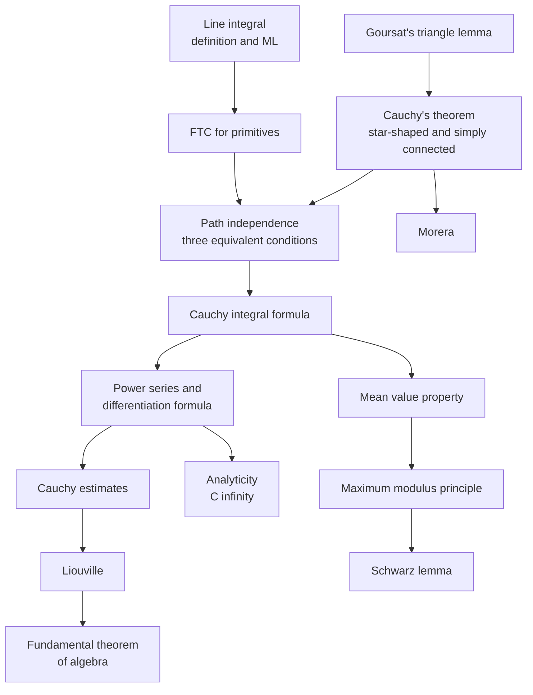

# Complex Integration

> [Mathematics](../../README.md) › [Complex Analysis](../README.md) · Level: Advanced · Prerequisites: [Complex Numbers and Geometry](../01-complex-numbers-and-geometry/README.md), [Analytic Functions](../02-analytic-functions/README.md), [Riemann Integration](../../14-real-analysis/05-riemann-integration/README.md), [Vector Calculus](../../07-calculus/13-vector-calculus/README.md), [Techniques of Integration](../../07-calculus/08-techniques-of-integration/README.md) · Estimated time: 720 min

## 1. Introduction

Real integration measures area. Complex integration measures something stranger and more powerful: it measures how a complex function twists and stretches the plane along a curve, and it does so with a bookkeeping that remembers *direction*. The definition is a direct transcription of the Riemann integral,

$$\int_\gamma f(z)\,dz := \int_a^b f\bigl(\gamma(t)\bigr)\,\gamma'(t)\,dt,$$

and the only new ingredient is that the increment $dz = \gamma'(t)\,dt$ is a **complex number**. Multiplication by a complex number is a rotation composed with a scaling, so the integral accumulates infinitely many small rotated, scaled copies of the values of $f$. Two integrals that look similar can therefore differ by a factor of $i$, and the orientation of the path matters.

The subject begins with a miracle. A holomorphic function, integrated around a closed curve that encircles no hole of its domain, always gives zero:

$$\oint_\gamma f(z)\,dz = 0 \qquad (\text{Cauchy's theorem}).$$

For real functions no such statement can hold — the integral of $x^2$ around a closed interval of the line is not even defined — and the reason it holds here is the Cauchy–Riemann equations, which force a holomorphic $f$ to behave like a field that is simultaneously curl-free and divergence-free (Section 4). From one vanishing integral the entire theory unfolds:

* **path independence** and the existence of **antiderivatives** on simply connected domains (Section 7.5);
* **Cauchy's integral formula**, which computes every interior value of $f$ from its boundary values (Section 7.7);
* **infinite differentiability** of holomorphic functions, and the **Cauchy estimates** that bound derivatives by sup norms (Section 7.8);
* **Liouville's theorem** and, as a two-line corollary, the **fundamental theorem of algebra** (Section 7.9);
* **Morera's theorem**, the converse of Cauchy's theorem, which is the standard test for holomorphy (Section 7.10);
* the **mean value property** and the **maximum modulus principle**, the beginnings of potential theory (Section 7.11);
* the evaluation of **real integrals** that resist every elementary technique (Section 7.13 and Section 9).

It also explains, finally, why the punctured plane is not simply connected. The function $1/z$ is holomorphic on $\mathbb{C}\setminus\{0\}$, yet

$$\oint_{\lvert z\rvert=1}\frac{dz}{z} = 2\pi i \ne 0 .$$

The hole is detected by an integral. The number $2\pi i$ is the first example of a **period**, and the integer multiple it produces around an arbitrary closed curve is the **winding number** — the topological invariant that governs the general form of Cauchy's theorem (Section 7.12).

The order of the tutorial is the order in which the ideas are needed. Sections 5 and 7.1–7.4 build the integral and its estimates, with no holomorphy at all. Section 7.5 isolates the algebraic face of the theory: primitives, path independence and vanishing periods are three descriptions of one property. Sections 7.6–7.8 prove the analytic face — Goursat's triangle lemma, Cauchy's theorem, the integral formula and its consequences. Sections 7.9–7.11 harvest corollaries, and Section 7.13 uses the machinery on real integrals. Section 7.12 is marked as the advanced topological refinement and may be skipped on a first reading.

## 2. Prerequisites

**Complex numbers and plane geometry.** Cartesian and polar form, modulus, argument, conjugation, the triangle inequality and the geometry of multiplication as rotation-dilation. Complex integration is plane geometry with signs, so fluency here is not optional. See [Complex Numbers and Geometry](../01-complex-numbers-and-geometry/README.md) and, for the algebra, [Complex Numbers](../../03-algebra/13-complex-numbers/README.md).

**Holomorphic functions.** The complex derivative, the Cauchy–Riemann equations, the algebra of holomorphic functions, and the elementary functions $e^z$, $\sin z$, $\cos z$, $\log z$ on a branch. Every theorem below has "holomorphic on a domain" among its hypotheses, and the proofs use the $C^1$ criterion (continuous partial derivatives satisfying Cauchy–Riemann) when they need Green's theorem. See [Analytic Functions](../02-analytic-functions/README.md).

**Riemann integration.** Partitions, Riemann sums, integrability of continuous functions on closed intervals, linearity and additivity of the integral, and the estimation rule $\lvert\int_a^b g\rvert \le \int_a^b \lvert g\rvert$. See [Riemann Integration](../../14-real-analysis/05-riemann-integration/README.md) and [Integrals](../../07-calculus/06-integrals/README.md).

**The fundamental theorem of calculus and substitution.** Both appear in the proof that $\int_\gamma F'\,dz = F(\gamma(b)) - F(\gamma(a))$. See [Fundamental Theorem of Calculus](../../07-calculus/07-fundamental-theorem-of-calculus/README.md) and [Techniques of Integration](../../07-calculus/08-techniques-of-integration/README.md).

**Green's theorem.** Used once, in Section 7.6, to explain *why* Cauchy's theorem is true under the extra hypothesis that $f$ is continuously differentiable. See [Vector Calculus](../../07-calculus/13-vector-calculus/README.md).

**Metric topology of the plane.** Open and closed sets, connectedness, compactness, distance from a point to a set, and the fact that a continuous function on a compact set is bounded and attains its bounds. See [Metric Spaces](../../14-real-analysis/06-metric-spaces/README.md).

**Geometric series.** The identity $\sum_{k=0}^{\infty} w^k = 1/(1-w)$ for $\lvert w\rvert<1$, used to expand $1/(\zeta-z)$ in Section 7.8. See [Real Sequences and Series](../../14-real-analysis/02-sequences-and-series/README.md).

## 3. Learning Objectives

By the end of this tutorial you will be able to

1. define paths, contours, closed and simple curves, orientation, concatenation and length, and give examples of each;
2. define the complex line integral both as a limit of Riemann sums and by a parametrisation, and prove that the two agree;
3. reduce a complex line integral to two real line integrals and compute integrals directly from a parametrisation;
4. prove linearity, additivity, reversal, reparametrisation invariance and the estimation inequality $\lvert\int_\gamma f\,dz\rvert \le \max_\gamma\lvert f\rvert\,\ell(\gamma)$;
5. state and prove the equivalence of primitives, path independence and vanishing of all closed-contour integrals, and prove the complex fundamental theorem of calculus;
6. state Goursat's lemma and reproduce the subdivision proof for a triangle, including the $4^n$ scaling and the passage to the limit;
7. state Cauchy's theorem for simply connected domains and explain, with $1/z$ on $\mathbb{C}\setminus\{0\}$, why the hypothesis cannot be dropped;
8. prove Cauchy's integral formula by the shrinking-circle argument and use it to evaluate contour integrals;
9. derive the Cauchy differentiation formula, deduce that holomorphic functions are analytic, and state Cauchy's estimates;
10. prove Liouville's theorem, the fundamental theorem of algebra and Morera's theorem;
11. prove the mean value property and the maximum modulus principle, and apply them to bound and locate extrema;
12. evaluate real integrals by contour deformation, including the estimation of arcs that are discarded in a limit.

## 4. Intuition

**A force field on a walk.** Imagine walking along a path $\gamma$ in a field of arrows $F$. The line integral $\int_\gamma F\cdot dr$ adds up the component of $F$ along your direction of travel. In physics this is the work done by the field. If $F$ is a gradient, $F = \nabla\phi$, the work depends only on the endpoints: it is $\phi(\text{end}) - \phi(\text{start})$. If the field circulates around a hole, a closed walk can return a nonzero answer.

A complex integral is two such line integrals at once. Writing $f = u+iv$ and $dz = dx+i\,dy$,

$$\int_\gamma f\,dz = \int_\gamma (u\,dx - v\,dy) + i\int_\gamma (u\,dy + v\,dx).$$

The first is the work of the field $(u,-v)$; the second is the work of the field $(v,u)$. Now the Cauchy–Riemann equations $u_x = v_y$, $u_y = -v_x$ say precisely that both fields are curl-free and divergence-free:

$$\operatorname{curl}(u,-v) = -v_x - u_y = 0, \qquad \operatorname{div}(u,-v) = u_x - v_y = 0 .$$

A curl-free field on a region without holes is a gradient, and a gradient has path-independent work. That is Cauchy's theorem, seen from physics.

**Holes are periods.** On the punctured plane, the field of $1/z$ is still curl-free and divergence-free, but the region has a hole and the field winds around it. Walking once counterclockwise around the hole collects $2\pi i$; walking twice collects $4\pi i$; walking the other way collects $-2\pi i$. The winding number is the number of times the path wraps around the hole, with sign, and the possible values of a closed integral are its integer multiples.

**Rigidity.** The integral formula says that a holomorphic function is determined inside a circle by its values on the circle:

$$f(z) = \frac{1}{2\pi i}\oint_{\lvert\zeta-z_0\rvert=r}\frac{f(\zeta)}{\zeta-z}\,d\zeta .$$

This is like a soap film: the wire is the boundary, the film is the function. It is also why holomorphic functions cannot have isolated bruises — a local defect would propagate to the boundary. Everything strange about the subject — infinite differentiability, no interior maxima, unique continuation — is a version of this rigidity.

**Why simply connected.** On a domain with a hole, a closed contour can enclose the hole and the argument that shrinks the contour to a point fails. The word "simply connected" is exactly the hypothesis that forbids this obstruction. It is a topological condition with an analytic consequence, and this is the first place in the curriculum where topology earns its keep.

## 5. Formal Definition

### 5.1 Curves, Contours and Orientation

**Definition 5.1** (path). A *path* in $\mathbb{C}$ is a continuous map $\gamma:[a,b]\to\mathbb{C}$ with $a<b$. Its *trace* is the set $\gamma^* := \gamma([a,b])$. The path is *continuously differentiable*, or $C^1$, if $\gamma'$ exists and is continuous on $[a,b]$ (with one-sided derivatives at the endpoints). It is *piecewise $C^1$* if there is a partition

$$a = t_0 < t_1 < \cdots < t_n = b$$

such that the restriction of $\gamma$ to each $[t_{j-1},t_j]$ is $C^1$.

**Definition 5.2** (contour). A *contour* is a piecewise $C^1$ path. A contour is *closed* if $\gamma(a) = \gamma(b)$, and *simple* if $\gamma$ is injective on $[a,b)$; a simple closed contour is also called a *Jordan contour*. A contour is *regular* at $t$ if $\gamma'(t)\ne0$; a piecewise $C^1$ contour is regular if it is regular at all but finitely many points.

The distinction between a path and its trace matters. Two different paths can trace the same set: the unit circle can be traversed once counterclockwise, once clockwise, or five times counterclockwise. Integrals see the map, not the set.

**Definition 5.3** (reverse and concatenation). For a path $\gamma:[a,b]\to\mathbb{C}$, the *reverse* path is

$$(-\gamma)(t) := \gamma(a+b-t), \qquad a\le t\le b .$$

If $\gamma:[a,b]\to\mathbb{C}$ and $\eta:[b,c]\to\mathbb{C}$ satisfy $\gamma(b) = \eta(b)$, their *concatenation* is the path $\gamma+\eta:[a,c]\to\mathbb{C}$ that equals $\gamma$ on $[a,b]$ and $\eta$ on $[b,c]$. Both operations preserve the class of contours.

**Definition 5.4** (length). The *length* of a $C^1$ path is $\ell(\gamma) := \int_a^b\lvert\gamma'(t)\rvert\,dt$; for a contour, sum over the smooth pieces. The length is finite because $\gamma'$ is continuous on each closed piece and therefore bounded there.

**Definition 5.5** (positive orientation). Let $\gamma$ be a simple closed contour. By the Jordan curve theorem its complement $\mathbb{C}\setminus\gamma^*$ has exactly two components, one bounded (the *interior* $\operatorname{Int}\gamma$) and one unbounded (the *exterior*). The contour is *positively oriented*, or *counterclockwise*, if $\operatorname{Int}\gamma$ lies to the left of the direction of travel; equivalently, if the winding number of Definition 5.12 equals $+1$ at every point of the interior. For the circle $\lvert z-z_0\rvert = r$ the standard positive parametrisation is

$$\gamma(t) = z_0 + re^{it}, \qquad 0\le t\le 2\pi .$$

### 5.2 Domains and Simple Connectivity

**Definition 5.6** (domain). A *domain* is a non-empty, open, connected subset of $\mathbb{C}$.

**Definition 5.7** (star-shaped, convex). A domain $\Omega$ is *star-shaped with respect to* $z_0\in\Omega$ if for every $z\in\Omega$ the segment $[z_0,z] = \{(1-s)z_0+sz : 0\le s\le1\}$ lies in $\Omega$. It is *convex* if the segment joining any two of its points lies in $\Omega$. Every convex domain is star-shaped with respect to each of its points.

**Definition 5.8** (simply connected). A domain $\Omega$ is *simply connected* if the complement of $\Omega$ in the Riemann sphere, $\mathbb{C}_\infty\setminus\Omega$, is connected. Equivalently: every closed contour in $\Omega$ is null-homotopic in $\Omega$, that is, it can be deformed continuously inside $\Omega$ to a single point. A domain that is not simply connected is *multiply connected*.

The equivalence of the two descriptions is a theorem of plane topology, proved in [Topology](../../17-topology/README.md); this tutorial uses only the geometric content: a simply connected domain has no holes. Discs, half-planes, convex sets and star-shaped sets are simply connected; the punctured plane $\mathbb{C}\setminus\{0\}$ and the annulus $\{1<\lvert z\rvert<2\}$ are not.

### 5.3 The Complex Line Integral

**Definition 5.9** (complex line integral). Let $\Omega\subseteq\mathbb{C}$ be open, let $f:\Omega\to\mathbb{C}$ be continuous, and let $\gamma:[a,b]\to\mathbb{C}$ be a contour with $\gamma^*\subset\Omega$. The *integral of $f$ along $\gamma$* is

$$\int_\gamma f(z)\,dz := \int_a^b f\bigl(\gamma(t)\bigr)\,\gamma'(t)\,dt ,$$

where the right-hand side is a Riemann integral of a piecewise continuous $\mathbb{C}$-valued function (integrate real and imaginary parts separately).

The definition is forced by Riemann sums. Partition $[a,b]$ by $a = t_0<\cdots<t_n = b$, choose $\tau_j\in[t_{j-1},t_j]$, and form

$$\sum_{j=1}^{n} f\bigl(\gamma(\tau_j)\bigr)\bigl(\gamma(t_j)-\gamma(t_{j-1})\bigr).$$

By the mean value theorem applied to the real and imaginary parts of $\gamma$, the increment is approximately $\gamma'(\tau_j)(t_j-t_{j-1})$, so the sum is a Riemann sum for $\int_a^b f(\gamma(t))\gamma'(t)\,dt$. Section 7.2 proves the convergence.

**Definition 5.10** (arc-length integral). With the same data, the integral of $f$ with respect to arc length is

$$\int_\gamma f(z)\,\lvert dz\rvert := \int_a^b f\bigl(\gamma(t)\bigr)\,\lvert\gamma'(t)\rvert\,dt .$$

It does not involve the orientation of $\gamma$ and is the natural object for bounding $\lvert\int_\gamma f\,dz\rvert$.

**Definition 5.11** (antiderivative). Let $f:\Omega\to\mathbb{C}$ be continuous. A *primitive*, or *antiderivative*, of $f$ on $\Omega$ is a holomorphic $F:\Omega\to\mathbb{C}$ with $F' = f$ on $\Omega$.

### 5.4 Winding Number

**Definition 5.12** (winding number). Let $\gamma$ be a closed contour and $a\notin\gamma^*$. The *winding number*, or *index*, of $\gamma$ about $a$ is

$$n(\gamma,a) := \frac{1}{2\pi i}\oint_\gamma \frac{dz}{z-a} .$$

Section 7.12 proves that this number is always an integer, that it is constant on each connected component of $\mathbb{C}\setminus\gamma^*$, and that it is $0$ on the unbounded component. For the standard counterclockwise circle, $n(\gamma,a) = 1$ for interior points and $0$ for exterior points.

## 6. Mathematical Notation

| Symbol | Read as | Meaning |
|---|---|---|
| $\gamma:[a,b]\to\mathbb{C}$ | gamma from a b to C | a path, that is, a continuous curve with a parametrisation |
| $\gamma^*$ | trace of gamma | the set of points the path passes through |
| $\gamma'(t)$ | gamma prime of t | velocity vector; a complex number |
| $-\gamma$ | minus gamma | the same trace traversed backwards |
| $\gamma+\eta$ | gamma plus eta | concatenation, first $\gamma$ then $\eta$ |
| $\displaystyle\int_\gamma f\,dz$ | integral over gamma of f dz | complex line integral, Definition 5.9 |
| $\displaystyle\oint_\gamma$ | contour integral | an integral over a closed contour |
| $\displaystyle\int_\gamma f\,\lvert dz\rvert$ | integral of f with respect to arc length | orientation-free integral, Definition 5.10 |
| $\ell(\gamma)$ | length of gamma | $\int_a^b\lvert\gamma'(t)\rvert\,dt$ |
| $\operatorname{Int}\gamma$ | interior of gamma | bounded component of $\mathbb{C}\setminus\gamma^*$ |
| $D(z_0,r)$, $\overline{D}(z_0,r)$ | open and closed disc | $\{\lvert z-z_0\rvert<r\}$ and $\{\lvert z-z_0\rvert\le r\}$ |
| $n(\gamma,a)$ | winding number of gamma about a | Definition 5.12 |
| $\max_\gamma\lvert f\rvert$ | maximum of f on gamma | $\max\{\lvert f(z)\rvert : z\in\gamma^*\}$ |
| $f^{(n)}$ | n-th derivative of f | used from Section 7.8 onwards |
| $\operatorname{Res}(f,z_0)$ | residue of f at $z_0$ | defined in [Power Series and Residues](../04-power-series-and-residues/README.md) |

Two notational warnings. First, $\lvert dz\rvert$ is not the modulus of a number: it is the arc-length element $\lvert\gamma'(t)\rvert\,dt$, so $\int_\gamma dz$ is a complex number while $\int_\gamma\lvert dz\rvert = \ell(\gamma)$ is a non-negative real number. Second, an integral written $\oint$ is not automatically zero: the circle on the sign records that the contour is closed, nothing more. Whether the integral vanishes is a theorem, and it has hypotheses.

## 7. Core Concepts

### 7.1 Curves, Contours and Their Orientation

The simplest contours are segments and circles. The segment from $z_0$ to $z_1$ is

$$\gamma(t) = z_0 + t(z_1-z_0), \qquad 0\le t\le1,$$

with $\gamma' = z_1-z_0$ constant and length $\lvert z_1-z_0\rvert$. The circle of radius $r$ about $z_0$, traversed counterclockwise, is $\gamma(t) = z_0+re^{it}$ with $\gamma' = ire^{it}$, $\lvert\gamma'\rvert = r$ and length $2\pi r$. The reverse of the standard circle is $z_0+re^{-it}$, which traverses the same set clockwise.

A contour is rarely a single formula. Typical constructions are:

* **polygonal paths**, concatenations of segments, used to approximate smooth curves;
* **boundaries of regions**, such as the boundary of a rectangle, which is the concatenation of four segments;
* **arcs plus segments**, as in the semicircular contours of Section 7.13;
* **keyhole contours**, which run along both sides of a slit and around a small circle — the standard device for avoiding a branch cut.

Two pieces of bookkeeping prevent most errors. First, record the *direction*: a contour enclosing a region must be traversed with the region on the left. Second, record the *starting point* when a contour is closed, because concatenation order changes the integral unless the integrand is holomorphic with a primitive.

**Example 7.1** (boundary of a rectangle). Let $R = \{x+iy : a\le x\le b,\ c\le y\le d\}$. Its positively oriented boundary consists of the segment up the left side, the segment right along the top, the segment down the right side, and the segment left along the bottom. The four pieces are chosen so that the interior stays on the left throughout.

**Example 7.2** (a contour that is not simple). The path $\gamma(t) = e^{it}$ for $0\le t\le 4\pi$ is closed, regular, and traces the unit circle twice. It is not simple, and its winding number about $0$ is $2$. Integrals along it are twice the integrals along the simple circle, which is consistent with $n(\gamma,0)=2$.

### 7.2 The Complex Line Integral as a Limit of Riemann Sums

**Proposition 7.3** (existence). Let $f$ be continuous on the open set $\Omega$, and let $\gamma:[a,b]\to\mathbb{C}$ be a contour with $\gamma^*\subset\Omega$. Then the Riemann sums

$$S(P,\tau) := \sum_{j=1}^{n} f\bigl(\gamma(\tau_j)\bigr)\bigl(\gamma(t_j)-\gamma(t_{j-1})\bigr)$$

converge, as the mesh $\max_j(t_j-t_{j-1})$ tends to $0$, to $\int_a^b f(\gamma(t))\gamma'(t)\,dt$. In particular the integral of Definition 5.9 is well defined.

*Proof.* It suffices to treat the case where $\gamma$ is $C^1$; a contour is a finite concatenation of such pieces. Write $g(t) := f(\gamma(t))\gamma'(t)$, which is continuous on $[a,b]$. The difference between $S(P,\tau)$ and the Riemann sum $\sum_j g(\tau_j)(t_j-t_{j-1})$ is

$$\sum_{j=1}^{n} f\bigl(\gamma(\tau_j)\bigr)\Bigl[\gamma(t_j)-\gamma(t_{j-1})-\gamma'(\tau_j)(t_j-t_{j-1})\Bigr].$$

Let $M := \max_{\gamma^*}\lvert f\rvert$, finite by compactness. Since $\gamma'$ is uniformly continuous on $[a,b]$, for every $\varepsilon>0$ there is $\delta>0$ such that $\lvert\gamma(s)-\gamma(t)-\gamma'(t)(s-t)\rvert\le\varepsilon\lvert s-t\rvert$ whenever $\lvert s-t\rvert<\delta$; this is the mean value inequality applied to the function $s\mapsto\gamma(s)-\gamma(t)-\gamma'(t)(s-t)$, whose derivative is $\gamma'(s)-\gamma'(t)$. If the mesh is less than $\delta$, the difference is bounded by $M\varepsilon\sum_j(t_j-t_{j-1}) = M\varepsilon(b-a)$, which tends to $0$. The sums $\sum_j g(\tau_j)(t_j-t_{j-1})$ converge to $\int_a^b g$ by the definition of the Riemann integral of a continuous function. $\blacksquare$

**Proposition 7.4** (real form). With $f = u+iv$ and $z = x+iy$,

$$\int_\gamma f\,dz = \int_\gamma (u\,dx - v\,dy) + i\int_\gamma (v\,dx + u\,dy).$$

*Proof.* On a smooth piece, $f(\gamma(t))\gamma'(t) = (u+iv)(x'+iy') = (ux'-vy') + i(vx'+uy')$, and integration in $t$ gives the two real line integrals. Add over the pieces. $\blacksquare$

The real form shows that a complex integral is a pair of real line integrals of the kind studied in [Vector Calculus](../../07-calculus/13-vector-calculus/README.md). It also explains why Green's theorem can prove Cauchy's theorem under smoothness hypotheses (Section 7.6).

### 7.3 Elementary Properties and the Estimation Inequality

**Proposition 7.5** (basic properties). Let $f,g$ be continuous on $\Omega$ and let $\gamma,\eta$ be contours in $\Omega$.

1. (Linearity) $\displaystyle\int_\gamma (\alpha f+\beta g)\,dz = \alpha\int_\gamma f\,dz + \beta\int_\gamma g\,dz$ for all $\alpha,\beta\in\mathbb{C}$.
2. (Additivity) If $\gamma+\eta$ is defined, then $\displaystyle\int_{\gamma+\eta} f\,dz = \int_\gamma f\,dz + \int_\eta f\,dz$.
3. (Reversal) $\displaystyle\int_{-\gamma} f\,dz = -\int_\gamma f\,dz$.
4. (Reparametrisation) If $\varphi:[c,d]\to[a,b]$ is $C^1$ with $\varphi(c)=a$, $\varphi(d)=b$ and $\varphi'>0$, then $\displaystyle\int_{\gamma\circ\varphi} f\,dz = \int_\gamma f\,dz$. If $\varphi'<0$ the sign is reversed.
5. (Conjugation) $\displaystyle\overline{\int_\gamma f\,dz} = \int_{\bar\gamma}\bar f\,dz$, where $\bar\gamma(t) = \overline{\gamma(t)}$.

*Proof.* All five are immediate from the definition and the corresponding properties of the Riemann integral. For (3), substitute $s = a+b-t$: the increment $d\gamma$ changes sign while the trace is the same. For (4), the chain rule gives $(\gamma\circ\varphi)' = \gamma'(\varphi)\varphi'$, and the substitution rule converts $\int_c^d f(\gamma(\varphi(s)))\gamma'(\varphi(s))\varphi'(s)\,ds$ into $\int_a^b f(\gamma(t))\gamma'(t)\,dt$ when $\varphi'>0$; when $\varphi'<0$ the substitution reverses the limits. For (5), conjugate the definition and use that conjugation is continuous and commutes with integration. $\blacksquare$

Property (4) says the integral is attached to an *oriented* curve, not to a parametrisation: any increasing reparametrisation gives the same answer. This is why one writes $\int_\gamma$ and not $\int_a^b$.

**Theorem 7.6** (ML inequality). Let $f$ be continuous on $\Omega$ and let $\gamma$ be a contour in $\Omega$. Then

$$\left\lvert\int_\gamma f(z)\,dz\right\rvert \le \Bigl(\max_{z\in\gamma^*}\lvert f(z)\rvert\Bigr)\,\ell(\gamma).$$

More generally $\lvert\int_\gamma f\,dz\rvert\le\int_\gamma\lvert f\rvert\,\lvert dz\rvert$.

*Proof.* On a smooth piece,

$$\left\lvert\int_{t_{j-1}}^{t_j} f(\gamma(t))\gamma'(t)\,dt\right\rvert \le \int_{t_{j-1}}^{t_j}\lvert f(\gamma(t))\rvert\,\lvert\gamma'(t)\rvert\,dt \le M\int_{t_{j-1}}^{t_j}\lvert\gamma'(t)\rvert\,dt ,$$

using the estimation rule for Riemann integrals and $M := \max_{\gamma^*}\lvert f\rvert$. Summing over the pieces gives the result. $\blacksquare$

The letters ML stand for "maximum times length". The inequality is the main estimation tool in the subject and it is used constantly: it converts an integral into a product of two numbers, one analytic (the size of $f$) and one geometric (the size of the curve). The classic error is to bound $\lvert f\rvert$ by a constant that blows up as the contour grows; Section 11 collects the variants.

**Corollary 7.7** (a useful special case). If $\lvert f(z)\rvert\le M$ on the circle $\lvert z-z_0\rvert = R$, then

$$\left\lvert\oint_{\lvert z-z_0\rvert=R} f(z)\,dz\right\rvert \le 2\pi R M .$$

### 7.4 Direct Computation

Every integral in this tutorial can in principle be computed from the definition. The skill is to choose a parametrisation and to use symmetry before algebra.

**Example 7.8** (a polynomial along two paths). Let $f(z) = z$ and let $\gamma_1$ be the segment from $0$ to $1+i$, while $\gamma_2$ is the polygonal path $0\to1\to1+i$. Along $\gamma_1$, $\gamma_1(t) = t(1+i)$ and $\gamma_1' = 1+i$, so

$$\int_{\gamma_1} z\,dz = \int_0^1 t(1+i)(1+i)\,dt = (1+i)^2\int_0^1 t\,dt = 2i\cdot\frac12 = i .$$

Along $\gamma_2$, the first segment has $z = t$, $dz = dt$ and contributes $\int_0^1 t\,dt = \tfrac12$; the second has $z = 1+it$, $dz = i\,dt$ and contributes $\int_0^1(1+it)i\,dt = i-\tfrac12$. The total is $i$ again. The two answers agree, as Theorem 7.12 predicts for a function with the primitive $z^2/2$.

**Example 7.9** (the conjugate along the same paths). Let $f(z) = \bar z$ and keep the two paths. Along $\gamma_1$, $\bar z = t(1-i)$ and $\gamma_1' = 1+i$, so the integrand is $t(1-i)(1+i) = 2t$ and

$$\int_{\gamma_1}\bar z\,dz = \int_0^1 2t\,dt = 1 .$$

Along $\gamma_2$, the horizontal piece contributes $\int_0^1 t\,dt = \tfrac12$ and the vertical piece contributes $\int_0^1(1-it)i\,dt = i+\tfrac12$, for a total of $1+i$. The answers differ, so $\bar z$ has no primitive on $\mathbb{C}$ and its integral is not path independent. This is consistent with [Analytic Functions](../02-analytic-functions/README.md): $\bar z$ satisfies the Cauchy–Riemann equations nowhere.

**Example 7.10** (powers around a circle). Let $n\in\mathbb{Z}$ and let $\gamma(t) = z_0+re^{it}$, $0\le t\le2\pi$. Then $\gamma(t)-z_0 = re^{it}$ and $dz = ire^{it}dt$, so

$$\oint_\gamma (z-z_0)^n\,dz = ir^{n+1}\int_0^{2\pi} e^{i(n+1)t}\,dt = \begin{cases} 2\pi i, & n = -1,\\[2pt] 0, & n\ne-1.\end{cases}$$

For $n\ne-1$ the integrand $e^{i(n+1)t}$ has the periodic primitive $e^{i(n+1)t}/(i(n+1))$, so its integral over a full period vanishes. For $n = -1$ the integrand is $i$, and the integral is $2\pi i$. This single computation is the engine of the residue theorem in [Power Series and Residues](../04-power-series-and-residues/README.md).

### 7.5 Antiderivatives and Path Independence

**Theorem 7.11** (fundamental theorem of calculus for contour integrals). Let $F$ be holomorphic on a domain $\Omega$ with $F' = f$. If $\gamma:[a,b]\to\Omega$ is a contour, then

$$\int_\gamma f(z)\,dz = F\bigl(\gamma(b)\bigr)-F\bigl(\gamma(a)\bigr).$$

In particular, the integral of a derivative depends only on the endpoints, and it vanishes around every closed contour.

*Proof.* It suffices to prove the identity on a smooth piece $[c,d]$ of the parametrisation. The function $h(t) := F(\gamma(t))$ is differentiable on $[c,d]$, and the chain rule for a holomorphic $F$ composed with a $C^1$ path gives

$$h'(t) = F'\bigl(\gamma(t)\bigr)\gamma'(t) = f\bigl(\gamma(t)\bigr)\gamma'(t).$$

The real fundamental theorem of calculus applied to the real and imaginary parts of $h$ gives $\int_c^d h'(t)\,dt = h(d)-h(c)$. Summing over the finitely many smooth pieces telescopes, because the endpoint values at the intermediate parameter values cancel. $\blacksquare$

This is the theorem that makes complex integration computable: whenever an antiderivative is visible, no parametrisation is needed.

**Theorem 7.12** (primitives, path independence, vanishing periods). Let $f$ be continuous on a domain $\Omega$. The following three statements are equivalent.

1. $f$ has a primitive on $\Omega$.
2. For any two contours $\gamma_1,\gamma_2$ in $\Omega$ with the same initial point and the same terminal point, $\int_{\gamma_1}f\,dz = \int_{\gamma_2}f\,dz$.
3. For every closed contour $\gamma$ in $\Omega$, $\oint_\gamma f\,dz = 0$.

*Proof.* (1) $\Rightarrow$ (2) is Theorem 7.11. (2) $\Rightarrow$ (3): a closed contour has the same initial and terminal point, so its integral equals the integral along the constant path, which is $0$. (3) $\Rightarrow$ (2): the concatenation $\gamma_1+(-\gamma_2)$ is a closed contour, so $0 = \int_{\gamma_1}f\,dz-\int_{\gamma_2}f\,dz$.

(2) $\Rightarrow$ (1): fix $z_0\in\Omega$ and define $F(w) := \int_{\gamma(w)}f\,dz$, where $\gamma(w)$ is any contour in $\Omega$ from $z_0$ to $w$; by (2) the value does not depend on the choice. Let $w\in\Omega$ and choose $r>0$ with $D(w,r)\subset\Omega$. For $0<\lvert h\rvert<r$ the segment $[w,w+h]$ lies in $D(w,r)$, so by (2) again

$$F(w+h)-F(w) = \int_{[w,w+h]}f\,dz = h\int_0^1 f(w+th)\,dt .$$

Hence

$$\left\lvert\frac{F(w+h)-F(w)}{h}-f(w)\right\rvert \le \int_0^1\bigl\lvert f(w+th)-f(w)\bigr\rvert\,dt ,$$

which tends to $0$ as $h\to0$ by the continuity of $f$ at $w$. Therefore $F'(w) = f(w)$, and $F$ is holomorphic with derivative $f$. $\blacksquare$

Condition (3) is a *global* hypothesis: it must hold for every closed contour. In practice one proves it from a topological hypothesis on $\Omega$ plus holomorphy of $f$, which is exactly Cauchy's theorem in Section 7.6.

**Example 7.13** ($1/z$ has no primitive on the punctured plane). On $\Omega = \mathbb{C}\setminus\{0\}$ the function $f(z) = 1/z$ is holomorphic. The unit circle $\gamma(t) = e^{it}$ gives

$$\oint_\gamma\frac{dz}{z} = \int_0^{2\pi}\frac{ie^{it}}{e^{it}}\,dt = 2\pi i\ne 0 .$$

By Theorem 7.12, $1/z$ has no primitive on $\mathbb{C}\setminus\{0\}$. The obstruction is the hole, not the function: on the slit plane $\mathbb{C}\setminus(-\infty,0]$ the principal logarithm is holomorphic with derivative $1/z$, so a primitive does exist there (Example 7.14).

**Example 7.14** (a primitive on a slit plane). The principal branch

$$\operatorname{Log}z := \ln\lvert z\rvert + i\operatorname{Arg}z, \qquad -\pi<\operatorname{Arg}z<\pi ,$$

is holomorphic on $\mathbb{C}\setminus(-\infty,0]$ with derivative $1/z$, as shown in [Analytic Functions](../02-analytic-functions/README.md). Hence for any contour $\gamma$ in that slit plane,

$$\int_\gamma\frac{dz}{z} = \operatorname{Log}\bigl(\gamma(b)\bigr)-\operatorname{Log}\bigl(\gamma(a)\bigr).$$

For a contour that crosses the negative real axis no such formula can hold globally, because the logarithm jumps by $2\pi i$ there; the missing $2\pi i$ is exactly the period computed in Example 7.13.

### 7.6 Cauchy's Theorem and Goursat's Lemma

**Lemma 7.15** (Goursat). Let $T$ be a closed triangular region contained in a domain $\Omega$ on which $f$ is holomorphic. Then

$$\oint_{\partial T}f(z)\,dz = 0,$$

where $\partial T$ is traversed counterclockwise.

*Proof.* Let $I := \bigl\lvert\oint_{\partial T}f\,dz\bigr\rvert$ and $L := \ell(\partial T)$, $d := \operatorname{diam}T$. Join the three midpoints of the sides, producing four congruent triangles $T^{(1)},\dots,T^{(4)}$, each with diameter $d/2$ and perimeter $L/2$. Each internal edge is traversed twice, in opposite directions, once by each of the two small triangles that share it, so those contributions cancel:

$$\oint_{\partial T}f\,dz = \sum_{j=1}^{4}\oint_{\partial T^{(j)}}f\,dz .$$

Hence at least one of the four satisfies $\bigl\lvert\oint_{\partial T^{(j)}}f\bigr\rvert\ge I/4$. Call it $T_1$ and repeat, producing nested triangular regions

$$T\supset T_1\supset T_2\supset\cdots,\qquad \operatorname{diam}T_n = \frac{d}{2^n},\qquad \ell(\partial T_n) = \frac{L}{2^n},\qquad \left\lvert\oint_{\partial T_n}f\,dz\right\rvert\ge\frac{I}{4^n}.$$

The sets $T_n$ are non-empty compact sets with diameters tending to $0$, so their intersection is a single point $z^*$ (compactness gives non-emptiness, and two distinct points of the intersection would be at distance at most $\operatorname{diam}T_n$ for every $n$).

Since $f$ is complex differentiable at $z^*$, for every $\varepsilon>0$ there is $\delta>0$ such that, whenever $\lvert z-z^*\rvert<\delta$,

$$\bigl\lvert f(z)-f(z^*)-f'(z^*)(z-z^*)\bigr\rvert\le\varepsilon\lvert z-z^*\rvert .$$

The polynomial $P(z) := f(z^*)+f'(z^*)(z-z^*)$ has the primitive $f(z^*)z+\tfrac12f'(z^*)(z-z^*)^2$, so by Theorem 7.11, $\oint_{\partial T_n}P\,dz = 0$ for every $n$. Therefore

$$\oint_{\partial T_n}f\,dz = \oint_{\partial T_n}(f-P)\,dz .$$

Choose $n$ so large that $T_n\subset D(z^*,\delta)$. On $T_n$ the integrand is bounded by $\varepsilon\lvert z-z^*\rvert\le\varepsilon\operatorname{diam}T_n$, so the ML inequality gives

$$\left\lvert\oint_{\partial T_n}f\,dz\right\rvert\le\varepsilon\,(\operatorname{diam}T_n)\,\ell(\partial T_n) = \varepsilon\,\frac{d}{2^n}\,\frac{L}{2^n} = \frac{\varepsilon\,dL}{4^n}.$$

Combining with $\bigl\lvert\oint_{\partial T_n}f\bigr\rvert\ge I/4^n$ yields $I\le\varepsilon\,dL$. Since $\varepsilon>0$ was arbitrary, $I = 0$. $\blacksquare$

The proof deserves a comment. Nothing is assumed about the continuity of $f'$, only its existence at the single point $z^*$ and the differentiability of $f$ on the triangle. This is why Goursat's argument is the right one: the classical proof of Cauchy's theorem used Green's theorem, which requires $f$ to be continuously differentiable. The subdivision trick replaces a smoothness hypothesis by a limit.

**Theorem 7.16** (Cauchy's theorem, star-shaped version). Let $\Omega$ be star-shaped with respect to $z_0$ and let $f$ be holomorphic on $\Omega$. Then $f$ has the primitive

$$F(z) := \int_{[z_0,z]}f(\zeta)\,d\zeta ,$$

and consequently $\oint_\gamma f\,dz = 0$ for every closed contour $\gamma$ in $\Omega$.

*Proof.* For $z\in\Omega$ and $h\in\mathbb{C}$ small enough that $z+h\in\Omega$, the triangle with vertices $z_0,z,z+h$ lies in $\Omega$ by star-shapedness. Goursat's lemma gives

$$0 = \int_{[z_0,z]}f\,d\zeta+\int_{[z,z+h]}f\,d\zeta+\int_{[z+h,z_0]}f\,d\zeta = F(z)+\int_{[z,z+h]}f\,d\zeta-F(z+h).$$

Thus $F(z+h)-F(z) = \int_{[z,z+h]}f\,d\zeta = h\int_0^1f(z+th)\,dt$, and

$$\left\lvert\frac{F(z+h)-F(z)}{h}-f(z)\right\rvert\le\int_0^1\bigl\lvert f(z+th)-f(z)\bigr\rvert\,dt\longrightarrow0 \qquad (h\to0)$$

by continuity. Hence $F' = f$, and Theorem 7.11 gives the vanishing of all closed integrals. $\blacksquare$

Every disc, half-plane and convex domain is star-shaped, so Theorem 7.16 covers all the elementary applications.

**Theorem 7.17** (Cauchy's theorem, simply connected version). Let $\Omega$ be a simply connected domain and let $f$ be holomorphic on $\Omega$. Then $\oint_\gamma f\,dz = 0$ for every closed contour $\gamma$ in $\Omega$; equivalently, every holomorphic function on $\Omega$ has a primitive.

*Proof sketch.* Since $\Omega$ is simply connected, $\gamma$ is homotopic in $\Omega$ to a constant path: there is a continuous $H:[0,1]\times[0,1]\to\Omega$ with $H(0,t) = \gamma(t)$, $H(1,t) = \text{constant}$, and $H(s,0) = H(s,1)$ for all $s$. Put $\gamma_s(t) := H(s,t)$ and $J(s) := \oint_{\gamma_s}f\,dz$. The function $J$ is continuous on $[0,1]$. It is also locally constant: for fixed $s_0$, the compact set $H(\{s_0\}\times[0,1])$ has positive distance from $\partial\Omega$, and a finite subdivision of the parameter square into small sub-squares, each mapped into a disc contained in $\Omega$, together with Goursat's lemma and the cancellation of internal edges, shows that $J$ is constant on a neighbourhood of $s_0$. A continuous locally constant function on a connected set is constant, so $J(s) = J(1) = 0$ for all $s$, in particular $J(0) = \oint_\gamma f\,dz = 0$. The existence of a primitive follows from Theorem 7.12. $\blacksquare$

The sketch is the standard proof; the only topological input is the existence of the homotopy, which is the definition of simple connectivity. A complete treatment, including the equivalence of the homotopy and complement formulations, is in [Topology](../../17-topology/README.md).

**Theorem 7.18** (Cauchy's theorem, multiply connected version). Let $\gamma_0,\gamma_1,\dots,\gamma_m$ be simple closed contours, positively oriented, with $\gamma_1,\dots,\gamma_m$ lying in the interior of $\gamma_0$ and with pairwise disjoint interiors. Let $f$ be holomorphic on an open set containing the closed region between them. Then

$$\oint_{\gamma_0}f\,dz = \sum_{k=1}^{m}\oint_{\gamma_k}f\,dz .$$

*Proof.* Cut the region along $m$ disjoint line segments, each joining $\gamma_0$ to one of the inner contours. The result is a simply connected region whose boundary consists of the contours together with two copies of each slit, traversed in opposite directions. By Theorem 7.17 the integral over this boundary vanishes; the two copies of each slit cancel, leaving the stated identity. $\blacksquare$

Figure-free mnemonic: the outer boundary counts positively, each inner boundary counts positively too, and the identity says that the outer integral equals the sum of the inner ones. This is the form used in the proof of the integral formula and of the residue theorem.

**Remark 7.19** (why the Cauchy–Riemann equations are the mechanism). Suppose for a moment that $f = u+iv$ is $C^1$ and that $\gamma$ is a positively oriented simple closed contour bounding a region $R$ to which Green's theorem applies. Proposition 7.4 and Green's theorem give

$$\oint_\gamma f\,dz = \iint_R(-v_x-u_y)\,dA+i\iint_R(u_x-v_y)\,dA .$$

Both integrands vanish identically precisely when $u_x = v_y$ and $u_y = -v_x$, the Cauchy–Riemann equations. So Cauchy's theorem is Green's theorem plus the Cauchy–Riemann equations; Goursat's lemma removes the extra hypothesis that $f$ is $C^1$, leaving only holomorphy.

**Example 7.20** (entire integrands). Every polynomial, every exponential $e^{p(z)}$ with $p$ a polynomial, and every function such as $\cos z$ or $\sin z$ is entire, and $\mathbb{C}$ is simply connected, so the integral over any closed contour in $\mathbb{C}$ vanishes. For instance $\oint_{\lvert z\rvert=5}e^{z^2}\cos z\,dz = 0$, although the integrand has no elementary primitive. By contrast $\oint_{\lvert z\rvert=1}dz/z = 2\pi i$ on the non-simply-connected domain $\mathbb{C}\setminus\{0\}$.

### 7.7 Cauchy's Integral Formula

**Theorem 7.21** (Cauchy's integral formula). Let $\gamma$ be a positively oriented simple closed contour, and let $f$ be holomorphic on an open set containing $\overline{\operatorname{Int}\gamma}$. Then for every $z\in\operatorname{Int}\gamma$,

$$f(z) = \frac{1}{2\pi i}\oint_\gamma\frac{f(\zeta)}{\zeta-z}\,d\zeta .$$

*Proof.* Fix $z\in\operatorname{Int}\gamma$ and choose $\rho>0$ such that $\overline{D}(z,\rho)\subset\operatorname{Int}\gamma$. Define

$$g(\zeta) := \begin{cases}\dfrac{f(\zeta)-f(z)}{\zeta-z}, & \zeta\ne z,\\[8pt] f'(z), & \zeta = z .\end{cases}$$

The function $g$ is holomorphic on $\operatorname{Int}\gamma\setminus\{z\}$ and continuous at $z$, because differentiability of $f$ at $z$ gives $f(\zeta)-f(z) = f'(z)(\zeta-z)+o(\lvert\zeta-z\rvert)$, hence $g(\zeta)\to f'(z)$.

Apply Theorem 7.18 to $g$ on the region between $\gamma$ and the circle $C_\rho$ of radius $\rho$ about $z$: the integrand is holomorphic there, so

$$\oint_\gamma g(\zeta)\,d\zeta = \oint_{C_\rho}g(\zeta)\,d\zeta .$$

On $\gamma$ the function $g$ equals $(f(\zeta)-f(z))/(\zeta-z)$ because $z\notin\gamma^*$, and the same is true on $C_\rho$ for $\zeta\ne z$. Now split the integral over $\gamma$:

$$\oint_\gamma\frac{f(\zeta)}{\zeta-z}\,d\zeta = f(z)\oint_\gamma\frac{d\zeta}{\zeta-z}+\oint_\gamma g(\zeta)\,d\zeta .$$

The first integral is $2\pi i\,n(\gamma,z) = 2\pi i$ because $z$ lies inside a positively oriented simple closed contour. For the second, use the identity above and estimate on $C_\rho$:

$$\left\lvert\oint_{C_\rho}g(\zeta)\,d\zeta\right\rvert\le2\pi\rho\max_{\lvert\zeta-z\rvert=\rho}\frac{\lvert f(\zeta)-f(z)\rvert}{\rho} = 2\pi\max_{\lvert\zeta-z\rvert=\rho}\lvert f(\zeta)-f(z)\rvert\longrightarrow0$$

as $\rho\to0$, by continuity of $f$ at $z$. Since the left side does not depend on $\rho$, it equals $0$. Therefore $\oint_\gamma f(\zeta)/(\zeta-z)\,d\zeta = 2\pi i f(z)$. $\blacksquare$

**Corollary 7.22** (circle form). If $f$ is holomorphic on a neighbourhood of $\overline{D}(z_0,r)$, then for every $z$ with $\lvert z-z_0\rvert<r$,

$$f(z) = \frac{1}{2\pi i}\oint_{\lvert\zeta-z_0\rvert=r}\frac{f(\zeta)}{\zeta-z}\,d\zeta .$$

The formula converts a *global* problem — find $f$ — into a *local* one: the values on a curve determine all values inside. It is the source of every rigidity phenomenon in the subject.

**Example 7.23** (a single interior singularity). For $\gamma$ the circle $\lvert z\rvert=2$,

$$\oint_\gamma\frac{e^z}{z-1}\,dz = 2\pi i\,e^{1} = 2\pi i\,e ,$$

because $f(z) = e^z$ is entire and $1\in\operatorname{Int}\gamma$. The same computation with $z-3$ in the denominator gives $0$: the integrand is holomorphic inside and on $\lvert z\rvert=2$, so Theorem 7.16 applies. The location of the pole, not the shape of the integrand, decides the answer.

**Example 7.24** (two interior singularities). For $\gamma$ the circle $\lvert z\rvert=2$ and $f(z) = 1/(z^2+1)$,

$$\frac{1}{z^2+1} = \frac{1}{2i}\left(\frac{1}{z-i}-\frac{1}{z+i}\right),$$

and both $\pm i$ lie inside $\gamma$. Applying the formula to each term separately with $f\equiv1$,

$$\oint_\gamma\frac{dz}{z^2+1} = \frac{1}{2i}\bigl(2\pi i-2\pi i\bigr) = 0 .$$

The two contributions cancel. There is no contradiction with "the integral of a holomorphic function vanishes": $1/(z^2+1)$ is not holomorphic on the disc $\lvert z\rvert<2$.

### 7.8 Infinite Differentiability and Cauchy's Estimates

**Theorem 7.25** (power series expansion and Cauchy's differentiation formula). Let $f$ be holomorphic on an open set containing $\overline{D}(z_0,R)$. Then for every $z$ with $\lvert z-z_0\rvert<R$,

$$f(z) = \sum_{n=0}^{\infty}a_n(z-z_0)^n,\qquad a_n = \frac{1}{2\pi i}\oint_{\lvert\zeta-z_0\rvert=r}\frac{f(\zeta)}{(\zeta-z_0)^{n+1}}\,d\zeta ,$$

where $0<r\le R$ is arbitrary. Moreover $f$ is infinitely often complex differentiable on $D(z_0,R)$, and

$$a_n = \frac{f^{(n)}(z_0)}{n!},\qquad f^{(n)}(z_0) = \frac{n!}{2\pi i}\oint_{\lvert\zeta-z_0\rvert=r}\frac{f(\zeta)}{(\zeta-z_0)^{n+1}}\,d\zeta .$$

*Proof.* Fix $z$ with $\lvert z-z_0\rvert = \rho<r$. Corollary 7.22, applied to the circle of radius $r$, gives

$$f(z) = \frac{1}{2\pi i}\oint_{\lvert\zeta-z_0\rvert=r}\frac{f(\zeta)}{(\zeta-z_0)-(z-z_0)}\,d\zeta .$$

For $\lvert\zeta-z_0\rvert = r$ we have $\bigl\lvert(z-z_0)/(\zeta-z_0)\bigr\rvert = \rho/r<1$, so the geometric series converges absolutely and uniformly in $\zeta$:

$$\frac{1}{(\zeta-z_0)-(z-z_0)} = \frac{1}{\zeta-z_0}\sum_{n=0}^{\infty}\left(\frac{z-z_0}{\zeta-z_0}\right)^{n} = \sum_{n=0}^{\infty}\frac{(z-z_0)^n}{(\zeta-z_0)^{n+1}} .$$

Uniform convergence on the circle permits term-by-term integration, which gives the displayed expansion with coefficients $a_n(r)$ depending on $r$. The coefficients do not depend on $r$: for each $n\ge0$ the function $\zeta\mapsto f(\zeta)(\zeta-z_0)^{-n-1}$ is holomorphic on the annulus $r_1<\lvert\zeta-z_0\rvert<r_2$, so Theorem 7.18 applied to that annulus shows that its integrals over the two boundary circles agree.

For the derivatives, the series converges uniformly on every compact subset of $D(z_0,R)$; a power series may be differentiated term by term on such sets, so $f$ is holomorphic there and

$$f^{(n)}(z_0) = n!\,a_n .$$

Substituting the integral expression for $a_n$ gives Cauchy's differentiation formula. $\blacksquare$

Two consequences deserve to be stated separately. First, a holomorphic function is **analytic**: it is locally the sum of a convergent power series, and the series converges to $f$ on the largest disc about $z_0$ contained in the domain. Second, a single complex derivative at every point of an open set forces derivatives of all orders. Neither statement has a real analogue: $x\mapsto x^2\sin(1/x)$ is differentiable but has a discontinuous derivative, and even $C^\infty$ real functions need not be analytic.

**Theorem 7.26** (Cauchy's estimates). Under the hypotheses of Theorem 7.25, if $\lvert f(\zeta)\rvert\le M$ on the circle $\lvert\zeta-z_0\rvert = R$, then for every $n\ge0$

$$\bigl\lvert f^{(n)}(z_0)\bigr\rvert\le\frac{n!\,M}{R^n}.$$

*Proof.* Apply the ML inequality to Cauchy's differentiation formula on the circle of radius $R$: the integrand is bounded by $M/R^{n+1}$ and the length is $2\pi R$, so

$$\bigl\lvert f^{(n)}(z_0)\bigr\rvert\le\frac{n!}{2\pi}\cdot 2\pi R\cdot\frac{M}{R^{n+1}} = \frac{n!\,M}{R^n} . \qquad\blacksquare$$

The estimate is sharp: for $f(z) = z^n$ on the circle of radius $R$ about $0$ one has $M = R^n$ and $\lvert f^{(n)}(0)\rvert = n!$, so equality holds. The case $n=1$ says $\lvert f'(z_0)\rvert\le M/R$: the derivative at the centre is controlled by values on the boundary. This is the estimate that proves Liouville's theorem.

### 7.9 Liouville's Theorem and the Fundamental Theorem of Algebra

**Theorem 7.27** (Liouville). Every bounded entire function is constant.

*Proof.* Let $f$ be entire with $\lvert f(z)\rvert\le M$ for all $z$. Fix $z_0\in\mathbb{C}$. Cauchy's estimate with $n=1$ on the circle of radius $R$ about $z_0$ gives

$$\lvert f'(z_0)\rvert\le\frac{M}{R}.$$

The left side does not depend on $R$, so letting $R\to\infty$ gives $f'(z_0) = 0$. Since $z_0$ was arbitrary, $f'\equiv0$ on the connected set $\mathbb{C}$, hence $f$ is constant. $\blacksquare$

**Corollary 7.28** (fundamental theorem of algebra). Every non-constant polynomial with complex coefficients has a complex root.

*Proof.* Suppose that $p(z) = p_0+p_1z+\cdots+p_nz^n$ with $n\ge1$ and $p_n\ne0$ has no zero. Then $g := 1/p$ is entire. As $\lvert z\rvert\to\infty$,

$$\lvert p(z)\rvert = \lvert z\rvert^n\Bigl\lvert p_n+\frac{p_{n-1}}{z}+\cdots+\frac{p_0}{z^n}\Bigr\rvert\ge\lvert z\rvert^n\bigl(\lvert p_n\rvert-\tfrac12\lvert p_n\rvert\bigr) = \tfrac12\lvert p_n\rvert\lvert z\rvert^n$$

for $\lvert z\rvert$ large, hence $\lvert g(z)\rvert\to0$. In particular $g$ is bounded: it is bounded by continuity on the compact disc $\lvert z\rvert\le R$ and by $1$ outside, for suitable $R$. By Liouville's theorem $g$ is constant, so $p$ is constant, contradicting $n\ge1$. $\blacksquare$

**Corollary 7.29** (factorisation). Every polynomial of degree $n\ge1$ factors as $p(z) = p_n\prod_{k=1}^{n}(z-\alpha_k)$, where the roots are listed with multiplicity. In particular a degree $n$ polynomial has exactly $n$ roots counted with multiplicity.

*Proof.* By Corollary 7.28 there is a root $\alpha_1$. Polynomial division gives $p(z) = (z-\alpha_1)q(z)$ with $\deg q = n-1$, and induction applies. $\blacksquare$

**Corollary 7.30** (polynomial growth). If $f$ is entire and $\lvert f(z)\rvert\le C(1+\lvert z\rvert)^N$ for some constants $C,N$, then $f$ is a polynomial of degree at most $N$.

*Proof.* Expand $f$ at $0$: $f(z) = \sum a_nz^n$ with $a_n = f^{(n)}(0)/n!$. By Cauchy's estimate on the circle of radius $R$,

$$\lvert a_n\rvert\le\frac{C(1+R)^N}{R^n}.$$

If $n>N$, letting $R\to\infty$ gives $a_n = 0$. Hence the expansion is a polynomial of degree at most $N$. $\blacksquare$

Liouville's theorem is often paraphrased as "an entire function that misses a disc is constant", and it is the first of the great rigidity theorems. It also shows that boundedness on the whole plane is a violent restriction: $\sin z$ is entire and unbounded, and the reason is that it grows exponentially along the imaginary axis.

### 7.10 Morera's Theorem

**Theorem 7.31** (Morera). Let $f$ be continuous on a domain $\Omega$. If

$$\oint_{\partial T}f(z)\,dz = 0$$

for every closed triangular region $T\subset\Omega$, then $f$ is holomorphic on $\Omega$.

*Proof.* Let $D(a,r)\subset\Omega$. Define $F(z) := \int_{[a,z]}f(\zeta)\,d\zeta$ for $z\in D(a,r)$. For $z,z+h\in D(a,r)$ the triangle with vertices $a,z,z+h$ lies in $D(a,r)$, so by hypothesis

$$0 = \int_{[a,z]}f+\int_{[z,z+h]}f+\int_{[z+h,a]}f = F(z)+\int_{[z,z+h]}f-F(z+h),$$

hence $F(z+h)-F(z) = h\int_0^1f(z+th)\,dt$ and, as in the proof of Theorem 7.16, $F'(z) = f(z)$. Thus $F$ is holomorphic on $D(a,r)$; by Theorem 7.25 its derivative $F' = f$ is holomorphic on $D(a,r)$ as well. Since every point of $\Omega$ lies in such a disc, $f$ is holomorphic on $\Omega$. $\blacksquare$

Morera's theorem is Cauchy's theorem run backwards. It is the standard way to prove that a limit of holomorphic functions is holomorphic.

**Corollary 7.32** (Weierstrass convergence theorem). If $(f_n)$ is a sequence of holomorphic functions on a domain $\Omega$ converging to $f$ uniformly on every compact subset of $\Omega$, then $f$ is holomorphic on $\Omega$, and $f_n^{(k)}\to f^{(k)}$ uniformly on compact subsets for every $k\ge1$.

*Proof.* Each $f_n$ is continuous, and uniform convergence on compact sets preserves continuity, so $f$ is continuous. For any triangle $T\subset\Omega$, the compact set $\overline{T}$ is covered by the uniform convergence, hence

$$\oint_{\partial T}f\,dz = \lim_{n\to\infty}\oint_{\partial T}f_n\,dz = 0 .$$

Morera's theorem gives holomorphy of $f$. The statement about derivatives follows from Cauchy's differentiation formula applied on a circle around each point, estimating $\lvert f_n-f\rvert$ uniformly on that circle. $\blacksquare$

### 7.11 The Mean Value Property and the Maximum Modulus Principle

**Theorem 7.33** (mean value property). Let $f$ be holomorphic on a neighbourhood of $\overline{D}(z_0,r)$. Then

$$f(z_0) = \frac{1}{2\pi}\int_0^{2\pi}f\bigl(z_0+re^{i\theta}\bigr)\,d\theta = \frac{1}{\pi r^2}\iint_{D(z_0,r)}f(x+iy)\,dx\,dy .$$

*Proof.* Corollary 7.22 with $z = z_0$ and the parametrisation $\zeta = z_0+re^{i\theta}$, $d\zeta = ire^{i\theta}d\theta$, give

$$f(z_0) = \frac{1}{2\pi i}\int_0^{2\pi}\frac{f(z_0+re^{i\theta})}{re^{i\theta}}\,ire^{i\theta}\,d\theta = \frac{1}{2\pi}\int_0^{2\pi}f(z_0+re^{i\theta})\,d\theta .$$

For the area form, multiply the circle identity for radius $\rho$ by $\rho$ and integrate $\rho$ from $0$ to $r$:

$$f(z_0)\frac{r^2}{2} = \frac{1}{2\pi}\int_0^r\int_0^{2\pi}f(z_0+\rho e^{i\theta})\,\rho\,d\theta\,d\rho = \frac{1}{2\pi}\iint_{D(z_0,r)}f\,dA .$$

Divide by $r^2/2$. $\blacksquare$

The real and imaginary parts of a holomorphic function therefore satisfy the same averaging identity. This is the defining property of harmonic functions, and it is the entry point to potential theory.

**Theorem 7.34** (maximum modulus principle). Let $f$ be holomorphic on a domain $\Omega$. If $\lvert f\rvert$ attains a local maximum at some point of $\Omega$, then $f$ is constant on $\Omega$.

*Proof.* Suppose $\lvert f(z_0)\rvert = M$ and $\lvert f(z)\rvert\le M$ for all $z\in D(z_0,r)\subset\Omega$. For $0<\rho<r$, Theorem 7.33 gives

$$M = \lvert f(z_0)\rvert = \left\lvert\frac{1}{2\pi}\int_0^{2\pi}f(z_0+\rho e^{i\theta})\,d\theta\right\rvert\le\frac{1}{2\pi}\int_0^{2\pi}\lvert f(z_0+\rho e^{i\theta})\rvert\,d\theta\le M .$$

Both inequalities are equalities. The second forces $\lvert f(z_0+\rho e^{i\theta})\rvert = M$ for every $\theta$, since a continuous non-positive function with zero integral is identically zero. As $\rho$ was arbitrary, $\lvert f\rvert\equiv M$ on $D(z_0,r)$.

It remains to deduce that $f$ is constant there. If $M = 0$ this is clear. Otherwise write $f = u+iv$ and differentiate $u^2+v^2\equiv M^2$:

$$uu_x+vv_x = 0,\qquad uu_y+vv_y = 0 .$$

Using the Cauchy–Riemann equations $u_x = v_y$, $u_y = -v_x$, the first equation becomes $uu_x-vu_y = 0$ and the second becomes $vu_x+uu_y = 0$. This is a linear system for $(u_x,u_y)$ with determinant $u^2+v^2 = M^2\ne0$, so $u_x = u_y = 0$; then $v_x = v_y = 0$ as well. Hence $f' = 0$ on $D(z_0,r)$ and $f$ is constant there.

Finally, let $A := \{z\in\Omega : \lvert f(z)\rvert = M\}$. The set $A$ is closed in $\Omega$ because $\lvert f\rvert$ is continuous, and it is open by the argument above. Since $\Omega$ is connected and $A$ is non-empty, $A = \Omega$; then $f$ is locally constant on a connected set, hence constant. $\blacksquare$

**Corollary 7.35** (maximum on the boundary). Let $\Omega$ be a bounded domain and let $f$ be continuous on the closure $\overline{\Omega}$ and holomorphic on $\Omega$. Then

$$\max_{z\in\overline{\Omega}}\lvert f(z)\rvert = \max_{z\in\partial\Omega}\lvert f(z)\rvert .$$

If moreover $f$ has no zeros on $\overline{\Omega}$, then $\min_{z\in\overline{\Omega}}\lvert f(z)\rvert = \min_{z\in\partial\Omega}\lvert f(z)\rvert$.

*Proof.* The continuous function $\lvert f\rvert$ attains a maximum on the compact set $\overline{\Omega}$. If the maximum is attained at an interior point, Theorem 7.34 makes $f$ constant, and the identity is trivial. Otherwise it is attained on $\partial\Omega$. For the minimum, apply the maximum principle to $1/f$, which is holomorphic because $f$ has no zeros. $\blacksquare$

**Corollary 7.36** (Schwarz lemma). Let $f:D(0,1)\to D(0,1)$ be holomorphic with $f(0) = 0$. Then $\lvert f(z)\rvert\le\lvert z\rvert$ for all $\lvert z\rvert<1$ and $\lvert f'(0)\rvert\le1$. Moreover, equality at one point $z\ne0$, or equality $\lvert f'(0)\rvert = 1$, forces $f(z) = e^{i\theta}z$ for some real $\theta$.

*Proof.* By Theorem 7.25, $f$ has a power series expansion $f(z) = a_0+a_1z+a_2z^2+\cdots$ about $0$ converging on the unit disc. Since $f(0)=0$ we have $a_0=0$, so $f(z) = z\,g(z)$ with $g(z) := a_1+a_2z+\cdots$ a convergent power series, hence holomorphic on the disc, and $g(0) = f'(0)$.

For $0<r<1$ and $\lvert z\rvert = r$ we have $\lvert g(z)\rvert = \lvert f(z)\rvert/r\le1/r$, so Corollary 7.35 applied to $g$ on $D(0,r)$ gives $\lvert g(z)\rvert\le1/r$ for $\lvert z\rvert\le r$. Letting $r\to1$ gives $\lvert g(z)\rvert\le1$ on the disc, that is $\lvert f(z)\rvert\le\lvert z\rvert$, and $\lvert f'(0)\rvert = \lvert g(0)\rvert\le1$. If $\lvert g(z_0)\rvert = 1$ for some $\lvert z_0\rvert<1$, then $\lvert g\rvert$ attains its maximum at an interior point, so Theorem 7.34 makes $g$ constant; the constant has modulus $1$, say $e^{i\theta}$, and $f(z) = e^{i\theta}z$. $\blacksquare$

### 7.12 Winding Numbers and the Homological Form

**Proposition 7.37** (the winding number is an integer and is locally constant). Let $\gamma$ be a closed contour and $a\notin\gamma^*$. Then $n(\gamma,a)\in\mathbb{Z}$. Moreover $a\mapsto n(\gamma,a)$ is constant on each connected component of $\mathbb{C}\setminus\gamma^*$, and it is $0$ on the unbounded component.

*Proof.* **Integrality.** It suffices to treat a smooth closed path. Define

$$\varphi(t) := \int_a^t\frac{\gamma'(s)}{\gamma(s)-a}\,ds,\qquad a\le t\le b .$$

The product $e^{-\varphi(t)}(\gamma(t)-a)$ has derivative $e^{-\varphi(t)}\bigl[\gamma'(t)-\varphi'(t)(\gamma(t)-a)\bigr] = 0$, so it is constant. At $t = a$ the value is $\gamma(a)-a$; at $t = b$, using $\gamma(b) = \gamma(a)$, it is again $\gamma(a)-a$. Hence $e^{-\varphi(b)} = 1$ and $\varphi(b)\in2\pi i\mathbb{Z}$. Since $n(\gamma,a) = \varphi(b)/(2\pi i)$, the winding number is an integer.

**Local constancy.** Consider

$$g(z) := \oint_\gamma\frac{d\zeta}{\zeta-z},\qquad z\notin\gamma^* .$$

The difference quotients converge uniformly on $\gamma$ to $\oint_\gamma(\zeta-z)^{-2}d\zeta$, so $g$ is holomorphic on $\mathbb{C}\setminus\gamma^*$ with $g'(z) = \oint_\gamma(\zeta-z)^{-2}\,d\zeta$. For fixed $z$, the function $\zeta\mapsto-1/(\zeta-z)$ is a primitive of $(\zeta-z)^{-2}$ on $\gamma$, so the integral vanishes by Theorem 7.11. Thus $g'\equiv0$ on $\mathbb{C}\setminus\gamma^*$, and $g$ is constant on each component.

**The unbounded component.** If $\lvert z\rvert>\max_{\gamma^*}\lvert\zeta\rvert$, then $\lvert\zeta-z\rvert\ge\lvert z\rvert-\max\lvert\zeta\rvert$ and hence

$$\lvert g(z)\rvert\le\frac{\ell(\gamma)}{\lvert z\rvert-\max_{\gamma^*}\lvert\zeta\rvert}\longrightarrow0\qquad(\lvert z\rvert\to\infty).$$

The constant value of $g$ on the unbounded component is therefore $0$, and $n(\gamma,a) = g(a)/(2\pi i) = 0$ there. $\blacksquare$

**Theorem 7.38** (homological form of Cauchy's theorem). Let $f$ be holomorphic on a domain $\Omega$ and let $\gamma$ be a closed contour in $\Omega$ such that $n(\gamma,a) = 0$ for every $a\notin\Omega$. Then

$$\oint_\gamma f(z)\,dz = 0 .$$

The hypothesis says that $\gamma$ does not wind around any point of the complement of $\Omega$; a simply connected domain has connected complement, so the hypothesis is automatic there by Proposition 7.37. This is the most general form of Cauchy's theorem for contours, and the version proved in Section 7.6 is the special case of a simply connected domain. The proof is a refinement of the argument of Theorem 7.17: one shows that $z\mapsto\oint_\gamma f(\zeta)/(\zeta-z)\,d\zeta$ is holomorphic off $\gamma^*$, vanishes at infinity and has zero derivative on $\Omega$ (where it equals $2\pi i f(z)$), then concludes. Full details are in Ahlfors, *Complex Analysis*, Chapter 4.

### 7.13 Applications to Real Integrals

The strategy for evaluating a real integral by contour integration has four steps, and every example below follows them.

1. **Complexify.** Replace the real variable by $z$ and choose a complex integrand whose restriction to the real axis is the given one, usually with $e^{iz}$ inserted when a cosine or sine is present.
2. **Choose a contour.** A large semicircle for integrals over $\mathbb{R}$; a circle for integrals over a period; an indented contour when a singularity sits on the axis.
3. **Apply Cauchy.** Use Theorem 7.16, the integral formula, or the differentiation formula on the closed contour.
4. **Let the parameters tend to their limits.** Estimate the discarded arcs with the ML inequality and solve for the unknown real integral.

Step 4 is where errors occur: an arc estimate must tend to $0$, and this has to be proved, not assumed.

**Example 7.39** (a rational integral). For $R>1$ let $\Gamma_R$ be the boundary of the upper half-disc: the segment $[-R,R]$ followed by the semicircle $C_R$ of radius $R$ from $R$ to $-R$. The function $1/(1+z^2) = 1/\bigl((z-i)(z+i)\bigr)$ has the single singularity $i$ inside $\Gamma_R$. Cauchy's integral formula with $f(z) = 1/(z+i)$ and $z_0 = i$ gives

$$\oint_{\Gamma_R}\frac{dz}{1+z^2} = 2\pi i\,f(i) = 2\pi i\cdot\frac{1}{2i} = \pi .$$

On $C_R$ we have $\lvert 1+z^2\rvert\ge R^2-1$, so the ML inequality bounds the arc contribution by $\pi R/(R^2-1)\to0$. Therefore

$$\int_{-\infty}^{\infty}\frac{dx}{1+x^2} = \lim_{R\to\infty}\int_{-R}^{R}\frac{dx}{1+x^2} = \pi .$$

*Check.* The integrand is positive and even, and $\int_0^\infty dx/(1+x^2) = \arctan x\big|_0^\infty = \pi/2$, so the answer is consistent with elementary calculus. The contour method agrees with the antiderivative, as it must.

**Example 7.40** (a double pole, using the differentiation formula). With the same contour and the integrand $1/(1+z^2)^2 = 1/\bigl((z-i)^2(z+i)^2\bigr)$, Cauchy's differentiation formula with $f(z) = 1/(z+i)^2$ and $n=1$ gives

$$\oint_{\Gamma_R}\frac{dz}{(1+z^2)^2} = 2\pi i\,f'(i) = 2\pi i\cdot\left(-\frac{2}{(z+i)^3}\right)_{z=i} = 2\pi i\cdot\frac{-2}{-8i} = \frac{\pi}{2}.$$

The arc is bounded by $\pi R/(R^2-1)^2\to0$, hence

$$\int_{-\infty}^{\infty}\frac{dx}{(1+x^2)^2} = \frac{\pi}{2}.$$

*Check.* Integration by parts on the real line gives $\int dx/(1+x^2)^2 = \tfrac12\bigl[x/(1+x^2)+\arctan x\bigr]_{-\infty}^{\infty} = \pi/2$, in agreement.

**Example 7.41** (a trigonometric integral). Let $z = e^{i\theta}$, so that $\cos\theta = (z+z^{-1})/2$, $\sin\theta = (z-z^{-1})/(2i)$ and $d\theta = dz/(iz)$. Then

$$\int_0^{2\pi}\frac{d\theta}{2+\cos\theta} = \oint_{\lvert z\rvert=1}\frac{1}{2+\tfrac12(z+z^{-1})}\cdot\frac{dz}{iz} = -2i\oint_{\lvert z\rvert=1}\frac{dz}{z^2+4z+1}.$$

The roots of $z^2+4z+1$ are $-2\pm\sqrt3$; only $z_1 = -2+\sqrt3\approx-0.268$ lies inside the unit circle. Partial fractions give $1/(z^2+4z+1) = 1/\bigl((z-z_1)(z-z_2)\bigr)$, and the integral formula with $f(z) = 1/(z-z_2)$ at $z_1$ yields

$$-2i\cdot2\pi i\cdot\frac{1}{z_1-z_2} = -2i\cdot2\pi i\cdot\frac{1}{2\sqrt3} = \frac{2\pi}{\sqrt3}.$$

*Check.* The integrand is positive, $2+\cos\theta\in[1,3]$, so the answer must lie in $[2\pi/3,2\pi] = [2.094,6.283]$; $2\pi/\sqrt3\approx3.628$ does.

**Example 7.42** (an integral that is not a contour integral). The identity $\int_0^\infty(\sin x)/x\,dx = \pi/2$ is obtained from the *indented* contour with integrand $e^{iz}/z$: the real segments combine to $2i\int_\varepsilon^R(\sin x)/x\,dx$, the large semicircle contributes $O(1/R)$, and the small clockwise semicircle contributes $-i\pi+o(1)$ as $\varepsilon\to0$. Cauchy's theorem gives the sum as $0$, so $\int_0^\infty(\sin x)/x\,dx = \pi/2$. Section 9.8 carries out every step.

## 8. Formulas and Properties

| Result | Statement | Hypotheses | Why it holds |
|---|---|---|---|
| ML inequality | $\bigl\lvert\int_\gamma f\,dz\bigr\rvert\le\max_{\gamma^*}\lvert f\rvert\cdot\ell(\gamma)$ | $f$ continuous, $\gamma$ a contour | triangle inequality applied to Riemann sums, then to the integral |
| FTC | $\int_\gamma F'\,dz = F(\gamma(b))-F(\gamma(a))$ | $F$ holomorphic on a domain containing $\gamma^*$ | chain rule and the real FTC on each smooth piece |
| Path independence | $f$ has a primitive $\iff$ all closed-contour integrals vanish | $f$ continuous on a domain | Theorem 7.12; primitives are built by integrating to a variable endpoint |
| Goursat | $\oint_{\partial T}f\,dz = 0$ on a triangle | $f$ holomorphic on a neighbourhood of $T$ | subdivision into four triangles, $4^{-n}$ decay, differentiability at the limit point |
| Cauchy's theorem | $\oint_\gamma f\,dz = 0$ for every closed $\gamma$ | $f$ holomorphic on a simply connected domain | Goursat plus null-homotopy of $\gamma$ |
| Cauchy's formula | $f(z) = \frac{1}{2\pi i}\oint_\gamma\frac{f(\zeta)}{\zeta-z}d\zeta$ | $f$ holomorphic on $\overline{\operatorname{Int}\gamma}$, $z$ inside | multiply-connected Cauchy plus a shrinking circle |
| Differentiation formula | $f^{(n)}(z) = \frac{n!}{2\pi i}\oint_\gamma\frac{f(\zeta)}{(\zeta-z)^{n+1}}d\zeta$ | as above | geometric series for $1/(\zeta-z)$, uniformly convergent |
| Cauchy estimates | $\lvert f^{(n)}(z_0)\rvert\le n!M/R^n$ | $\lvert f\rvert\le M$ on $\lvert\zeta-z_0\rvert = R$ | ML inequality applied to the derivative formula |
| Liouville | bounded entire $\Rightarrow$ constant | entire and bounded on $\mathbb{C}$ | Cauchy estimate for $f'$ with $R\to\infty$ |
| Fundamental theorem of algebra | every non-constant polynomial has a root | none | $1/p$ bounded and entire if $p$ has no zeros |
| Morera | triangles have zero integral $\Rightarrow$ holomorphic | $f$ continuous | construct a primitive $F$ with $F'=f$ |
| Mean value | $f(z_0) = \frac{1}{2\pi}\int_0^{2\pi}f(z_0+re^{i\theta})d\theta$ | $f$ holomorphic near the closed disc | integral formula on the circle |
| Maximum modulus | $\lvert f\rvert$ has no interior maximum unless $f$ is constant | $f$ holomorphic on a domain | mean value property plus connectedness |
| Winding number | $n(\gamma,a)\in\mathbb{Z}$, locally constant, $0$ outside | $a\notin\gamma^*$ | logarithmic derivative and the vanishing of $g'$ |

Three of these deserve a warning about hypotheses. **Cauchy's theorem** requires the *whole* enclosed region to lie in the domain; it is not enough that $f$ be holomorphic on the curve. **The integral formula** requires the point $z$ to be inside the contour, and the function to be holomorphic on the interior and its closure. **Liouville's theorem** requires boundedness on all of $\mathbb{C}$; a bound on a half-plane, or a bound that grows with $\lvert z\rvert$, gives nothing.

## 9. Step-by-Step Examples

**Example 9.1** (a polynomial, using a primitive). Compute $\int_\gamma(3z^2+2z)\,dz$ where $\gamma$ is any contour from $0$ to $1+i$. The integrand is the derivative of $F(z) = z^3+z^2$, so Theorem 7.11 gives

$$\int_\gamma(3z^2+2z)\,dz = F(1+i)-F(0) = (1+i)^3+(1+i)^2 .$$

Now $(1+i)^2 = 1+2i+i^2 = 2i$ and $(1+i)^3 = (1+i)(2i) = 2i+2i^2 = -2+2i$, so the answer is $-2+4i$.

*Check by parametrisation.* Take the straight segment $\gamma(t) = t(1+i)$, $0\le t\le1$. Then $z = t(1+i)$, $dz = (1+i)dt$, and

$$\int_0^1\bigl(3t^2(1+i)^2+2t(1+i)\bigr)(1+i)\,dt = \int_0^1\bigl(3t^2(1+i)^3+2t(1+i)^2\bigr)dt = (1+i)^3+(1+i)^2,$$

identical. $\checkmark$

**Example 9.2** (inside versus outside). Compute both integrals over the circle $\gamma$ given by $\lvert z-1\rvert = 1$, traversed counterclockwise.

*First integral.* $\oint_\gamma dz/(z-1) = 2\pi i$, by Theorem 7.21 with $f\equiv1$: the point $1$ is the centre of the circle and lies inside.

*Second integral.* $\oint_\gamma dz/(z-3) = 0$. The integrand is holomorphic on the disc $\lvert z-1\rvert\le1$ (the singularity is at $3$, whose distance from the centre is $2>1$), so Theorem 7.16 applies.

*Check.* Parametrise $\gamma(t) = 1+e^{it}$: the first integral is $\int_0^{2\pi}ie^{it}/e^{it}dt = 2\pi i$. The second is $\int_0^{2\pi}ie^{it}/(e^{it}-2)dt$, and the substitution $w = e^{it}$ turns it into $\oint_{\lvert w\rvert=1}dw/(w-2) = 0$ by the same argument. $\checkmark$

**Example 9.3** (partial fractions then the formula). Compute

$$\oint_{\lvert z\rvert=2}\frac{2z+1}{z^2+z}\,dz .$$

The denominator factors as $z(z+1)$, and

$$\frac{2z+1}{z(z+1)} = \frac{1}{z}+\frac{1}{z+1},$$

as one checks by clearing denominators: $1\cdot(z+1)+1\cdot z = 2z+1$. Both $0$ and $-1$ lie inside $\lvert z\rvert=2$, so Theorem 7.21 applied to each term with $f\equiv1$ gives

$$\oint_{\lvert z\rvert=2}\frac{dz}{z}+\oint_{\lvert z\rvert=2}\frac{dz}{z+1} = 2\pi i+2\pi i = 4\pi i .$$

*Check.* The integrand is holomorphic except at $0,-1$, both enclosed; the answer is $2\pi i$ times the sum of the two "residues" $1$ and $1$, which is consistent with the residue theorem of [Power Series and Residues](../04-power-series-and-residues/README.md). $\checkmark$

**Example 9.4** (a third-order pole at the centre). Compute

$$\oint_{\lvert z\rvert=1}\frac{e^z}{z^3}\,dz .$$

Here $f(z) = e^z$ is entire, $z_0 = 0$ and $n = 2$ in the differentiation formula of Theorem 7.25:

$$\oint_{\lvert z\rvert=1}\frac{e^z}{z^3}\,dz = \frac{2\pi i}{2!}f''(0) = \pi i\cdot e^0 = \pi i .$$

*Check by series.* $e^z/z^3 = z^{-3}+z^{-2}+\tfrac12z^{-1}+\tfrac16+\cdots$, and by Example 7.10 only the $z^{-1}$ term contributes to the integral over a circle: $\oint z^{-1}dz = 2\pi i$, so the answer is $2\pi i\cdot\tfrac12 = \pi i$. $\checkmark$

**Example 9.5** (two poles and an ML bound). Compute $\oint_{\lvert z\rvert=3}e^z/(z^2+1)\,dz$ and compare with the ML bound.

Since $z^2+1 = (z-i)(z+i)$ and both poles lie inside $\lvert z\rvert=3$, split the integrand:

$$\frac{1}{z^2+1} = \frac{1}{2i}\left(\frac{1}{z-i}-\frac{1}{z+i}\right).$$

Theorem 7.21 gives

$$\oint_{\lvert z\rvert=3}\frac{e^z}{z^2+1}\,dz = \frac{1}{2i}\bigl(2\pi i\,e^{i}-2\pi i\,e^{-i}\bigr) = \pi\bigl(e^{i}-e^{-i}\bigr) = 2\pi i\sin 1 .$$

*Check.* $\lvert 2\pi i\sin1\rvert = 2\pi\sin1\approx5.29$. On $\lvert z\rvert=3$, $\lvert e^z\rvert\le e^3$, $\lvert z^2+1\rvert\ge9-1 = 8$ and $\ell(\gamma) = 6\pi$, so the ML bound is $6\pi e^3/8\approx47.2$. The bound holds but is nine times too large, which is typical: ML is an inequality, not an asymptotic. $\checkmark$

**Example 9.6** (a trigonometric integral). Compute

$$I = \int_0^{2\pi}\frac{d\theta}{2+\cos\theta}.$$

Put $z = e^{i\theta}$. Then $\cos\theta = \tfrac12(z+z^{-1})$, $d\theta = dz/(iz)$, and the unit circle is traversed counterclockwise:

$$I = \oint_{\lvert z\rvert=1}\frac{dz}{iz\left(2+\tfrac12(z+z^{-1})\right)} = \oint_{\lvert z\rvert=1}\frac{2\,dz}{i\,(4z+z^2+1)} = -2i\oint_{\lvert z\rvert=1}\frac{dz}{z^2+4z+1}.$$

The quadratic factors as $(z-z_1)(z-z_2)$ with $z_{1,2} = -2\pm\sqrt3$. Since $z_1z_2 = 1$ and $\lvert z_1\rvert<1<\lvert z_2\rvert$, exactly $z_1 = -2+\sqrt3$ lies inside. With $f(z) = 1/(z-z_2)$ holomorphic inside the circle,

$$\oint_{\lvert z\rvert=1}\frac{dz}{(z-z_1)(z-z_2)} = 2\pi i\,f(z_1) = \frac{2\pi i}{z_1-z_2} = \frac{2\pi i}{2\sqrt3}.$$

Hence $I = -2i\cdot\dfrac{2\pi i}{2\sqrt3} = \dfrac{4\pi}{2\sqrt3} = \dfrac{2\pi}{\sqrt3}$.

*Check.* Numerically $2\pi/\sqrt3\approx3.6276$. A crude trapezoid rule with the values at $\theta = 0,\pi/2,\pi,3\pi/2$ gives $\tfrac{2\pi}{4}\bigl(\tfrac13+\tfrac12+\tfrac11+\tfrac12\bigr) = \tfrac{\pi}{2}\cdot\tfrac{7}{3}\approx3.665$, within $1\%$; refining the mesh converges to the exact value. The exact answer also satisfies the general formula $\int_0^{2\pi}d\theta/(a+b\cos\theta) = 2\pi/\sqrt{a^2-b^2}$ with $a=2$, $b=1$. $\checkmark$

**Example 9.7** (a cosine integral over the line). Show that

$$\int_{-\infty}^{\infty}\frac{\cos x}{1+x^2}\,dx = \frac{\pi}{e}.$$

Consider $f(z) = e^{iz}/(1+z^2)$ and the contour $\Gamma_R$ of Example 7.39. The only singularity inside is $z = i$, where $1+z^2 = (z-i)(z+i)$; Theorem 7.21 with $g(z) = e^{iz}/(z+i)$ gives

$$\oint_{\Gamma_R}\frac{e^{iz}}{1+z^2}\,dz = 2\pi i\,g(i) = 2\pi i\cdot\frac{e^{-1}}{2i} = \frac{\pi}{e}.$$

On $C_R$, write $z = Re^{i\theta}$ with $0\le\theta\le\pi$; then $\lvert e^{iz}\rvert = e^{-R\sin\theta}\le1$ and $\lvert 1+z^2\rvert\ge R^2-1$, so the arc contribution is at most $\pi R/(R^2-1)\to0$. Letting $R\to\infty$,

$$\int_{-\infty}^{\infty}\frac{e^{ix}}{1+x^2}\,dx = \frac{\pi}{e}.$$

Taking real parts gives the stated identity; taking imaginary parts gives $\int_{-\infty}^{\infty}\sin x/(1+x^2)\,dx = 0$, which is also clear because the integrand is odd.

*Check.* $\pi/e\approx1.1557$. The integrand is even and bounded by $1/(1+x^2)$, whose integral is $\pi$; the cosine factor reduces the value to $\pi/e$, which is plausible. For $x$ near $0$ the integrand is $\approx1$, and it decays like $1/x^2$; a numerical quadrature gives $1.1557$ to four decimals. $\checkmark$

**Example 9.8** (an indented contour). Prove that

$$\int_0^\infty\frac{\sin x}{x}\,dx = \frac{\pi}{2}.$$

Let $0<\varepsilon<R$ and let $\Gamma$ be the closed contour consisting of the segment $[-R,-\varepsilon]$, the clockwise semicircle $C_\varepsilon$ of radius $\varepsilon$ about $0$ in the upper half-plane, the segment $[\varepsilon,R]$, and the counterclockwise semicircle $C_R$ of radius $R$. The integrand $e^{iz}/z$ is holomorphic on and inside $\Gamma$ (the origin is excluded by the indentation), so Theorem 7.16 gives

$$\int_{-R}^{-\varepsilon}\frac{e^{ix}}{x}\,dx+\int_{C_\varepsilon}\frac{e^{iz}}{z}\,dz+\int_{\varepsilon}^{R}\frac{e^{ix}}{x}\,dx+\int_{C_R}\frac{e^{iz}}{z}\,dz = 0 .$$

*The two segments.* Substituting $x = -u$ in the first integral turns it into $-\int_\varepsilon^R e^{-iu}/u\,du$, so the segments contribute

$$\int_\varepsilon^R\frac{e^{ix}-e^{-ix}}{x}\,dx = 2i\int_\varepsilon^R\frac{\sin x}{x}\,dx .$$

*The large arc.* On $C_R$, $\lvert e^{iz}\rvert = e^{-R\sin\theta}\le1$ and $\lvert dz/z\rvert = d\theta$, so

$$\left\lvert\int_{C_R}\frac{e^{iz}}{z}\,dz\right\rvert\le\int_0^{\pi}e^{-R\sin\theta}d\theta\le2\int_0^{\pi/2}e^{-2R\theta/\pi}d\theta\le\frac{\pi}{R}\longrightarrow0,$$

using $\sin\theta\ge2\theta/\pi$ on $[0,\pi/2]$.

*The small arc.* Parametrise $C_\varepsilon$ by $z = \varepsilon e^{i\theta}$ with $\theta$ decreasing from $\pi$ to $0$:

$$\int_{C_\varepsilon}\frac{e^{iz}}{z}\,dz = \int_\pi^0\frac{e^{i\varepsilon e^{i\theta}}}{\varepsilon e^{i\theta}}\,i\varepsilon e^{i\theta}\,d\theta = -i\int_0^{\pi}e^{i\varepsilon e^{i\theta}}d\theta\longrightarrow-i\pi .$$

The convergence is uniform in $\varepsilon$ because $\lvert e^{i\varepsilon e^{i\theta}}-1\rvert\le\varepsilon$.

*Conclusion.* Letting $\varepsilon\to0$ and $R\to\infty$ in the identity gives $2i\int_0^\infty(\sin x)/x\,dx-i\pi = 0$, hence the integral is $\pi/2$.

*Check.* The integrand $(\sin x)/x$, extended by $1$ at $0$, is positive on $(0,\pi)$ and the alternating humps decrease in size; the value $\pi/2\approx1.5708$ is close to the first hump's area $\approx1.85$ minus the second $\approx0.43$, which is $\approx1.42$; adding the rest gives $\approx1.57$. The same integral computed by the Laplace transform gives $\arctan(\infty) = \pi/2$, in agreement. $\checkmark$

## 10. Visual Explanations

The logical architecture of the tutorial. Every arrow is a proof in the text.

Which tool to use for a given closed-contour integral:

| The integrand looks like | The enclosed singularities are | Tool |
|---|---|---|
| a derivative $F'$ | irrelevant | FTC, Theorem 7.11 |
| holomorphic on the whole interior | none | Cauchy's theorem, Theorem 7.16 |
| $g(z)/(z-z_0)$ with $g$ holomorphic | one, at $z_0$ | integral formula, Theorem 7.21 |
| $g(z)/(z-z_0)^{n+1}$ | one, of order $n+1$ | differentiation formula, Theorem 7.25 |
| a sum of such terms | several | split by partial fractions and apply the formula term by term |
| a rational function of $\cos\theta,\sin\theta$ | — | substitute $z = e^{i\theta}$ and use the formula |

The geometry of the three standard contours:

| Contour | Used for | What must be estimated |
|---|---|---|
| Semicircle $[-R,R]\cup C_R$ | integrals over $\mathbb{R}$ | the arc $C_R$, usually $O(1/R)$ |
| Unit circle $\lvert z\rvert=1$ | integrals over a period | nothing; the substitution is exact |
| Indented semicircle | a pole on the real axis | the small arc, which contributes $i\pi$ times the residue-like coefficient |
| Keyhole | a branch cut along a ray | the two sides of the slit and the small circle |

## 11. Common Mistakes

**1. Forgetting the factor $\gamma'(t)$.** Writing $\int_\gamma f\,dz = \int_a^b f(\gamma(t))\,dt$ is wrong by the factor $\gamma'(t)$. For the unit circle the correct factor is $ie^{it}$, which is where the $2\pi i$ in $\oint dz/z$ comes from.

**2. Reversing the orientation without changing the sign.** Traversing a contour clockwise multiplies the integral by $-1$ (Proposition 7.5). When a problem says "positively oriented", it means counterclockwise with the interior on the left; if a computation gives the negative of the expected real integral, this is almost always why.

**3. Using Cauchy's theorem on a domain with a hole.** The hypothesis is that the *whole region enclosed by the contour* lies in the domain. No domain that contains both the unit circle and the point $0$ can make $\oint_{\lvert z\rvert=1}dz/z$ vanish: such a domain is not simply connected, and the integral is $2\pi i$.

**4. Applying the integral formula with the point outside.** If $z\notin\operatorname{Int}\gamma$, the integral $\oint_\gamma f(\zeta)/(\zeta-z)d\zeta$ is $0$ when $f$ is holomorphic on the interior, not $2\pi i f(z)$. Always mark the enclosed singularities before computing.

**5. Confusing a pole on the contour with a pole inside.** If a singularity lies on $\gamma$, neither Cauchy's theorem nor the integral formula applies. Either indent the contour around it (Example 9.8) or use the principal value; the indentation contributes $-i\pi$ times the residue, exactly half of what an enclosed pole would contribute.

**6. Bounding an integral by something that does not tend to zero.** On the semicircle of radius $R$ the length grows like $R$, so a pointwise bound like $\lvert f\rvert\le C$ gives only $\lvert\int_{C_R}\rvert\le\pi RC$, which diverges. One needs a decay such as $\lvert f(z)\rvert\le C/R$ or an exponential factor such as $\lvert e^{iz}\rvert = e^{-\operatorname{Im}z}$.

**7. Treating $\lvert dz\rvert$ as $\lvert dz\rvert$ of a number.** The symbol $\lvert dz\rvert$ denotes the arc-length element; $\lvert\int_\gamma f\,dz\rvert\ne\int_\gamma\lvert f\rvert\lvert dz\rvert$ in general, only $\le$.

**8. Believing that $\oint_\gamma f\,dz$ vanishes whenever $\gamma$ is closed.** Closedness alone gives nothing. The conjugate $\bar z$ is continuous everywhere, yet

$$\oint_{\lvert z\rvert=1}\bar z\,dz = \int_0^{2\pi}e^{-it}\,ie^{it}\,dt = 2\pi i\ne0,$$

because $\bar z$ is not holomorphic (Example 7.9 shows the same failure along two paths).

**9. Assuming a primitive exists because the function is holomorphic.** On a non-simply-connected domain this fails, and the failure is measurable: $\oint dz/z = 2\pi i$. Conversely, on a simply connected domain a primitive always exists, even when no formula for it is known. A related trap is a *branch cut*: on the slit plane the principal logarithm is a primitive of $1/z$, but the cut must not cross the contour. A path from $1$ to $-1$ that goes below the origin and one that goes above it give answers differing by $2\pi i$, because they lie on different branches.

**10. Applying Morera's theorem with only some triangles checked.** The hypothesis is *all* triangles in the domain. Checking triangles inside one disc proves holomorphy on that disc only — which is often enough, but the quantifier must be respected.

**11. Misapplying the maximum principle on an unbounded or non-compact set.** The maximum of $\lvert f\rvert$ on an unbounded domain need not be attained on the boundary: $\lvert e^z\rvert = e^{x}$ is bounded by $1$ on the imaginary axis and unbounded in the right half-plane. Corollary 7.35 requires $\Omega$ bounded.

## 12. Applications

**Fluid flow and circulation.** A two-dimensional incompressible irrotational flow has a complex potential $\Omega = \phi+i\psi$ that is holomorphic. For a closed curve, $\oint\Omega'(z)\,dz = \Gamma+i\Phi$, where the real part $\Gamma = \oint(u\,dx+v\,dy)$ is the circulation and the imaginary part is the flux. Cauchy's theorem says that the circulation vanishes around any loop enclosing no obstacle, and the period around an obstacle is the strength of the vortex or the source inside. This is how lift on an aerofoil is computed via the Joukowski map and the Kutta condition.

**Electrostatics and potential theory.** The electric field of a two-dimensional charge distribution is the gradient of a harmonic potential, and harmonic functions are locally the real parts of holomorphic functions. Cauchy's integral formula becomes the Poisson integral formula, which solves the Dirichlet problem on a disc from boundary data. The mean value property is the statement that the potential at a point is the average of the potential on a surrounding circle — physically, the absence of free charge inside.

**Signal processing and control.** The Cauchy integral formula expresses a function inside a contour by its boundary values, which is the mathematical content of the Hilbert transform and of the Kramers–Kronig relations between the real and imaginary parts of a response function. In control theory the same formula computes the number of unstable poles of a feedback loop from the image of the imaginary axis (the Nyquist criterion), and the winding number of Section 7.12 is the topological invariant behind it.

**Asymptotics and steepest descent.** Integrals of the form $\int_\gamma e^{\lambda\varphi(z)}dz$ are evaluated by deforming $\gamma$, using Cauchy's theorem, onto a path through a saddle point where $\varphi' = 0$. The leading asymptotics come from a Gaussian integral near the saddle. This is the saddle-point method, and it is how Stirling's formula and the asymptotics of special functions are derived.

**Numerical integration.** Contour deformation gives exact error terms for quadrature: the error of a rule is an integral over a contour surrounding the interval, which can be estimated by ML. This is the standard technique for proving the convergence of Gaussian quadrature and for choosing step sizes in the numerical inversion of Laplace transforms.

**Geometry and topology.** The winding number is the first example of a degree, and Cauchy's theorem in its homological form is the prototype of de Rham's theorem: integration pairs curves with forms, and the pairing depends only on homology classes. The residue theorem is the plane case of the general residue theory on Riemann surfaces.

## 13. Exercises

The problem set contains **38 exercises**:

* **Beginner (1–12):** parametrisations, direct computation from the definition, lengths, inside-versus-outside tests, reversal and concatenation, simple applications of the ML inequality, primitives of polynomials.
* **Intermediate (13–22):** integrals over circles with one or several enclosed poles, the integral formula and the differentiation formula, path independence via a logarithm on a slit plane, ML estimates with growing contours, a circulation integral.
* **Advanced (23–30):** rigidity from the Cauchy–Riemann equations, local minima of $\lvert f\rvert$, one-sided bounds on $\operatorname{Re}f$, Liouville-type results with a counterexample, a removable singularity proved by Morera's theorem, iterated Schwarz lemmas, and the role of connectedness.
* **Challenge (31–38):** rational, trigonometric and oscillatory real integrals by contour deformation, the Gaussian cosine integral by a rectangular contour, a keyhole integral with a branch cut, and the Fresnel integrals by a sector.

Attempt every problem on paper before opening [solutions.md](solutions.md). The solutions are complete, give the strategy first, and end with an independent check where one exists.

## 14. Solutions

Complete worked solutions for all 38 exercises are in [solutions.md](solutions.md). Each names the strategy, carries out every step, and ends with an independent check where one is available.

## 15. Summary

* A contour is a piecewise $C^1$ path; the complex line integral is $\int_\gamma f\,dz = \int_a^b f(\gamma(t))\gamma'(t)\,dt$, and it depends on the orientation, not on the parametrisation.
* In real form it is two real line integrals, $\int(u\,dx-v\,dy)+i\int(v\,dx+u\,dy)$, which is why the Cauchy–Riemann equations control it.
* The ML inequality $\lvert\int_\gamma f\,dz\rvert\le\max\lvert f\rvert\cdot\ell(\gamma)$ is the universal estimation tool.
* For continuous $f$ on a domain: primitives exist $\iff$ the integral is path independent $\iff$ all closed-contour integrals vanish.
* On a star-shaped or simply connected domain, every holomorphic function has a primitive; the proof is Goursat's subdivision argument, which needs no continuity of $f'$.
* Cauchy's integral formula $f(z) = \frac{1}{2\pi i}\oint_\gamma\frac{f(\zeta)}{\zeta-z}d\zeta$ expresses interior values by boundary values.
* Consequently holomorphic functions are analytic, have derivatives of all orders, and satisfy the Cauchy estimates $\lvert f^{(n)}(z_0)\rvert\le n!M/R^n$.
* Liouville's theorem and the fundamental theorem of algebra are immediate corollaries of the estimates; polynomial growth forces a polynomial.
* Morera's theorem is the converse of Cauchy's theorem and proves holomorphy from a triangle condition; it gives the Weierstrass convergence theorem.
* The mean value property and the maximum modulus principle are the first rigidity theorems; a non-constant holomorphic function has no interior maximum of $\lvert f\rvert$.
* The winding number $n(\gamma,a)$ is an integer, constant on the components of the complement of $\gamma^*$, and zero on the unbounded one; it governs the general form of Cauchy's theorem.
* Real integrals are evaluated by complexifying, closing the contour, applying Cauchy's theorem or the integral formula, and estimating the discarded arcs.

## 16. Further Learning

The direct sequel is [Power Series and Residues](../04-power-series-and-residues/README.md), which turns the Laurent expansion into a computational machine: the residue theorem evaluates every closed integral whose singularities are isolated, and Jordan's lemma adds the estimates needed for integrals of $e^{iaz}f(z)$ over large semicircles. The theory of harmonic functions begun in Section 7.11 continues in [Differential Equations](../../16-differential-equations/README.md) and in the potential theory of [Vector Calculus](../../07-calculus/13-vector-calculus/README.md). The topological ideas of Section 7.12 are developed systematically in [Topology](../../17-topology/README.md), and the real-analytic background — uniform convergence, the Riemann integral, compactness — is in [Real Analysis](../../14-real-analysis/README.md).

Standard references:

* Lars Ahlfors, *Complex Analysis* — Chapters 4 and 5 contain the classical treatment, including the homological form of Cauchy's theorem.
* John B. Conway, *Functions of One Complex Variable* — careful proofs of Goursat and of the homotopy version, with a full account of the topology.
* Elias M. Stein and Rami Shakarchi, *Complex Analysis* — a modern treatment that emphasises the integral formula as the engine of the subject.
* Tristan Needham, *Visual Complex Analysis* — the geometric meaning of contour integrals, with figures that make orientation and winding numbers obvious.
* James Ward Brown and Ruel V. Churchill, *Complex Variables and Applications* — the standard engineering text, with many worked contour integrals.
* Walter Rudin, *Real and Complex Analysis* — a compact treatment for readers who already know measure theory.

