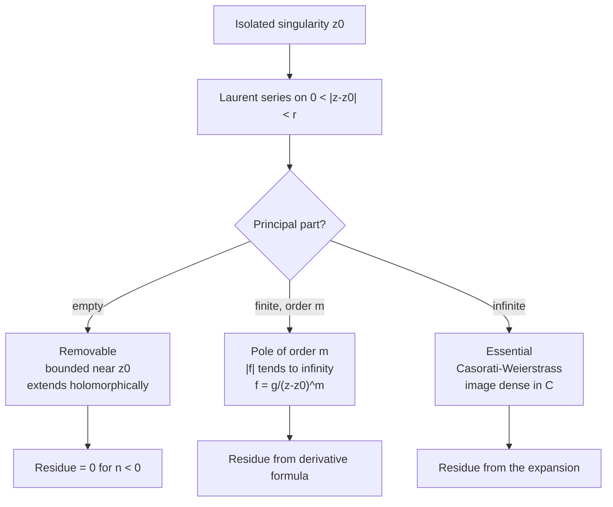

# Power Series and Residues

> [Mathematics](../../README.md) › [Complex Analysis](../README.md) · Level: Advanced · Prerequisites: [Complex Integration](../03-complex-integration/README.md), [Analytic Functions](../02-analytic-functions/README.md), [Real Sequences and Series](../../14-real-analysis/02-sequences-and-series/README.md), [Riemann Integration](../../14-real-analysis/05-riemann-integration/README.md) · Estimated time: 720 min

## 1. Introduction

A holomorphic function is locally a power series. That was proved in [Complex Integration](../03-complex-integration/README.md) with a single estimate: expanding $1/(\zeta-z)$ as a geometric series and integrating term by term gives, for $\lvert z-z_0\rvert<R$,

$$f(z) = \sum_{n=0}^{\infty}\frac{f^{(n)}(z_0)}{n!}(z-z_0)^n .$$

The present tutorial starts where that formula stops. Three questions are left open, and each one opens a new subject.

**What happens at the edge of the disc?** The Taylor series converges on the largest disc about $z_0$ contained in the domain, and its radius is exactly the distance from $z_0$ to the nearest singularity. The formula already knows where it will fail, but it cannot describe the function outside the disc. To do that one needs a series in powers of $z-z_0$ that is allowed to run in both directions:

$$f(z) = \sum_{n=-\infty}^{\infty}a_n(z-z_0)^n .$$

This is a **Laurent series**, and it converges on an **annulus** $r<\lvert z-z_0\rvert<R$ rather than a disc. The negative powers carry all the information about the singularity at $z_0$, and the single coefficient $a_{-1}$ — the **residue** — turns out to control every contour integral of $f$ around $z_0$.

**What kinds of singularity are there?** An isolated singularity is a point where $f$ is undefined but is holomorphic on a punctured disc around it. The Laurent expansion sorts them into exactly three types. If no negative powers occur the singularity is *removable*: the function extends holomorphically. If finitely many occur the singularity is a *pole*, and the function blows up like a power of $1/\lvert z-z_0\rvert$. If infinitely many occur the singularity is *essential*, and the function behaves so wildly that its values come arbitrarily close to every complex number (Casorati–Weierstrass, Section 7.4).

**How are integrals computed?** The **residue theorem** says that for a closed contour,

$$\oint_\gamma f(z)\,dz = 2\pi i\sum_k\operatorname{Res}(f,z_k),$$

the sum running over the singularities enclosed by $\gamma$. The theorem converts an analytic problem — integrate a function — into an algebraic one — read off one coefficient from a Laurent expansion. Its applications include:

* every rational integral $\int_{-\infty}^{\infty}P(x)/Q(x)\,dx$ with $\deg Q\ge\deg P+2$;
* every trigonometric integral of a rational function over a period;
* integrals of the form $\int_{-\infty}^{\infty}e^{iaz}f(z)\,dz$ with $f$ decaying and $a>0$, where **Jordan's lemma** supplies the estimate on the closing arc;
* the **argument principle** and **Rouché's theorem**, which count the zeros of a holomorphic function inside a contour without solving any equation;
* sums of infinite series, by applying the residue theorem to $\pi\cot(\pi z)f(z)$;
* the **residue at infinity** and the total-residue identity $\sum_{a\in\mathbb{C}_\infty}\operatorname{Res}(f,a) = 0$.

The last item is the conceptual centrepiece. On the Riemann sphere there is no distinguished point, and the residues of a meromorphic function sum to zero; what looks like a miracle about rational functions is a bookkeeping identity about a compact surface.

A word on method. Every residue computation rests on an expansion, and every expansion is valid only on a stated annulus. Most errors in this subject are not algebraic but geographic: expanding $1/(z-1)$ in powers of $z$ on a region where $\lvert z\rvert>1$, or closing a contour through a region where the integrand grows. Sections 9 and 11 are organised around these two failure modes.

## 2. Prerequisites

**Complex integration.** Cauchy's theorem, the integral formula, the differentiation formula, the maximum modulus principle and the ML inequality are used constantly. See [Complex Integration](../03-complex-integration/README.md).

**Holomorphic functions and elementary functions.** The complex derivative, the Cauchy–Riemann equations, and the functions $e^z$, $\sin z$, $\cos z$, $\log z$ with their power series. See [Analytic Functions](../02-analytic-functions/README.md).

**Convergence of series.** Absolute and uniform convergence, the ratio and root tests, the Weierstrass $M$-test, and term-by-term differentiation of power series on their interior. See [Real Sequences and Series](../../14-real-analysis/02-sequences-and-series/README.md) and [Sequences and Series in Calculus](../../07-calculus/11-sequences-and-series-in-calculus/README.md).

**Improper integrals.** Convergence of $\int_a^\infty f$, absolute versus conditional convergence, and the comparison and Dirichlet tests; the subject evaluates such integrals and must justify that they converge. See [Riemann Integration](../../14-real-analysis/05-riemann-integration/README.md) and [Integrals](../../07-calculus/06-integrals/README.md).

**Trigonometric identities.** Double-angle and addition formulas, and the values of $\sin$ and $\cos$ at multiples of $\pi/4$ and $\pi/6$. See [Trigonometric Identities](../../05-trigonometry/03-trigonometric-identities/README.md).

**The complex plane and its topology.** Open discs, annuli, connectedness, compactness, and the distance from a point to a closed set. See [Complex Numbers and Geometry](../01-complex-numbers-and-geometry/README.md) and [Metric Spaces](../../14-real-analysis/06-metric-spaces/README.md).

## 3. Learning Objectives

By the end of this tutorial you will be able to

1. compute the radius of convergence of a power series by the ratio or root test and state the Cauchy–Hadamard formula;
2. prove that a power series is holomorphic inside its disc and may be differentiated and integrated term by term;
3. state Taylor's theorem, identify the Taylor coefficients of the elementary functions, and explain why the radius is the distance to the nearest singularity;
4. state Laurent's theorem for an annulus, prove it from Cauchy's integral formula, and prove that Laurent coefficients are unique;
5. expand a given rational function in Laurent series on each annulus centred at a prescribed point;
6. classify an isolated singularity as removable, a pole of stated order, or essential, and prove the characterisations;
7. state and prove Riemann's removable-singularity theorem and the Casorati–Weierstrass theorem;
8. compute residues at simple poles, at poles of any order, and by the formula $\operatorname{Res}(p/q,z_0) = p(z_0)/q'(z_0)$;
9. state and prove the residue theorem and use it to evaluate contour integrals;
10. state and prove Jordan's lemma and use it, with the ML inequality, to justify the closing of contours;
11. evaluate rational, trigonometric and exponential-type real integrals by residues, including cases with a pole on the real axis;
12. state and prove the argument principle and Rouché's theorem, and count the zeros of a polynomial in a disc or an annulus;
13. compute residues at infinity and use the identity that all residues on the Riemann sphere sum to zero;
14. explain how residues are used in stability theory, asymptotic analysis and the summation of series.

## 4. Intuition

**A series that runs both ways.** A Taylor series is a prediction made from local information: all derivatives at one point. It works while the prediction can be continued without meeting a singularity. A Laurent series is what remains when the prediction meets a hole: the negative powers describe the hole itself. Think of a map of a city with a lake in the middle. The Taylor series is a description that works until the lake; the Laurent series describes an annulus around the lake, with the negative powers measuring how deep the water is at the centre.

**Three kinds of singularity.** If the negative part is absent, the "hole" is a puncture in a smooth surface: the function can be patched. If the negative part is a finite sum $\sum_{k=1}^m b_k(z-z_0)^{-k}$, the surface rises to an infinite spike of order $m$: a pole. If the negative part is infinite, the surface oscillates without limit: an essential singularity. A useful image is the behaviour of $1/z^m$ (spike), $z$ (no hole at all), and $e^{1/z}$ (a whirlpool whose values come arbitrarily close to every complex number).

**Residues as a local charge.** In electrostatics, the flux of a field through a surface equals the total charge inside, and the charge is detected by a single number at each source. The residue theorem is exactly this statement for contour integrals: the integral of $f$ around a loop equals $2\pi i$ times the total "charge" of the singularities inside. Deforming the loop without crossing a singularity does not change the integral, so the integral depends only on the singularities it encloses. This is why the shape of the contour is irrelevant and why only the enclosed residue matters.

**Why $a_{-1}$ and nothing else.** On a circle about $z_0$, all powers $(z-z_0)^n$ integrate to zero except $n=-1$, where the integral is $2\pi i$ (Section 7.4 of the previous tutorial). So the residue is the unique coefficient that is not invisible to integration. The notation $\operatorname{Res}$ is a reminder: it is the *residue* left after everything else is integrated away.

**Counting zeros without solving.** The number of zeros of $f$ inside a contour equals the winding number of the image curve $f\circ\gamma$ around $0$: each zero contributes one turn. Rouché's theorem exploits this: if $f$ dominates $g$ on the contour, then $f+g$ winds around $0$ exactly as $f$ does, so the two have the same number of zeros. This is how one proves the fundamental theorem of algebra again and how engineers count unstable poles without factoring a polynomial of degree fifty.

## 5. Formal Definition

**Definition 5.1** (annulus). For $z_0\in\mathbb{C}$ and $0\le r<R\le\infty$, the *annulus* with centre $z_0$ and radii $r,R$ is

$$A(z_0;r,R) := \{z\in\mathbb{C} : r<\lvert z-z_0\rvert<R\}.$$

It is a domain when $r<R$, and it is simply connected exactly when $r=0$.

**Definition 5.2** (Laurent series). A *Laurent series* about $z_0$ is a doubly infinite series

$$\sum_{n=-\infty}^{\infty}a_n(z-z_0)^n := \sum_{n=0}^{\infty}a_n(z-z_0)^n+\sum_{n=1}^{\infty}a_{-n}(z-z_0)^{-n},$$

with $a_n\in\mathbb{C}$. It *converges* at $z$ if both series on the right converge, and it converges absolutely if both do.

**Definition 5.3** (isolated singularity). Let $z_0\in\mathbb{C}$ and let $f$ be holomorphic on a punctured disc $0<\lvert z-z_0\rvert<r$ but not at $z_0$ (either $f$ is undefined there or it fails to be holomorphic). Then $z_0$ is an *isolated singularity* of $f$. The *punctured neighbourhood* of $z_0$ is any set $0<\lvert z-z_0\rvert<\rho\le r$.

**Definition 5.4** (removable, pole, essential). Let $z_0$ be an isolated singularity of $f$ with Laurent expansion $f(z) = \sum_{n\in\mathbb{Z}}a_n(z-z_0)^n$ on a punctured disc. The *principal part* is $\sum_{n<0}a_n(z-z_0)^n$.

* If $a_n = 0$ for all $n<0$, the singularity is **removable**.
* If $a_n = 0$ for $n<-m$ and $a_{-m}\ne0$ for some $m\ge1$, the singularity is a **pole of order $m$**.
* If $a_n\ne0$ for infinitely many $n<0$, the singularity is **essential**.

A pole of order $1$ is called a **simple pole**. A function whose only singularities in a domain are poles is **meromorphic** in that domain.

**Definition 5.5** (residue). Let $z_0$ be an isolated singularity of $f$ with Laurent expansion $\sum a_n(z-z_0)^n$. The *residue* of $f$ at $z_0$ is the coefficient of $(z-z_0)^{-1}$:

$$\operatorname{Res}(f,z_0) := a_{-1} .$$

Equivalently, $\operatorname{Res}(f,z_0) = \dfrac{1}{2\pi i}\displaystyle\oint_{\lvert z-z_0\rvert=\rho}f(z)\,dz$ for every sufficiently small $\rho>0$, by term-by-term integration of the Laurent series.

**Definition 5.6** (residue at infinity). Let $f$ be holomorphic on $\lvert z\rvert>R$. The *residue at infinity* is

$$\operatorname{Res}(f,\infty) := -\frac{1}{2\pi i}\oint_{\lvert z\rvert=\rho}f(z)\,dz,\qquad \rho>R,$$

the circle being traversed counterclockwise. Section 7.13 shows that this equals $-a_{-1}$ in the expansion of $f$ in powers of $1/z$ near $\infty$, which is why the definition carries a minus sign: the point $\infty$ is enclosed by the circle when the circle is traversed *clockwise*, so the natural residue at infinity is minus the counterclockwise integral.

**Definition 5.7** (order of a zero). A holomorphic $f$ has a *zero of order $m\ge1$* at $a$ if $f(a) = f'(a) = \cdots = f^{(m-1)}(a) = 0$ but $f^{(m)}(a)\ne0$; equivalently $f(z) = (z-a)^m g(z)$ with $g$ holomorphic and $g(a)\ne0$.

## 6. Mathematical Notation

| Symbol | Read as | Meaning |
|---|---|---|
| $\displaystyle\sum_{n=-\infty}^{\infty}a_n(z-z_0)^n$ | Laurent series about $z_0$ | a series with negative and non-negative powers, Definition 5.2 |
| $A(z_0;r,R)$ | annulus with centre $z_0$, inner radius $r$, outer radius $R$ | $\{r<\lvert z-z_0\rvert<R\}$ |
| $R$ | radius of convergence | the largest $\rho$ such that the series converges on $\lvert z-z_0\rvert<\rho$ |
| $a_{-1}$ | the coefficient of $(z-z_0)^{-1}$ | the residue, Definition 5.5 |
| $\operatorname{Res}(f,z_0)$ | residue of $f$ at $z_0$ | $a_{-1}$ of the Laurent expansion at $z_0$ |
| $\operatorname{Res}(f,\infty)$ | residue at infinity | minus the normalized integral over a large circle |
| $\operatorname{ord}_a f$ | order of $f$ at $a$ | $m$ for a zero of order $m$, $-m$ for a pole of order $m$ |
| $\operatorname{PV}\displaystyle\int_{-\infty}^{\infty}$ | Cauchy principal value | $\lim_{R\to\infty}\int_{-R}^{R}$ with symmetric indentations, Definition 7.25 |
| $Z$, $P$ | number of zeros, number of poles | counted with multiplicity inside a contour |
| $\Delta_\gamma\arg f$ | change of argument along $\gamma$ | $2\pi$ times the winding number of $f\circ\gamma$ about $0$ |
| $M_R$ | maximum on the arc of radius $R$ | $\max\{\lvert f(z)\rvert : \lvert z\rvert=R,\ \operatorname{Im}z\ge0\}$ |
| $C_R$, $\Gamma_R$ | the large arc, the closed contour | $C_R$ is the semicircle; $\Gamma_R$ is $[-R,R]$ followed by $C_R$ |
| $p/q$ | a quotient of polynomials | used in the residue formula $\operatorname{Res}(p/q,z_0) = p(z_0)/q'(z_0)$ |

Read aloud: "$\operatorname{Res}(f,z_0)$" is "the residue of $f$ at $z_0$". The plural is "residues", and the phrase "the residue at $z_0$ is $a_{-1}$" is the definition, not a theorem.

## 7. Core Concepts

### 7.1 Power Series and Their Radius of Convergence

A power series about $z_0$ is $\sum_{n\ge0}a_n(z-z_0)^n$. Its set of convergence is a disc, possibly with some boundary behaviour, and the radius of that disc is computable from the coefficients.

**Theorem 7.1** (Cauchy–Hadamard). Let $\sum_{n\ge0}a_n(z-z_0)^n$ be a power series and

$$R := \frac{1}{\limsup_{n\to\infty}\lvert a_n\rvert^{1/n}}\in[0,\infty],$$

with the conventions $1/0 = \infty$ and $1/\infty = 0$. Then the series converges absolutely for $\lvert z-z_0\rvert<R$ and diverges for $\lvert z-z_0\rvert>R$. On every compact subset of the disc the convergence is uniform.

*Proof.* By the root test for series of non-negative terms, $\sum\lvert a_n\rvert\rho^n$ converges when $\limsup_n\bigl(\lvert a_n\rvert\rho^n\bigr)^{1/n} = \rho\limsup_n\lvert a_n\rvert^{1/n}<1$, that is when $\rho<R$. It diverges when $\rho>R$. For uniform convergence on $\lvert z-z_0\rvert\le\rho<R$, the Weierstrass $M$-test applies with $M_n = \lvert a_n\rvert\rho^n$ and $\sum M_n<\infty$. $\blacksquare$

**Theorem 7.2** (analytic operations). Let $f(z) = \sum_{n\ge0}a_n(z-z_0)^n$ have radius of convergence $R>0$. Then $f$ is holomorphic on $D(z_0,R)$, and on that disc

$$f'(z) = \sum_{n\ge1}n\,a_n(z-z_0)^{n-1},\qquad \int_{z_0}^{z}f(\zeta)\,d\zeta = \sum_{n\ge0}\frac{a_n}{n+1}(z-z_0)^{n+1},$$

both series having radius of convergence $R$.

*Proof.* The differentiated series has coefficients $na_n$, and $\limsup\lvert na_n\rvert^{1/n} = \limsup\lvert a_n\rvert^{1/n}$ because $n^{1/n}\to1$; hence it has the same radius $R$. On $\lvert z-z_0\rvert\le\rho<R$ both the series and the differentiated series converge uniformly, so term-by-term differentiation is legitimate (the standard theorem on uniform convergence of derivatives, applied on each smaller disc and then everywhere). The integral statement follows from term-by-term integration, which needs only uniform convergence on compact sets. $\blacksquare$

The radius has a geometric meaning which is the key to all the examples: if $f$ is holomorphic on a domain $\Omega$ containing $D(z_0,R)$ and cannot be continued past a boundary point $\zeta$ with $\lvert\zeta-z_0\rvert = R$, then the Taylor series of $f$ at $z_0$ has radius exactly $R$. The series converges on the largest disc free of singularities, no matter how small the disc on which $f$ was originally defined.

**Example 7.3** (three radii). The geometric series $\sum z^n$ has coefficients $1$ and radius $1$: it sums to $1/(1-z)$ on $\lvert z\rvert<1$, with a pole at $z=1$ at distance $1$. The exponential $\sum z^n/n!$ has radius $\infty$, since $(1/n!)^{1/n}\to0$. The series $\sum n!\,z^n$ has radius $0$: it diverges for every $z\ne0$. All three behaviours occur, and the radius detects the distance to the nearest singularity of the sum.

### 7.2 Taylor Series

**Theorem 7.4** (Taylor). Let $f$ be holomorphic on a domain $\Omega$ and let $D(z_0,R)\subset\Omega$. Then for every $z\in D(z_0,R)$,

$$f(z) = \sum_{n=0}^{\infty}\frac{f^{(n)}(z_0)}{n!}(z-z_0)^n,$$

the series converging absolutely and uniformly on compact subsets of the disc.

*Proof.* This is Theorem 7.25 of [Complex Integration](../03-complex-integration/README.md): expand $1/(\zeta-z)$ in the integral formula as a geometric series and integrate term by term. $\blacksquare$

**Corollary 7.5** (uniqueness of coefficients). If $f(z) = \sum_{n\ge0}a_n(z-z_0)^n$ on a neighbourhood of $z_0$, then $a_n = f^{(n)}(z_0)/n!$ for every $n$. Consequently two power series that agree on a set with an accumulation point inside their common disc of convergence have identical coefficients.

*Proof.* Differentiate the series $n$ times at $z_0$ using Theorem 7.2. The last assertion follows because the coefficients are determined by the derivatives, or by subtracting the series and applying the identity theorem for power series. $\blacksquare$

**Example 7.6** (standard expansions). The following are valid on the discs indicated, and each is obtained by differentiating or integrating a geometric series.

| Function | Series about $0$ | Radius |
|---|---|---|
| $\dfrac{1}{1-z}$ | $\sum_{n\ge0}z^n$ | $1$ |
| $\dfrac{1}{(1-z)^2}$ | $\sum_{n\ge1}nz^{n-1}$ | $1$ |
| $e^z$ | $\sum_{n\ge0}\dfrac{z^n}{n!}$ | $\infty$ |
| $\sin z$ | $\sum_{k\ge0}\dfrac{(-1)^kz^{2k+1}}{(2k+1)!}$ | $\infty$ |
| $\cos z$ | $\sum_{k\ge0}\dfrac{(-1)^kz^{2k}}{(2k)!}$ | $\infty$ |
| $\log(1+z)$ | $\sum_{n\ge1}\dfrac{(-1)^{n-1}z^n}{n}$ | $1$ |
| $\arctan z$ | $\sum_{k\ge0}\dfrac{(-1)^kz^{2k+1}}{2k+1}$ | $1$ |

For $\log(1+z)$ and $\arctan z$ the radius is $1$ because of the singularity at $z=-1$, respectively at $z=\pm i$, both at distance $1$ from the origin. The series cannot see the singularity directly — it only sees that its radius cannot be larger.

### 7.3 Laurent Series on an Annulus

**Theorem 7.7** (Laurent). Let $0\le r<R\le\infty$ and let $f$ be holomorphic on the annulus $A(z_0;r,R)$. Then for every $z$ in the annulus,

$$f(z) = \sum_{n=-\infty}^{\infty}a_n(z-z_0)^n,\qquad a_n = \frac{1}{2\pi i}\oint_{\lvert\zeta-z_0\rvert=\rho}\frac{f(\zeta)}{(\zeta-z_0)^{n+1}}\,d\zeta,$$

where $\rho$ is any number with $r<\rho<R$. The series converges absolutely and uniformly on every compact subset of the annulus, and the coefficients do not depend on $\rho$.

*Proof sketch.* Fix $z$ with $r<\lvert z-z_0\rvert<R$ and choose $\rho_1,\rho_2$ with $r<\rho_1<\lvert z-z_0\rvert<\rho_2<R$. Applying Cauchy's theorem to the region between the two circles (Theorem 7.18 of [Complex Integration](../03-complex-integration/README.md)) and then the integral formula on the outer circle,

$$f(z) = \frac{1}{2\pi i}\oint_{\lvert\zeta-z_0\rvert=\rho_2}\frac{f(\zeta)}{\zeta-z}\,d\zeta-\frac{1}{2\pi i}\oint_{\lvert\zeta-z_0\rvert=\rho_1}\frac{f(\zeta)}{\zeta-z}\,d\zeta .$$

On the outer circle, $\lvert z-z_0\rvert<\lvert\zeta-z_0\rvert$, so

$$\frac{1}{\zeta-z} = \sum_{n\ge0}\frac{(z-z_0)^n}{(\zeta-z_0)^{n+1}}$$

uniformly in $\zeta$, giving the non-negative powers. On the inner circle, $\lvert\zeta-z_0\rvert<\lvert z-z_0\rvert$, so

$$\frac{1}{\zeta-z} = -\sum_{k\ge1}\frac{(\zeta-z_0)^{k-1}}{(z-z_0)^k},$$

uniformly in $\zeta$, giving the negative powers. Integrating term by term produces the displayed coefficients with $\rho = \rho_1$ or $\rho_2$ (the two minus signs, one from the outer-minus-inner formula and one from this expansion, cancel); independence of $\rho$ follows from Cauchy's theorem applied to the annulus between any two admissible circles. $\blacksquare$

**Corollary 7.8** (uniqueness). The Laurent coefficients of $f$ on a given annulus are unique: if $\sum a_n(z-z_0)^n = \sum b_n(z-z_0)^n$ on an annulus, then $a_n = b_n$ for all $n$.

*Proof.* Multiply by $(z-z_0)^{-k-1}$ and integrate over a circle $\lvert z-z_0\rvert=\rho$ inside the annulus. By uniform convergence and Example 7.10 of [Complex Integration](../03-complex-integration/README.md), every term vanishes except $n=k$, whose integral is $2\pi i$; hence $a_k = b_k$. $\blacksquare$

The annulus is the natural domain. A function holomorphic on a punctured disc $0<\lvert z-z_0\rvert<R$ has *one* Laurent expansion there if the punctured disc is an annulus with $r=0$. A function with two singularities at different distances has *different* Laurent expansions on the different annuli between the singularities, and using the wrong one is the commonest error in the subject.

**Example 7.9** (two annuli, one function). Let $f(z) = 1/\bigl(z(z-1)\bigr)$ and $z_0=0$. The singularities are at $0$ and $1$, so there are two annuli: $0<\lvert z\rvert<1$ and $1<\lvert z\rvert<\infty$.

*On $0<\lvert z\rvert<1$* we have $\lvert z\rvert<1$, so

$$f(z) = -\frac1z\cdot\frac{1}{1-z} = -\frac1z\sum_{n\ge0}z^n = -\frac1z-1-z-z^2-\cdots,$$

a Laurent series with a simple pole at $0$ and residue $-1$.

*On $1<\lvert z\rvert<\infty$* we have $\lvert 1/z\rvert<1$, so

$$f(z) = \frac{1}{z^2}\cdot\frac{1}{1-\tfrac1z} = \frac{1}{z^2}\sum_{n\ge0}z^{-n} = \frac{1}{z^2}+\frac{1}{z^3}+\frac{1}{z^4}+\cdots .$$

This expansion has no negative powers at all: it is a power series in $1/z$, and the residue at $0$ read from it is $0$. There is no contradiction: the residue is defined by the expansion on a punctured disc around $0$, which is the *first* annulus, not the second. On the second annulus the coefficient of $z^{-1}$ is zero, and indeed the integral of $f$ over a large circle is $0$ by the residue theorem, since both poles contribute $+1$ and $-1$.

### 7.4 Classification of Isolated Singularities

**Theorem 7.10** (trichotomy). Every isolated singularity of a holomorphic function is exactly one of the three types of Definition 5.4.

*Proof.* The Laurent expansion on a punctured disc exists by Theorem 7.7. Look at the set of indices $n<0$ with $a_n\ne0$: it is empty, finite and non-empty, or infinite. These are the three cases. $\blacksquare$

The classification is therefore a statement about the principal part of the Laurent expansion. Three theorems convert it into statements about limits, which is how singularities are recognised in practice.

**Theorem 7.11** (Riemann's removable-singularity theorem). Let $f$ be holomorphic on $0<\lvert z-z_0\rvert<R$. The following are equivalent.

1. The singularity is removable.
2. $f$ is bounded on some punctured neighbourhood of $z_0$.
3. The limit $\lim_{z\to z_0}f(z)$ exists and is finite.

When these hold, the extended function $\tilde f(z_0) := \lim_{z\to z_0}f(z)$ is holomorphic on the full disc $D(z_0,R)$.

*Proof.* (1) $\Rightarrow$ (2) and (1) $\Rightarrow$ (3): a holomorphic extension is continuous, hence bounded and convergent on a compact neighbourhood. (3) $\Rightarrow$ (2) is immediate.

(2) $\Rightarrow$ (1): let $\lvert f\rvert\le M$ on $0<\lvert z-z_0\rvert<\rho$ and let $a_n$ be the Laurent coefficients. For $n<0$ and any $r\in(0,\rho)$, the ML inequality applied to the coefficient integral gives

$$\lvert a_n\rvert = \left\lvert\frac{1}{2\pi i}\oint_{\lvert\zeta-z_0\rvert=r}\frac{f(\zeta)}{(\zeta-z_0)^{n+1}}\,d\zeta\right\rvert\le\frac{1}{2\pi}\cdot2\pi r\cdot\frac{M}{r^{n+1}} = Mr^{-n}.$$

Since $-n>0$, letting $r\to0$ gives $a_n = 0$. Hence $f(z) = \sum_{n\ge0}a_n(z-z_0)^n$ on the punctured disc, and the series defines a holomorphic function on the whole disc with value $a_0$ at $z_0$. $\blacksquare$

**Theorem 7.12** (characterisations of poles). Let $f$ be holomorphic on $0<\lvert z-z_0\rvert<R$ and let $m\ge1$. The following are equivalent.

1. $z_0$ is a pole of order $m$.
2. $f(z) = g(z)/(z-z_0)^m$ near $z_0$, where $g$ is holomorphic on a neighbourhood of $z_0$ and $g(z_0)\ne0$.
3. $\lim_{z\to z_0}(z-z_0)^m f(z)$ exists, is finite and nonzero.
4. $\lvert f(z)\rvert\to\infty$ as $z\to z_0$, and $m$ is the smallest integer with $(z-z_0)^m f(z)$ bounded near $z_0$.

*Proof.* (1) $\Rightarrow$ (2): multiply the Laurent series by $(z-z_0)^m$; the result has only non-negative powers and its constant term is $a_{-m}\ne0$. (2) $\Rightarrow$ (3): $(z-z_0)^mf(z) = g(z)\to g(z_0)\ne0$. (3) $\Rightarrow$ (4): if $(z-z_0)^mf\to c\ne0$ then $\lvert f\rvert\to\infty$; no smaller power can be bounded, because then the limit in (3) with that smaller exponent would be $0$. (4) $\Rightarrow$ (1): by (4), $g := (z-z_0)^mf$ is bounded and holomorphic on a punctured disc, so it extends holomorphically to $z_0$ by Theorem 7.11. Minimality of $m$ forces $g(z_0)\ne0$: if $g(z_0) = 0$ then $g(z)/(z-z_0) = (z-z_0)^{m-1}f(z)$ would be bounded near $z_0$. Hence $f = g/(z-z_0)^m$ with $g(z_0)\ne0$, which is a pole of order $m$. $\blacksquare$

**Theorem 7.13** (Casorati–Weierstrass). Let $z_0$ be an essential singularity of $f$. Then for every $\delta>0$ with $0<\delta<R$, the image $f\bigl(\{0<\lvert z-z_0\rvert<\delta\}\bigr)$ is dense in $\mathbb{C}$: for every $w\in\mathbb{C}$ and every $\varepsilon>0$ there is $z$ with $\lvert z-z_0\rvert<\delta$ and $\lvert f(z)-w\rvert<\varepsilon$.

*Proof.* Suppose not. Then there are $w$, $\varepsilon>0$ and $\delta>0$ with $\lvert f(z)-w\rvert\ge\varepsilon$ for all $0<\lvert z-z_0\rvert<\delta$. Then

$$g(z) := \frac{1}{f(z)-w}$$

is holomorphic on the punctured disc and bounded by $1/\varepsilon$, so by Theorem 7.11 it extends holomorphically to $z_0$. Since $f = w+1/g$ on the punctured disc, two cases arise: if $g(z_0)\ne0$, then $f$ extends holomorphically (removable singularity); if $g$ has a zero of order $k\ge1$ at $z_0$, then $f$ has a pole of order $k$. Both contradict the assumption that the singularity is essential. $\blacksquare$

A classic illustration: $e^{1/z}$ near $0$ takes every nonzero value infinitely often (since $e^{w}=v$ is solvable for every $v\ne0$), and takes the value $0$ never; the image is $\mathbb{C}\setminus\{0\}$, whose closure is all of $\mathbb{C}$.

### 7.5 Residues and Their Computation

**Proposition 7.14** (simple pole). If $z_0$ is a simple pole of $f$, then

$$\operatorname{Res}(f,z_0) = \lim_{z\to z_0}(z-z_0)f(z).$$

*Proof.* Write $f(z) = a_{-1}/(z-z_0)+a_0+a_1(z-z_0)+\cdots$; multiplying by $z-z_0$ and letting $z\to z_0$ leaves $a_{-1}$. $\blacksquare$

**Proposition 7.15** (quotient formula). Let $f = p/q$ where $p,q$ are holomorphic near $z_0$, $p(z_0)\ne0$, $q(z_0)=0$ and $q'(z_0)\ne0$. Then

$$\operatorname{Res}(f,z_0) = \frac{p(z_0)}{q'(z_0)} .$$

*Proof.* By Proposition 7.14,

$$\operatorname{Res}(f,z_0) = \lim_{z\to z_0}(z-z_0)\frac{p(z)}{q(z)} = \lim_{z\to z_0}p(z)\cdot\frac{1}{\dfrac{q(z)-q(z_0)}{z-z_0}} = \frac{p(z_0)}{q'(z_0)} ,$$

using the definition of the derivative and the continuity of $p$. $\blacksquare$

**Proposition 7.16** (pole of order $m$). If $z_0$ is a pole of order $m\ge1$ of $f$, then

$$\operatorname{Res}(f,z_0) = \frac{1}{(m-1)!}\lim_{z\to z_0}\frac{d^{m-1}}{dz^{m-1}}\Bigl[(z-z_0)^mf(z)\Bigr].$$

*Proof.* Put $h(z) := (z-z_0)^mf(z)$, which is holomorphic near $z_0$ with $h(z_0)\ne0$. From the Laurent expansion $f(z) = \sum_{n\ge-m}a_n(z-z_0)^n$,

$$h(z) = a_{-m}+a_{-m+1}(z-z_0)+\cdots+a_{-1}(z-z_0)^{m-1}+a_0(z-z_0)^m+\cdots .$$

The coefficient of $(z-z_0)^{m-1}$ in $h$ is $a_{-1}$, and by Taylor's theorem it equals $h^{(m-1)}(z_0)/(m-1)!$. $\blacksquare$

For $m=1$ the formula reduces to Proposition 7.14; for $m=2$ it reads $\operatorname{Res} = \lim\frac{d}{dz}\bigl[(z-z_0)^2f(z)\bigr]$. The formula is a *derivative*, not a limit of derivatives: one differentiates first and then substitutes.

**Example 7.17** (five residues).

1. $f(z) = \dfrac{1}{z^2+1}$ at $z_0=i$: simple pole since $z^2+1 = (z-i)(z+i)$, so $\operatorname{Res} = \dfrac{1}{2i} = -\dfrac{i}{2}$.
2. $f(z) = \dfrac{e^z}{(z-1)^3}$ at $z_0=1$: pole of order $3$, so $\operatorname{Res} = \dfrac{1}{2!}\dfrac{d^2}{dz^2}e^z\Big|_{z=1} = \dfrac{e}{2}$.
3. $f(z) = \dfrac{z}{(z^2+1)^2}$ at $z_0=i$: pole of order $2$. Put $h(z) = \dfrac{z}{(z+i)^2}$; then
   $$h'(z) = \frac{(z+i)^2-2z(z+i)}{(z+i)^4} = \frac{i-z}{(z+i)^3},\qquad h'(i) = \frac{0}{(2i)^3} = 0 ,$$
   so the residue vanishes. (The two simple poles of $z/(z^2+1)$ cancel in the derivative.)
4. $f(z) = \cot z = \dfrac{\cos z}{\sin z}$ at $z_0=0$: simple pole, and by Proposition 7.15, $\operatorname{Res} = \dfrac{\cos0}{\cos0} = 1$. At $z_0=\pi$ the residue is again $1$.
5. $f(z) = \dfrac{1}{z^3(z-1)}$ at $z_0=0$: pole of order $3$, so
   $$\operatorname{Res} = \frac{1}{2!}\frac{d^2}{dz^2}\Bigl(\frac{1}{z-1}\Bigr)\Big|_{z=0} = \frac{1}{2}\cdot\frac{2}{(z-1)^3}\Big|_{z=0} = -1 .$$
   The expansion confirms it: $\dfrac{1}{z^3}\cdot\dfrac{1}{z-1} = -\dfrac{1}{z^3}\Bigl(1+z+z^2+\cdots\Bigr) = -\dfrac{1}{z^3}-\dfrac{1}{z^2}-\dfrac{1}{z}-\cdots$.

### 7.6 The Residue Theorem

**Theorem 7.18** (residue theorem). Let $\gamma$ be a positively oriented simple closed contour, and let $f$ be holomorphic on an open set containing $\overline{\operatorname{Int}\gamma}$ except at finitely many isolated singularities $z_1,\dots,z_m$ in $\operatorname{Int}\gamma$. Then

$$\oint_\gamma f(z)\,dz = 2\pi i\sum_{k=1}^{m}\operatorname{Res}(f,z_k).$$

*Proof.* Choose $\rho>0$ so small that the closed discs $\overline{D}(z_k,\rho)$ are pairwise disjoint and contained in $\operatorname{Int}\gamma$, and so that $f$ is holomorphic on each punctured disc $0<\lvert z-z_k\rvert\le\rho$. By the multiply connected form of Cauchy's theorem (Theorem 7.18 of [Complex Integration](../03-complex-integration/README.md)) applied to the region obtained by deleting the discs,

$$\oint_\gamma f\,dz = \sum_{k=1}^{m}\oint_{\lvert z-z_k\rvert=\rho}f\,dz .$$

On each circle, expand $f$ in its Laurent series at $z_k$; the expansion converges uniformly on the circle, so term-by-term integration is legitimate. By Example 7.10 of [Complex Integration](../03-complex-integration/README.md), only the term $n=-1$ survives, and

$$\oint_{\lvert z-z_k\rvert=\rho}f\,dz = 2\pi i\,a_{-1}^{(k)} = 2\pi i\operatorname{Res}(f,z_k). \qquad\blacksquare$$

**Example 7.19** (a contour integral by residues). Let $\gamma$ be the circle $\lvert z\rvert=2$. The singularities of $e^z/(z^2-1)$ are $\pm1$, both inside, and both simple. By Proposition 7.15 with $p = e^z$, $q = z^2-1$, $q' = 2z$,

$$\operatorname{Res}\Bigl(\frac{e^z}{z^2-1},1\Bigr) = \frac{e}{2},\qquad \operatorname{Res}\Bigl(\frac{e^z}{z^2-1},-1\Bigr) = \frac{e^{-1}}{-2} = -\frac{1}{2e}.$$

Hence
$$\oint_{\gamma}\frac{e^z}{z^2-1}\,dz = 2\pi i\left(\frac{e}{2}-\frac{1}{2e}\right) = \pi i\left(e-\frac1e\right) = 2\pi i\sinh 1 .$$

*Check.* The answer is purely imaginary, and the integrand is real on the real axis, so conjugating the integral (Proposition 7.5 of the previous tutorial) gives the negative of itself — consistent with a purely imaginary value. $\checkmark$

### 7.7 Jordan's Lemma

**Lemma 7.20** (Jordan). Let $a>0$ and let $f$ be continuous on the region $\{\operatorname{Im}z\ge0,\ \lvert z\rvert\ge R_0\}$. For $R\ge R_0$ put

$$M_R := \max\{\lvert f(z)\rvert : \lvert z\rvert = R,\ \operatorname{Im}z\ge0\}.$$

If $M_R\to0$ as $R\to\infty$, then

$$\lim_{R\to\infty}\int_{C_R}e^{iaz}f(z)\,dz = 0,$$

where $C_R$ is the upper semicircle of radius $R$ traversed counterclockwise.

*Proof.* Parametrise $z = Re^{i\theta}$, $0\le\theta\le\pi$. Then $\lvert e^{iaz}\rvert = e^{-aR\sin\theta}$ and $\lvert dz\rvert = R\,d\theta$, so

$$\left\lvert\int_{C_R}e^{iaz}f(z)\,dz\right\rvert\le M_RR\int_0^{\pi}e^{-aR\sin\theta}\,d\theta .$$

The integrand is symmetric about $\pi/2$, and on $\bigl[0,\tfrac\pi2\bigr]$ the chord bound $\sin\theta\ge\frac{2\theta}{\pi}$ holds (the graph of $\sin$ lies above the chord joining $(0,0)$ to $(\pi/2,1)$). Hence

$$\int_0^{\pi}e^{-aR\sin\theta}d\theta = 2\int_0^{\pi/2}e^{-aR\sin\theta}d\theta\le2\int_0^{\pi/2}e^{-2aR\theta/\pi}d\theta\le\frac{\pi}{aR}.$$

Therefore the integral is bounded by $M_RR\cdot\dfrac{\pi}{aR} = \dfrac{\pi M_R}{a}\to0$. $\blacksquare$

The lemma is the statement that the exponential factor $e^{iaz}$ with $a>0$ decays exponentially on the upper semicircle. It fails for $a<0$, in which case the lower semicircle must be used, and it fails on the lower semicircle for $a>0$. This is the origin of the rule "close in the half-plane where the exponential decays".

**Corollary 7.21** (closing the contour). Let $p,q$ be polynomials with $\deg q\ge\deg p+1$, and suppose $q$ has no real zeros. Then for $a>0$,

$$\lim_{R\to\infty}\int_{C_R}e^{iaz}\frac{p(z)}{q(z)}\,dz = 0 .$$

*Proof.* On $\lvert z\rvert=R$ we have $\lvert p/q\rvert = O(R^{\deg p-\deg q})\to0$ because $\deg p-\deg q\le-1$. Jordan's lemma applies with $M_R = O(R^{-1})$. $\blacksquare$

### 7.8 Real Integrals of Rational Functions

**Theorem 7.22** (rational integrals over the line). Let $p,q$ be polynomials with real coefficients, $\deg q\ge\deg p+2$, and $q(x)\ne0$ for $x\in\mathbb{R}$. Then

$$\int_{-\infty}^{\infty}\frac{p(x)}{q(x)}\,dx = 2\pi i\sum_{\operatorname{Im}z_k>0}\operatorname{Res}\Bigl(\frac{p}{q},z_k\Bigr),$$

summed over the poles of $p/q$ in the upper half-plane.

*Proof.* Let $\Gamma_R$ be the boundary of the upper half-disc. For large $R$ all upper-half-plane poles lie inside. The residue theorem gives $\oint_{\Gamma_R}p/q = 2\pi i\sum\operatorname{Res}$. On $C_R$,

$$\left\lvert\frac{p(z)}{q(z)}\right\rvert = O\bigl(R^{\deg p-\deg q}\bigr) = O(R^{-2}),\qquad \ell(C_R) = \pi R,$$

so the arc contributes $O(R^{-1})\to0$. Taking $R\to\infty$ leaves the real integral equal to the residue sum. $\blacksquare$

The degree condition is exactly what makes the arc vanish. If $\deg q = \deg p+1$ the arc contributes a constant and the integral may diverge logarithmically, as $\int dx/(1+x)$ shows.

### 7.9 Trigonometric Integrals over a Period

**Theorem 7.23** (trigonometric integrals). Let $R(\cdot,\cdot)$ be a rational function of two variables, finite on the unit circle. Then

$$\int_0^{2\pi}R(\cos\theta,\sin\theta)\,d\theta = \oint_{\lvert z\rvert=1}R\Bigl(\frac{z+z^{-1}}{2},\ \frac{z-z^{-1}}{2i}\Bigr)\frac{dz}{iz},$$

and the integral equals $2\pi i$ times the sum of the residues of the integrand at the poles inside the unit disc.

*Proof.* With $z = e^{i\theta}$ we have $dz = iz\,d\theta$, so $d\theta = dz/(iz)$, and the two formulas for $\cos$ and $\sin$ follow from $z = \cos\theta+i\sin\theta$ and $z^{-1} = \cos\theta-i\sin\theta$. The resulting integrand is a rational function of $z$, so the residue theorem applies. $\blacksquare$

In practice one clears the $1/z$ powers by multiplying numerator and denominator, then factors the denominator and keeps the roots inside $\lvert z\rvert=1$.

### 7.10 Integrals with $e^{iaz}$, Principal Values and Indentation

**Theorem 7.24** (exponential integrals over the line). Let $p,q$ be polynomials with real coefficients, $\deg q\ge\deg p+1$, $q$ without real zeros, and $a>0$. Then

$$\int_{-\infty}^{\infty}e^{iax}\frac{p(x)}{q(x)}\,dx = 2\pi i\sum_{\operatorname{Im}z_k>0}\operatorname{Res}\Bigl(e^{iaz}\frac{p}{q},z_k\Bigr).$$

*Proof.* Apply the residue theorem on $\Gamma_R$ and let $R\to\infty$; the arc vanishes by Corollary 7.21. $\blacksquare$

Taking real and imaginary parts gives $\int\cos(ax)p/q$ and $\int\sin(ax)p/q$. Note that the residue must be computed for $e^{iaz}p(z)/q(z)$, not for $p/q$: the exponential factor changes the residue by the value of $e^{iaz}$ at the pole.

**Definition 7.25** (Cauchy principal value). If $f$ is continuous on $\mathbb{R}\setminus\{x_1,\dots,x_m\}$ and the limits exist, the *Cauchy principal value* is

$$\operatorname{PV}\int_{-\infty}^{\infty}f(x)\,dx := \lim_{R\to\infty}\lim_{\varepsilon\to0}\left(\int_{-R}^{x_1-\varepsilon}f+\int_{x_1+\varepsilon}^{x_2-\varepsilon}f+\cdots+\int_{x_m+\varepsilon}^{R}f\right),$$

with one $\varepsilon$ removed around each singularity. For a function with a single simple pole, the principal value exists even when the improper integral does not, as $\int_{-R}^{R}dx/x = 0$ shows.

**Lemma 7.26** (indentation). Let $f$ have a simple pole at $x_0\in\mathbb{R}$, and for $\varepsilon>0$ let $C_\varepsilon$ be the upper semicircle $x_0+\varepsilon e^{i\theta}$, $\pi\ge\theta\ge0$, traversed clockwise. Then

$$\lim_{\varepsilon\to0}\int_{C_\varepsilon}f(z)\,dz = -i\pi\operatorname{Res}(f,x_0).$$

*Proof.* Write $f(z) = c/(z-x_0)+g(z)$ with $c = \operatorname{Res}(f,x_0)$ and $g$ holomorphic near $x_0$. The integral of $g$ over $C_\varepsilon$ is bounded by $\pi\varepsilon\max_{C_\varepsilon}\lvert g\rvert\to0$, and

$$\int_{C_\varepsilon}\frac{c\,dz}{z-x_0} = c\int_{\pi}^{0}i\,d\theta = -i\pi c . \qquad\blacksquare$$

**Theorem 7.27** (integrals with poles on the line). Let $f = p/q$ with $\deg q\ge\deg p+2$, $q$ having simple zeros on $\mathbb{R}$, and let $a\ge0$. Then

$$\operatorname{PV}\int_{-\infty}^{\infty}e^{iax}f(x)\,dx = 2\pi i\sum_{\operatorname{Im}z_k>0}\operatorname{Res}(e^{iaz}f,z_k)+i\pi\sum_{x_j\in\mathbb{R}}\operatorname{Res}(e^{iax}f,x_j).$$

For $a=0$ this computes principal values of rational integrals with simple real poles. When $a>0$ the degree condition may be weakened to $\deg q\ge\deg p+1$, because Jordan's lemma replaces the degree count on the large arc.

*Proof.* Indent the real axis around each real pole by a small upper semicircle and close with a large semicircle. The residue theorem gives $2\pi i$ times the upper residues; the small arcs contribute $-i\pi$ times the real residues by Lemma 7.26; the large arc vanishes by Jordan's lemma (or by the degree count when $a=0$). Rearranging gives the formula. $\blacksquare$

### 7.11 The Argument Principle

**Theorem 7.28** (argument principle). Let $\gamma$ be a positively oriented simple closed contour, and let $f$ be meromorphic on an open set containing $\overline{\operatorname{Int}\gamma}$, with no zeros and no poles on $\gamma$. Then

$$\frac{1}{2\pi i}\oint_\gamma\frac{f'(z)}{f(z)}\,dz = Z-P,$$

where $Z$ is the number of zeros of $f$ inside $\gamma$ and $P$ the number of poles, both counted with multiplicity.

*Proof.* Near a zero $a$ of order $k$, write $f(z) = (z-a)^kg(z)$ with $g$ holomorphic and $g(a)\ne0$. Then

$$\frac{f'}{f} = \frac{k}{z-a}+\frac{g'}{g},$$

and $g'/g$ is holomorphic at $a$; so $f'/f$ has a simple pole at $a$ with residue $k$. Near a pole $b$ of order $m$, write $f = (z-b)^{-m}h$ with $h(b)\ne0$; then

$$\frac{f'}{f} = \frac{-m}{z-b}+\frac{h'}{h},$$

so the residue is $-m$. The only singularities of $f'/f$ inside $\gamma$ are these simple poles, and the residue theorem gives

$$\frac{1}{2\pi i}\oint_\gamma\frac{f'}{f}\,dz = \sum_{\text{zeros}}k-\sum_{\text{poles}}m = Z-P . \qquad\blacksquare$$

**Corollary 7.29** (geometric form). With the hypotheses of Theorem 7.28,

$$Z-P = n(f\circ\gamma,\,0),$$

the winding number of the image curve about $0$. Equivalently, $2\pi(Z-P) = \Delta_\gamma\arg f$, the total change in the argument of $f$ as $z$ traverses $\gamma$.

*Proof.* Substitute $w = f(z)$ in the integral: $f'(z)dz = dw$, so

$$\frac{1}{2\pi i}\oint_\gamma\frac{f'(z)}{f(z)}\,dz = \frac{1}{2\pi i}\oint_{f\circ\gamma}\frac{dw}{w} = n(f\circ\gamma,0),$$

which is Definition 5.12 of [Complex Integration](../03-complex-integration/README.md). $\blacksquare$

The corollary is the reason the theorem is called the argument principle: each zero of $f$ inside $\gamma$ contributes one full turn of $f(z)$ about the origin, each pole contributes one turn in the opposite direction, and the total is read off from the change of $\arg f$.

### 7.12 Rouché's Theorem and Counting Zeros

**Theorem 7.30** (Rouché). Let $f$ and $g$ be holomorphic on an open set containing $\overline{\operatorname{Int}\gamma}$, where $\gamma$ is a positively oriented simple closed contour. If

$$\lvert f(z)-g(z)\rvert<\lvert f(z)\rvert\qquad\text{for all }z\in\gamma^*,$$

then $f$ and $g$ have the same number of zeros inside $\gamma$, counted with multiplicity.

*Proof.* The strict inequality forces $f\ne0$ and $g\ne0$ on $\gamma^*$. Consider $h := g/f$, which is meromorphic inside $\gamma$ with no zeros or poles on $\gamma$. On $\gamma^*$,

$$\lvert h(z)-1\rvert = \frac{\lvert g(z)-f(z)\rvert}{\lvert f(z)\rvert}<1,$$

so the image curve $h\circ\gamma$ lies in the disc $D(1,1)$, which does not contain $0$. By Corollary 7.29 applied to $h$, the winding number $n(h\circ\gamma,0)$ is $0$, so the argument principle gives

$$0 = Z_h-P_h = \#\{\text{zeros of }g\}-\#\{\text{zeros of }f\},$$

since the poles of $h$ are exactly the zeros of $f$ and the zeros of $h$ are exactly the zeros of $g$ (a common zero cancels and contributes to neither). Hence the two zero counts agree. $\blacksquare$

The usual formulation replaces $g$ by $f+g$: if $\lvert g\rvert<\lvert f\rvert$ on $\gamma^*$, then $f$ and $f+g$ have the same number of zeros inside. To count zeros of a polynomial $P$, write $P = f+g$ with $f$ the dominant term and $g$ the rest, and verify the inequality on a suitable circle.

**Example 7.31** (counting zeros). Let $P(z) = z^5+3z+1$.

*Inside $\lvert z\rvert=1$:* take $f(z) = 3z$ and $g(z) = z^5+1$. On $\lvert z\rvert=1$,
$$\lvert g(z)\rvert\le1+1 = 2<3 = \lvert f(z)\rvert .$$
So $P$ has as many zeros as $3z$ inside the unit disc, namely one.

*Inside $\lvert z\rvert=2$:* take $f(z) = z^5$ and $g(z) = 3z+1$. On $\lvert z\rvert=2$,
$$\lvert g(z)\rvert\le6+1 = 7<32 = \lvert f(z)\rvert .$$
So all five zeros lie in $\lvert z\rvert<2$, and therefore four lie in the annulus $1<\lvert z\rvert<2$.

*Check.* $P(-1) = -1-3+1 = -3<0$ and $P(0) = 1>0$, so there is a real zero in $(-1,0)$, consistent with exactly one zero in the unit disc. $\checkmark$

### 7.13 The Residue at Infinity

**Proposition 7.32** (residue at infinity). Let $f$ be holomorphic on $\lvert z\rvert>R$. Then

$$\operatorname{Res}(f,\infty) = -\operatorname{Res}\Bigl(\frac{1}{w^2}f\Bigl(\frac1w\Bigr),\,0\Bigr),$$

and if $f(z) = \sum_{n\le N}a_nz^n$ is the expansion near $\infty$, then $\operatorname{Res}(f,\infty) = -a_{-1}$.

*Proof.* Put $z = 1/w$, $dz = -dw/w^2$. As $z$ traverses $\lvert z\rvert=\rho$ counterclockwise, $w$ traverses $\lvert w\rvert=1/\rho$ clockwise, so

$$\frac{1}{2\pi i}\oint_{\lvert z\rvert=\rho}f(z)\,dz = \frac{1}{2\pi i}\oint_{\lvert w\rvert=1/\rho}\frac{f(1/w)}{w^2}\,dw ,$$

the two sign changes (from $dz$ and from the reversed orientation) cancelling. Therefore

$$\operatorname{Res}(f,\infty) = -\frac{1}{2\pi i}\oint_{\lvert z\rvert=\rho}f\,dz = -\operatorname{Res}\Bigl(\frac{f(1/w)}{w^2},0\Bigr).$$

For the second statement, $f(1/w)/w^2 = \sum_{n\le N}a_nw^{-n-2}$, whose residue at $0$ is the coefficient of $w^{-1}$, namely $a_{-1}$. $\blacksquare$

**Theorem 7.33** (total residue). Let $f$ be meromorphic on the Riemann sphere, that is, meromorphic on $\mathbb{C}$ with only finitely many poles. Then

$$\sum_{a\in\mathbb{C}_\infty}\operatorname{Res}(f,a) = 0 .$$

*Proof.* Choose $R$ larger than the modulus of every pole. The residue theorem gives

$$\frac{1}{2\pi i}\oint_{\lvert z\rvert=R}f(z)\,dz = \sum_{\text{finite poles}}\operatorname{Res}(f,a),$$

and Definition 5.6 gives $\operatorname{Res}(f,\infty) = -\dfrac{1}{2\pi i}\oint_{\lvert z\rvert=R}f\,dz$. Adding the two identities gives the result. $\blacksquare$

**Example 7.34** (residues at infinity).

1. $f(z) = 1/z$: $\operatorname{Res}(f,0) = 1$ and $\operatorname{Res}(f,\infty) = -1$; the total is $0$.
2. $f(z) = 1/(z^2+1)$: the finite residues are $\dfrac{1}{2i}$ and $-\dfrac{1}{2i}$, summing to $0$, so $\operatorname{Res}(f,\infty) = 0$. Directly, $f(1/w)/w^2 = \dfrac{1}{1+w^2}$, which is holomorphic at $0$.
3. $f(z) = z^2/(z^2+1)$: the finite residues still sum to $0$, so $\operatorname{Res}(f,\infty) = 0$; the expansion $1-\dfrac{1}{z^2}+\dfrac{1}{z^4}-\cdots$ has no $1/z$ term.
4. $f(z) = z/(z-1)$: the finite residue at $1$ is $1$, so $\operatorname{Res}(f,\infty) = -1$.

For a rational function $p/q$ with $\deg q\ge\deg p+2$ the residue at infinity is $0$, so the residues at all finite poles sum to $0$. In particular the lower half-plane residues sum to minus the upper half-plane ones, which is why the formulas of Sections 7.8 and 7.10 may add only the upper half-plane poles and still obtain the real integral.

### 7.14 A Workflow for Evaluating Integrals

The following checklist covers every integral in this tutorial and in the exercises.

1. **Identify the type.** A rational function of $x$ over $\mathbb{R}$: semicircle, Theorem 7.22. A rational function of $\cos\theta,\sin\theta$ over a period: unit circle, Theorem 7.23. A product with $e^{iax}$: semicircle, Theorem 7.24, with $a>0$. A pole on the real axis: indent, Theorem 7.27. A branch point: keyhole contour.
2. **Check the degree or decay.** The arc must vanish; verify $\deg q\ge\deg p+2$ for rational functions, $\deg q\ge\deg p+1$ with Jordan for exponential factors, and exponential decay on the chosen arc.
3. **Choose the half-plane.** Close upwards if $a>0$ (because $\lvert e^{iaz}\rvert = e^{-ay}$ decays for $y>0$), downwards if $a<0$.
4. **Locate the poles.** Draw them. A pole on the contour is not enclosed; indent around it.
5. **Compute the residues** with Proposition 7.14, 7.15 or 7.16, and add only those inside.
6. **Take real or imaginary parts** at the end, and check signs against a numerical value or a known special case.

Sums of series use the same machinery with the kernel $\pi\cot(\pi z)$, whose residues are $1$ at every integer, or $\pi\csc(\pi z)$, whose residues alternate. The details are carried out in the exercises.

## 8. Formulas and Properties

| Result | Statement | Hypotheses | Why it holds |
|---|---|---|---|
| Cauchy–Hadamard | $R = 1/\limsup\lvert a_n\rvert^{1/n}$ | power series about $z_0$ | root test applied to $\sum\lvert a_n\rvert\rho^n$ |
| Taylor | $f(z) = \sum\frac{f^{(n)}(z_0)}{n!}(z-z_0)^n$ | $f$ holomorphic on $D(z_0,R)$ | integral formula plus a geometric series |
| Laurent | $f(z) = \sum_{n\in\mathbb{Z}}a_n(z-z_0)^n$ | $f$ holomorphic on $A(z_0;r,R)$ | Cauchy's theorem on the annulus, two geometric series |
| Removable criterion | bounded near $z_0$ $\iff$ removable | isolated singularity | Laurent coefficients estimated by $Mr^{-n}$ |
| Pole criterion | $\lvert f\rvert\to\infty$ $\iff$ pole | isolated singularity | divide by the leading negative power |
| Essential criterion | principal part infinite | isolated singularity | Casorati–Weierstrass |
| Simple-pole residue | $\operatorname{Res} = \lim(z-z_0)f(z)$ | simple pole | multiply the Laurent series by $z-z_0$ |
| Quotient residue | $\operatorname{Res}(p/q,z_0) = p(z_0)/q'(z_0)$ | $p(z_0)\ne0$, $q(z_0)=0$, $q'(z_0)\ne0$ | definition of the derivative |
| Order-$m$ residue | $\frac{1}{(m-1)!}\lim\frac{d^{m-1}}{dz^{m-1}}\bigl[(z-z_0)^mf\bigr]$ | pole of order $m$ | Taylor coefficient of $(z-z_0)^{m-1}$ |
| Residue theorem | $\oint_\gamma f = 2\pi i\sum\operatorname{Res}$ | finitely many singularities inside | Cauchy on the punctured region plus term-by-term integration |
| Jordan's lemma | $\int_{C_R}e^{iaz}f\to0$ | $a>0$, $M_R\to0$ | $\sin\theta\ge2\theta/\pi$ on $[0,\pi/2]$ |
| Rational integral | $\int_{\mathbb{R}}p/q = 2\pi i\sum_{\operatorname{Im}>0}\operatorname{Res}$ | $\deg q\ge\deg p+2$, no real zeros | residue theorem and $O(R^{-2})$ arc estimate |
| Trigonometric integral | $\int_0^{2\pi}R(\cos,\sin) = \oint_{\lvert z\rvert=1}R(\ldots)\frac{dz}{iz}$ | $R$ finite on the circle | $z = e^{i\theta}$ |
| Exponential integral | $\int_{\mathbb{R}}e^{iax}p/q = 2\pi i\sum_{\operatorname{Im}>0}\operatorname{Res}$ | $a>0$, $\deg q\ge\deg p+1$, no real zeros | Jordan's lemma |
| Indentation | $\int_{C_\varepsilon}f\to-i\pi\operatorname{Res}(f,x_0)$ | simple pole on the axis | split off the singular term |
| Argument principle | $\frac{1}{2\pi i}\oint f'/f = Z-P$ | no zeros or poles on $\gamma$ | residues of $f'/f$ at zeros and poles |
| Rouché | $\lvert f-g\rvert<\lvert f\rvert$ on $\gamma$ $\Rightarrow$ same number of zeros | $f,g$ holomorphic inside | $g/f$ maps $\gamma$ into $D(1,1)$ |
| Residue at infinity | $\operatorname{Res}(f,\infty) = -a_{-1}$ | $f$ holomorphic for $\lvert z\rvert>R$ | substitution $z=1/w$ |
| Total residue | $\sum_{a\in\mathbb{C}_\infty}\operatorname{Res}(f,a)=0$ | $f$ meromorphic on the sphere | integrate over a large circle |

Two entries deserve emphasis because they are the ones most often misapplied. The **Laurent expansion is annulus-specific**: the coefficients depend on which annulus is used, and only the annulus $0<\lvert z-z_0\rvert<\rho$ determines the residue at $z_0$. And **Rouché's inequality is strict**: if $\lvert f-g\rvert = \lvert f\rvert$ at a single point of the contour, a zero can cross the contour, and the conclusion can fail.

## 9. Step-by-Step Examples

**Example 9.1** (Taylor expansions and their radii). Expand $f(z) = \dfrac{1}{z-3}$ in powers of $z-1$ and state the radius.

Write $z-3 = (z-1)-2$, so

$$f(z) = \frac{1}{(z-1)-2} = -\frac12\cdot\frac{1}{1-\tfrac{z-1}{2}} = -\frac12\sum_{n\ge0}\Bigl(\frac{z-1}{2}\Bigr)^n = -\sum_{n\ge0}\frac{(z-1)^n}{2^{n+1}},$$

valid for $\lvert z-1\rvert<2$. The radius is $2$, the distance from the centre $1$ to the pole $3$.

*Check.* At $z=1$ the series gives $-1/2$, and $f(1) = 1/(1-3) = -1/2$. At $z=1+1 = 2$ the series is $-\sum 1/2^{n+1} = -1$, and $f(2) = 1/(2-3) = -1$. The geometric ratio at $z=2$ is $1/2$, so convergence is comfortable. $\checkmark$

**Example 9.2** (Laurent expansions about a pole). Expand $f(z) = \dfrac{1}{(z-1)(z-2)}$ in powers of $z-1$ on the two annuli centred at $1$.

Partial fractions give $f(z) = \dfrac{1}{z-2}-\dfrac{1}{z-1}$, and $z-2 = (z-1)-1$.

*On $0<\lvert z-1\rvert<1$:* since $\lvert z-1\rvert<1$,

$$\frac{1}{(z-1)-1} = -\frac{1}{1-(z-1)} = -\sum_{n\ge0}(z-1)^n,$$

so
$$f(z) = -\frac{1}{z-1}-1-(z-1)-(z-1)^2-\cdots .$$
There is a simple pole at $1$ with residue $-1$.

*On $1<\lvert z-1\rvert<\infty$:* since $\lvert 1/(z-1)\rvert<1$,

$$\frac{1}{(z-1)-1} = \frac{1}{z-1}\cdot\frac{1}{1-\tfrac{1}{z-1}} = \sum_{n\ge1}\frac{1}{(z-1)^n},$$

so
$$f(z) = \frac{1}{(z-1)^2}+\frac{1}{(z-1)^3}+\cdots,$$
with no $(z-1)^{-1}$ term.

*Check.* The two expansions live on different annuli and cannot be compared there; each must reproduce $f$ on its own domain. At $z=1+2 = 3$, the second series is $\tfrac14+\tfrac18+\cdots = \tfrac14\cdot\tfrac{1}{1-1/2} = \tfrac12$, and $f(3) = 1/(2\cdot1) = 1/2$. $\checkmark$ The vanishing of the coefficient of $(z-1)^{-1}$ on the outer annulus reflects the fact that the sum of the residues inside a circle of radius $>1$ about $1$ is $\operatorname{Res}(f,1)+\operatorname{Res}(f,2) = -1+1 = 0$, and the coefficient of $(z-1)^{-1}$ is exactly the normalized integral over such a circle.

**Example 9.3** (classifying singularities). Classify the singularity at the indicated point and give the first terms of the Laurent expansion.

1. $f(z) = \dfrac{\sin z}{z}$ at $0$: $\sin z/z = 1-z^2/6+z^4/120-\cdots$, no negative powers. **Removable**, value $1$.
2. $f(z) = \dfrac{z^2+1}{(z-i)^3}$ at $i$: $z^2+1 = (z-i)(z+i)$, so $f = \dfrac{z+i}{(z-i)^2}$ and $z+i\to2i\ne0$. **Pole of order $2$**, residue $= \dfrac{d}{dz}(z+i)\big|_{z=i} = 1$.
3. $f(z) = z^2e^{1/z}$ at $0$: $z^2e^{1/z} = z^2+z+\dfrac12+\dfrac{1}{6z}+\dfrac{1}{24z^2}+\cdots$, infinitely many negative powers. **Essential**, residue $1/6$.
4. $f(z) = \dfrac{1}{e^z-1}$ at $0$: $e^z-1 = z+z^2/2+\cdots$, so $f = \dfrac1z\cdot\dfrac{1}{1+z/2+\cdots} = \dfrac1z-\dfrac12+\cdots$. **Simple pole**, residue $1$.
5. $f(z) = \dfrac{1}{e^z-1}-\dfrac1z$ at $0$: the singular parts cancel, leaving $-\dfrac12+\dfrac{z}{12}-\cdots$. **Removable**, value $-1/2$.

*Check.* Cases 4 and 5 are consistent: subtracting $1/z$ from the expansion of case 4 removes the pole and leaves a finite value. In case 3 the residue is the coefficient of $z^{-1}$ in $z^2\sum z^{-n}/n!$, namely the coefficient of $z^{-3}$ in $\sum z^{-n}/n!$, which is $1/3! = 1/6$. $\checkmark$

**Example 9.4** (five residues).

1. $f(z) = \dfrac{z+1}{z^2-4}$ at $z=2$ and $z=-2$. Both are simple: $\operatorname{Res}(f,2) = \dfrac{3}{4}$ and $\operatorname{Res}(f,-2) = \dfrac{-1}{-4} = \dfrac14$. The sum is $1$, which equals the residue at infinity with a minus sign: $\operatorname{Res}(f,\infty) = -1$.
2. $f(z) = \dfrac{e^{iz}}{z^2+1}$ at $z=i$: $\operatorname{Res} = \dfrac{e^{i\cdot i}}{2i} = \dfrac{e^{-1}}{2i} = -\dfrac{i}{2e}$.
3. $f(z) = \dfrac{1}{z\sin z}$ at $0$: $z\sin z = z^2\bigl(1-z^2/6+\cdots\bigr)$, so $f = \dfrac{1}{z^2}\bigl(1+z^2/6+\cdots\bigr) = \dfrac{1}{z^2}+\dfrac16+\cdots$. The residue is $0$; the singularity is a pole of order $2$.
4. $f(z) = \dfrac{1-\cos z}{z^3}$ at $0$: $1-\cos z = \dfrac{z^2}{2}-\dfrac{z^4}{24}+\cdots$, so $f = \dfrac{1}{2z}-\dfrac{z}{24}+\cdots$. Simple pole, residue $\dfrac12$.
5. $f(z) = \dfrac{z}{\sin^2 z}$ at $0$: $\sin^2z = z^2\bigl(1-z^2/3+\cdots\bigr)$, so $f = \dfrac1z\bigl(1+z^2/3+\cdots\bigr)$. Simple pole, residue $1$.

*Check.* In case 1 the sum of all residues on the sphere is $\tfrac34+\tfrac14+(-1) = 0$, as Theorem 7.33 requires. In case 3, differentiating would give the wrong answer: the pole is of order $2$ and the formula of Proposition 7.16 gives $\frac{d}{dz}\bigl[z^2 f(z)\bigr] = \frac{d}{dz}\bigl[z/\sin z\bigr]$ at $0$, which is $0$ because $z/\sin z$ is even. $\checkmark$

**Example 9.5** (a trigonometric integral). Compute

$$I = \int_0^{2\pi}\frac{d\theta}{2+\sin\theta}.$$

Put $z = e^{i\theta}$, so $\sin\theta = (z-z^{-1})/(2i)$ and $d\theta = dz/(iz)$. Then

$$2+\sin\theta = 2+\frac{z^2-1}{2iz} = \frac{4iz+z^2-1}{2iz},$$

and

$$I = \oint_{\lvert z\rvert=1}\frac{2iz}{z^2+4iz-1}\cdot\frac{dz}{iz} = 2\oint_{\lvert z\rvert=1}\frac{dz}{z^2+4iz-1}.$$

The roots of the denominator are

$$z = \frac{-4i\pm\sqrt{-16+4}}{2} = -2i\pm i\sqrt3 = i\bigl(-2\pm\sqrt3\bigr),$$

of which only $z_1 = i(-2+\sqrt3)$, of modulus $2-\sqrt3\approx0.268$, lies inside the unit circle. Proposition 7.15 gives

$$\operatorname{Res}\Bigl(\frac{2}{z^2+4iz-1},z_1\Bigr) = \frac{2}{2z_1+4i} = \frac{2}{2i\sqrt3} = \frac{1}{i\sqrt3} = -\frac{i}{\sqrt3}.$$

Hence $I = 2\pi i\cdot\Bigl(-\dfrac{i}{\sqrt3}\Bigr) = \dfrac{2\pi}{\sqrt3}$.

*Check.* $2\pi/\sqrt3\approx3.6276$. The general formula $\int_0^{2\pi}d\theta/(a+b\sin\theta) = 2\pi/\sqrt{a^2-b^2}$ with $a=2$, $b=1$ gives the same value, and a numerical quadrature confirms it. Also $2+\sin\theta\in[1,3]$, so the integral must lie between $2\pi/3\approx2.09$ and $2\pi\approx6.28$. $\checkmark$

**Example 9.6** (a rational integral with four poles). Show that

$$\int_{-\infty}^{\infty}\frac{dx}{1+x^4} = \frac{\pi}{\sqrt2}.$$

The poles are the fourth roots of $-1$, namely $e^{i\pi/4}$, $e^{3i\pi/4}$, $e^{5i\pi/4}$, $e^{7i\pi/4}$; the first two lie in the upper half-plane. Since $1+z^4 = \prod(z-z_k)$ and the derivative of $1+z^4$ is $4z^3$, Proposition 7.15 gives $\operatorname{Res} = 1/(4z_k^3)$, so with $z_1 = e^{i\pi/4}$ and $z_2 = e^{3i\pi/4}$,

$$\operatorname{Res}_1 = \frac{1}{4e^{3i\pi/4}} = \frac{e^{-3i\pi/4}}{4},\qquad \operatorname{Res}_2 = \frac{1}{4e^{9i\pi/4}} = \frac{e^{-i\pi/4}}{4}.$$

Now $e^{-3i\pi/4} = -\dfrac{\sqrt2}{2}-\dfrac{i\sqrt2}{2}$ and $e^{-i\pi/4} = \dfrac{\sqrt2}{2}-\dfrac{i\sqrt2}{2}$, so their sum is $-i\sqrt2$ and

$$\operatorname{Res}_1+\operatorname{Res}_2 = \frac14\left(-i\sqrt2\right) = -\frac{i\sqrt2}{4}.$$

By Theorem 7.22,
$$\int_{-\infty}^{\infty}\frac{dx}{1+x^4} = 2\pi i\left(-\frac{i\sqrt2}{4}\right) = \frac{2\pi\sqrt2}{4} = \frac{\pi}{\sqrt2}.$$

*Check.* $\pi/\sqrt2\approx2.2214$. Independent computation: $\int_0^\infty dx/(1+x^4) = \pi/(2\sqrt2)$ is a standard beta-integral value, and the integrand is even, so the full integral is $\pi/\sqrt2$. A numerical quadrature agrees. $\checkmark$

**Example 9.7** (an exponential integral with Jordan's lemma). For $a>0$,

$$\int_{-\infty}^{\infty}\frac{e^{3ix}}{1+x^2}\,dx = \frac{\pi}{e^3}.$$

Consider $f(z) = \dfrac{e^{3iz}}{1+z^2}$ and the contour $\Gamma_R$ bounding the upper half-disc. The only pole inside is $z=i$, a simple pole with

$$\operatorname{Res}(f,i) = \left.\frac{e^{3iz}}{2z}\right|_{z=i} = \frac{e^{-3}}{2i} = -\frac{i}{2e^3}.$$

On $C_R$, $\lvert e^{3iz}\rvert = e^{-3\operatorname{Im}z}\le1$ and $\lvert 1+z^2\rvert\ge R^2-1$, so $M_R\le1/(R^2-1)\to0$ and Jordan's lemma makes the arc integral vanish. Therefore

$$\int_{-\infty}^{\infty}\frac{e^{3ix}}{1+x^2}\,dx = 2\pi i\cdot\frac{e^{-3}}{2i} = \pi e^{-3}.$$

Taking real parts gives the stated cosine integral; taking imaginary parts gives $\int\sin(3x)/(1+x^2)\,dx = 0$, which is forced by oddness.

*Check.* At $a=0$ the integral would be $\pi$, the value of $\int dx/(1+x^2)$; multiplying the integrand by $e^{-3}$ at $a=3$ is the right order of magnitude, and $\pi e^{-3}\approx0.1565$. The general formula $\int_{\mathbb{R}}e^{iax}/(x^2+1)dx = \pi e^{-a}$ for $a>0$ confirms it. $\checkmark$

**Example 9.8** (a sector contour). Show that

$$\int_0^\infty\frac{dx}{1+x^3} = \frac{2\pi}{3\sqrt3}.$$

Let $S_R$ be the boundary of the sector $\{re^{i\theta} : 0\le r\le R,\ 0\le\theta\le2\pi/3\}$, traversed from $0$ to $R$ along the real axis, then along the arc to $Re^{2\pi i/3}$, then back along the ray to $0$. The integrand $1/(1+z^3)$ has one pole inside the sector, at $z_1 = e^{i\pi/3}$, and

$$\operatorname{Res}\Bigl(\frac{1}{1+z^3},z_1\Bigr) = \frac{1}{3z_1^2} = \frac{e^{-2i\pi/3}}{3}.$$

The integral over $S_R$ is $2\pi i$ times this residue. Along the ray $\theta = 2\pi/3$ we have $z = re^{2\pi i/3}$, $z^3 = r^3e^{2\pi i} = r^3$, and $dz = e^{2\pi i/3}dr$; the ray is traversed from $R$ to $0$, so its contribution is $-e^{2\pi i/3}\int_0^R dr/(1+r^3)$. Hence, writing $I_R := \int_0^R dr/(1+r^3)$,

$$\bigl(1-e^{2\pi i/3}\bigr)I_R+\int_{\text{arc}}\frac{dz}{1+z^3} = 2\pi i\cdot\frac{e^{-2i\pi/3}}{3}.$$

On the arc, $\lvert 1+z^3\rvert\ge R^3-1$ and the length is $\dfrac{2\pi R}{3}$, so the arc integral is $O(R^{-2})\to0$. Therefore

$$I = \frac{2\pi i\,e^{-2i\pi/3}}{3\bigl(1-e^{2\pi i/3}\bigr)} .$$

Now $1-e^{2\pi i/3} = e^{i\pi/3}\bigl(e^{-i\pi/3}-e^{i\pi/3}\bigr) = -2i\,e^{i\pi/3}\sin\dfrac{\pi}{3} = -i\sqrt3\,e^{i\pi/3}$. Thus

$$I = \frac{2\pi i\,e^{-2i\pi/3}}{3\cdot(-i\sqrt3\,e^{i\pi/3})} = -\frac{2\pi}{3\sqrt3}\,e^{-i\pi} = \frac{2\pi}{3\sqrt3}.$$

*Check.* $2\pi/(3\sqrt3)\approx1.2092$. The integral $\int_0^\infty dx/(1+x^3)$ can also be computed by partial fractions in $x$ and gives the same value; numerically, a quadrature confirms $1.20920$. The sector was chosen with angle $2\pi/3$ precisely because $z^3$ maps it to a full turn, making the ray integral a multiple of the real integral. $\checkmark$

**Example 9.9** (counting zeros in an annulus). Locate the zeros of $P(z) = z^7-5z^3+12$.

*Inside $\lvert z\rvert=1$:* take $f(z) = 12$ and $g(z) = z^7-5z^3$. On $\lvert z\rvert=1$,
$$\lvert g(z)\rvert\le1+5 = 6<12 = \lvert f(z)\rvert .$$
Rouché's theorem gives $P$ as many zeros as the constant $12$, namely none.

*Inside $\lvert z\rvert=2$:* take $f(z) = z^7$ and $g(z) = -5z^3+12$. On $\lvert z\rvert=2$,
$$\lvert g(z)\rvert\le5\cdot8+12 = 52<128 = \lvert f(z)\rvert .$$
So $P$ has all seven zeros in $\lvert z\rvert<2$.

Hence all seven zeros lie in the annulus $1<\lvert z\rvert<2$, and none lies on either boundary circle.

*Check.* $P$ has real coefficients, so non-real zeros come in conjugate pairs; since there are seven zeros, at least one is real. $P(1) = 1-5+12 = 8>0$ and $P(-1) = -1+5+12 = 16>0$, while $P(-2) = -128+40+12 = -76<0$; by the intermediate value theorem there is a real zero in $(-2,-1)$, consistent with the annulus count and with the absence of zeros in the unit disc. $\checkmark$

## 10. Visual Explanations

The classification of isolated singularities, and the test that identifies each type:

Which contour for which integral, and what must be estimated:

| Integral | Contour | Estimate that must vanish |
|---|---|---|
| $\int_{\mathbb{R}}p(x)/q(x)dx$, $\deg q\ge\deg p+2$ | upper semicircle | $\max_{C_R}\lvert p/q\rvert\cdot\pi R = O(R^{-1})$ |
| $\int_{\mathbb{R}}e^{iax}p/q$, $a>0$ | upper semicircle | Jordan: $\pi M_R/a$ with $M_R\to0$ |
| $\int_{\mathbb{R}}e^{iax}p/q$, $a<0$ | lower semicircle | Jordan applied to $e^{-i\lvert a\rvert z}$ in the lower half-plane |
| $\int_0^{2\pi}R(\cos,\sin)d\theta$ | unit circle | none, the substitution is exact |
| simple pole on $\mathbb{R}$ | indented semicircle | small arc gives $-i\pi\operatorname{Res}$, not zero |
| $\int_0^\infty x^{a-1}f(x)dx$ | keyhole around the branch cut | small circle $O(\varepsilon^a)$, large circle $O(R^{a-1})$ |
| $\int_0^\infty f(x)dx$ with $f$ even and rational | sector of angle $2\pi/n$ | arc $O(R^{1-n})$ |

The three standard kernels for summing series, with their residues:

| Kernel | Residue at $z=n\in\mathbb{Z}$ | Use |
|---|---|---|
| $\pi\cot(\pi z)$ | $1$ | series with terms $f(n)$, no sign alternation |
| $\pi\csc(\pi z)$ | $(-1)^n$ | alternating series |
| $\pi\tan(\pi z)$ | $-1$ | series over half-integers |

## 11. Common Mistakes

**1. Expanding on the wrong annulus.** The expansion of $\dfrac{1}{1-z}$ as $\sum z^n$ is valid only for $\lvert z\rvert<1$; on $\lvert z\rvert>1$ the correct expansion is $-\sum z^{-n}$. Writing the first on the second region produces a series that diverges exactly where it is supposed to represent $f$. Always state the annulus before expanding.

**2. Closing the contour in the wrong half-plane.** For $e^{iaz}$ with $a>0$, the factor $\lvert e^{iaz}\rvert = e^{-ay}$ decays in the upper half-plane; closing downwards makes the arc grow like $e^{\lvert a\rvert R}$. For $a<0$ the roles reverse. The sign of $a$ decides the contour, not habit.

**3. Computing $\operatorname{Res}(f,z_k)$ when the integrand is $e^{iaz}f(z)$.** The exponential is part of the function whose residue is needed: $\operatorname{Res}(e^{iaz}f,z_k) = e^{iaz_k}\operatorname{Res}(f,z_k)$ only when $f$ has a *simple* pole. For higher-order poles the exponential must be included before differentiating.

**4. Using the order-$m$ formula with the wrong $m$.** For $\dfrac{z^2+1}{(z-i)^3}$ the pole at $i$ is of order $2$, not $3$, because $z^2+1$ vanishes at $i$. Cancel common factors before reading off the order.

**5. Treating a pole on the contour as if it were inside.** The residue theorem counts only singularities strictly inside. A pole on $\gamma$ makes the integral improper; indent around it and use Lemma 7.26, which contributes $-i\pi$ times the residue, not $2\pi i$.

**6. Forgetting the branch cut.** For $z^{a-1}$, $\log z$, or $\sqrt z$, no single holomorphic branch exists on a punctured neighbourhood of $0$. Choose a branch, record where its cut lies, and choose a contour (keyhole) that avoids the cut. Integrating a multi-valued function around a loop without fixing the branch gives an answer that depends on the branch, hence no answer at all.

**7. Losing the factor $2\pi i$.** The residue theorem gives $2\pi i$ times the sum, not the sum. A quick check: for $f = 1/z$ and the unit circle the answer is $2\pi i$, so any formula producing $1$ is missing the factor.

**8. Estimating an arc with $\max\lvert f\rvert\cdot\text{length}$ and getting a nonzero limit.** If the degree condition fails, the method does not apply: $\int_{\mathbb{R}}dx/(1+x)$ diverges, and its semicircle "computation" would give an infinite arc contribution. Check $\deg q-\deg p\ge2$ (or $\ge1$ with Jordan) before starting.

**9. Assuming every point where a formula fails is a singularity.** The function $\sin z/z$ is undefined at $0$ only by convention; the singularity is removable, the residue is $0$, and no pole should be reported. Conversely, a function given by a formula that is finite at $z_0$ has no singularity there at all.

**10. Applying the residue theorem to a non-closed contour.** The theorem is about closed contours. For an arc, only the ML inequality or an explicit parametrisation is available.

**11. Replacing Rouché's strict inequality by a non-strict one.** If $\lvert f-g\rvert\le\lvert f\rvert$ with equality somewhere on $\gamma$, zeros may sit exactly on the contour and the count can jump. Use a slightly larger or smaller circle, or perturb the polynomial.

**12. Confusing the residue at infinity with the residue at a finite point.** The sign is negative, and the variable change $z = 1/w$ brings a factor $1/w^2$. For $f(z) = 1/z$ the finite residue is $1$ and the residue at infinity is $-1$.

## 12. Applications

**Control theory and stability.** A feedback system is stable when all poles of its transfer function lie in the left half-plane. The Nyquist criterion applies the argument principle to $f(s) = 1+G(s)H(s)$ along a contour that follows the imaginary axis and closes through the right half-plane; the number of encirclements of the origin counts the unstable closed-loop poles. Rouché's theorem gives the robustness margin: if a perturbation is smaller than $\lvert f\rvert$ on the contour, the pole count cannot change.

**Counting zeros without solving.** Rouché's theorem is the standard tool for locating roots of polynomials and of transcendental equations. It decides how many roots of a characteristic equation lie in a disc, an annulus or a sector, which is exactly what stability and bifurcation analysis require. The fundamental theorem of algebra itself follows from Rouché by comparing $z^n$ with the lower-order terms on a large circle.

**Sums of series and number theory.** Applying the residue theorem to $\pi\cot(\pi z)f(z)$ converts a sum over the integers into a sum of residues at the poles of $f$. This evaluates $\sum 1/n^2 = \pi^2/6$, $\sum 1/(n^2+a^2)$, and alternating variants. In analytic number theory the same device, in the form of Perron's formula, expresses arithmetic sums as contour integrals of Dirichlet series, and the residue at $s=1$ of $\zeta$ produces the prime number theorem's main term.

**Asymptotics and special functions.** Integrals of the form $\int e^{\lambda\varphi(z)}dz$ are deformed onto steepest-descent paths through saddle points; the residue theorem accounts for the singularities crossed during the deformation, and the local expansion at the saddle gives the asymptotic series. Airy functions, Bessel functions and Stirling's formula all arise this way.

**Physics: Green's functions and dispersion relations.** Propagators in quantum field theory are boundary values of meromorphic functions, and contour deformation turns their integrals into sums of residues at physical poles, with the small imaginary parts encoding causality. The Kramers–Kronig relations are the statement that the real and imaginary parts of a causal response function are Hilbert transforms of each other, which is Cauchy's integral formula applied on a half-plane.

**Signal processing.** The $z$-transform of a discrete signal is a Laurent series, and the region of convergence is an annulus. Whether a system is causal and stable is read off from the poles relative to the unit circle, which is the discrete analogue of the Nyquist criterion. Filter design places poles and zeros to shape the frequency response, and the residue at a pole measures the contribution of that mode to the impulse response.

**Combinatorics.** Generating functions are power series whose coefficients count objects. Singularity analysis reads the asymptotics of the coefficients from the nearest singularity: a simple pole gives exponential growth, an algebraic singularity of exponent $\alpha$ gives $n^{-\alpha-1}$ corrections, and an essential singularity produces wildly oscillating coefficients. This is the analytic combinatorics of Flajolet and Sedgewick.

## 13. Exercises

The problem set contains **38 exercises**:

* **Beginner (1–12):** radii of convergence, Taylor expansions, Laurent expansions on stated annuli, classification of singularities, residues at simple poles, simple contour integrals.
* **Intermediate (13–22):** residues at poles of higher order, the quotient and order-$m$ formulas, contour integrals with several enclosed poles, trigonometric integrals over a period with a general kernel, and rational integrals over the line.
* **Advanced (23–30):** removable singularities under algebraic growth, the pole criterion and its order, essential singularities and limits, the argument principle, counting zeros in discs and annuli by Rouché, residues at infinity and the total-residue identity.
* **Challenge (31–38):** rational and trigonometric integrals, a general formula for $\int_0^{2\pi}d\theta/(a+b\sin\theta)$, the Dirichlet integral by indentation, a mixed rational-oscillatory integral, a keyhole integral with a branch, a series summed with $\pi\cot(\pi z)$, and the fundamental theorem of algebra by Rouché.

Attempt every problem on paper before opening [solutions.md](solutions.md). State the annulus or the contour before computing, and check each numerical answer against a special case.

## 14. Solutions

Complete worked solutions for all 38 exercises are in [solutions.md](solutions.md). Each names the strategy, carries out every step, states the annulus or contour used, and ends with an independent check where one is available.

## 15. Summary

* A power series converges on a disc whose radius is $1/\limsup\lvert a_n\rvert^{1/n}$; inside it the sum is holomorphic and may be differentiated and integrated term by term.
* Taylor's theorem represents a holomorphic function by its derivatives at a point, with radius equal to the distance to the nearest singularity.
* Laurent's theorem represents a function holomorphic on an annulus by a series with negative and non-negative powers; the coefficients are unique and depend on the annulus.
* An isolated singularity is removable, a pole of some order, or essential, according to the principal part of its Laurent expansion.
* Removable means bounded near the point; a pole means $\lvert f\rvert\to\infty$; essential means the image of every punctured neighbourhood is dense (Casorati–Weierstrass).
* The residue is the coefficient $a_{-1}$; it is computed by a limit at a simple pole, by $p(z_0)/q'(z_0)$ for a quotient, or by an $(m-1)$-fold derivative at a pole of order $m$.
* The residue theorem gives $\oint_\gamma f\,dz = 2\pi i\sum\operatorname{Res}(f,z_k)$ over the enclosed singularities.
* Jordan's lemma makes the large arc vanish for $e^{iaz}f$ with $a>0$ and $\max\lvert f\rvert\to0$; it is the tool that justifies closing contours for exponential integrals.
* Rational integrals over $\mathbb{R}$ need $\deg q\ge\deg p+2$; trigonometric integrals over a period reduce to the unit circle; exponential integrals need $a>0$ and the upper half-plane.
* A simple pole on the real axis is handled by indentation, which contributes $-i\pi$ times its residue to the principal value.
* The argument principle says $\frac{1}{2\pi i}\oint f'/f = Z-P$, and its geometric form says this is the winding number of $f\circ\gamma$ about $0$.
* Rouché's theorem states that $\lvert f-g\rvert<\lvert f\rvert$ on $\gamma$ forces $f$ and $g$ to have the same number of zeros inside.
* The residue at infinity is minus the coefficient of $1/z$ in the expansion at infinity, and all residues on the Riemann sphere sum to zero.

## 16. Further Learning

This is the last computational topic of the discipline before [Conformal Mappings](../README.md#topic-inventory), which uses residues to construct harmonic functions and to prove the Riemann mapping theorem. The summation techniques of Section 7.14 lead into analytic number theory; the asymptotic methods into [Differential Equations](../../16-differential-equations/README.md) and the theory of special functions; and the stability applications into control theory and [Applied Mathematics](../../23-applied-mathematics/README.md). The topological background for the argument principle — degree, winding number, and the Riemann sphere — is developed in [Topology](../../17-topology/README.md).

Standard references:

* Lars Ahlfors, *Complex Analysis* — the classical treatment of Laurent series, residues and the argument principle.
* John B. Conway, *Functions of One Complex Variable* — careful proofs, including the general form of Rouché's theorem.
* Elias M. Stein and Rami Shakarchi, *Complex Analysis* — a modern account with applications to sums and integrals.
* Tristan Needham, *Visual Complex Analysis* — geometric explanations of residues and of the argument principle.
* James Ward Brown and Ruel V. Churchill, *Complex Variables and Applications* — a large collection of worked contour integrals.
* Philippe Flajolet and Robert Sedgewick, *Analytic Combinatorics* — the systematic use of singularity analysis.
* George B. Arfken, Hans J. Weber and Frank E. Harris, *Mathematical Methods for Physicists* — the working physicist's version, with many integrals evaluated by residues.

