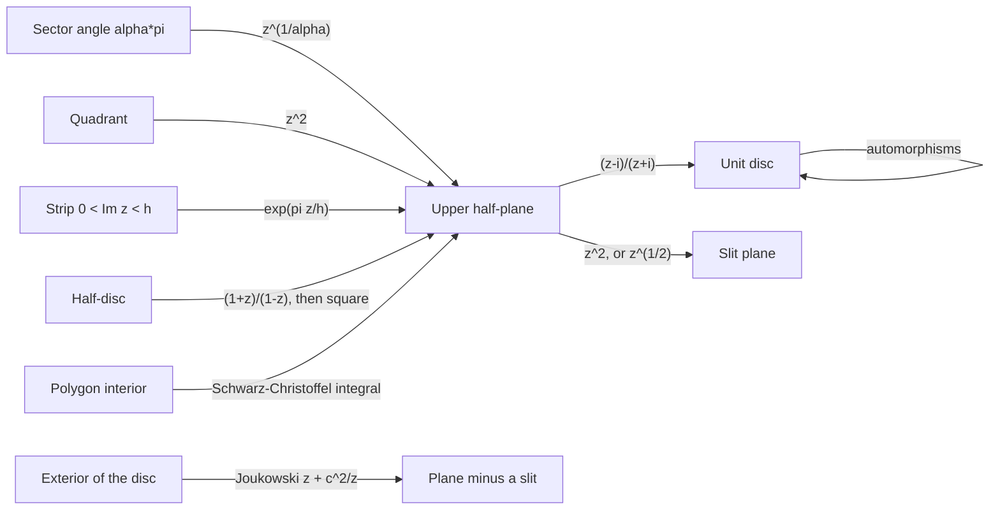

# Conformal Mappings

> [Mathematics](../../README.md) › [Complex Analysis](../README.md) · Level: Advanced · Prerequisites: [Complex Numbers and Geometry](../01-complex-numbers-and-geometry/README.md), [Analytic Functions](../02-analytic-functions/README.md), [Complex Integration](../03-complex-integration/README.md), [Power Series and Residues](../04-power-series-and-residues/README.md), [Connectedness](../../17-topology/04-connectedness/README.md) · Estimated time: 600 min

## 1. Introduction

A holomorphic function with nonzero derivative is a *local similarity*: near each point it rotates by
$\arg f'(z_0)$, scales by $\lvert f'(z_0)\rvert$, and preserves the angle between any two curves. This
single observation, proved in one line from the chain rule, is the beginning of a geometric theory.

**Why geometry forces rigidity.** Conformality is a strong condition: a map that preserves angles at
every point of a domain must be holomorphic (or antiholomorphic). So "conformal map" and "holomorphic
bijection" describe the same class of maps, and the question "which domains are the same?" becomes a
question about analytic functions. The answer, for simply connected domains, is spectacular:

> every simply connected proper domain of $\mathbb{C}$ is conformally equivalent to the unit disc.

This is the **Riemann mapping theorem**. It says that the disc is a universal model, so any problem
about harmonic functions on a simply connected domain can be solved on the disc and transported back.

**The vocabulary of the subject.** Three families of examples carry almost all applications.

* **Möbius transformations** $z\mapsto(az+b)/(cz+d)$, the conformal automorphisms of the Riemann sphere.
  They map circles and lines to circles and lines, are triply transitive on the sphere, and are
  classified by their fixed points into elliptic, parabolic, hyperbolic and loxodromic types.
* **Elementary maps** — powers, exponentials, logarithms, the Joukowski map — which convert strips,
  wedges, half-planes and slit planes into each other. Composing them with Möbius maps gives an
  explicit conformal map for every domain bounded by arcs and straight lines that one meets in practice.
* **The Schwarz–Christoffel integral**, which maps the half-plane onto the interior of any polygon and
  is the general tool for polygonal domains; rectangles lead to elliptic integrals, triangles to
  hypergeometric ones.

**Where the subject is used.** Conformal maps preserve harmonic functions, hence solve the Dirichlet
problem for Laplace's equation on any simply connected domain. In two-dimensional ideal fluid flow they
turn a flow past an obstacle into a flow in a half-plane, and this is how lift on an aerofoil is
computed (the Joukowski transformation and the Kutta condition). In electrostatics they give the field
near a conducting corner or between capacitor plates. In heat conduction, groundwater flow, and numerical
grid generation the same technique appears under different names.

**The plan.** Sections 7.1–7.3 develop conformality and the Möbius group, including the classification
and the cross-ratio. Section 7.4 is a working table of conformal maps between standard domains. Sections
7.5–7.6 state the Schwarz–Christoffel formula with a verified example and the Riemann mapping theorem
with a discussion of its depth. Section 7.7 proves the Schwarz lemma and computes the automorphism group
of the disc; Section 7.8 solves the Dirichlet problem by conformal mapping; Section 7.9 develops the
applications. Two warnings deserve to be stated at the outset: conformality is a *local* property and
says nothing about injectivity, and the Riemann mapping theorem is an existence theorem that gives no
formula — explicit maps come from the catalogue in Section 7.4, not from the theorem.

## 2. Prerequisites

**Complex numbers and geometry.** Modulus, argument, conjugation, the geometric meaning of multiplication
and inversion, circles and lines as loci. See [Complex Numbers and Geometry](../01-complex-numbers-and-geometry/README.md).

**Holomorphic functions.** The complex derivative, Cauchy–Riemann equations, the chain rule, conformality
of the elementary maps, and the inverse function theorem in the holomorphic setting. See
[Analytic Functions](../02-analytic-functions/README.md).

**Complex integration and series.** Cauchy's theorem and integral formula, the maximum modulus principle,
Taylor and Laurent expansions, and the identity theorem. See
[Complex Integration](../03-complex-integration/README.md) and
[Power Series and Residues](../04-power-series-and-residues/README.md).

**Topology of the plane.** Open, connected and simply connected sets; compactness; continuous extension
to a boundary. See [Connectedness](../../17-topology/04-connectedness/README.md) and
[Metric Spaces](../../14-real-analysis/06-metric-spaces/README.md).

**Multivariable calculus.** Partial derivatives, the Jacobian matrix, the real inverse function theorem,
and Laplace's equation in two variables. See
[Multivariable Calculus](../../07-calculus/12-multivariable-calculus/README.md) and
[Vector Calculus](../../07-calculus/13-vector-calculus/README.md).

## 3. Learning Objectives

By the end of this tutorial you will be able to

1. define conformality at a point and prove that a holomorphic $f$ is conformal exactly where
   $f'(z)\ne0$, with scale factor $\lvert f'\rvert$ and rotation $\arg f'$;
2. prove the converse: a $C^1$ map that preserves oriented angles is holomorphic with nonzero derivative;
3. compute images of curves and regions under Möbius transformations, and explain why they map
   generalised circles to generalised circles;
4. use the cross-ratio to write down the unique Möbius map sending three prescribed points to three
   prescribed points, and to test whether four points are concyclic;
5. classify a Möbius transformation as elliptic, parabolic, hyperbolic or loxodromic from its trace,
   and find its fixed points and multiplier;
6. construct conformal maps between the standard domains: disc, half-plane, strip, quadrant, wedge,
   slit plane and half-disc;
7. state the Schwarz–Christoffel formula with its hypotheses and apply it to the half-strip and to
   triangles;
8. state the Riemann mapping theorem, explain its uniqueness statement, and discuss why it is deep;
9. prove the Schwarz lemma, deduce the Schwarz–Pick inequalities, and compute $\operatorname{Aut}(\mathbb{D})$
   and $\operatorname{Aut}(\mathbb{H})$;
10. prove that harmonicity is preserved by composition with a holomorphic map and solve the Dirichlet
    problem on a simply connected domain by transporting the Poisson formula;
11. model two-dimensional ideal fluid flow with a complex potential, compute flow past a circular
    cylinder with circulation, and state the Kutta–Joukowski lift formula;
12. solve elementary electrostatic and aerofoil problems by conformal mapping.

## 4. Intuition

**A conformal map is a photocopy with curved paper.** Near a point where $f'\ne0$, the map looks like
multiplication by a complex number: rotate, scale, translate. Circles become circles (to first order),
angles are preserved, and the local picture is a similarity. The curvature appears only at the second
order: a square grid is mapped to a curvilinear grid whose cells are small squares turned and stretched.

**Angles are the invariant.** Two curves crossing at angle $\theta$ are mapped to two curves crossing at
the same angle. This is why conformal maps are the natural isomorphisms of the plane as a *conformal*
geometry: they preserve the only local measurement — angle — that a complex structure provides. Lengths
are distorted (by $\lvert f'\rvert$, which varies), and areas by $\lvert f'\rvert^2$; lengths and areas
are not conformal invariants, angles are.

**The sphere is the right home.** On $\mathbb{C}$ alone, Möbius transformations are awkward: a
translation has a fixed point at infinity, and $1/z$ exchanges $0$ and $\infty$. Adding the point
$\infty$ gives the Riemann sphere, on which every Möbius transformation is an honest homeomorphism and
every line is a circle through $\infty$. The classification of Möbius transformations by their fixed
points — two fixed points, one fixed point, or a rotation — is a classification of the possible rigid
motions of a curved surface.

**Folding a domain into a standard one.** Conformal maps are the "change of coordinates" of
two-dimensional potential theory. A flow past a cylinder, a field near a corner, the temperature in a
wedge: all become the same problem after the right map. The catalogue of Section 7.4 is the dictionary:
$z\mapsto z^2$ opens a quadrant into a half-plane, $z\mapsto e^z$ unrolls a strip, $z\mapsto z^{1/\alpha}$
opens a wedge of angle $\alpha\pi$, and $1/z$ turns lines into circles.

**Why the Riemann mapping theorem should be surprising.** Holomorphic functions are rigid: fixing their
values on a set with an accumulation point fixes them everywhere. A conformal map between two domains is
a holomorphic bijection, so it is a *very* rigid object; there is no reason for two arbitrarily shaped
domains to admit one. That every simply connected proper domain does is a deep existence theorem,
proved not by formula but by an optimisation over a family of holomorphic functions. The rigidity
reappears immediately: once one map exists, all others are obtained by composing with an automorphism of
the disc, a three-parameter family.

## 5. Formal Definition

**Definition 5.1** (conformal at a point). Let $\Omega\subseteq\mathbb{C}$ be open, $f:\Omega\to\mathbb{C}$,
$z_0\in\Omega$. Then $f$ is **conformal at $z_0$** if it is real-differentiable at $z_0$ with invertible
Jacobian, and it preserves oriented angles: for every pair of $C^1$ curves $\gamma_1,\gamma_2$ through
$z_0$ with nonzero tangents, the angle from $\gamma_1$ to $\gamma_2$ at $z_0$ equals the angle from
$f\circ\gamma_1$ to $f\circ\gamma_2$ at $f(z_0)$.

**Definition 5.2** (conformal map of domains). A map $f:\Omega\to\Omega'$ between domains is a
**conformal equivalence** (or **conformal map**) if it is a bijection, holomorphic, and $f'(z)\ne0$ for
all $z\in\Omega$. Equivalently $f$ is biholomorphic: holomorphic with holomorphic inverse. The domains
are then **conformally equivalent**, written $\Omega\cong\Omega'$. A holomorphic injective map on a
domain is **univalent**; a domain is a **domain of univalence** for $f$ if $f$ is injective there.

**Definition 5.3** (automorphism group). $\operatorname{Aut}(\Omega)$ is the group of conformal
automorphisms $\Omega\to\Omega$ under composition.

**Definition 5.4** (Möbius transformation). A **Möbius transformation** (or fractional linear
transformation) is
$$T(z)=\frac{az+b}{cz+d},\qquad a,b,c,d\in\mathbb{C},\quad ad-bc\ne0 .$$
It is a bijection of the extended plane $\widehat{\mathbb{C}}=\mathbb{C}\cup\{\infty\}$ with
$T(\infty)=a/c$ if $c\ne0$ and $T(\infty)=\infty$ otherwise, and $T(-d/c)=\infty$ if $c\ne0$. The
composition of two Möbius transformations corresponds to the product of their coefficient matrices, so
the set of all of them is the group $\mathrm{PGL}_2(\mathbb{C})=\mathrm{GL}_2(\mathbb{C})/\mathbb{C}^\times$,
and $\mathrm{PSL}_2(\mathbb{C})=\mathrm{SL}_2(\mathbb{C})/\{\pm I\}$ is the same group because a matrix
can be scaled to determinant $1$.

**Definition 5.5** (generalised circle). A **generalised circle** is a circle or a straight line in
$\mathbb{C}$, regarded as a circle on $\widehat{\mathbb{C}}$ passing (or not) through $\infty$.

**Definition 5.6** (cross-ratio). For distinct $z_1,z_2,z_3,z_4\in\widehat{\mathbb{C}}$,
$$(z_1,z_2;z_3,z_4)=\frac{(z_3-z_1)(z_4-z_2)}{(z_3-z_2)(z_4-z_1)}\in\widehat{\mathbb{C}},$$
with the value defined by continuity when one entry is $\infty$ (for instance
$(\infty,z_2;z_3,z_4)=(z_4-z_2)/(z_3-z_2)$).

**Definition 5.7** (harmonic function; Dirichlet problem). A $C^2$ function $u:\Omega\to\mathbb{R}$ is
**harmonic** if $u_{xx}+u_{yy}=0$ on $\Omega$. The **Dirichlet problem** on $\Omega$ with boundary data
$g:\partial\Omega\to\mathbb{R}$ asks for a harmonic $u$ on $\Omega$, continuous on $\overline\Omega$, with
$u=g$ on $\partial\Omega$.

**Definition 5.8** (hyperbolic geometry of the disc). The **Poincaré metric** on the unit disc is
$$ds=\frac{2\lvert dz\rvert}{1-\lvert z\rvert^2},$$
and the **hyperbolic distance** is its length functional. Conformal automorphisms of $\mathbb{D}$ are
exactly the isometries of this metric, a fact equivalent to the Schwarz–Pick inequality of Section 7.7.

## 6. Mathematical Notation

| Symbol | Read as | Meaning |
|---|---|---|
| $\Omega$, $\Omega'$ | domain | open connected subset of $\mathbb{C}$ |
| $\mathbb{D}$, $\mathbb{H}$ | the unit disc, the upper half-plane | $\lvert z\rvert<1$, $\operatorname{Im}z>0$ |
| $\widehat{\mathbb{C}}$ | the Riemann sphere | $\mathbb{C}\cup\{\infty\}$ |
| $f'(z)$ | complex derivative | local scale $\lvert f'\rvert$ and rotation $\arg f'$ |
| $\partial f/\partial\bar z$ | Wirtinger derivative | zero exactly when $f$ is holomorphic |
| $\operatorname{Aut}(\Omega)$ | automorphism group | conformal bijections $\Omega\to\Omega$ |
| $\mathrm{PGL}_2(\mathbb{C})$, $\mathrm{PSL}_2(\mathbb{R})$ | Möbius groups | all, resp. real-coefficient, transformations |
| $\operatorname{tr}^2 A$ | square of the trace | classifies a Möbius transformation |
| $\lambda=T'(\zeta)$ | multiplier at a fixed point | controls the local dynamics |
| $(z_1,z_2;z_3,z_4)$ | cross-ratio | Möbius invariant of four points |
| $\Delta u=u_{xx}+u_{yy}$ | Laplacian | $u$ harmonic iff $\Delta u=0$ |
| $P_r(\theta)$ | Poisson kernel | $(1-r^2)/(1-2r\cos\theta+r^2)$ |
| $\Phi=\phi+i\psi$ | complex potential | velocity potential plus stream function |
| $u-iv=\Phi'(z)$ | complex velocity | velocity components of the flow |
| $\Gamma$ | circulation | line integral of velocity around a loop |
| $w=z+c^2/z$ | Joukowski map | conformal map producing aerofoil shapes |

## 7. Core Concepts

### 7.1 Conformality and the Meaning of $f'(z)\ne0$

**Theorem 7.1** (holomorphic with nonzero derivative implies conformal). Let $f$ be holomorphic on a
domain $\Omega$ and let $z_0\in\Omega$ with $f'(z_0)\ne0$. Then $f$ is conformal at $z_0$: the tangent to
a curve through $z_0$ is rotated by $\arg f'(z_0)$ and scaled by $\lvert f'(z_0)\rvert$, independently of
the curve.

*Proof.* Let $\gamma(t)=x(t)+iy(t)$ be $C^1$ with $\gamma(0)=z_0$ and $\gamma'(0)\ne0$. By the chain
rule $(f\circ\gamma)'(0)=f'(z_0)\gamma'(0)$. Hence
$$\arg(f\circ\gamma)'(0)=\arg f'(z_0)+\arg\gamma'(0),\qquad \lvert(f\circ\gamma)'(0)\rvert=\lvert f'(z_0)\rvert\,\lvert\gamma'(0)\rvert .$$
For two curves the difference of initial arguments — the angle between them — is unchanged, and both
tangent lengths are multiplied by the same positive number $\lvert f'(z_0)\rvert$. Orientation is
preserved because multiplication by $f'(z_0)$ is an orientation-preserving linear map. $\blacksquare$

**Corollary 7.2** (local behaviour at $z_0$). With the notation of Theorem 7.1,
$f(z)=f(z_0)+f'(z_0)(z-z_0)+o(\lvert z-z_0\rvert)$, so $f$ is locally a rotation by $\arg f'(z_0)$, a
dilation by $\lvert f'(z_0)\rvert$ and a translation. In particular $f$ is locally injective at $z_0$
(inverse function theorem), and $f$ maps small circles to curves whose length element is scaled by
$\lvert f'\rvert$ and small areas by $\lvert f'\rvert^2$.

**Example 7.3** (the failure at a critical point). For $f(z)=z^2$ and $z_0=0$ we have $f'(0)=0$. The
image of the ray at angle $\theta$ is the ray at angle $2\theta$, so angles at $0$ are *doubled*: two
curves meeting at angle $\theta$ are mapped to curves meeting at $2\theta$. The local form is
$f(z)-f(0)=z^m$ near a zero of order $m$, and angles are multiplied by $m$. Consequently a holomorphic
map is conformal at $z_0$ exactly when $f'(z_0)\ne0$.

**Theorem 7.4** (converse: angle preservation forces holomorphy). Let $f$ be real-differentiable at $z_0$
with invertible Jacobian. If $f$ preserves oriented angles at $z_0$, then $f$ is holomorphic at $z_0$ and
$f'(z_0)\ne0$. If $f$ reverses angles, then $\bar f$ is holomorphic at $z_0$ with nonzero derivative.

*Proof.* Write $z=x+iy$, $f=u+iv$, and let $J=\begin{pmatrix}u_x&u_y\\v_x&v_y\end{pmatrix}$ be the Jacobian
at $z_0$. A linear map preserves angles and orientation exactly when it is a positive multiple of an
orthogonal matrix: $J=\lambda R$ with $\lambda>0$ and $R$ a rotation. If $R$ is rotation by $\theta$,
$$J=\lambda\begin{pmatrix}\cos\theta&-\sin\theta\\ \sin\theta&\cos\theta\end{pmatrix}
=\begin{pmatrix}u_x&u_y\\v_x&v_y\end{pmatrix},$$
so $u_x=v_y=\lambda\cos\theta$ and $u_y=-v_x=-\lambda\sin\theta$: the Cauchy–Riemann equations hold, $f$
is holomorphic at $z_0$ (the definition of the complex derivative is the pair of real equations plus
differentiability), and $f'(z_0)=u_x+iv_x=\lambda e^{i\theta}\ne0$. If $J$ is $\lambda$ times a
reflection composed with a rotation, the signs give $u_x=-v_y$ and $u_y=v_x$, which is the
Cauchy–Riemann system for $\bar f$. $\blacksquare$

**Consequence.** For maps of domains, "conformal" $=$ "holomorphic and injective with nonzero derivative".
Holomorphic injectivity already forces $f'\ne0$: if $f'(z_0)=0$ of order $m\ge2$, then near $z_0$ the map
is $m$-to-$1$, contradicting injectivity. So a univalent map is conformal everywhere.

### 7.2 Möbius Transformations

**Theorem 7.5** (generators). Every Möbius transformation is a composition of maps of the three types
$z\mapsto z+b$ (translation), $z\mapsto az$ with $a\ne0$ (rotation and dilation), and $z\mapsto1/z$
(inversion).

*Proof.* If $c=0$ then $T(z)=(a/d)z+b/d$ is dilation followed by translation. If $c\ne0$, polynomial
division gives
$$T(z)=\frac ac+\frac{b-\frac{ad}{c}}{cz+d}=\frac ac-\frac{ad-bc}{c}\cdot\frac{1}{cz+d},$$
a composition of $z\mapsto cz+d$, inversion, multiplication by $-(ad-bc)/c$ and translation by $a/c$.
$\blacksquare$

**Theorem 7.6** (generalised circles). A Möbius transformation maps generalised circles to generalised
circles, and it is a homeomorphism of $\widehat{\mathbb{C}}$ that is conformal off the pole.

*Proof.* Translations and dilations clearly preserve the class of circles and lines. For inversion
$w=1/z$ (equivalently $z=1/w$), the circle $\lvert z-z_0\rvert^2=r^2$ becomes
$$\lvert 1-z_0w\rvert^2=r^2\lvert w\rvert^2\iff(\lvert z_0\rvert^2-r^2)\lvert w\rvert^2-z_0w-\bar z_0\bar w+1=0 .$$
If $\lvert z_0\rvert\ne r$ this is a circle in $w$; if $\lvert z_0\rvert=r$ the quadratic term vanishes
and it is a line. Lines not through the origin are circles through $\infty$ and are handled by the same
equation with $z_0$ replaced by the point at infinity; a line through the origin maps to itself. Since
every Möbius map is a composition of these, the claim follows. Conformality holds where the derivative
$T'(z)=(ad-bc)/(cz+d)^2$ is nonzero; at the pole one uses the local coordinate $1/T$, which has nonzero
derivative there. $\blacksquare$

**Theorem 7.7** (triple transitivity and the cross-ratio). For distinct $z_1,z_2,z_3$ and distinct
$w_1,w_2,w_3$ in $\widehat{\mathbb{C}}$ there is exactly one Möbius transformation with $T(z_j)=w_j$ for
$j=1,2,3$. The cross-ratio is invariant:
$(Tz_1,Tz_2;Tz_3,Tz_4)=(z_1,z_2;z_3,z_4)$.

*Proof.* The map
$$S(z)=\frac{(z-z_1)(z_2-z_3)}{(z-z_2)(z_1-z_3)}$$
is Möbius (its determinant is nonzero when the three points are distinct) and satisfies $S(z_1)=0$,
$S(z_2)=\infty$, $S(z_3)=1$. Composing with the inverse of the analogous map for the $w_j$ gives
existence; uniqueness follows because a Möbius map fixing $0,\infty,1$ is the identity (it is
$z\mapsto(az+b)/(cz+d)$ with $b=0$, $c=0$, $a=d$). Invariance of the cross-ratio is checked on the
generators, or by observing that $z\mapsto(z_1,z_2;z_3,z)$ is the unique Möbius map sending
$z_1\mapsto0$, $z_2\mapsto\infty$, $z_3\mapsto1$ and using uniqueness. $\blacksquare$

**Corollary 7.8** (concyclicity test). Four distinct points lie on a common generalised circle if and only
if their cross-ratio is real.

*Proof.* Let $T$ send $z_1,z_2,z_3$ to $0,\infty,1$. A generalised circle through $0$ and $\infty$ is a
line through $0$, and the one through $1$ is the real axis. Hence $z_4$ lies on the generalised circle
through $z_1,z_2,z_3$ iff $T(z_4)\in\mathbb{R}$, i.e. iff $(z_1,z_2;z_3,z_4)\in\mathbb{R}$ by invariance.
$\blacksquare$

**Theorem 7.9** (automorphisms of the sphere). Every biholomorphic map of $\widehat{\mathbb{C}}$ to itself
is a Möbius transformation; hence $\operatorname{Aut}(\widehat{\mathbb{C}})=\mathrm{PGL}_2(\mathbb{C})$.

*Proof sketch.* A biholomorphic $f$ is meromorphic on the sphere, so it has finitely many poles and its
polar part at a pole $\zeta$ is a principal part $\sum_{k\ge1}c_k(z-\zeta)^{-k}$, which is the
transformation of a Möbius map. Subtracting the principal parts at all poles gives a holomorphic map
$\widehat{\mathbb{C}}\to\mathbb{C}$, hence constant (Liouville). So $f$ is a sum of finitely many Möbius
terms; injectivity of $f$ forces exactly one pole, of order $1$, and a polynomial part of degree at most
$1$, so $f$ is Möbius. $\blacksquare$

**Example 7.10** (the Cayley transform). The map $C(z)=\dfrac{z-i}{z+i}$ sends $\mathbb{H}$ onto
$\mathbb{D}$: for $z=x+iy$,
$$\lvert z-i\rvert^2=x^2+(y-1)^2,\qquad\lvert z+i\rvert^2=x^2+(y+1)^2,$$
so $\lvert C(z)\rvert<1$ iff $y>0$. It sends $i\mapsto0$, $0\mapsto-1$, $\infty\mapsto1$, and its inverse
is $C^{-1}(w)=i\dfrac{1+w}{1-w}$.

### 7.3 Classification of Möbius Transformations

**Fixed points.** For $T\ne\mathrm{id}$ the equation $z=T(z)$ reads $cz^2+(d-a)z-b=0$ when $c\ne0$, a
quadratic with one or two solutions; when $c=0$ one solves $z=(az+b)/d$ and remembers that $\infty$ is
also fixed. Hence a non-identity Möbius transformation has exactly one or two fixed points on
$\widehat{\mathbb{C}}$.

**Normalisation and multiplier.** Scale the matrix to determinant $1$, so that $A\in\mathrm{SL}_2(\mathbb{C})$
is defined up to sign. Then the **trace invariant** $\tau=\operatorname{tr}(A)^2$ is well defined. At a
fixed point $\zeta$ the **multiplier** is $\lambda=T'(\zeta)=(c\zeta+d)^{-2}$, and
$$\operatorname{tr}(A)=\mu+\mu^{-1}\ \text{ with }\ \mu^2=\lambda,\qquad\text{hence}\qquad
\tau=\lambda+2+\lambda^{-1}.$$
A Möbius map with two fixed points is conjugate (by a Möbius map sending them to $0$ and $\infty$) to
$z\mapsto\lambda z$; with one fixed point it is conjugate to $z\mapsto z+1$.

**Theorem 7.11** (classification). Let $T\ne\mathrm{id}$ have trace invariant $\tau$. Then

| Type | Condition on $\tau$ | Fixed points | Normal form | Geometry |
|---|---|---|---|---|
| elliptic | $\tau\in[0,4)$ | two | $z\mapsto\lambda z$, $\lvert\lambda\rvert=1$, $\lambda\ne1$ | rotation |
| parabolic | $\tau=4$ | one | $z\mapsto z+1$ | translation, shear |
| hyperbolic | $\tau\in(4,\infty)$ | two | $z\mapsto\lambda z$, $\lambda>1$ real | stretch along an axis |
| loxodromic | $\tau\notin[0,\infty)$ | two | $z\mapsto\lambda z$, $\lvert\lambda\rvert\ne1$, $\lambda\notin\mathbb{R}_{>0}$ | stretch and rotate: spiral |

*Proof.* Conjugate so that the fixed points are $0$ and $\infty$ (or the single fixed point is $\infty$).
Then the map is $z\mapsto\lambda z$ with $\lambda\ne1$, or $z\mapsto z+1$. For $z\mapsto\lambda z$ the
matrix is $\operatorname{diag}(\mu,\mu^{-1})$ with $\mu^2=\lambda$, so
$\tau=(\mu+\mu^{-1})^2=\lambda+2+\lambda^{-1}$. If $\lvert\lambda\rvert=1$ and $\lambda\ne1$ then
$\lambda+\lambda^{-1}=2\cos\theta\in(-2,2)$, so $\tau\in[0,4)$; if $\lambda>0$ real and $\ne1$ then
$\tau>4$; if $\lambda\notin\mathbb{R}$ or $\lvert\lambda\rvert\ne1$ (and $\lambda\notin\mathbb{R}_{>0}$)
then $\tau\notin[0,\infty)$. The parabolic case $\lambda=1$ is the normal form $z\mapsto z+1$, whose
matrix $\begin{pmatrix}1&1\\0&1\end{pmatrix}$ has $\tau=4$. The four cases are exhaustive and mutually
exclusive. $\blacksquare$

**Example 7.12** (classification by hand). For $T(z)=\dfrac{2z+1}{z+1}$ the matrix
$\begin{pmatrix}2&1\\1&1\end{pmatrix}$ has determinant $1$ and trace $3$, so $\tau=9>4$: hyperbolic. The
fixed points solve $z^2-z-1=0$, i.e. $z=(1\pm\sqrt5)/2$, both real, and the multiplier at
$\zeta=(1+\sqrt5)/2$ is $\lambda=(\zeta+1)^{-2}=\zeta^{-4}\approx0.146$, with
$\lambda+\lambda^{-1}=7=\tau-2$. Since $\lvert\lambda\rvert\ne1$ and $\lambda>0$, $T$ stretches along the
real axis and contracts along the orthogonal family of circles through the two fixed points — the
hyperbolic picture.

**Remark 7.13** (real coefficients). A Möbius transformation with $a,b,c,d\in\mathbb{R}$ and
$ad-bc>0$ preserves $\mathbb{H}$ and $\mathbb{R}$, and every automorphism of $\mathbb{H}$ arises this
way: $\operatorname{Aut}(\mathbb{H})=\mathrm{PSL}_2(\mathbb{R})$. Under the Cayley transform this becomes
$\operatorname{Aut}(\mathbb{D})=\mathrm{PSU}(1,1)$, computed in Theorem 7.25.

### 7.4 Constructing Maps Between Standard Domains

Conformal maps are built by composition from a short list. The rule of thumb: **remove corners with
powers, remove exponential growth with logarithms, and use Möbius maps to place everything else.**

| Source domain | Target | Map | Verification |
|---|---|---|---|
| $\mathbb{H}$ | $\mathbb{D}$ | $\dfrac{z-i}{z+i}$ | $\lvert z-i\rvert<\lvert z+i\rvert\iff\operatorname{Im}z>0$ |
| $\mathbb{D}$ | $\mathbb{H}$ | $i\dfrac{1+z}{1-z}$ | inverse of the above |
| $\mathbb{H}$ | right half-plane | $-iz$ | $\operatorname{Re}(-iz)=\operatorname{Im}z$ |
| disc | disc, $a\mapsto0$ | $\dfrac{z-a}{1-\bar az}$ | $\lvert z\rvert<1\Rightarrow\lvert z-a\rvert<\lvert1-\bar az\rvert$ |
| sector $0<\arg z<\alpha\pi$ | $\mathbb{H}$ | $z^{1/\alpha}$ | argument divided by $\alpha$ |
| quadrant | $\mathbb{H}$ | $z^2$ | argument doubled |
| strip $0<\operatorname{Im}z<\pi$ | $\mathbb{H}$ | $e^z$ | $\operatorname{Im}e^z=e^x\sin y>0$ |
| strip $0<\operatorname{Im}z<h$ | $\mathbb{D}$ | $\dfrac{e^{\pi z/h}-i}{e^{\pi z/h}+i}$ | strip $\to\mathbb{H}\to\mathbb{D}$ |
| slit plane $\mathbb{C}\setminus(-\infty,0]$ | right half-plane | $\sqrt z$ | principal branch, argument halved |
| half-disc $\lvert z\rvert<1$, $\operatorname{Im}z>0$ | $\mathbb{H}$ | $\left(\dfrac{1+z}{1-z}\right)^2$ | arc $\mapsto$ negative axis, diameter $\mapsto$ positive axis |
| exterior $\lvert z\rvert>1$ | exterior of $[-1,1]$ | $z+\dfrac1z$ | $z=e^{i\theta}\mapsto2\cos\theta$ |
| annulus $r<\lvert z\rvert<R$ | annulus $1<\lvert w\rvert<R/r$ | $z/r$ | the modulus $R/r$ is a conformal invariant |

**How to read the table.** Each entry is a holomorphic bijection onto its target; composing entries and
inserting Möbius maps gives a map for any domain whose boundary consists of arcs of generalised circles
and rays. Three of the entries are worth verifying in detail because they are used constantly.

**Example 7.14** (sector to half-plane). For $0<\alpha\le2$ the principal branch of $z^{1/\alpha}$ maps
the sector $\{0<\arg z<\alpha\pi\}$ onto $\mathbb{H}$. Indeed $z=re^{i\theta}$ with $0<\theta<\alpha\pi$
gives $z^{1/\alpha}=r^{1/\alpha}e^{i\theta/\alpha}$ with $0<\theta/\alpha<\pi$, which is exactly the upper
half-plane; the map is holomorphic and injective there (its derivative $\frac1\alpha z^{1/\alpha-1}$ never
vanishes) and onto by the computation.

**Example 7.15** (half-disc to half-plane). Let $g(z)=\dfrac{1+z}{1-z}$, a Möbius map sending
$-1\mapsto0$, $0\mapsto1$, $1\mapsto\infty$. On the diameter $(-1,1)$ the ratio is real and positive, and
on the arc $\lvert z\rvert=1$ we have $\lvert1+z\rvert=\lvert1-z\rvert$, so $g(z)$ is purely imaginary.
Hence $g$ carries the half-disc onto the **first quadrant** $0<\arg w<\pi/2$: its boundary, the
imaginary axis together with the positive real axis, is the boundary of that quadrant, and an interior
point such as $z=i/2$ maps to $g=0.6+0.8i$. Squaring doubles the argument, so
$z\mapsto\left(\dfrac{1+z}{1-z}\right)^2$ maps the half-disc onto $\mathbb{H}$.

**Example 7.16** (strips and the exponential). $z\mapsto e^z$ maps the horizontal strip
$0<\operatorname{Im}z<h$ onto the sector $0<\arg w<h$ with the origin removed: writing $z=x+iy$ gives
$w=e^xe^{iy}$, so $\lvert w\rvert=e^x$ ranges over $(0,\infty)$ while $\arg w=y$ ranges over $(0,h)$. For
$h=\pi$ the image is $\mathbb{H}$; for $h=2\pi$ it is $\mathbb{C}$ minus the positive real axis.

**Remark 7.17** (obstructions). Not every pair of domains is conformally equivalent. The unit disc and
$\mathbb{C}$ are not, by Liouville: no conformal map $\mathbb{C}\to\mathbb{D}$ can be surjective with
holomorphic inverse, since a bounded entire function is constant. The disc and the punctured disc
$\mathbb{D}\setminus\{0\}$ are not equivalent either: a biholomorphic map is a homeomorphism, and
homeomorphisms preserve simple connectivity, whereas removing a point destroys it. Two annuli
$r_1<\lvert z\rvert<R_1$ and $r_2<\lvert z\rvert<R_2$ are conformally equivalent exactly when
$R_1/r_1=R_2/r_2$; the ratio, the **modulus** of the annulus, is a conformal invariant. The Riemann
mapping theorem says nothing about annuli, because they are not simply connected.

### 7.5 The Schwarz–Christoffel Formula

**Theorem 7.18** (Schwarz–Christoffel). Let $P$ be a polygon with vertices $w_1,\dots,w_n$ in
counterclockwise order and interior angles $\alpha_1\pi,\dots,\alpha_n\pi$ with $0<\alpha_k<2$ and
$\sum_k\alpha_k=n-2$. Let $f:\mathbb{H}\to\operatorname{int}P$ be a conformal map that extends
continuously to $\overline{\mathbb{H}}$ and sends real points $x_1<x_2<\cdots<x_n$ to $w_1,\dots,w_n$
respectively. Then there are constants $A\in\mathbb{C}$ and $C\in\mathbb{C}^\times$ with
$$f(z)=A+C\int^z\prod_{k=1}^{n}(\zeta-x_k)^{\alpha_k-1}\,d\zeta .$$
Conversely, for real $x_1<\cdots<x_n$ and exponents $\beta_k=\alpha_k-1\in(-1,1)$ satisfying
$\sum_k\beta_k=-2$, the integral maps $\mathbb{H}$ conformally onto the interior of a polygon with
interior angles $\alpha_k\pi$.

**Where the formula comes from.** On each interval $(x_k,x_{k+1})$ all factors are nonzero and have
constant argument, so $f'$ has constant argument: the image of that interval is a straight segment. Near
$x_k$, the only vanishing factor is $(\zeta-x_k)^{\beta_k}$, so $f(z)-f(x_k)$ behaves like
$(z-x_k)^{\beta_k+1}=(z-x_k)^{\alpha_k}$; a power with exponent $\alpha_k$ opens the angle $\pi$ of the
real axis to the angle $\alpha_k\pi$, which is the corner of the polygon. The condition
$\sum_k\beta_k=-2$ makes the integrand behave like $\zeta^{-2}$ at infinity, so $f$ has a finite limit
there and the polygon closes. The direction of the sides and the size of the polygon are carried by the
two constants $C$ (rotation and scale) and $A$ (translation); they are determined by the positions of
the vertices.

**Example 7.19** (half-strip from two vertices). Take two prevertices $x_1=-1$, $x_2=1$ and two interior
angles $\pi/2$, so $\alpha_k=1/2$ and $\beta_k=-1/2$. The formula gives
$$f(z)=\int_0^z(\zeta+1)^{-1/2}(\zeta-1)^{-1/2}\,d\zeta=\pm\int_0^z\frac{d\zeta}{\sqrt{1-\zeta^2}}=\pm\arcsin z .$$
The endpoints $-1,1$ map to $\mp\pi/2$ on the real axis, and the two remaining boundary rays of
$\mathbb{H}$ map onto the vertical rays $\operatorname{Re}w=\mp\pi/2$ with $\operatorname{Im}w>0$ (the
one-sided limits are $\pm\pi/2+i\,\operatorname{arccosh}\lvert x\rvert$ for $\lvert x\rvert>1$). Hence
the image is the half-strip
$$\left\{w:\ -\frac\pi2<\operatorname{Re}w<\frac\pi2,\ \operatorname{Im}w>0\right\},$$
whose third "vertex" is at infinity, where the two vertical sides are parallel: the interior angle there
is $0$, contributing the factor $\alpha_\infty-1=-1$ that is absorbed into the constant $C$.

**Example 7.20** (equilateral triangle). Take $x_1=-1$, $x_2=0$, $x_3=1$ and three angles $\pi/3$, so
$\beta_k=-2/3$ and $\sum\beta_k=-2$:
$$f(z)=\int_0^z(\zeta+1)^{-2/3}\,\zeta^{-2/3}\,(\zeta-1)^{-2/3}\,d\zeta .$$
The three corner openings are $\pi/3$, so the image is a triangle with all angles $\pi/3$, and the
symmetry of the configuration $\{-1,0,1\}$ under real Möbius maps (which act triply transitively on
$\mathbb{R}$) makes it equilateral. For a rectangle the four angles are $\pi/2$, giving
$f(z)=\int^z\prod_{k=1}^4(\zeta-x_k)^{-1/2}d\zeta$, an elliptic integral: the side lengths are the
complete elliptic integrals, and the modulus of the rectangle is the conformal invariant that no
elementary function expresses.

**Remark 7.21.** The formula is an existence statement with a free choice of prevertices: for a given
polygon the correct $x_k$ are not known in advance, and finding them is a nontrivial numerical problem
(the "parameter problem"). What the formula does give immediately is the *shape*: the angles determine
the exponents, and hence the local behaviour at every corner.

### 7.6 The Riemann Mapping Theorem

**Theorem 7.22** (Riemann mapping theorem). Let $\Omega\subsetneq\mathbb{C}$ be a nonempty simply
connected domain. Then for every $z_0\in\Omega$ there is a unique conformal map
$f:\Omega\to\mathbb{D}$ with $f(z_0)=0$ and $f'(z_0)>0$.

**Uniqueness.** If $f,g$ both satisfy the conditions, then $g\circ f^{-1}$ is an automorphism of
$\mathbb{D}$ fixing $0$ with positive derivative at $0$; by Theorem 7.25 below it is a rotation, and
positivity of the derivative forces the rotation to be the identity.

**Why it is deep.** The theorem is an existence statement about a very rigid class of objects, and its
proof cannot be a formula. The standard proofs run as follows.

* *Reformulate as an optimisation.* Consider the family $\mathcal{F}$ of all injective holomorphic
  $f:\Omega\to\mathbb{D}$ with $f(z_0)=0$ and $f'(z_0)>0$. It is nonempty because $\Omega$ is proper:
  choose $a\notin\Omega$, use that $\Omega$ is simply connected to build a holomorphic square root of
  $z-a$ on $\Omega$, and compose with a Möbius map to land in the disc. The quantity $f'(z_0)$, real
  and positive, is bounded above; let $M$ be its supremum.
* *Compactness.* By Montel's theorem the family is normal, so a sequence with $f_n'(z_0)\to M$ has a
  subsequence converging uniformly on compact sets; the limit is holomorphic, injective (a nonconstant
  limit of injective maps is injective) and satisfies the normalisation. This is where completeness of
  the space of holomorphic functions, not a formula, produces the map.
* *Surjectivity.* If the extremal $f$ omitted a value $b\in\mathbb{D}$, one composes with a square root
  of the disc automorphism $\varphi_b$ and with a Möbius map to obtain a competitor with larger
  derivative at $z_0$, contradicting maximality; the maximum modulus principle converts "not onto" into
  such a competitor. Hence $f$ is onto.

So the proof uses the compactness of normal families, the simply connected hypothesis (through the
square root), and the maximum modulus principle. None of these can be replaced by a computation, and the
result fails for the disc versus $\mathbb{C}$ (Liouville), for annuli (Section 7.4), and in several
complex variables: the ball and the polydisc in $\mathbb{C}^2$ are not biholomorphic (Poincaré), so
there is no higher-dimensional analogue.

**What the theorem does not say.** It gives no formula and no information about the boundary. The map
need not extend continuously to $\partial\Omega$ for a general simply connected domain; if $\Omega$ is a
Jordan domain (its boundary is a simple closed curve), **Carathéodory's theorem** says the map does
extend to a homeomorphism of the closures, which is what makes the Dirichlet problem of Section 7.8
work in the naive way.

### 7.7 The Schwarz Lemma and the Automorphisms of the Disc

**Theorem 7.23** (Schwarz lemma). Let $f:\mathbb{D}\to\mathbb{D}$ be holomorphic with $f(0)=0$. Then
$$\lvert f(z)\rvert\le\lvert z\rvert\ \ (z\in\mathbb{D}),\qquad \lvert f'(0)\rvert\le1 .$$
Equality at one point $z\ne0$, or equality $\lvert f'(0)\rvert=1$, holds if and only if
$f(z)=e^{i\theta}z$ for some $\theta\in\mathbb{R}$.

*Proof.* Define $g(z)=f(z)/z$ for $z\ne0$ and $g(0)=f'(0)$. Since $f(0)=0$, the singularity at $0$ is
removable (the quotient has a finite limit $f'(0)$), so $g$ is holomorphic on $\mathbb{D}$. On the circle
$\lvert z\rvert=r<1$ we have $\lvert g(z)\rvert=\lvert f(z)\rvert/r\le1/r$, so by the maximum modulus
principle $\lvert g(z)\rvert\le1/r$ for $\lvert z\rvert\le r$. Letting $r\to1$ gives
$\lvert g(z)\rvert\le1$, that is $\lvert f(z)\rvert\le\lvert z\rvert$, and also
$\lvert f'(0)\rvert=\lvert g(0)\rvert\le1$. If equality holds at some interior point, then $\lvert g\rvert$
attains its maximum $1$ inside $\mathbb{D}$, so $g$ is constant of modulus $1$: $g=e^{i\theta}$ and
$f(z)=e^{i\theta}z$.
$\blacksquare$

**Corollary 7.24** (Schwarz–Pick). For holomorphic $f:\mathbb{D}\to\mathbb{D}$ and $a\in\mathbb{D}$,
$$\left\lvert\frac{f(z)-f(a)}{1-\overline{f(a)}f(z)}\right\rvert\le\left\lvert\frac{z-a}{1-\bar az}\right\rvert,
\qquad \frac{\lvert f'(a)\rvert}{1-\lvert f(a)\rvert^2}\le\frac{1}{1-\lvert a\rvert^2}.$$
The second inequality is the first divided by $\lvert z-a\rvert$ and with $z\to a$.

*Proof.* Let $\varphi_a(z)=\dfrac{z-a}{1-\bar az}$, an automorphism of $\mathbb{D}$ with
$\varphi_a(a)=0$ and inverse $\varphi_{-a}$. Then $g=\varphi_{f(a)}\circ f\circ\varphi_{-a}$ maps
$\mathbb{D}\to\mathbb{D}$ and fixes $0$, so $\lvert g\rvert\le\lvert\cdot\rvert$ by the Schwarz lemma;
unwinding the definition gives the first inequality. $\blacksquare$

**Theorem 7.25** (automorphisms of the disc). Every automorphism of $\mathbb{D}$ has the form
$$\varphi(z)=e^{i\theta}\frac{z-a}{1-\bar az},\qquad a\in\mathbb{D},\ \theta\in\mathbb{R},$$
and every map of this form is an automorphism. Hence $\operatorname{Aut}(\mathbb{D})$ is a
three-parameter group.

*Proof.* For $a\in\mathbb{D}$ the map $\varphi_a(z)=(z-a)/(1-\bar az)$ is holomorphic on a neighbourhood
of $\overline{\mathbb{D}}$ (the denominator does not vanish for $\lvert z\rvert\le1$), satisfies
$\lvert\varphi_a(z)\rvert<1$ for $\lvert z\rvert<1$ — because
$\lvert z-a\rvert^2-\lvert1-\bar az\rvert^2=(1-\lvert a\rvert^2)(\lvert z\rvert^2-1)<0$ — and
$\varphi_{-a}\circ\varphi_a=\mathrm{id}$; so it is an automorphism, and so is any $e^{i\theta}\varphi_a$.

Conversely, let $f\in\operatorname{Aut}(\mathbb{D})$ and put $a=f^{-1}(0)$. Then
$g=f\circ\varphi_a$ fixes $0$, and $g$ is an automorphism, so $g^{-1}$ is also holomorphic and maps
$\mathbb{D}$ to $\mathbb{D}$. Applying the Schwarz lemma to $g$ and to $g^{-1}$ gives
$\lvert g'(0)\rvert\le1$ and $\lvert(g^{-1})'(0)\rvert\le1$; since $(g^{-1})'(0)=1/g'(0)$, both are
$1$. Equality in the Schwarz lemma gives $g(z)=e^{i\theta}z$, hence $f=e^{i\theta}\varphi_a$. $\blacksquare$

**Corollary 7.26** (automorphisms of the half-plane). $\operatorname{Aut}(\mathbb{H})$ consists of the
maps $z\mapsto\dfrac{az+b}{cz+d}$ with $a,b,c,d\in\mathbb{R}$, $ad-bc>0$. Indeed conjugation by the
Cayley transform $C$ identifies $\operatorname{Aut}(\mathbb{H})$ with
$\operatorname{Aut}(\mathbb{D})$: $f\mapsto C\circ f\circ C^{-1}$.

**Remark 7.27** (hyperbolic geometry). The Schwarz–Pick inequality says exactly that a holomorphic
self-map of $\mathbb{D}$ does not increase hyperbolic distance. Automorphisms are the isometries, and
the statement "every holomorphic map is distance-decreasing" is the Schwarz lemma in geometric form.

### 7.8 Harmonic Functions and the Dirichlet Problem

**Theorem 7.28** (harmonicity is conformally invariant). Let $u$ be harmonic on $\Omega$ and let
$f:\Omega'\to\Omega$ be holomorphic. Then $u\circ f$ is harmonic on $\Omega'$.

*Proof.* Harmonicity is local, so fix $w_0\in\Omega'$ and a disc $D(f(w_0),\rho)\subseteq\Omega$. On a
disc every harmonic function has a harmonic conjugate, so $u=\operatorname{Re}h$ for a holomorphic $h$
there. Then $u\circ f=\operatorname{Re}(h\circ f)$ on a neighbourhood of $w_0$, and the real part of a
holomorphic function is harmonic. $\blacksquare$

**Theorem 7.29** (Poisson formula for the disc). Let $g$ be continuous on the unit circle. Then the unique
function $u$ harmonic on $\mathbb{D}$, continuous on $\overline{\mathbb{D}}$, with $u=g$ on the circle, is
$$u(re^{i\theta})=\frac{1}{2\pi}\int_0^{2\pi}P_r(\theta-t)\,g(e^{it})\,dt,\qquad
P_r(\varphi)=\frac{1-r^2}{1-2r\cos\varphi+r^2}.$$
The **Poisson kernel** $P_r$ is the real part of $\dfrac{e^{it}+z}{e^{it}-z}$ with $z=re^{i\theta}$; it is
positive, integrates to $2\pi$, and concentrates at $t=\theta$ as $r\to1$, which gives the boundary
values. Uniqueness is the maximum principle.

**Theorem 7.30** (Dirichlet problem by conformal mapping). Let $\Omega$ be a simply connected Jordan
domain and $g:\partial\Omega\to\mathbb{R}$ continuous. Let $f:\Omega\to\mathbb{D}$ be a Riemann map
extending to a homeomorphism of the closures (Carathéodory). Then the solution is
$$u=U\circ f,\qquad\text{where }U\text{ solves the Dirichlet problem on }\mathbb{D}\text{ with data }g\circ f^{-1}|_{\partial\mathbb{D}},$$
and $U$ is given by Theorem 7.29. In particular $u$ exists and is unique.

*Proof.* $U$ exists by Theorem 7.29 applied to the continuous function $g\circ f^{-1}$ on the circle.
Then $u=U\circ f$ is harmonic by Theorem 7.28, continuous on $\overline\Omega$ because $f$ extends
continuously and $U$ is continuous, and on $\partial\Omega$ it equals $g$. Uniqueness: the difference of
two solutions is harmonic, continuous on the closure and zero on the boundary, hence zero by the maximum
principle. $\blacksquare$

**Example 7.31** (step data in the half-plane). The function $u(z)=\dfrac{1}{\pi}\arg z$ is harmonic on
$\mathbb{H}$ (it is $\operatorname{Im}\log z$ divided by $\pi$), has boundary values $0$ on the positive
real axis and $1$ on the negative real axis, and is the conformal image of the corresponding disc
problem. More generally the Poisson formula for the half-plane reads
$$u(x,y)=\frac{y}{\pi}\int_{-\infty}^{\infty}\frac{u(t,0)}{(x-t)^2+y^2}\,dt .$$

**Remark 7.32** (why conformal mapping solves the problem). The Laplacian transforms under a conformal map
by $\Delta(u\circ f)=\lvert f'\rvert^2(\Delta u)\circ f$, so the equation $\Delta u=0$ is preserved, and
the boundary data are transported by the boundary homeomorphism. Nothing else is needed: the difficulty
of a Dirichlet problem is entirely the difficulty of finding $f$, which is exactly what the catalogue of
Section 7.4 and the Riemann mapping theorem supply.

### 7.9 Applications

**(a) Two-dimensional ideal fluid flow.** For incompressible irrotational flow in a domain $\Omega$ the
velocity field $(u,v)$ has a potential $\phi$ and a stream function $\psi$ with $u=\phi_x=\psi_y$,
$v=\phi_y=-\psi_x$. The **complex potential** is $\Phi=\phi+i\psi$, holomorphic, and
$$\Phi'(z)=u-iv .$$
Streamlines are the level curves of $\psi$, and a rigid boundary must be a streamline. Since a harmonic
function on a simply connected domain is the real part of a holomorphic function, every such flow is
described by one holomorphic $\Phi$, and every conformal map sends a flow to a flow: if $w=f(z)$ then
$\Phi\circ f^{-1}$ is the potential in the $w$-plane. This is the **conformal invariance of ideal flow**.

*Uniform flow past a circular cylinder* of radius $a$: take
$$\Phi(z)=U\left(z+\frac{a^2}{z}\right),\qquad \Phi'(z)=U\left(1-\frac{a^2}{z^2}\right).$$
On $\lvert z\rvert=a$ we have $z+a^2/z=2a\cos\theta\in\mathbb{R}$, so $\psi=0$: the circle is a
streamline. As $\lvert z\rvert\to\infty$, $\Phi'(z)\to U$: uniform flow at speed $U$ along the real axis.
The **stagnation points**, where $\Phi'=0$, are $z=\pm a$.

*Circulation.* Adding a vortex term gives
$$\Phi(z)=U\left(z+\frac{a^2}{z}\right)-\frac{i\Gamma}{2\pi}\log z,$$
which still has $\psi$ constant on the circle and now has circulation $\Gamma$ (counterclockwise). By the
**Kutta–Joukowski theorem** the force on the cylinder per unit length is perpendicular to the flow with
magnitude
$$L=\rho U\lvert\Gamma\rvert,$$
where $\rho$ is the density; with $\Gamma>0$ the lift points in the positive $y$ direction. The
stagnation points solve $U(z^2-a^2)-\frac{i\Gamma}{2\pi}z=0$; for $\Gamma=4\pi aU$ the equation becomes
$(z-ia)^2=0$, so there is a single stagnation point at the top of the cylinder. Two features deserve
comment: the drag is zero (d'Alembert's paradox, an artefact of the ideal model) and the lift depends on
$\Gamma$, which ideal theory does not determine — it is fixed in practice by the Kutta condition at a
sharp trailing edge.

*Obstacles of other shapes.* The **Milne–Thomson circle theorem** states that if $\Phi(z)$ is the
potential of a flow without boundaries, the flow past the unit cylinder is
$\Phi(z)+\overline{\Phi(1/\bar z)}$; combined with a conformal map it produces the flow past any
obstacle.

**(b) Electrostatics and heat.** The electrostatic potential in a charge-free region is harmonic, so it is
the real part of a holomorphic function and is transported by conformal maps. Between two conducting
plates meeting at angle $\alpha$ with potentials $0$ and $V$, the potential is
$u=\dfrac{V}{\alpha}\arg z$, harmonic with the right boundary values. The field magnitude
$\lvert\nabla u\rvert=\dfrac{V}{\alpha\lvert z\rvert}$ blows up at the edge of the plates, so a sharp
corner concentrates the field; for a polygonal conductor the Schwarz–Christoffel exponents determine the
strength of the singularity. Capacitance per unit length, fields near corners, and the temperature in a
wall with prescribed boundary temperatures are computed by the same reduction to a solved domain.

**(c) Aerofoils.** The **Joukowski map**
$$w=z+\frac{c^2}{z},\qquad c>0,$$
is conformal for $\lvert z\rvert>c$ and maps the circle $\lvert z\rvert=a>c$ onto the ellipse with
semiaxes $a+c^2/a$ and $a-c^2/a$: indeed $z=ae^{i\theta}$ gives
$w=\left(a+\frac{c^2}{a}\right)\cos\theta+i\left(a-\frac{c^2}{a}\right)\sin\theta$. The circle through the
two critical points $z=\pm c$ maps to a curve with a cusp at $w=\pm2c$ — a flat plate; a circle through
$z=c$ only, with centre displaced off the real axis, maps to a **Joukowski aerofoil** with a sharp
trailing edge and a rounded nose. The flow past the aerofoil is the image of the flow past a cylinder,
and the circulation is chosen so that the rear stagnation point sits exactly at the sharp trailing edge:
this is the **Kutta condition**, and it selects the physically observed lift. The lift is then
$L=\rho U\Gamma$ by Kutta–Joukowski, increasing with the angle of attack. The model predicts infinite
suction at a sharp leading edge and zero drag, which is why real aerodynamics needs boundary-layer
theory; but the lift formula is accurate for thin wings at moderate angles of attack.

## 8. Formulas and Properties

| Result | Hypotheses | Content | Why it holds |
|---|---|---|---|
| conformality criterion | $f$ holomorphic, $f'(z_0)\ne0$ | angles preserved, scale $\lvert f'\rvert$, rotation $\arg f'$ | chain rule: $(f\circ\gamma)'=f'\gamma'$ |
| converse | $f$ real-$C^1$, $J$ invertible | angle preserving $\Rightarrow$ holomorphic, $f'\ne0$ | angle-preserving linear maps are similarities |
| Möbius generators | $ad-bc\ne0$ | generate by $z+b$, $az$, $1/z$ | polynomial division |
| circles to circles | $T$ Möbius | generalised circles preserved | inversion fixes the class |
| triple transitivity | three distinct points each | unique $T$ | the cross-ratio map $S(z)$ |
| cross-ratio | four distinct points | invariant under Möbius maps | checked on generators |
| concyclicity | four distinct points | concyclic or collinear $\iff$ cross-ratio real | image of $\mathbb{R}$ under $S$ |
| classification | $A\in\mathrm{SL}_2(\mathbb{C})$, $A\ne\pm I$ | elliptic, parabolic, hyperbolic, loxodromic by $\tau$ | normal form $\lambda z$ or $z+1$ |
| Schwarz–Christoffel | angles $\alpha_k\pi$, $\sum\alpha_k=n-2$ | $f'=C\prod(\zeta-x_k)^{\alpha_k-1}$ | local behaviour of powers |
| Riemann mapping | $\Omega$ simply connected, proper | $\Omega\cong\mathbb{D}$, unique up to $\operatorname{Aut}(\mathbb{D})$ | normal families and a maximal derivative |
| Schwarz lemma | $f:\mathbb{D}\to\mathbb{D}$, $f(0)=0$ | $\lvert f(z)\rvert\le\lvert z\rvert$, $\lvert f'(0)\rvert\le1$ | maximum principle for $f(z)/z$ |
| Schwarz–Pick | $f:\mathbb{D}\to\mathbb{D}$ | hyperbolic distance does not increase | Schwarz lemma after composing with $\varphi_a$ |
| automorphisms of $\mathbb{D}$ | biholomorphic $f$ | $e^{i\theta}(z-a)/(1-\bar az)$ | Schwarz lemma applied to $f$ and $f^{-1}$ |
| harmonic invariance | $u$ harmonic, $f$ holomorphic | $u\circ f$ harmonic | $u=\operatorname{Re}h$ locally |
| Poisson formula | $g$ continuous on the circle | $u=P_r*g$ | harmonic approximate identity |
| Dirichlet by mapping | $\Omega$ simply connected Jordan | $u=U\circ f$ | conformal invariance plus uniqueness |
| complex potential | ideal flow | $\Phi'=u-iv$ | Cauchy–Riemann equations |
| cylinder flow | radius $a$, speed $U$, circulation $\Gamma$ | $\Phi=U(z+a^2/z)-i\Gamma\log z/(2\pi)$ | circle is a streamline |
| lift | steady ideal flow past a body | $L=\rho U\Gamma$ | Blasius integral, or momentum balance |

**Three derivations worth remembering.**

*Why $\lvert f'(z_0)\rvert$ is the local scale.* For small $h$ we have
$f(z_0+h)-f(z_0)=f'(z_0)h+o(\lvert h\rvert)$; the image of a small circle of radius $r$ has diameter
$\lvert f'(z_0)\rvert r+o(r)$, and the image of a small square of side $r$ has area
$\lvert f'(z_0)\rvert^2r^2+o(r^2)$. This is also the geometric content of the Jacobian determinant
$\lvert f'\rvert^2$.

*Why the exponents in Schwarz–Christoffel sum to $-2$.* For large $\lvert\zeta\rvert$ the product
behaves like $\zeta^{\sum\beta_k}$; if $\sum\beta_k=-2$ the integrand is $O(\lvert\zeta\rvert^{-2})$, which
is integrable at infinity along rays, so $f$ has a finite limit at $\infty$ and the polygon closes up. If
the sum were smaller the sides would diverge, if larger they would close up too soon. Equivalently,
$\sum(\alpha_k-1)=n-2-n=-2$ for $n$ vertices of a polygon.

*Why the Poisson kernel is $\operatorname{Re}\frac{e^{it}+z}{e^{it}-z}$.* For fixed $e^{it}$ the function
$z\mapsto(e^{it}+z)/(e^{it}-z)$ is holomorphic on $\mathbb{D}$ with real part
$\dfrac{1-r^2}{1-2r\cos(\theta-t)+r^2}$; being a real part, it is harmonic in $z$, and as $r\to1$ it
concentrates at $\theta=t$ like a delta function. Averaging boundary data against it therefore produces
the harmonic extension — the same mechanism as the Cauchy integral formula, with the real part taken.

## 9. Step-by-Step Examples

**Example 9.1** (conformality at a point, easy). Let $f(z)=z^2$ and $z_0=1+i$. Then $f'(z_0)=2+2i$, so
$\lvert f'(z_0)\rvert=2\sqrt2$ and $\arg f'(z_0)=\pi/4$. The horizontal direction $1$ at $z_0$ maps to the
direction $2+2i$ (angle $\pi/4$, length $2\sqrt2$), and the vertical direction $i$ maps to
$(2+2i)i=-2+2i$ (also angle $\pi/4$ from $i$, also length $2\sqrt2$): the right angle is preserved and
both tangent vectors are scaled equally, as conformality requires. At $z=0$ instead $f'(0)=0$ and the
angle between the positive real and positive imaginary axes, $\pi/2$, is mapped to the angle between the
positive and negative real axes, $\pi$: angles are doubled at a critical point, so $f$ is not conformal
there.

**Example 9.2** (Möbius maps and cross-ratios, easy). (a) A Möbius map sending $0\mapsto1$, $1\mapsto\infty$,
$\infty\mapsto0$ is $T(z)=\dfrac{1}{1-z}$: indeed $T(0)=1$, the denominator vanishes at $z=1$, and
$T(z)\to0$ as $z\to\infty$.
(b) Cross-ratio: with $z_3=\infty$ the formula reduces to $(z_1,z_2;\infty,z_4)=\dfrac{z_4-z_2}{z_4-z_1}$,
so $(0,1;\infty,2)=\dfrac{2-1}{2-0}=\dfrac12$.
(c) The points $0,1,i,1+i$ are the vertices of a square, hence concyclic; accordingly
$$(0,1;i,1+i)=\frac{(i-0)(1+i-1)}{(i-1)(1+i-0)}=\frac{i\cdot i}{(i-1)(1+i)}=\frac{-1}{-2}=\frac12\in\mathbb{R},$$
in agreement with Corollary 7.8.

**Example 9.3** (classification, medium). Let $T(z)=2iz$, with matrix $A=\operatorname{diag}(2i,1)$. The
fixed points are $0$ and $\infty$, and the multiplier is $\lambda=2i$, of modulus $2$ and argument
$\pi/2$: the map spirals outward, so it is loxodromic. The trace invariant is
$$\tau=\frac{(\operatorname{tr}A)^2}{\det A}=\frac{(1+2i)^2}{2i}=\frac{-3+4i}{2i}=2+\frac32 i\notin[0,\infty),$$
consistent with Theorem 7.11, and indeed $\lambda+\lambda^{-1}=2i-\frac{i}{2}=\frac32i$, so
$\lambda+2+\lambda^{-1}=2+\frac32i=\tau$.

**Example 9.4** (mapping an exterior half-disc, medium). Let $\Omega=\{z:\lvert z\rvert>1,\ \operatorname{Im}z>0\}$
and let $w=z+\dfrac1z$. On $\lvert z\rvert=1$ we get $w=2\cos\theta\in[-2,2]$, on the real axis with
$\lvert z\rvert>1$ we get the rays $\lvert w\rvert\ge2$, and the interior point $z=2i$ maps to
$2i-\frac{i}{2}=\frac32i$. The Joukowski map is injective on $\lvert z\rvert>1$, so $\Omega$ maps
conformally onto $\mathbb{H}$. Composing with $w\mapsto(w-i)/(w+i)$ gives a conformal map
$\Omega\to\mathbb{D}$; explicitly
$$F(z)=\frac{z+\frac1z-i}{z+\frac1z+i}=\frac{z^2-iz+1}{z^2+iz+1}.$$

**Example 9.5** (Schwarz–Christoffel data, medium-hard). A triangle with interior angles
$\pi/2,\pi/4,\pi/4$ has $\alpha_1=\frac12$, $\alpha_2=\alpha_3=\frac14$, so the exponents are
$\beta_1=-\frac12$ and $\beta_2=\beta_3=-\frac34$, and indeed
$\sum\beta_k=-\frac12-\frac34-\frac34=-2$. With prevertices $-1,0,1$ the map is
$$f(z)=\int_0^z(\zeta+1)^{-1/2}\zeta^{-3/4}(\zeta-1)^{-3/4}\,d\zeta ,$$
which sends $\mathbb{H}$ onto that isosceles right triangle. The two equal exponents produce the two
equal angles, and the sum rule guarantees that the integral converges at infinity.

**Example 9.6** (Schwarz lemma, hard). (a) If $f:\mathbb{D}\to\mathbb{D}$ is holomorphic with $f(0)=0$
and $f(\tfrac12)=\tfrac12$, then $\lvert f(\tfrac12)\rvert=\lvert\tfrac12\rvert$, so equality holds in the
Schwarz lemma; hence $f(z)=e^{i\theta}z$, and evaluating at $z=\tfrac12$ gives $e^{i\theta}=1$. So $f$ is
the identity. (b) If $f(0)=0$ and $f'(0)=1$, equality holds in $\lvert f'(0)\rvert\le1$, so again $f$ is
a rotation, and $f'(0)=e^{i\theta}=1$ forces $f=\mathrm{id}$.
(c) For a general holomorphic $f:\mathbb{D}\to\mathbb{D}$ with $f(0)=a$, Schwarz–Pick at $0$ gives
$$\lvert f'(0)\rvert\le1-\lvert f(0)\rvert^2 .$$
(d) The automorphism group: by Theorem 7.25 every automorphism is $e^{i\theta}\varphi_a$, so
$\operatorname{Aut}(\mathbb{D})$ has real dimension $3$ (two for $a$, one for $\theta$), matching
$\operatorname{Aut}(\mathbb{H})=\mathrm{PSL}_2(\mathbb{R})$, whose matrices are determined by three real
parameters up to scale.

**Example 9.7** (flow past a cylinder with circulation, hard). Take
$\Phi(z)=U\left(z+\dfrac{a^2}{z}\right)-\dfrac{i\Gamma}{2\pi}\log z$ with $\Gamma=4\pi aU$. Then
$$\Phi'(z)=U\left(1-\frac{a^2}{z^2}\right)-\frac{i\Gamma}{2\pi z},\qquad
\Phi'(z)=0\iff U(z^2-a^2)-2iaUz=0\iff(z-ia)^2=0,$$
so there is a single stagnation point, at the top of the cylinder $z=ia$. On the cylinder
$\lvert z\rvert=a$ the term $z+a^2/z=2a\cos\theta$ is real and $\log z=\log a+i\theta$, so
$\psi=U\cdot0-\frac{\Gamma}{2\pi}\log a$ is constant: the circle is a streamline, as required. Far away
$\Phi'(z)\to U$, i.e. uniform flow of speed $U$. The lift per unit length is
$$L=\rho U\Gamma=4\pi\rho aU^2 ,$$
directed along $+y$; the drag is zero. The example shows the two roles of $\Gamma$: it moves the
stagnation point (here exactly to the top) and it produces the lift.

## 10. Visual Explanations

The routes between standard domains, and which map realises them:

How to choose a map in practice:

| Shape of the boundary | Tool |
|---|---|
| two rays from a point | power $z^{1/\alpha}$ |
| two parallel lines | exponential or logarithm |
| one circle or line | Möbius transformation |
| two circles meeting (lens) | Möbius map sending one intersection to $\infty$, then a power |
| straight segments meeting at arbitrary angles | Schwarz–Christoffel |
| two disjoint boundary circles (annulus) | only $z\mapsto z/r$; moduli must match |

## 11. Common Mistakes

1. **Confusing conformal with injective.** Conformality is local. $z\mapsto e^z$ is conformal everywhere
   but not injective on $\mathbb{C}$; the exponential is conformal and injective only on strips of height
   less than $2\pi$.
2. **Applying the Riemann mapping theorem to non-simply-connected domains.** It requires $\Omega$ simply
   connected and $\Omega\ne\mathbb{C}$; annuli and punctured discs are counterexamples.
3. **Forgetting $f'(z)\ne0$.** A holomorphic bijection automatically has nonzero derivative, but a merely
   holomorphic map with $f'=0$ somewhere is not conformal there, and angles are multiplied by the order of
   the zero.
4. **Using the principal branch outside its domain.** $z^{1/\alpha}$ and $\log z$ are defined on the cut
   plane; if the sector crosses the negative real axis, a different branch must be chosen, and the map
   changes by a constant multiple.
5. **Treating a Möbius map as conformal at its pole.** It is conformal on $\widehat{\mathbb{C}}$ only in
   the spherical sense: in the local coordinate $1/T$ at the pole. On $\mathbb{C}$ it is conformal where
   the denominator does not vanish.
6. **Misreading the classification.** The invariant is $\operatorname{tr}(A)^2$ for a matrix of
   determinant $1$ (or $\operatorname{tr}(A)^2/\det A$ in general), not the trace; scaling the matrix
   changes the trace but not $\tau$.
7. **Confusing the Schwarz lemma with a global statement.** It assumes $f(0)=0$; for general $f$ one must
   use Schwarz–Pick, and the bound reads $\lvert f'(a)\rvert\le(1-\lvert f(a)\rvert^2)/(1-\lvert a\rvert^2)$.
8. **Solving Dirichlet problems without checking the boundary correspondence.** A conformal map must send
   the given boundary data to a *solvable* boundary problem; if the map does not extend to the boundary,
   the transport of data requires care.
9. **Sign errors in the complex potential.** The convention $\Phi'=u-iv$ fixes the orientation of
   $\Gamma$ and the sign of the lift. Reversing the convention reverses both, so a positive circulation
   can appear to give downward lift; check the convention against the streamline condition before using
   $L=\rho U\Gamma$.

## 12. Applications

* **Fluid dynamics.** Ideal flow past cylinders, aerofoils, plates and cascades; the complex potential,
  Milne–Thomson theorem, Blasius forces and the Kutta condition. See
  [Vector Calculus](../../07-calculus/13-vector-calculus/README.md) for the underlying vector fields.
* **Electrostatics and magnetostatics.** Potentials of conductors with polygonal or circular cross-sections,
  capacitance per unit length, field enhancement at corners, conformal mapping of transmission lines.
* **Heat conduction and groundwater flow.** Steady temperatures and Darcy flow obey Laplace's equation;
  the same catalogue of maps applies, with the potential interpreted as temperature or hydraulic head.
* **Aerodynamics.** The Joukowski transformation remains the standard first model of an aerofoil and the
  cleanest derivation of the Kutta–Joukowski lift theorem.
* **Numerical grid generation.** Conformal maps produce orthogonal curvilinear grids for finite-element
  and finite-volume solvers; the Schwarz–Christoffel formula generates body-fitted meshes around
  polygonal geometries.
* **Elasticity and fracture.** The stress concentration at a crack tip is computed by mapping a slit onto
  a circle; the inverse square-root singularity is the conformal image of a half-plane corner.
* **Complex dynamics and geometry.** The automorphism group of the disc, the hyperbolic metric and the
  Schwarz lemma are the entry point to Kleinian groups, Teichmüller theory and the uniformisation theorem.
* **Mathematical physics.** Two-dimensional conformal field theory, minimal surfaces (Weierstrass
  representation) and string theory all rest on the existence of local conformal coordinates.

## 13. Exercises

The problem set contains **36 exercises** in [exercises.md](exercises.md): conformality computations,
Möbius maps and cross-ratios (Beginner); classification, standard-domain maps, Schwarz–Christoffel data
and Poisson integrals (Intermediate); proofs of the Schwarz lemma, Schwarz–Pick, the automorphism groups
and the circle-preservation theorem (Advanced); and the loxodromic dynamics, Joukowski flow computations
and the obstructions to conformal equivalence (Challenge).

## 14. Solutions

Complete worked solutions for all 36 exercises are in [solutions.md](solutions.md). Each states the
strategy, carries out every step, names the theorem used with its hypotheses, and verifies the resulting
map on the boundary.

## 15. Summary

* A holomorphic map is conformal exactly where $f'\ne0$, with local scale $\lvert f'\rvert$ and rotation
  $\arg f'$; a $C^1$ map that preserves oriented angles is holomorphic with nonzero derivative.
* Conformal equivalence of domains is biholomorphy; the automorphism group of a domain is its group of
  conformal self-maps.
* Möbius transformations are the conformal automorphisms of the Riemann sphere, generated by
  translations, dilations and inversion; they map generalised circles to generalised circles and act
  triply transitively.
* The cross-ratio is a complete Möbius invariant, and four points are concyclic or collinear exactly when
  their cross-ratio is real.
* A non-identity Möbius transformation is elliptic, parabolic, hyperbolic or loxodromic according to its
  trace invariant and multiplier; the four types are rotations, translations, stretches and spirals.
* Conformal maps between standard domains are built from powers, exponentials, logarithms, the Cayley
  transform and Möbius maps; composition gives a map for any domain bounded by arcs and rays.
* The Schwarz–Christoffel formula writes the map from $\mathbb{H}$ to a polygon as an integral of a
  product of powers $(\zeta-x_k)^{\alpha_k-1}$ with $\sum(\alpha_k-1)=-2$.
* The Riemann mapping theorem asserts that every simply connected proper domain is conformally equivalent
  to the disc, uniquely up to automorphisms; its proof uses normal families, and it says nothing about
  boundary behaviour or explicit formulas.
* The Schwarz lemma bounds $\lvert f(z)\rvert\le\lvert z\rvert$ and $\lvert f'(0)\rvert\le1$ for
  $f:\mathbb{D}\to\mathbb{D}$ fixing $0$, with equality only for rotations; Schwarz–Pick is the
  invariant form.
* $\operatorname{Aut}(\mathbb{D})=\{e^{i\theta}(z-a)/(1-\bar az)\}$ and
  $\operatorname{Aut}(\mathbb{H})=\mathrm{PSL}_2(\mathbb{R})$.
* Harmonicity is preserved by composition with a holomorphic map, so the Dirichlet problem on a simply
  connected domain reduces to the Poisson formula on the disc.
* In ideal two-dimensional flow the complex potential satisfies $\Phi'=u-iv$, the cylinder potential is
  $U(z+a^2/z)-i\Gamma\log z/(2\pi)$, and the lift is $L=\rho U\Gamma$; the Joukowski map transfers this
  to aerofoils, where the Kutta condition fixes $\Gamma$.

## 16. Further Learning

The sequel is the theory of univalent functions and the uniformisation theorem: the Schwarz lemma grows
into the hyperbolic metric, and the Riemann mapping theorem into the Poincaré–Koebe uniformisation of
Riemann surfaces. On the applied side, the conformal potential theory of this tutorial is developed
further in [Differential Equations](../../16-differential-equations/README.md) (Laplace and the
Dirichlet problem), [Vector Calculus](../../07-calculus/13-vector-calculus/README.md) (potential fields)
and [Applied Mathematics](../../23-applied-mathematics/README.md). The topological background is in
[Connectedness](../../17-topology/04-connectedness/README.md) and
[Algebraic Topology](../../17-topology/05-algebraic-topology/README.md), where simple connectivity becomes
the vanishing of the fundamental group.

Standard references:

* Lars V. Ahlfors, *Complex Analysis* — the classical treatment of Möbius transformations, the Schwarz
  lemma and the Riemann mapping theorem.
* John B. Conway, *Functions of One Complex Variable* — complete proofs of the mapping theorem and the
  Dirichlet problem.
* Elias M. Stein and Rami Shakarchi, *Complex Analysis* — a modern account, with the Poisson kernel and
  harmonic functions developed carefully.
* Zeev Nehari, *Conformal Mapping* — the standard reference for Schwarz–Christoffel and applied maps.
* Tristan Needham, *Visual Complex Analysis* — geometric explanations of Möbius transformations and the
  Schwarz lemma.
* Peter Henrici, *Applied and Computational Complex Analysis*, volume 1 — Schwarz–Christoffel in
  computational practice.
* L. M. Milne-Thomson, *Theoretical Hydrodynamics* — the classical source for the circle theorem and
  aerofoil flow.
* George Pólya and Gábor Szegő, *Isoperimetric Inequalities in Mathematical Physics* — conformal
  invariants and their applications.

