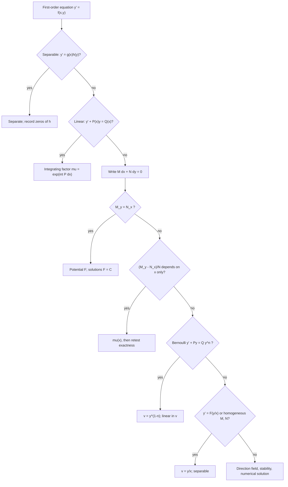
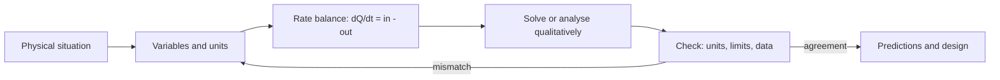

# First-Order Differential Equations

> [Mathematics](../../README.md) › [Differential Equations](../README.md) · Level: Intermediate · Prerequisites: [Differentiation Rules](../../07-calculus/04-differentiation-rules/README.md), [Applications of Derivatives](../../07-calculus/05-applications-of-derivatives/README.md), [The Fundamental Theorem of Calculus](../../07-calculus/07-fundamental-theorem-of-calculus/README.md), [Techniques of Integration](../../07-calculus/08-techniques-of-integration/README.md), [Exponential and Logarithmic Functions](../../03-algebra/12-exponential-and-logarithmic-functions/README.md) · Estimated time: 10 h

## 1. Introduction

Almost every quantitative law of nature is a statement about a *rate of change*, not about a value. Newton's second law equates acceleration, a second derivative, to force divided by mass; a cooling body loses heat at a rate proportional to the temperature difference with the room; a population grows at a rate proportional to its size until food runs short. In each case the law relates a function to its derivatives, and finding the function is a separate problem.

That problem is this topic. An equation relating an unknown function to its derivatives is a **differential equation**, and its order is that of the highest derivative present. First-order equations involve only $y'$ (equivalently $\dfrac{dy}{dx}$), and they come first because every higher-order method reduces to them, because the central qualitative questions — existence, uniqueness, interval of definition, long-run behaviour — can be posed and settled here in the simplest setting, and because the standard models of growth, decay, cooling, mixing, epidemics and terminal velocity are all first-order.

Four exact techniques cover most equations that can be solved in closed form:

| Technique | Recognisable form | Section |
|---|---|---|
| Separation of variables | $y' = f(x)\,g(y)$ | §7.2 |
| Integrating factor | $y' + P(x)y = Q(x)$ | §7.3 |
| Exact equations | $M\,dx + N\,dy = 0$ with $M_y = N_x$ | §7.4 |
| Substitution | Bernoulli $y' + Py = Qy^{n}$, or $y' = F(y/x)$ | §7.5 |

Beyond them lie **existence and uniqueness** (§7.6), which says when a model really determines its own future, and **qualitative analysis** (§7.1, §7.7), which extracts growth, decay, equilibria and stability without solving anything. Most equations that arise in practice have no formula at all; the qualitative theory is then not a consolation prize but the only answer, and usually the more useful one.

Historically, Newton solved $y' = f(x,y)$ by power series, Euler introduced the integrating factor, Leibniz and the Bernoullis classified the solvable families, Liouville proved in the 1830s that $y' = y^{2} + x$ is not solvable in elementary terms, and Picard and Lindelöf supplied the existence theory in the 1890s. Everything below is one of those steps made explicit.

## 2. Prerequisites

**Differentiation** ([Differentiation Rules](../../07-calculus/04-differentiation-rules/README.md), [Applications of Derivatives](../../07-calculus/05-applications-of-derivatives/README.md)). The chain rule in the composite form $\dfrac{d}{dx}F(y(x)) = F'(y(x))\,y'(x)$ is the engine of both the separation method and the integrating factor; the product rule is used to derive the latter; implicit differentiation is needed to recover $y'$ from a relation $F(x,y) = C$; the Mean Value Theorem is what turns "zero derivative" into "constant".

**Integration** ([The Fundamental Theorem of Calculus](../../07-calculus/07-fundamental-theorem-of-calculus/README.md), [Techniques of Integration](../../07-calculus/08-techniques-of-integration/README.md)). Both parts of the Fundamental Theorem; substitution, integration by parts and partial fractions; and the standard antiderivatives $\int \dfrac{du}{u} = \ln|u| + C$, $\int \dfrac{du}{1+u^{2}} = \arctan u + C$ and $\int e^{u}du = e^{u} + C$.

**Algebra** ([Exponential and Logarithmic Functions](../../03-algebra/12-exponential-and-logarithmic-functions/README.md)). The laws of exponents and logarithms, $e^{x} > 0$, and $\ln$ as the inverse of $\exp$ on $(0,\infty)$.

No linear algebra is assumed; the one place it would help is the dimension-two theory of [Second-Order Linear ODEs](../02-second-order-linear-odes/README.md).

## 3. Learning Objectives

After this tutorial you will be able to:

1. Define differential equation, order, linearity, homogeneity and autonomy, and classify a given equation.
2. Distinguish general, particular and singular solutions, and state the interval of definition of a solution.
3. Read a direction field, draw isoclines, and use $f$ and $y'' = f_x + f_y f$ to sketch solutions without solving.
4. Solve separable equations, justify the split $dy/h(y) = g(x)dx$ by the chain rule, and recover every lost solution.
5. Derive $\mu = e^{\int P\,dx}$ from the product rule and solve any first-order linear equation with it.
6. Test $M\,dx + N\,dy = 0$ for exactness, reconstruct the potential, and find integrating factors $\mu(x)$ and $\mu(y)$.
7. Solve Bernoulli equations and equations of the form $y' = F(y/x)$ by substitution.
8. State Picard–Lindelöf with its hypotheses, explain the contraction proof, and give examples of non-uniqueness and blow-up.
9. Solve the growth, cooling, mixing, logistic and terminal-velocity models, carrying units correctly.
10. Classify equilibria of $y' = f(y)$ from the sign of $f$ and prove that a bounded monotone solution converges to an equilibrium.

## 4. Intuition

**A differential equation is a field of slopes.** Given a point $(x,y)$, the right side $f(x,y)$ of $y' = f(x,y)$ returns the slope that a solution through that point must have. Draw a short segment of that slope everywhere and you have a **direction field**; a solution is a curve that threads through it, leaving each point in the prescribed direction. Existence says a curve can be drawn; uniqueness says only one leaves a given point.

This explains the shape of the theory. The field is a local object, so a solution is only guaranteed locally, and it ceases to exist when the curve runs off the field or turns vertical — which is why $y = 1/(1-x)$ solves $y' = y^{2}$, $y(0)=1$ only for $x<1$. The field shows where solutions rise and fall without giving a formula, which is why qualitative answers are often available when formulas are not. When $f$ depends on $y$ alone the field is translation invariant in $x$: every solution is a translate of every other, and the whole behaviour fits on one vertical line, the **phase line**.

**The four techniques are four ways of finding a curve from its slopes.** *Separation* applies when the slope factorises into an $x$-part and a $y$-part, so the two accumulations can be performed separately. *The integrating factor* is the product rule run backwards: multiply by a function chosen so that the left side becomes the derivative of a product. *Exactness* is the case where $(M,N)$ is a gradient field, so solutions are level curves of a potential — a conservation law. *Substitution* is a change of variable that turns the equation into one of the first three.

**Modelling is the same picture with units.** Every rate equation reads

$$\text{rate of change of } Q = \text{rate in} - \text{rate out},$$

with every term in the units of $Q$ per unit time. Matching units is the cheapest check on a model and catches most errors before any algebra.

## 5. Formal Definition

### 5.1 Differential equations, order, linearity

Let $D \subseteq \mathbb{R}^{2}$ be open and $f : D \to \mathbb{R}$.

> **Definition 5.1 (solution).** A **solution of $y' = f(x,y)$ on an interval $I$** is a differentiable $y : I \to \mathbb{R}$ with $(x,y(x)) \in D$ and $y'(x) = f(x,y(x))$ for all $x \in I$.

> **Definition 5.2 (order).** The **order** is that of the highest derivative present: $y' + xy = 0$ has order $1$, $y'' + y = 0$ order $2$, $(y')^{2} + y = 0$ order $1$.

> **Definition 5.3 (linearity).** An equation of order $n$ is **linear** if it can be written
> $$a_n(x)y^{(n)} + a_{n-1}(x)y^{(n-1)} + \dots + a_1(x)y' + a_0(x)y = g(x)$$
> with coefficients and $g$ depending on $x$ only. It is **homogeneous** if $g \equiv 0$. Otherwise it is **nonlinear**.

Linearity concerns how $y$ and its derivatives appear: to the first power, multiplied by functions of $x$, never inside $\sin y$ or $e^{y}$. Thus $y' + (\sin x)y = x^{2}$ is linear, while $y' + y^{2} = 0$, $y' = \sin y$ and $yy' = x$ are not. The second-order theory is [the next topic](../02-second-order-linear-odes/README.md); here only $y' + P(x)y = Q(x)$ is needed.

> **Definition 5.4 (autonomous).** The equation is **autonomous** if $f$ does not depend on $x$, that is $y' = f(y)$.

Autonomous equations are exactly those whose direction field is invariant under horizontal translation.

### 5.2 Solutions, general and particular; initial value problems

A solution may be **explicit**, a formula $y = \varphi(x)$, or **implicit**, a relation $F(x,y) = C$ satisfied by the solutions.

> **Definition 5.5 (general solution).** A one-parameter family $y = \varphi(x,C)$ is a **general solution** on a region if every solution there is obtained by some choice of $C$, with at most isolated exceptions.

> **Definition 5.6 (singular solution).** A solution not obtained from the general solution for any value of the constant is a **singular solution**.

The exceptions are real: $y' = y^{2}$ has general solution $y = -1/(x+C)$, while $y \equiv 0$ is a solution that no finite $C$ produces. Whether an equilibrium is lost or merely a limit must be decided, not assumed.

> **Definition 5.7 (initial value problem).** An **IVP** is a differential equation with a prescribed value: $y' = f(x,y)$, $y(x_0) = y_0$.

> **Definition 5.8 (interval of definition).** A solution is **maximal** if it cannot be extended to a larger interval on which it still solves the equation; the interval of definition is that of the maximal extension.

The interval is part of the answer. $y = \tan x$ solves $y' = 1 + y^{2}$ only on intervals of length $\pi$, and $y = 1/(1-x)$ solves $y' = y^{2}$, $y(0)=1$ only on $(-\infty,1)$, although neither formula displays the restriction.

### 5.3 Direction fields and isoclines

> **Definition 5.9 (direction field).** The **direction field** of $y' = f(x,y)$ assigns to each $(x,y) \in D$ the line through that point with slope $f(x,y)$.

> **Definition 5.10 (isocline).** For a constant $c$, the **isocline of slope $c$** is $\{(x,y) \in D : f(x,y) = c\}$.

For $y' = y - x$ the isoclines are the parallel lines $y = x + c$; every solution crossing one of them has slope $c$ there. Drawing a few isoclines, marking slopes on them and interpolating is the fastest way to sketch a direction field by hand.

## 6. Mathematical Notation

| Symbol | Read as | Meaning |
|---|---|---|
| $y'$, $\dfrac{dy}{dx}$, $\dot{y}$ | "y prime", "dee y dee x", "y dot" | derivative with respect to the independent variable; the dot is used when that variable is time |
| $f(x,y)$ | "f of x and y" | the right side; the slope assigned at $(x,y)$ |
| $D$, $I$ | "dee", "eye" | open domain of $f$; interval of $x$ on which a solution is defined |
| $y(x_0) = y_0$ | "y at x-zero equals y-zero" | initial condition; $(x_0,y_0)$ is the initial point |
| $P(x)$, $Q(x)$ | "P of x", "Q of x" | coefficient and forcing in $y' + Py = Q$ |
| $M(x,y)$, $N(x,y)$ | "M of x and y", "N of x and y" | coefficients of $M\,dx + N\,dy = 0$ |
| $M_y$, $N_x$ | "M sub y", "N sub x" | partial derivatives $\partial M/\partial y$, $\partial N/\partial x$ |
| $\mu(x)$ | "mu of x" | an integrating factor |
| $F(x,y)$ | "F of x and y" | a potential function |
| $y^{*}$ | "y star" | an equilibrium value of an autonomous equation |
| $L$ | "ell" | a Lipschitz constant |
| $n$ | "en" | the exponent in $y' + Py = Qy^{n}$ |

Two conventions: $\ln$ always means the natural logarithm, and an arbitrary constant is written once at the moment of integration and may be renamed afterwards ($C$, then $A$, then $K$ — the same family).

## 7. Core Concepts

### 7.1 Direction fields and qualitative analysis

Three kinds of information are available without solving anything.

**Monotonicity.** Where $f > 0$ every solution is strictly increasing, where $f < 0$ strictly decreasing; along a curve where $f = 0$ the tangents are horizontal.

**Concavity.** Differentiating $y' = f(x,y)$ and using the chain rule gives

$$y'' = \frac{\partial f}{\partial x} + \frac{\partial f}{\partial y}\,y' = f_x(x,y) + f_y(x,y)\,f(x,y).$$

The sign tells where solutions are concave up or down, hence where an inflection point must occur. For $y' = y - x$ we get $f_x = -1$ and $f_y = 1$, so $y'' = y' - 1$: solutions are concave up exactly where their slope exceeds $1$.

**Asymptotic behaviour.** Sometimes one curve organises the whole field. For $y' = y - x$ the line $y = x + 1$ is itself a solution, since $y' = 1$ and $y - x = 1$ agree there; above it $y' > 1$ and solutions rise away, below it $y' < 1$ and they fall away. Writing $u = y - (x+1)$ gives $u' = y' - 1 = y - x - 1 = u$, hence $u = Ce^{x}$ and

$$y = x + 1 + Ce^{x}.$$

That example also displays a structural fact used throughout the next topic: the difference of two solutions of a linear equation solves the homogeneous equation.

**A full sketch.** For $y' = y(1-y)$ we have $f > 0$ on $(0,1)$ and $f < 0$ outside. The lines $y = 0$ and $y = 1$ are solutions; solutions starting in $(0,1)$ increase, trapped between the equilibria; those starting above $1$ decrease towards $1$; those starting below $0$ decrease without bound. That is the complete qualitative picture, obtained in three lines and valid for every initial condition, and §9.9 confirms it exactly.

### 7.2 Separable equations

> **Definition 7.1.** The equation $y' = f(x,y)$ is **separable** if $f(x,y) = g(x)h(y)$.

The method accumulates the $x$-dependence on one side and the $y$-dependence on the other. The justification is short and worth reading carefully, because the informal version "multiply by $dx$" hides a use of the chain rule.

**Derivation.** Suppose $h(y) \ne 0$ on the interval where the solution lives, and let $G' = g$ and $H' = 1/h$. For a solution $y$, the chain rule gives

$$\frac{d}{dx}H(y(x)) = H'(y(x))\,y'(x) = \frac{y'(x)}{h(y(x))} = \frac{g(x)h(y(x))}{h(y(x))} = g(x) = G'(x).$$

The derivative of $H(y(x)) - G(x)$ vanishes on an interval, so by the Mean Value Theorem that difference is constant:

$$H(y(x)) - G(x) = C .$$

Because $H' = 1/h$ never vanishes, $H$ is strictly monotone, hence injective, and the relation can be solved: $y(x) = H^{-1}\bigl(G(x)+C\bigr)$, with $C = H(y_0) - G(x_0)$ to meet $y(x_0) = y_0$.

**Why splitting $dy/dx$ is legitimate here.** The symbol $\dfrac{dy}{dx}$ is not a quotient of numbers. The informal chain

$$\frac{dy}{dx} = g(x)h(y) \;\Longrightarrow\; \frac{dy}{h(y)} = g(x)\,dx \;\Longrightarrow\; \int\frac{dy}{h(y)} = \int g(x)\,dx$$

abbreviates the display above: both sides are differentials of the *same* function of $x$, namely $H(y(x))$ and $G(x)$, and equality of derivatives is what allows equality up to a constant. The rigorous form of "$du = y'\,dx$" is the substitution rule $\int \frac{y'(x)}{h(y(x))}dx = \int \frac{du}{h(u)}$. The step is legitimate because the left side depends on $x$ only through $y$; it is *not* a licence to cancel $d$'s elsewhere, and that is why the product rule has no such shortcut.

**Where solutions are lost.** The division requires $h(y) \ne 0$. If $h(y^{*}) = 0$ then $y \equiv y^{*}$ is a solution, since both sides vanish, and it may be approached by the family only as $C \to \pm\infty$, never attained. The procedure is therefore: (i) record every zero of $h$ as a constant solution; (ii) solve on each region where $h \ne 0$; (iii) state which constants are new.

**Example 7.1.** Solve $y' = y^{2}$. Here $h(y) = y^{2}$ has the zero $y = 0$, giving $y \equiv 0$; off it,

$$\int y^{-2}dy = \int dx \;\Longrightarrow\; -\frac{1}{y} = x + C \;\Longrightarrow\; y = -\frac{1}{x+C},$$

and the constant solution is not in this family. The full solution set is $y = -1/(x+C)$ together with $y \equiv 0$.

**Example 7.2.** Solve $y' = y/x$ for $x > 0$. Separation gives $\ln|y| = \ln x + C$, so $|y| = e^{C}x$ and $y = \pm e^{C}x$. With $K = \pm e^{C}$ this is $y = Kx$ for $K \ne 0$, and the lost solution $y \equiv 0$ supplies $K = 0$; hence $y = Kx$ for all $K \in \mathbb{R}$, on any interval avoiding $0$. The absolute value is what makes the sign of $K$ free; dropping it loses the negative solutions.

### 7.3 Linear equations and the integrating factor

A first-order linear equation in **standard form** is

$$y' + P(x)\,y = Q(x).$$

The left side is almost the derivative of a product: $(My)' = My' + M'y$. If $M' = MP$, multiplying by $M$ turns the left side into $(My)'$ and one integration finishes the problem. That is the whole idea.

**Derivation.** We want $My' + MPy = (My)' = My' + M'y$, so the coefficients of $y$ must agree:

$$MP = M' \quad\Longleftrightarrow\quad \frac{M'}{M} = P \quad\Longleftrightarrow\quad \ln|M| = \int P\,dx .$$

Taking $M > 0$ gives the **integrating factor**

$$\boxed{\;\mu(x) = \exp\!\left(\int P(x)\,dx\right).\;}$$

Multiplying the standard form by $\mu$ gives $(\mu y)' = \mu Q$, hence

$$\mu y = \int \mu Q\,dx + C, \qquad y = \frac{1}{\mu}\left(\int \mu Q\,dx + C\right).$$

The constant in $\int P\,dx$ is irrelevant: adding $c$ multiplies $\mu$ and $\int \mu Q\,dx$ by the same $e^{c}$, leaving the quotient unchanged, so the simplest antiderivative is always used.

**Validity.** $\mu$ is continuous and positive wherever $P$ is, so the division is legitimate. If $P$ and $Q$ are continuous on an interval $I$ containing $x_0$, then $\mu > 0$ and $\mu Q$ is continuous on $I$, the integral is finite on compact subintervals, and the solution exists on all of $I$: a linear equation cannot blow up inside the interval of continuity of its coefficients, in sharp contrast with $y' = y^{2}$.

**Structure of the solution set.** The formula reads

$$y = \underbrace{\frac{1}{\mu}\int \mu Q\,dx}_{\text{particular } y_p} + \underbrace{\frac{C}{\mu}}_{\text{homogeneous}}.$$

The second term is the general solution of $y' + Py = 0$, which separates to $\ln|y| = -\int P$ and gives $y = Ce^{-\int P} = C/\mu$. So: *general solution of the non-homogeneous equation = one particular solution + general solution of the homogeneous equation*. In the next topic this becomes the backbone of the whole theory.

**Example 7.3.** Solve $y' + y/x = x^{2}$ for $x > 0$. Here $\int P\,dx = \ln x$, so $\mu = x$ and

$$xy' + y = x^{3} \;\Longrightarrow\; (xy)' = x^{3} \;\Longrightarrow\; xy = \frac{x^{4}}{4} + C \;\Longrightarrow\; y = \frac{x^{3}}{4} + \frac{C}{x}.$$

*Check:* $y' + y/x = \frac{3x^{2}}{4} - \frac{C}{x^{2}} + \frac{x^{2}}{4} + \frac{C}{x^{2}} = x^{2}$ ✓

### 7.4 Exact equations and integrating factors

Write the equation in **differential form** $M(x,y)\,dx + N(x,y)\,dy = 0$, shorthand for $M + Ny' = 0$. Solving gives $y' = -M/N$ where $N \ne 0$, so this is the same object as before, but the symmetric appearance suggests a different question: is $(M,N)$ a gradient?

> **Definition 7.2 (exact).** The equation is **exact** on a region $R$ if some differentiable $F : R \to \mathbb{R}$ satisfies $F_x = M$ and $F_y = N$ there. Such an $F$ is a **potential function**.

If $F$ exists, then along a solution $\frac{d}{dx}F(x,y(x)) = F_x + F_y y' = M + Ny' = 0$, so $F$ is constant: the solutions are the level curves of the potential, and the equation is a conservation law.

> **Theorem 7.1 (exactness test).** Let $M, N$ have continuous first partial derivatives on a rectangle $R$ (more generally, on a simply connected region). Then $M\,dx + N\,dy = 0$ is exact on $R$ if and only if
> $$\frac{\partial M}{\partial y} = \frac{\partial N}{\partial x}$$
> there.

*Necessity.* If $F_x = M$ and $F_y = N$ with $F$ twice continuously differentiable, then $M_y = F_{xy} = F_{yx} = N_x$ by Clairaut's theorem.

*Sufficiency.* Assume $M_y = N_x$, fix $(x_0,y_0) \in R$ and define

$$F(x,y) = \int_{x_0}^{x}M(s,y_0)\,ds + \int_{y_0}^{y}N(x,t)\,dt .$$

Then $F_y = N(x,y)$ and, by the Fundamental Theorem of Calculus,

$$F_x = M(x,y_0) + \int_{y_0}^{y}N_x(x,t)\,dt = M(x,y_0) + \int_{y_0}^{y}M_y(x,t)\,dt = M(x,y_0) + M(x,y) - M(x,y_0) = M(x,y). \;\blacksquare$$

The "simply connected" clause matters: on a region with a hole the test can pass without a single-valued potential existing. Every region in this tutorial is a rectangle or half-plane, where the construction applies.

**Finding the potential.** Integrate $M$ with respect to $x$ at fixed $y$: $F = \int M\,dx + g(y)$. Differentiate with respect to $y$, set the result equal to $N$, and solve for $g'(y)$; exactness guarantees that the equation for $g'$ involves $y$ only.

**Example 7.4.** Solve $(2x+3y)\,dx + (3x+2y)\,dy = 0$. Here $M_y = 3 = N_x$, so the equation is exact.

$$F = \int(2x+3y)\,dx = x^{2} + 3xy + g(y), \qquad F_y = 3x + g'(y) = 3x + 2y \;\Longrightarrow\; g = y^{2}.$$

The solutions are $x^{2} + 3xy + y^{2} = C$. *Check:* implicit differentiation gives $2x + 3y + (3x+2y)y' = 0$ ✓

**Integrating factors.** When $M_y \ne N_x$, multiply by $\mu$ to make $\mu M\,dx + \mu N\,dy = 0$ exact. The condition is

$$\frac{\partial(\mu M)}{\partial y} = \frac{\partial(\mu N)}{\partial x} \quad\Longleftrightarrow\quad \mu\,(M_y - N_x) = N\,\mu_x - M\,\mu_y,$$

a partial differential equation for $\mu$ and in general harder than the original problem. Two cases are useful. If

$$\frac{M_y - N_x}{N} = \varphi(x)$$

depends on $x$ alone, seek $\mu = \mu(x)$: the condition collapses to $\mu' = \varphi\mu$, so $\mu = e^{\int\varphi\,dx}$. Symmetrically, if $(N_x - M_y)/M = \psi(y)$ depends on $y$ alone, then $\mu = e^{\int\psi\,dy}$ works. The justification is exactly the computation above: with $\mu = \mu(x)$ the condition reads $\mu(M_y - N_x) = \mu'N$, a separable equation. There is no general algorithm; when neither quotient simplifies one tries $\mu = x^{a}y^{b}$ or a function of $x+y$, and success is a matter of luck and experience.

**Example 7.5.** Solve $(3xy + y^{2})\,dx + (x^{2} + xy)\,dy = 0$. First, $M_y = 3x + 2y$ and $N_x = 2x + y$ differ. But

$$\frac{M_y - N_x}{N} = \frac{x+y}{x(x+y)} = \frac{1}{x},$$

so $\mu = e^{\int dx/x} = x$. Multiplying gives $(3x^{2}y + xy^{2})dx + (x^{3} + x^{2}y)dy = 0$, whose coefficients satisfy $M_y = 3x^{2} + 2xy = N_x$. Then

$$F = x^{3}y + \frac{x^{2}y^{2}}{2} + g(y), \qquad F_y = x^{3} + x^{2}y + g'(y) = x^{3} + x^{2}y \;\Longrightarrow\; g' = 0,$$

so the solutions are $x^{3}y + \tfrac{1}{2}x^{2}y^{2} = C$.

### 7.5 Substitutions: Bernoulli and homogeneous equations

**Bernoulli equations.** For $n \ne 0,1$, the equation

$$y' + P(x)\,y = Q(x)\,y^{n}$$

becomes linear under $v = y^{1-n}$. Dividing by $y^{n}$ gives $y^{-n}y' + Py^{1-n} = Q$; since $v' = (1-n)y^{-n}y'$, this is

$$\frac{v'}{1-n} + Pv = Q \quad\Longleftrightarrow\quad v' + (1-n)P\,v = (1-n)Q .$$

The cases $n = 0$ and $n = 1$ are already linear: $n = 0$ gives $y' + Py = Q$, and $n = 1$ gives $y' + (P-Q)y = 0$. For $n > 0$ the solution $y \equiv 0$ is destroyed by the division and must be reinstated; for non-integer $n$, $y^{n}$ requires $y > 0$ and the solution lives on an interval where that holds.

**Example 7.6.** Solve $y' + y = xy^{3}$. With $n = 3$ and $v = y^{-2}$, division by $y^{3}$ gives $-v'/2 + v = x$, that is $v' - 2v = -2x$. Then $\mu = e^{-2x}$ and $(ve^{-2x})' = -2xe^{-2x}$, so by parts

$$ve^{-2x} = xe^{-2x} + \tfrac{1}{2}e^{-2x} + C \;\Longrightarrow\; v = x + \tfrac{1}{2} + Ce^{2x}.$$

Thus $y^{-2} = x + \tfrac{1}{2} + Ce^{2x}$, and $y \equiv 0$ is an additional solution.

**Homogeneous equations.** If

$$y' = F\!\left(\frac{y}{x}\right),$$

the substitution $v = y/x$, that is $y = xv$ and $y' = v + xv'$, gives

$$v + xv' = F(v) \quad\Longleftrightarrow\quad x\,v' = F(v) - v \quad\Longleftrightarrow\quad \frac{dv}{F(v)-v} = \frac{dx}{x},$$

a separable equation. The name clashes with "homogeneous linear" (zero right side); the form of the equation decides which is meant. The same substitution handles $M\,dx + N\,dy = 0$ when $M$ and $N$ are homogeneous of the same degree $k$: then $y = xv$ factors out $x^{k-1}$ and reduces the equation to separable form.

**Example 7.7.** Solve $y' = \dfrac{x+y}{x-y}$. Dividing by $x$ gives $F(v) = \frac{1+v}{1-v}$, so

$$xv' = \frac{1+v}{1-v} - v = \frac{1+v^{2}}{1-v} \;\Longrightarrow\; \frac{1-v}{1+v^{2}}\,dv = \frac{dx}{x} .$$

Integration gives $\arctan v - \tfrac{1}{2}\ln(1+v^{2}) = \ln|x| + C$, and since $\tfrac{1}{2}\ln(1+v^{2}) + \ln|x| = \tfrac{1}{2}\ln(x^{2}+y^{2})$,

$$\arctan\!\left(\frac{y}{x}\right) = \frac{1}{2}\ln\left(x^{2}+y^{2}\right) + C .$$

The implicit form is the answer; solving for $y$ would require inverting an arctangent inside a logarithm and gains nothing. Note that $x = y$ is excluded, because the original equation has a zero denominator there.

**The linear substitution.** For $y' = f(ax + by + c)$ with $b \ne 0$, put $v = ax + by + c$. Then $v' = a + bf(v)$, which separates: $\dfrac{dv}{a + bf(v)} = dx$. For example $y' = (x+y)^{2}$ gives $v' = 1 + v^{2}$, hence $\arctan v = x + C$ and $y = \tan(x+C) - x$, valid between consecutive zeros of the cosine.

### 7.6 Existence and uniqueness: the Picard–Lindelöf theorem

> **Theorem 7.2 (Picard–Lindelöf).** Let $D \subseteq \mathbb{R}^{2}$ be open, $f : D \to \mathbb{R}$ continuous, $(x_0,y_0) \in D$. Suppose $f$ is **locally Lipschitz in $y$**: near $(x_0,y_0)$ there is $L$ with
> $$\lvert f(x,y_1) - f(x,y_2)\rvert \le L\,\lvert y_1 - y_2\rvert .$$
> Then for some $\delta > 0$ the IVP $y' = f(x,y)$, $y(x_0) = y_0$ has exactly one solution on $(x_0-\delta,\,x_0+\delta)$.

A sufficient condition, used in every application, is that $f_y$ exists and is continuous near the point: then the Mean Value Theorem gives $f(x,y_1) - f(x,y_2) = f_y(x,\xi)(y_1-y_2)$ and $L$ is the maximum of $|f_y|$ nearby.

**Intuition: the solution is a fixed point.** Integrating the equation from $x_0$ to $x$ gives the equivalent **integral equation**

$$y(x) = y_0 + \int_{x_0}^{x}f\bigl(s,y(s)\bigr)\,ds .$$

Define $(Ty)(x) = y_0 + \int_{x_0}^{x}f(s,y(s))\,ds$ on continuous functions with the supremum norm. A solution is a fixed point of $T$, and $T$ is a **contraction**:

$$\lVert Tu - Tv\rVert \le L\,\lvert x-x_0\rvert\,\lVert u-v\rVert \le L\delta\,\lVert u-v\rVert,$$

so choosing $\delta < 1/L$ makes the factor less than $1$ and the Banach fixed point theorem gives a unique fixed point. The proof is constructive: the **Picard iterates** $y_0(x) \equiv y_0$ and

$$y_{n+1}(x) = y_0 + \int_{x_0}^{x}f\bigl(s,y_n(s)\bigr)\,ds$$

converge uniformly to the solution, and each is an explicit polynomial when $f$ is polynomial. This is how Newton computed series solutions, and it is the prototype of every numerical method.

**The hypotheses cannot be dropped.** Continuity alone gives existence (Peano) but not uniqueness. For

$$y' = 3y^{2/3}, \qquad y(0) = 0,$$

$f$ is continuous but $\lvert f(y) - f(0)\rvert/\lvert y\rvert = 3\lvert y\rvert^{-1/3} \to \infty$, so no Lipschitz constant exists at the origin — and indeed both $y \equiv 0$ and $y = x^{3}$ solve the IVP. Worse, for every $c \ge 0$ the function equal to $0$ for $x \le c$ and to $(x-c)^{3}$ for $x \ge c$ is a solution, so infinitely many solutions pass through the origin. Uniqueness fails exactly where the field becomes vertical in the $y$-direction.

**The theorem is local.** For $y' = y^{2}$ with $y(0) = 1$ the solution $y = 1/(1-x)$ exists only for $x < 1$. The theorem promises a solution on *some* interval about $0$ — here $(-1,1)$ is the best possible — and says nothing about its size. Blow-up in finite time is a genuine feature of nonlinear equations, not an artefact of the method.

**Linear equations are globally solvable.** If $P, Q$ are continuous on an interval $I$ containing $x_0$, then $f(x,y) = Q(x) - P(x)y$ satisfies $\lvert f(x,y_1) - f(x,y_2)\rvert = \lvert P(x)\rvert\lvert y_1-y_2\rvert$, so $f$ is Lipschitz in $y$ on every compact subinterval; patching local solutions together extends the solution to all of $I$, exactly as the formula of §7.3 confirms.

### 7.7 Autonomous equations: equilibria and stability

> **Definition 7.3 (equilibrium).** A number $y^{*}$ with $f(y^{*}) = 0$ is an **equilibrium** of $y' = f(y)$; the constant function $y \equiv y^{*}$ is the corresponding equilibrium solution.

> **Definition 7.4 (stability).** An equilibrium $y^{*}$ is **stable** if for every $\varepsilon > 0$ there is $\delta > 0$ such that every solution with $\lvert y(x_0) - y^{*}\rvert < \delta$ satisfies $\lvert y(x) - y^{*}\rvert < \varepsilon$ for all $x \ge x_0$. It is **asymptotically stable** if it is stable and every solution starting sufficiently near converges to it, and **unstable** if it is not stable.

**The phase line.** Between consecutive equilibria $f$ has constant sign. Where $f > 0$ every solution with a value there is strictly increasing and, by uniqueness, can never leave the interval; hence it converges to an endpoint. Marking arrows on the line according to the sign of $f$ gives the **phase line**, and the arrows are the whole story.

**The linearisation test.** Let $f$ be continuously differentiable at the equilibrium $y^{*}$.

* If $f'(y^{*}) < 0$, then $y^{*}$ is asymptotically stable.
* If $f'(y^{*}) > 0$, then $y^{*}$ is unstable.
* If $f'(y^{*}) = 0$, the test gives no information.

*Why.* In the first case choose $m > 0$ and an interval $(y^{*}-\delta, y^{*}+\delta)$ on which $f' \le -m < 0$. There $f$ is strictly decreasing with $f(y^{*}) = 0$, so $f > 0$ just below $y^{*}$ and $f < 0$ just above: solutions are pushed towards $y^{*}$ and cannot cross it. A solution starting in the interval is monotone and bounded, so it has a limit $L$, and Lemma 7.1 below forces $f(L) = 0$; the only zero in the interval is $y^{*}$. The second case is the same argument with $f$ increasing, so the arrows point away.

*Why the third case is inconclusive.* All three behaviours occur at a flat equilibrium:

| Equation | $f'(0)$ | Behaviour of $y \equiv 0$ |
|---|---|---|
| $y' = -y^{3}$ | $0$ | asymptotically stable; solutions decay like $(2x)^{-1/2}$ |
| $y' = y^{3}$ | $0$ | unstable; solutions blow up in finite time |
| $y' = y^{2}$ | $0$ | unstable, but approached from below only (semistable) |

> **Lemma 7.1.** Let $f$ be continuous and let $y$ solve $y' = f(y)$ on $[0,\infty)$, bounded and eventually monotone. Then $L = \lim_{x\to\infty}y(x)$ exists and $f(L) = 0$.

*Proof.* A bounded monotone function has a limit $L$. For each integer $n$ the Mean Value Theorem gives $y(n+1) - y(n) = y'(\xi_n) = f(y(\xi_n))$ with $\xi_n \in (n,n+1)$. The left side tends to $0$ and $y(\xi_n) \to L$, so by continuity $f(L) = 0$. $\blacksquare$

**Example 7.8.** For the logistic equation $y' = ry(1 - y/K)$ with $r,K > 0$, the equilibria are $0$ and $K$, and $f'(y) = r - 2ry/K$ gives $f'(0) = r > 0$ (unstable) and $f'(K) = -r < 0$ (asymptotically stable). The arrows point right on $(0,K)$ and left on $(K,\infty)$, so every positive initial value converges to $K$; §9.9 verifies this from the explicit formula.

## 8. Formulas and Properties

Each statement is given with the hypotheses under which it holds; every one of them fails somewhere outside them.

### 8.1 Structure of the linear equation

> **Theorem 8.1.** Let $P, Q$ be continuous on an interval $I$ and let $y_p$ be one solution of $y' + Py = Q$ on $I$. Then the solutions on $I$ are exactly $y = y_p + Ce^{-\int P\,dx}$, $C \in \mathbb{R}$.

*Proof.* For any solution $y$, the difference $u = y - y_p$ satisfies $u' + Pu = 0$ (linearity of differentiation). That equation separates to $u'/u = -P$ wherever $u \ne 0$, giving $u = Ce^{-\int P}$; the zero solution is $C = 0$, and uniqueness rules out a solution that vanishes at one point and not elsewhere. Conversely each $y_p + Ce^{-\int P}$ is a solution. $\blacksquare$

Two consequences are used constantly. The difference of two solutions of the non-homogeneous equation solves the homogeneous equation — that is why every physical "transient" is a homogeneous solution. And two solutions of the same IVP agree everywhere, which is the standard way to prove that a guessed particular solution is *the* one.

### 8.2 Separable equations

> **Theorem 8.2.** Let $g$ be continuous on $I_x$, $h$ continuous on $I_y$, and $H' = 1/h$ on a subinterval where $h \ne 0$. Then the solutions of $y' = g(x)h(y)$ with values in that subinterval satisfy $H(y) = \int g(x)\,dx + C$ implicitly, and each relation defines a unique differentiable $y$ locally because $H' \ne 0$. The zeros of $h$ give additional constant solutions.

### 8.3 The integrating factor

> **Theorem 8.3.** For continuous $P, Q$ on $I$ and $\mu = e^{\int P\,dx}$,
> $$y' + P(x)y = Q(x) \quad\Longleftrightarrow\quad \bigl(\mu(x)y\bigr)' = \mu(x)Q(x),$$
> and the general solution is $y = \mu^{-1}\left(\int\mu Q\,dx + C\right)$.

*Proof.* $\mu' = \mu P$, so $(\mu y)' = \mu y' + \mu' y = \mu(y' + Py)$; since $\mu > 0$ on $I$, multiplying or dividing by $\mu$ is reversible. $\blacksquare$

The identity $\mu' = \mu P$ is the whole content: an integrating factor is a function whose logarithmic derivative is the coefficient of $y$.

### 8.4 Exact equations

> **Theorem 8.4.** Let $M, N$ have continuous partial derivatives on a rectangle $R$. Then $M\,dx + N\,dy = 0$ is exact on $R$ if and only if $M_y = N_x$; when it is, the solutions are the level curves $F = C$ of any potential with $F_x = M$, $F_y = N$.

The proof, including the explicit construction of $F$, is in §7.4. The rectangle is what makes the construction legal: on a region with a hole, $M_y = N_x$ does not imply exactness.

### 8.5 Bernoulli equations

> **Theorem 8.5.** For $n \ne 0,1$, the substitution $v = y^{1-n}$ turns $y' + P(x)y = Q(x)y^{n}$ into the linear equation $v' + (1-n)P(x)\,v = (1-n)Q(x)$.

*Proof.* Multiply the equation by $(1-n)y^{-n}$ and use $(1-n)y^{-n}y' = v'$. $\blacksquare$ The solution $y \equiv 0$, present when $n > 0$, is destroyed by the division and must be reinstated.

### 8.6 Homogeneous equations

> **Theorem 8.6.** If $F$ is continuous, the substitution $v = y/x$ (on $x > 0$ or $x < 0$) turns $y' = F(y/x)$ into the separable equation $x v' = F(v) - v$.

*Proof.* $y = xv$ gives $y' = v + xv'$ and $F(y/x) = F(v)$. $\blacksquare$ The zeros of $F(v) - v$ correspond to straight-line solutions $y = v^{*}x$, lost in the separation.

### 8.7 Autonomous equations

> **Theorem 8.7.** Let $f$ be continuously differentiable near an equilibrium $y^{*}$. If $f'(y^{*}) < 0$ then $y^{*}$ is asymptotically stable; if $f'(y^{*}) > 0$ it is unstable; if $f'(y^{*}) = 0$ nothing follows.

> **Corollary 8.1.** Every bounded, eventually monotone solution of $y' = f(y)$ with $f$ continuous converges to an equilibrium.

The corollary explains why the phase line is a complete description: a solution cannot oscillate, because $y'$ has one sign between consecutive equilibria, and it cannot stop anywhere except at an equilibrium.

### 8.8 Existence and uniqueness

> **Theorem 8.8 (Picard–Lindelöf).** If $f$ and $f_y$ are continuous near $(x_0,y_0)$, then $y' = f(x,y)$, $y(x_0)=y_0$ has a unique solution on some interval about $x_0$.

Three corollaries are used throughout. **No crossing:** two distinct solutions of the same equation cannot touch, since both would solve the IVP at the touching point; this is why a solution trapped between two equilibria stays there. **Continuous dependence on data:** the contraction estimate shows the solution depends continuously on $(x_0,y_0)$, which is what makes a model predictive. **Local, not global:** the interval may be arbitrarily small, and blow-up can occur at its end.

### 8.9 Decision checklist

| Look at the equation | Try | Section |
|---|---|---|
| Can it be written $y' = g(x)h(y)$? | separation; record zeros of $h$ | §7.2 |
| Is it, or can it be put in, the form $y' + P(x)y = Q(x)$? | integrating factor $\mu = e^{\int P}$ | §7.3 |
| Is it $M\,dx + N\,dy = 0$ with $M_y = N_x$? | potential $F$; solutions $F = C$ | §7.4 |
| Does $(M_y - N_x)/N$ depend on $x$ only? | integrating factor $e^{\int (M_y-N_x)/N\,dx}$ | §7.4 |
| Is it $y' + Py = Qy^{n}$, $n \ne 0,1$? | Bernoulli $v = y^{1-n}$ | §7.5 |
| Is it $y' = F(y/x)$? | $v = y/x$ | §7.5 |
| Is it $y' = f(ax+by+c)$? | $v = ax+by+c$ | §7.5 |
| None of these | direction field, stability analysis, numerical methods | §7.1, §7.6 |

## 9. Step-by-Step Examples

Every example ends with a verification by substitution, because that is the only proof that a candidate solution is a solution.

### 9.1 A separable initial value problem

Solve $\dfrac{dy}{dx} = 2xy$ with $y(0) = 1$.

*Strategy: the right side factorises with $g(x) = 2x$ and $h(y) = y$, so separate.*

The only zero of $h$ is $y = 0$, giving the constant solution $y \equiv 0$, which is irrelevant here because $y(0) = 1$. For $y \ne 0$,

$$\frac{dy}{y} = 2x\,dx \;\Longrightarrow\; \ln|y| = x^{2} + C \;\Longrightarrow\; |y| = e^{C}e^{x^{2}} .$$

Since $y(0) = 1 > 0$ and a solution cannot cross zero without violating uniqueness, $y = e^{C}e^{x^{2}}$ and the condition $y(0)=1$ gives $e^{C} = 1$. Hence

$$y = e^{x^{2}}, \qquad x \in \mathbb{R}.$$

*Check:* $y' = 2xe^{x^{2}} = 2xy$ ✓ and $y(0) = 1$ ✓. The formula is defined for every $x$ and never leaves the domain of $f$, so the maximal interval is $\mathbb{R}$.

### 9.2 A separable equation with lost solutions

Solve $y' = y^{2} - 4$.

*Strategy: factor first and record the zeros of the $y$-factor.*

Since $y^{2} - 4 = (y-2)(y+2)$, the constant solutions are $y \equiv 2$ and $y \equiv -2$. Off them,

$$\frac{dy}{y^{2}-4} = dx, \qquad \frac{1}{y^{2}-4} = \frac{1}{4}\left(\frac{1}{y-2} - \frac{1}{y+2}\right),$$

so $\tfrac{1}{4}\ln\left\lvert\frac{y-2}{y+2}\right\rvert = x + C$, that is $\left\lvert\frac{y-2}{y+2}\right\rvert = Ke^{4x}$ with $K > 0$. Dropping the absolute value lets the constant be any real $A$:

$$\frac{y-2}{y+2} = Ae^{4x} \;\Longrightarrow\; y - 2 = Ae^{4x}(y+2) \;\Longrightarrow\; y = 2\,\frac{1 + Ae^{4x}}{1 - Ae^{4x}} .$$

*Remarks.* Setting $A = 0$ gives $y = 2$; the solution $y = -2$ is the limit $A \to \pm\infty$ and is never attained, so it is a singular solution and must be listed separately. The formula has a vertical asymptote where $Ae^{4x} = 1$, so each branch is defined on one side of that point. Between the equilibria the solutions are bounded and converge to $2$ as $x\to\infty$ and to $-2$ as $x\to-\infty$, exactly as the phase line predicts.

*Check:* differentiating gives $y' = \dfrac{16Ae^{4x}}{(1-Ae^{4x})^{2}}$ and $y^{2} - 4 = 4\,\dfrac{(1+Ae^{4x})^{2} - (1-Ae^{4x})^{2}}{(1-Ae^{4x})^{2}} = \dfrac{16Ae^{4x}}{(1-Ae^{4x})^{2}}$ ✓

### 9.3 Newton's law of cooling, with units

A cup of coffee at $90\,^{\circ}\mathrm{C}$ stands in a room at $20\,^{\circ}\mathrm{C}$. It cools at a rate proportional to the excess temperature, with $k = 0.05\ \mathrm{min}^{-1}$. Find the temperature after $10$ minutes and the time to reach $30\,^{\circ}\mathrm{C}$.

*Model.* With $T$ in $^{\circ}\mathrm{C}$ and $t$ in minutes,

$$\frac{dT}{dt} = -k(T - T_m), \qquad T(0) = 90, \quad T_m = 20 .$$

Both sides carry $^{\circ}\mathrm{C}/\mathrm{min}$, and $k$ carries $\mathrm{min}^{-1}$, so $kt$ is dimensionless — as an exponent must be.

*Solve.* Separation gives $\ln(T - T_m) = -kt + C$, hence $T = T_m + Ae^{-kt}$, and $T(0) = 90$ gives $A = 70$:

$$T(t) = 20 + 70e^{-0.05t}.$$

*Answer.* $T(10) = 20 + 70e^{-0.5} \approx 62.5\,^{\circ}\mathrm{C}$. For $T = 30$: $e^{-0.05t} = 10/70 = 1/7$, so $t = 20\ln 7 \approx 38.9$ minutes.

*Check:* $T(0) = 90$ ✓, $T \to 20 = T_m$ as $t \to \infty$ ✓, and $T$ is decreasing ✓.

### 9.4 A linear equation with constant coefficients

Solve $y' + 2y = 4x$ with $y(0) = 3$.

*Strategy: standard form with $P = 2$, so $\mu = e^{2x}$.*

$$(ye^{2x})' = 4xe^{2x} \;\Longrightarrow\; ye^{2x} = 4\int xe^{2x}dx = 2xe^{2x} - e^{2x} + C,$$

using integration by parts with $u = x$, $dv = e^{2x}dx$. Hence $y = 2x - 1 + Ce^{-2x}$, and $y(0) = 3$ gives $C = 4$:

$$y = 2x - 1 + 4e^{-2x}.$$

*Check:* $y' = 2 - 8e^{-2x}$, so $y' + 2y = 2 - 8e^{-2x} + 4x - 2 + 8e^{-2x} = 4x$ ✓ and $y(0) = 3$ ✓.

*Reading the answer:* $2x - 1$ is the long-run response to the forcing $4x$ (a particular solution), and $4e^{-2x}$ is the transient, decaying at the rate $2$ of the homogeneous equation — the split of Theorem 8.1.

### 9.5 A linear equation with variable coefficients

Solve $y' + (\tan x)y = \sec x$ on $\left(-\tfrac{\pi}{2},\tfrac{\pi}{2}\right)$ with $y(0) = 1$.

*Strategy: $P = \tan x$ is continuous on that interval, so the integrating factor exists there.*

Since $\int\tan x\,dx = -\ln(\cos x)$ and $\cos x > 0$ on the interval, $\mu = e^{-\ln\cos x} = \sec x$. Multiplying,

$$\sec x\,y' + \sec x\tan x\,y = \sec^{2}x \quad\Longleftrightarrow\quad (y\sec x)' = \sec^{2}x,$$

and since $(\tan x)' = \sec^{2}x$,

$$y\sec x = \tan x + C \;\Longrightarrow\; y = \sin x + C\cos x .$$

The condition $y(0) = 1$ gives $C = 1$, so $y = \sin x + \cos x$ on the whole interval.

*Check:* $y' = \cos x - \sin x$ and

$$y' + (\tan x)y = \cos x - \sin x + \frac{\sin^{2}x}{\cos x} + \sin x = \frac{\cos^{2}x + \sin^{2}x}{\cos x} = \sec x. \;\checkmark$$

*Why the interval stops:* $\tan x$ and $\sec x$ are continuous exactly on the interval given; at the endpoints $\cos x = 0$ and the solution cannot be continued.

### 9.6 An exact equation with an initial value

Solve $(2xy + \cos x)\,dx + (x^{2} - 1)\,dy = 0$ with $y(0) = 2$.

*Test.* $M = 2xy + \cos x$ and $N = x^{2} - 1$ give $M_y = 2x = N_x$, so the equation is exact.

*Potential.*

$$F = \int(2xy + \cos x)\,dx = x^{2}y + \sin x + g(y), \qquad F_y = x^{2} + g'(y) = x^{2} - 1 \;\Longrightarrow\; g(y) = -y .$$

So $F = x^{2}y + \sin x - y$ and the solutions are $x^{2}y + \sin x - y = C$. The initial condition gives $C = F(0,2) = -2$, hence

$$y\,(x^{2}-1) = -2 - \sin x \;\Longrightarrow\; y = \frac{2 + \sin x}{1 - x^{2}}, \qquad -1 < x < 1.$$

*Check:* differentiating $x^{2}y + \sin x - y = -2$ gives $(2xy + \cos x) + (x^{2}-1)y' = 0$ ✓, which is the original equation multiplied by $dx$.

### 9.7 A Bernoulli equation

Solve $y' + y = e^{x}y^{2}$.

*Strategy: $n = 2$, so $v = y^{-1}$ and $v' = -y^{-2}y'$.*

Dividing by $y^{2}$ gives $y^{-2}y' + y^{-1} = e^{x}$, that is $-v' + v = e^{x}$, so

$$v' - v = -e^{x} .$$

Here $P = -1$, $\mu = e^{-x}$ and $(ve^{-x})' = -1$, hence $ve^{-x} = -x + C$ and $v = (C-x)e^{x}$. Therefore

$$y = \frac{1}{v} = \frac{e^{-x}}{C - x},$$

together with the solution $y \equiv 0$ destroyed by the division by $y^{2}$. Each branch is defined on $(-\infty,C)$ or $(C,\infty)$; with $y(0) = y_0 \ne 0$ we get $C = 1/y_0$.

*Check:* $y' = -e^{-x}(C-x)^{-1} + e^{-x}(C-x)^{-2}$, so $y' + y = e^{-x}(C-x)^{-2} = e^{x}y^{2}$ ✓

### 9.8 A homogeneous equation

Solve $(x^{2} - y^{2})\,dx + 2xy\,dy = 0$ for $x > 0$.

*Strategy: $M$ and $N$ are homogeneous of degree $2$, so put $y = xv$ and $dy = v\,dx + x\,dv$.*

$$(x^{2} - x^{2}v^{2})\,dx + 2x^{2}v\,(v\,dx + x\,dv) = 0 \;\Longrightarrow\; \left(1 + v^{2}\right)dx + 2vx\,dv = 0,$$

after dividing by $x^{2}$ and collecting. This separates:

$$\frac{2v}{1+v^{2}}\,dv = -\frac{dx}{x} \;\Longrightarrow\; \ln\left(1+v^{2}\right) = -\ln x + C \;\Longrightarrow\; x\left(1+v^{2}\right) = K .$$

Substituting $v = y/x$ gives $x^{2} + y^{2} = Kx$, that is $\left(x - \tfrac{K}{2}\right)^{2} + y^{2} = \left(\tfrac{K}{2}\right)^{2}$: the solutions are circles through the origin with centres on the $x$-axis, restricted to $x > 0$.

*Check:* differentiating $x^{2} + y^{2} = Kx$ gives $2x + 2yy' = K = (x^{2}+y^{2})/x$, and multiplying by $x$ gives $2x^{2} + 2xyy' = x^{2} + y^{2}$, that is $(x^{2}-y^{2}) + 2xy\,y' = 0$ ✓

### 9.9 The logistic equation with numbers

A fish population $P(t)$, in thousands, obeys $P' = 0.5\,P\left(1 - P/200\right)$ with $P(0) = 20$. Find $P(t)$, the long-run population and the time at which $P = 100$.

*Separate.* The equilibria are $0$ and $200$, and the initial value lies between them, so the solution stays there and division by $P(1 - P/200)$ is legitimate:

$$\int\frac{dP}{P\left(1 - P/200\right)} = \int 0.5\,dt, \qquad \frac{1}{P\left(1 - P/200\right)} = \frac{1}{P} + \frac{1/200}{1 - P/200}.$$

Integrating, $\ln\dfrac{P}{1 - P/200} = 0.5t + C$, so $\dfrac{P}{1 - P/200} = Ae^{0.5t}$ and

$$P\left(1 + \frac{Ae^{0.5t}}{200}\right) = Ae^{0.5t} \;\Longrightarrow\; P = \frac{200}{1 + \dfrac{200}{A}e^{-0.5t}} .$$

*Initial condition.* $P(0) = 20$ gives $1 + 200/A = 10$, so $A = 200/9$ and

$$P(t) = \frac{200}{1 + 9e^{-0.5t}} .$$

*Answer.* As $t\to\infty$, $P \to 200$, the carrying capacity. Setting $P = 100$ gives $1 + 9e^{-0.5t} = 2$, so $e^{-0.5t} = 1/9$ and $t = 2\ln 9 \approx 4.39$ years (with $t$ in years), at which point the stock is one hundred thousand fish.

*Check:* $P(0) = 200/10 = 20$ ✓. Also $P' = \dfrac{200\cdot 4.5e^{-0.5t}}{(1+9e^{-0.5t})^{2}}$ and

$$0.5\,P\left(1 - \frac{P}{200}\right) = 0.5\cdot\frac{200}{1+9e^{-0.5t}}\cdot\frac{9e^{-0.5t}}{1+9e^{-0.5t}} = \frac{900e^{-0.5t}}{(1+9e^{-0.5t})^{2}},$$

which agrees since $200\cdot 4.5 = 900$ ✓

## 10. Visual Explanations

### 10.1 Choosing a method

The decision tree below is the practical content of the checklist in §8.9: the first test that succeeds wins, and if all fail only the qualitative and numerical tools remain.

### 10.2 Reading an autonomous equation from its phase line

For $y' = f(y)$ the sign of $f$ between consecutive equilibria determines everything; the table lists the four possible patterns and the verdicts that the linearisation test reproduces whenever $f'(y^{*}) \ne 0$.

| Sign pattern | Arrows | Verdict at $y^{*}$ |
|---|---|---|
| $+$ then $-$ | $\rightarrow\; y^{*} \;\leftarrow$ | asymptotically stable (sink) |
| $-$ then $+$ | $\leftarrow\; y^{*} \;\rightarrow$ | unstable (source) |
| $+$ then $+$ | $\rightarrow\; y^{*} \;\rightarrow$ | semistable: unstable, approached from the left only |
| $-$ then $-$ | $\leftarrow\; y^{*} \;\leftarrow$ | semistable: unstable, approached from the right only |

The semistable rows are exactly the flat cases $f'(y^{*}) = 0$ in which $f$ does not change sign, such as $y' = y^{2}$ at $y^{*} = 0$. Drawing the phase line is therefore not a preliminary to the theory but a complete substitute for it.

### 10.3 The modelling cycle

Every application in §12 runs the same loop, which is why differential equations are the language of applied mathematics.

The check is not optional: units must balance in the equation *and* in the solution, the limits $t \to 0$ and $t \to \infty$ must reproduce the physics, and the predictions must be compared with data before the model is trusted.

## 11. Common Mistakes

**1. Dividing by $h(y)$ and forgetting the lost solutions.** In $y' = y^{2}$ the division hides $y \equiv 0$; in $y' = y^{2} - 4$ it hides $y \equiv \pm 2$; in $y' = y(1-y)$ it hides both equilibria. Factor first, record the zeros, and say at the end which of them the family does not contain.

**2. Dropping the absolute value in $\int dy/y$.** Writing $\ln y$ instead of $\ln|y|$ silently assumes $y > 0$. The correct chain is $\ln|y| = \dots$, then $|y| = e^{C}e^{\dots}$, then $y = \pm e^{C}e^{\dots}$; the sign belongs to the constant and must survive.

**3. Wrong sign in the integrating factor.** For $y' - 3y = \dots$ the factor is $e^{-3x}$, not $e^{3x}$. The one-line test is $\mu' = P\mu$; if it fails, the product $(\mu y)'$ will not reproduce the equation.

**4. Adding the constant twice, or not at all.** One integration, one constant. A constant inserted into $\mu = e^{\int P + c}$ cancels and should be omitted; a forgotten constant loses the whole family except one member.

**5. Treating $dy/dx$ as a fraction everywhere.** It is legitimate shorthand only in the chain-rule computation of §7.2, where the left side depends on $x$ through $y$ alone. It is not a licence to cancel $d$'s in $\frac{d}{dx}(uv)$, and it does not apply to an equation such as $y' = x+y$ that does not separate.

**6. Declaring exactness without testing.** $M\,dx + N\,dy = 0$ is exact only if $M_y = N_x$. A frequent error is to integrate $M$, differentiate the result with respect to $y$, and then "adjust" $N$ until it matches; that adjustment is legitimate only after an integrating factor has been applied.

**7. Confusing the two meanings of "homogeneous".** In $y' + P(x)y = 0$ it means zero right-hand side; in $y' = F(y/x)$ it means degree-zero scaling. The form of the equation decides which is meant.

**8. Using the Bernoulli substitution at $n = 0$ or $n = 1$.** There the equation is already linear, and $v = y^{1-n}$ is either $y$ (pointless) or $1$ (degenerate — the unknown disappears). Use the integrating factor instead.

**9. Reporting a formula without its interval.** $y = 1/(1-x)$ solves $y' = y^{2}$, $y(0)=1$ only on $(-\infty,1)$; $y = \tan(x+C)$ solves $y' = 1+y^{2}$ only between consecutive zeros of the cosine. The interval is part of the answer.

**10. Believing a formula is a solution because it was derived.** Only substitution proves it. Conversely, only Theorem 7.2 proves that no other solution passes through the same point; a verification without a uniqueness argument answers a different question.

**11. Misreading a stability verdict.** When $f'(y^{*}) = 0$ the derivative gives no information: $y' = -y^{3}$ is stable, $y' = y^{3}$ is unstable, and $y' = y^{2}$ is semistable, all with $f'(0) = 0$. Examine the sign of $f$ on both sides.

**12. Mixing units.** In the cooling model $k$ is in $\mathrm{min}^{-1}$, so $t$ must be in minutes; inserting hours changes the exponent by a factor of $60$. In mixing problems the inflow and outflow terms must both be computed in the same mass and volume units.

## 12. Applications

### 12.1 Exponential growth and decay

The model is $N' = kN$, with $k > 0$ for growth and $k < 0$ for decay, and the solution is $N = N_0e^{kt}$. For decay one usually gives the **half-life** $T_{1/2}$, and $N_0/2 = N_0e^{kT_{1/2}}$ gives

$$k = -\frac{\ln 2}{T_{1/2}} .$$

*Radiocarbon dating.* With $T_{1/2} = 5730\ \mathrm{yr}$, $k = -\ln 2/5730 \approx -1.2097\times 10^{-4}\ \mathrm{yr}^{-1}$. A sample retaining $30\%$ of its carbon-14 has age $t = -\ln(0.30)/|k| \approx 9.95\times 10^{3}\ \mathrm{yr}$.

*Bacterial growth.* A culture doubling every $20\ \mathrm{min}$ has $k = \ln 2/20 \approx 0.0347\ \mathrm{min}^{-1}$ and grows by $e^{60k} = 2^{3} = 8$ in an hour.

The model is realistic only while resources are unlimited; §12.4 supplies the correction.

### 12.2 Newton's law of cooling

With ambient temperature $T_m$ and cooling constant $k > 0$,

$$\frac{dT}{dt} = -k(T - T_m) \;\Longrightarrow\; T(t) = T_m + (T_0 - T_m)e^{-kt}.$$

Units: $T$ in $^{\circ}\mathrm{C}$ (or K), $t$ in the time unit of $k$, and $k$ in inverse time. The law is the linearisation of Stefan–Boltzmann radiation for small temperature differences and is accurate for forced convection. *Forensic estimate:* a body at $27\,^{\circ}\mathrm{C}$ in a room at $21\,^{\circ}\mathrm{C}$, with $k = 0.1\ \mathrm{h}^{-1}$ and normal temperature $37\,^{\circ}\mathrm{C}$, has cooled for $t = \ln(16/6)/0.1 \approx 9.8\ \mathrm{h}$.

### 12.3 Mixing problems

A tank holds volume $V(t)$ of well-mixed liquid with $S(t)$ kilograms of salt. Solution enters at $r_{\mathrm{in}}$ litres per minute with concentration $c_{\mathrm{in}}$ kilograms per litre, and the mixture leaves at $r_{\mathrm{out}}$. Then

$$\frac{dS}{dt} = \underbrace{r_{\mathrm{in}}c_{\mathrm{in}}}_{\mathrm{kg/min}} - \underbrace{r_{\mathrm{out}}\frac{S}{V(t)}}_{\mathrm{kg/min}}, \qquad V(t) = V_0 + \left(r_{\mathrm{in}} - r_{\mathrm{out}}\right)t .$$

When $r_{\mathrm{in}} = r_{\mathrm{out}}$ the volume is constant and the equation is linear with constant coefficients. *Example:* $V_0 = 200\ \mathrm{L}$, $r_{\mathrm{in}} = r_{\mathrm{out}} = 4\ \mathrm{L/min}$, $c_{\mathrm{in}} = 0.5\ \mathrm{kg/L}$, $S(0) = 0$ gives $S' = 2 - 0.02S$ and

$$S(t) = 100\left(1 - e^{-0.02t}\right)\ \mathrm{kg},$$

so $S \to 100\ \mathrm{kg}$: the steady state in which the tank holds $0.5\ \mathrm{kg/L}$, the inflow concentration, as it must. Half the steady state is reached at $t = 50\ln 2 \approx 34.7\ \mathrm{min}$.

### 12.4 The logistic equation

$$\frac{dP}{dt} = rP\left(1 - \frac{P}{K}\right), \qquad P(t) = \frac{K}{1 + \left(\dfrac{K-P_0}{P_0}\right)e^{-rt}} .$$

Here $r$ is the intrinsic growth rate (per unit time) and $K$ the carrying capacity (same units as $P$). For $P \ll K$ growth is nearly exponential at rate $r$; as $P \to K$ it slows to zero. The qualitative verdict of §7.7 — $0$ unstable, $K$ asymptotically stable — matches the formula of §9.9.

*Fishery.* With $r = 0.8\ \mathrm{yr}^{-1}$ and $K = 500$ tonnes, a stock of $50$ tonnes grows as $P = 500/(1+9e^{-0.8t})$ and reaches half the capacity at $t = \ln 9/0.8 \approx 2.75\ \mathrm{yr}$. Constant harvesting at rate $h$ replaces the right side by $rP(1-P/K) - h$; the equilibria disappear once $h > rK/4$, and the stock collapses — the fold bifurcation of the exercises.

### 12.5 Terminal velocity

A body of mass $m$ falling with linear air resistance $-kv$ satisfies $m\,dv/dt = mg - kv$ with $v(0) = 0$, so

$$v(t) = \frac{mg}{k}\left(1 - e^{-kt/m}\right), \qquad v_\infty = \frac{mg}{k}.$$

Units: $m$ in kg, $g = 9.8\ \mathrm{m/s^{2}}$, $k$ in $\mathrm{kg/s}$, so $mg/k$ is in $\mathrm{m/s}$ and $m/k$ in seconds. For $m = 80\ \mathrm{kg}$ and $k = 16\ \mathrm{kg/s}$: $v_\infty = 49\ \mathrm{m/s}$, time constant $5\ \mathrm{s}$, and $90\%$ of terminal velocity at $t = 5\ln 10 \approx 11.5\ \mathrm{s}$. With quadratic drag $kv^{2}$ the equation is still separable but no longer linear, and $v_\infty = \sqrt{mg/k}$.

### 12.6 Relaxation in electrical circuits

A capacitor $C$ charged through a resistor $R$ from a constant source $V_s$ obeys Kirchhoff's voltage law

$$RC\,\frac{dV}{dt} + V = V_s, \qquad V(t) = V_s\left(1 - e^{-t/(RC)}\right),$$

with time constant $\tau = RC$ seconds. For $R = 1\ \mathrm{k\Omega}$ and $C = 1\ \mu\mathrm{F}$, $\tau = 1\ \mathrm{ms}$ and the capacitor reaches $99\%$ of $V_s$ in about $5\tau = 5\ \mathrm{ms}$. On discharge, $V = V_0e^{-t/\tau}$. This is Newton cooling with different letters: a first-order linear equation with constant coefficients describes any system relaxing to equilibrium at a rate proportional to its displacement from it.

## 13. Exercises

The problem set is [exercises.md](exercises.md): 34 problems graded Beginner, Intermediate, Advanced and Challenge, covering classification, direction fields, the four techniques, existence and uniqueness, autonomous equations and the standard models. The Challenge problems extend §§7.6–7.7.

## 14. Solutions

Complete worked solutions, with the strategy, every step and a verification by substitution, are in [solutions.md](solutions.md). Attempt each problem first; the solutions name the trap that each problem is designed to expose.

## 15. Summary

* A first-order ODE is a slope field; a solution is a curve with the prescribed slope everywhere, on an interval that is part of the answer.
* **Separable** $y' = g(x)h(y)$: accumulate each side, justify the split by the chain rule, and record the zeros of $h$ separately.
* **Linear** $y' + Py = Q$: $\mu = e^{\int P}$ is forced by $\mu' = \mu P$, and then $(\mu y)' = \mu Q$; the general solution is particular plus homogeneous, $y_p + Ce^{-\int P}$.
* **Exact** $M\,dx + N\,dy = 0$: exact iff $M_y = N_x$ on a rectangle; the solutions are level curves of the potential. If $(M_y - N_x)/N$ is a function of $x$ alone it is an integrating factor, and symmetrically in $y$.
* **Substitutions**: $v = y^{1-n}$ linearises Bernoulli; $v = y/x$ separates a homogeneous equation; $v = ax+by+c$ separates $y' = f(ax+by+c)$.
* **Picard–Lindelöf**: continuity plus local Lipschitz in $y$ gives a unique local solution, proved by a contraction of the integral operator; without Lipschitz uniqueness fails ($y' = 3y^{2/3}$), and even with it solutions may blow up in finite time ($y' = y^{2}$).
* **Autonomous** $y' = f(y)$: equilibria are the zeros of $f$; the sign of $f$ gives monotonicity; bounded eventually monotone solutions converge to equilibria; $f'(y^{*}) < 0$ means asymptotically stable, $f'(y^{*}) > 0$ unstable, and $f'(y^{*}) = 0$ requires the signs.
* **Models**: $N = N_0e^{kt}$; $T = T_m + (T_0-T_m)e^{-kt}$; $S' = r_{\mathrm{in}}c_{\mathrm{in}} - r_{\mathrm{out}}S/V$; $P = K/\left(1 + \frac{K-P_0}{P_0}e^{-rt}\right)$; $v = \frac{mg}{k}\left(1-e^{-kt/m}\right)$.
* Always substitute back, and always state the interval.

## 16. Further Learning

**Next in this discipline**

* [Second-Order Linear ODEs](../02-second-order-linear-odes/README.md) — the linear structure of §8.1 in dimension two, with the Wronskian, resonance and oscillation.
* [The discipline index](../README.md) — the full study order; systems of ODEs come next and are the setting in which every higher-order equation is studied.
* [Numerical Solutions of ODEs](../../19-numerical-analysis/README.md) — Euler's method and its error analysis use the same contraction estimate as §7.6.

**Supporting mathematics**

* [Real Analysis](../../14-real-analysis/README.md) — completeness of $\mathbb{R}$ and the contraction mapping theorem, both used in the proof of Picard–Lindelöf.
* [Complex Analysis](../../15-complex-analysis/README.md) — the complex exponential, needed for the characteristic roots of the next topic.
* [Mathematical Modeling](../../22-mathematical-modeling/README.md) and [Applied Mathematics](../../23-applied-mathematics/README.md) — dimensional analysis and the modelling cycle of §10.3.

**Standard references**

* W. E. Boyce and R. C. DiPrima, *Elementary Differential Equations and Boundary Value Problems* — the standard undergraduate treatment of this material.
* M. Tenenbaum and H. Pollard, *Ordinary Differential Equations* — encyclopaedic on solution techniques and the classical geometric viewpoint.
* V. I. Arnold, *Ordinary Differential Equations* — the qualitative and geometric theory; the direction field of §7.1 is its central object.
* S. H. Strogatz, *Nonlinear Dynamics and Chaos* — the phase line of §7.7 developed into bifurcation theory.
* E. Hairer, S. P. Nørsett and G. Wanner, *Solving Ordinary Differential Equations I* — what to do when no formula exists.

