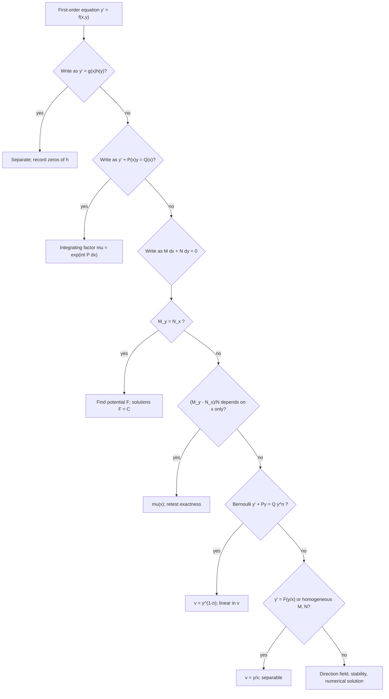
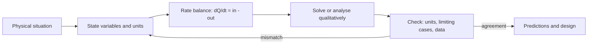

# First-Order Differential Equations

> [Mathematics](../../README.md) › [Differential Equations](../README.md) · Level: Intermediate · Prerequisites: [Differentiation Rules](../../07-calculus/04-differentiation-rules/README.md), [Applications of Derivatives](../../07-calculus/05-applications-of-derivatives/README.md), [The Fundamental Theorem of Calculus](../../07-calculus/07-fundamental-theorem-of-calculus/README.md), [Techniques of Integration](../../07-calculus/08-techniques-of-integration/README.md), [Exponential and Logarithmic Functions](../../03-algebra/12-exponential-and-logarithmic-functions/README.md) · Estimated time: 10 h

## 1. Introduction

Almost every quantitative law of nature is a statement about a *rate of change*, not about a value.
Newton's second law says that acceleration — a second derivative — equals force divided by mass. A
cooling body loses heat at a rate proportional to the temperature difference with the room. A
population grows at a rate proportional to its size, until food becomes scarce and the rate falls.
Radioactive nuclei decay at a rate proportional to how many are left. In each case the physical law
gives a relation between a function and its derivatives; finding the function is a separate problem.

That problem is the subject of this topic. An equation relating an unknown function to its
derivatives is a **differential equation**, and its order is that of the highest derivative that
appears. First-order equations involve only $y'$ (or, equivalently, $\dfrac{dy}{dx}$), and they are
the right place to begin because

* every method for them generalises — second-order equations are solved by reducing to first-order
  systems, numerically or theoretically;
* the central *qualitative* questions (does a solution exist? is it unique? where is it defined? does
  it settle down?) can all be asked and answered here, in the simplest setting;
* the standard models of growth, decay, cooling, mixing, spread of disease and terminal velocity are
  all first-order.

Four exact techniques cover the great majority of equations that can be solved in closed form:

| Technique | Recognisable form | Section |
|---|---|---|
| Separation of variables | $y' = f(x)\,g(y)$ | §7.2 |
| Integrating factor | $y' + P(x)y = Q(x)$ | §7.3 |
| Exact equations | $M\,dx + N\,dy = 0$ with $M_y = N_x$ | §7.4 |
| Substitution | Bernoulli $y' + Py = Qy^n$, or $y' = F(y/x)$ | §7.5 |

Beyond these lies the theory: **existence and uniqueness** (§7.6), which tells us when a model
actually determines a unique future, and **qualitative analysis** (§7.1, §7.7), which extracts the
behaviour of solutions — growth, decay, equilibria, stability — without solving anything. For most
equations arising in practice, no formula exists; the qualitative theory is then not a consolation
prize but the only available answer, and it is often the more useful one.

The topic has a historical arc worth noticing. Newton solved $y' = f(x,y)$ by power series; Euler
introduced the integrating factor and the numerical method that bears his name; Leibniz, the
Bernoullis and Riccati classified the solvable families; Liouville showed in the 1830s that
$y' = y^2 + x$ cannot be solved in elementary terms; Picard and Lindelöf in the 1890s supplied the
existence theory that made the subject rigorous. Everything in this tutorial is one of those steps
made explicit.

## 2. Prerequisites

**From differentiation** ([Differentiation Rules](../../07-calculus/04-differentiation-rules/README.md),
[Applications of Derivatives](../../07-calculus/05-applications-of-derivatives/README.md))

* The chain rule, including the composite form $\dfrac{d}{dx}F(y(x)) = F'(y(x))\,y'(x)$. This single
  identity is the engine behind both the separation method and the integrating factor.
* The product rule, used in the integrating-factor derivation.
* Implicit differentiation, needed to differentiate a relation $F(x,y) = C$ and recover $y'$.
* The Mean Value Theorem, used whenever a zero derivative must imply a constant.

**From integration** ([The Fundamental Theorem of Calculus](../../07-calculus/07-fundamental-theorem-of-calculus/README.md),
[Techniques of Integration](../../07-calculus/08-techniques-of-integration/README.md))

* The Fundamental Theorem in both parts: every continuous function has an antiderivative, and
  $\dfrac{d}{dx}\displaystyle\int_a^x f = f(x)$.
* Substitution, integration by parts, and partial fractions — the three tools that turn a separated
  equation into an explicit formula.
* The standard antiderivatives $\int \dfrac{du}{u} = \ln|u| + C$, $\int \dfrac{du}{1+u^2} = \arctan u + C$,
  $\int \dfrac{du}{\sqrt{1-u^2}} = \arcsin u + C$, $\int e^{u}\,du = e^u + C$.

**From algebra** ([Exponential and Logarithmic Functions](../../03-algebra/12-exponential-and-logarithmic-functions/README.md))

* The laws of exponents and logarithms, and the fact that $e^x > 0$ and $\ln$ is its inverse on
  $(0,\infty)$.
* Solving linear and quadratic equations, and factoring.

No linear algebra is assumed. The one place where a matrix would help — the proof that a linear
equation has a two-dimensional solution space — belongs to
[Second-Order Linear ODEs](../02-second-order-linear-odes/README.md).

## 3. Learning Objectives

After working through this tutorial you will be able to:

1. State what a differential equation is, identify its order, and decide whether it is linear,
   homogeneous, autonomous, or none of these.
2. Distinguish a general solution, a particular solution, a singular solution, and the interval of
   definition of a solution; explain why the last of these is part of the answer.
3. Read a direction field, draw isoclines, and use the sign of $f$ and of $y'' = f_x + f_y f$ to sketch
   solution curves without solving the equation.
4. Solve separable equations, justify the split $\dfrac{dy}{g(y)} = f(x)\,dx$ by the chain rule, and
   find every solution that is lost when a division by $g(y)$ takes place.
5. Derive the integrating factor $\mu = e^{\int P\,dx}$ from the product rule, and solve any linear
   first-order equation with it.
6. Test an equation $M\,dx + N\,dy = 0$ for exactness using $M_y = N_x$, reconstruct the potential,
   and find integrating factors of the forms $\mu(x)$ and $\mu(y)$.
7. Recognise and solve Bernoulli equations and equations of the form $y' = F(y/x)$ by substitution.
8. State the Picard–Lindelöf theorem with its hypotheses, explain the contraction argument behind it,
   and give examples where uniqueness fails or where a solution blows up in finite time.
9. Solve the linear, separable and logistic models that arise in applications, carrying units
   correctly through the calculation.
10. Classify the equilibria of an autonomous equation as stable, asymptotically stable or unstable
    from the sign of $f$, and prove that a bounded monotone solution must tend to an equilibrium.

## 4. Intuition

**A differential equation is a field of slopes.** Give me a point $(x,y)$ in the plane and the right
side $f(x,y)$ of $y' = f(x,y)$ returns a number: the slope that a solution passing through that point
must have. Draw a short segment of that slope at every point and you have a **direction field**. A
solution is a curve that threads through the field, always leaving each point in the direction the
field prescribes. Existence says a curve can always be drawn; uniqueness says only one curve leaves a
given point.

This picture immediately explains the shape of the theory. The field is a *local* object, so a
solution is only guaranteed locally, and it stops existing when the curve runs off the edge of the
field or turns vertical — that is why $y = 1/(1-x)$ solves $y' = y^2$, $y(0)=1$ only for $x<1$. The
field tells you where solutions rise and fall without telling you the formula, which is why a
qualitative answer is often available when a formula is not. And in the special case where $f$
depends on $y$ alone, the field is invariant under horizontal translation: every solution is a
translate of every other, and the whole behaviour of the equation is visible on a single vertical
line — the **phase line**.

**The four techniques are four ways of finding a curve from its slopes.**

* *Separation* is the case where the slope is a product of an $x$-part and a $y$-part. Then the
  $y$-motion and the $x$-motion can be accumulated separately, and the equation says that two
  accumulations are equal.
* *The integrating factor* is the product rule run backwards. If the left side does not look like the
  derivative of a product, multiply by a clever function so that it does. Nothing else is happening.
* *Exactness* is the case where the field $(M,N)$ is a gradient field. Then the solutions are the
  level curves of a potential function: the equation is a conservation law.
* *Substitution* is a change of variable chosen so that the equation becomes one of the previous
  three. Bernoulli's substitution turns a nonlinear equation into a linear one; the substitution
  $v = y/x$ turns a scale-invariant equation into a separable one.

**Modelling is the same picture with units attached.** A rate equation always has the form

$$\text{rate of change of } Q = \text{rate in} - \text{rate out},$$

and each term carries the units of $Q$ per unit time. Getting the units to match is the cheapest
check on a model, and it catches most modelling errors before any algebra is done.

## 5. Formal Definition

### 5.1 Differential equations, order, linearity

Let $D \subseteq \mathbb{R}^2$ be open and $f : D \to \mathbb{R}$ a function.

A **first-order ordinary differential equation in normal form** is an equation

$$y' = f(x,y),$$

to be solved for a differentiable function $y$ of the single variable $x$. More generally, a
**differential equation of order $n$** is an equation relating $x$, $y$, $y', \dots, y^{(n)}$; an
**ordinary** differential equation (ODE) involves one independent variable, a **partial** differential
equation (PDE) involves several.

> **Definition 5.1 (solution).** A **solution of $y' = f(x,y)$ on an interval $I$** is a differentiable
> function $y : I \to \mathbb{R}$ such that $(x, y(x)) \in D$ and $y'(x) = f(x, y(x))$ for every
> $x \in I$. The interval $I$ may be open, closed or half-open, but it must contain more than one
> point, and $y$ must be differentiable at every interior point of $I$.

> **Definition 5.2 (order).** The **order** of a differential equation is the order of the highest
> derivative that appears in it: $y' + x y = 0$ has order $1$, $y'' + y = 0$ has order $2$, and
> $(y')^2 + y = 0$ has order $1$.

> **Definition 5.3 (linearity).** An equation of order $n$ is **linear** if it can be written
> $$a_n(x)\,y^{(n)} + a_{n-1}(x)\,y^{(n-1)} + \dots + a_1(x)\,y' + a_0(x)\,y = g(x)$$
> with coefficients $a_k$ and right-hand side $g$ depending on $x$ only. It is **homogeneous** if
> $g \equiv 0$, and **non-homogeneous** otherwise. An equation that is not linear is **nonlinear**.

Linearity is a statement about how $y$ and its derivatives appear: each of them occurs to the first
power, multiplied by a function of $x$, and never inside a function such as $\sin y$ or $e^{y}$. Thus
$y' + (\sin x)\,y = x^2$ is linear, while $y' + y^2 = 0$, $y' = \sin y$ and $y\,y' = x$ are not.
Second-order linear equations are the subject of [the next topic](../02-second-order-linear-odes/README.md);
here we only need the first-order case $y' + P(x)\,y = Q(x)$.

> **Definition 5.4 (autonomous).** The equation $y' = f(x,y)$ is **autonomous** if $f$ does not depend
> on $x$, that is $y' = f(y)$.

Autonomous equations are exactly the ones whose direction field is invariant under horizontal
translation, and their theory (§7.7) is the cleanest part of the subject.

### 5.2 Solutions, general and particular; initial value problems

A solution may be given **explicitly**, as a formula $y = \varphi(x)$, or **implicitly**, as a
relation $F(x,y) = C$ that every solution satisfies and from which $y$ can in principle be recovered.

> **Definition 5.5 (general solution).** A one-parameter family $y = \varphi(x,C)$ is a **general
> solution** of a first-order equation on a region if every solution of the equation on that region is
> obtained by choosing $C$, with at most isolated exceptions.

> **Definition 5.6 (singular solution).** A solution that is not obtained from the general solution by
> any choice of the constant is a **singular solution**.

The exceptional cases are real: $y' = y^2$ has general solution $y = -\dfrac{1}{x+C}$, and $y \equiv 0$
is a solution that no choice of $C$ produces. It is a singular solution. Whether an equilibrium is
"lost" or merely a limiting case must be decided, not assumed.

> **Definition 5.7 (initial value problem).** An **initial value problem** (IVP) consists of a
> differential equation together with a prescribed value:
> $$y' = f(x,y), \qquad y(x_0) = y_0 .$$

> **Definition 5.8 (interval of definition).** A solution $y$ on $I$ is **maximal** if it cannot be
> extended to a larger interval on which it still solves the equation. The interval of definition of a
> solution is the interval of its maximal extension.

The interval is part of the answer. $y = \tan x$ solves $y' = 1 + y^2$ only on intervals of length
$\pi$, and $y = 1/(1-x)$ solves $y' = y^2$ with $y(0) = 1$ only on $(-\infty, 1)$, even though both
formulas are written without any visible restriction.

### 5.3 Direction fields and isoclines

> **Definition 5.9 (direction field).** The **direction field** of $y' = f(x,y)$ on $D$ is the
> assignment to each point $(x,y) \in D$ of the line through that point with slope $f(x,y)$.

> **Definition 5.10 (isocline).** For a constant $c$, the **isocline of slope $c$** is the set
> $\{(x,y) \in D : f(x,y) = c\}$.

The isoclines of $y' = y - x$ are the parallel lines $y = x + c$; along each of them every solution
crossing it has the same slope $c$. Isoclines are the cheapest way to draw a direction field by hand:
draw a few, mark the slope on each, and interpolate.

## 6. Mathematical Notation

| Symbol | Read as | Meaning |
|---|---|---|
| $y'$, $\dfrac{dy}{dx}$, $\dot{y}$ | "y prime", "dee y dee x", "y dot" | the derivative of $y$ with respect to the independent variable; $\dot{y}$ is used when that variable is time |
| $f(x,y)$ | "f of x and y" | the right-hand side; the slope assigned at $(x,y)$ |
| $D$ | "dee" | the open domain of $f$ in the $(x,y)$-plane |
| $I$ | "eye" | an interval of $x$-values on which a solution is defined |
| $y(x_0) = y_0$ | "y at x-zero equals y-zero" | the initial condition; $(x_0,y_0)$ is the initial point |
| $P(x)$, $Q(x)$ | "P of x", "Q of x" | coefficient and forcing in the linear form $y' + P y = Q$ |
| $M(x,y)$, $N(x,y)$ | "M of x and y", "N of x and y" | the two coefficient functions of $M\,dx + N\,dy = 0$ |
| $M_y$, $N_x$ | "M sub y", "N sub x" | partial derivatives $\dfrac{\partial M}{\partial y}$, $\dfrac{\partial N}{\partial x}$ |
| $\mu(x)$ | "mu of x" | an integrating factor |
| $F(x,y)$, $\varphi$ | "F", "phi" | a potential function; a solution written as $y = \varphi(x)$ |
| $C$, $K$ | "see", "kay" | arbitrary constants |
| $y^{*}$ | "y star" | an equilibrium value of an autonomous equation |
| $L$ | "ell" | a Lipschitz constant |
| $n$ | "en" | the exponent in a Bernoulli equation $y' + Py = Q y^n$ |
| $\displaystyle\int P\,dx$ | "integral of P dee x" | any one antiderivative of $P$; the constant is absorbed into $\mu$ |

Two conventions are used throughout. First, $\ln$ always means the natural logarithm. Second, an
arbitrary constant is written once, at the moment of integration, and is then renamed freely — that is
why the same family may appear as $y = Ce^{x^2}$ in one line and $y = Ae^{x^2}$ in the next.

## 7. Core Concepts

### 7.1 Direction fields and qualitative analysis

The right-hand side of $y' = f(x,y)$ assigns a slope to every point, so it determines the *shape* of
every solution even when it does not determine a formula. Three pieces of information are available
without solving anything.

**Monotonicity.** On a region where $f > 0$ every solution is strictly increasing; where $f < 0$ every
solution is strictly decreasing; where $f = 0$ the solution is locally constant. In particular, if
$f(x,y) = 0$ along a curve, that curve is a set of horizontal tangents.

**Concavity.** Differentiating $y' = f(x,y)$ with respect to $x$ and using the chain rule gives

$$y'' = \frac{\partial f}{\partial x} + \frac{\partial f}{\partial y}\,y' = f_x(x,y) + f_y(x,y)\,f(x,y).$$

The sign of this expression tells where solution curves are concave up or down, and hence where an
inflection point must occur. For $y' = y - x$ we get $f_x = -1$ and $f_y = 1$, so
$y'' = -1 + (y-x) = y' - 1$: a solution is concave up exactly where its slope exceeds $1$.

**Asymptotic behaviour.** Sometimes a single curve organises the whole field. For $y' = y - x$ the
line $y = x + 1$ is itself a solution, because $y' = 1$ and $y - x = 1$ agree on it. Solutions above
it have $y' > 1$ and rise away from it; solutions below have $y' < 1$ and fall away from it. Writing
$u = y - (x+1)$ gives $u' = y' - 1 = y - x - 1 = u$, so $u = Ce^{x}$ and

$$y = x + 1 + C e^{x}.$$

Every solution is a departure from the straight line $y = x+1$, growing exponentially. That exact
solution also displays a structural fact used constantly in the next topic: the difference between two
solutions of a linear equation satisfies the homogeneous equation.

**Worked sketch.** For $y' = y(1-y)$: $f > 0$ for $0 < y < 1$ and $f < 0$ for $y < 0$ or $y > 1$. The
horizontal lines $y = 0$ and $y = 1$ are solutions. Solutions starting in $(0,1)$ increase and are
trapped between the two equilibria; solutions starting above $1$ decrease towards $1$; solutions
starting below $0$ decrease without bound. That is the complete qualitative picture, obtained in three
lines and valid for every initial condition — and it is exactly what the explicit solution of §9.9
will confirm.

### 7.2 Separable equations

> **Definition 7.1.** The equation $y' = f(x,y)$ is **separable** if $f(x,y) = g(x)\,h(y)$ for
> functions $g$ of $x$ alone and $h$ of $y$ alone.

The method is to accumulate the $x$-dependence on one side and the $y$-dependence on the other. The
justification is short and worth reading carefully, because the informal version "multiply by $dx$"
hides an application of the chain rule.

**Derivation.** Suppose $h(y) \ne 0$ on the interval where the solution lives, and let

$$G(x) = \int g(x)\,dx, \qquad H(y) = \int \frac{dy}{h(y)},$$

so that $G' = g$ and $H' = 1/h$. Let $y$ be a solution and consider the composite $H(y(x))$. By the
chain rule,

$$\frac{d}{dx} H(y(x)) = H'(y(x))\,y'(x) = \frac{y'(x)}{h(y(x))} = \frac{g(x)\,h(y(x))}{h(y(x))} = g(x) = G'(x).$$

The derivative of $H(y(x)) - G(x)$ is zero on an interval, so by the Mean Value Theorem that
difference is constant:

$$H(y(x)) - G(x) = C .$$

Since $H' = 1/h$ never vanishes, $H$ is strictly monotone on the interval, hence injective, and the
relation can be solved for $y$:

$$y(x) = H^{-1}\bigl(G(x) + C\bigr).$$

Choosing $C = H(y_0) - G(x_0)$ imposes the initial condition $y(x_0) = y_0$.

**Why "splitting $dy/dx$" is legitimate here.** The symbol $\dfrac{dy}{dx}$ is *not* a quotient of two
numbers. What the informal computation

$$\frac{dy}{dx} = g(x)h(y) \;\Longrightarrow\; \frac{dy}{h(y)} = g(x)\,dx \;\Longrightarrow\; \int \frac{dy}{h(y)} = \int g(x)\,dx$$

actually abbreviates is the displayed chain-rule calculation: both sides of the second display are
read as differentials of the *same* function of $x$, namely $H(y(x))$ and $G(x)$, and the equality of
their derivatives is what entitles us to conclude equality of the functions up to a constant. The
substitution rule for integrals, $\int \dfrac{y'(x)}{h(y(x))}\,dx = \int \dfrac{du}{h(u)}$ with
$u = y(x)$, is the rigorous form of "substituting $du = y'\,dx$". Whenever we write $dy = y'\,dx$ we
mean exactly this, and nothing more. The manoeuvre is legitimate *because* the left side depends on
$x$ only through $y$. It would be illegitimate to "cancel" $d$'s across a sum such as $\dfrac{d}{dx}(uv)$,
and that is why the product rule has no such shortcut.

**Where solutions can be lost.** The division by $h(y)$ requires $h(y) \ne 0$. If $h(y^{*}) = 0$ then
the constant function $y \equiv y^{*}$ is a solution, since both sides vanish. Such a solution may not
appear in the family $H(y) = G(x) + C$ for any finite $C$ — the family approaches it only as
$C \to \pm\infty$ — so it must be recorded separately. The complete procedure is therefore:

1. Find all zeros of $h$ and record each as a constant solution.
2. Solve the separated equation on the regions where $h \ne 0$.
3. Decide which of the recorded constants are already included in the family, and state the rest.

**Example 7.1.** Solve $y' = y^{2}$.

Here $g = 1$ and $h(y) = y^2$, whose only zero is $y = 0$, giving the constant solution $y \equiv 0$.
Off $y = 0$,

$$\int y^{-2}\,dy = \int dx \;\Longrightarrow\; -\frac{1}{y} = x + C \;\Longrightarrow\; y = -\frac{1}{x+C}.$$

The constant solution is not obtained for any finite $C$, so the full solution set is
$y = -\dfrac{1}{x+C}$ together with $y \equiv 0$.

**Example 7.2 (absolute values).** Solve $y' = \dfrac{y}{x}$ for $x > 0$.

Separation gives $\ln|y| = \ln x + C$, hence $|y| = e^{C}x$ and $y = \pm e^{C} x$. Writing
$K = \pm e^{C}$ produces $y = Kx$ with $K \ne 0$, and the lost solution $y \equiv 0$ supplies $K = 0$.
The general solution is $y = Kx$ with $K \in \mathbb{R}$, on any interval not containing $0$. The
absolute value is what makes the sign of $K$ free; dropping it too early silently loses the negative
solutions.

### 7.3 Linear equations and the integrating factor

A first-order linear equation is written in **standard form**

$$y' + P(x)\,y = Q(x).$$

The left side is *almost* the derivative of a product: $(y\,M)' = y'M + yM'$. If we could find a
function $M(x)$ with $M' = MP$, then multiplying the equation by $M$ would convert the left side into
$(yM)'$, and one integration would finish the job. That is the entire idea; the rest is carrying it
out.

**Derivation of the integrating factor.** We want

$$M\,y' + M\,P\,y = (M\,y)'.$$

The right side is $M\,y' + M'\,y$. Comparing the two expressions, the coefficient of $y$ must agree:

$$M\,P = M' \quad\Longleftrightarrow\quad \frac{M'}{M} = P \quad\Longleftrightarrow\quad \ln|M| = \int P\,dx .$$

Since $M$ may be taken positive, we choose

$$\boxed{\;\mu(x) = \exp\!\left(\int P(x)\,dx\right).\;}$$

With this $\mu$, multiplying the standard form by $\mu$ gives $(\mu y)' = \mu Q$, hence

$$\mu y = \int \mu Q\,dx + C, \qquad y = \frac{1}{\mu(x)}\left(\int \mu Q\,dx + C\right).$$

**Why the constant in $\int P\,dx$ does not matter.** Replacing $\int P\,dx$ by $\int P\,dx + c$
multiplies $\mu$ by $e^{c}$ and multiplies $\int \mu Q\,dx$ by the same factor; the quotient is
unchanged. We therefore always take the simplest antiderivative.

**Why the formula is valid on the whole interval of continuity.** $\mu$ is continuous and strictly
positive wherever $P$ is continuous, so dividing by it is legitimate. If $P$ and $Q$ are continuous on
an interval $I$, every solution of the standard form on $I$ is given by the displayed formula with some
$C$, and conversely every such formula is a solution. In particular the solution of an initial value
problem with $x_0 \in I$ exists on all of $I$ — linear equations do not blow up inside the interval of
continuity of their coefficients. (This is a strong contrast with $y' = y^2$.)

**Structure of the solution set.** Write the formula as

$$y = \underbrace{\frac{1}{\mu}\int \mu Q\,dx}_{\text{one particular solution } y_p} \;+\; \underbrace{\frac{C}{\mu}}_{\text{solution of } y' + Py = 0}.$$

The second term is the general solution of the homogeneous equation, and it is visible directly:
$y' + Py = 0$ separates to $\ln|y| = -\int P\,dx$, so $y = Ce^{-\int P\,dx} = C/\mu$. The general
solution of the non-homogeneous equation is a particular solution plus the general solution of the
homogeneous equation. This is a linear-algebra statement in disguise, and in
[the next topic](../02-second-order-linear-odes/README.md) it becomes the backbone of the whole theory.

**Example 7.3.** Solve $y' + \dfrac{y}{x} = x^2$ for $x > 0$.

Here $P = 1/x$, so $\int P\,dx = \ln x$ and $\mu = e^{\ln x} = x$. Multiplying by $x$,

$$x y' + y = x^{3} \;\Longrightarrow\; (xy)' = x^{3} \;\Longrightarrow\; xy = \frac{x^{4}}{4} + C \;\Longrightarrow\; y = \frac{x^{3}}{4} + \frac{C}{x}.$$

*Check:* $y' = \dfrac{3x^{2}}{4} - \dfrac{C}{x^{2}}$, and $y' + \dfrac{y}{x} = \dfrac{3x^{2}}{4} - \dfrac{C}{x^{2}} + \dfrac{x^{2}}{4} + \dfrac{C}{x^{2}} = x^{2}$. ✓

### 7.4 Exact equations and integrating factors

Write a first-order equation in **differential form**

$$M(x,y)\,dx + N(x,y)\,dy = 0,$$

which is shorthand for $M(x,y) + N(x,y)\,y' = 0$. Solving for $y'$ gives
$y' = -M/N$ wherever $N \ne 0$, so this is the same object as before, but the symmetric appearance of
$x$ and $y$ suggests a different question: is the vector field $(M,N)$ the gradient of a function?

> **Definition 7.2 (exact).** The equation $M\,dx + N\,dy = 0$ is **exact** on a region $R$ if there is
> a differentiable $F : R \to \mathbb{R}$ with
> $$F_x(x,y) = M(x,y), \qquad F_y(x,y) = N(x,y)$$
> for all $(x,y) \in R$. Such an $F$ is a **potential function**.

If $F$ exists, then along any solution $y(x)$,

$$\frac{d}{dx}F(x,y(x)) = F_x + F_y\,y' = M + N\,y' = 0,$$

so $F(x,y(x))$ is constant. The solutions are exactly the level curves $F(x,y) = C$ of the potential —
the equation expresses a conservation law.

**The exactness test.** Suppose $M$ and $N$ have continuous first partial derivatives on a rectangle
(or on any simply connected region). Then

$$M\,dx + N\,dy = 0 \text{ is exact} \quad\Longleftrightarrow\quad \frac{\partial M}{\partial y} = \frac{\partial N}{\partial x}.$$

*Necessity.* If $F_x = M$ and $F_y = N$, then $M_y = F_{xy}$ and $N_x = F_{yx}$, and mixed partial
derivatives of a $C^{2}$ function agree (Clairaut's theorem). Hence $M_y = N_x$.

*Sufficiency.* Assume $M_y = N_x$ and fix $(x_0,y_0)$ in the rectangle. Define

$$F(x,y) = \int_{x_0}^{x} M(s,y_0)\,ds + \int_{y_0}^{y} N(x,t)\,dt .$$

Then, by the Fundamental Theorem of Calculus, $F_y = N(x,y)$; and

$$F_x = M(x,y_0) + \int_{y_0}^{y} N_x(x,t)\,dt = M(x,y_0) + \int_{y_0}^{y} M_y(x,t)\,dt = M(x,y_0) + \bigl[M(x,y) - M(x,y_0)\bigr] = M(x,y).$$

So $F$ is a potential and the equation is exact. $\blacksquare$

The "simply connected" hypothesis matters: on a region with a hole the test can pass without a
single-valued potential existing. Every region in this tutorial is a rectangle or a half-plane, where
the construction above applies.

**Finding the potential in practice.** Integrate $M$ with respect to $x$, treating $y$ as a constant,
to get $F(x,y) = \int M\,dx + g(y)$; then differentiate with respect to $y$, set the result equal to
$N$, and solve for $g'(y)$. The test $M_y = N_x$ guarantees that the equation for $g'$ involves $y$
only.

**Example 7.4.** Solve $(2x + 3y)\,dx + (3x + 2y)\,dy = 0$.

Here $M = 2x + 3y$ and $N = 3x + 2y$, so $M_y = 3 = N_x$: the equation is exact. Then

$$F = \int (2x+3y)\,dx = x^{2} + 3xy + g(y), \qquad F_y = 3x + g'(y) = 3x + 2y \;\Longrightarrow\; g'(y) = 2y,$$

so $g = y^{2}$ and the solutions are $x^{2} + 3xy + y^{2} = C$.

*Check by implicit differentiation:* $2x + 3y + (3x + 2y)y' = 0$, which is the original equation. ✓

**Integrating factors for non-exact equations.** When $M_y \ne N_x$, it may still be possible to
multiply by a function $\mu$ so that $\mu M\,dx + \mu N\,dy = 0$ becomes exact. The requirement is

$$\frac{\partial(\mu M)}{\partial y} = \frac{\partial(\mu N)}{\partial x}
\quad\Longleftrightarrow\quad
\mu\,(M_y - N_x) = N\,\mu_x - M\,\mu_y .$$

This is a partial differential equation for $\mu$ — generally harder than the original problem — but
two special cases are useful and are the ones that occur in exercises.

*If $\dfrac{M_y - N_x}{N}$ depends on $x$ alone*, call it $\varphi(x)$. Then $\mu = \mu(x)$ may be
sought, the equation above collapses to $\mu' = \varphi\,\mu$, and

$$\mu(x) = \exp\!\left(\int \varphi(x)\,dx\right).$$

*If $\dfrac{N_x - M_y}{M}$ depends on $y$ alone*, call it $\psi(y)$; then $\mu = \mu(y)$ with

$$\mu(y) = \exp\!\left(\int \psi(y)\,dy\right).$$

*Justification of the first case.* With $\mu = \mu(x)$ the exactness condition reads
$\mu M_y = \mu' N + \mu N_x$, that is $\mu(M_y - N_x) = \mu' N$, that is $\mu'/\mu = (M_y-N_x)/N$.
If the right side is a function of $x$ only, this is a separable equation for $\mu$, solved by the
formula displayed. The second case is the same computation with the roles of $x$ and $y$ exchanged.
Note that there is no general algorithm for finding an integrating factor: when neither quotient
simplifies, one looks for a product $\mu = x^{a}y^{b}$ or a function of $x+y$, and success is a matter
of luck and experience.

**Example 7.5.** Solve $(3xy + y^{2})\,dx + (x^{2} + xy)\,dy = 0$.

First test: $M_y = 3x + 2y$ and $N_x = 2x + y$, so the equation is not exact. Compute

$$\frac{M_y - N_x}{N} = \frac{(3x + 2y) - (2x + y)}{x^{2} + xy} = \frac{x + y}{x(x+y)} = \frac{1}{x},$$

which depends on $x$ only. Hence $\mu = e^{\int dx/x} = x$. Multiplying,

$$(3x^{2}y + xy^{2})\,dx + (x^{3} + x^{2}y)\,dy = 0,$$

and now $M_y = 3x^{2} + 2xy = N_x$. Integrating,

$$F = \int (3x^{2}y + xy^{2})\,dx = x^{3}y + \frac{x^{2}y^{2}}{2} + g(y), \qquad F_y = x^{3} + x^{2}y + g'(y) = x^{3} + x^{2}y,$$

so $g' = 0$ and the solutions are

$$x^{3}y + \frac{x^{2}y^{2}}{2} = C .$$

*Check:* differentiating gives $(3x^{2}y + xy^{2}) + (x^{3} + x^{2}y)y' = 0$, and dividing by $x$ returns
the original equation. ✓

### 7.5 Substitutions: Bernoulli and homogeneous equations

Some equations become one of the three solvable types only after a change of dependent variable. Two
families are standard; a third, the general substitution $v = ax + by + c$, is worth knowing.

**Bernoulli equations.** The equation

$$y' + P(x)\,y = Q(x)\,y^{n}, \qquad n \ne 0, 1,$$

is nonlinear because of $y^{n}$, but the substitution $v = y^{1-n}$ linearises it. Assuming
$y > 0$ (or handling the sign separately), divide by $y^{n}$:

$$y^{-n}y' + P\,y^{1-n} = Q .$$

Now $v = y^{1-n}$ gives $v' = (1-n)y^{-n}y'$, so $y^{-n}y' = \dfrac{v'}{1-n}$ and

$$\frac{v'}{1-n} + P\,v = Q \quad\Longleftrightarrow\quad v' + (1-n)P\,v = (1-n)Q,$$

a first-order linear equation for $v$. Solve it with an integrating factor and substitute back.

The cases $n = 0$ and $n = 1$ are excluded because the equation is already linear: $n = 0$ gives
$y' + Py = Q$, and $n = 1$ gives $y' + (P - Q)y = 0$. For $n > 0$ the solution $y \equiv 0$ is lost in
the division and must be recorded separately; for non-integer $n$ the expression $y^{n}$ requires
$y > 0$, and the solution lives on an interval where that holds.

**Example 7.6.** Solve $y' + y = x\,y^{3}$.

With $n = 3$ we set $v = y^{-2}$, so $v' = -2y^{-3}y'$. Dividing the equation by $y^{3}$ gives
$y^{-3}y' + y^{-2} = x$, that is $-\dfrac{v'}{2} + v = x$, or

$$v' - 2v = -2x .$$

Here $P = -2$ and $\mu = e^{-2x}$, so $(ve^{-2x})' = -2xe^{-2x}$ and

$$ve^{-2x} = \int -2x e^{-2x}\,dx = x e^{-2x} + \tfrac{1}{2}e^{-2x} + C,$$

using integration by parts. Hence $v = x + \tfrac{1}{2} + Ce^{2x}$ and

$$y^{-2} = x + \tfrac{1}{2} + Ce^{2x}, \qquad\text{that is}\qquad y = \pm\frac{1}{\sqrt{x + \tfrac12 + Ce^{2x}}}.$$

The solution $y \equiv 0$ was removed by the division by $y^{3}$ and must be added.

**Homogeneous equations.** An equation of the form

$$y' = F\!\left(\frac{y}{x}\right)$$

is called **homogeneous** (of degree zero); the name conflicts with "homogeneous linear", a different
notion, and the context is always the guide. The substitution

$$v = \frac{y}{x}, \qquad y = xv, \qquad y' = v + x\,v'$$

converts it into a separable equation:

$$v + x v' = F(v) \quad\Longleftrightarrow\quad x\,v' = F(v) - v \quad\Longleftrightarrow\quad \frac{dv}{F(v) - v} = \frac{dx}{x}.$$

The same substitution works for $M\,dx + N\,dy = 0$ when $M$ and $N$ are homogeneous polynomials of the
same degree $k$: putting $y = xv$ gives $dx$ coefficient $x^{k}M(1,v)$ and $dy$ coefficient
$x^{k}N(1,v)$, and the factor $x^{k-1}$ can be cancelled.

**Example 7.7.** Solve $y' = \dfrac{x+y}{x-y}$.

Divide numerator and denominator by $x$: $y' = \dfrac{1 + y/x}{1 - y/x}$, so $F(v) = \dfrac{1+v}{1-v}$.
With $y = xv$,

$$x v' = \frac{1+v}{1-v} - v = \frac{1 + v - v + v^{2}}{1-v} = \frac{1+v^{2}}{1-v},$$

so

$$\frac{1-v}{1+v^{2}}\,dv = \frac{dx}{x} \;\Longrightarrow\; \arctan v - \frac{1}{2}\ln(1+v^{2}) = \ln|x| + C .$$

Since $\tfrac12\ln(1+v^{2}) + \ln|x| = \tfrac12\ln(x^{2} + y^{2})$, this is

$$\arctan\!\left(\frac{y}{x}\right) = \frac{1}{2}\ln\left(x^{2}+y^{2}\right) + C.$$

The solution is left in implicit form; solving for $y$ would require inverting
$\arctan$ inside a logarithm and gains nothing. Note that $x = y$ is excluded (the denominator of the
original equation vanishes there), which is consistent with $F$ being undefined at $v = 1$.

**The linear substitution.** For $y' = f(ax + by + c)$ with $b \ne 0$, put $v = ax + by + c$. Then
$v' = a + b\,y' = a + b\,f(v)$, which is separable:

$$\frac{dv}{a + b\,f(v)} = dx .$$

**Example 7.8.** Solve $y' = (x+y)^{2}$.

With $v = x + y$ we get $v' = 1 + y' = 1 + v^{2}$, so

$$\frac{dv}{1+v^{2}} = dx \;\Longrightarrow\; \arctan v = x + C \;\Longrightarrow\; y = \tan(x + C) - x .$$

The solution is defined only on intervals where $\cos(x+C) \ne 0$.

### 7.6 Existence and uniqueness: the Picard–Lindelöf theorem

A differential equation is useful as a model only if it determines the future. The following theorem
is the precise statement that it does, locally, and its hypotheses are minimal in a precise sense.

> **Theorem 7.1 (Picard–Lindelöf).** Let $D \subseteq \mathbb{R}^{2}$ be open, let $f : D \to \mathbb{R}$
> be continuous, and let $(x_0,y_0) \in D$. Suppose $f$ is **locally Lipschitz in $y$**: for some
> neighbourhood of $(x_0,y_0)$ there is a constant $L$ with
> $$\lvert f(x,y_1) - f(x,y_2)\rvert \le L\,\lvert y_1 - y_2\rvert$$
> for all points of that neighbourhood. Then there is $\delta > 0$ such that the initial value problem
> $$y' = f(x,y), \qquad y(x_0) = y_0$$
> has exactly one solution on the interval $(x_0 - \delta,\, x_0 + \delta)$.

A sufficient condition for the Lipschitz hypothesis, used in every application, is that $f$ be
continuous and have a continuous partial derivative $f_y$ near the point: then the Mean Value Theorem
gives $f(x,y_1) - f(x,y_2) = f_y(x,\xi)(y_1 - y_2)$, and $L$ may be taken as the maximum of
$\lvert f_y\rvert$ over the neighbourhood.

**Intuition: a solution is a fixed point.** Integrating the equation from $x_0$ to $x$,
using $y(x_0) = y_0$, gives the equivalent **integral equation**

$$y(x) = y_0 + \int_{x_0}^{x} f\bigl(s, y(s)\bigr)\,ds .$$

Define the operator $T$ on continuous functions by $(Ty)(x) = y_0 + \int_{x_0}^{x} f(s,y(s))\,ds$. Then
$y$ solves the IVP exactly when $Ty = y$: a fixed point of $T$. On the space of continuous functions
on a small interval with the supremum norm, $T$ is a **contraction**: for two functions $u$ and $v$,

$$\lVert Tu - Tv\rVert \le L\,\lvert x - x_0\rvert\,\lVert u - v\rVert \le L\delta\,\lVert u-v\rVert,$$

and choosing $\delta < 1/L$ makes the factor less than $1$. The Banach fixed point theorem then gives
a unique fixed point. The proof is constructive: the **Picard iterates**

$$y_0(x) \equiv y_0, \qquad y_{n+1}(x) = y_0 + \int_{x_0}^{x} f\bigl(s, y_n(s)\bigr)\,ds$$

converge uniformly to the solution, and each iterate is an explicit polynomial when $f$ is a
polynomial. This is exactly how Newton computed series solutions, and it is the prototype of every
numerical method in [Numerical Solutions of ODEs](../../19-numerical-analysis/README.md).

**Hypotheses cannot be dropped.** Continuity alone guarantees existence (Peano's theorem) but not
uniqueness. The standard counterexample is

$$y' = 3y^{2/3}, \qquad y(0) = 0 .$$

Here $f(y) = 3y^{2/3}$ is continuous but $\lvert f(y) - f(0)\rvert/\lvert y\rvert = 3\lvert y\rvert^{-1/3} \to \infty$
as $y \to 0$, so no Lipschitz constant exists at the origin. And indeed both $y \equiv 0$ and
$y = x^{3}$ solve the IVP (check: $y' = 3x^{2}$ and $3y^{2/3} = 3x^{2}$ for $x \ge 0$). In fact, for
every $c \ge 0$ the function that is $0$ for $x \le c$ and $(x-c)^{3}$ for $x \ge c$ is a solution, so
infinitely many solutions pass through the origin. Uniqueness can fail exactly where the field becomes
vertical in the $y$-direction.

**The theorem is local, and solutions can blow up.** For $y' = y^{2}$ with $y(0) = 1$ the solution is
$y = 1/(1-x)$, which exists only for $x < 1$. The theorem promises a solution on *some* interval about
$0$ — here $\lvert x\rvert < 1$ is the best possible — and says nothing about the size of that
interval. Blow-up in finite time is a genuine feature of nonlinear equations, not an artefact of the
method.

**Linear equations are globally solvable.** If $P$ and $Q$ are continuous on an interval $I$
containing $x_0$, then $f(x,y) = Q(x) - P(x)y$ satisfies
$\lvert f(x,y_1) - f(x,y_2)\rvert = \lvert P(x)\rvert\,\lvert y_1 - y_2\rvert$, so $f$ is Lipschitz in
$y$ with $L = \max_{I}\lvert P\rvert$ on each compact subinterval. A patch-together argument then
extends the solution to all of $I$: the explicit formula of §7.3 confirms this, since $\mu > 0$ and the
integral of $\mu Q$ is finite on compact subintervals.

### 7.7 Autonomous equations: equilibria and stability

For $y' = f(y)$ the field depends only on height, so the whole qualitative theory fits on a line.

> **Definition 7.3 (equilibrium).** A number $y^{*}$ with $f(y^{*}) = 0$ is an **equilibrium** (or
> critical point) of $y' = f(y)$; the constant function $y \equiv y^{*}$ is an equilibrium solution.

> **Definition 7.4 (stability).** An equilibrium $y^{*}$ is **stable** if for every $\varepsilon > 0$
> there is $\delta > 0$ such that every solution with $\lvert y(x_0) - y^{*}\rvert < \delta$ satisfies
> $\lvert y(x) - y^{*}\rvert < \varepsilon$ for all $x \ge x_0$. It is **asymptotically stable** if it
> is stable and, in addition, $y(x) \to y^{*}$ as $x \to \infty$ for all solutions starting
> sufficiently near. It is **unstable** if it is not stable.

**The phase line.** Between consecutive equilibria, $f$ has constant sign. If $f > 0$ on $(a,b)$ then
every solution with a value in $(a,b)$ is strictly increasing and, by uniqueness, can never leave the
interval; it therefore converges to one of the endpoints. Drawing arrows on the line according to the
sign of $f$ gives the **phase line**, and its arrows tell the whole story.

**The linearisation test.** Suppose $f$ is continuously differentiable at an equilibrium $y^{*}$.

* If $f'(y^{*}) < 0$, then $y^{*}$ is asymptotically stable.
* If $f'(y^{*}) > 0$, then $y^{*}$ is unstable.
* If $f'(y^{*}) = 0$, the test is inconclusive.

*Why the first case holds.* Choose $m > 0$ and an interval $(y^{*}-\delta, y^{*}+\delta)$ on which
$f' \le -m < 0$. Then $f$ is strictly decreasing there with $f(y^{*}) = 0$, so $f(y) > 0$ just below
$y^{*}$ and $f(y) < 0$ just above it: solutions are pushed towards $y^{*}$ from both sides and can never
cross it. A solution starting in the interval is monotone and bounded, hence converges to a limit $L$;
passing to the limit in $y' = f(y)$ (or by the argument below) forces $f(L) = 0$, and the only zero in
the interval is $y^{*}$, so $L = y^{*}$. The second case is the same argument with $f$ increasing, and
the arrows then point away.

*Why the third case is inconclusive.* All three behaviours occur at a flat equilibrium:

| Equation | $f'(0)$ | Behaviour of the zero solution |
|---|---|---|
| $y' = -y^{3}$ | $0$ | asymptotically stable (solutions decay like $(2x)^{-1/2}$) |
| $y' = y^{3}$ | $0$ | unstable (solutions blow up in finite time) |
| $y' = y^{2}$ | $0$ | unstable, but approached from below only (semistable) |

**A limit lemma.** A useful general fact, which supplies the missing step above:

> **Lemma 7.1.** Let $f$ be continuous and let $y$ be a solution of $y' = f(y)$ on $[0,\infty)$ that is
> bounded and eventually monotone. Then $L = \lim_{x\to\infty} y(x)$ exists and $f(L) = 0$.

*Proof.* A bounded monotone function has a limit $L$. For each $n$, the Mean Value Theorem gives
$y(n+1) - y(n) = y'(\xi_n) = f(y(\xi_n))$ for some $\xi_n \in (n, n+1)$. The left side tends to
$L - L = 0$, and $y(\xi_n) \to L$, so by continuity of $f$, $f(L) = 0$. $\blacksquare$

**Example 7.9 (logistic).** For $y' = ry\left(1 - \dfrac{y}{K}\right)$ with $r, K > 0$, the equilibria
are $y^{*} = 0$ and $y^{*} = K$. Since $f'(y) = r - \dfrac{2ry}{K}$, we get $f'(0) = r > 0$ (unstable)
and $f'(K) = -r < 0$ (asymptotically stable). The phase line has arrows pointing right on $(0,K)$ and
left on $(K,\infty)$: every positive initial value converges to the carrying capacity $K$. The
explicit solution of §9.9 confirms it.

## 8. Formulas and Properties

Every statement below is given with its hypotheses, because each one fails somewhere outside them.

### 8.1 Structure of the linear equation

> **Theorem 8.1.** Let $P, Q$ be continuous on an interval $I$ and let $y_p$ be one solution of
> $y' + P y = Q$ on $I$. Then the solutions on $I$ are exactly
> $$y = y_p + C e^{-\int P\,dx}, \qquad C \in \mathbb{R}.$$

*Proof.* If $y$ is any solution, then $(y - y_p)' + P(y - y_p) = Q - Q = 0$, so $u = y - y_p$ solves
the homogeneous equation. That equation separates: $u'/u = -P$ wherever $u \ne 0$, giving
$u = Ce^{-\int P\,dx}$ on any interval where $u$ keeps one sign; the zero solution is the case $C = 0$,
and uniqueness (Theorem 7.1) rules out a solution that is zero at one point and nonzero elsewhere.
Conversely any $y_p + Ce^{-\int P\,dx}$ is a solution by linearity of differentiation. $\blacksquare$

Two consequences are used repeatedly. First, **the difference of two solutions of the non-homogeneous
equation solves the homogeneous equation** — this is why every "transient" in physics is a homogeneous
solution. Second, the solution of an IVP is unique, so two solutions that agree at one point are
identical; this is the standard way to prove that a guessed particular solution is *the* one.

### 8.2 Separable equations

> **Theorem 8.2.** Let $g$ be continuous on an interval $I_x$, let $h$ be continuous on an interval
> $I_y$, and let $H$ be an antiderivative of $1/h$ on a subinterval on which $h \ne 0$. Then the
> solutions of $y' = g(x)h(y)$ with values in that subinterval are given implicitly by
> $$H(y) = \int g(x)\,dx + C,$$
> and each of these relations defines a unique differentiable $y$ locally, because $H' = 1/h \ne 0$.
> The zeros of $h$ give additional constant solutions.

The proof is the chain-rule computation of §7.2. The hypothesis $h \ne 0$ is not cosmetic: without it,
$H$ is not invertible and the family may miss solutions.

### 8.3 Linear equations and the integrating factor

> **Theorem 8.3.** Let $P, Q$ be continuous on an interval $I$ and let $\mu = e^{\int P\,dx}$. Then on
> $I$,
> $$y' + P(x)y = Q(x) \quad\Longleftrightarrow\quad \bigl(\mu(x)\,y\bigr)' = \mu(x)\,Q(x),$$
> and the general solution is $y = \dfrac{1}{\mu}\left(\displaystyle\int \mu Q\,dx + C\right)$.

*Proof.* $\mu' = \mu P$ by the chain rule, so $(\mu y)' = \mu y' + \mu' y = \mu(y' + Py)$. The equation
is therefore equivalent to $(\mu y)' = \mu Q$, and $\mu > 0$ everywhere on $I$. Integrating once gives
the formula. $\blacksquare$

The identity $\mu' = \mu P$ is the whole content: an integrating factor is a function whose logarithmic
derivative is the coefficient of $y$.

### 8.4 Exact equations

> **Theorem 8.4.** Let $M, N$ have continuous partial derivatives on a rectangle $R$, with $N \ne 0$
> where the equation is solved for $y'$. Then $M\,dx + N\,dy = 0$ is exact on $R$ if and only if
> $M_y = N_x$ there. When it is exact, the solutions are the level curves $F(x,y) = C$ of any potential
> $F$ with $F_x = M$, $F_y = N$.

Both directions were proved in §7.4; the sufficiency proof exhibits the potential explicitly. The
rectangle hypothesis is what makes the construction legal — on a region with a hole, closedness of the
field does not imply exactness.

### 8.5 Bernoulli equations

> **Theorem 8.5.** For $n \ne 0,1$, the substitution $v = y^{1-n}$ turns
> $y' + P(x)y = Q(x)y^{n}$ into the linear equation
> $$v' + (1-n)P(x)\,v = (1-n)Q(x).$$

*Proof.* Differentiate $v = y^{1-n}$: $v' = (1-n)y^{-n}y'$. Multiplying the original equation by
$(1-n)y^{-n}$ gives $(1-n)y^{-n}y' + (1-n)P\,y^{1-n} = (1-n)Q$, that is the displayed linear equation.
$\blacksquare$

The solution $y \equiv 0$ exists when $n > 0$ and is destroyed by the division; it must be reinstated
at the end.

### 8.6 Homogeneous (degree-zero) equations

> **Theorem 8.6.** If $F$ is continuous, the substitution $v = y/x$ (on the half-plane $x > 0$ or
> $x < 0$) turns $y' = F(y/x)$ into the separable equation
> $$x\,v' = F(v) - v .$$

*Proof.* $y = xv$ gives $y' = v + xv'$ by the product rule, and $F(y/x) = F(v)$; subtracting $v$
leaves $xv' = F(v) - v$. $\blacksquare$

The zeros of $F(v) - v$ correspond to straight-line solutions $y = v^{*}x$, which are equilibria of the
$v$-equation and are lost when the equation is separated.

### 8.7 Autonomous equations

> **Theorem 8.7.** Let $f$ be continuously differentiable on an interval and let $y^{*}$ be an
> equilibrium.
> 1. If $f'(y^{*}) < 0$, then $y^{*}$ is asymptotically stable.
> 2. If $f'(y^{*}) > 0$, then $y^{*}$ is unstable.
> 3. If $f'(y^{*}) = 0$, no conclusion follows.

The proof is in §7.7. Part 3 is illustrated by $y' = -y^{3}$, $y' = y^{3}$ and $y' = y^{2}$, which
share $f'(0) = 0$ and have three different behaviours.

> **Corollary 8.1.** Every bounded solution of $y' = f(y)$ with $f$ continuous that is eventually
> monotone converges to an equilibrium (Lemma 7.1).

This is why the phase line is a complete description: a solution cannot oscillate, since $y'$ has a
fixed sign on each interval between equilibria, and it cannot stop except at an equilibrium.

### 8.8 Existence and uniqueness

> **Theorem 8.8 (Picard–Lindelöf).** If $f$ and $f_y$ are continuous near $(x_0,y_0)$, then the IVP
> $y' = f(x,y)$, $y(x_0) = y_0$ has a unique solution on some interval about $x_0$.

The Lipschitz hypothesis is what drives the contraction; continuity of $f_y$ supplies it on a
neighbourhood, but the theorem is true under the weaker hypothesis of local Lipschitz continuity stated
in §7.6. Two corollaries are used constantly:

* **No crossing.** Two distinct solutions of the same equation cannot touch: if $y_1(x_1) = y_2(x_1)$,
  then both solve the IVP with that initial condition, so they agree. This is the standard argument for
  "a solution trapped between two equilibria stays there".
* **Continuity in the data.** The solution depends continuously on $(x_0,y_0)$; the proof is again the
  contraction estimate. Physically, this is what makes a model predictive.

### 8.9 Decision checklist

| Look at the equation | Try | Section |
|---|---|---|
| Can it be written $y' = g(x)h(y)$? | separation | §7.2 |
| Is it, or can it be put in the form $y' + P(x)y = Q(x)$? | integrating factor | §7.3 |
| Is it $M\,dx + N\,dy = 0$ with $M_y = N_x$? | potential function | §7.4 |
| Does $(M_y - N_x)/N$ depend on $x$ only? | integrating factor $\mu(x)$ | §7.4 |
| Is it $y' + Py = Qy^{n}$ with $n \ne 0,1$? | Bernoulli $v = y^{1-n}$ | §7.5 |
| Is it $y' = F(y/x)$? | $v = y/x$ | §7.5 |
| Is it $y' = f(ax+by+c)$? | $v = ax+by+c$ | §7.5 |
| None of the above | direction field, then numerical methods | §7.1 |

## 9. Step-by-Step Examples

The examples run from routine to substantial. Every one ends with a verification by substitution,
because that is the only check that a solution is correct.

### 9.1 A separable initial value problem

Solve $\dfrac{dy}{dx} = 2xy$ with $y(0) = 1$.

*Strategy: the right side factors as $g(x)h(y)$ with $g(x) = 2x$ and $h(y) = y$, so separate.*

$h$ has its only zero at $y = 0$, which gives the constant solution $y \equiv 0$ — irrelevant here
because the initial value is $1$. For $y \ne 0$,

$$\frac{dy}{y} = 2x\,dx \;\Longrightarrow\; \ln|y| = x^{2} + C .$$

Exponentiating, $\lvert y\rvert = e^{C}e^{x^{2}}$, and since $y(0) = 1 > 0$ the solution stays positive
(it cannot cross $0$ without violating uniqueness), so

$$y = e^{C}e^{x^{2}} .$$

The condition $y(0) = 1$ gives $e^{C} = 1$, hence

$$y = e^{x^{2}}, \qquad x \in \mathbb{R}.$$

*Check:* $y' = 2x e^{x^{2}} = 2xy$ ✓, and $y(0) = e^{0} = 1$ ✓.

*Why the interval is all of $\mathbb{R}$:* the formula is defined and differentiable everywhere, and
it never leaves the domain of $f(x,y) = 2xy$.

### 9.2 A separable equation with lost solutions

Solve $y' = y^{2} - 4$.

*Strategy: factor and separate; record the zeros of the $y$-factor first.*

$y^{2} - 4 = (y-2)(y+2)$, so the constant solutions are $y \equiv 2$ and $y \equiv -2$. Off these,

$$\frac{dy}{y^{2}-4} = dx .$$

Partial fractions: $\dfrac{1}{y^{2}-4} = \dfrac{1}{4}\left(\dfrac{1}{y-2} - \dfrac{1}{y+2}\right)$.
Hence

$$\frac{1}{4}\ln\left\lvert\frac{y-2}{y+2}\right\rvert = x + C, \qquad\text{that is}\qquad \left\lvert\frac{y-2}{y+2}\right\rvert = Ke^{4x}$$

with $K = e^{4C} > 0$. Dropping the absolute value replaces $K$ by an arbitrary nonzero constant $A$,
and the constant solutions correspond to $A = 0$ and to the limiting cases $A \to \pm\infty$:

$$\frac{y-2}{y+2} = A e^{4x}, \qquad A \in \mathbb{R}.$$

Solving for $y$: $y - 2 = Ae^{4x}(y+2)$, so $y(1 - Ae^{4x}) = 2 + 2Ae^{4x}$ and

$$y = 2\cdot\frac{1 + Ae^{4x}}{1 - Ae^{4x}}.$$

*Remarks.* (i) Setting $A = 0$ gives $y = 2$; the solution $y = -2$ is the limit $A \to \infty$ and is
*not* attained, so it is a singular solution and must be listed separately. (ii) The formula has a
vertical asymptote where $Ae^{4x} = 1$, so each branch is defined only on one side of that point, and
the maximal interval depends on $A$. (iii) Between the equilibria $-2 < y < 2$ the solution is bounded:
those solutions converge to $2$ as $x \to \infty$ and to $-2$ as $x \to -\infty$, exactly as the phase
line of §7.7 predicts.

*Check:* differentiating $y = 2\dfrac{1+Ae^{4x}}{1-Ae^{4x}}$ gives

$$y' = \frac{2\cdot 4Ae^{4x}(1-Ae^{4x}) + 2\cdot 4Ae^{4x}(1+Ae^{4x})}{(1-Ae^{4x})^{2}} = \frac{16Ae^{4x}}{(1-Ae^{4x})^{2}},$$

and $y^{2} - 4 = 4\dfrac{(1+Ae^{4x})^{2} - (1-Ae^{4x})^{2}}{(1-Ae^{4x})^{2}} = 4\cdot\dfrac{4Ae^{4x}}{(1-Ae^{4x})^{2}}$,
which is the same. ✓

### 9.3 Newton's law of cooling (modelling with units)

A cup of coffee at $90\,^{\circ}\mathrm{C}$ is placed in a room at $20\,^{\circ}\mathrm{C}$. It cools
at a rate proportional to the excess temperature, with constant $k = 0.05\ \mathrm{min}^{-1}$. Find
the temperature after $10$ minutes and the time at which it reaches $30\,^{\circ}\mathrm{C}$.

*Step 1 — set up the model.* Let $T(t)$ be the temperature in $^{\circ}\mathrm{C}$ at time $t$ in
minutes. Newton's law says

$$\frac{dT}{dt} = -k\,(T - T_m), \qquad T(0) = T_0,$$

with $T_m = 20$, $T_0 = 90$, $k = 0.05\ \mathrm{min}^{-1}$. The unit of the right side is
$^{\circ}\mathrm{C}/\mathrm{min}$, matching the left side; the constant $k$ carries $\mathrm{min}^{-1}$.

*Step 2 — solve.* The equation is autonomous and separable (and also linear). Separating,

$$\frac{dT}{T - T_m} = -k\,dt \;\Longrightarrow\; \ln(T - T_m) = -kt + C \;\Longrightarrow\; T = T_m + Ae^{-kt}.$$

*Step 3 — impose the initial condition.* $T(0) = T_m + A = T_0$, so $A = T_0 - T_m = 70$:

$$T(t) = 20 + 70e^{-0.05t}.$$

*Step 4 — answer the questions.* After $10$ minutes,
$T(10) = 20 + 70e^{-0.5} \approx 20 + 42.5 = 62.5\,^{\circ}\mathrm{C}$. Reaching $30\,^{\circ}\mathrm{C}$
means $70e^{-0.05t} = 10$, that is $e^{-0.05t} = 1/7$, so

$$t = \frac{\ln 7}{0.05} = 20\ln 7 \approx 38.9\ \mathrm{min}.$$

*Check:* the units of $T$ are $^{\circ}\mathrm{C}$, of $t$ minutes, and $kt$ is dimensionless — as it
must be for an exponential. Also $T \to 20$ as $t \to \infty$, the room temperature, as expected. ✓

### 9.4 A linear equation with constant coefficients

Solve $y' + 2y = 4x$ with $y(0) = 3$.

*Strategy: standard form with $P = 2$, $Q = 4x$; the integrating factor is $\mu = e^{2x}$.*

Multiplying by $e^{2x}$ turns the left side into $(ye^{2x})'$:

$$(ye^{2x})' = 4xe^{2x} .$$

Integrate by parts with $u = x$, $dv = e^{2x}dx$:

$$\int 4xe^{2x}dx = 4\left[\frac{xe^{2x}}{2} - \int \frac{e^{2x}}{2}dx\right] = 2xe^{2x} - e^{2x}.$$

Hence

$$ye^{2x} = 2xe^{2x} - e^{2x} + C \;\Longrightarrow\; y = 2x - 1 + Ce^{-2x}.$$

The initial condition gives $3 = -1 + C$, so $C = 4$ and

$$y = 2x - 1 + 4e^{-2x}.$$

*Check:* $y' = 2 - 8e^{-2x}$, so $y' + 2y = 2 - 8e^{-2x} + 4x - 2 + 8e^{-2x} = 4x$ ✓, and $y(0) = -1 + 4 = 3$ ✓.

*Reading the answer:* the term $2x - 1$ is a particular solution describing the long-run response to the
forcing $4x$; the term $4e^{-2x}$ is the transient, which decays at the rate $2$ set by the homogeneous
equation. That split is Theorem 8.1.

### 9.5 A linear equation with variable coefficients

Solve $y' + (\tan x)\,y = \sec x$ on $\left(-\tfrac{\pi}{2}, \tfrac{\pi}{2}\right)$ with $y(0) = 1$.

*Strategy: $P = \tan x$ is continuous on the interval, so the integrating factor is
$\mu = e^{\int \tan x\,dx}$.*

Since $\displaystyle\int \tan x\,dx = -\ln(\cos x)$ (because $\cos x > 0$ on this interval),

$$\mu = e^{-\ln(\cos x)} = \frac{1}{\cos x} = \sec x .$$

Multiplying the equation by $\sec x$ gives $\sec x\,y' + \sec x\tan x\,y = \sec^{2}x$, that is

$$(y\sec x)' = \sec^{2}x .$$

Since $\dfrac{d}{dx}\tan x = \sec^{2}x$,

$$y\sec x = \tan x + C, \qquad y = \sin x + C\cos x .$$

The condition $y(0) = 1$ gives $C = 1$, so

$$y = \sin x + \cos x, \qquad -\frac{\pi}{2} < x < \frac{\pi}{2}.$$

*Check:* $y' = \cos x - \sin x$ and

$$y' + (\tan x)y = \cos x - \sin x + \frac{\sin x}{\cos x}\left(\sin x + \cos x\right) = \cos x - \sin x + \frac{\sin^{2}x}{\cos x} + \sin x = \frac{\cos^{2}x + \sin^{2}x}{\cos x} = \sec x. \;\checkmark$$

*Remark on the interval:* the coefficients $\tan x$ and $\sec x$ are continuous exactly on the interval
given, so by Theorem 8.3 the solution is defined on all of it; the endpoints are where $\cos x = 0$ and
the solution cannot be continued.

### 9.6 An exact equation with an initial value

Solve $(2xy + \cos x)\,dx + (x^{2} - 1)\,dy = 0$ with $y(0) = 2$.

*Step 1 — test for exactness.* $M = 2xy + \cos x$, $N = x^{2} - 1$, hence $M_y = 2x$ and $N_x = 2x$.
They agree, so the equation is exact on any rectangle avoiding the vertical lines where $N$ vanishes
in an essential way; near $(0,2)$ there is no obstruction.

*Step 2 — find the potential.*

$$F = \int (2xy + \cos x)\,dx = x^{2}y + \sin x + g(y),$$

$$F_y = x^{2} + g'(y) \overset{!}{=} x^{2} - 1 \;\Longrightarrow\; g'(y) = -1 \;\Longrightarrow\; g(y) = -y .$$

So $F(x,y) = x^{2}y + \sin x - y$ and the solutions are the level curves

$$x^{2}y + \sin x - y = C .$$

*Step 3 — apply the initial condition.* $F(0,2) = 0 + 0 - 2 = -2$, so

$$x^{2}y + \sin x - y = -2 \;\Longrightarrow\; y\,(x^{2}-1) = -2 - \sin x \;\Longrightarrow\; y = \frac{2 + \sin x}{1 - x^{2}} .$$

This is valid on the interval containing $0$ on which $x^{2} \ne 1$, namely $(-1, 1)$.

*Check by implicit differentiation:* differentiating $x^{2}y + \sin x - y = -2$ gives
$2xy + x^{2}y' + \cos x - y' = 0$, that is $(2xy + \cos x) + (x^{2}-1)y' = 0$ ✓, which is the original
equation divided by $dx$.

### 9.7 A Bernoulli equation

Solve $y' + y = e^{x}y^{2}$.

*Strategy: $n = 2$, so $v = y^{1-2} = y^{-1}$.*

Divide by $y^{2}$: $y^{-2}y' + y^{-1} = e^{x}$. With $v = y^{-1}$ and $v' = -y^{-2}y'$ this becomes
$-v' + v = e^{x}$, that is

$$v' - v = -e^{x}.$$

Here $P = -1$, so $\mu = e^{-x}$ and $(ve^{-x})' = -1$. Hence $ve^{-x} = -x + C$, so
$v = (C - x)e^{x}$ and

$$y = \frac{1}{v} = \frac{e^{-x}}{C - x}.$$

The division by $y^{2}$ removed the solution $y \equiv 0$, which must be added: the complete solution set
is $y = \dfrac{e^{-x}}{C-x}$ together with $y \equiv 0$.

Each solution is defined on one of the intervals cut out by $x = C$; with $y(0) = y_0 \ne 0$ we get
$C = 1/y_0$, and the maximal interval is $(-\infty, C)$ or $(C,\infty)$ according to the sign of $C$.

*Check:* with $y = e^{-x}(C-x)^{-1}$,

$$y' = -e^{-x}(C-x)^{-1} + e^{-x}(C-x)^{-2},$$

so

$$y' + y = e^{-x}(C-x)^{-2} = e^{-x}\cdot\frac{1}{(C-x)^{2}} = e^{x}\cdot\frac{e^{-2x}}{(C-x)^{2}} = e^{x}y^{2}. \;\checkmark$$

### 9.8 A homogeneous equation

Solve $(x^{2} - y^{2})\,dx + 2xy\,dy = 0$ for $x > 0$.

*Strategy: $M$ and $N$ are homogeneous of degree $2$, so substitute $y = xv$.*

With $y = xv$ we have $dy = v\,dx + x\,dv$, and

$$(x^{2} - x^{2}v^{2})\,dx + 2x^{2}v\,(v\,dx + x\,dv) = 0 .$$

Divide by $x^{2}$ and collect terms in $dx$:

$$\left(1 - v^{2} + 2v^{2}\right)dx + 2vx\,dv = 0 \;\Longrightarrow\; \left(1 + v^{2}\right)dx + 2vx\,dv = 0 .$$

This is separable:

$$\frac{2v}{1+v^{2}}\,dv = -\frac{dx}{x} \;\Longrightarrow\; \ln\left(1+v^{2}\right) = -\ln x + C .$$

Exponentiating, $(1+v^{2})x = K$ with $K > 0$, and substituting $v = y/x$,

$$x + \frac{y^{2}}{x} = K \;\Longrightarrow\; x^{2} + y^{2} = Kx .$$

Completing the square, $\left(x - \tfrac{K}{2}\right)^{2} + y^{2} = \left(\tfrac{K}{2}\right)^{2}$: the
solutions are the circles through the origin with centres on the $x$-axis, restricted to $x > 0$ (and
the origin itself, where the original equation is degenerate).

*Check:* differentiating $x^{2} + y^{2} = Kx$ gives $2x + 2yy' = K$; substituting $K = (x^{2}+y^{2})/x$
and multiplying by $x$: $2x^{2} + 2xyy' = x^{2} + y^{2}$, that is $(x^{2} - y^{2}) + 2xy\,y' = 0$ ✓.

### 9.9 The logistic equation with numbers

A fish population $P(t)$ (in thousands) in a lake obeys $\dfrac{dP}{dt} = 0.5\,P\left(1 - \dfrac{P}{200}\right)$
with $P(0) = 20$. Find $P(t)$, the long-run population, and the time at which $P = 100$.

*Step 1 — separate.* The equilibria are $P = 0$ and $P = 200$; the initial value $20$ lies between them,
so the solution stays there and we may divide by $P(1 - P/200)$:

$$\int \frac{dP}{P\left(1 - P/200\right)} = \int 0.5\,dt .$$

*Step 2 — partial fractions.* Since

$$\frac{1}{P\left(1 - P/200\right)} = \frac{1}{P} + \frac{1/200}{1 - P/200},$$

the integral is $\ln P - \ln\left(1 - P/200\right) = \ln\dfrac{P}{1 - P/200}$. Hence

$$\ln\frac{P}{1 - P/200} = 0.5t + C \;\Longrightarrow\; \frac{P}{1 - P/200} = Ae^{0.5t} .$$

*Step 3 — solve for $P$.* From $P = Ae^{0.5t}\left(1 - P/200\right)$,

$$P\left(1 + \frac{Ae^{0.5t}}{200}\right) = Ae^{0.5t} \;\Longrightarrow\; P = \frac{200Ae^{0.5t}}{200 + Ae^{0.5t}} = \frac{200}{1 + \dfrac{200}{A}e^{-0.5t}} .$$

*Step 4 — impose $P(0) = 20$.* $\dfrac{200}{1 + 200/A} = 20$ gives $1 + 200/A = 10$, so $A = 200/9$
and

$$P(t) = \frac{200}{1 + 9e^{-0.5t}} .$$

*Step 5 — answer.* As $t \to \infty$, $e^{-0.5t} \to 0$ and $P \to 200$: the carrying capacity. Setting
$P = 100$ gives $1 + 9e^{-0.5t} = 2$, so $e^{-0.5t} = 1/9$ and $t = 2\ln 9 \approx 4.39$. In the units of
the model ($t$ in years, $P$ in thousands) the population reaches one hundred thousand at about
$4.4$ years.

*Check:* $P(0) = 200/10 = 20$ ✓. For the differential equation, write $P = 200/(1 + 9e^{-0.5t})$; then
$P' = \dfrac{200\cdot 4.5e^{-0.5t}}{(1+9e^{-0.5t})^{2}}$, while
$0.5P(1 - P/200) = 0.5\cdot\dfrac{200}{1+9e^{-0.5t}}\cdot\dfrac{9e^{-0.5t}}{1+9e^{-0.5t}} = \dfrac{900e^{-0.5t}}{(1+9e^{-0.5t})^{2}}$,
and $200 \cdot 4.5 = 900$ ✓.

### 9.10 Picard iteration

Compute the first three Picard iterates for $y' = x + y$, $y(0) = 0$, and identify the limit.

*Recall:* $y_0(x) \equiv 0$ and $y_{n+1}(x) = \displaystyle\int_0^{x}\bigl(s + y_n(s)\bigr)\,ds$.

*First iterate:*

$$y_1(x) = \int_0^{x} s\,ds = \frac{x^{2}}{2} .$$

*Second iterate:*

$$y_2(x) = \int_0^{x}\left(s + \frac{s^{2}}{2}\right)ds = \frac{x^{2}}{2} + \frac{x^{3}}{6} .$$

*Third iterate:*

$$y_3(x) = \int_0^{x}\left(s + \frac{s^{2}}{2} + \frac{s^{3}}{6}\right)ds = \frac{x^{2}}{2} + \frac{x^{3}}{6} + \frac{x^{4}}{24} .$$

The pattern is $y_n(x) = \displaystyle\sum_{k=2}^{n+1}\frac{x^{k}}{k!}$, so the limit is

$$y(x) = \sum_{k=2}^{\infty}\frac{x^{k}}{k!} = e^{x} - 1 - x .$$

*Check:* $y(0) = 1 - 1 - 0 = 0$ ✓ and $y' = e^{x} - 1 = x + (e^{x} - 1 - x) = x + y$ ✓. The series
converges for every $x$, so the solution is defined on all of $\mathbb{R}$ — the exponential growth of
the iterates is not a sign of blow-up here, because the linear equation has no finite-time singularity.

*Why the iterates converge so fast:* each integration raises the degree by one and divides by a growing
factorial, which is the mechanism behind the general contraction estimate of §7.6.

## 10. Visual Explanations

### 10.1 Choosing a method

The following decision procedure is the practical content of §8.9. It is a decision tree, not a
theorem: the first test that succeeds wins, and a failure of all of them means the qualitative and
numerical tools are the only ones left.

### 10.2 Reading an autonomous equation from its phase line

For $y' = f(y)$, the sign of $f$ between consecutive equilibria determines everything. The table
records the four possible sign patterns, their arrow diagrams and their stability verdicts; the
linearisation test of §7.7 reproduces the verdicts whenever $f'(y^{*}) \ne 0$.

| Sign pattern (left to right) | Arrows | Equilibria |
|---|---|---|
| $+$ then $-$ | $\rightarrow\; y^{*} \;\leftarrow$ | $y^{*}$ asymptotically stable (a sink) |
| $-$ then $+$ | $\leftarrow\; y^{*} \;\rightarrow$ | $y^{*}$ unstable (a source) |
| $+$ then $+$ | $\rightarrow\; y^{*} \;\rightarrow$ | $y^{*}$ semistable: unstable, approached from the left only |
| $-$ then $-$ | $\leftarrow\; y^{*} \;\leftarrow$ | $y^{*}$ semistable: unstable, approached from the right only |

The semistable patterns are exactly the flat cases $f'(y^{*}) = 0$ where $f$ does not change sign, such
as $y' = y^{2}$ at $y^{*} = 0$.

### 10.3 The modelling cycle

Every application in §12 uses the same loop; the loop is the reason differential equations are the
language of applied mathematics.

The check step is not optional. Units must balance in the equation *and* in the solution; the limits
$t \to 0$ and $t \to \infty$ must reproduce the physics; and the solution must be compared with
measured data before the model is trusted.

## 11. Common Mistakes

**1. Dividing by $h(y)$ and forgetting the lost solutions.** In $y' = y^{2}$ the division hides
$y \equiv 0$; in $y' = y^{2}-4$ it hides $y \equiv \pm 2$; in $y' = y(1-y)$ it hides the two equilibria.
Always factor first, record the zeros, and state at the end which of them are not in the family.

**2. Dropping the absolute value in $\displaystyle\int \frac{dy}{y}$.** Writing $\ln y$ instead of
$\ln|y|$ silently assumes $y > 0$. The correct step is $\ln|y| = \dots$, then $|y| = e^{C}e^{\dots}$,
then $y = \pm e^{C}e^{\dots}$; the sign is part of the constant and must not be thrown away.

**3. Forgetting the constant, or adding it twice.** One integration, one constant. Adding $C$ inside
$\mu = e^{\int P + C}$ and again in $\int \mu Q$ double counts; the constant in the exponent cancels
(§7.3) and should simply be omitted.

**4. Wrong sign in the integrating factor.** For $y' - 3y = \dots$ the factor is $e^{-3x}$, not
$e^{3x}$. The test is one line: $\mu' = P\mu$. If the exponent has the wrong sign, the product
$(\mu y)'$ will not reproduce the equation.

**5. Treating $dy/dx$ as a fraction everywhere.** It is a legitimate shorthand only in the specific
chain-rule computation of §7.2, where the left side is a function of $y$ alone. It is not a licence to
"cancel" $d$'s in $\dfrac{d}{dx}(uv)$, and it does not apply to an equation such as $y' = x + y$ that
does not separate.

**6. Declaring exactness without checking.** $M\,dx + N\,dy = 0$ is exact only if $M_y = N_x$. A common
error is to integrate $M$ with respect to $x$, then differentiate the result with respect to $y$ and
"adjust" $N$ so that it matches. The adjustment is legitimate only when the equation really is exact;
otherwise an integrating factor is required first.

**7. Confusing "homogeneous" with "homogeneous linear".** In $y' + P(x)y = 0$ the word means zero
right-hand side; in $y' = F(y/x)$ it means degree-zero scaling. The same word, two unrelated notions;
the form of the equation decides which is meant.

**8. Using the Bernoulli substitution at $n = 0$ or $n = 1$.** At $n = 0$ and $n = 1$ the equation is
already linear, and $v = y^{1-n}$ is either $y$ (harmless but pointless) or $1$ (degenerate — the
substitution loses the unknown entirely). Use the integrating factor directly.

**9. Reporting a formula without its interval.** The formula $y = 1/(1-x)$ is a solution of
$y' = y^{2}$, $y(0)=1$ only on $(-\infty,1)$; $y = \tan(x+C)$ is a solution of $y'=1+y^2$ only between
consecutive zeros of the cosine. The interval is part of the answer, and questions about existence ask
precisely for it.

**10. Believing that a solution exists because a formula was written down.** Any algebraic manipulation
can produce a formula; only substitution into the equation proves it is a solution, and only Theorem
7.1 proves that no other solution passes through the same point. Both checks are cheap and both are
routinely skipped.

**11. Misreading a stability verdict.** The linearisation test gives *no* information when
$f'(y^{*}) = 0$: $y' = -y^{3}$ is stable, $y' = y^{3}$ is unstable and $y' = y^{2}$ is semistable, all
with $f'(0) = 0$. The sign of $f$ on each side of the equilibrium must be examined.

**12. Mixing units.** In the cooling model, $k$ has units $\mathrm{min}^{-1}$ and $t$ must be in
minutes; inserting $t$ in hours changes the answer by a factor of $60$ in the exponent. In mixing
problems the rate in and the rate out must have the same units, which forces the concentration
$S/V$ to be computed in the same mass and volume units as the inflow.

## 12. Applications

### 12.1 Exponential growth and decay

The model is $N' = kN$ with $k > 0$ for growth and $k < 0$ for decay. Separating,

$$N(t) = N_0e^{kt}.$$

For decay it is customary to give the **half-life** $T_{1/2}$, the time for half the material to
disappear. From $N_0/2 = N_0e^{kT_{1/2}}$ we get

$$k = -\frac{\ln 2}{T_{1/2}} .$$

*Radiocarbon dating.* Carbon-14 has $T_{1/2} = 5730\ \mathrm{yr}$, so
$k = -\ln 2/5730 \approx -1.2097\times 10^{-4}\ \mathrm{yr}^{-1}$. A sample with $30\%$ of its original
carbon-14 left has age

$$t = -\frac{\ln 0.30}{\lvert k\rvert} = \frac{1.2040}{1.2097\times10^{-4}}\ \mathrm{yr} \approx 9.95\times 10^{3}\ \mathrm{yr}.$$

*Bacterial growth.* A culture doubling every $20\ \mathrm{min}$ has $k = \ln 2/20 \approx 0.0347\ \mathrm{min}^{-1}$,
and grows by a factor $e^{k\cdot 60} = 2^{3} = 8$ in an hour.

The model is realistic only while resources are unlimited; §12.4 supplies the correction.

### 12.2 Newton's law of cooling

With ambient temperature $T_m$ and cooling constant $k > 0$,

$$\frac{dT}{dt} = -k\,(T - T_m) \;\Longrightarrow\; T(t) = T_m + (T_0 - T_m)e^{-kt}.$$

Units: $T$ in $^{\circ}\mathrm{C}$ (or K), $t$ in the time unit of $k$, and $k$ in inverse time. The
model is the linearisation of Stefan–Boltzmann radiation for small temperature differences and is
accurate for forced convection.

*Forensic estimate.* A body found at $27\,^{\circ}\mathrm{C}$ in a room at $21\,^{\circ}\mathrm{C}$,
with $k = 0.1\ \mathrm{h}^{-1}$ and normal body temperature $37\,^{\circ}\mathrm{C}$, has been cooling for
$t = -\ln\left(\frac{27-21}{37-21}\right)/0.1 = \ln(16/6)/0.1 \approx 9.8\ \mathrm{h}$.

### 12.3 Mixing problems

A tank contains volume $V(t)$ of liquid with $S(t)$ kilograms of dissolved salt. Solution enters at
rate $r_{\mathrm{in}}$ litres per minute with concentration $c_{\mathrm{in}}$ kilograms per litre, and
the well-mixed contents leave at rate $r_{\mathrm{out}}$. Then

$$\frac{dS}{dt} = \underbrace{r_{\mathrm{in}}c_{\mathrm{in}}}_{\text{kg/min}} \;-\; \underbrace{r_{\mathrm{out}}\frac{S}{V(t)}}_{\text{kg/min}}, \qquad V(t) = V_0 + (r_{\mathrm{in}} - r_{\mathrm{out}})\,t .$$

When $r_{\mathrm{in}} = r_{\mathrm{out}}$ the volume is constant and the equation is linear with
constant coefficients.

*Example.* $V_0 = 200\ \mathrm{L}$, $r_{\mathrm{in}} = r_{\mathrm{out}} = 4\ \mathrm{L/min}$,
$c_{\mathrm{in}} = 0.5\ \mathrm{kg/L}$, $S(0) = 0$. Then $S' = 2 - 0.02S$, so

$$S(t) = 100\left(1 - e^{-0.02t}\right)\ \mathrm{kg},$$

and $S \to 100\ \mathrm{kg}$ as $t\to\infty$ — the steady state in which the tank contains
$0.5\ \mathrm{kg/L}$, the same concentration as the inflow, as it must. Half the steady state is
reached at $t = 50\ln 2 \approx 34.7\ \mathrm{min}$.

### 12.4 The logistic equation

$$\frac{dP}{dt} = rP\left(1 - \frac{P}{K}\right), \qquad P(t) = \frac{K}{1 + \left(\dfrac{K - P_0}{P_0}\right)e^{-rt}} .$$

Here $r > 0$ is the intrinsic growth rate (per unit time) and $K$ the carrying capacity (same units as
$P$). The model captures the two regimes: for $P \ll K$ it is nearly exponential with rate $r$, and
as $P \to K$ growth slows to zero. The solution was derived in §9.9; the qualitative verdict of §7.7 —
$0$ unstable, $K$ asymptotically stable — matches it.

*Fishery.* With $r = 0.8\ \mathrm{yr}^{-1}$ and $K = 500$ tonnes, a stock of $50$ tonnes grows along
$P = 500/(1 + 9e^{-0.8t})$ and reaches half the carrying capacity at $t = \ln 9/0.8 \approx 2.75\ \mathrm{yr}$.
Harvesting at a constant rate $h$ replaces $rP(1-P/K)$ by $rP(1-P/K) - h$; the equilibria disappear
when $h > rK/4$, and the stock collapses — the fold bifurcation of the exercises.

### 12.5 Terminal velocity

A body of mass $m$ falling under gravity with linear air resistance $-kv$ satisfies

$$m\frac{dv}{dt} = mg - kv, \qquad v(0) = 0 .$$

Separating or using an integrating factor,

$$v(t) = \frac{mg}{k}\left(1 - e^{-kt/m}\right), \qquad v_{\infty} = \frac{mg}{k}.$$

Units: $m$ in kg, $g = 9.8\ \mathrm{m/s^{2}}$, $k$ in $\mathrm{kg/s}$, so $mg/k$ is in
$\mathrm{m/s}$ and $m/k$ in seconds. For $m = 80\ \mathrm{kg}$ and $k = 16\ \mathrm{kg/s}$,
$v_\infty = 49\ \mathrm{m/s}$ and the time constant is $m/k = 5\ \mathrm{s}$; the body reaches $90\%$ of
terminal velocity at $t = 5\ln 10 \approx 11.5\ \mathrm{s}$. With quadratic drag $kv^{2}$ the equation is
still separable but no longer linear; the terminal velocity becomes $\sqrt{mg/k}$.

### 12.6 RC circuits

A capacitor $C$ (farads) charged through a resistor $R$ (ohms) from a constant source $V_s$ (volts)
satisfies, by Kirchhoff's voltage law,

$$RC\,\frac{dV}{dt} + V = V_s, \qquad V(0) = 0,$$

where $V$ is the voltage across the capacitor. The solution is

$$V(t) = V_s\left(1 - e^{-t/(RC)}\right),$$

with time constant $\tau = RC$ seconds. For $R = 1\ \mathrm{k\Omega}$ and $C = 1\ \mu\mathrm{F}$,
$\tau = 10^{-3}\ \mathrm{s}$, so the capacitor is charged to $99\%$ of $V_s$ in about
$5\tau = 5\ \mathrm{ms}$. When $V_s$ is switched off and the capacitor discharges through the same
resistor, $V = V_0e^{-t/\tau}$. This is the same equation as Newton cooling, with different names for
the symbols — a first-order linear equation with constant coefficients appears wherever a system
relaxes towards an equilibrium at a rate proportional to its displacement from it.

