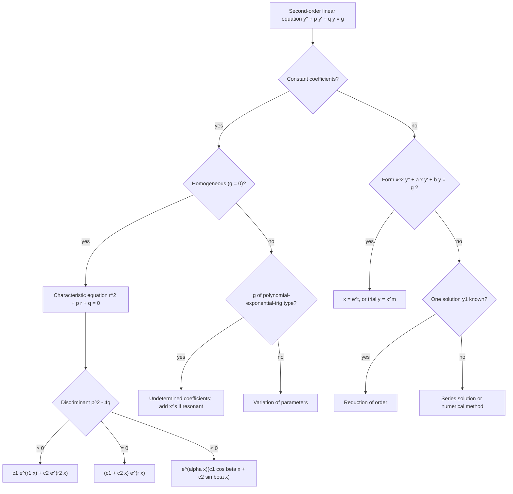

# Second-Order Linear ODEs

> [Mathematics](../../README.md) › [Differential Equations](../README.md) · Level: Advanced · Prerequisites: [First-Order Differential Equations](../01-first-order-odes/README.md), [Differentiation Rules](../../07-calculus/04-differentiation-rules/README.md), [Techniques of Integration](../../07-calculus/08-techniques-of-integration/README.md), [Vector Spaces](../../08-linear-algebra/04-vector-spaces/README.md), [Eigenvalues and Eigenvectors](../../08-linear-algebra/07-eigenvalues-and-eigenvectors/README.md), [Complex Numbers](../../03-algebra/13-complex-numbers/README.md), [Trigonometric Identities](../../05-trigonometry/03-trigonometric-identities/README.md) · Estimated time: 10 h

## 1. Introduction

Newton's second law makes acceleration — a second derivative — proportional to force. Every system with mass and stiffness, every circuit with inductance and capacitance, every beam with bending stiffness obeys a second-order linear equation. That is why this is the most used class of differential equations in science and engineering, and why it deserves a complete theory rather than a bag of tricks.

The theory is genuinely elegant. The set of solutions of a *homogeneous* linear equation is a **vector space of dimension two**: the superposition principle holds, and two independent solutions determine all the rest. Solving the equation means finding a basis, and every method in this topic is a way of finding one basis vector, or of building a particular solution once the basis is known. The structure is exactly that of a plane through the origin, and the Wronskian is the determinant that tests when two vectors in it are independent.

For **constant coefficients** the whole problem reduces to algebra: substituting $y = e^{rx}$ turns the differential equation into the quadratic **characteristic equation** $r^{2} + pr + q = 0$. Its three cases — distinct real, repeated, complex conjugate roots — produce the three families of solutions, and each case has a derivation rather than a rule (§7.2).

When a forcing term is present, two methods produce a particular solution. **Undetermined coefficients** is fast and applies to polynomials, exponentials, sines and cosines; its apparently arbitrary rules are the residue of the annihilator argument, and **resonance** is exactly the case where the forcing's natural frequency collides with the system's. **Variation of parameters** is slower but general, and it is derived, not guessed.

The applications are not decoration: the mass–spring system, the series RLC circuit and the Euler–Bernoulli beam are the same three-term structure $a\ddot{y} + b\dot{y} + cy = f$, and the vocabulary of damping, natural frequency, amplitude, phase and resonance transfers verbatim between them.

## 2. Prerequisites

**First-order equations** ([First-Order Differential Equations](../01-first-order-odes/README.md)): separation, integrating factors, the distinction between general and particular solutions, existence and uniqueness, and the fact that a first-order linear equation has a one-parameter family of solutions.

**Differentiation and integration** ([Differentiation Rules](../../07-calculus/04-differentiation-rules/README.md), [Techniques of Integration](../../07-calculus/08-techniques-of-integration/README.md)): the product and chain rules, the derivatives of $e^{x}$, $\sin x$, $\cos x$, $\ln x$, and integration by parts and partial fractions.

**Linear algebra** ([Vector Spaces](../../08-linear-algebra/04-vector-spaces/README.md), [Eigenvalues and Eigenvectors](../../08-linear-algebra/07-eigenvalues-and-eigenvectors/README.md)): linear independence, basis, dimension, and the determinant of a $2 \times 2$ matrix. The solution set of a homogeneous linear ODE is a vector space, so these words are used literally.

**Complex numbers** ([Complex Numbers](../../03-algebra/13-complex-numbers/README.md)): $i^{2} = -1$, the modulus and argument, and Euler's formula $e^{i\theta} = \cos\theta + i\sin\theta$, which is what turns complex roots into real oscillations.

**Trigonometry** ([Trigonometric Identities](../../05-trigonometry/03-trigonometric-identities/README.md)): the addition formulas, used to combine $A\cos\omega t + B\sin\omega t$ into a single shifted cosine.

## 3. Learning Objectives

After this tutorial you will be able to:

1. Decide whether a second-order equation is linear, homogeneous, and of constant or variable coefficients, and put it in standard form.
2. Prove the superposition principle and the theorem that a homogeneous linear equation has a two-dimensional solution space, using the Wronskian.
3. Compute Wronskians, use Abel's identity, and decide whether two solutions form a fundamental set.
4. Solve constant-coefficient equations in all three root cases, deriving the repeated-root solution rather than recalling it.
5. Find particular solutions by undetermined coefficients, including every resonance case, and explain why each rule is what it is.
6. Derive and apply variation of parameters for arbitrary continuous forcing.
7. Compute the steady-state amplitude and phase of a forced damped oscillator, locate the resonance frequency, and classify the damping.
8. Solve Cauchy–Euler equations, including the repeated and complex cases, and convert between $x$ and $t = \ln x$.
9. Derive the reduction-of-order formula and use it to complete a fundamental set from one solution.
10. Model a mass–spring system, an RLC circuit and a simply supported beam, with units, and interpret the parameters physically.

## 4. Intuition

**Two numbers must be supplied, so the solution space is a plane.** A first-order equation needs one initial value; a second-order equation needs two, position and velocity. Two pieces of information cannot be carried by a one-parameter family, so the family must be two-parameter — and linearity makes the parameter space an honest vector space: the sum of two solutions is a solution, and so is a scalar multiple.

**Superposition is the statement that the equation is blind to amplitude.** If $y_1$ and $y_2$ each satisfy $y'' + py' + qy = 0$, so does every combination, because differentiation is linear. Physically: two motions of the same oscillator can be superposed, and their sum is again a possible motion.

**Reduction to algebra.** For constant coefficients, $e^{rx}$ is an eigenfunction of $D = d/dx$: $D e^{rx} = r e^{rx}$. Applying $D^{2} + pD + q$ multiplies it by $r^{2} + pr + q$, so the differential equation becomes a quadratic equation for the growth rate $r$. Real roots give pure growth or decay; a repeated root is the borderline case where a second, slower-growing solution $xe^{rx}$ appears; complex roots give oscillation dressed in exponential decay or growth.

**Forcing and resonance.** A driven oscillator responds at the driving frequency, not at its own. The response amplitude is the ratio of the force amplitude to the *impedance* of the system at that frequency, and the impedance is smallest — so the response largest — near the natural frequency. When damping is zero the impedance vanishes exactly there and the amplitude grows without bound: resonance.

## 5. Formal Definition

### 5.1 The equation and its operator

A **second-order linear ordinary differential equation** in standard form is

$$y'' + p(x)\,y' + q(x)\,y = g(x),$$

with $p, q, g$ continuous on an interval $I$. It is **homogeneous** if $g \equiv 0$ and **non-homogeneous** otherwise; it has **constant coefficients** if $p$ and $q$ are constants; it is **autonomous** in that case (no explicit $x$).

> **Definition 5.1 (linear operator).** For twice differentiable $y$, define
> $$L[y] = y'' + p(x)y' + q(x)y .$$
> Then $L$ is **linear**: $L[c_{1}y_{1} + c_{2}y_{2}] = c_{1}L[y_{1}] + c_{2}L[y_{2}]$ for all constants $c_{1}, c_{2}$ and all twice differentiable $y_{1}, y_{2}$.

The equation is then $L[y] = g$, and the homogeneous equation is $L[y] = 0$.

> **Definition 5.2 (solution and IVP).** A **solution on $I$** is a twice differentiable $y$ with $(L[y])(x) = g(x)$ for all $x \in I$. An **initial value problem** adds two conditions at a point $x_{0} \in I$:
> $$y(x_{0}) = y_{0}, \qquad y'(x_{0}) = y_{1} .$$

> **Definition 5.3 (Wronskian).** For differentiable $y_{1}, y_{2}$,
> $$W(y_{1},y_{2})(x) = \det\begin{pmatrix} y_{1} & y_{2} \\ y_{1}' & y_{2}' \end{pmatrix} = y_{1}y_{2}' - y_{1}'y_{2} .$$

> **Definition 5.4 (fundamental set).** Two solutions $y_{1}, y_{2}$ of $L[y] = 0$ on $I$ form a **fundamental set** (a basis of the solution space) if $W(y_{1},y_{2})(x) \ne 0$ at some — equivalently, at every — point of $I$.

### 5.2 Existence, uniqueness and the solution space

> **Theorem 5.1 (existence and uniqueness).** Let $p, q, g$ be continuous on an open interval $I$ containing $x_{0}$, and let $y_{0}, y_{1} \in \mathbb{R}$. Then the initial value problem $L[y] = g$, $y(x_{0}) = y_{0}$, $y'(x_{0}) = y_{1}$ has exactly one solution, defined on all of $I$.

This is the second-order case of Picard–Lindelöf: writing $u = (y, y')$ gives the first-order system $u' = (u_{2},\; g - qu_{1} - pu_{2})$, whose right side is continuous and Lipschitz in $u$ on every compact subinterval, so §7.6 of [the previous topic](../01-first-order-odes/README.md) applies and gives existence and uniqueness on $I$.

> **Definition 5.5 (solution space).** $\mathcal{S} = \{y : I \to \mathbb{R} : y \text{ is twice differentiable and } L[y] = 0\}$ is the **solution space** of the homogeneous equation.

$\mathcal{S}$ is a vector space under the usual operations, by linearity of $L$. Theorem 7.1 below states that $\dim \mathcal{S} = 2$.

### 5.3 Reduction to a first-order system

The substitution $u_{1} = y$, $u_{2} = y'$ converts $y'' + py' + qy = g$ into

$$u_{1}' = u_{2}, \qquad u_{2}' = -q(x)u_{1} - p(x)u_{2} + g(x),$$

that is $u' = A(x)u + b(x)$ with $A = \begin{pmatrix} 0 & 1 \\ -q & -p\end{pmatrix}$. For constant coefficients $A$ is a constant matrix whose eigenvalues solve $r^{2} + pr + q = 0$ — the characteristic equation is the eigenvalue equation of the companion matrix, which is why the same quadratic governs everything in §7.2.

## 6. Mathematical Notation

| Symbol | Read as | Meaning |
|---|---|---|
| $L[y]$ | "L of y" | the operator $y'' + py' + qy$ |
| $p(x)$, $q(x)$ | "p of x", "q of x" | the coefficient functions; constants in §7.2 |
| $g(x)$ | "g of x" | the forcing (right-hand side) |
| $y_{1}$, $y_{2}$ | "y one", "y two" | a pair of solutions, usually a fundamental set |
| $W(y_{1},y_{2})$ | "the Wronskian of y-one and y-two" | $y_{1}y_{2}' - y_{1}'y_{2}$ |
| $c_{1}$, $c_{2}$ | "see one", "see two" | arbitrary constants; coordinates in the solution space |
| $r$, $r_{1}$, $r_{2}$ | "arr" | roots of the characteristic equation |
| $\alpha \pm i\beta$ | "alpha plus or minus i beta" | a complex conjugate pair of roots, $\beta > 0$ |
| $\omega_{0}$ | "omega nought" | natural (undamped) angular frequency, rad/s |
| $\zeta$ | "zeta" | damping ratio, dimensionless |
| $\omega_{d}$ | "omega dee" | damped angular frequency, $\omega_{0}\sqrt{1-\zeta^{2}}$ |
| $\omega$ | "omega" | driving angular frequency, rad/s |
| $A$, $\varphi$ | "A", "phi" | amplitude and phase of a sinusoidal response |
| $m$, $c$, $k$ | "em", "see", "kay" | mass, damping coefficient, stiffness |
| $x^{m}$ | "x to the m" | trial solution for a Cauchy–Euler equation |
| $t = \ln x$ | "t equals ell-en x" | the substitution that converts Cauchy–Euler to constant coefficients |

Conventions: $\ln$ is the natural logarithm; angles are in radians; a dot ($\dot{y}$) denotes a derivative with respect to time; and $\operatorname{Re}$, $\operatorname{Im}$ denote real and imaginary parts.

## 7. Core Concepts

### 7.1 Superposition and the two-dimensional solution space

> **Theorem 7.1.** Let $p, q$ be continuous on an interval $I$. Then the solution space $\mathcal{S}$ of $y'' + p(x)y' + q(x)y = 0$ on $I$ is a vector space of dimension exactly $2$.

*Proof.* **(i) $\mathcal{S}$ is a subspace.** If $L[y_{1}] = L[y_{2}] = 0$ then, by linearity of $L$, $L[c_{1}y_{1} + c_{2}y_{2}] = c_{1}L[y_{1}] + c_{2}L[y_{2}] = 0$: closed under addition and scalar multiplication, and $0 \in \mathcal{S}$.

**(ii) $\dim \mathcal{S} \le 2$.** Let $y_{1}, y_{2} \in \mathcal{S}$ be a fundamental set and let $x_{0} \in I$. For arbitrary $y \in \mathcal{S}$ consider the linear system for the unknowns $c_{1}, c_{2}$:

$$c_{1}y_{1}(x_{0}) + c_{2}y_{2}(x_{0}) = y(x_{0}), \qquad c_{1}y_{1}'(x_{0}) + c_{2}y_{2}'(x_{0}) = y'(x_{0}).$$

Its determinant is $W(y_{1},y_{2})(x_{0}) \ne 0$, so there is a unique solution $(c_{1},c_{2})$. The function $c_{1}y_{1} + c_{2}y_{2}$ lies in $\mathcal{S}$ and has the same value and derivative at $x_{0}$ as $y$; by uniqueness (Theorem 5.1) the two are equal. Hence $y_{1}, y_{2}$ span $\mathcal{S}$.

**(iii) $\dim \mathcal{S} \ge 2$.** By Theorem 5.1 there are solutions $y_{1}$ with $y_{1}(x_{0}) = 1$, $y_{1}'(x_{0}) = 0$ and $y_{2}$ with $y_{2}(x_{0}) = 0$, $y_{2}'(x_{0}) = 1$. Their Wronskian at $x_{0}$ is $1\cdot1 - 0\cdot0 = 1 \ne 0$, so they are linearly independent. $\blacksquare$

Three consequences organise everything that follows.

* **General solution of the homogeneous equation:** $y = c_{1}y_{1} + c_{2}y_{2}$ with $y_{1}, y_{2}$ a fundamental set. The constants are the coordinates of the solution in the basis.
* **General solution of the non-homogeneous equation:** $y = y_{p} + c_{1}y_{1} + c_{2}y_{2}$, where $y_{p}$ is any one particular solution. Indeed $L[y - y_{p}] = g - g = 0$, and conversely every such combination solves $L[y] = g$.
* **Initial value problems:** the two constants are determined by the $2 \times 2$ system above, whose determinant is $W(x_{0}) \ne 0$ — so the data $(y_{0}, y_{1})$ correspond one-to-one with solutions.

The Wronskian test has a strong form, which is what makes it practical.

> **Theorem 7.2 (Abel's identity).** If $y_{1}, y_{2}$ solve $y'' + p(x)y' + q(x)y = 0$ on $I$, then
> $$W(x) = W(x_{0})\exp\!\left(-\int_{x_{0}}^{x}p(s)\,ds\right) \qquad (x \in I).$$

*Proof.* Differentiate $W = y_{1}y_{2}' - y_{1}'y_{2}$ and use the equation in the form $y_{i}'' = -py_{i}' - qy_{i}$:

$$W' = y_{1}y_{2}'' - y_{1}''y_{2} = y_{1}\left(-py_{2}' - qy_{2}\right) - \left(-py_{1}' - qy_{1}\right)y_{2} = -p\left(y_{1}y_{2}' - y_{1}'y_{2}\right) = -pW .$$

This is a first-order linear equation for $W$, with solution the displayed exponential. $\blacksquare$

Because an exponential never vanishes, **$W$ is either identically zero on $I$ or nowhere zero on $I$**. So two solutions are either linearly independent everywhere or dependent everywhere, and testing at a single convenient point decides it.

### 7.2 Constant coefficients: all three cases derived

Take $p, q$ constants and look for a solution of the shape $y = e^{rx}$, the natural guess because $e^{rx}$ is an eigenfunction of differentiation: $(e^{rx})' = re^{rx}$. Substituting,

$$L\left[e^{rx}\right] = \left(r^{2} + pr + q\right)e^{rx} .$$

Since $e^{rx} \ne 0$, the guess works exactly when

$$r^{2} + pr + q = 0,$$

the **characteristic equation**. Its roots $r_{1}, r_{2}$ satisfy $r_{1} + r_{2} = -p$ and $r_{1}r_{2} = q$.

**Case 1: distinct real roots.** Then $y_{1} = e^{r_{1}x}$ and $y_{2} = e^{r_{2}x}$ are solutions, and

$$W = r_{2}e^{(r_{1}+r_{2})x} - r_{1}e^{(r_{1}+r_{2})x} = (r_{2} - r_{1})e^{(r_{1}+r_{2})x} \ne 0 .$$

So they form a fundamental set and

$$y = c_{1}e^{r_{1}x} + c_{2}e^{r_{2}x} .$$

The signs of $r_{1}, r_{2}$ decide the behaviour at infinity: both negative gives decay to $0$ (stable node), both positive gives growth (unstable), opposite signs gives a saddle in which one direction decays and the other grows.

**Case 2: a repeated root $r = -p/2$.** Only one exponential is available. There is a second solution

$$y_{2} = x\,e^{rx},$$

and two derivations explain why.

*Direct verification.* Using $2r + p = 0$ and $r^{2} + pr + q = 0$,

$$y_{2}' = (1 + rx)e^{rx}, \qquad y_{2}'' = \left(2r + r^{2}x\right)e^{rx},$$

$$L[y_{2}] = \left[2r + r^{2}x + p(1 + rx) + qx\right]e^{rx} = \left[(2r + p) + x\left(r^{2} + pr + q\right)\right]e^{rx} = 0 .$$

*Derivation as a limit.* For $r_{1} \ne r_{2}$ near $r$, both $e^{r_{1}x}$ and $e^{r_{2}x}$ solve the equation, so by linearity so does the difference quotient

$$\frac{e^{r_{1}x} - e^{r_{2}x}}{r_{1} - r_{2}} ,$$

and as $r_{2} \to r_{1}$ this tends to $\dfrac{\partial}{\partial r}e^{rx} = x e^{rx}$. Since the equation's coefficients depend continuously on $r$, the limit is again a solution. The factor $x$ is the fingerprint of a degeneracy, and it reappears in the Cauchy–Euler equation (§7.6) and in the resonance rule (§7.3).

Hence with $r = -p/2$,

$$y = \left(c_{1} + c_{2}x\right)e^{rx}, \qquad W = e^{2rx} \ne 0 .$$

**Case 3: complex conjugate roots $r = \alpha \pm i\beta$, $\beta > 0$.** With real coefficients, complex roots come in conjugate pairs. Formally $e^{(\alpha + i\beta)x}$ solves the equation, and by Euler's formula

$$e^{(\alpha+i\beta)x} = e^{\alpha x}\left(\cos\beta x + i\sin\beta x\right).$$

Write $u(x) = e^{\alpha x}\cos\beta x$ and $v(x) = e^{\alpha x}\sin\beta x$, so that $e^{(\alpha+i\beta)x} = u + iv$. Since $L$ has real coefficients it commutes with taking real and imaginary parts: $L[u + iv] = L[u] + iL[v] = 0$ forces $L[u] = 0$ and $L[v] = 0$. So both $u$ and $v$ are real solutions, and

$$y = e^{\alpha x}\left(c_{1}\cos\beta x + c_{2}\sin\beta x\right), \qquad W = \beta e^{2\alpha x} \ne 0 .$$

The solution is an oscillation of angular frequency $\beta$ whose amplitude is modulated by $e^{\alpha x}$: decay if $\alpha < 0$, growth if $\alpha > 0$, pure oscillation if $\alpha = 0$. The amplitude–phase form $y = Re^{\alpha x}\cos(\beta x - \varphi)$ with $R = \sqrt{c_{1}^{2}+c_{2}^{2}}$ and $\tan\varphi = c_{2}/c_{1}$ is often the clearest way to report it.

### 7.3 Undetermined coefficients, and why resonance happens

Suppose $p, q$ are constants and $g$ is a polynomial, an exponential, a sine or cosine, or a product of these. The method guesses the *shape* of a particular solution with unknown coefficients and solves for them.

The rules look arbitrary; they are the visible part of a structural fact. Write $L = D^{2} + pD + q$ as a polynomial in $D$, and factor it over $\mathbb{C}$: $L = (D - r_{1})(D - r_{2})$. The elementary identity

$$(D - \alpha)\left[P(x)e^{\alpha x}\right] = \left(P'(x) + \alpha P(x) - \alpha P(x)\right)e^{\alpha x} = P'(x)e^{\alpha x}$$

shows that $(D-\alpha)$ *differentiates the polynomial and leaves the exponential alone*. Hence $(D-\alpha)^{k}$ lowers the degree by $k$, and if $\alpha$ is a root of $L$ of multiplicity $s$, then $L = (D-\alpha)^{s}M(D)$ with $M(\alpha) \ne 0$, so

$$L\left[P_{n}(x)e^{\alpha x}\right] = e^{\alpha x}\,M(D)\left[P_{n}^{(s)}(x)\right],$$

a polynomial of degree $n - s$ (or zero). To match a forcing $P_{n}e^{\alpha x}$ of degree $n$ we must therefore start with a polynomial of degree $n + s$, and the extra $s$ powers are precisely the factor $x^{s}$ in the rule. That is the whole content of "multiply by $x$ when the forcing solves the homogeneous equation".

| Forcing $g(x)$ | Trial $y_{p}$ | $s$ |
|---|---|---|
| $P_{n}(x)$ | $x^{s}Q_{n}(x)$ | multiplicity of $0$ as a root |
| $P_{n}(x)e^{\alpha x}$ | $x^{s}Q_{n}(x)e^{\alpha x}$ | multiplicity of $\alpha$ as a root |
| $P_{n}(x)e^{\alpha x}\cos\beta x$ or $\sin\beta x$ | $x^{s}e^{\alpha x}\left(Q_{n}\cos\beta x + R_{n}\sin\beta x\right)$ | multiplicity of $\alpha + i\beta$ as a root |

Here $P_{n}$ is a given polynomial of degree $n$ and $Q_{n}$, $R_{n}$ are general polynomials of the same degree with unknown coefficients. If $g$ is a sum, solve for each term separately and add the results (superposition for the non-homogeneous equation).

**Resonance** is the case $s \ge 1$: the forcing has exactly the frequency of a homogeneous solution, so the naive guess is annihilated by $L$ and cannot produce $g$. The factor $x$ is not a trick but the lowest power that survives the operator. Physically it is the case where the driving frequency equals a natural frequency, and the response grows without bound.

**Example 7.1.** Solve $y'' + 4y = 3\cos 2x$. The homogeneous solutions are $\cos 2x$ and $\sin 2x$, and $\pm 2i$ are simple roots, so $s = 1$ and

$$y_{p} = x\left(A\cos 2x + B\sin 2x\right).$$

Then $y_{p}' = (A + 2Bx)\cos 2x + (B - 2Ax)\sin 2x$ and $y_{p}'' = (4B - 4Ax)\cos 2x - (4A + 4Bx)\sin 2x$, so

$$y_{p}'' + 4y_{p} = 4B\cos 2x - 4A\sin 2x \overset{!}{=} 3\cos 2x \;\Longrightarrow\; B = \tfrac34,\; A = 0,$$

and $y = c_{1}\cos 2x + c_{2}\sin 2x + \tfrac34 x\sin 2x$. The amplitude of the resonant term grows linearly in $x$.

### 7.4 Variation of parameters

Undetermined coefficients needs a special right-hand side. **Variation of parameters** works for any continuous $g$, at the price of two integrals.

Let $y_{1}, y_{2}$ be a fundamental set of the homogeneous equation and seek

$$y_{p} = u_{1}(x)y_{1}(x) + u_{2}(x)y_{2}(x)$$

with $u_{1}, u_{2}$ functions to be found. Two unknown functions but only one equation ($L[y_{p}] = g$) leaves a degree of freedom, and we spend it on the condition

$$u_{1}'y_{1} + u_{2}'y_{2} = 0 .$$

This is exactly the condition that makes $y_{p}'$ look like the derivative of a linear combination with *constant* coefficients:

$$y_{p}' = u_{1}y_{1}' + u_{2}y_{2}' .$$

Differentiating once more and substituting into $L[y_{p}] = g$:

$$y_{p}'' = u_{1}'y_{1}' + u_{2}'y_{2}' + u_{1}y_{1}'' + u_{2}y_{2}'',$$

$$L[y_{p}] = \left(u_{1}'y_{1}' + u_{2}'y_{2}'\right) + u_{1}\underbrace{L[y_{1}]}_{0} + u_{2}\underbrace{L[y_{2}]}_{0} + p\underbrace{\left(u_{1}'y_{1} + u_{2}'y_{2}\right)}_{0} = u_{1}'y_{1}' + u_{2}'y_{2}' .$$

So the two conditions are the linear system

$$u_{1}'y_{1} + u_{2}'y_{2} = 0, \qquad u_{1}'y_{1}' + u_{2}'y_{2}' = g,$$

whose determinant is $W = y_{1}y_{2}' - y_{1}'y_{2} \ne 0$. Cramer's rule gives

$$u_{1}' = -\frac{y_{2}\,g}{W}, \qquad u_{2}' = \frac{y_{1}\,g}{W},$$

and integrating,

$$\boxed{\;y_{p}(x) = -y_{1}(x)\int^{x}\frac{y_{2}(s)g(s)}{W(s)}\,ds \;+\; y_{2}(x)\int^{x}\frac{y_{1}(s)g(s)}{W(s)}\,ds\;}$$

with arbitrary constants in the integrals (they only add homogeneous solutions). This is the general particular solution, valid for every continuous $g$.

**Example 7.2.** Solve $y'' + y = \tan x$ on $\left(-\tfrac{\pi}{2},\tfrac{\pi}{2}\right)$.

Here $y_{1} = \cos x$, $y_{2} = \sin x$ and $W = \cos^{2}x + \sin^{2}x = 1$. Then

$$u_{1}' = -\sin x\tan x = -\frac{\sin^{2}x}{\cos x} = -\sec x + \cos x, \qquad u_{2}' = \cos x\tan x = \sin x,$$

so $u_{1} = -\ln\left\lvert\sec x + \tan x\right\rvert + \sin x$ and $u_{2} = -\cos x$. Therefore

$$y_{p} = \left(-\ln\left\lvert\sec x + \tan x\right\rvert + \sin x\right)\cos x - \cos x\sin x = -\cos x\,\ln\left\lvert\sec x + \tan x\right\rvert .$$

The two $\sin x\cos x$ terms cancel — a general feature: the terms that would duplicate homogeneous solutions always do.

### 7.5 Forced oscillations: damping, amplitude, phase and resonance

A mass on a spring with damping and a periodic force obeys

$$m\,\ddot{y} + c\,\dot{y} + k\,y = F_{0}\cos\omega t .$$

Dividing by $m$ puts it in the standard form

$$\ddot{y} + 2\zeta\omega_{0}\,\dot{y} + \omega_{0}^{2}\,y = \frac{F_{0}}{m}\cos\omega t, \qquad \omega_{0} = \sqrt{\frac{k}{m}}, \quad \zeta = \frac{c}{2\sqrt{mk}} .$$

$\omega_{0}$ is the **natural frequency** (rad/s) and $\zeta \ge 0$ the **damping ratio** (dimensionless).

**The homogeneous cases.** The characteristic equation is $r^{2} + 2\zeta\omega_{0}r + \omega_{0}^{2} = 0$, with roots

$$r = \omega_{0}\left(-\zeta \pm \sqrt{\zeta^{2}-1}\right).$$

| $\zeta$ | Name | Roots | Behaviour |
|---|---|---|---|
| $0$ | undamped | $\pm i\omega_{0}$ | perpetual oscillation |
| $0 < \zeta < 1$ | underdamped | $-\zeta\omega_{0} \pm i\omega_{d}$, $\omega_{d} = \omega_{0}\sqrt{1-\zeta^{2}}$ | decaying oscillation |
| $\zeta = 1$ | critically damped | $-\omega_{0}$ (double) | fastest return without oscillation |
| $\zeta > 1$ | overdamped | two distinct negative reals | slow return, no oscillation |

**The steady state.** Seek $y_{p} = \operatorname{Re}\left[Y e^{i\omega t}\right]$. Substituting,

$$\left[-\omega^{2} + 2i\zeta\omega_{0}\omega + \omega_{0}^{2}\right]Y e^{i\omega t} = \frac{F_{0}}{m}e^{i\omega t}, \qquad Y = \frac{F_{0}/m}{\left(\omega_{0}^{2} - \omega^{2}\right) + 2i\zeta\omega_{0}\omega} .$$

Taking modulus and argument,

$$A(\omega) = \frac{F_{0}/m}{\sqrt{\left(\omega_{0}^{2}-\omega^{2}\right)^{2} + \left(2\zeta\omega_{0}\omega\right)^{2}}}, \qquad \tan\varphi = \frac{2\zeta\omega_{0}\omega}{\omega_{0}^{2}-\omega^{2}},$$

so the steady-state response is $y_{p} = A(\omega)\cos\left(\omega t - \varphi\right)$: it oscillates at the **driving** frequency, lags by $\varphi \in (0,\pi)$, and has amplitude equal to the force amplitude divided by the *impedance* $\sqrt{(\omega_{0}^{2}-\omega^{2})^{2} + (2\zeta\omega_{0}\omega)^{2}}$.

For $\zeta > 0$ the homogeneous part decays, so every solution converges to $y_{p}$: the transient disappears and the steady state is all that is left.

**Resonance.** Maximise $A$ over $\omega$. Squaring the denominator and setting $u = \omega^{2}$,

$$\left(\omega_{0}^{2}-u\right)^{2} + 4\zeta^{2}\omega_{0}^{2}u = u^{2} - 2\omega_{0}^{2}\left(1 - 2\zeta^{2}\right)u + \omega_{0}^{4},$$

a convex quadratic in $u$, minimal at $u = \omega_{0}^{2}\left(1-2\zeta^{2}\right)$. Hence the **resonance frequency** is

$$\omega_{r} = \omega_{0}\sqrt{1 - 2\zeta^{2}} \quad \left(\zeta < \tfrac{1}{\sqrt{2}}\right), \qquad A_{\max} = \frac{F_{0}/m}{2\zeta\omega_{0}^{2}\sqrt{1-\zeta^{2}}} .$$

For light damping $\omega_{r} \approx \omega_{0}$ and $A_{\max} \approx \dfrac{F_{0}}{c\,\omega_{0}}$: the response is limited only by the damping. At $\zeta = 0$ the amplitude is unbounded at $\omega = \omega_{0}$, and the solution grows linearly in time (Example 9.4 and problem 31).

### 7.6 The Cauchy–Euler equation

An equation of the form

$$x^{2}y'' + a\,x\,y' + b\,y = g(x), \qquad x > 0,$$

with $a, b$ constants, is a **Cauchy–Euler** (or equidimensional) equation. Its coefficients are not constant, but the equation is invariant under the scaling $x \mapsto \lambda x$, which suggests the trial $y = x^{m}$:

$$y' = m x^{m-1}, \quad y'' = m(m-1)x^{m-2} \;\Longrightarrow\; x^{2}y'' + axy' + by = \left[m(m-1) + am + b\right]x^{m} .$$

So $x^{m}$ solves the homogeneous equation exactly when the **indicial equation**

$$m(m-1) + am + b = 0, \qquad\text{that is}\qquad m^{2} + (a-1)m + b = 0,$$

holds. The three cases mirror §7.2:

| Roots of the indicial equation | Fundamental set ($x>0$) |
|---|---|
| distinct real $m_{1}, m_{2}$ | $x^{m_{1}}$, $x^{m_{2}}$ |
| repeated $m$ | $x^{m}$, $x^{m}\ln x$ |
| complex $\alpha \pm i\beta$ | $x^{\alpha}\cos(\beta\ln x)$, $x^{\alpha}\sin(\beta\ln x)$ |

The cleanest justification of all three at once is the substitution $x = e^{t}$, $t = \ln x$. By the chain rule,

$$\frac{dy}{dx} = \frac{1}{x}\frac{dy}{dt}, \qquad \frac{d^{2}y}{dx^{2}} = \frac{1}{x^{2}}\left(\frac{d^{2}y}{dt^{2}} - \frac{dy}{dt}\right),$$

so the equation becomes

$$\ddot{y} + (a-1)\dot{y} + b\,y = g\left(e^{t}\right),$$

a constant-coefficient equation in $t$. Converting the three constant-coefficient cases back with $t = \ln x$ and $e^{t} = x$ gives the table: a repeated root $m$ yields $e^{mt}$ and $te^{mt} = x^{m}\ln x$, and a complex pair gives $e^{\alpha t}\cos(\beta t) = x^{\alpha}\cos(\beta\ln x)$, and so on.

For $x < 0$ the same formulas hold with $x$ replaced by $\lvert x\rvert$, on the interval $x < 0$; the two half-lines are separate problems because the coefficients are singular at $0$.

### 7.7 Reduction of order

Given one nonzero solution $y_{1}$ of $y'' + p(x)y' + q(x)y = 0$, a second independent solution can always be found. Put

$$y = v(x)\,y_{1}(x), \qquad y' = v'y_{1} + vy_{1}', \qquad y'' = v''y_{1} + 2v'y_{1}' + vy_{1}'' .$$

Substituting and collecting the terms in $v$:

$$L[y] = v''y_{1} + v'\left(2y_{1}' + py_{1}\right) + v\underbrace{\left(y_{1}'' + py_{1}' + qy_{1}\right)}_{0} = 0 .$$

The $v$-term vanishes because $y_{1}$ is a solution, leaving a first-order equation for $w = v'$:

$$w' + \left(\frac{2y_{1}'}{y_{1}} + p\right)w = 0 \;\Longrightarrow\; \ln\lvert w\rvert = -2\ln\lvert y_{1}\rvert - \int p\,dx,$$

so $w = \dfrac{e^{-\int p\,dx}}{y_{1}^{2}}$ and

$$\boxed{\;y_{2}(x) = y_{1}(x)\int^{x}\frac{e^{-\int p(s)\,ds}}{y_{1}(t)^{2}}\,dt\;}$$

Choosing $p = 0$ recovers the familiar special case $y_{2} = y_{1}\int dt/y_{1}^{2}$. The Wronskian of the pair is $W = y_{1}^{2}w = e^{-\int p}$, which is Abel's identity (Theorem 7.2) again — nonzero, so $y_{2}$ is genuinely independent. This is the derivation behind the $x e^{rx}$ in the repeated-root case and the $x^{m}\ln x$ in the repeated Cauchy–Euler case.

### 7.8 Applications

**Mass–spring systems.** A mass $m$ (kg) on a spring of stiffness $k$ (N/m) with viscous damping $c$ (N·s/m) and external force $F(t)$ (N) obeys

$$m\,\ddot{y} + c\,\dot{y} + k\,y = F(t),$$

where $y$ is the displacement in metres from equilibrium. Every term has units of newtons. The natural frequency is $\omega_{0} = \sqrt{k/m}$ rad/s, the damping ratio $\zeta = c/(2\sqrt{mk})$, and §7.5 applies verbatim.

**Series RLC circuits.** A resistor $R$ (Ω), inductor $L$ (H) and capacitor $C$ (F) in series with a voltage source $E(t)$ (V) obey, for the charge $q$ (C) on the capacitor,

$$L\,\ddot{q} + R\,\dot{q} + \frac{1}{C}\,q = E(t), \qquad i = \dot{q} .$$

Every term has units of volts. The inductance plays the role of mass, resistance of damping and $1/C$ of stiffness; the current and the charge oscillate, and the circuit is under-, critically or overdamped according to the sign of $R^{2} - 4L/C$ — the discriminant, exactly as for the spring.

**Beams.** For a beam of length $L$ with flexural rigidity $EI$ (N·m², where $E$ is Young's modulus in Pa and $I$ the second moment of area in m⁴) carrying a distributed load $w(x)$ (N/m), the Euler–Bernoulli theory gives $EI\,y'''' = w$. When the bending moment $M(x)$ is known, the same theory reduces to a *second-order* equation for the deflection $y$ (m):

$$EI\,y'' = -M(x),$$

with $y$ measured downward and $M$ positive for sagging. Two integrations and the support conditions determine $y$; a simply supported beam has $y(0) = y(L) = 0$ and the end moments vanish, which is exactly enough data for the second-order problem (Example 9.9).

## 8. Formulas and Properties

### 8.1 Superposition and the shape of the general solution

> **Theorem 8.1.** Let $p, q, g$ be continuous on $I$.
> 1. If $L[y_{1}] = 0$ and $L[y_{2}] = 0$, then $L[c_{1}y_{1} + c_{2}y_{2}] = 0$ for all constants $c_{1}, c_{2}$.
> 2. If $y_{p}$ is one solution of $L[y] = g$ and $y_{1}, y_{2}$ a fundamental set for $L[y] = 0$, then the solutions of $L[y] = g$ are exactly $y_{p} + c_{1}y_{1} + c_{2}y_{2}$.

*Proof.* Part 1 is linearity of differentiation. For part 2, $L[y - y_{p}] = g - g = 0$, so $y - y_{p}$ lies in the solution space, which by Theorem 7.1 is spanned by $y_{1}, y_{2}$; conversely each $y_{p} + c_{1}y_{1} + c_{2}y_{2}$ solves the equation. $\blacksquare$

### 8.2 Wronskian and Abel's identity

> **Theorem 8.2.** For solutions $y_{1}, y_{2}$ of $y'' + py' + qy = 0$ with $p$ continuous,
> $$W(x) = W(x_{0})\exp\!\left(-\int_{x_{0}}^{x}p(s)\,ds\right).$$
> Hence either $W \equiv 0$ (dependent pair) or $W \ne 0$ everywhere (fundamental set).

The proof is in §7.1. The practical content is that independence need only be checked at one point, and that for constant coefficients it can be read off the roots.

### 8.3 Constant coefficients

> **Theorem 8.3.** Let $r_{1}, r_{2}$ be the roots of $r^{2} + pr + q = 0$ (with $p, q$ real). Then a fundamental set of $y'' + py' + qy = 0$ is
> $$\{e^{r_{1}x}, e^{r_{2}x}\} \text{ if } r_{1} \ne r_{2} \text{ real}, \qquad \{e^{rx}, xe^{rx}\} \text{ if } r_{1} = r_{2} = r, \qquad \{e^{\alpha x}\cos\beta x, e^{\alpha x}\sin\beta x\} \text{ if } r = \alpha \pm i\beta .$$

The derivations, including the verification of each Wronskian, are in §7.2. Two special consequences are worth memorising as *facts*, not as rules: the repeated root contributes the factor $x$ because the second solution is $\partial_{r}e^{rx}$; the real and imaginary parts of a complex solution are solutions because the coefficients are real.

### 8.4 Undetermined coefficients

> **Theorem 8.4.** Let $p, q$ be constants, let $\alpha + i\beta$ be a root of the characteristic equation of multiplicity $s \ge 0$, and let $P_{n}$ be a polynomial of degree $n$. Then the equation
> $$y'' + py' + qy = P_{n}(x)\,e^{\alpha x}\cos\beta x \quad\left(\text{or } \sin\beta x\right)$$
> has a particular solution $y_{p} = x^{s}e^{\alpha x}\left(Q_{n}(x)\cos\beta x + R_{n}(x)\sin\beta x\right)$, where $Q_{n}, R_{n}$ are polynomials of degree $n$.

The argument from the factorisation $L = (D-\alpha)^{s}M(D)$ is in §7.3. When $\beta = 0$ the cosine drops out and the statement reduces to the polynomial-times-exponential case, with $s$ the multiplicity of $\alpha$; the case $g = P_{n}(x)$ is $\alpha = 0$.

### 8.5 Variation of parameters

> **Theorem 8.5.** Let $y_{1}, y_{2}$ be a fundamental set of $y'' + py' + qy = 0$ and let $g$ be continuous. Then
> $$y_{p} = -y_{1}\int\frac{y_{2}g}{W}\,dx + y_{2}\int\frac{y_{1}g}{W}\,dx$$
> is a particular solution of $y'' + py' + qy = g$.

The derivation, including the choice of the constraint $u_{1}'y_{1} + u_{2}'y_{2} = 0$, is in §7.4. Unlike undetermined coefficients, the theorem requires no hypothesis on the shape of $g$ beyond continuity.

### 8.6 Forced damped oscillator

> **Theorem 8.6.** For $\ddot{y} + 2\zeta\omega_{0}\dot{y} + \omega_{0}^{2}y = (F_{0}/m)\cos\omega t$ with $\zeta \ge 0$, the functions $A\cos(\omega t - \varphi)$ are steady-state solutions, where
> $$A = \frac{F_{0}/m}{\sqrt{\left(\omega_{0}^{2}-\omega^{2}\right)^{2} + 4\zeta^{2}\omega_{0}^{2}\omega^{2}}}, \qquad \tan\varphi = \frac{2\zeta\omega_{0}\omega}{\omega_{0}^{2}-\omega^{2}},$$
> and the amplitude is maximal at $\omega_{r} = \omega_{0}\sqrt{1-2\zeta^{2}}$ when $\zeta < 1/\sqrt{2}$, with maximum value $\dfrac{F_{0}/m}{2\zeta\omega_{0}^{2}\sqrt{1-\zeta^{2}}} = \dfrac{F_{0}}{c\,\omega_{0}\sqrt{1-\zeta^{2}}}$.

Written with $\omega_{r}$ and $A_{\max}$ as in the statement, the maximum is approximately $F_{0}/(c\omega_{0})$ for light damping. For $\zeta = 0$ the response is unbounded at $\omega = \omega_{0}$; for $\zeta > 0$ the homogeneous part decays and the steady state is the whole long-run behaviour.

### 8.7 Cauchy–Euler equations

> **Theorem 8.7.** For $x^{2}y'' + axy' + by = 0$ on $x > 0$, let $m^{2} + (a-1)m + b = 0$ have roots $m_{1}, m_{2}$. Then a fundamental set is $\{x^{m_{1}}, x^{m_{2}}\}$ for distinct real roots, $\{x^{m}, x^{m}\ln x\}$ for a repeated root $m$, and $\{x^{\alpha}\cos(\beta\ln x), x^{\alpha}\sin(\beta\ln x)\}$ for $m = \alpha \pm i\beta$.

The substitution $t = \ln x$ converts the equation into $\ddot{y} + (a-1)\dot{y} + by = g(e^{t})$, which is where all three cases come from.

### 8.8 Reduction of order

> **Theorem 8.8.** If $y_{1}$ is a nonzero solution of $y'' + py' + qy = 0$ on $I$, then
> $$y_{2} = y_{1}\int\frac{e^{-\int p\,dx}}{y_{1}^{2}}\,dx$$
> is a second solution, and $W(y_{1},y_{2}) = e^{-\int p\,dx} \ne 0$, so $\{y_{1}, y_{2}\}$ is a fundamental set.

### 8.9 Decision guide

| The equation | Method | Section |
|---|---|---|
| Constant coefficients, homogeneous | characteristic equation | §7.2 |
| Constant coefficients, $g$ a polynomial × exponential × sine/cosine | undetermined coefficients (mind $s$) | §7.3 |
| Constant coefficients, other continuous $g$ | variation of parameters | §7.4 |
| $x^{2}y'' + axy' + by = g(x)$ | Cauchy–Euler: $x = e^{t}$ or trial $x^{m}$ | §7.6 |
| One solution known, coefficients arbitrary | reduction of order | §7.7 |
| $p, q$ arbitrary and no solution known | series or numerical methods (next topics) | §16 |

## 9. Step-by-Step Examples

Every example is checked by substitution; the checks are the part to imitate.

### 9.1 Distinct real roots with initial data

Solve $y'' - y' - 6y = 0$ with $y(0) = 1$ and $y'(0) = 0$.

*Characteristic equation.* $r^{2} - r - 6 = (r-3)(r+2) = 0$, so $r_{1} = 3$, $r_{2} = -2$: distinct and real.

*General solution.* $y = c_{1}e^{3x} + c_{2}e^{-2x}$.

*Initial conditions.* $y(0) = c_{1} + c_{2} = 1$ and $y'(0) = 3c_{1} - 2c_{2} = 0$. From the second, $c_{1} = \tfrac{2}{3}c_{2}$; substituting, $\tfrac{5}{3}c_{2} = 1$, so $c_{2} = \tfrac{3}{5}$ and $c_{1} = \tfrac{2}{5}$. Hence

$$y = \frac{2}{5}e^{3x} + \frac{3}{5}e^{-2x} .$$

*Check:* $y' = \tfrac{6}{5}e^{3x} - \tfrac{6}{5}e^{-2x}$ and $y'' = \tfrac{18}{5}e^{3x} + \tfrac{12}{5}e^{-2x}$, so

$$y'' - y' - 6y = \left(\tfrac{18}{5} - \tfrac{6}{5} - \tfrac{12}{5}\right)e^{3x} + \left(\tfrac{12}{5} + \tfrac{6}{5} - \tfrac{18}{5}\right)e^{-2x} = 0 \;\checkmark$$

and $y(0) = 1$, $y'(0) = 0$ ✓.

*Reading the answer:* the $e^{3x}$ term dominates as $x \to \infty$; the solution grows, because one root is positive. With $y'(0) = 0$ the initial velocity vanishes, yet the solution still moves — the initial *position* already lies off the equilibrium, and the unstable mode feeds on it.

### 9.2 A repeated root with initial data

Solve $y'' - 4y' + 4y = 0$ with $y(0) = 2$ and $y'(0) = 1$.

*Characteristic equation.* $r^{2} - 4r + 4 = (r-2)^{2} = 0$, a repeated root $r = 2$. By §7.2 a fundamental set is $\{e^{2x}, xe^{2x}\}$, so

$$y = \left(c_{1} + c_{2}x\right)e^{2x} .$$

*Initial conditions.* $y(0) = c_{1} = 2$; and $y' = \left(c_{2} + 2c_{1} + 2c_{2}x\right)e^{2x}$ gives $y'(0) = c_{2} + 4 = 1$, so $c_{2} = -3$. Hence

$$y = \left(2 - 3x\right)e^{2x} .$$

*Check:* $y' = \left(-3 + 4 - 6x\right)e^{2x} = \left(1 - 6x\right)e^{2x}$ and $y'' = \left(-6 + 2 - 12x\right)e^{2x} = \left(-4 - 12x\right)e^{2x}$, so

$$y'' - 4y' + 4y = \left(-4 - 12x - 4 + 24x + 8 - 12x\right)e^{2x} = 0 \;\checkmark$$

and $y(0) = 2$, $y'(0) = 1$ ✓.

*Reading the answer:* the solution changes sign at $x = \tfrac23$. This is behaviour no single exponential can produce; it is the signature of criticality — the system returns towards equilibrium as fast as possible and then overshoots at most once.

### 9.3 Complex roots and the amplitude–phase form

Solve $y'' + 2y' + 5y = 0$ with $y(0) = 1$, $y'(0) = 0$.

*Characteristic equation.* $r^{2} + 2r + 5 = 0$ gives $r = -1 \pm 2i$, so $\alpha = -1$, $\beta = 2$, and

$$y = e^{-x}\left(c_{1}\cos 2x + c_{2}\sin 2x\right).$$

*Initial conditions.* $y(0) = c_{1} = 1$. Differentiating,

$$y' = e^{-x}\left[\left(-c_{1} + 2c_{2}\right)\cos 2x + \left(-c_{2} - 2c_{1}\right)\sin 2x\right],$$

so $y'(0) = -1 + 2c_{2} = 0$, giving $c_{2} = \tfrac12$. Hence

$$y = e^{-x}\left(\cos 2x + \tfrac12\sin 2x\right) = \frac{\sqrt{5}}{2}\,e^{-x}\cos\left(2x - \arctan\tfrac12\right).$$

*Check:* for $y = e^{\alpha x}\left(c_{1}\cos\beta x + c_{2}\sin\beta x\right)$ a direct computation gives

$$L[y] = e^{\alpha x}\left[\left(\alpha^{2}-\beta^{2}+p\alpha+q\right)c_{1} + \left(2\alpha\beta+p\beta\right)c_{2}\right]\cos\beta x + e^{\alpha x}\left[\left(\alpha^{2}-\beta^{2}+p\alpha+q\right)c_{2} - \left(2\alpha\beta+p\beta\right)c_{1}\right]\sin\beta x,$$

and with $p = 2$, $q = 5$, $\alpha = -1$, $\beta = 2$ both brackets vanish: $\alpha^{2}-\beta^{2}+p\alpha+q = 1-4-2+5 = 0$ and $2\alpha\beta+p\beta = -4+4 = 0$ ✓.

*Reading the answer:* the amplitude $\sqrt{c_{1}^{2}+c_{2}^{2}} = \sqrt{5}/2 \approx 1.118$ decays like $e^{-x}$, and the motion crosses zero every $\pi/2$ in $x$. The phase lag $\arctan(1/2) \approx 0.464$ says the motion starts at its maximum displacement but is already moving towards zero.

### 9.4 Resonance

Solve $y'' + y = 2\sin x$.

*Homogeneous part.* $r^{2} + 1 = 0$ gives $y_{h} = c_{1}\cos x + c_{2}\sin x$.

*Why the naive guess fails.* The forcing $\sin x$ has exactly the homogeneous frequency, so any combination $A\cos x + B\sin x$ is annihilated by $L$: it is a solution of the homogeneous equation and produces $0$, not $2\sin x$. This is the case $s = 1$ of Theorem 8.4, and the trial must carry a factor $x$:

$$y_{p} = x\left(A\cos x + B\sin x\right).$$

*Substitution.*

$$y_{p}' = \left(A + Bx\right)\cos x + \left(B - Ax\right)\sin x, \qquad y_{p}'' = \left(2B - Ax\right)\cos x - \left(2A + Bx\right)\sin x,$$

so $y_{p}'' + y_{p} = 2B\cos x - 2A\sin x$. Matching $2\sin x$ gives $B = 0$ and $A = -1$:

$$y_{p} = -x\cos x, \qquad y = c_{1}\cos x + c_{2}\sin x - x\cos x .$$

*Check:* $y_{p}' = -\cos x + x\sin x$, $y_{p}'' = 2\sin x + x\cos x$, and $y_{p}'' + y_{p} = 2\sin x$ ✓.

*Reading the answer:* the response amplitude grows linearly in $x$ — the undamped resonance phenomenon. With any damping the growth would be bounded, by the amplitude formula of §8.6.

### 9.5 Variation of parameters with a singular forcing

Solve $y'' - 2y' + y = \dfrac{e^{x}}{x}$ for $x > 0$.

*Homogeneous part.* The characteristic equation $(r-1)^{2} = 0$ gives $y_{1} = e^{x}$, $y_{2} = xe^{x}$, and $W = e^{x}\left(e^{x} + xe^{x}\right) - e^{x}\cdot xe^{x} = e^{2x}$.

*Variation of parameters.* With $g = e^{x}/x$,

$$u_{1}' = -\frac{y_{2}g}{W} = -\frac{xe^{x}\cdot e^{x}/x}{e^{2x}} = -1, \qquad u_{2}' = \frac{y_{1}g}{W} = \frac{e^{x}\cdot e^{x}/x}{e^{2x}} = \frac{1}{x} .$$

Hence $u_{1} = -x$ and $u_{2} = \ln x$ (the constants of integration only reproduce $y_{1}, y_{2}$), so

$$y_{p} = -xe^{x} + xe^{x}\ln x .$$

The term $-xe^{x}$ is a multiple of $y_{2}$ and may be discarded, leaving

$$y_{p} = x e^{x}\ln x, \qquad y = \left(c_{1} + c_{2}x\right)e^{x} + xe^{x}\ln x .$$

*Check:* $y_{p}' = e^{x}\left(1 + x\right)\ln x + e^{x}$ and $y_{p}'' = e^{x}\left(2 + x\right)\ln x + e^{x}\dfrac{1 + x}{x} + e^{x}\cdot\frac{1}{x} + e^{x}$; substituting,

$$y_{p}'' - 2y_{p}' + y_{p} = e^{x}\ln x\left[(2+x) - 2(1+x) + x\right] + e^{x}\left[\frac{1+x}{x} + 1 - 2\right] = e^{x}\cdot\frac{1}{x} = \frac{e^{x}}{x} \;\checkmark$$

*Reading the answer:* the forcing $e^{x}/x$ is not of the polynomial-times-exponential type, so undetermined coefficients is not available; variation of parameters handles it because the integrals $\int(-1)dx$ and $\int dx/x$ are elementary.

### 9.6 A Cauchy–Euler equation

Solve $x^{2}y'' - 2xy' + 2y = x^{3}$ for $x > 0$.

*Homogeneous part.* The indicial equation is $m(m-1) - 2m + 2 = m^{2} - 3m + 2 = (m-1)(m-2) = 0$, so $y_{h} = c_{1}x + c_{2}x^{2}$.

*Particular solution.* The right side is $x^{3}$, a power not in the homogeneous set, so try $y_{p} = Ax^{3}$:

$$y_{p}' = 3Ax^{2}, \quad y_{p}'' = 6Ax \;\Longrightarrow\; 6Ax^{3} - 6Ax^{3} + 2Ax^{3} = 2Ax^{3} = x^{3} \;\Longrightarrow\; A = \tfrac12 .$$

Hence

$$y = c_{1}x + c_{2}x^{2} + \tfrac12 x^{3}, \qquad x > 0 .$$

*Check by the $t = \ln x$ route.* With $x = e^{t}$ the equation becomes $\ddot{y} - 3\dot{y} + 2y = e^{3t}$, whose characteristic roots are $1, 2$ and whose particular solution is $\tfrac12e^{3t}$ since $9 - 9 + 2 = 2$ ✓. Converting back gives $\tfrac12x^{3}$ ✓.

### 9.7 Reduction of order

Given that $y_{1} = x$ solves $x^{2}y'' - xy' + y = 0$ for $x > 0$, find a second solution.

*Put the equation in standard form first.* Dividing by $x^{2}$ gives $y'' - \frac{1}{x}y' + \frac{1}{x^{2}}y = 0$, so $p = -1/x$ and

$$e^{-\int p\,dx} = e^{\int dx/x} = x .$$

*Apply the formula.* With $y_{1} = x$,

$$y_{2} = y_{1}\int\frac{x}{x^{2}}\,dx = x\int\frac{dx}{x} = x\ln x .$$

*Check:* $y_{2}' = \ln x + 1$, $y_{2}'' = 1/x$, so

$$x^{2}\cdot\frac{1}{x} - x\left(\ln x + 1\right) + x\ln x = x - x\ln x - x + x\ln x = 0 \;\checkmark$$

and $W(x, x\ln x) = x\left(\ln x + 1\right) - 1\cdot x\ln x = x \ne 0$ ✓, so $\{x, x\ln x\}$ is a fundamental set and

$$y = c_{1}x + c_{2}x\ln x, \qquad x > 0 .$$

*Remark:* this is the repeated-root case of a Cauchy–Euler equation, and the factor $\ln x$ is exactly the factor that $t = \ln x$ predicts: the equation is $t$-translation invariant and $t$ multiplies $e^{t}$.

### 9.8 A forced damped oscillator, with numbers

A $1\ \mathrm{kg}$ mass hangs on a spring of stiffness $5\ \mathrm{N/m}$ with damping $2\ \mathrm{N{\cdot}s/m}$ and is driven by $F(t) = 10\cos(2t)\ \mathrm{N}$. Find the steady-state response.

*Standard form.* $m = 1$, $c = 2$, $k = 5$, $F_{0} = 10$, $\omega = 2$, so

$$\omega_{0} = \sqrt{\frac{5}{1}} = \sqrt5 \approx 2.236\ \mathrm{rad/s}, \qquad \zeta = \frac{c}{2\sqrt{mk}} = \frac{2}{2\sqrt5} = \frac{1}{\sqrt5} \approx 0.447 .$$

Since $0 < \zeta < 1$ the system is underdamped.

*Complex amplitude.* $Y = \dfrac{F_{0}/m}{\left(\omega_{0}^{2}-\omega^{2}\right) + 2i\zeta\omega_{0}\omega} = \dfrac{10}{\left(5-4\right) + 2i\cdot\frac{1}{\sqrt5}\cdot\sqrt5\cdot 2} = \dfrac{10}{1 + 4i}$.

Hence

$$A = \frac{10}{\sqrt{1 + 16}} = \frac{10}{\sqrt{17}} \approx 2.43\ \mathrm{m}, \qquad \varphi = \arctan\frac{4}{1} \approx 1.326\ \mathrm{rad} \approx 76^{\circ},$$

and the steady state is $y_{p} = 2.43\cos\left(2t - 1.326\right)$ metres.

*Checks.* Units: $F_{0}/m$ is $\mathrm{N/kg} = \mathrm{m/s^{2}}$, and dividing by $\omega_{0}^{2}$-like quantities (units $\mathrm{s^{-2}}$) gives metres ✓. The resonance frequency is $\omega_{r} = \omega_{0}\sqrt{1-2\zeta^{2}} = \sqrt5\sqrt{1 - 0.4} \approx 1.73\ \mathrm{rad/s}$, so driving at $\omega = 2 > \omega_{r}$ puts the response past the peak — consistent with the phase exceeding $45^{\circ}$ ✓. Direct substitution into $\ddot{y} + 2\dot{y} + 5y$: with $y_{p} = \operatorname{Re}\left[Ye^{2it}\right]$ and $Y = 10/(1+4i)$, the operator multiplies by $(-4 + 4i + 5) = 1 + 4i$, recovering $10e^{2it}$ ✓.

### 9.9 Beam deflection

A simply supported beam of length $L = 6\ \mathrm{m}$ carries a uniform load $w_{0} = 10\ \mathrm{kN/m}$. With $E = 200\ \mathrm{GPa}$ and $I = 5\times10^{-5}\ \mathrm{m^{4}}$, find the deflection curve and the maximum deflection.

*Bending moment.* The reactions are $w_{0}L/2$ at each support, so at distance $x$ from the left support

$$M(x) = \frac{w_{0}Lx}{2} - \frac{w_{0}x^{2}}{2} = \frac{w_{0}x\left(L-x\right)}{2},$$

positive for sagging. With $y$ measured downward, $EI\,y'' = -M(x)$.

*Integrate twice.*

$$EI\,y' = -\frac{w_{0}}{2}\left(\frac{Lx^{2}}{2} - \frac{x^{3}}{3}\right) + A, \qquad EI\,y = -\frac{w_{0}}{2}\left(\frac{Lx^{3}}{6} - \frac{x^{4}}{12}\right) + Ax + B .$$

*Support conditions.* $y(0) = 0$ gives $B = 0$. $y(L) = 0$ gives

$$-\frac{w_{0}}{2}\left(\frac{L^{4}}{6} - \frac{L^{4}}{12}\right) + AL = 0 \;\Longrightarrow\; AL = \frac{w_{0}L^{4}}{24} \;\Longrightarrow\; A = \frac{w_{0}L^{3}}{24} .$$

Hence

$$y(x) = \frac{w_{0}}{24EI}\left(L^{3}x - 2Lx^{3} + x^{4}\right) = \frac{w_{0}x}{24EI}\left(L^{3} - 2Lx^{2} + x^{3}\right).$$

*Maximum deflection.* By symmetry it occurs at $x = L/2$, where $L^{3} - 2L\cdot\frac{L^{2}}{4} + \frac{L^{3}}{8} = \frac{5L^{3}}{8}$, so

$$y_{\max} = \frac{w_{0}}{24EI}\cdot\frac{L}{2}\cdot\frac{5L^{3}}{8} = \frac{5w_{0}L^{4}}{384EI} .$$

*Numbers.* $EI = (2\times10^{11})(5\times10^{-5}) = 10^{7}\ \mathrm{N{\cdot}m^{2}}$, $w_{0} = 10^{4}\ \mathrm{N/m}$, $L^{4} = 1296\ \mathrm{m^{4}}$, so

$$y_{\max} = \frac{5\cdot10^{4}\cdot1296}{384\cdot10^{7}} = 1.69\times10^{-2}\ \mathrm{m} \approx 16.9\ \mathrm{mm}.$$

*Checks.* Units: $w_{0}L^{4}$ is $(\mathrm{N/m})\,\mathrm{m^{4}} = \mathrm{N\,m^{3}}$, and dividing by $EI$ in $\mathrm{N\,m^{2}}$ leaves metres ✓. The deflection scales as the fourth power of the span, so doubling $L$ multiplies it by $16$ — the reason long spans need disproportionate depth. Substituting the formula into $EI\,y'' = -M$ returns $-w_{0}x(L-x)/2$ ✓, and $y(0) = y(L) = 0$ ✓.

## 10. Visual Explanations

### 10.1 Choosing a method

The tree applies to the equations of this topic. The left branch is the fast route, the right branch the general one.

### 10.2 The solution space as a plane

For a homogeneous equation the solutions form a plane through the origin; the table records the basis that each root type supplies, together with the shape of the corresponding trajectory.

| Roots | Basis | Shape of a typical solution |
|---|---|---|
| $r_{1} < r_{2}$ real | $e^{r_{1}x}$, $e^{r_{2}x}$ | combination of two pure growths or decays; at most one zero |
| $r$ double | $e^{rx}$, $xe^{rx}$ | one-humped curve; at most one zero, approaching $0$ from one side |
| $\alpha \pm i\beta$ | $e^{\alpha x}\cos\beta x$, $e^{\alpha x}\sin\beta x$ | oscillation of frequency $\beta$ inside an envelope $e^{\alpha x}$; infinitely many zeros |

The dimension count is what forbids any other behaviour: no third independent shape exists, so a solution of a second-order homogeneous equation can never oscillate at two different frequencies, nor grow like $x^{2}e^{rx}$.

### 10.3 Reading an amplitude response

The steady-state amplitude $A(\omega)$ of a damped oscillator, normalised by its static value $A_{0} = F_{0}/k$, behaves as follows.

| $\omega/\omega_{0}$ | $\zeta$ small | $\zeta = 1/\sqrt{2}$ | $\zeta = 1$ |
|---|---|---|---|
| $0$ | $\approx 1$ | $1$ | $1$ |
| $0.5$ | $\approx 1.33$ | $0.97$ | $0.80$ |
| $1$ | large, $\approx 1/(2\zeta)$ | $0.71$ | $0.50$ |
| $2$ | $\approx 0.33$ | $0.24$ | $0.20$ |
| $\to \infty$ | $\to 0$ like $\omega^{-2}$ | $\to 0$ | $\to 0$ |

Three facts are visible in the table: the static response is always $F_{0}/k$; the response peaks near $\omega_{0}$ when damping is light and the peak disappears at $\zeta = 1/\sqrt{2}$; and at high frequency the mass dominates and the amplitude decays like $\omega^{-2}$ regardless of damping.

## 11. Common Mistakes

**1. Writing $c_{1}y_{1} + c_{2}y_{2}$ without checking independence.** For a repeated root, $e^{rx}$ and $2e^{rx}$ are not a fundamental set, and the "general solution" then contains only one arbitrary constant. Compute $W$, or read the case from the discriminant.

**2. Forgetting the factor $x$ in the repeated-root case.** The second solution is $xe^{rx}$, not $e^{rx}$ again and not $e^{2rx}$. The factor is derived in §7.2; it is the derivative with respect to $r$.

**3. Using $e^{(\alpha+i\beta)x}$ as a real answer.** The real solutions are its real and imaginary parts, $e^{\alpha x}\cos\beta x$ and $e^{\alpha x}\sin\beta x$. A complex answer is not wrong, but it is not a real-valued solution unless the constants are conjugate.

**4. Guessing a resonant particular solution without the factor $x$.** For $y'' + 4y = 3\cos 2x$ the trial $A\cos 2x + B\sin 2x$ yields $0 = 3\cos 2x$: no solution. The forcing solves the homogeneous equation, so the trial must be multiplied by $x$.

**5. Multiplying by $x$ when there is no resonance.** For $y'' + 4y = 3\cos 3x$ the trial $Ax\cos 3x$ is unnecessary and leads to a longer computation, though it still works if carried out — extra terms are absorbed by the homogeneous solution. Multiplying by $x^{2}$ when $s = 1$ is a genuine error: it produces a term that cannot be matched.

**6. Sign errors in the characteristic equation.** It is $r^{2} + pr + q = 0$ for $y'' + py' + qy = 0$. For $y'' - 4y' + 4y = 0$ the roots are $2, 2$, not $-2, -2$.

**7. Forgetting to divide by the leading coefficient.** For $2y'' + 4y' + 8y = 0$ the parameters are $p = 2$, $q = 4$, not $4$ and $8$; the roots are $-1 \pm i\sqrt3$, not those of $2r^{2} + 4r + 8 = 0$ divided incorrectly.

**8. Using the Cauchy–Euler rule for non-Cauchy–Euler equations.** The trial $x^{m}$ applies only when the coefficients are $x^{2}$, $x$ and a constant in that pattern. For $x^{2}y'' + xy' + (x^{2}-1)y = 0$ (Bessel) the trial fails.

**9. Dropping the domain in a Cauchy–Euler equation.** The substitution $t = \ln x$ requires $x > 0$; for $x < 0$ every $x^{m}$ becomes $\lvert x\rvert^{m}$ and the two half-lines are different problems. The point $x = 0$ is a singular point and is never in the interval.

**10. Forgetting to normalise before reduction of order.** The formula $y_{2} = y_{1}\int e^{-\int p}/y_{1}^{2}$ uses the coefficient $p$ of the *standard* form $y'' + py' + qy = 0$. With $x^{2}y'' - xy' + y = 0$ one must first divide by $x^{2}$, giving $p = -1/x$; using $p = -x$ is a common and fatal slip.

**11. Adding a homogeneous solution twice.** In variation of parameters the integrals produce constants that merely reproduce $c_{1}y_{1} + c_{2}y_{2}$; they may be set to zero. The answer already contains the homogeneous part.

**12. Confusing amplitude with displacement at $t = 0$.** $A\cos(\omega t - \varphi)$ has amplitude $A$ but value $A\cos\varphi$ at $t = 0$. If the initial condition is given, the constants $c_{1}, c_{2}$ are determined first and the amplitude–phase form is computed afterwards.

**13. Believing that resonance always means infinite amplitude.** With damping the amplitude is finite, maximal at $\omega_{r} = \omega_{0}\sqrt{1-2\zeta^{2}}$, and the peak disappears entirely when $\zeta \ge 1/\sqrt{2}$.

## 12. Applications

### 12.1 Mass–spring systems

$$m\,\ddot{y} + c\,\dot{y} + k\,y = F(t), \qquad \omega_{0} = \sqrt{\frac{k}{m}}, \quad \zeta = \frac{c}{2\sqrt{mk}} .$$

Units: $m$ in kg, $c$ in N·s/m, $k$ in N/m, $F$ in N, $y$ in m, $t$ in s. A $0.5\ \mathrm{kg}$ mass on a spring of stiffness $8\ \mathrm{N/m}$ with damping $1\ \mathrm{N{\cdot}s/m}$ has $\omega_{0} = 4\ \mathrm{rad/s}$, $\zeta = 0.25$, $\omega_{d} = \sqrt{15} \approx 3.87\ \mathrm{rad/s}$ and decays with time constant $1/(\zeta\omega_{0}) = 1\ \mathrm{s}$. Released from $y(0) = 0.1\ \mathrm{m}$ at rest,

$$y = e^{-t}\left(0.1\cos\sqrt{15}\,t + \frac{0.1}{\sqrt{15}}\sin\sqrt{15}\,t\right)\ \mathrm{m},$$

an oscillation whose amplitude falls by the factor $e^{-2\pi\zeta/\sqrt{1-\zeta^{2}}} \approx 0.197$ each cycle — the **logarithmic decrement** $\delta = 2\pi\zeta/\sqrt{1-\zeta^{2}} \approx 1.62$ is the quantity measured in a vibration test to infer $\zeta$.

### 12.2 Series RLC circuits

$$L\,\ddot{q} + R\,\dot{q} + \frac{1}{C}\,q = E(t), \qquad i = \dot{q} .$$

Units: $L$ in henries, $R$ in ohms, $C$ in farads, $q$ in coulombs, $i$ in amperes, $E$ in volts. With $L = 1\ \mathrm{H}$, $R = 16\ \Omega$, $C = 10^{-2}\ \mathrm{F}$ and no source, the characteristic roots are $-8 \pm 6i$: the circuit is underdamped, the charge oscillates at $6\ \mathrm{rad/s}$, and the envelope decays with time constant $1/8\ \mathrm{s}$. The **quality factor** $Q = \omega_{0}/(2\alpha) = 10/16 = 0.625$ is small, so the circuit is heavily damped even though it oscillates; a radio tuner works with $Q$ of order $10^{2}$.

### 12.3 Beam deflection

$$EI\,y'' = -M(x) \quad\text{or}\quad EI\,y'''' = w(x),$$

with $E$ in Pa ($\mathrm{N/m^{2}}$), $I$ in $\mathrm{m^{4}}$, $EI$ in $\mathrm{N{\cdot}m^{2}}$, $w$ in N/m and $y$ in m. For a simply supported beam under a uniform load $w_{0}$,

$$y(x) = \frac{w_{0}x}{24EI}\left(L^{3} - 2Lx^{2} + x^{3}\right), \qquad y_{\max} = \frac{5w_{0}L^{4}}{384EI},$$

as derived in Example 9.9. The fourth-power dependence on $L$ is the governing fact of structural design; the linear dependence on $1/I$ is why a deeper cross-section is far stiffer than a wider one of the same area.

### 12.4 One equation, many names

The mass–spring system and the RLC circuit are the same equation with renamed constants; the table is the reason the vocabulary of one field is used in the other.

| General | Mass–spring | RLC circuit |
|---|---|---|
| $a\ddot{y} + b\dot{y} + cy = f$ | $m\ddot{y} + c\dot{y} + ky = F$ | $L\ddot{q} + R\dot{q} + q/C = E$ |
| inertia $a$ | mass $m$ (kg) | inductance $L$ (H) |
| damping $b$ | $c$ (N·s/m) | resistance $R$ (Ω) |
| stiffness $c$ | $k$ (N/m) | $1/C$ (F$^{-1}$) |
| natural frequency | $\sqrt{k/m}$ | $1/\sqrt{LC}$ |
| damping ratio | $c/(2\sqrt{mk})$ | $\dfrac{R}{2}\sqrt{\dfrac{C}{L}}$ |

The beam is the exception: it is a fourth-order *static* problem, $EI\,y'''' = w$, whose rigidity $EI$ plays the role of stiffness and whose load $w$ plays the role of forcing, but whose spectrum is different — a simply supported beam of density $\rho$ and cross-section $A$ has fundamental angular frequency $\pi^{2}\sqrt{EI/(\rho A L^{4})}$.

## 13. Exercises

The problem set is [exercises.md](exercises.md): 34 problems graded Beginner, Intermediate, Advanced and Challenge, covering classification, Wronskians, all three root cases, undetermined coefficients including resonance, variation of parameters, Cauchy–Euler equations, reduction of order, the forced oscillator, and the three applications.

## 14. Solutions

Complete worked solutions, with the strategy, every step and a verification by substitution, are in [solutions.md](solutions.md). Attempt each problem first; several are designed to expose a specific trap named in §11.

## 15. Summary

* A second-order linear equation is $L[y] = g$ with $L[y] = y'' + py' + qy$ linear in $y$ and its derivatives.
* The homogeneous solution space is a **vector space of dimension 2**: a fundamental set is two solutions with $W \ne 0$, and the general solution is $c_{1}y_{1} + c_{2}y_{2}$.
* **Abel:** $W = W_{0}e^{-\int p}$, so $W$ is identically zero or never zero; independence is decided at one point.
* **Constant coefficients:** the characteristic equation $r^{2} + pr + q = 0$; distinct real roots give $e^{r_{1}x}, e^{r_{2}x}$; a repeated root $r$ gives $e^{rx}, xe^{rx}$ (because the second solution is $\partial_{r}e^{rx}$); complex roots $\alpha \pm i\beta$ give $e^{\alpha x}\cos\beta x$, $e^{\alpha x}\sin\beta x$.
* **Non-homogeneous:** general solution $= y_{p} + c_{1}y_{1} + c_{2}y_{2}$.
* **Undetermined coefficients** works for polynomial-times-exponential-times-trigonometric forcing, with the factor $x^{s}$ where $s$ is the multiplicity of the forcing frequency as a root; resonance is the case $s \ge 1$.
* **Variation of parameters:** $y_{p} = -y_{1}\int y_{2}g/W + y_{2}\int y_{1}g/W$, valid for every continuous $g$.
* **Forced oscillator:** steady state $A\cos(\omega t - \varphi)$ with $A = (F_{0}/m)/\sqrt{(\omega_{0}^{2}-\omega^{2})^{2} + 4\zeta^{2}\omega_{0}^{2}\omega^{2}}$; resonance at $\omega_{r} = \omega_{0}\sqrt{1-2\zeta^{2}}$; damping ratio $\zeta$ classifies the motion as under-, critically or overdamped.
* **Cauchy–Euler:** $x^{2}y'' + axy' + by = 0$ is solved by $y = x^{m}$ with $m(m-1) + am + b = 0$, or by $x = e^{t}$; the three cases gain $\ln x$ or the trigonometric form.
* **Reduction of order:** $y_{2} = y_{1}\int e^{-\int p}/y_{1}^{2}\,dx$ completes any fundamental set.
* The same equation describes a mass–spring system, an RLC circuit and a beam; the constants rename, the mathematics does not.

## 16. Further Learning

**Next in this discipline**

* [The discipline index](../README.md) — the study order; systems of ODEs come next and generalise the companion-matrix idea of §5.3.
* [Laplace Transforms](../README.md) — the systematic way to handle discontinuous forcing and initial conditions in second-order problems.
* [Numerical Solutions of ODEs](../../19-numerical-analysis/README.md) — what to do when the coefficients are not constant and no closed form exists.
* [First-Order Differential Equations](../01-first-order-odes/README.md) — the prerequisite, and the source of the reduction to systems used in Theorem 5.1.

**Supporting mathematics**

* [Vector Spaces](../../08-linear-algebra/04-vector-spaces/README.md) — the language in which Theorem 7.1 is stated; the solution space is a genuine two-dimensional vector space.
* [Complex Analysis](../../15-complex-analysis/README.md) — Euler's formula and the complex exponential, developed systematically.
* [Applied Mathematics](../../23-applied-mathematics/README.md) and [Mathematical Modeling](../../22-mathematical-modeling/README.md) — dimensional analysis and model building for the applications of §12.

**Standard references**

* W. E. Boyce and R. C. DiPrima, *Elementary Differential Equations and Boundary Value Problems* — the standard treatment of every method in this topic.
* E. A. Coddington and N. Levinson, *Theory of Ordinary Differential Equations* — the rigorous theory behind the existence theorems of §5.
* V. I. Arnold, *Ordinary Differential Equations* — the geometric view of linear systems and oscillation.
* J. P. Den Hartog, *Mechanical Vibrations* — the engineering theory of damping and resonance.
* S. Timoshenko, *Strength of Materials* — the derivation of the beam equation and the standard deflection formulas.

