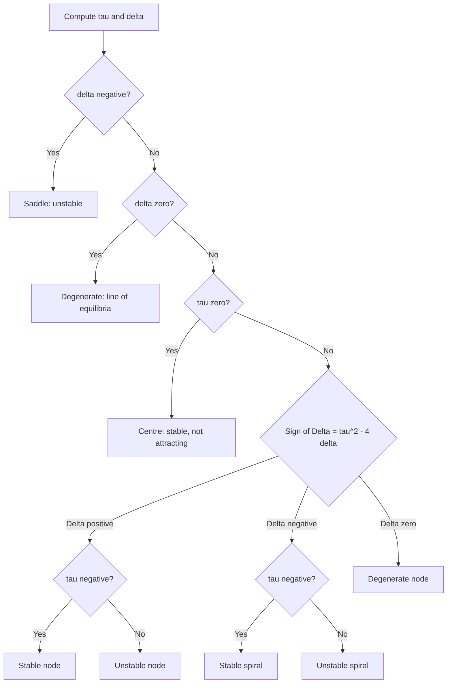

# Systems of ODEs

> [Mathematics](../../README.md) › [Differential Equations](../README.md) · Level: Advanced · Prerequisites: [Differentiation Rules](../../07-calculus/04-differentiation-rules/README.md), [Multivariable Calculus](../../07-calculus/12-multivariable-calculus/README.md), [Matrices](../../08-linear-algebra/02-matrices/README.md), [Determinants](../../08-linear-algebra/06-determinants/README.md), [Eigenvalues and Eigenvectors](../../08-linear-algebra/07-eigenvalues-and-eigenvectors/README.md), [First-Order Differential Equations](../01-first-order-odes/README.md), [Second-Order Linear ODEs](../02-second-order-linear-odes/README.md) · Estimated time: 10 h

## 1. Introduction

Every equation studied so far has had one unknown function. Real systems rarely oblige: a pendulum is described by an angle **and** an angular velocity, two species by two populations, an electrical network by a current and a charge, a chemical reaction by several concentrations. Each unknown has its own rate law, and the rate of one depends on the values of the others. The result is a **system** of coupled differential equations, and the first surprise is that nothing new has to be invented: a system of $n$ first-order equations is a single first-order equation for an unknown that happens to take values in $\mathbb{R}^n$.

That reframing is the whole subject. Write the unknowns as one vector $\mathbf{x}(t) = (x_1(t),\dots,x_n(t))$ and the rate laws as one vector field $\mathbf{f}$; then

$$\mathbf{x}' = \mathbf{f}(t,\mathbf{x})$$

says that at the point $\mathbf{x}$ the state must move with velocity $\mathbf{f}(t,\mathbf{x})$. The right-hand side is a velocity field, the solution is a particle carried by it, and the collection of all trajectories is the **phase portrait**. Every theorem of [First-Order Differential Equations](../01-first-order-odes/README.md) — existence, uniqueness, blow-up, dependence on data — survives verbatim with $|\cdot|$ replaced by a norm. What is genuinely new is the *geometry*: in one dimension a solution can only go up or down, so nothing can spiral, oscillate, or cross; in two dimensions all of that becomes possible, and the shape of the portrait is the main object of study.

The second theme is **linear algebra**, and it is what makes the linear case completely solvable. For

$$\mathbf{x}' = A\mathbf{x}$$

with a constant $n \times n$ matrix $A$, superposition holds, the solutions form an $n$-dimensional vector space, and an eigenvector $\mathbf{v}$ of $A$ with eigenvalue $\lambda$ produces the solution $e^{\lambda t}\mathbf{v}$ — a straight-line motion that rescales in place. With a full set of eigenvectors the general solution is a linear combination of these modes; when eigenvectors are scarce, **generalised eigenvectors** supply the missing solutions and the polynomial factors $t^{k}e^{\lambda t}$ that already appeared for repeated roots of second-order equations. The whole theory is packaged by the **matrix exponential** $e^{At}$, the exact analogue of the scalar $e^{at}$ and the object that solves every linear initial value problem at once.

The third theme is **qualitative dynamics**. Nonlinear systems almost never have closed-form solutions, yet their portraits near equilibrium are governed by the linearisation: the **Hartman–Grobman theorem** says that at a hyperbolic equilibrium the nonlinear flow and its linear part are the same picture up to a continuous change of coordinates. That is the reason a physicist can replace $\sin\theta$ by $\theta$ and still trust the conclusion that the downward pendulum is stable. Away from equilibrium, and at non-hyperbolic points, **Lyapunov functions** — generalised energies that decrease along orbits — decide stability without a formula.

The subject was created by Poincaré in the 1880s, who stopped asking for formulas and started drawing portraits; Lyapunov in 1892 supplied the stability definitions and the second method that still carry his name; Hartman (1960) and Grobman (1959) proved independently that linearisation is qualitatively exact at hyperbolic points. The applications in §12 — competition, predation, the pendulum, oscillators — are the classical testing grounds, and they remain the reason the theory is taught.

## 2. Prerequisites

**Linear algebra** ([Matrices](../../08-linear-algebra/02-matrices/README.md), [Determinants](../../08-linear-algebra/06-determinants/README.md), [Eigenvalues and Eigenvectors](../../08-linear-algebra/07-eigenvalues-and-eigenvectors/README.md)). Matrix multiplication and the identity $A(P\mathbf{y}) = P(A\mathbf{y})$ for a change of basis; determinants, trace, and the identities $\operatorname{tr}(P^{-1}AP) = \operatorname{tr}A$, $\det(P^{-1}AP) = \det A$; eigenvalues as roots of the characteristic polynomial $\det(A - \lambda I) = 0$; eigenvectors and eigenspaces; the fact that eigenvectors belonging to distinct eigenvalues are linearly independent. Linear independence and bases are used constantly. **Jordan form** is not assumed: §7.4 constructs the missing solutions directly from generalised eigenvectors and states the decomposition it needs.

**Calculus** ([Differentiation Rules](../../07-calculus/04-differentiation-rules/README.md), [Multivariable Calculus](../../07-calculus/12-multivariable-calculus/README.md)). The product and chain rules; partial derivatives and the gradient; the multivariable chain rule $\dfrac{d}{dt}V(\mathbf{x}(t)) = \nabla V(\mathbf{x}(t))\cdot\mathbf{x}'(t)$, which is the engine behind every Lyapunov computation; Taylor's theorem in several variables, which is the content of "linearisation"; polar coordinates and the identities $r\dot r = x\dot x + y\dot y$, $r^2\dot\theta = x\dot y - y\dot x$.

**Differential equations** ([First-Order Differential Equations](../01-first-order-odes/README.md), [Second-Order Linear ODEs](../02-second-order-linear-odes/README.md)). Separable and linear first-order equations; the existence and uniqueness theorem with its Lipschitz hypothesis; the characteristic equation and the three root cases for constant-coefficient second-order equations; the reduction of an $n$-th order equation to a first-order system, which [Second-Order Linear ODEs](../02-second-order-linear-odes/README.md) introduces in dimension two. Everything in the present topic is that reduction carried out in general.

**Series** ([Sequences and Series in Calculus](../../07-calculus/11-sequences-and-series-in-calculus/README.md)). Absolute convergence, the ratio test, and the right to rearrange absolutely convergent series — used to prove that the matrix exponential converges and that its derivative may be computed term by term.

## 3. Learning Objectives

After this tutorial you will be able to:

1. Convert an $n$-th order scalar equation, or a system of higher-order equations, into a first-order system in normal form, and write the companion matrix of a linear equation.
2. State the existence–uniqueness theorem for systems, explain which hypothesis fails in examples of non-uniqueness, and distinguish local from global existence.
3. Show that the solutions of $\mathbf{x}' = A\mathbf{x}$ form an $n$-dimensional vector space, and use a fundamental matrix $\Phi(t)$ to solve initial value problems.
4. Define the matrix exponential by its series, prove that it converges, that $\dfrac{d}{dt}e^{At} = Ae^{At}$, and that $e^{A(t+s)} = e^{At}e^{As}$.
5. Compute $e^{At}$ by diagonalisation, by the nilpotent (Jordan) decomposition, and by solving for generalised eigenvectors.
6. Solve $\mathbf{x}' = A\mathbf{x}$ in all three eigenvalue cases — distinct real, complex conjugate, defective repeated — and write the real form of complex solutions.
7. Derive the trace–determinant classification of planar equilibria (node, saddle, spiral, centre) and explain *why* the eigenvalues determine the picture.
8. Define Lyapunov stability, attraction, asymptotic stability and instability, prove the linear stability criterion, and construct Lyapunov functions for mechanical and ecological examples.
9. Linearise a nonlinear system at an equilibrium, compute the Jacobian, and apply the Hartman–Grobman theorem, including a clear statement of what it does and does not say.
10. Analyse the competing-species, pendulum and predator–prey models: equilibria, linearisation, invariant quantities, and the ecological or mechanical meaning of each region of the portrait.

## 4. Intuition

**A system is a fluid flow.** Imagine a tank of moving water and a speck of dust dropped into it. The velocity of the water at each point is $\mathbf{f}(\mathbf{x})$; the dust is carried along so that its position obeys $\mathbf{x}' = \mathbf{f}(\mathbf{x})$. Nothing in that picture mentions "solving"; the *portrait* of the flow — where it speeds up, where it settles, where it circulates — is the answer, and a formula is only a convenient way of describing it. The same picture covers a pendulum (the state is angle and angular velocity), a predator–prey pair (the state is two populations) and an electrical circuit (the state is charge and current).

**Equilibria are the still points, and their type is the local shape of the flow.** At a point where $\mathbf{f} = \mathbf{0}$ the dust does not move. Nearby, the flow either pushes everything away (source), pulls everything in (sink), does both in different directions (saddle), or swirls (spiral or centre). Because the motion near the point is approximately linear, the local picture is decided by the linear map $D\mathbf{f}(\mathbf{x}^*)$ — its eigenvectors give the directions along which the flow is purely radial, and its eigenvalues give the rates.

**Eigenvalues are the rates; eigenvectors are the directions.** If $\mathbf{x}(t) = c(t)\mathbf{v}$ remains on the line spanned by $\mathbf{v}$, then $\mathbf{x}' = c'\mathbf{v}$ must equal $A\mathbf{x} = c\lambda\mathbf{v}$, so $c' = \lambda c$ and $c = c_0e^{\lambda t}$. Nothing else can stay on a line through the origin. Hence the eigenlines are the skeleton of a linear portrait: real eigenvalues give straight-line motions, their signs decide in/out, and everything between the lines is a compromise between two rates. Complex eigenvalues mean that no real line is preserved — the map rotates — and a rotation combined with expansion or contraction is a spiral.

**Nonlinear systems are locally linear.** Zoom in on an equilibrium and the field looks straighter and straighter, because differentiability means the field is its linear part plus a remainder that is smaller than linear. Hartman–Grobman turns "looks like" into a theorem at hyperbolic points. This is exactly why physics works: $\sin\theta \approx \theta$ is not a convenience but a statement about the phase portrait, valid near the bottom of the swing.

**Lyapunov functions are energies.** If a quantity $V$ is minimal at the equilibrium and never increases along orbits, trajectories cannot escape the sublevel sets of $V$, so the equilibrium is stable; if $V$ strictly decreases whenever the state is not at equilibrium, they must eventually arrive. For a damped pendulum, $V$ is the mechanical energy and $V' = -b\,\omega^2$ is the rate at which friction removes it.

## 5. Formal Definition

Throughout, $n \in \mathbb{N}$, $D \subseteq \mathbb{R}\times\mathbb{R}^n$ is open, and $\mathbf{f}: D \to \mathbb{R}^n$. Vectors are columns.

> **Definition 5.1 (system in normal form).** A **first-order system in normal form** is
> $$\mathbf{x}' = \mathbf{f}(t,\mathbf{x}),$$
> that is, $x_i'(t) = f_i(t, x_1(t),\dots,x_n(t))$ for $i = 1,\dots,n$. The system is **linear** if $\mathbf{f}(t,\mathbf{x}) = A(t)\mathbf{x} + \mathbf{b}(t)$ for a matrix-valued function $A$ and a vector-valued function $\mathbf{b}$; it is **homogeneous** if $\mathbf{b} = \mathbf{0}$; it is **autonomous** if $\mathbf{f}$ does not depend on $t$.

> **Definition 5.2 (solution and initial value problem).** A **solution on an interval $I \subseteq \mathbb{R}$** is a differentiable $\mathbf{x}: I \to \mathbb{R}^n$ with $(t,\mathbf{x}(t)) \in D$ and $\mathbf{x}'(t) = \mathbf{f}(t,\mathbf{x}(t))$ for all $t \in I$. The **initial value problem** with data $(t_0,\mathbf{x}_0)$ adds $\mathbf{x}(t_0) = \mathbf{x}_0$.

> **Definition 5.3 (vector field, orbit, phase portrait).** For an autonomous system, $\mathbf{f}$ is a **vector field** on $U \subseteq \mathbb{R}^n$. The **orbit** (or trajectory) through $\mathbf{x}_0$ is the image of the maximal solution with $\mathbf{x}(0) = \mathbf{x}_0$. The **phase portrait** is the collection of all orbits, drawn as curves in $U$ with arrows indicating the direction of increasing $t$. An **equilibrium** (critical point, rest point, steady state) is $\mathbf{x}^* \in U$ with $\mathbf{f}(\mathbf{x}^*) = \mathbf{0}$.

> **Definition 5.4 (linear system, fundamental matrix).** A **linear homogeneous system** is $\mathbf{x}' = A(t)\mathbf{x}$ with $A$ continuous on an interval $I$. A **fundamental matrix** on $I$ is an $n\times n$ matrix $\Phi(t)$ whose columns are solutions and whose columns are linearly independent at every $t \in I$ (equivalently, at one $t$).

> **Definition 5.5 (matrix exponential).** For an $n\times n$ matrix $A$ and $t \in \mathbb{R}$,
> $$e^{At} := \sum_{k=0}^{\infty} \frac{(At)^k}{k!} = I + At + \frac{A^2t^2}{2!} + \frac{A^3t^3}{3!} + \cdots,$$
> with $A^0 := I$.

> **Definition 5.6 (stability).** Let $\mathbf{x}^*$ be an equilibrium of an autonomous system and let $\mathbf{x}(t;\mathbf{x}_0)$ denote the solution with $\mathbf{x}(0) = \mathbf{x}_0$.
> * $\mathbf{x}^*$ is **Lyapunov stable** if for every $\varepsilon > 0$ there is $\delta > 0$ such that $\lVert \mathbf{x}_0 - \mathbf{x}^* \rVert < \delta$ implies $\lVert \mathbf{x}(t;\mathbf{x}_0) - \mathbf{x}^* \rVert < \varepsilon$ for all $t \ge 0$ on which the solution exists.
> * $\mathbf{x}^*$ is **attracting** if there is $\delta_1 > 0$ such that $\lVert \mathbf{x}_0 - \mathbf{x}^*\rVert < \delta_1$ implies $\mathbf{x}(t;\mathbf{x}_0) \to \mathbf{x}^*$ as $t\to\infty$.
> * $\mathbf{x}^*$ is **asymptotically stable** if it is both stable and attracting, and **unstable** if it is not stable.
> * $\mathbf{x}^*$ is **hyperbolic** if no eigenvalue of $D\mathbf{f}(\mathbf{x}^*)$ has real part zero.

## 6. Mathematical Notation

| Symbol | Read as | Meaning |
|---|---|---|
| $t$ | $t$ | independent variable, usually time |
| $\mathbf{x}(t)$ | x of t | state vector $(x_1(t),\dots,x_n(t))^{\mathsf T}$ |
| $\mathbf{x}'$, $\dot{\mathbf{x}}$ | x prime, x dot | componentwise derivative with respect to $t$ |
| $\mathbf{f}(t,\mathbf{x})$ | f of t and x | vector field, one component per equation |
| $A$ | A | constant $n\times n$ coefficient matrix |
| $A^{\mathsf T}$ | A transpose | rows and columns exchanged |
| $\operatorname{tr}A$, $\det A$ | trace, determinant | $\sum_i a_{ii}$ and the signed volume factor |
| $\lambda$, $\mathbf{v}$ | lambda, v | eigenvalue and eigenvector, $A\mathbf{v} = \lambda\mathbf{v}$, $\mathbf{v}\ne\mathbf{0}$ |
| $\mathbf{u}$ | u | generalised eigenvector, $(A-\lambda I)\mathbf{u} = \mathbf{v}$ |
| $\operatorname{Re}\lambda$, $\operatorname{Im}\lambda$ | real / imaginary part | $\lambda = \operatorname{Re}\lambda + i\operatorname{Im}\lambda$ |
| $e^{At}$ | e to the A t | matrix exponential, Definition 5.5 |
| $\Phi(t)$ | Phi of t | fundamental matrix; its columns are independent solutions |
| $\tau$, $\delta$ | tau, delta | $\operatorname{tr}A$ and $\det A$ of a $2\times2$ matrix |
| $\Delta$ | Delta | discriminant $\tau^2 - 4\delta$ of the characteristic polynomial |
| $J$, $D\mathbf{f}(\mathbf{x}^*)$ | Jacobian | matrix $\left(\partial f_i/\partial x_j\right)$ at $\mathbf{x}^*$ |
| $\lVert A\rVert$ | norm of A | operator norm $\sup_{\lVert \mathbf{x}\rVert = 1}\lVert A\mathbf{x}\rVert$ |
| $r$, $\theta$ | r, theta | polar coordinates $x = r\cos\theta$, $y = r\sin\theta$ |
| $V$, $\dot V$ | V, V dot | Lyapunov function and $\dot V = \nabla V\cdot\mathbf{f}$ |
| $\mathcal{O}(\lVert\mathbf{x}\rVert^2)$ | big-O of x squared | a remainder bounded by $C\lVert\mathbf{x}\rVert^2$ near $\mathbf{0}$ |
| $W^{s}$, $W^{u}$ | stable / unstable manifold | orbits tending to $\mathbf{x}^*$ as $t\to\pm\infty$ |

## 7. Core Concepts

### 7.1 From one equation of order $n$ to a system of order one

The reduction is mechanical, and it is the reason systems are the general case rather than a special case.

> **Theorem 7.1 (reduction to a first-order system).** Let $I$ be an interval, $F: I\times\mathbb{R}^n\to\mathbb{R}$ continuous, and consider
> $$y^{(n)} = F\left(t, y, y', \dots, y^{(n-1)}\right).$$
> Define $x_1 = y$, $x_2 = y'$, …, $x_n = y^{(n-1)}$, i.e. $\mathbf{x} = (y, y', \dots, y^{(n-1)})^{\mathsf T}$. Then $y$ solves the $n$-th order equation on $I$ if and only if $\mathbf{x}$ solves
> $$\mathbf{x}' = \begin{pmatrix} x_2 \\ x_3 \\ \vdots \\ x_n \\ F(t,x_1,\dots,x_n)\end{pmatrix}$$
> on $I$. The correspondence preserves initial data: $y^{(k)}(t_0) = x_{k+1}(t_0)$ for $k = 0,\dots,n-1$.

**Proof.** If $y$ is $n$ times differentiable and solves the scalar equation, then $x_k' = y^{(k)} = x_{k+1}$ for $k < n$ and $x_n' = y^{(n)} = F(t, y, \dots, y^{(n-1)}) = F(t,x_1,\dots,x_n)$, so $\mathbf{x}$ solves the system. Conversely, if $\mathbf{x}$ solves the system, put $y := x_1$. Then $y$ is differentiable with $y' = x_1' = x_2$; differentiating repeatedly gives $y^{(k)} = x_{k+1}$ for $k = 0,\dots,n-1$ (induction on $k$, using $x_{k}' = x_{k+1}$), so $y$ is $n$ times differentiable and $y^{(n)} = x_n' = F(t,x_1,\dots,x_n) = F(t, y, \dots, y^{(n-1)})$. The initial-data statement is immediate from $x_{k+1} = y^{(k)}$. $\blacksquare$

The map $y \mapsto \mathbf{x}$ is thus a bijection between solutions, and it is *linear*: sums and scalar multiples correspond. Consequently every statement about linear systems transfers to linear scalar equations and back, which is why the two theories are developed together.

> **Definition 7.1 (companion matrix).** For the constant-coefficient linear equation
> $$y^{(n)} + a_{n-1}y^{(n-1)} + \cdots + a_1y' + a_0y = g(t),$$
> the reduction of Theorem 7.1 gives $\mathbf{x}' = A\mathbf{x} + \mathbf{b}(t)$ with
> $$A = \begin{pmatrix} 0 & 1 & 0 & \cdots & 0\\ 0 & 0 & 1 & \cdots & 0\\ \vdots & & & \ddots & \vdots\\ 0 & 0 & 0 & \cdots & 1\\ -a_0 & -a_1 & -a_2 & \cdots & -a_{n-1}\end{pmatrix}, \qquad \mathbf{b}(t) = \begin{pmatrix} 0 \\ \vdots \\ 0 \\ g(t)\end{pmatrix}.$$
> $A$ is the **companion matrix** of the polynomial $p(\lambda) = \lambda^n + a_{n-1}\lambda^{n-1} + \cdots + a_0$.

Expanding $\det(A - \lambda I)$ along the last row (or by induction on $n$) gives

$$\det(A - \lambda I) = (-1)^n\left(\lambda^n + a_{n-1}\lambda^{n-1} + \cdots + a_0\right),$$

so the eigenvalues of the companion matrix are exactly the roots of the characteristic polynomial of the scalar equation. This is the first instance of a principle used throughout: *the eigenvalues of the system are the exponents of the scalar equation*. A second-order equation with characteristic roots $-1 \pm 2i$ becomes a $2\times2$ system whose eigenvalues are $-1 \pm 2i$, and the phase portrait is therefore a stable spiral — which is precisely the damped oscillation of the scalar solution $e^{-t}(c_1\cos 2t + c_2\sin 2t)$.

**Example.** The equation $y''' - 2y'' + y' - 3y = \sin t$ becomes, with $x_1 = y$, $x_2 = y'$, $x_3 = y''$,

$$\mathbf{x}' = \begin{pmatrix} 0 & 1 & 0\\ 0 & 0 & 1\\ 3 & -1 & 2\end{pmatrix}\mathbf{x} + \begin{pmatrix} 0\\ 0\\ \sin t\end{pmatrix},$$

whose companion matrix has characteristic polynomial $\lambda^3 - 2\lambda^2 + \lambda - 3$ — the polynomial of the original equation, as guaranteed.

The reduction also runs in reverse for systems that are *not* in normal form: an $n$-th order system $\mathbf{y}^{(n)} = \mathbf{F}(t,\mathbf{y},\dots,\mathbf{y}^{(n-1)})$ with $\mathbf{y}\in\mathbb{R}^m$ becomes a first-order system of size $mn$ by stacking $\mathbf{y}, \mathbf{y}', \dots, \mathbf{y}^{(n-1)}$. A single second-order equation in two unknowns is therefore a four-dimensional first-order system, which is why coupled oscillators live in $\mathbb{R}^4$.

### 7.2 Existence, uniqueness and the solution space

> **Theorem 7.2 (Picard–Lindelöf for systems).** Let $D \subseteq \mathbb{R}\times\mathbb{R}^n$ be open and $\mathbf{f}: D\to\mathbb{R}^n$ continuous and locally Lipschitz in $\mathbf{x}$: for every $(t_0,\mathbf{x}_0)\in D$ there are $\rho, L > 0$ with
> $$\lVert \mathbf{f}(t,\mathbf{x}) - \mathbf{f}(t,\mathbf{y})\rVert \le L\lVert \mathbf{x}-\mathbf{y}\rVert$$
> whenever $(t,\mathbf{x}),(t,\mathbf{y})$ lie in the ball of radius $\rho$ about $(t_0,\mathbf{x}_0)$. Then for every $(t_0,\mathbf{x}_0) \in D$ the initial value problem has a unique solution on some interval $I$ containing $t_0$ in its interior, and a unique maximal solution; the maximal interval is open, and as $t$ approaches either endpoint the orbit either leaves every compact subset of $D$ or fails to exist.

The proof is the same contraction argument as in [First-Order Differential Equations](../01-first-order-odes/README.md) §7.6, with the absolute value replaced by any norm on $\mathbb{R}^n$; the integral equation

$$\mathbf{x}(t) = \mathbf{x}_0 + \int_{t_0}^{t}\mathbf{f}\left(s,\mathbf{x}(s)\right)ds$$

is solved by iterating the Picard operator on a space of continuous functions with the supremum norm, and the Lipschitz condition makes that operator a contraction on a small interval. Nothing in the argument uses $n = 1$. The two new features are worth naming: the hypothesis is *local* Lipschitz, and the conclusion is *local* in time, because a solution of a nonlinear system may blow up in finite time exactly as $y' = y^2$ does.

For linear systems the situation is much better, and the reason is that a linear vector field cannot produce finite-time blow-up: its growth is at most exponential.

> **Theorem 7.3 (global existence for linear systems).** If $A(t)$ and $\mathbf{b}(t)$ are continuous on an interval $I$ and $t_0\in I$, then for every $\mathbf{x}_0$ the initial value problem $\mathbf{x}' = A(t)\mathbf{x} + \mathbf{b}(t)$, $\mathbf{x}(t_0) = \mathbf{x}_0$ has a unique solution defined on the whole of $I$.

This follows from the integral form plus Gronwall's inequality: if $M(t) = \max_{t_0\le s\le t}\lVert A(s)\rVert$ and $B(t) = \max_{t_0\le s\le t}\lVert \mathbf{b}(s)\rVert$, then

$$\lVert \mathbf{x}(t)\rVert \le \lVert \mathbf{x}_0\rVert + \int_{t_0}^{t}\left(M(s)\lVert \mathbf{x}(s)\rVert + B(s)\right)ds,$$

and Gronwall's inequality bounds $\lVert \mathbf{x}(t)\rVert$ by a finite quantity on every compact subinterval, so the solution can never leave the domain. Uniqueness is Theorem 7.2, whose Lipschitz constant may be taken as $\max_{s\in[t_0,t]}\lVert A(s)\rVert$.

> **Theorem 7.4 (superposition and dimension).** Let $A(t)$ be continuous on an interval $I$. The set $S$ of solutions of the homogeneous system $\mathbf{x}' = A(t)\mathbf{x}$ on $I$ is a vector space, and for any fixed $t_0\in I$ the evaluation map
> $$E_{t_0}: S \to \mathbb{R}^n, \qquad E_{t_0}(\mathbf{x}) = \mathbf{x}(t_0)$$
> is a linear isomorphism. In particular $\dim S = n$.

**Proof.** If $\mathbf{x},\mathbf{y}\in S$ and $c\in\mathbb{R}$, then $(\mathbf{x}+c\mathbf{y})' = A\mathbf{x} + cA\mathbf{y} = A(\mathbf{x}+c\mathbf{y})$, so $\mathbf{x}+c\mathbf{y}\in S$; the zero function is in $S$; hence $S$ is a vector space. $E_{t_0}$ is linear because evaluation at a point is linear. It is injective: if $E_{t_0}(\mathbf{x}) = \mathbf{0}$ then $\mathbf{x}$ and the zero solution share the initial value, so $\mathbf{x} \equiv \mathbf{0}$ by uniqueness. It is surjective: every $\mathbf{x}_0\in\mathbb{R}^n$ is attained by the solution of the initial value problem, which exists on all of $I$ by Theorem 7.3. A linear bijection preserves dimension, and $\dim\mathbb{R}^n = n$. $\blacksquare$

> **Corollary 7.5 (fundamental matrices).** Let $\boldsymbol\varphi_1,\dots,\boldsymbol\varphi_n$ be solutions of $\mathbf{x}' = A(t)\mathbf{x}$ on $I$ and let $\Phi(t)$ be the matrix with these columns. The following are equivalent: (i) the $\boldsymbol\varphi_i$ are linearly independent as functions; (ii) $\Phi(t_0)$ is invertible for one $t_0\in I$; (iii) $\Phi(t)$ is invertible for every $t\in I$. In that case every solution is $\mathbf{x} = \Phi(t)\mathbf{c}$ for a unique constant vector $\mathbf{c}$, and the solution of the initial value problem is
> $$\mathbf{x}(t) = \Phi(t)\Phi(t_0)^{-1}\mathbf{x}_0.$$

**Proof.** (i) $\Leftrightarrow$ (ii): a linear combination $\sum c_i\boldsymbol\varphi_i$ is a solution whose value at $t_0$ is $\Phi(t_0)\mathbf{c}$; the combination vanishes identically iff (by Theorem 7.4) its value at $t_0$ vanishes. So a nontrivial vanishing combination exists iff $\Phi(t_0)$ is singular. (ii) $\Leftrightarrow$ (iii): if $\Phi(t_1)$ is singular for some $t_1$, then some nontrivial combination vanishes at $t_1$, hence identically, hence $\Phi(t_0)$ is singular; reversing the roles gives the other direction. The representation formula is the uniqueness statement again, and the initial value problem is solved by choosing $\mathbf{c} = \Phi(t_0)^{-1}\mathbf{x}_0$. $\blacksquare$

> **Theorem 7.6 (Abel's formula, or Liouville's formula).** If $\Phi$ is a fundamental matrix of $\mathbf{x}' = A(t)\mathbf{x}$ with $A$ continuous, then
> $$\det\Phi(t) = \det\Phi(t_0)\exp\left(\int_{t_0}^{t}\operatorname{tr}A(s)\,ds\right).$$

**Proof.** Write $W(t) = \det\Phi(t)$. For a differentiable matrix function, Jacobi's formula says $\dfrac{d}{dt}\det M = \det M\cdot\operatorname{tr}\left(M^{-1}M'\right)$ whenever $M$ is invertible. Apply it to $M = \Phi(t)$, using $\Phi' = A\Phi$:

$$W' = W\operatorname{tr}\left(\Phi^{-1}A\Phi\right) = W\operatorname{tr}A,$$

because the trace is invariant under cyclic permutation: $\operatorname{tr}(\Phi^{-1}A\Phi) = \operatorname{tr}(A\Phi\Phi^{-1}) = \operatorname{tr}A$. The scalar equation $W' = (\operatorname{tr}A)W$ has the solution displayed, and the formula extends to any $t$ by continuity even if $W$ were to vanish. $\blacksquare$

Jacobi's formula itself is a one-line consequence of the Leibniz rule: $\det M = \sum_{\sigma}\operatorname{sgn}(\sigma)\prod_i m_{i\sigma(i)}$, and differentiating a product hits one factor per term; grouping the result gives $\det M\cdot\operatorname{tr}(M^{-1}M')$. In two dimensions it reads

$$W' = \begin{vmatrix} \varphi_{11}' & \varphi_{12}'\\ \varphi_{21}' & \varphi_{22}'\end{vmatrix} + \begin{vmatrix} \varphi_{11} & \varphi_{12}\\ \varphi_{21}' & \varphi_{22}'\end{vmatrix} = W\operatorname{tr}A.$$

For a constant matrix, Abel's formula becomes $\det e^{At} = e^{t\operatorname{tr}A}$, a fact used repeatedly below.

### 7.3 The matrix exponential

The scalar solution of $x' = ax$ is $x = e^{at}x_0$. The matrix analogue must satisfy $\Phi' = A\Phi$ and $\Phi(0) = I$, and the power series of the scalar exponential suggests the definition.

> **Lemma 7.7 (convergence).** For every $n\times n$ matrix $A$ and every $T > 0$, the series $\sum_{k\ge 0}(At)^k/k!$ converges absolutely and uniformly on $[-T,T]$; hence $e^{At}$ is a well-defined matrix for every real $t$.

**Proof.** Submultiplicativity of the operator norm gives $\lVert A^k\rVert\le\lVert A\rVert^k$. Hence for $|t|\le T$,

$$\sum_{k=0}^{\infty}\left\lVert\frac{(At)^k}{k!}\right\rVert \le \sum_{k=0}^{\infty}\frac{\left(\lVert A\rVert T\right)^k}{k!} = e^{\lVert A\rVert T} < \infty,$$

and the Weierstrass test gives uniform absolute convergence. $\blacksquare$

> **Theorem 7.8 (the matrix exponential solves the linear system).** For every constant $n\times n$ matrix $A$, the matrix $\Phi(t) = e^{At}$ satisfies
> $$\Phi'(t) = A\Phi(t), \qquad \Phi(0) = I.$$
> Consequently $\Phi(t) = e^{At}$ is the principal fundamental matrix of $\mathbf{x}' = A\mathbf{x}$, and the solution of the initial value problem is $\mathbf{x}(t) = e^{At}\mathbf{x}_0$.

**Proof.** The series for $e^{At}$ and the series for its term-by-term derivative,

$$\sum_{k=1}^{\infty}\frac{kA^k t^{k-1}}{k!} = A\sum_{j=0}^{\infty}\frac{A^jt^j}{j!} = Ae^{At},$$

both converge uniformly on $[-T,T]$ by the estimate of Lemma 7.7 applied to $A$ and to $A^2$ (the derivative series is the series of $Ae^{At}$, which converges uniformly). Uniform convergence of a series of $C^1$ functions with uniformly convergent derivatives permits differentiation term by term, so $\Phi'(t) = Ae^{At} = A\Phi(t)$. At $t = 0$ every term with $k\ge1$ vanishes, leaving $I$. Uniqueness in Theorem 7.2 makes this the only solution with $\Phi(0) = I$. $\blacksquare$

> **Theorem 7.9 (properties of the exponential).** For $n\times n$ matrices and real $s,t$:
> 1. $e^{A(t+s)} = e^{At}e^{As}$; in particular $e^{At}$ is invertible with inverse $e^{-At}$.
> 2. $A$ commutes with $e^{At}$, and $e^{At}e^{Bs} = e^{Bs}e^{At}$ if $AB = BA$.
> 3. If $AB = BA$ then $e^{A+B} = e^{A}e^{B}$; without commutativity this can fail.
> 4. $e^{P^{-1}AP} = P^{-1}e^{A}P$ for every invertible $P$.
> 5. $\det e^{A} = e^{\operatorname{tr}A}$.

**Proof.** (1) The product of the absolutely convergent series is

$$e^{At}e^{As} = \sum_{k,j\ge0}\frac{A^kt^k}{k!}\frac{A^js^j}{j!} = \sum_{m\ge0}\frac{A^m}{m!}\sum_{k=0}^{m}\binom{m}{k}t^ks^{m-k} = \sum_{m\ge0}\frac{A^m(t+s)^m}{m!},$$

where the binomial theorem applies because all factors are powers of the *same* matrix and therefore commute. The rearrangement is legitimate by absolute convergence. Setting $s = -t$ gives $e^{At}e^{-At} = e^{0} = I$. (2) $A$ commutes with every $A^k$, hence with the series; the second claim follows from (3) applied both ways. (3) When $AB = BA$ the binomial theorem applies to $(A+B)^m$, and the same rearrangement as in (1) gives the identity. (4) $(P^{-1}AP)^k = P^{-1}A^kP$, so the series telescopes. (5) Combine (4) with the triangular form (or with Abel's formula, Theorem 7.6, applied to $\Phi = e^{At}$ at $t = 1$). $\blacksquare$

The failure of (3) without commutativity is not a technicality: it is why the formula $e^{(A+B)t} = e^{At}e^{Bt}$ cannot be used to split a system into "easy" parts unless those parts commute. An explicit counterexample is in Exercise 26.

**How to compute $e^{At}$.** Three methods cover every case met in practice.

1. **Diagonalisation.** If $A = PDP^{-1}$ with $D = \operatorname{diag}(\lambda_1,\dots,\lambda_n)$, then $e^{At} = P\operatorname{diag}(e^{\lambda_1t},\dots,e^{\lambda_nt})P^{-1}$ by Theorem 7.9(4).
2. **Nilpotent decomposition.** Write $A = S + N$ with $S$ diagonalisable, $N$ nilpotent, and $SN = NS$ (the Jordan decomposition; such a splitting always exists over $\mathbb{C}$ and, in block form, over $\mathbb{R}$). Then $e^{At} = e^{St}e^{Nt}$ and the second factor is a *finite* sum, because $N^m = 0$ for some $m \le n$:
   $$e^{Nt} = I + Nt + \frac{N^2t^2}{2!} + \cdots + \frac{N^{m-1}t^{m-1}}{(m-1)!}.$$
3. **Generalised eigenvectors.** Solve $(A-\lambda I)\mathbf{v} = \mathbf{0}$ for eigenvectors and $(A-\lambda I)\mathbf{u} = \mathbf{v}$ for generalised eigenvectors, then assemble the solutions as in §7.4. This is the same computation as (2) organised solution by solution.

For $2\times2$ matrices a useful shortcut follows from the Cayley–Hamilton theorem: $A^2 = (\operatorname{tr}A)A - (\det A)I$, so every power of $A$ reduces to a combination of $I$ and $A$, and

$$e^{At} = \alpha(t)I + \beta(t)A$$

with $\alpha,\beta$ determined by the scalar problems $\alpha' = -\delta\beta$, $\beta' = \alpha + \tau\beta$, $\alpha(0) = 1$, $\beta(0) = 0$. This is the matrix version of the scalar reduction $e^{\lambda t}$ as a combination of two fundamental solutions. It gives, for instance, $e^{At} = e^{\tau t/2}\left[\cos(\omega t)I + \frac{\sin(\omega t)}{\omega}\left(A - \frac{\tau}{2}I\right)\right]$ when $\Delta = \tau^2 - 4\delta < 0$ and $\omega = \sqrt{-\Delta}/2$ — a formula worth recognising, because it says that *every* $2\times2$ exponential is a rotation-dilation.

### 7.4 Solving $\mathbf{x}' = A\mathbf{x}$ by eigenvalues

> **Theorem 7.10 (real distinct eigenvalues).** Let $A$ be real, and let $\mathbf{v}_1,\dots,\mathbf{v}_n$ be eigenvectors with distinct eigenvalues $\lambda_1,\dots,\lambda_n$. Then $\mathbf{x}_i(t) = e^{\lambda_it}\mathbf{v}_i$ are solutions and form a fundamental set; the general solution is
> $$\mathbf{x}(t) = \sum_{i=1}^{n}c_ie^{\lambda_it}\mathbf{v}_i, \qquad c_i\in\mathbb{R}.$$

**Proof.** Since $\mathbf{v}_i$ is constant, $\mathbf{x}_i' = \lambda_ie^{\lambda_it}\mathbf{v}_i = e^{\lambda_it}A\mathbf{v}_i = A\mathbf{x}_i$; each is a solution. For independence, suppose $\sum c_ie^{\lambda_it}\mathbf{v}_i\equiv\mathbf{0}$. Distinct eigenvalues have linearly independent eigenvectors, so from $\sum_i (c_ie^{\lambda_it})\mathbf{v}_i = \mathbf{0}$ we get $c_ie^{\lambda_it} = 0$ for each $i$ and all $t$, hence all $c_i = 0$. By Theorem 7.4 the $n$ independent solutions form a basis. $\blacksquare$

The formula is a statement about **modes**: each eigenpair contributes a motion along a fixed line, growing or decaying at rate $\lambda_i$. The eigenvalue with the largest real part dominates as $t\to\infty$; the one with the smallest real part dominates as $t\to-\infty$. This single observation is the source of almost all qualitative conclusions in the linear theory.

When eigenvalues are complex, the eigenvectors are complex and so are the solutions, but $A$ is real and the real and imaginary parts of a complex solution are again solutions.

> **Theorem 7.11 (complex conjugate eigenvalues).** Let $A$ be real and let $\lambda = \alpha + i\beta$ with $\beta\ne0$ be an eigenvalue with eigenvector $\mathbf{v} = \mathbf{p} + i\mathbf{q}$, where $\mathbf{p},\mathbf{q}\in\mathbb{R}^n$ are not both zero. Then
> $$\mathbf{x}(t) = e^{\alpha t}\left(\mathbf{p}\cos\beta t - \mathbf{q}\sin\beta t\right), \qquad \mathbf{y}(t) = e^{\alpha t}\left(\mathbf{p}\sin\beta t + \mathbf{q}\cos\beta t\right)$$
> are real, linearly independent solutions of $\mathbf{x}' = A\mathbf{x}$.

**Proof.** Since $A$ is real, $A\bar{\mathbf{v}} = \bar{\lambda}\bar{\mathbf{v}}$, so $\mathbf{z}(t) = e^{\lambda t}\mathbf{v}$ and $\overline{\mathbf{z}(t)} = e^{\bar\lambda t}\bar{\mathbf{v}}$ are both solutions. A complex solution $\mathbf{z} = \mathbf{x} + i\mathbf{y}$ has real and imaginary parts that are solutions, because $\mathbf{z}' = \mathbf{x}' + i\mathbf{y}'$ and $A\mathbf{z} = A\mathbf{x} + iA\mathbf{y}$; equating real and imaginary parts gives $A\mathbf{x} = \mathbf{x}'$ and $A\mathbf{y} = \mathbf{y}'$. Expanding $e^{(\alpha+i\beta)t}(\mathbf{p}+i\mathbf{q})$ and separating terms gives the displayed formulas. Independence: if $\mathbf{x},\mathbf{y}$ were dependent, then $\mathbf{z}$ and $\bar{\mathbf{z}}$ would be dependent, hence $\mathbf{z} = c\bar{\mathbf{z}}$, which forces the real and imaginary parts of $e^{\lambda t}\mathbf{v}$ to be proportional for all $t$; evaluating at $t = 0$ and using $\beta \ne 0$ contradicts $\mathbf{v}\ne\mathbf{0}$ unless $\mathbf{p},\mathbf{q}$ were dependent, in which case $\mathbf{v}$ would be a real eigenvector for a non-real eigenvalue — impossible. $\blacksquare$

**Repeated eigenvalues.** Let $\lambda$ be an eigenvalue of algebraic multiplicity $m$ and geometric multiplicity $g < m$. There are not enough eigenvectors, and the missing $m-g$ solutions contain powers of $t$. The construction uses a **chain** of generalised eigenvectors $\mathbf{v}_1,\dots,\mathbf{v}_m$ satisfying

$$(A-\lambda I)\mathbf{v}_1 = \mathbf{0}, \qquad (A-\lambda I)\mathbf{v}_{j} = \mathbf{v}_{j-1}\quad (j\ge2).$$

> **Theorem 7.12 (defective eigenvalue).** If $\mathbf{v}_1,\dots,\mathbf{v}_r$ is such a chain, then
> $$\mathbf{x}(t) = e^{\lambda t}\left(\mathbf{v}_1 + t\mathbf{v}_2 + \frac{t^2}{2!}\mathbf{v}_3 + \cdots + \frac{t^{r-1}}{(r-1)!}\mathbf{v}_r\right)$$
> solves $\mathbf{x}' = A\mathbf{x}$.

**Proof.** Write $\mathbf{x} = e^{\lambda t}\mathbf{w}(t)$ with $\mathbf{w}(t) = \sum_{j=1}^{r}\frac{t^{j-1}}{(j-1)!}\mathbf{v}_j$. Then

$$\mathbf{x}' - A\mathbf{x} = e^{\lambda t}\left(\mathbf{w}' + \lambda\mathbf{w} - A\mathbf{w}\right) = e^{\lambda t}\left(\mathbf{w}' - (A-\lambda I)\mathbf{w}\right).$$

Now $\mathbf{w}' = \sum_{j=2}^{r}\frac{t^{j-2}}{(j-2)!}\mathbf{v}_j$ and $(A-\lambda I)\mathbf{w} = \sum_{j=1}^{r}\frac{t^{j-1}}{(j-1)!}(A-\lambda I)\mathbf{v}_j = \sum_{j=2}^{r}\frac{t^{j-1}}{(j-1)!}\mathbf{v}_{j-1}$, where the first term vanished because $\mathbf{v}_1$ is an eigenvector. Re-indexing the last sum by $i = j-1$ gives $\sum_{i=1}^{r-1}\frac{t^{i}}{i!}\mathbf{v}_i$, which is exactly $\mathbf{w}'$ (whose terms run over $i = 1,\dots,r-1$). Hence $\mathbf{x}' = A\mathbf{x}$. $\blacksquare$

Each chain of length $r$ contributes $r$ independent solutions; taking all chains over all eigenvalues produces $n$ solutions, and they form a fundamental set (this is the content of the Jordan normal form theorem). In practice one solves $(A-\lambda I)\mathbf{u} = \mathbf{v}$ for one generalised eigenvector per missing dimension; when the deficiency is larger, the chain must be continued.

The same result is often expressed through the exponential: if $A = S + N$ is the Jordan decomposition, then $N$ is nilpotent on each generalised eigenspace and $e^{At} = e^{St}e^{Nt}$, a finite polynomial times $e^{St}$. For example, the Jordan block

$$A = \begin{pmatrix}\lambda & 1 & 0\\ 0 & \lambda & 1\\ 0 & 0 & \lambda\end{pmatrix} = \lambda I + N, \qquad N = \begin{pmatrix}0&1&0\\0&0&1\\0&0&0\end{pmatrix},\quad N^3 = 0,$$

has

$$e^{At} = e^{\lambda t}\begin{pmatrix}1 & t & t^2/2\\ 0 & 1 & t\\ 0 & 0 & 1\end{pmatrix}.$$

### 7.5 Phase portraits in the plane, and why eigenvalues decide them

Let $A$ be a real $2\times2$ matrix with

$$\tau = \operatorname{tr}A, \qquad \delta = \det A, \qquad \Delta = \tau^2 - 4\delta.$$

Its characteristic polynomial is $\lambda^2 - \tau\lambda + \delta$, so the eigenvalues are $\lambda_\pm = \frac{1}{2}\left(\tau \pm \sqrt{\Delta}\right)$, and

$$\lambda_+ + \lambda_- = \tau, \qquad \lambda_+\lambda_- = \delta.$$

**The classification.**

| Condition | Eigenvalues | Type | Stability |
|---|---|---|---|
| $\delta < 0$ | real, opposite signs | saddle | unstable |
| $\delta > 0$, $\Delta > 0$, $\tau < 0$ | real, both negative | stable node | asymptotically stable |
| $\delta > 0$, $\Delta > 0$, $\tau > 0$ | real, both positive | unstable node | unstable |
| $\delta > 0$, $\Delta < 0$, $\tau < 0$ | $\alpha \pm i\beta$, $\alpha<0$ | stable spiral (focus) | asymptotically stable |
| $\delta > 0$, $\Delta < 0$, $\tau > 0$ | $\alpha \pm i\beta$, $\alpha>0$ | unstable spiral | unstable |
| $\delta > 0$, $\tau = 0$ | $\pm i\beta$, $\beta\ne0$ | centre | stable, not attracting |
| $\delta > 0$, $\Delta = 0$, $\tau \ne 0$ | repeated $\tau/2$ | degenerate node | as $\tau$ |
| $\delta > 0$, $\Delta = 0$, $A = \lambda I$ | repeated $\lambda$, every vector an eigenvector | star node | as the sign of $\tau$ |
| $\delta = 0$, $A \ne 0$ | $0$ and $\tau$ | line of equilibria | degenerate |

When $\Delta = 0$ and $A = \lambda I$ is a scalar multiple of the identity, every direction is an eigenvector and the portrait is a **star node**: all orbits are straight rays.

**Why the eigenvalues determine the picture.** The argument has three steps.

*Step 1: similarity changes nothing qualitative.* If $P$ is invertible and $\mathbf{y} = P^{-1}\mathbf{x}$, then $\mathbf{x}' = A\mathbf{x}$ becomes $\mathbf{y}' = P^{-1}AP\,\mathbf{y}$. The map $\mathbf{x}\mapsto P\mathbf{y}$ is a linear bijection of the plane, hence a homeomorphism, and it carries orbits of the $\mathbf{y}$-system to orbits of the $\mathbf{x}$-system while preserving the direction of time. So we may replace $A$ by any similar matrix; in particular, by its real Jordan form. This is the linear prototype of Hartman–Grobman (§7.7).

*Step 2: the real Jordan forms are explicit.* Every real $2\times2$ matrix is similar to one of

$$\begin{pmatrix}\lambda_1&0\\0&\lambda_2\end{pmatrix},\quad \lambda_1\le\lambda_2 \text{ real}; \qquad \begin{pmatrix}\lambda&1\\0&\lambda\end{pmatrix},\quad \lambda \text{ real}; \qquad \begin{pmatrix}\alpha&-\beta\\ \beta&\alpha\end{pmatrix},\quad \beta>0 .$$

*Distinct real eigenvalues.* The system decouples: $y_1 = c_1e^{\lambda_1t}$, $y_2 = c_2e^{\lambda_2t}$. Eliminating $t$ gives $|y_2| = C|y_1|^{\lambda_2/\lambda_1}$. If $0>\lambda_1>\lambda_2$ (both negative with $\lambda_1$ the slower decay), then $\lambda_2/\lambda_1>1$ and $y_2/y_1\to0$: every orbit tends to the origin **tangent to the $\lambda_1$-eigendirection**, the slow one. That is a stable node, and it explains why the portrait looks asymmetric: the two rates break the symmetry between the axes. If $\lambda_1<0<\lambda_2$, then $y_1\to0$ while $|y_2|\to\infty$, and the relation $|y_1| = C|y_2|^{\lambda_1/\lambda_2}$ shows orbits hug the $y_2$-axis: a saddle, with two orbits on the stable eigenline, two on the unstable eigenline, and hyperbola-like curves in between.

*Repeated real eigenvalue.* If $A = \lambda I$ every line is invariant and the portrait is a star. Otherwise $A = \lambda I + N$ with $N\ne0$ nilpotent, so $N^2 = 0$ and $e^{At} = e^{\lambda t}(I + tN)$. In the basis $(\mathbf{v},\mathbf{u})$ with $N\mathbf{u} = \mathbf{v}$, $N\mathbf{v} = \mathbf{0}$: $y_1 = e^{\lambda t}(c_1 + c_2t)$, $y_2 = e^{\lambda t}c_2$. Every orbit has $y_2 = c_2e^{\lambda t}$ and $y_1/y_2 = c_1/c_2 + t$, so as $t\to\pm\infty$ the ratio grows without bound: orbits approach the origin tangent to the *single* eigendirection but wind around it on one side, giving the **degenerate (improper) node**.

*Complex eigenvalues.* Similarity to the real Jordan form $\begin{pmatrix}\alpha&-\beta\\\beta&\alpha\end{pmatrix} = \alpha I + \beta J$ with $J = \begin{pmatrix}0&-1\\1&0\end{pmatrix}$, a rotation by $+\pi/2$ scaled by $\beta$. In polar coordinates $y_1 = r\cos\theta$, $y_2 = r\sin\theta$:

$$r\dot r = y_1\dot y_1 + y_2\dot y_2 = \alpha(y_1^2+y_2^2) = \alpha r^2, \qquad r^2\dot\theta = y_1\dot y_2 - y_2\dot y_1 = \beta(y_1^2+y_2^2) = \beta r^2.$$

For $r>0$,

$$\dot r = \alpha r, \qquad \dot\theta = \beta, \qquad\text{hence}\qquad r(\theta) = r_0e^{(\alpha/\beta)(\theta-\theta_0)} .$$

The orbit is a **logarithmic spiral**: it winds with constant angular speed and its radius changes geometrically per revolution. If $\alpha<0$ it spirals in, if $\alpha>0$ out, and if $\alpha = 0$ it is a circle traversed with period $2\pi/\beta$ — a **centre**. Note that the sign of $\beta$ only fixes the direction of rotation (clockwise or anticlockwise); it never changes the type, which is why only $\tau = 2\alpha$ and $\delta = \alpha^2+\beta^2$ appear in the classification.

*Step 3: read off $\tau$ and $\delta$.* Since $\tau = \lambda_++\lambda_-$ and $\delta = \lambda_+\lambda_-$, the sign of $\delta$ decides whether the eigenvalues have the same sign (both real), opposite signs (both real), or are non-real conjugates (because a real quadratic with negative discriminant has complex roots). The sign of $\tau$ decides growth versus decay: for real roots it is the sign of the sum, for complex roots $\tau = 2\alpha$ is twice the real part. The discriminant $\Delta$ distinguishes real from complex. The table above is nothing but this dictionary.

**Degenerate cases.** If $\delta = 0$, one eigenvalue is zero, $\det A = 0$, and $A$ has a nontrivial null space: every point of $\ker A$ is an equilibrium. If also $\tau\ne0$, the other eigenvalue $\tau$ is real and the portrait consists of parallel lines, orbits moving towards or away from the line of equilibria. If $\delta = 0$ and $\tau = 0$ then $A^2 = -\delta I + \tau A = 0$; with $A\ne0$ the matrix is nilpotent of rank one, all orbits are lines parallel to $\ker A$ translated, and no isolated equilibrium exists. These cases are unstable under perturbation of $A$ and are called **non-hyperbolic**; the interesting classification is for $\delta\ne0$ and $\tau\ne0$.

### 7.6 Stability and Lyapunov functions

The definitions are 5.6. Two warnings about them are essential.

* Stability is *not* the same as attraction. A centre is stable (orbits stay near the origin) but not attracting. Conversely, an equilibrium can attract every nearby point yet fail to be stable — the solution can leave a large neighbourhood before returning. Asymptotic stability requires both.
* Attraction is a statement about a *neighbourhood*: an equilibrium can have a small basin. The set of points whose orbits converge to $\mathbf{x}^*$ is its **basin of attraction**; it need not be all of the phase space.

> **Theorem 7.13 (linear stability).** For $\mathbf{x}' = A\mathbf{x}$ the origin is
> * asymptotically stable if and only if $\operatorname{Re}\lambda < 0$ for every eigenvalue of $A$;
> * stable but not attracting if and only if $\operatorname{Re}\lambda\le0$ for all eigenvalues and every eigenvalue with $\operatorname{Re}\lambda = 0$ is **semisimple** (its generalised eigenspace equals its eigenspace);
> * unstable otherwise, i.e. if some eigenvalue has $\operatorname{Re}\lambda > 0$, or if $\operatorname{Re}\lambda = 0$ for an eigenvalue with a nontrivial Jordan block.

**Proof (sketch, and the idea behind the general case).** Over $\mathbb{C}$, bring $A$ to Jordan form $J = \operatorname{diag}(J_1,\dots,J_r)$ with blocks $J_i = \lambda_iI + N_i$. The exponential of a block of size $m$ is $e^{\lambda_it}$ times a matrix whose entries are $t^k/k!$ for $k<m$; hence every entry of $e^{Jt}$ is a finite sum of terms $t^ke^{\lambda_it}$ with $k < m$. Therefore

$$\left\lVert e^{At}\right\rVert \le C(t)\,e^{\alpha t}, \qquad \alpha = \max_i\operatorname{Re}\lambda_i,$$

where $C(t)$ is a polynomial of degree at most $n-1$. If $\alpha<0$, choose $\mu$ with $\alpha<-\mu<0$; then $C(t)e^{\alpha t}\le C_0e^{-\mu t}$ for all $t\ge0$, so $\lVert\mathbf{x}(t)\rVert\le C_0e^{-\mu t}\lVert\mathbf{x}_0\rVert\to0$: asymptotic stability. If some $\operatorname{Re}\lambda_i>0$, the corresponding block contains a solution growing like $e^{\operatorname{Re}\lambda_it}$, so the origin is unstable. If $\alpha = 0$: semisimple blocks with purely imaginary eigenvalues give $e^{At}$ bounded (hence stable, and not attracting because orbits are periodic or quasi-periodic), while a Jordan block of size $\ge2$ produces the factor $t$, which is unbounded — instability. $\blacksquare$

The theorem is often abbreviated as "the equilibrium is asymptotically stable iff all eigenvalues lie in the open left half-plane". The boundary case is delicate and is exactly why the classification in §7.5 treats the centre separately.

> **Theorem 7.14 (Lyapunov's second method).** Let $U$ be a neighbourhood of $\mathbf{0}$, $V: U\to\mathbb{R}$ continuously differentiable with $V(\mathbf{0}) = 0$ and $V(\mathbf{x}) > 0$ for $\mathbf{x}\in U\setminus\{\mathbf{0}\}$. Let $\dot V(\mathbf{x}) := \nabla V(\mathbf{x})\cdot\mathbf{f}(\mathbf{x})$, the derivative of $V$ along solutions of $\mathbf{x}' = \mathbf{f}(\mathbf{x})$. Then:
> 1. If $\dot V\le0$ on $U$, the origin is stable.
> 2. If $\dot V<0$ on $U\setminus\{\mathbf{0}\}$, the origin is asymptotically stable.

**Proof of (1).** Fix $\varepsilon>0$ with $\overline{B_\varepsilon(\mathbf{0})}\subseteq U$. The boundary sphere $S_\varepsilon = \{\lVert\mathbf{x}\rVert = \varepsilon\}$ is compact and $V>0$ there, so $m := \min_{S_\varepsilon}V > 0$. By continuity of $V$ at $\mathbf{0}$ there is $\delta\in(0,\varepsilon)$ with $V(\mathbf{x}) < m$ whenever $\lVert\mathbf{x}\rVert<\delta$. If $\lVert\mathbf{x}_0\rVert<\delta$, then $\frac{d}{dt}V(\mathbf{x}(t)) = \dot V(\mathbf{x}(t))\le0$ as long as the solution exists, so $V(\mathbf{x}(t))\le V(\mathbf{x}_0) < m$. The orbit cannot reach $S_\varepsilon$, because there $V\ge m$; by continuity it therefore stays in $B_\varepsilon$ for all $t\ge0$. Since $\varepsilon$ was arbitrary, the origin is stable.

**Proof of (2).** The orbit is bounded by (1) and converges to a compact invariant set by monotonicity of $V$. The **LaSalle invariance principle** says that a bounded forward orbit whose $\omega$-limit set $\Omega$ is nonempty lies, together with $\Omega$, in the largest invariant subset of $\{\dot V = 0\}$. Under the hypothesis $\dot V<0$ off the origin, that set is $\{\mathbf{0}\}$, so $\Omega = \{\mathbf{0}\}$ and $\mathbf{x}(t)\to\mathbf{0}$. $\blacksquare$

The principle is a *test*: any positive definite function that decreases along the flow certifies stability, and one only has to find one. For mechanical systems the energy is the natural candidate; for ecological ones, a weighted combination of the populations or a first integral; for linear systems, a quadratic form $\mathbf{x}^{\mathsf T}P\mathbf{x}$.

> **Theorem 7.15 (Lyapunov equation).** If every eigenvalue of $A$ has negative real part, then for every symmetric positive definite $Q$ there is a unique symmetric positive definite $P$ solving
> $$A^{\mathsf T}P + PA = -Q,$$
> and $V(\mathbf{x}) = \mathbf{x}^{\mathsf T}P\mathbf{x}$ is a strict Lyapunov function for $\mathbf{x}' = A\mathbf{x}$.

**Proof.** The integral $P := \int_0^{\infty}e^{A^{\mathsf T}t}Qe^{At}\,dt$ converges because the integrand decays exponentially by Theorem 7.13. Then

$$A^{\mathsf T}P + PA = \int_0^\infty\frac{d}{dt}\left(e^{A^{\mathsf T}t}Qe^{At}\right)dt = \left[e^{A^{\mathsf T}t}Qe^{At}\right]_0^\infty = -Q,$$

and $P$ is symmetric; it is positive definite because $Q$ is and $e^{At}$ is invertible, so $\mathbf{x}^{\mathsf T}P\mathbf{x} = \int_0^\infty (e^{At}\mathbf{x})^{\mathsf T}Q(e^{At}\mathbf{x})\,dt > 0$ for $\mathbf{x}\ne\mathbf{0}$. Uniqueness: if $P_1,P_2$ both solve it, $D = P_1-P_2$ satisfies $A^{\mathsf T}D + DA = 0$, so $D = e^{A^{\mathsf T}t}De^{At}$ for all $t$ (differentiate and use uniqueness of solutions), and letting $t\to\infty$ gives $D = 0$. Finally $\dot V = \mathbf{x}^{\mathsf T}(A^{\mathsf T}P + PA)\mathbf{x} = -\mathbf{x}^{\mathsf T}Q\mathbf{x} < 0$ for $\mathbf{x}\ne\mathbf{0}$. $\blacksquare$

### 7.7 Linearisation and the Hartman–Grobman theorem

Let $\mathbf{f}$ be $C^1$ on a neighbourhood of an equilibrium $\mathbf{x}^*$. Taylor's theorem gives

$$\mathbf{f}(\mathbf{x}^* + \mathbf{h}) = \underbrace{\mathbf{f}(\mathbf{x}^*)}_{=\,\mathbf{0}} + D\mathbf{f}(\mathbf{x}^*)\mathbf{h} + \mathbf{r}(\mathbf{h}), \qquad \frac{\lVert\mathbf{r}(\mathbf{h})\rVert}{\lVert\mathbf{h}\rVert}\to0 \text{ as } \mathbf{h}\to\mathbf{0}.$$

The **linearisation** of the system at $\mathbf{x}^*$ is $\mathbf{h}' = D\mathbf{f}(\mathbf{x}^*)\mathbf{h}$, where $D\mathbf{f} = \left(\partial f_i/\partial x_j\right)$ is the Jacobian matrix evaluated at $\mathbf{x}^*$. The nonlinearity is $o(\lVert\mathbf{h}\rVert)$, so the linear part is the dominant term near the equilibrium.

> **Theorem 7.16 (Hartman–Grobman).** Let $\mathbf{f}$ be $C^1$ near an equilibrium $\mathbf{x}^*$ and suppose $\mathbf{x}^*$ is hyperbolic, i.e. no eigenvalue of $D\mathbf{f}(\mathbf{x}^*)$ has zero real part. Then there are neighbourhoods $U$ of $\mathbf{x}^*$ and $V$ of $\mathbf{0}$ and a **homeomorphism** $H: U\to V$ with $H(\mathbf{x}^*) = \mathbf{0}$ that conjugates the nonlinear flow to its linearisation:
> $$H\left(\boldsymbol{\varphi}_t(\mathbf{x})\right) = e^{D\mathbf{f}(\mathbf{x}^*)t}H(\mathbf{x})$$
> for all $\mathbf{x}\in U$ and all $t$ for which the left side is defined. In particular, the nonlinear and linear phase portraits have the same qualitative type: stable node, saddle, stable spiral, and so on.

**What it says.** Near a hyperbolic equilibrium, nothing qualitative is lost by discarding the nonlinear terms: the two portraits are the same picture distorted by a continuous change of coordinates. Consequently the trace–determinant classification computed from the Jacobian is the classification of the nonlinear system at that point.

**What it does not say.** The homeomorphism need not be differentiable, and it does not preserve lengths, angles, times, or the exact shape of orbits. The linear system may complete a revolution in time $2\pi/\beta$; the nonlinear one generally does not. Invariant *quantities* (energy, first integrals) are not preserved either.

**Where it fails.** Hyperbolicity is indispensable. At a centre the linearisation has eigenvalues $\pm i\beta$ and the theorem is silent; the nonlinear portrait can be a centre (the pendulum), a stable spiral, or an unstable spiral. The standard example is

$$\mathbf{x}' = \begin{pmatrix}-y\\ x\end{pmatrix} + (x^2+y^2)\begin{pmatrix}x\\ y\end{pmatrix}, \qquad\text{i.e. in polar form}\qquad \dot r = r^3,\quad \dot\theta = 1,$$

whose linearisation at the origin is the rotation $\begin{pmatrix}0&-1\\1&0\end{pmatrix}$ with eigenvalues $\pm i$, but whose orbits are $r = r_0/\sqrt{1-2r_0^2t}$, spiralling outwards to infinity in finite time. Linear centre, nonlinear unstable spiral: the linearisation has no authority at a non-hyperbolic point.

> **Theorem 7.17 (stable manifold theorem, stated).** Let $\mathbf{x}^*$ be a hyperbolic equilibrium of a $C^1$ (indeed $C^r$) vector field. Then the sets
> $$W^{s}(\mathbf{x}^*) = \left\{\mathbf{x} : \boldsymbol{\varphi}_t(\mathbf{x})\to\mathbf{x}^* \text{ as } t\to+\infty\right\}, \qquad W^{u}(\mathbf{x}^*) = \left\{\mathbf{x} : \boldsymbol{\varphi}_t(\mathbf{x})\to\mathbf{x}^* \text{ as } t\to-\infty\right\}$$
> are $C^r$ embedded submanifolds tangent at $\mathbf{x}^*$ to the stable and unstable eigenspaces of $D\mathbf{f}(\mathbf{x}^*)$ respectively, of the same dimensions.

The stable manifold theorem upgrades Hartman–Grobman in a different direction: it gives smooth invariant curves (in the plane) whose tangent directions are exactly the eigendirections, and it is what makes the saddles of the pendulum and of the competition model drawable with confidence. The unstable manifold of one equilibrium frequently becomes the stable manifold of another, forming a **separatrix** that divides basins of attraction.

### 7.8 Applications

**Competing species.** Two species competing for the same resource are modelled by

$$x' = x\left(r_1 - a_{11}x - a_{12}y\right), \qquad y' = y\left(r_2 - a_{21}x - a_{22}y\right),$$

with all constants positive; $x,y\ge0$ are populations. The nullclines are the axes and the two lines $r_1 = a_{11}x + a_{12}y$, $r_2 = a_{21}x + a_{22}y$. Besides $(0,0)$ there are the axial equilibria $(r_1/a_{11},0)$ and $(0,r_2/a_{22})$, and possibly an interior equilibrium. Which one attracts depends on the relative strengths; §9.10 and Exercise 33 work out the canonical example in which the interior equilibrium is a saddle and the two axial equilibria are stable — **bistability**, in which one species wins and which one depends on the initial conditions. That is the mathematical content of the **competitive exclusion principle**: two species cannot coexist on one resource if each suppresses the other more than itself.

**The pendulum.** A pendulum of length $L$ in gravity $g$ with linear damping $b\ge0$ obeys $\theta'' + b\theta' + (g/L)\sin\theta = 0$. In the state $(\theta,\omega) = (\theta,\theta')$,

$$\theta' = \omega, \qquad \omega' = -\frac{g}{L}\sin\theta - b\omega .$$

The equilibria are $(\theta,\omega) = (k\pi,0)$: the downward positions $k$ even and the inverted positions $k$ odd. The Jacobian is

$$J(\theta,\omega) = \begin{pmatrix}0 & 1\\ -\frac{g}{L}\cos\theta & -b\end{pmatrix},$$

with $\tau = -b$, $\delta = \frac{g}{L}\cos\theta$. At $\theta = 0$ (mod $2\pi$): $\delta = g/L > 0$, and for $b = 0$ the eigenvalues are $\pm i\sqrt{g/L}$ — a centre — while for $b>0$ they are $-\frac{b}{2}\pm i\sqrt{\frac{g}{L} - \frac{b^2}{4}}$, a stable spiral. At $\theta = \pi$: $\delta = -g/L<0$, a saddle for every $b$. The undamped portrait has closed orbits around the downward position, separatrices along the unstable manifolds of the inverted position, and running solutions above the separatrix; see §10. With damping, the energy

$$E(\theta,\omega) = \tfrac{1}{2}\omega^2 + \frac{g}{L}\left(1-\cos\theta\right)$$

satisfies $\dot E = \omega\left(-\frac{g}{L}\sin\theta - b\omega\right) + \frac{g}{L}\sin\theta\,\omega = -b\omega^2\le0$, which proves stability of every downward equilibrium and, by LaSalle, asymptotic stability when $b>0$.

**Predator–prey.** The Lotka–Volterra model

$$x' = x\left(a - by\right), \qquad y' = y\left(-c + dx\right)$$

with $a,b,c,d>0$ describes prey $x$ and predators $y$. Equilibria are $(0,0)$ and $(c/d,\,a/b)$. The Jacobian is $\begin{pmatrix}a-by & -bx\\ dy & -c+dx\end{pmatrix}$, so at the interior point

$$J = \begin{pmatrix}0 & -\frac{bc}{d}\\ \frac{ad}{b} & 0\end{pmatrix}, \qquad \tau = 0,\quad \delta = ac>0,$$

and the linearisation is a centre. Unlike the pendulum, here the centre survives nonlinearity and can be proved: the function

$$H(x,y) = dx - c\ln x + by - a\ln y$$

is constant along solutions, because

$$\dot H = \left(d - \frac{c}{x}\right)x(a-by) + \left(b - \frac{a}{y}\right)y(-c+dx) = (dx-c)(a-by) + (by-a)(dx-c) = 0.$$

$H$ is strictly convex with a unique minimum at $(c/d,a/b)$ and tends to $+\infty$ on the boundary of the positive quadrant, so its level sets are closed curves: every orbit in the interior is periodic, and the equilibrium is a stable centre surrounded by a one-parameter family of cycles. The amplitude depends on the initial condition — a structurally unstable feature that disappears under any perturbation of the model (for example, adding saturation or self-limitation turns the centre into a stable spiral).

**Oscillators.** A mass–spring system $m\ddot y + c\dot y + ky = 0$ becomes $\mathbf{x}' = A\mathbf{x}$ with $\mathbf{x} = (y,\dot y)$ and

$$A = \begin{pmatrix}0&1\\ -\frac{k}{m} & -\frac{c}{m}\end{pmatrix}, \qquad \tau = -\frac{c}{m},\quad \delta = \frac{k}{m}>0 .$$

The three damping cases of [Second-Order Linear ODEs](../02-second-order-linear-odes/README.md) are exactly the three regions of the trace–determinant plane: underdamped $c^2<4mk$ gives $\Delta<0$ (spiral), critically damped $c^2 = 4mk$ gives $\Delta = 0$ (degenerate node), overdamped $c^2>4mk$ gives $\Delta>0$ (node). The same matrix with $(y,\dot y)\mapsto(q,i)$ describes an RLC circuit, where $L\ddot q + R\dot q + q/C = 0$.

## 8. Formulas and Properties

Every formula below is stated with its hypotheses, and each was proved in §7; the pointers say where.

### 8.1 Conversion and the companion matrix

| Formula | Hypotheses | Why |
|---|---|---|
| $x_1 = y,\ x_2 = y',\dots,x_n = y^{(n-1)}$ turns $y^{(n)} = F(t,y,\dots,y^{(n-1)})$ into a first-order system | $F$ continuous | Theorem 7.1: the correspondence is a linear bijection preserving initial data |
| $\det(A-\lambda I) = (-1)^n p(\lambda)$ for the companion matrix | constant coefficients | expansion along the last row; the eigenvalues are the characteristic roots |

### 8.2 Solution formulas for linear systems

| Formula | Hypotheses | Why |
|---|---|---|
| $\mathbf{x}(t) = e^{At}\mathbf{x}_0$ | $A$ constant | Theorem 7.8 |
| $\mathbf{x}(t) = \Phi(t)\Phi(t_0)^{-1}\mathbf{x}_0$ | $\Phi$ fundamental | Corollary 7.5 |
| $\mathbf{x}(t) = e^{At}\mathbf{x}_0 + \displaystyle\int_{t_0}^{t}e^{A(t-s)}\mathbf{b}(s)\,ds$ | $A$ constant, $\mathbf{b}$ continuous | variation of constants; differentiate and use $\frac{d}{dt}e^{A(t-s)} = Ae^{A(t-s)}$ |
| $\mathbf{x}(t) = \Phi(t)\mathbf{c}$ is the general solution | $\Phi$ fundamental | Corollary 7.5 |
| $\det\Phi(t) = \det\Phi(t_0)\exp\left(\int_{t_0}^t\operatorname{tr}A\right)$ | $A$ continuous | Abel's formula, Theorem 7.6 |
| $\mathbf{x}(t) = \displaystyle\sum_i c_ie^{\lambda_it}\mathbf{v}_i$ | distinct real eigenvalues | Theorem 7.10 |
| $\mathbf{x} = e^{\alpha t}(\mathbf{p}\cos\beta t - \mathbf{q}\sin\beta t)$, $\mathbf{y} = e^{\alpha t}(\mathbf{p}\sin\beta t + \mathbf{q}\cos\beta t)$ | $\lambda = \alpha+i\beta$, $\mathbf{v} = \mathbf{p}+i\mathbf{q}$, $A$ real | Theorem 7.11 |
| $e^{\lambda t}\sum_{j=1}^{r}\dfrac{t^{j-1}}{(j-1)!}\mathbf{v}_j$ | chain $(A-\lambda I)\mathbf{v}_j = \mathbf{v}_{j-1}$ | Theorem 7.12 |

The **variation of constants** formula deserves its name: the constant vector in the homogeneous solution is allowed to vary, $\mathbf{x} = e^{At}\mathbf{c}(t)$, and substitution gives $e^{At}\mathbf{c}'(t) = \mathbf{b}(t)$, so $\mathbf{c}(t) = \mathbf{c}(t_0) + \int_{t_0}^{t}e^{-As}\mathbf{b}(s)\,ds$. Multiplying by $e^{At}$ and using $e^{At}e^{-As} = e^{A(t-s)}$ gives the formula.

### 8.3 The exponential at a glance

| Property | Hypothesis | Comment |
|---|---|---|
| $e^{A\cdot0} = I$ | — | every $k\ge1$ term vanishes |
| $\dfrac{d}{dt}e^{At} = Ae^{At} = e^{At}A$ | — | term-by-term differentiation |
| $e^{A(t+s)} = e^{At}e^{As}$ | — | binomial theorem inside one matrix |
| $\left(e^{At}\right)^{-1} = e^{-At}$ | — | set $s = -t$ |
| $e^{A+B} = e^{A}e^{B}$ | $AB = BA$ | fails in general |
| $e^{P^{-1}AP} = P^{-1}e^{A}P$ | $P$ invertible | change of basis |
| $\det e^{At} = e^{t\operatorname{tr}A}$ | — | Abel's formula |
| $e^{At} = e^{\lambda t}\left[I + tN + \cdots + \frac{t^{m-1}N^{m-1}}{(m-1)!}\right]$ | $A = \lambda I + N$, $N^m = 0$ | nilpotent part is a finite sum |

### 8.4 The trace–determinant dictionary

With $\tau = \operatorname{tr}A$, $\delta = \det A$, $\Delta = \tau^2-4\delta$, and $\lambda_\pm = \frac{1}{2}(\tau\pm\sqrt{\Delta})$:

| Sign pattern | Eigenvalues | Portrait | Stability |
|---|---|---|---|
| $\delta<0$ | $\lambda_-<0<\lambda_+$ | saddle | unstable |
| $\delta>0$, $\Delta>0$, $\tau<0$ | both real negative | node, orbits tangent to the slow eigendirection | asymptotically stable |
| $\delta>0$, $\Delta>0$, $\tau>0$ | both real positive | node | unstable |
| $\delta>0$, $\Delta<0$, $\tau<0$ | $\alpha\pm i\beta$, $\alpha<0$ | spiral in, clockwise iff $\beta>0$ | asymptotically stable |
| $\delta>0$, $\Delta<0$, $\tau>0$ | $\alpha\pm i\beta$, $\alpha>0$ | spiral out | unstable |
| $\delta>0$, $\tau=0$ | $\pm i\beta$ | centre, closed ellipses | stable, not attracting |
| $\delta>0$, $\Delta=0$, $\tau\ne0$ | repeated $\tau/2$ | degenerate node (or star if $A=\lambda I$) | as the sign of $\tau$ |
| $\delta=0$ | $0$ and $\tau$ | line of equilibria | degenerate |

### 8.5 Stability dictionary

| Object | Criterion |
|---|---|
| $\mathbf{x}' = A\mathbf{x}$ asymptotically stable | $\operatorname{Re}\lambda < 0$ for all eigenvalues |
| stable, not attracting | $\operatorname{Re}\lambda\le0$, imaginary-axis eigenvalues semisimple |
| unstable | some $\operatorname{Re}\lambda>0$, or a non-semisimple eigenvalue on the imaginary axis |
| nonlinear equilibrium, hyperbolic | same verdict as $D\mathbf{f}(\mathbf{x}^*)$ (Hartman–Grobman) |
| nonlinear equilibrium, non-hyperbolic | undecided by the Jacobian; needs a Lyapunov function, a first integral, or normal-form analysis |
| Lyapunov certificate | $V>0$ off the equilibrium and $\dot V\le0$ $\Rightarrow$ stable; $\dot V<0$ $\Rightarrow$ asymptotically stable |

## 9. Step-by-Step Examples

### 9.1 From a second-order equation to a system

**Problem.** Write $y''+2y'+5y=0$ as a first-order system, solve it, and identify the type of equilibrium.

**Step 1 — set up the state.** Take $x_1 = y$ and $x_2 = y'$. Then $x_1' = x_2$ and $x_2' = y'' = -5y - 2y' = -5x_1 - 2x_2$, so

$$\mathbf{x}' = \begin{pmatrix}0&1\\-5&-2\end{pmatrix}\mathbf{x} = A\mathbf{x}.$$

**Step 2 — eigenvalues.** $\tau = -2$, $\delta = 5$, $\Delta = 4-20 = -16<0$, so

$$\lambda = \frac{-2\pm\sqrt{-16}}{2} = -1\pm 2i.$$

**Step 3 — compare with the scalar equation.** The characteristic equation of the original ODE is $\lambda^2+2\lambda+5 = 0$, with the same roots. This is Theorem 7.1's promise: the system carries the same exponents.

**Step 4 — type.** $\delta>0$, $\tau<0$, $\Delta<0$: a stable spiral. Indeed the scalar solution is $y = e^{-t}(c_1\cos 2t + c_2\sin 2t)$, a damped oscillation.

**Step 5 — check the decay rate.** $\operatorname{Re}\lambda = -1$ is the decay rate and $\operatorname{Im}\lambda = 2$ the angular frequency; the quasi-period is $2\pi/2 = \pi$. Both are readable directly from the scalar solution, as they must be.

### 9.2 Distinct real eigenvalues, with an initial condition

**Problem.** Solve $\mathbf{x}' = A\mathbf{x}$ for $A = \begin{pmatrix}1&2\\3&2\end{pmatrix}$ with $\mathbf{x}(0) = (1,0)^{\mathsf T}$.

**Step 1 — invariants.** $\tau = 3$, $\delta = 1\cdot2 - 2\cdot3 = -4$, so $\lambda^2-3\lambda-4 = (\lambda-4)(\lambda+1)$ and $\lambda_1 = 4$, $\lambda_2 = -1$. Since $\delta<0$ the equilibrium is a saddle.

**Step 2 — eigenvector for $\lambda_1 = 4$.** Solve $(A-4I)\mathbf{v} = \mathbf{0}$:

$$\begin{pmatrix}-3&2\\3&-2\end{pmatrix}\binom{v_1}{v_2} = \binom{0}{0} \Longrightarrow -3v_1+2v_2 = 0 \Longrightarrow \mathbf{v}_1 = \binom{2}{3}.$$

The second row is the negative of the first, so it adds nothing; that is the expected rank drop at an eigenvalue.

**Step 3 — eigenvector for $\lambda_2 = -1$.** $(A+I)\mathbf{v} = \mathbf{0}$ gives $2v_1+2v_2 = 0$, so $\mathbf{v}_2 = \binom{1}{-1}$.

**Step 4 — general solution.**

$$\mathbf{x}(t) = c_1e^{4t}\binom{2}{3} + c_2e^{-t}\binom{1}{-1}.$$

**Step 5 — initial condition.** $c_1\binom{2}{3} + c_2\binom{1}{-1} = \binom{1}{0}$ gives $2c_1+c_2 = 1$ and $3c_1-c_2 = 0$. Adding: $5c_1 = 1$, so $c_1 = 1/5$; then $c_2 = 3/5$. Hence

$$\mathbf{x}(t) = \frac{1}{5}e^{4t}\binom{2}{3} + \frac{3}{5}e^{-t}\binom{1}{-1}.$$

**Check.** At $t=0$: $\frac15(2,3)+\frac35(1,-1) = (2/5+3/5,\ 3/5-3/5) = (1,0)$ ✓. Differentiating,

$$\mathbf{x}' = \frac{4}{5}e^{4t}\binom{2}{3} - \frac{3}{5}e^{-t}\binom{1}{-1},$$

while

$$A\mathbf{x} = \frac15e^{4t}\begin{pmatrix}1&2\\3&2\end{pmatrix}\binom{2}{3} + \frac35e^{-t}\begin{pmatrix}1&2\\3&2\end{pmatrix}\binom{1}{-1} = \frac15e^{4t}\binom{8}{12} + \frac35e^{-t}\binom{-1}{1},$$

and $\frac15(8,12) = \frac45(2,3)$, $\frac35(-1,1) = -\frac35(1,-1)$ ✓. As $t\to\infty$ the solution leaves along the unstable eigendirection $(2,3)$ because $e^{4t}$ dominates $e^{-t}$.

### 9.3 The rotation–dilation shortcut

**Problem.** Compute $e^{At}$ for $A = \begin{pmatrix}1&-1\\1&1\end{pmatrix}$.

**Step 1 — split into scalar and rotation parts.** $A = I + J$ with $J = \begin{pmatrix}0&-1\\1&0\end{pmatrix}$. Since $I$ commutes with everything, $e^{At} = e^{tI}e^{Jt} = e^t e^{Jt}$.

**Step 2 — exponentiate the rotation.** $J^2 = -I$, so the series splits into the cosine and sine series:

$$e^{Jt} = \sum_{k\ \text{even}}\frac{J^kt^k}{k!} + \sum_{k\ \text{odd}}\frac{J^kt^k}{k!} = I\sum_{m\ge0}\frac{(-1)^mt^{2m}}{(2m)!} + J\sum_{m\ge0}\frac{(-1)^mt^{2m+1}}{(2m+1)!} = (\cos t)I + (\sin t)J.$$

**Step 3 — assemble.**

$$e^{At} = e^t\begin{pmatrix}\cos t & -\sin t\\ \sin t & \cos t\end{pmatrix}.$$

**Check.** At $t=0$ this is $I$ ✓. Differentiating gives $e^t\begin{pmatrix}\cos t-\sin t & -\sin t-\cos t\\ \sin t+\cos t & \cos t-\sin t\end{pmatrix}$, while

$$Ae^{At} = e^t\begin{pmatrix}1&-1\\1&1\end{pmatrix}\begin{pmatrix}\cos t&-\sin t\\ \sin t&\cos t\end{pmatrix} = e^t\begin{pmatrix}\cos t-\sin t & -\sin t-\cos t\\ \sin t+\cos t & -\sin t+\cos t\end{pmatrix} ✓.$$

The eigenvalues are $1\pm i$: an unstable spiral with rotation number one revolution per $2\pi$ time units.

### 9.4 Complex eigenvalues from the definition of the eigenvector

**Problem.** Solve $\mathbf{x}' = \begin{pmatrix}-1&2\\-2&-1\end{pmatrix}\mathbf{x}$ with $\mathbf{x}(0) = (1,0)^{\mathsf T}$.

**Step 1 — eigenvalues.** $\tau = -2$, $\delta = 1+4 = 5$, $\Delta = 4-20 = -16$, so $\lambda = -1\pm 2i$.

**Step 2 — eigenvector for $\lambda = -1+2i$.** Subtract $\lambda I$:

$$A-\lambda I = \begin{pmatrix}-1-(-1+2i) & 2\\ -2 & -1-(-1+2i)\end{pmatrix} = \begin{pmatrix}-2i & 2\\ -2 & -2i\end{pmatrix}.$$

The first row gives $-2iv_1 + 2v_2 = 0$, i.e. $v_2 = iv_1$; the second row gives $-2v_1 - 2iv_2 = -2v_1 - 2i(iv_1) = -2v_1+2v_1 = 0$, consistent. Take

$$\mathbf{v} = \binom{1}{i} = \binom{1}{0} + i\binom{0}{1}, \qquad \mathbf{p} = \binom{1}{0},\quad \mathbf{q} = \binom{0}{1}.$$

**Step 3 — real solutions by Theorem 7.11.** With $\alpha = -1$, $\beta = 2$:

$$\mathbf{x}(t) = e^{-t}\left[\binom{1}{0}\cos 2t - \binom{0}{1}\sin 2t\right] = e^{-t}\binom{\cos 2t}{-\sin 2t},$$

$$\mathbf{y}(t) = e^{-t}\left[\binom{1}{0}\sin 2t + \binom{0}{1}\cos 2t\right] = e^{-t}\binom{\sin 2t}{\cos 2t}.$$

**Step 4 — apply the initial condition.** $\mathbf{x}(0) = (1,0)^{\mathsf T}$ is exactly the first solution, so

$$\mathbf{x}(t) = e^{-t}\binom{\cos 2t}{-\sin 2t}.$$

**Check by substitution.** $\mathbf{x}' = e^{-t}\binom{-\cos 2t - 2\sin 2t}{\sin 2t - 2\cos 2t}$ and

$$A\mathbf{x} = e^{-t}\begin{pmatrix}-1&2\\-2&-1\end{pmatrix}\binom{\cos 2t}{-\sin 2t} = e^{-t}\binom{-\cos 2t - 2\sin 2t}{-2\cos 2t + \sin 2t} ✓.$$

**Step 5 — read the portrait.** The orbit is the spiral $r(t) = e^{-t}$, $\theta(t) = -2t$, i.e. $r = e^{\theta/2}$ with $\theta$ decreasing: a clockwise inward spiral, since $\beta = 2>0$ means the rotation in the real Jordan form is by $+2t$ in the $(y_1,y_2)$ coordinates and the map $(y_1,y_2)\mapsto(x_1,x_2)$ here reverses orientation. The type — stable spiral — is independent of that orientation detail.

### 9.5 A defective matrix

**Problem.** Solve $\mathbf{x}' = \begin{pmatrix}3&1\\-1&1\end{pmatrix}\mathbf{x}$ and compute $e^{At}$.

**Step 1 — eigenvalues.** $\tau = 4$, $\delta = 3+1 = 4$, so $\lambda^2-4\lambda+4 = (\lambda-2)^2$: the eigenvalue $\lambda = 2$ is double. (Equivalently $\Delta = 0$.)

**Step 2 — eigenvector.** $(A-2I)\mathbf{v} = \begin{pmatrix}1&1\\-1&-1\end{pmatrix}\mathbf{v} = \mathbf{0}$ gives $\mathbf{v} = \binom{1}{-1}$. The eigenspace is one-dimensional, so the matrix is defective.

**Step 3 — generalised eigenvector.** Solve $(A-2I)\mathbf{u} = \mathbf{v}$:

$$\begin{pmatrix}1&1\\-1&-1\end{pmatrix}\binom{u_1}{u_2} = \binom{1}{-1} \Longrightarrow u_1+u_2 = 1 .$$

The choice $\mathbf{u} = \binom{0}{1}$ works.

**Step 4 — two independent solutions.** By Theorem 7.12 with $r=2$:

$$\boldsymbol\varphi_1 = e^{2t}\mathbf{v} = e^{2t}\binom{1}{-1}, \qquad \boldsymbol\varphi_2 = e^{2t}(\mathbf{u}+t\mathbf{v}) = e^{2t}\binom{t}{1-t}.$$

**Step 5 — the general solution and the exponential.**

$$\mathbf{x}(t) = c_1e^{2t}\binom{1}{-1} + c_2e^{2t}\binom{t}{1-t}, \qquad e^{At} = e^{2t}\begin{pmatrix}1+t & t\\ -t & 1-t\end{pmatrix},$$

the second displayed formula because the columns of $e^{At}$ are the solutions with initial values $\mathbf{e}_1$ and $\mathbf{e}_2$: for $\mathbf{x}_0 = \mathbf{e}_1$, $c_1 = 1$, $c_2 = 1$, giving $(1+t,\,-t)e^{2t}$; for $\mathbf{x}_0 = \mathbf{e}_2$, $c_1 = 0$, $c_2 = 1$, giving $(t,\,1-t)e^{2t}$.

**Check.** $e^{A\cdot0} = I$ ✓. Differentiate the first column: $\frac{d}{dt}e^{2t}(1+t,-t) = e^{2t}(2+2t+1,\,-2t-1) = e^{2t}(3+2t,\,-2t-1)$, while $A$ times that column is $e^{2t}\begin{pmatrix}3(1+t)-t\\ -(1+t)+( -t)\end{pmatrix} = e^{2t}(3+2t,\,-1-2t)$ ✓. The solution with $\mathbf{x}(0) = (0,1)$ is $e^{2t}(t,1-t)$; as $t$ grows the ratio $x_2/x_1\to-1$, so all orbits approach the origin tangent to the eigenline spanned by $(1,-1)$ — the signature of a degenerate node.

### 9.6 A Jordan block of size three

**Problem.** Compute $e^{At}$ for $A = \begin{pmatrix}2&1&0\\0&2&1\\0&0&2\end{pmatrix}$ and solve with $\mathbf{x}(0) = (0,0,1)^{\mathsf T}$.

**Step 1 — split.** $A = 2I+N$ with $N = \begin{pmatrix}0&1&0\\0&0&1\\0&0&0\end{pmatrix}$. Since $2I$ commutes with $N$ and $N^3 = 0$,

$$e^{At} = e^{2t}\left(I + tN + \frac{t^2}{2}N^2\right) = e^{2t}\begin{pmatrix}1&t&t^2/2\\ 0&1&t\\ 0&0&1\end{pmatrix}.$$

**Step 2 — apply to the data.** The third column of $e^{At}$ is the solution with $\mathbf{x}(0) = (0,0,1)$:

$$\mathbf{x}(t) = e^{2t}\begin{pmatrix}t^2/2\\ t\\ 1\end{pmatrix}.$$

**Check.** $\mathbf{x}(0) = (0,0,1)$ ✓. Differentiating,

$$\mathbf{x}' = e^{2t}\begin{pmatrix}t^2+t\\ 1+2t\\ 2\end{pmatrix} \quad\text{(componentwise: } \tfrac{d}{dt}(e^{2t}t^2/2) = e^{2t}(t^2+t),\ \tfrac{d}{dt}(e^{2t}t) = e^{2t}(1+2t),\ \tfrac{d}{dt}e^{2t} = 2e^{2t}\text{)},$$

while

$$A\mathbf{x} = e^{2t}\begin{pmatrix}2t^2/2 + t\\ 2t + 1\\ 2\end{pmatrix} = e^{2t}\begin{pmatrix}t^2+t\\ 2t+1\\ 2\end{pmatrix} ✓.$$

The solution grows like $t^2e^{2t}$: a double deficiency produces a quadratic polynomial in front of the exponential, exactly as a triple root of a scalar equation produces $t^2e^{\lambda t}$.

### 9.7 Nonhomogeneous system and resonance

**Problem.** Solve $\mathbf{x}' = \begin{pmatrix}0&1\\-1&0\end{pmatrix}\mathbf{x} + \binom{0}{\cos t}$ with $\mathbf{x}(0) = \mathbf{0}$.

**Step 1 — why this is resonance.** Writing the first component, $x_1'' = x_2' = -x_1+\cos t$, so $x_1''+x_1 = \cos t$: the forcing has exactly the natural frequency, the resonant case of [Second-Order Linear ODEs](../02-second-order-linear-odes/README.md).

**Step 2 — the matrix exponential.** Here $A = J$ with $J^2 = -I$, so as in Example 9.3, $e^{At} = \begin{pmatrix}\cos t & \sin t\\ -\sin t & \cos t\end{pmatrix}$.

**Step 3 — variation of constants.** With $\mathbf{x}_0 = \mathbf{0}$,

$$\mathbf{x}(t) = \int_0^t e^{A(t-s)}\binom{0}{\cos s}\,ds = \int_0^t\binom{\sin(t-s)\cos s}{\cos(t-s)\cos s}\,ds.$$

**Step 4 — evaluate the first integral.** Use $\sin(t-s) = \sin t\cos s - \cos t\sin s$:

$$\int_0^t\left(\sin t\cos^2s - \cos t\sin s\cos s\right)ds = \sin t\left(\frac{t}{2}+\frac{\sin 2t}{4}\right) - \cos t\cdot\frac{\sin^2t}{2}.$$

Now $\sin t\sin 2t/4 = \sin^2t\cos t/2$, so the last two terms cancel and the integral equals $\frac{t\sin t}{2}$.

**Step 5 — the second component is the derivative of the first.** $x_2 = x_1' = \frac{1}{2}\left(\sin t + t\cos t\right)$. This must also equal the second integral; indeed $\int_0^t\cos(t-s)\cos s\,ds = \frac12\int_0^t\left[\cos(2s-t)+\cos t\right]ds = \frac12\left[\frac{\sin t}{2} + t\cos t\right]$, using the product-to-sum identity and $\sin(2t - t) - \sin(-t) = 2\sin t$. ✓

**Answer.**

$$\mathbf{x}(t) = \frac{1}{2}\binom{t\sin t}{\sin t + t\cos t}.$$

**Check.** $\mathbf{x}(0) = \mathbf{0}$ ✓; $x_1' = \frac12(\sin t+t\cos t) = x_2$ ✓; $x_2' = \frac12(\cos t+\cos t-t\sin t) = \cos t - \frac{t\sin t}{2} = \cos t - x_1$ ✓.

The amplitude grows linearly in time: that is resonance, produced here not by a repeated root but by a forcing at the natural frequency.

### 9.8 A triangular system solved by forward substitution

**Problem.** Solve $\mathbf{x}' = \begin{pmatrix}1&2\\0&3\end{pmatrix}\mathbf{x} + \binom{0}{e^{2t}}$.

**Step 1 — solve the second equation, which is closed.** $x_2' = 3x_2 + e^{2t}$. The integrating factor is $e^{-3t}$:

$$\left(x_2e^{-3t}\right)' = e^{-t} \Longrightarrow x_2e^{-3t} = -e^{-t}+C \Longrightarrow x_2 = Ce^{3t} - e^{2t}.$$

**Step 2 — substitute into the first equation.** $x_1' = x_1 + 2Ce^{3t} - 2e^{2t}$. With integrating factor $e^{-t}$:

$$\left(x_1e^{-t}\right)' = 2Ce^{2t} - 2e^{t} \Longrightarrow x_1e^{-t} = Ce^{2t} - 2e^{t} + D \Longrightarrow x_1 = De^{t} + Ce^{3t} - 2e^{2t}.$$

**Answer.**

$$\binom{x_1}{x_2} = D\binom{1}{0}e^{t} + C\binom{1}{1}e^{3t} - \binom{2}{1}e^{2t}.$$

**Check.** $x_1' = De^t + 3Ce^{3t} - 4e^{2t}$ and $x_1 + 2x_2 = De^t + Ce^{3t} - 2e^{2t} + 2Ce^{3t} - 2e^{2t}$ ✓. $x_2' = 3Ce^{3t} - 2e^{2t} = 3x_2 + e^{2t}$ ✓. The homogeneous part is exactly $D e^{t}\mathbf{e}_1 + C e^{3t}(1,1)^{\mathsf T}$ — the eigenvalue/eigenvector answer — and the particular solution $-e^{2t}(2,1)^{\mathsf T}$ is what a variation-of-constants computation would give.

### 9.9 The pendulum, quantitatively

**Problem.** For a pendulum with $L = 1\ \mathrm{m}$, $g = 9.81\ \mathrm{m/s^2}$ and damping coefficient $b = 0.5\ \mathrm{s^{-1}}$, classify the equilibria and compute the period of small oscillations.

**Step 1 — the system.** $\theta' = \omega$, $\omega' = -9.81\sin\theta - 0.5\omega$.

**Step 2 — downward equilibrium.** At $(\theta,\omega) = (0,0)$,

$$J = \begin{pmatrix}0&1\\-9.81&-0.5\end{pmatrix}, \qquad \tau = -0.5,\quad \delta = 9.81>0,\quad \Delta = 0.25 - 39.24<0.$$

A stable spiral: damped oscillations. The eigenvalues are

$$\lambda = \frac{-0.5\pm i\sqrt{39.24-0.25}}{2} = -0.25\pm 3.124i .$$

**Step 3 — period and decay.** The quasi-period is $2\pi/3.124 \approx 2.011\ \mathrm{s}$, close to the undamped $2\pi/\sqrt{9.81} \approx 2.007\ \mathrm{s}$. The envelope decays like $e^{-0.25t}$, with time constant $4\ \mathrm{s}$; a factor $e^{-1}$ per $4$ seconds.

**Step 4 — inverted equilibrium.** At $(\pi,0)$,

$$J = \begin{pmatrix}0&1\\ 9.81&-0.5\end{pmatrix}, \qquad \delta = -9.81<0,$$

a saddle with eigenvalues $\lambda = \frac{-0.5\pm\sqrt{0.25+39.24}}{2}$, i.e. $2.90$ and $-3.40$. One eigendirection leaves, one enters, and the damping merely tilts them; the type is fixed by the sign of $\delta$ alone.

**Step 5 — consistency with energy.** With $E = \frac12\omega^2 + 9.81(1-\cos\theta)$, $\dot E = -0.5\omega^2\le0$; the downward equilibrium is the only point where $\dot E = 0$ within a small neighbourhood, so it is asymptotically stable by LaSalle, confirming Step 2 without using the linearisation.

### 9.10 Competing species: a bistable portrait

**Problem.** Analyse $x' = x(3-x-2y)$, $y' = y(2-x-y)$ on the closed first quadrant.

**Step 1 — equilibria.** Solve $x(3-x-2y) = 0$ and $y(2-x-y) = 0$. The four non-negative solutions are

$$(0,0),\qquad (3,0),\qquad (0,2),\qquad (1,1),$$

the last from $3-x-2y = 0$, $2-x-y = 0$, whose difference gives $1-y = 0$.

**Step 2 — the Jacobian.**

$$J(x,y) = \begin{pmatrix}3-2x-2y & -2x\\ -y & 2-x-2y\end{pmatrix}.$$

**Step 3 — classify each point.**

*$(0,0)$:* $J = \begin{pmatrix}3&0\\0&2\end{pmatrix}$, eigenvalues $3,2>0$: an unstable node. Both species grow when rare.

*$(3,0)$:* $J = \begin{pmatrix}-3&-6\\0&-1\end{pmatrix}$, eigenvalues $-3,-1$: a stable node. Species $y$ cannot invade.

*$(0,2)$:* $J = \begin{pmatrix}-1&0\\-2&-2\end{pmatrix}$, eigenvalues $-1,-2$: a stable node. Species $x$ cannot invade.

*$(1,1)$:* $J = \begin{pmatrix}-1&-2\\-1&-1\end{pmatrix}$, $\tau = -2$, $\delta = 1-2 = -1<0$: a **saddle**, with eigenvalues $-1\pm\sqrt2$, i.e. $0.414$ and $-2.414$.

**Step 4 — the separatrices.** The unstable eigenvector at $(1,1)$ satisfies $(J-\lambda I)\mathbf{v} = \mathbf{0}$ with $\lambda = -1+\sqrt2$:

$$\begin{pmatrix}-\sqrt2 & -2\\ -1& -\sqrt2\end{pmatrix}\mathbf{v} = \mathbf{0} \Longrightarrow \sqrt2v_1 + 2v_2 = 0 \Longrightarrow \mathbf{v} = \binom{\sqrt2}{-1},$$

and the stable eigenvector, for $\lambda = -1-\sqrt2$, is $\binom{\sqrt2}{1}$. So the stable manifold enters the saddle along the diagonal direction (both populations increasing) and the unstable manifold leaves along $(\sqrt2,-1)$ (species $x$ up, species $y$ down). That unstable manifold is the **separatrix**: on one side orbits go to $(3,0)$, on the other to $(0,2)$.

**Step 5 — ecological reading.** The two stable nodes are the two possible winners; the saddle is the razor's edge between them. This is **bistability**, and it is why the outcome of competition depends on initial densities. In the language of the introduction: the species that is even slightly ahead at the start wins, because the interior equilibrium cannot hold.

### 9.11 Predator–prey: the first integral does the work

**Problem.** For $x' = x(2-y)$, $y' = y(x-1)$ with $x,y>0$, find the equilibria, classify the interior one, and find a conserved quantity.

**Step 1 — equilibria.** $(0,0)$ (saddle, eigenvalues $2$ and $-1$) and $(1,2)$. The interior point has

$$J = \begin{pmatrix}2-y & -x\\ y & x-1\end{pmatrix}_{(1,2)} = \begin{pmatrix}0&-1\\2&0\end{pmatrix}, \qquad \tau = 0,\ \delta = 2>0,$$

so the linearisation is a centre with angular frequency $\sqrt2$ and period $2\pi/\sqrt2\approx 4.44$.

**Step 2 — a conserved quantity.** Try $H = x - \ln x + y - 2\ln y$ (the coefficients are the equilibrium values $c$ and $a$ in the general formula $dx - c\ln x + by - a\ln y$). Then

$$\dot H = \left(1-\frac1x\right)x(2-y) + \left(1-\frac2y\right)y(x-1) = (x-1)(2-y) + (y-2)(x-1) = 0.$$

**Step 3 — what the level sets look like.** $H\to+\infty$ as $x\to0^+$, $x\to\infty$, $y\to0^+$ or $y\to\infty$, and $H$ has a unique critical point at $(1,2)$ (solve $1-1/x = 0$, $1-2/y = 0$). The Hessian there is $\operatorname{diag}(1, 1/2)$, positive definite, so $(1,2)$ is a strict minimum. Level sets $H = c$ with $c>H(1,2)$ are therefore closed curves surrounding $(1,2)$. Since $\dot H = 0$, each orbit stays on one such curve.

**Step 4 — conclusion.** Every positive orbit is periodic, the equilibrium is a stable centre, and the amplitude is set by the initial condition. This is a genuinely nonlinear result that the linearisation could only suggest — and it is fragile: replacing $x(2-y)$ by $x(2-y-\varepsilon x)$ breaks the first integral and turns the centre into a stable spiral.

## 10. Visual Explanations

The classification of a planar linear system is a decision procedure on two numbers.

The pictures those words stand for:

| Type | What an orbit does | Eigen-data |
|---|---|---|
| Star node | Straight rays in and out | $A = \lambda I$ |
| Node | Enters tangent to the slow eigendirection | real $\lambda_1\ne\lambda_2$, same sign |
| Degenerate node | Enters tangent to the only eigendirection, winding on one side | repeated $\lambda$, defective |
| Saddle | Approaches along one line, leaves along another | $\lambda_1<0<\lambda_2$ |
| Spiral | Winds with constant angular speed, radius geometric | $\alpha\pm i\beta$, $\alpha\ne0$ |
| Centre | Closed ellipses | $\pm i\beta$ |

**A recipe for sketching.** (1) Compute $\tau,\delta$, find the eigenvalues. (2) Find the eigenvectors and draw the invariant lines through the origin. (3) Mark the arrows on those lines: inward if $\lambda<0$, outward if $\lambda>0$. (4) Decide the type from the table. (5) If it is a node, curve the remaining orbits so that they become tangent to the slow direction at the origin; if it is a saddle, draw hyperbola-like arcs between the eigenlines; if it is a spiral, wind them in or out with the correct sense, remembering that the sense of rotation is not determined by $\tau$ and $\delta$ but by the sign of the off-diagonal entries. (6) If the question is about a *nonlinear* system, do all of this at each equilibrium, then join the pieces using the stable manifold theorem.

For nonlinear systems the portraits are assembled from these local pictures, and the global picture is constrained by two facts: orbits cannot cross (uniqueness), and in the plane a bounded orbit whose $\omega$-limit set contains no equilibrium must be a closed orbit (**Poincaré–Bendixson**). That is why planar portraits are so much more rigid than three-dimensional ones, where chaos first becomes possible.

## 11. Common Mistakes

1. **Using $e^{At} = e^{A_1t}e^{A_2t}$ when $A_1,A_2$ do not commute.** The identity requires $A_1A_2 = A_2A_1$. Splitting $A = \lambda I + N$ is always safe because $\lambda I$ commutes with everything; splitting into two general matrices is not.
2. **Treating $e^{A+B} = e^Ae^B$ as universal.** Exercise 26 gives a counterexample; the correct general statement is the Baker–Campbell–Hausdorff series, which begins $e^{A}e^{B} = e^{A+B+\frac12[A,B]+\cdots}$.
3. **Writing $e^{At}$ as "the matrix with entries $e^{a_{ij}t}$".** The exponential acts on eigenvalues, not on entries. For $A = \begin{pmatrix}0&1\\0&0\end{pmatrix}$ the exponential is $I + At$, not $I$.
4. **Concluding "centre" for a nonlinear system from $\tau = 0$, $\delta>0$.** Hartman–Grobman does not apply: a non-hyperbolic equilibrium can be a centre, a stable spiral or an unstable spiral. The predator–prey example is a centre, the example of §7.7 is an unstable spiral; only an additional argument (first integral, Lyapunov function) decides.
5. **Forgetting that a repeated eigenvalue may be defective.** Assuming two eigenvectors and writing $c_1e^{\lambda t}\mathbf{v}_1+c_2e^{\lambda t}\mathbf{v}_2$ when the eigenspace is one-dimensional produces a "general solution" that misses half the solutions. Always compute the dimension of $\ker(A-\lambda I)$ and, if it is smaller than the algebraic multiplicity, solve for the chain.
6. **Confusing the algebraic and geometric multiplicity.** The geometric multiplicity is $\dim\ker(A-\lambda I)$; the matrix is diagonalisable exactly when they agree for every eigenvalue.
7. **Using a complex eigenvector as if it were a real solution.** The real solutions are the real and imaginary parts of $e^{\lambda t}\mathbf{v}$; writing a complex vector in a real initial value problem is an error unless conjugates are recombined.
8. **Thinking trace and determinant determine the eigenvectors.** They determine the *type* and the stability, not the directions. Two matrices with the same $\tau,\delta$ can have wildly different eigenlines.
9. **Treating stability and attraction as synonyms.** A centre is stable but not attracting; asymptotic stability needs both.
10. **Applying Lyapunov's theorem with an inconclusive $\dot V$.** If $\dot V$ changes sign, the test says nothing. Choosing $V$ requires insight, and a failed attempt is not evidence of instability.
11. **Linearising at a non-equilibrium point.** The Jacobian is only a linearisation of the field at a *zero* of the field; at other points the constant term $\mathbf{f}(\mathbf{x}^*)\ne\mathbf{0}$ dominates and the shift $\mathbf{x} = \mathbf{x}^*+\mathbf{h}$ produces an affine, not linear, system.
12. **Believing the linearisation preserves periods and amplitudes.** Hartman–Grobman is topological: it preserves the shape of the portrait, not times, lengths, or energies. The pendulum's period depends on amplitude even though its linearisation is a harmonic oscillator.

## 12. Applications

**Population dynamics.** The competition and predator–prey models of §7.8 and Examples 9.10–9.11 are the prototypes. The same structure — equilibria, Jacobian, classification, separatrix — organises epidemiology: the SIR model $S' = -\beta SI$, $I' = \beta SI-\gamma I$, $R' = \gamma I$ conserves $S+I+R = N$ and reduces to the planar system in $(S,I)$, whose equilibria are the whole axis $I = 0$ (a line of disease-free states, the degenerate case $\delta = 0$) and whose Jacobian there has eigenvalues $0$ and $\beta S-\gamma$. The epidemic grows iff $S>\gamma/\beta$, i.e. iff the basic reproduction number $R_0 = \beta N/\gamma$ exceeds $1$ — a stability threshold read off from the sign of an eigenvalue.

**Control engineering.** A linear control system $\mathbf{x}' = A\mathbf{x}+B\mathbf{u}$, $\mathbf{y} = C\mathbf{x}$ is designed by placing the eigenvalues of $A-BK$ (state feedback $\mathbf{u} = -K\mathbf{x}$) in the left half-plane. Lyapunov's theorem is the certificate: solving $A^{\mathsf T}P+PA = -Q$ with $P>0$ proves stability of the closed loop, and the same $V = \mathbf{x}^{\mathsf T}P\mathbf{x}$ gives a guaranteed decay rate. The trace–determinant plane is the design chart for second-order loops, where $\delta = \omega_n^2$ and $\tau = -2\zeta\omega_n$ identify natural frequency and damping ratio.

**Mechanical and electrical oscillation.** The mass–spring–damper and the series RLC circuit share the matrix $\begin{pmatrix}0&1\\-k/m&-c/m\end{pmatrix}$ and $\begin{pmatrix}0&1\\-1/(LC)&-R/L\end{pmatrix}$; the eigenvalues decide under-, critical or overdamping, and the phase portrait is the spiral or node that an oscilloscope would show if voltage were plotted against current. Coupled oscillators (two masses, two circuits, or a chain of them) give $4\times4$, $6\times6,\dots$ systems whose normal modes are the eigenvectors; the eigenvalues are the squared frequencies, and beats and mode locking are properties of the eigenvector matrix.

**Robotics and mechanics.** A robot arm with $n$ joints has a state of dimension $2n$ (angles and angular velocities). The linearisation about a working point gives the Jacobian whose eigenvalues govern whether a control law is stable; the eigenvectors describe the coordination of joints in each mode. The double pendulum — a four-dimensional system — already shows the transition from regular to chaotic motion, and is the standard example where a planar theory is no longer enough.

**Numerical simulation.** Stiff systems — those with eigenvalues of vastly different magnitudes — force explicit solvers to take tiny steps, because the fast mode is stable but not resolved. The ratio of largest to smallest $|\operatorname{Re}\lambda|$ is the **stiffness ratio**, and implicit methods are chosen precisely because they remain stable when the step size is large compared with the fast time scale. [Numerical Analysis](../../19-numerical-analysis/README.md) develops the methods; the eigenvalues studied here are what the step-size control is reacting to.

**Classical mechanics and variational principles.** Hamilton's equations $\dot q_i = \partial H/\partial p_i$, $\dot p_i = -\partial H/\partial q_i$ are a system whose flow preserves the symplectic form; the eigenvalues of a Hamiltonian linearisation come in pairs $\pm\lambda$ or in quadruples $\pm\alpha\pm i\beta$, which is why a Hamiltonian centre cannot turn into a spiral and why "stable" in mechanics means a centre-type linearisation plus a nonlinear argument. Energy is the Lyapunov function, and its conservation is the statement $\dot H = 0$.

## 13. Exercises

The problem set is [exercises.md](exercises.md): 36 problems in four bands. Problems 1–12 build fluency with conversion, eigenpairs, the matrix exponential and the trace–determinant classification; 13–23 apply the three eigenvalue cases to initial value problems and analyse the pendulum, competition and predator–prey models; 24–31 are proofs about the exponential, Abel's formula, linear stability and Lyapunov's theorem; 32–36 are challenge problems on Jordan blocks, non-autonomous systems, the failure of Hartman–Grobman at a centre, and the structure of bounded solutions.

Work the problems with the tutorial closed where you can. Every solution in [solutions.md](solutions.md) finishes with a verification — substitute the answer into the equation, or check the hypotheses of the theorem invoked — and that check is the part most worth imitating.

## 14. Solutions

Complete worked solutions are in [solutions.md](solutions.md). Each states the strategy, carries out the algebra, states which theorem is being applied and why its hypotheses hold, and verifies the result.

## 15. Summary

* An $n$-th order equation is a first-order system in $\mathbb{R}^n$ via $\mathbf{x} = (y,y',\dots,y^{(n-1)})$; a linear equation becomes a companion matrix whose characteristic polynomial is the original one.
* Picard–Lindelöf holds verbatim for systems; linear systems have global solutions on the whole interval of continuity of $A$.
* The solutions of $\mathbf{x}' = A\mathbf{x}$ form an $n$-dimensional vector space; a fundamental matrix $\Phi$ satisfies $\Phi' = A\Phi$, and $\mathbf{x} = \Phi(t)\Phi(t_0)^{-1}\mathbf{x}_0$.
* $e^{At} = \sum (At)^k/k!$ converges for all $t$, satisfies $\frac{d}{dt}e^{At} = Ae^{At}$, $e^{A(t+s)} = e^{At}e^{As}$, and $\det e^{At} = e^{t\operatorname{tr}A}$; it is the principal fundamental matrix.
* Eigenvectors give the modes $e^{\lambda t}\mathbf{v}$; complex eigenvalues give rotation combined with growth or decay; defective eigenvalues require generalised eigenvectors and produce polynomial factors $t^k$.
* In the plane, $\tau$ and $\delta$ decide everything: $\delta<0$ saddle, $\delta>0$ with $\tau^2<4\delta$ a spiral (in if $\tau<0$), $\tau=0$ a centre, otherwise a node; the derivation is similarity to the real Jordan form plus polar coordinates.
* Stability: all eigenvalues in the open left half-plane means asymptotic stability; a semisimple imaginary-axis eigenvalue means stability without attraction; anything else is unstable.
* Lyapunov's second method: a positive definite $V$ with $\dot V\le0$ proves stability, with $\dot V<0$ (or LaSalle) asymptotic stability; the linear Lyapunov equation supplies $V$ automatically when the eigenvalues are stable.
* Hartman–Grobman: at a hyperbolic equilibrium the nonlinear portrait is homeomorphic to its linearisation; at a non-hyperbolic one it says nothing, and a centre needs a separate argument.
* The three model systems — competition (bistability), pendulum (centre or spiral below, saddle above), predator–prey (neutral centre with a first integral) — illustrate the whole vocabulary.

## 16. Further Learning

**Within this discipline**

* [Laplace Transforms](../04-laplace-transforms/README.md) — an alternative route to $e^{At}$ and to the response of linear systems, treating discontinuous and impulsive inputs systematically.
* [Second-Order Linear ODEs](../02-second-order-linear-odes/README.md) — the scalar theory whose characteristic roots are the eigenvalues of the companion matrix.
* [First-Order Differential Equations](../01-first-order-odes/README.md) — existence and uniqueness, on which §7.2 builds directly.
* [The discipline index](../README.md) — the full study order.

**Supporting mathematics**

* [Eigenvalues and Eigenvectors](../../08-linear-algebra/07-eigenvalues-and-eigenvectors/README.md) — the linear algebra used throughout, including diagonalisation and the characteristic polynomial.
* [Real Analysis](../../14-real-analysis/README.md) — compactness, uniform convergence and the contraction mapping theorem, which justify the limits taken in §7.3 and §7.6.
* [Complex Analysis](../../15-complex-analysis/README.md) — the complex exponential and the behaviour of $e^{\lambda t}$ for complex $\lambda$.
* [Topology](../../17-topology/README.md) — homeomorphisms and conjugation of flows, the language of Hartman–Grobman.
* [Numerical Analysis](../../19-numerical-analysis/README.md) — what to do when the eigenvalues make the system stiff.

**Standard references**

* V. I. Arnold, *Ordinary Differential Equations* — the geometric theory, with phase portraits as the central object.
* M. W. Hirsch, S. Smale and R. L. Devaney, *Differential Equations, Dynamical Systems, and an Introduction to Chaos* — the standard modern account of linear systems, stability and Hartman–Grobman.
* L. Perko, *Differential Equations and Dynamical Systems* — a complete treatment of the planar classification and the stable manifold theorem.
* S. H. Strogatz, *Nonlinear Dynamics and Chaos* — applications, bifurcations and the models of §12, with pictures.
* P. Hartman, *Ordinary Differential Equations* — the original source for the linearisation theorem.
* A. M. Lyapunov, *The General Problem of the Stability of Motion* (1892; English translation 1992) — the origin of the definitions and of the second method.
