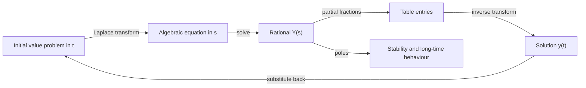

# Laplace Transforms

> [Mathematics](../../README.md) › [Differential Equations](../README.md) · Level: Advanced · Prerequisites: [Techniques of Integration](../../07-calculus/08-techniques-of-integration/README.md), [Sequences and Series in Calculus](../../07-calculus/11-sequences-and-series-in-calculus/README.md), [Complex Numbers and Geometry](../../15-complex-analysis/01-complex-numbers-and-geometry/README.md), [First-Order Differential Equations](../01-first-order-odes/README.md), [Second-Order Linear ODEs](../02-second-order-linear-odes/README.md), [Systems of ODEs](../03-systems-of-odes/README.md) · Estimated time: 9 h

## 1. Introduction

The differential equations of the previous topics are solved by recognising a pattern and integrating. That works when the right-hand side is a polynomial, an exponential, a sine or a cosine, and it fails as soon as the forcing is a switch, a pulse, a hammer blow, or a function defined in pieces. It also becomes clumsy when the equation carries initial conditions, because the constants of integration must be fitted at the end, and it becomes genuinely painful for systems of several equations, where the coupling must be untangled by hand.

The **Laplace transform** replaces all of that by algebra. It maps a function $f(t)$ of time to a function $F(s)$ of a complex variable,

$$F(s) = \int_0^{\infty}e^{-st}f(t)\,dt,$$

and in doing so it turns differentiation into multiplication by $s$, integration into division by $s$, and — the crucial point — it incorporates the initial conditions automatically through the terms $-f(0)$, $-f'(0)$ and so on. An initial value problem becomes a linear algebraic equation for $F(s)$; one solves it, and then recovers $f(t)$ by inverting the transform. Discontinuous and impulsive forcing is not an afterthought: the unit step $u(t-a)$ transforms to $e^{-as}/s$ and the Dirac delta $\delta(t-a)$ to $e^{-as}$, so switches and blows are handled by the same algebra as smooth inputs.

Two further ideas give the method its reach. The first is the **convolution theorem**: the transform of the convolution $(f*g)(t) = \int_0^t f(\tau)g(t-\tau)\,d\tau$ is the product $F(s)G(s)$. Physically, convolution is the superposition of responses to a continuous stream of impulses, so the theorem says that a linear system's response to *any* input is the product of its **transfer function** $H(s)$ with the transform of the input. That single sentence is the foundation of classical control theory and of a good part of signal processing. The second is the relation with the **Fourier transform**: putting $s = i\omega$ recovers the Fourier transform of a causal, exponentially bounded signal, which explains why the Laplace variable is a complex frequency and why poles in the left half-plane mean stability.

The method has a history worth knowing because it explains its slightly archaic notation. Heaviside used an "operational calculus" in the 1890s, treating the differentiation operator $D$ as an algebraic quantity and writing $1/(D+a)$ for what we would now call a transfer function. The rules worked but the justification did not exist; Bromwich and later Doetsch and Widder supplied it by expressing the inverse transform as a contour integral in the complex plane, the **Bromwich integral**. The modern treatment is the one given here: the transform is an integral, its properties are theorems, and the delta function is a distribution rather than a mysterious "function that is infinite at one point".

The topic is deliberately self-contained about the delta. Many textbooks introduce $\delta$ informally and then manipulate it as if it were a function; that leads to errors at $t = 0$ and to confusion about the derivative rule. §7.5 treats it properly as a distribution, derives its transform from a limit of genuine functions, and states exactly which identities survive.

## 2. Prerequisites

**Integration** ([Techniques of Integration](../../07-calculus/08-techniques-of-integration/README.md)). Integration by parts, the workhorse of every derivation in this topic; substitution; partial fractions; completing the square; and the standard integrals $\int e^{au}\sin(bu)\,du$ and $\int e^{au}\cos(bu)\,du$. Improper integrals over $[0,\infty)$ are used constantly: the transform is defined as a limit $\lim_{R\to\infty}\int_0^R$, and every convergence statement is a statement about that limit. The Gamma integral $\int_0^\infty x^{n}e^{-x}dx = n!$ appears in §7.2 and in the exercises.

**Series** ([Sequences and Series in Calculus](../../07-calculus/11-sequences-and-series-in-calculus/README.md)). Geometric series, used for periodic functions and for justifying the term-by-term operations; the ratio test; absolute convergence, which permits the interchange of sums and integrals in the convolution proof.

**Complex numbers** ([Complex Numbers and Geometry](../../15-complex-analysis/01-complex-numbers-and-geometry/README.md)). $s = \sigma+i\omega$; Euler's formula $e^{i\theta} = \cos\theta+i\sin\theta$; the modulus and argument of a complex number; complex conjugate roots of a real quadratic. The region of convergence is a half-plane in the complex $s$-plane, and poles are complex numbers.

**Differential equations** ([First-Order Differential Equations](../01-first-order-odes/README.md), [Second-Order Linear ODEs](../02-second-order-linear-odes/README.md), [Systems of ODEs](../03-systems-of-odes/README.md)). Constant-coefficient linear equations and their characteristic roots; the three cases (distinct real, complex, repeated); the idea that a linear initial value problem has a unique solution; eigenvalues and the matrix exponential, which the Laplace transform computes in a different way. The transfer function of §7.9 is exactly the object that, in [Systems of ODEs](../03-systems-of-odes/README.md), is called $C(sI-A)^{-1}B$; nothing here needs that formula, but the reader who has met it will see the same structure.

## 3. Learning Objectives

After this tutorial you will be able to:

1. State the definition of the Laplace transform, the hypotheses of piecewise continuity and exponential order that make it converge, and describe the region of convergence as a right half-plane.
2. Derive the transforms of $1$, $t$, $t^n$, $e^{at}$, $\sin at$, $\cos at$, $\sinh at$, $\cosh at$ from the integral definition.
3. Use linearity, the derivative rule, the integral rule and the two shifting theorems, and prove each of them.
4. Handle the unit step function and the Dirac delta correctly, including the shift rule and the impulse response, and explain in what sense $\delta$ is a distribution.
5. State and prove the convolution theorem and use it both to compute inverse transforms and to solve integral equations.
6. Invert a rational transform by partial fractions in all three cases — distinct real poles, repeated poles, irreducible quadratic poles — using the cover-up rule and completing the square.
7. Solve constant-coefficient initial value problems, including problems with piecewise and impulsive forcing, and verify the answer by substitution.
8. Derive the transfer function of a linear system, identify its impulse response and step response, and decide stability from the poles.
9. Explain the relationship between the Laplace and Fourier transforms, including the role of the region of convergence and of causality.
10. Use the initial and final value theorems within their hypotheses, and recognise when they fail.

## 4. Intuition

**The transform is a weighted average of the signal's history.** Fix a complex number $s = \sigma+i\omega$ and multiply $f(t)$ by the decaying exponential $e^{-\sigma t}$ and by the oscillation $e^{-i\omega t}$; then integrate over all time. The result $F(s)$ records how much of the "frequency" $\omega$ and the "growth rate" $\sigma$ the signal contains, weighted so that distant time matters less. A signal that grows like $e^{3t}$ can still be analysed, provided $\sigma>3$: the extra decay $e^{-\sigma t}$ beats the growth, and the integral converges. That is the meaning of the region of convergence, and it is why the Laplace transform can handle unstable systems that the Fourier transform cannot.

**Differentiation becomes multiplication because of integration by parts.** The identity

$$\int_0^\infty e^{-st}f'(t)\,dt = \Big[e^{-st}f(t)\Big]_0^\infty + s\int_0^\infty e^{-st}f(t)\,dt = -f(0) + sF(s)$$

is the whole method in one line: the derivative is traded for a factor $s$, and the price is the initial value. Every rule in the subject is a variation on this trade. The second derivative costs $-sf(0)-f'(0)$, the third costs three terms, and this is precisely why the Laplace transform is the natural tool for *initial value* problems: the data enter as coefficients in an algebraic equation.

**Multiplication by an exponential shifts the picture.** If $f$ has transform $F(s)$, then $e^{at}f(t)$ has transform $F(s-a)$: multiplying by a growing exponential moves every feature of the transform one unit to the right. Similarly, *delaying* the signal by $a$ multiplies the transform by $e^{-as}$: a delay is a phase factor, and $e^{-as}$ is the algebraic trace of "nothing happens until $t = a$". These two shifts are the reason the transform is so effective with switched inputs.

**Convolution is what linear systems do.** A linear system cannot do anything with an input except accumulate scaled, delayed copies of its own impulse response: that is the meaning of the convolution integral $y(t) = \int_0^t h(t-\tau)x(\tau)d\tau$. Under the transform, the accumulation becomes multiplication, $Y(s) = H(s)X(s)$. This is why engineers speak of "multiplying by the transfer function", and why filter design is the design of a function $H$ whose product with the input spectrum has the desired shape.

## 5. Formal Definition

Throughout, $f:[0,\infty)\to\mathbb{R}$ (or $\mathbb{C}$) is a function of time, and $s = \sigma+i\omega$ is complex.

> **Definition 5.1 (piecewise continuity and exponential order).** $f$ is **piecewise continuous on $[0,\infty)$** if on every finite interval $[0,T]$ it has at most finitely many discontinuities and is continuous elsewhere, with finite one-sided limits at each discontinuity. $f$ is of **exponential order $\sigma_0$** if there are constants $M>0$, $T\ge0$ and $\sigma_0\in\mathbb{R}$ with
> $$\lvert f(t)\rvert\le Me^{\sigma_0 t}\qquad\text{for all } t\ge T .$$
> The restriction to $t\ge T$ allows integrable singularities at $0$, such as $f(t) = t^{-1/2}$.

> **Definition 5.2 (Laplace transform and region of convergence).** The **Laplace transform** of $f$ is
> $$F(s) = \mathcal{L}\{f\}(s) := \int_0^{\infty}e^{-st}f(t)\,dt = \lim_{R\to\infty}\int_0^{R}e^{-st}f(t)\,dt,$$
> for those $s\in\mathbb{C}$ for which the limit exists. That set is the **region of convergence** (ROC), and it is always a right half-plane $\operatorname{Re}s>\sigma_c$ (Theorem 7.1), whose boundary value $\sigma_c$ is the **abscissa of convergence**. The **one-sided** transform is used throughout; the **two-sided** (bilateral) transform integrates over $\mathbb{R}$ and is mentioned only in §7.10.

> **Definition 5.3 (inverse transform).** If $F = \mathcal{L}\{f\}$, then $f$ is an **inverse Laplace transform** of $F$, written $f = \mathcal{L}^{-1}\{F\}$. By Lerch's theorem (stated in §8), a continuous $f$ is determined uniquely by $F$, so the inverse is well defined on continuous functions.

> **Definition 5.4 (unit step).** For $a\ge0$,
> $$u(t-a) := \begin{cases}0, & t<a,\\ 1, & t\ge a.\end{cases}$$
> The Heaviside function is $u(t) := u(t-0)$, equal to $1$ on $[0,\infty)$; its value at $t=0$ is irrelevant for integration.

> **Definition 5.5 (Dirac delta).** The **Dirac delta at $a\ge0$** is the distribution defined by
> $$\langle\delta(t-a),\varphi\rangle := \varphi(a)$$
> for every continuous test function $\varphi$. It is not a function; statements such as "$\delta(0)=\infty$" are meaningless. Equivalently, $\delta(t-a)$ is the weak derivative of $u(t-a)$, and it may be obtained as the limit of the rectangular pulses
> $$\delta_\varepsilon(t-a) = \frac{1}{\varepsilon}\,\mathbf{1}_{[a,a+\varepsilon)}(t), \qquad \varepsilon>0,$$
> each of which is an ordinary function of integral $1$.

> **Definition 5.6 (convolution).** The **convolution** of $f$ and $g$ is
> $$(f*g)(t) := \int_0^{t}f(\tau)g(t-\tau)\,d\tau .$$

> **Definition 5.7 (transfer function and impulse response).** For the linear constant-coefficient equation
> $$a_ny^{(n)}+\cdots+a_1y'+a_0y = b_mx^{(m)}+\cdots+b_1x'+b_0x,$$
> the **transfer function** is $H(s) = \dfrac{B(s)}{A(s)}$ with $A(s) = \sum_{k=0}^{n}a_ks^k$ and $B(s) = \sum_{k=0}^{m}b_ks^k$. The **impulse response** is $h(t) = \mathcal{L}^{-1}\{H\}(t)$, that is, the solution with zero initial conditions and input $x = \delta$.

> **Definition 5.8 (poles, zeros, stability).** The **poles** of a rational $F$ are the zeros of its denominator, the **zeros** those of its numerator. A system with transfer function $H$ is **stable** if every pole of $H$ lies in the open left half-plane $\operatorname{Re}s<0$.

## 6. Mathematical Notation

| Symbol | Read as | Meaning |
|---|---|---|
| $t$ | t | time, $t\ge0$ |
| $s$, $\sigma$, $\omega$ | s, sigma, omega | complex frequency $s = \sigma+i\omega$ |
| $F(s)$, $\mathcal{L}\{f\}$ | F of s, Laplace of f | the transform of $f$ |
| $\mathcal{L}^{-1}\{F\}$ | inverse Laplace | the function whose transform is $F$ |
| $\sigma_c$ | abscissa of convergence | the left edge of the region of convergence |
| $u(t-a)$ | u of t minus a | unit step, $0$ before $a$ and $1$ after |
| $\delta(t-a)$ | Dirac delta at a | distribution with $\langle\delta(t-a),\varphi\rangle = \varphi(a)$ |
| $f*g$ | f star g, f convolved with g | $\int_0^t f(\tau)g(t-\tau)d\tau$ |
| $H(s)$ | H of s | transfer function |
| $h(t)$ | h of t | impulse response, $\mathcal{L}^{-1}\{H\}$ |
| $\Gamma(z)$ | Gamma of z | $\int_0^\infty x^{z-1}e^{-x}dx$, with $\Gamma(n+1) = n!$ and $\Gamma(\tfrac12) = \sqrt\pi$ |
| $f(0^+)$ | f of zero from the right | $\lim_{t\to0^+}f(t)$ |
| $\dot f$, $f'$ | f dot, f prime | derivative with respect to $t$ |
| $\mathbf{1}_A$ | indicator of A | $1$ on $A$, $0$ outside |
| $\operatorname{Re}s$, $\operatorname{Im}s$ | real and imaginary parts | $\sigma$ and $\omega$ |

## 7. Core Concepts

### 7.1 The definition and the region of convergence

The transform integrates $f$ against a decaying exponential. Whether the integral converges is therefore a competition between the growth of $f$ and the decay of $e^{-\sigma t}$, and the outcome depends only on $\sigma = \operatorname{Re}s$.

> **Theorem 7.1 (existence and absolute convergence).** Let $f$ be piecewise continuous on $[0,\infty)$ and of exponential order $\sigma_0$, with $\lvert f(t)\rvert\le Me^{\sigma_0t}$ for $t\ge T$. Then $F(s)$ exists and converges absolutely for every $s$ with $\operatorname{Re}s>\sigma_0$, and
> $$\lvert F(s)\rvert\le\frac{M'}{\operatorname{Re}s-\sigma_0}$$
> for a constant $M'$ depending on $f$ near $0$.

**Proof.** Split $\int_0^\infty = \int_0^T+\int_T^\infty$. The first piece is an integral of a piecewise continuous function over a finite interval, hence finite. For the second,

$$\int_T^{\infty}\left\lvert e^{-st}f(t)\right\rvert dt \le M\int_T^{\infty}e^{-(\operatorname{Re}s-\sigma_0)t}dt = \frac{Me^{-(\operatorname{Re}s-\sigma_0)T}}{\operatorname{Re}s-\sigma_0}<\infty$$

whenever $\operatorname{Re}s>\sigma_0$. Absolute convergence implies convergence, and the bound follows by enlarging $M$ to absorb the first piece. $\blacksquare$

> **Theorem 7.2 (the region of convergence is a right half-plane).** If $F(s_0)$ converges for some $s_0$, then $F(s)$ converges for every $s$ with $\operatorname{Re}s>\operatorname{Re}s_0$.

**Proof.** Put $g(t) = \int_0^te^{-s_0u}f(u)\,du$. Since the improper integral converges, $g$ is continuous and bounded, say $\lvert g(t)\rvert\le K$. Integration by parts (Stieltjes form, valid for $g$ of bounded variation) gives, for $\operatorname{Re}s>\operatorname{Re}s_0$,

$$\int_0^Re^{-su}f(u)\,du = \int_0^Re^{-(s-s_0)u}\,dg(u) = \left[e^{-(s-s_0)u}g(u)\right]_0^R+(s-s_0)\int_0^Re^{-(s-s_0)u}g(u)\,du .$$

The boundary term at $R$ is bounded by $Ke^{-(\operatorname{Re}s-\operatorname{Re}s_0)R}\to0$, and the remaining integral converges absolutely because $\lvert g\rvert\le K$ and the exponential decays. $\blacksquare$

The ROC is therefore an interval $(\sigma_c,\infty)$ in $\sigma$, possibly all of $\mathbb{R}$ (for $f$ of exponential order $-\infty$, such as a function of compact support) or empty. At the boundary the transform may or may not converge, and that detail matters when taking a limit $s\to0$ or $s\to i\omega$.

**Examples of the three outcomes.**

* $f(t) = 1$: $F(s) = 1/s$ for $\operatorname{Re}s>0$; $\sigma_c = 0$, and the boundary $\operatorname{Re}s = 0$ is excluded because $\int_0^\infty e^{-i\omega t}dt$ does not converge.
* $f(t) = e^{3t}$: $F(s) = 1/(s-3)$ for $\operatorname{Re}s>3$; $\sigma_c = 3$. The transform exists, but only to the right of the growth rate.
* $f(t) = e^{t^2}$: for real $s = \sigma$, the integrand is $e^{t^2-\sigma t}$, which exceeds $e^{t^2/2}$ for $t>2\sigma$ and therefore diverges. **No** value of $s$ makes the integral converge: the ROC is empty and $e^{t^2}$ has no Laplace transform. Super-exponential growth is outside the theory.

The transform is linear because the integral is: for constants $\alpha,\beta$ and functions with a common region of convergence,

$$\mathcal{L}\{\alpha f+\beta g\} = \alpha F(s)+\beta G(s),$$

on the intersection of the two regions. This is used so often that it is not stated again.

### 7.2 The transforms of the elementary functions

Every entry in the table below is derived from the definition, not postulated. The derivations are the model for all later computations.

**The constant.** For $\operatorname{Re}s>0$,

$$F(s) = \int_0^{\infty}e^{-st}\cdot1\,dt = \lim_{R\to\infty}\left[-\frac{e^{-st}}{s}\right]_0^R = \lim_{R\to\infty}\frac{1-e^{-sR}}{s} = \frac1s .$$

The limit $e^{-sR}\to0$ is precisely the condition $\operatorname{Re}s>0$: write $e^{-sR} = e^{-\sigma R}e^{-i\omega R}$, whose modulus is $e^{-\sigma R}$.

**The monomials.** For $n\ge1$, integrate by parts with $u = t^n$, $dv = e^{-st}dt$:

$$\int_0^{\infty}t^ne^{-st}dt = \underbrace{\left[-\frac{t^ne^{-st}}{s}\right]_0^\infty}_{=\,0}+\frac{n}{s}\int_0^{\infty}t^{n-1}e^{-st}dt .$$

The boundary term vanishes for $\operatorname{Re}s>0$ because the exponential beats any power. Writing $I_n$ for the integral, $I_n = \frac ns I_{n-1}$ with $I_0 = 1/s$, so by induction

$$I_n = \frac{n!}{s^{n+1}} .$$

**The exponential.** For $\operatorname{Re}s>\operatorname{Re}a$,

$$\int_0^{\infty}e^{-st}e^{at}dt = \int_0^{\infty}e^{-(s-a)t}dt = \frac{1}{s-a}.$$

**Sine and cosine.** Let $I = \int_0^\infty e^{-st}\sin(at)dt$ and $J = \int_0^\infty e^{-st}\cos(at)dt$. Two integrations by parts give the pair

$$I = \frac{a}{s}J, \qquad J = \frac1s-\frac{a}{s}I .$$

Substituting the first into the second: $I = \frac as\left(\frac1s-\frac as I\right)$, so $I\left(1+\frac{a^2}{s^2}\right) = \frac{a}{s^2}$ and

$$I = \frac{a}{s^2+a^2}, \qquad J = \frac{s}{s^2+a^2},$$

valid for $\operatorname{Re}s>0$ (the convergence of the integrals requires it) and for every real $a\ne0$. The same result follows in one line from Euler's formula, writing $\sin at = (e^{iat}-e^{-iat})/(2i)$ and using the exponential transform; the trigonometric route is kept here because it displays the mechanism.

**Hyperbolic functions.** From $\sinh at = (e^{at}-e^{-at})/2$ and $\cosh at = (e^{at}+e^{-at})/2$:

$$\mathcal{L}\{\sinh at\} = \frac12\left(\frac{1}{s-a}-\frac{1}{s+a}\right) = \frac{a}{s^2-a^2}, \qquad \mathcal{L}\{\cosh at\} = \frac{s}{s^2-a^2},$$

for $\operatorname{Re}s>\lvert\operatorname{Re}a\rvert$.

| $f(t)$ | $F(s)$ | ROC |
|---|---|---|
| $1$ | $\dfrac1s$ | $\operatorname{Re}s>0$ |
| $t$ | $\dfrac{1}{s^2}$ | $\operatorname{Re}s>0$ |
| $t^n$, $n\in\mathbb{N}$ | $\dfrac{n!}{s^{n+1}}$ | $\operatorname{Re}s>0$ |
| $t^{\alpha}$, $\alpha>-1$ | $\dfrac{\Gamma(\alpha+1)}{s^{\alpha+1}}$ | $\operatorname{Re}s>0$ |
| $e^{at}$ | $\dfrac{1}{s-a}$ | $\operatorname{Re}s>\operatorname{Re}a$ |
| $\sin at$ | $\dfrac{a}{s^2+a^2}$ | $\operatorname{Re}s>0$ |
| $\cos at$ | $\dfrac{s}{s^2+a^2}$ | $\operatorname{Re}s>0$ |
| $\sinh at$ | $\dfrac{a}{s^2-a^2}$ | $\operatorname{Re}s>\lvert\operatorname{Re}a\rvert$ |
| $\cosh at$ | $\dfrac{s}{s^2-a^2}$ | $\operatorname{Re}s>\lvert\operatorname{Re}a\rvert$ |
| $t^ne^{at}$ | $\dfrac{n!}{(s-a)^{n+1}}$ | $\operatorname{Re}s>\operatorname{Re}a$ |
| $e^{at}\sin bt$ | $\dfrac{b}{(s-a)^2+b^2}$ | $\operatorname{Re}s>\operatorname{Re}a$ |
| $e^{at}\cos bt$ | $\dfrac{s-a}{(s-a)^2+b^2}$ | $\operatorname{Re}s>\operatorname{Re}a$ |
| $u(t-a)$ | $\dfrac{e^{-as}}{s}$ | $\operatorname{Re}s>0$ |
| $\delta(t-a)$, $a\ge0$ | $e^{-as}$ | all $s$ |
| $t^{-1/2}$ | $\sqrt{\pi/s}$ | $\operatorname{Re}s>0$ |

The $t^{-1/2}$ entry is derived from the Gamma integral in Exercise 32; the entry $t^\alpha$ for non-integer $\alpha$ uses $\Gamma(\alpha+1)$ and is the general form.

### 7.3 Linearity, the derivative rule and the integral rule

> **Theorem 7.3 (transform of a derivative).** Let $f$ be continuous on $[0,\infty)$ and of exponential order $\sigma_0$, with $f'$ piecewise continuous and of exponential order. Then for $\operatorname{Re}s>\sigma_0$,
> $$\mathcal{L}\{f'\}(s) = sF(s)-f(0),$$
> and, if $f,f',\dots,f^{(n-1)}$ are continuous and $f^{(n)}$ is piecewise continuous,
> $$\mathcal{L}\left\{f^{(n)}\right\}(s) = s^nF(s)-s^{n-1}f(0)-s^{n-2}f'(0)-\cdots-f^{(n-1)}(0).$$

**Proof.** Integrate by parts on $[0,R]$:

$$\int_0^Re^{-st}f'(t)\,dt = \left[e^{-st}f(t)\right]_0^R+s\int_0^Re^{-st}f(t)\,dt = e^{-sR}f(R)-f(0)+s\int_0^Re^{-st}f(t)\,dt.$$

Since $\lvert f(R)\rvert\le Me^{\sigma_0R}$ and $\operatorname{Re}s>\sigma_0$, the boundary term at $R$ tends to $0$: $\lvert e^{-sR}f(R)\rvert\le Me^{-(\operatorname{Re}s-\sigma_0)R}\to0$. The integral tends to $F(s)$ by Definition 5.2, so the first formula follows. Iterating it,

$$\mathcal{L}\{f''\} = s\mathcal{L}\{f'\}-f'(0) = s^2F(s)-sf(0)-f'(0),$$

and the general formula follows by induction on $n$. $\blacksquare$

The formula is the algebraic heart of the method: an $n$-th order equation becomes a polynomial of degree $n$ in $s$, and the initial data enter as the coefficients of the lower powers.

> **Theorem 7.4 (transform of an integral).** If $f$ is piecewise continuous and of exponential order, then for $\operatorname{Re}s>\max(0,\sigma_0)$,
> $$\mathcal{L}\left\{\int_0^tf(\tau)\,d\tau\right\}(s) = \frac{F(s)}{s}.$$

**Proof (via the derivative rule).** Put $g(t) = \int_0^tf(\tau)d\tau$. Then $g$ is continuous, $g(0) = 0$, and $g' = f$ wherever $f$ is continuous. The derivative rule gives $F(s) = \mathcal{L}\{g'\} = sG(s)-g(0) = sG(s)$, hence $G = F/s$. $\blacksquare$

**Proof (via Fubini).** Formally,

$$\frac{F(s)}{s} = \int_0^{\infty}e^{-st}\left(\int_0^tf(\tau)\,d\tau\right)dt,$$

because writing $1/s = \int_0^\infty e^{-su}du$ and interchanging the two integrals over the triangle $0\le u<\infty$, $0\le\tau\le t$ recovers the same expression. The second proof is the one that generalises to functions with jumps; the first is the one that explains *why* division by $s$ is the inverse of differentiation.

> **Theorem 7.5 (multiplication by $t$).** If $F(s) = \mathcal{L}\{f\}$ for $\operatorname{Re}s>\sigma_0$, then
> $$\mathcal{L}\{tf(t)\}(s) = -F'(s), \qquad \mathcal{L}\{t^nf(t)\}(s) = (-1)^nF^{(n)}(s).$$

**Proof.** Differentiate $F(s) = \int_0^\infty e^{-st}f(t)dt$ with respect to $s$. Formally, $\frac{\partial}{\partial s}e^{-st} = -te^{-st}$, so $F'(s) = -\int_0^\infty te^{-st}f(t)dt$. The differentiation under the integral sign is legitimate on any half-plane $\operatorname{Re}s\ge\sigma_0+\varepsilon$: the integrand is dominated by $tMe^{-(\sigma_0+\varepsilon)t}$, which is integrable on $[0,\infty)$, so the dominated convergence theorem applies. Repeating gives the $n$-th formula. $\blacksquare$

> **Theorem 7.6 (division by $t$).** Suppose $F(s) = \mathcal{L}\{f\}$ and $\lim_{t\to0^+}f(t)/t$ exists (or $f(t)/t$ is integrable at $0$). Then
> $$\mathcal{L}\left\{\frac{f(t)}{t}\right\}(s) = \int_s^{\infty}F(\sigma)\,d\sigma .$$

**Proof.** For $\operatorname{Re}s>\sigma_0$,

$$\int_s^{\infty}F(\sigma)\,d\sigma = \int_s^{\infty}\int_0^{\infty}e^{-\sigma t}f(t)\,dt\,d\sigma = \int_0^{\infty}f(t)\int_s^{\infty}e^{-\sigma t}\,d\sigma\,dt = \int_0^{\infty}f(t)\frac{e^{-st}}{t}\,dt,$$

where Fubini applies because the double integral converges absolutely when $\operatorname{Re}s>\sigma_0$ and $f(t)/t$ is integrable near $0$. $\blacksquare$

For example, $\mathcal{L}\{\sin t/t\} = \int_s^\infty\frac{d\sigma}{\sigma^2+1} = \frac{\pi}{2}-\arctan s = \arctan(1/s)$.

### 7.4 The shifting theorems

> **Theorem 7.7 (first shifting theorem).** If $F(s) = \mathcal{L}\{f(t)\}$ for $\operatorname{Re}s>\sigma_0$, then for every constant $a$,
> $$\mathcal{L}\left\{e^{at}f(t)\right\}(s) = F(s-a), \qquad \operatorname{Re}s>\sigma_0+\operatorname{Re}a .$$

**Proof.** Substitute the definition:

$$\int_0^{\infty}e^{-st}e^{at}f(t)\,dt = \int_0^{\infty}e^{-(s-a)t}f(t)\,dt = F(s-a).$$

The region is the set where $\operatorname{Re}(s-a)>\sigma_0$. $\blacksquare$

The theorem says that multiplication by a growing exponential *shifts the transform to the right*: every pole moves from $s = p$ to $s = p+a$. In inverse form, $\mathcal{L}^{-1}\{F(s-a)\} = e^{at}f(t)$.

> **Theorem 7.8 (second shifting theorem).** If $F(s) = \mathcal{L}\{f(t)\}$, then for $a>0$,
> $$\mathcal{L}\left\{f(t-a)u(t-a)\right\}(s) = e^{-as}F(s).$$

**Proof.** Since the factor $u(t-a)$ vanishes for $t<a$, substituting $u = t-a$ gives

$$\int_0^{\infty}e^{-st}f(t-a)u(t-a)\,dt = \int_a^{\infty}e^{-st}f(t-a)\,dt = \int_0^{\infty}e^{-s(u+a)}f(u)\,du = e^{-as}F(s). \quad\blacksquare$$

The two shifting theorems look alike and are constantly confused. The first *multiplies* by an exponential and shifts the argument of $F$; the second *delays* the function, multiplies by a step, and multiplies the transform by an exponential. The factor $u(t-a)$ is not optional: the function $f(t-a)$ alone is defined for $t<a$ only by extending $f$ backwards, and its transform is generally different. Every piecewise-defined forcing is written with steps,

$$f(t) = f_1(t)\left[u(t)-u(t-a)\right]+f_2(t)\,u(t-a),$$

and then transformed term by term using the second shifting theorem after writing each term as a function of $t-a$.

### 7.5 The unit step and the Dirac delta

**The step.** From the definition, for $a\ge0$ and $\operatorname{Re}s>0$,

$$\mathcal{L}\{u(t-a)\} = \int_a^{\infty}e^{-st}dt = \frac{e^{-as}}{s}.$$

This is the second shifting theorem with $f\equiv1$. A rectangular pulse of height $h$ and duration $\varepsilon$ starting at $a$ is $h[u(t-a)-u(t-a-\varepsilon)]$, with transform $\frac{h}{s}\left(e^{-as}-e^{-(a+\varepsilon)s}\right)$.

**The delta.** There is no ordinary function that vanishes everywhere except at one point, is infinite there, and has integral $1$; the object with those properties is a **distribution**, defined by how it acts on test functions (Definition 5.5). Its Laplace transform is likewise defined by a limit. Let

$$\delta_\varepsilon(t-a) = \frac1\varepsilon\mathbf{1}_{[a,a+\varepsilon)}(t), \qquad \int_0^\infty\delta_\varepsilon(t-a)\,dt = 1 .$$

Each $\delta_\varepsilon$ is an ordinary function, so its transform is an ordinary integral:

$$\mathcal{L}\{\delta_\varepsilon(t-a)\} = \frac1\varepsilon\int_a^{a+\varepsilon}e^{-st}dt = e^{-as}\,\frac{1-e^{-\varepsilon s}}{\varepsilon s}.$$

As $\varepsilon\to0^+$, $\dfrac{1-e^{-\varepsilon s}}{\varepsilon s}\to1$ (expand the exponential or use l'Hôpital in $\varepsilon$), so we **define**

$$\mathcal{L}\{\delta(t-a)\} = \lim_{\varepsilon\to0^+}\mathcal{L}\{\delta_\varepsilon(t-a)\} = e^{-as}, \qquad a\ge0 .$$

For $a = 0$ this gives $\mathcal{L}\{\delta(t)\} = 1$: the delta is the neutral element of convolution, and its transform is the neutral element of multiplication.

**The delta as a derivative.** In the distributional sense, $\dfrac{d}{dt}u(t-a) = \delta(t-a)$, and more generally a function with a jump $J = f(t_0^+)-f(t_0^-)$ at $t_0$ has distributional derivative $f'_{\text{classical}}+J\delta(t-t_0)$. This is consistent with the derivative rule: for piecewise smooth $f$,

$$\mathcal{L}\{f'\} = sF(s)-f(0^+),$$

with $f(0^+)$ rather than $f(0)$, because the jump at $0$ (if any) is absorbed into the initial value. For example, $f(t) = u(t)$ has $f' = \delta$ and $F = 1/s$, so $sF-f(0^+) = 1-0 = 1 = \mathcal{L}\{\delta\}$ ✓.

**Why the care is necessary.** Treating $\delta$ as a function leads to statements such as "$\delta(0)$ is infinite" and to the false rule $\mathcal{L}\{\delta(t-1)\delta(t-2)\} = e^{-3s}$; products of deltas at different points are not defined, and products at the same point require a renormalisation that the classical theory does not supply. The safe rules are the ones stated above: $\delta$ acts on continuous test functions, its transform is $e^{-as}$, and it appears in the derivative rule only through jumps.

### 7.6 Convolution and the convolution theorem

> **Definition (convolution).** $(f*g)(t) = \int_0^tf(\tau)g(t-\tau)\,d\tau$.

Convolution is commutative ($f*g = g*f$, by the substitution $\tau\mapsto t-\tau$), associative, and bilinear. It is *not* ordinary multiplication: $1*1 = t$, not $1$.

> **Theorem 7.9 (convolution theorem).** Let $f,g$ be piecewise continuous and of exponential order, with transforms $F,G$ converging for $\operatorname{Re}s>\sigma_0$. Then
> $$\mathcal{L}\{(f*g)(t)\}(s) = F(s)G(s), \qquad \operatorname{Re}s>\sigma_0 .$$

**Proof.** By definition and Fubini (Tonelli, since the integrand is absolutely integrable on the quadrant for $\operatorname{Re}s$ large),

$$F(s)G(s) = \left(\int_0^{\infty}e^{-su}f(u)\,du\right)\left(\int_0^{\infty}e^{-sv}g(v)\,dv\right) = \int_0^{\infty}\!\!\int_0^{\infty}e^{-s(u+v)}f(u)g(v)\,du\,dv .$$

Change variables $(u,v)\mapsto(t,\tau)$ with $t = u+v$ and $\tau = u$; the Jacobian is $1$ and the quadrant $u,v\ge0$ becomes $0\le\tau\le t<\infty$. Hence

$$F(s)G(s) = \int_0^{\infty}e^{-st}\left(\int_0^tf(\tau)g(t-\tau)\,d\tau\right)dt = \mathcal{L}\{f*g\}(s). \quad\blacksquare$$

**What it is not.** $\mathcal{L}\{f(t)g(t)\} \ne F(s)G(s)$. The simplest counterexample is $f = g = 1$: $\mathcal{L}\{1\cdot1\} = 1/s$, but $F(s)G(s) = 1/s^2$. The product of transforms corresponds to *convolution*, not to pointwise multiplication.

The theorem has two directions. Given a complicated product, invert each factor and convolve; given a convolution (as in an integral equation), transform and multiply. Both are used in §9 and in the exercises.

### 7.7 The inverse transform by partial fractions

If $F(s) = P(s)/Q(s)$ is a rational function with $\deg P<\deg Q$, the inverse is found by decomposing $F$ into terms from the table. Three cases exhaust the possibilities over $\mathbb{R}$.

**Case 1: distinct real poles.** If $Q$ has simple roots $s_1,\dots,s_n$, then

$$F(s) = \sum_{i=1}^{n}\frac{A_i}{s-s_i}, \qquad A_i = \lim_{s\to s_i}(s-s_i)F(s) = \frac{P(s_i)}{Q'(s_i)} .$$

The second expression is the **cover-up rule**: cover the factor $(s-s_i)$ in $Q$ and evaluate the rest at $s = s_i$. Then $f(t) = \sum_iA_ie^{s_it}$.

**Case 2: repeated real poles.** If $(s-s_1)^m$ divides $Q$, the expansion contains

$$\frac{A_{1}}{s-s_1}+\frac{A_{2}}{(s-s_1)^2}+\cdots+\frac{A_{m}}{(s-s_1)^m}, \qquad A_{m-k} = \frac{1}{k!}\lim_{s\to s_1}\frac{d^k}{ds^k}\left[(s-s_1)^mF(s)\right].$$

The terms invert to $A_j\dfrac{t^{j-1}}{(j-1)!}e^{s_1t}$ for the $j$-th power. The derivative formula, not cover-up alone, is needed when $m\ge2$.

**Case 3: irreducible quadratic poles.** A factor $s^2+bs+c$ with $b^2<4c$ has roots $\alpha\pm i\beta$ with $\alpha = -b/2$, $\beta = \sqrt{4c-b^2}/2$. Write the numerator in the form $A(s-\alpha)+B\beta$ and use

$$\mathcal{L}^{-1}\left\{\frac{s-\alpha}{(s-\alpha)^2+\beta^2}\right\} = e^{\alpha t}\cos\beta t, \qquad \mathcal{L}^{-1}\left\{\frac{\beta}{(s-\alpha)^2+\beta^2}\right\} = e^{\alpha t}\sin\beta t .$$

Completing the square and matching the numerator to these two shapes is the whole technique.

**Improper rational functions.** If $\deg P\ge\deg Q$, divide first: $F = $ polynomial $+$ proper fraction. A polynomial in $s$ inverts to a combination of $\delta$ and its derivatives — for example, $s$ inverts to $\delta'(t)$, which is why improper transforms rarely arise from ordinary initial value problems (there $Y(s)$ is proper whenever the equation is of order at least one and the input is a function).

### 7.8 Solving initial value problems

The procedure is fixed.

1. Take the transform of both sides, using linearity and the derivative rule, and insert the initial values.
2. Solve the resulting algebraic equation for $Y(s)$.
3. Decompose $Y(s)$ into table entries and invert.
4. Verify by substitution and by checking the initial conditions.

The advantage over the classical method is that step 1 uses the initial conditions immediately, so no arbitrary constants appear and step 3 never involves solving for them. For a second-order equation the algebra is

$$\left(s^2+a_1s+a_0\right)Y(s) = F(s)+\left(s+a_1\right)y(0)+y'(0),$$

so

$$Y(s) = \underbrace{\frac{F(s)}{P(s)}}_{\text{forced response}}+\underbrace{\frac{(s+a_1)y(0)+y'(0)}{P(s)}}_{\text{free response}}, \qquad P(s) = s^2+a_1s+a_0 .$$

The first term is the response to the forcing from rest, the second the decay of the initial data. Both are inverted by the same partial-fraction machinery, and the split is the reason the transform is so useful in control: the two contributions can be designed separately.

**Discontinuous forcing.** Write the forcing with unit steps, transform using Theorem 7.8, and invert each term. The answer inherits the steps: each delayed term $e^{-as}G(s)$ inverts to $g(t-a)u(t-a)$, so the solution is assembled from pieces that switch on at the same times as the input. The pieces must join continuously (for a second-order equation, $y$ and $y'$ are continuous unless the input contains a delta); checking the joins is the best verification of a piecewise answer.

### 7.9 Transfer functions and the impulse response

Take a linear constant-coefficient equation with zero initial conditions and input $x(t)$:

$$a_ny^{(n)}+\cdots+a_1y'+a_0y = b_mx^{(m)}+\cdots+b_0x .$$

Transforming and using the derivative rule with all initial values zero,

$$A(s)Y(s) = B(s)X(s), \qquad A(s) = \sum_{k=0}^na_ks^k,\quad B(s) = \sum_{k=0}^mb_ks^k,$$

so

$$Y(s) = H(s)X(s), \qquad H(s) := \frac{B(s)}{A(s)} .$$

$H$ is the **transfer function**. Its inverse transform $h$ is the **impulse response**, the solution when $x = \delta$: indeed $Y = H\cdot1 = H$. By the convolution theorem, the response to an arbitrary input is

$$y(t) = (h*x)(t) = \int_0^th(t-\tau)x(\tau)\,d\tau .$$

That formula is the statement that a linear system is completely characterised by its response to one impulse: every input is a superposition of impulses of strength $x(\tau)d\tau$ at times $\tau$, and each produces $h(t-\tau)x(\tau)d\tau$ at time $t$.

**Step response.** If $x = u$, then $X = 1/s$ and $Y = H(s)/s$; the step response is the integral of the impulse response, $y(t) = \int_0^th(\tau)d\tau$, which is the integral rule of Theorem 7.4 in disguise.

**Stability.** If every pole of $H$ has negative real part, then $h$ is a sum of terms $t^ke^{\lambda t}$ with $\operatorname{Re}\lambda<0$, hence decays exponentially, and every bounded input produces a bounded output (the convolution of an $L^1$ kernel with a bounded function is bounded). A pole in the right half-plane makes $h$ grow and the system unstable; a simple pole on the imaginary axis makes it oscillate forever without decaying — **marginally stable**. The **final value theorem** of §8 then computes the steady-state value of the step response as $\lim_{s\to0}sH(s)/s = H(0)$, which is the DC gain.

**Several equations.** For a system $\mathbf{x}' = A\mathbf{x}+B\mathbf{u}$, $\mathbf{y} = C\mathbf{x}$, transforming gives $s\mathbf{X} = A\mathbf{X}+B\mathbf{U}$ (zero initial state), so $\mathbf{X} = (sI-A)^{-1}B\mathbf{U}$ and $\mathbf{Y} = C(sI-A)^{-1}B\,\mathbf{U}$. The transfer matrix is $C(sI-A)^{-1}B$, and its poles are the eigenvalues of $A$ — the same eigenvalues that [Systems of ODEs](../03-systems-of-odes/README.md) studies geometrically. The Laplace route and the eigenvector route are two languages for the same object.

### 7.10 Comparison with the Fourier transform

The **Fourier transform** of a function on the whole line is

$$\widehat f(\omega) = \int_{-\infty}^{\infty}e^{-i\omega t}f(t)\,dt,$$

and the **inverse** is $f(t) = \frac{1}{2\pi}\int_{-\infty}^{\infty}e^{i\omega t}\widehat f(\omega)\,d\omega$. Setting $s = i\omega$ in the Laplace transform of a *causal* function (one with $f(t) = 0$ for $t<0$) gives the same integral:

$$F(i\omega) = \int_0^{\infty}e^{-i\omega t}f(t)\,dt = \widehat f(\omega).$$

The comparison is therefore precise but conditional.

| | Laplace | Fourier |
|---|---|---|
| Domain | $s = \sigma+i\omega$ | $\omega\in\mathbb{R}$ |
| Range of integration | $[0,\infty)$ (one-sided) | $(-\infty,\infty)$ |
| Class of functions | piecewise continuous, exponential order; ROC a right half-plane | integrable, or square-integrable, or tempered distributions |
| Growth allowed | $e^{\sigma_0t}$ for some finite $\sigma_0<0$ in the ROC | only what the convergence of the integral permits |
| Differentiation | $sF(s)-f(0)$ | $i\omega\widehat f(\omega)$ |
| Eigenfunctions | $e^{st}$ | $e^{i\omega t}$ |
| Handles initial conditions | yes, automatically | no, inconvenient |
| Handles switches and impulses | yes, through $e^{-as}$ | yes, but distribution theory is needed |
| Inversion | partial fractions (for rational $F$) | contour/integral formula |
| Natural for | initial value problems, control, circuits | spectral analysis, signal processing, PDEs |

The relation $F(i\omega) = \widehat f(\omega)$ holds when the imaginary axis lies inside the ROC, i.e. when $\sigma_c<0$. If $\sigma_c>0$ — a growing signal — the Fourier transform does not exist as a function, while the Laplace transform still does; that is the technical reason the Laplace transform is preferred for unstable systems and for design. Conversely, the Fourier transform applies to non-causal signals (defined for all $t$) and to stationary processes, which the one-sided transform cannot see. The two-sided Laplace transform

$$\mathcal{L}_{2}\{f\}(s) = \int_{-\infty}^{\infty}e^{-st}f(t)\,dt$$

interpolates between them: its ROC is a vertical strip $\sigma_1<\operatorname{Re}s<\sigma_2$, and the Fourier transform is its value on the imaginary axis when that axis lies in the strip. For $f(t) = e^{-a\lvert t\rvert}$ the strip is $-a<\operatorname{Re}s<a$, and on $s = i\omega$ the two-sided transform equals $2a/(a^2+\omega^2)$, the Fourier transform.

**Eigenfunction interpretation.** Both transforms diagonalise differentiation, which is why both turn linear constant-coefficient equations into algebra. The Fourier transform uses the eigenfunctions $e^{i\omega t}$ of $d/dt$ with eigenvalue $i\omega$ and needs the whole real line to decompose a signal; the Laplace transform uses $e^{st}$ with eigenvalue $s$ and needs only the half-line, at the price of a more complicated inversion and a region of convergence. For causal systems the two agree on the imaginary axis, and the engineering vocabulary — "frequency response" $H(i\omega)$, "poles in the left half-plane", "bandwidth" — is the Fourier reading of Laplace data.

### 7.11 Where the method is used

**Electrical circuits.** A series RLC circuit with a switch closed at $t = 0$ obeys $Lq''+Rq'+q/C = E(t)$ with $q(0) = q_0$, $q'(0) = i_0$. The transform gives $Q(s) = \frac{E(s)+L(sq_0+i_0)+Rq_0}{Ls^2+Rs+1/C}$, whose poles are the natural frequencies $-\frac{R}{2L}\pm\sqrt{\frac{R^2}{4L^2}-\frac{1}{LC}}$. Underdamped, critically damped and overdamped are the three cases of the discriminant, exactly as in [Second-Order Linear ODEs](../02-second-order-linear-odes/README.md); a switched source is a step, and the transient is the partial-fraction decomposition.

**Mechanical vibrations.** A mass–spring–damper with a suddenly applied force or a hammer blow is the same algebra with $m,c,k$ in place of $L,R,1/C$. The impulse response is the response to a hammer blow, and the step response is the response to a suddenly applied constant force; both are measured experimentally and compared with $H(s)$.

**Control engineering.** The transfer function is the central object of classical control: a plant $H(s)$ in a feedback loop with controller $K(s)$ has closed-loop transfer function $\frac{KH}{1+KH}$, and design means choosing $K$ so that the poles of this expression lie in the left half-plane with a prescribed damping. PID controllers are rational functions of $s$, and the Laplace domain turns delay into the factor $e^{-as}$, which is why delay is hard: it is not rational, and it adds infinitely many poles.

**Probability.** The moment generating function of a random variable $X$ with density $f$ is $M_X(s) = \mathbb{E}[e^{sX}] = \int e^{sx}f(x)dx$, the two-sided Laplace transform of the density evaluated at $-s$. Sums of independent random variables correspond to products of moment generating functions — the convolution theorem in probabilistic language.

**Partial differential equations and fractional calculus.** Transforming the time variable turns a PDE into an ODE in the space variables: the heat equation $u_t = \kappa u_{xx}$ becomes $sU-\kappa U_{xx} = u(0)$, whose solution is a decaying exponential in $x$; inverting gives the heat kernel as a convolution. The transform of $t^\alpha$ extends differentiation to fractional order, and $s^\alpha$ is the symbol of a fractional derivative — the starting point of fractional calculus.

## 8. Formulas and Properties

### 8.1 The rule book

| Rule | Formula | Hypotheses | Proved in |
|---|---|---|---|
| Linearity | $\mathcal{L}\{\alpha f+\beta g\} = \alpha F+\beta G$ | common ROC | §7.1 |
| Derivative | $\mathcal{L}\{f'\} = sF(s)-f(0)$ | $f$ continuous, $f'$ piecewise continuous, exponential order | Theorem 7.3 |
| $n$-th derivative | $\mathcal{L}\{f^{(n)}\} = s^nF-\sum_{k=0}^{n-1}s^{n-1-k}f^{(k)}(0)$ | $f^{(n-1)}$ continuous, $f^{(n)}$ piecewise continuous | Theorem 7.3 |
| Integral | $\mathcal{L}\left\{\int_0^tf\right\} = F(s)/s$ | $f$ piecewise continuous, exponential order | Theorem 7.4 |
| Times $t$ | $\mathcal{L}\{tf(t)\} = -F'(s)$ | $F$ differentiable in the ROC | Theorem 7.5 |
| Divide by $t$ | $\mathcal{L}\{f(t)/t\} = \int_s^\infty F(\sigma)d\sigma$ | $f(t)/t$ integrable at $0$ | Theorem 7.6 |
| First shift | $\mathcal{L}\{e^{at}f(t)\} = F(s-a)$ | ROC shifted by $\operatorname{Re}a$ | Theorem 7.7 |
| Second shift | $\mathcal{L}\{f(t-a)u(t-a)\} = e^{-as}F(s)$ | $a>0$ | Theorem 7.8 |
| Convolution | $\mathcal{L}\{f*g\} = F(s)G(s)$ | both transforms exist | Theorem 7.9 |
| Step | $\mathcal{L}\{u(t-a)\} = e^{-as}/s$ | $a\ge0$ | §7.5 |
| Delta | $\mathcal{L}\{\delta(t-a)\} = e^{-as}$ | $a\ge0$ | §7.5 |
| Periodic | $\mathcal{L}\{f\} = \dfrac{1}{1-e^{-sT}}\displaystyle\int_0^Te^{-st}f(t)dt$ | $f$ has period $T$ | Theorem 8.1 |
| Initial value | $\lim_{s\to\infty}sF(s) = f(0^+)$ | the limit $f(0^+)$ exists | Theorem 8.2 |
| Final value | $\lim_{s\to0}sF(s) = \lim_{t\to\infty}f(t)$ | the $t$-limit exists and $f$ is piecewise smooth of exponential order | Theorem 8.3 |

> **Theorem 8.1 (periodic functions).** If $f$ is piecewise continuous, of exponential order, and periodic with period $T>0$, then
> $$\mathcal{L}\{f\}(s) = \frac{1}{1-e^{-sT}}\int_0^Te^{-st}f(t)\,dt, \qquad \operatorname{Re}s>0 .$$

**Proof.** Split the integral into the periods $[kT,(k+1)T]$ and substitute $t = u+kT$ in the $k$-th piece:

$$\int_0^{\infty}e^{-st}f(t)dt = \sum_{k=0}^{\infty}\int_0^Te^{-s(u+kT)}f(u+kT)\,du = \left(\sum_{k=0}^{\infty}e^{-skT}\right)\int_0^Te^{-su}f(u)\,du .$$

The geometric series sums to $1/(1-e^{-sT})$ when $\lvert e^{-sT}\rvert<1$, i.e. $\operatorname{Re}s>0$. $\blacksquare$

> **Theorem 8.2 (initial value theorem).** If $f$ is continuous on $(0,\infty)$, piecewise smooth, of exponential order, and $f(0^+) = \lim_{t\to0^+}f(t)$ exists, then
> $$\lim_{s\to+\infty}sF(s) = f(0^+).$$

**Proof.** By the derivative rule, $sF(s)-f(0^+) = \mathcal{L}\{f'\}(s) = \int_0^\infty e^{-st}f'(t)dt$. Since $\lvert f'(t)\rvert\le Me^{\sigma_0t}$, the integrand is dominated by $Me^{-(s-\sigma_0)t}$, integrable for $s>\sigma_0$; dominated convergence gives $\mathcal{L}\{f'\}(s)\to0$ as $s\to+\infty$. Hence $sF(s)\to f(0^+)$. $\blacksquare$

> **Theorem 8.3 (final value theorem).** Suppose $f$ is piecewise smooth and of exponential order, and $L := \lim_{t\to\infty}f(t)$ exists. Then
> $$\lim_{s\to0^+}sF(s) = L .$$

**Proof.** The derivative rule gives $sF(s)-f(0) = \mathcal{L}\{f'\}(s)$. Since $f(t)\to L$, the improper integral $\int_0^\infty f'(t)dt = L-f(0)$ converges. **Abel's theorem** for Laplace integrals states that if $\int_0^\infty g(t)dt$ converges then $\lim_{s\to0^+}\int_0^\infty e^{-st}g(t)dt = \int_0^\infty g(t)dt$; applying it to $g = f'$ gives $sF(s)-f(0)\to L-f(0)$, i.e. $sF(s)\to L$. $\blacksquare$

**Two warnings about the value theorems.** They are one-way implications: the existence of $\lim sF(s)$ does **not** imply the existence of $f(0^+)$ or $\lim f(t)$. For $f(t) = \sin t$, $sF(s) = s/(s^2+1)\to0$ as $s\to0^+$, yet $\sin t$ has no limit; the final value theorem fails because its hypothesis fails. For $f(t) = e^{t}$, $sF(s) = s/(s-1)\to0$ as $s\to0^+$, yet $f\to\infty$ — same lesson. In practice one checks that all poles of $sF(s)$ lie in $\operatorname{Re}s<0$ (except a possible simple pole at $0$), and then the final value is $F$'s residue at $0$.

> **Theorem 8.4 (Lerch's uniqueness theorem, stated).** If $f$ and $g$ are piecewise continuous and of exponential order on $[0,\infty)$ and $F(s) = G(s)$ for all $s$ in a common right half-plane, then $f(t) = g(t)$ at every point of continuity of both. In particular a continuous function is determined by its transform, and the inverse transform is well defined.

Lerch's theorem is what licenses the phrase "the inverse transform": without it, two different functions could share a transform and the method would be ambiguous. Its proof is analytic (it uses the fact that the transform is analytic in the ROC and that a certain integral operator is injective); the statement is all that is needed here.

### 8.2 The shape of a rational transform

For a proper rational $F = P/Q$ in lowest terms, the partial-fraction decomposition of §7.7 has one term per pole:

| Pole type | Terms in $F$ | Contribution to $f(t)$ |
|---|---|---|
| simple real $s=a$ | $\dfrac{A}{s-a}$ | $Ae^{at}$ |
| real $s=a$, multiplicity $m$ | $\sum_{j=1}^{m}\dfrac{A_j}{(s-a)^j}$ | $\sum_{j=1}^{m}\dfrac{A_j}{(j-1)!}t^{j-1}e^{at}$ |
| complex pair $\alpha\pm i\beta$ | $\dfrac{B(s-\alpha)+C\beta}{(s-\alpha)^2+\beta^2}$ | $e^{\alpha t}\left(B\cos\beta t+C\sin\beta t\right)$ |

Consequently the inverse of a rational transform is always a finite sum of terms $t^ke^{\alpha t}\cos\beta t$ and $t^ke^{\alpha t}\sin\beta t$. The pole with the largest real part dominates as $t\to\infty$; the pole with the smallest real part dominates as $t\to0^+$. This is the exact analogue of the eigenvalue classification of [Systems of ODEs](../03-systems-of-odes/README.md): the poles of $H$ are the eigenvalues of the companion matrix.

## 9. Step-by-Step Examples

### 9.1 Four transforms from the definition

**Problem.** Compute $\mathcal{L}\{2\}$, $\mathcal{L}\{t\}$, $\mathcal{L}\{e^{3t}\}$ and $\mathcal{L}\{\sin 2t\}$ from Definition 5.2, stating the region of convergence.

**Step 1 — the constant.** For $\operatorname{Re}s>0$,

$$\mathcal{L}\{2\} = 2\lim_{R\to\infty}\int_0^Re^{-st}dt = 2\lim_{R\to\infty}\frac{1-e^{-sR}}{s} = \frac{2}{s},$$

since $\lvert e^{-sR}\rvert = e^{-(\operatorname{Re}s)R}\to0$. The ROC is $\operatorname{Re}s>0$.

**Step 2 — the identity function.** Integrate by parts with $u = t$, $dv = e^{-st}dt$:

$$\int_0^{\infty}te^{-st}dt = \left[-\frac{te^{-st}}{s}\right]_0^\infty+\frac1s\int_0^\infty e^{-st}dt = 0+\frac{1}{s}\cdot\frac1s = \frac{1}{s^2}.$$

The boundary term vanishes because $te^{-(\operatorname{Re}s)t}\to0$ for $\operatorname{Re}s>0$.

**Step 3 — the exponential.** $\mathcal{L}\{e^{3t}\} = \int_0^\infty e^{-(s-3)t}dt = \dfrac{1}{s-3}$ for $\operatorname{Re}s>3$. Note the ROC: the growth rate of the function becomes the left edge of the region.

**Step 4 — the sine.** With $I = \int_0^\infty e^{-st}\sin 2t\,dt$ and $J = \int_0^\infty e^{-st}\cos 2t\,dt$, two integrations by parts give $I = \frac2sJ$ and $J = \frac1s-\frac2sI$. Substituting,

$$I = \frac2s\left(\frac1s-\frac2sI\right) \Longrightarrow I\left(1+\frac{4}{s^2}\right) = \frac{2}{s^2} \Longrightarrow I = \frac{2}{s^2+4}.$$

**Check.** Each result matches the table of §7.2 with $a = 3$ and $a = 2$; and for large $s$, $\mathcal{L}\{\sin 2t\}\approx 2/s^2$, consistent with the small-time behaviour $\sin 2t\approx 2t$ and $\mathcal{L}\{2t\} = 2/s^2$ ✓.

### 9.2 First shifting in both directions

**Problem.** Compute (a) $\mathcal{L}\{t^2e^{-3t}\}$ and (b) $\mathcal{L}\{e^{-t}\cos 3t\}$; then invert $F(s) = \dfrac{1}{(s+2)^3}$.

*(a)* With $f(t) = t^2$ and $F(s) = 2/s^3$, Theorem 7.7 with $a = -3$ gives

$$\mathcal{L}\{t^2e^{-3t}\} = \frac{2}{(s+3)^3}, \qquad \operatorname{Re}s>-3 .$$

*(b)* With $f(t) = \cos 3t$ and $F(s) = s/(s^2+9)$, Theorem 7.7 with $a = -1$ gives

$$\mathcal{L}\{e^{-t}\cos 3t\} = \frac{s+1}{(s+1)^2+9}.$$

*(c)* From (a), $\dfrac{1}{(s+2)^3} = \dfrac12\cdot\dfrac{2}{(s+2)^3} = \dfrac12\mathcal{L}\{t^2e^{-2t}\}$, so the inverse is $\frac12t^2e^{-2t}$.

**Check.** Differentiate the answer of (c): $\frac{d}{dt}\left(\frac12t^2e^{-2t}\right) = te^{-2t}-t^2e^{-2t}$, and its transform should be $s\cdot\frac{1}{(s+2)^3}-0 = \frac{s}{(s+2)^3}$. Directly, $\mathcal{L}\{te^{-2t}\}-\mathcal{L}\{t^2e^{-2t}\} = \frac{1}{(s+2)^2}-\frac{2}{(s+2)^3} = \frac{(s+2)-2}{(s+2)^3} = \frac{s}{(s+2)^3}$ ✓.

### 9.3 A second-order initial value problem

**Problem.** Solve $y''+5y'+6y = 0$, $y(0) = 1$, $y'(0) = 0$.

**Step 1 — transform.** By Theorem 7.3,

$$\left[s^2Y-s\cdot1-0\right]+5\left[sY-1\right]+6Y = 0 .$$

**Step 2 — algebra.** Collecting,

$$\left(s^2+5s+6\right)Y = s+5 \Longrightarrow Y(s) = \frac{s+5}{(s+2)(s+3)} .$$

**Step 3 — partial fractions.** Cover-up: $A = \dfrac{-2+5}{-2+3} = 3$, $B = \dfrac{-3+5}{-3+2} = -2$, so

$$Y(s) = \frac{3}{s+2}-\frac{2}{s+3} .$$

**Step 4 — invert.** $y(t) = 3e^{-2t}-2e^{-3t}$.

**Check.** $y(0) = 3-2 = 1$ ✓. $y' = -6e^{-2t}+6e^{-3t}$, so $y'(0) = 0$ ✓. And

$$y''+5y'+6y = \left(12e^{-2t}-18e^{-3t}\right)+5\left(-6e^{-2t}+6e^{-3t}\right)+6\left(3e^{-2t}-2e^{-3t}\right) = (12-30+18)e^{-2t}+(-18+30-12)e^{-3t} = 0 ✓.$$

The poles $-2,-3$ are exactly the characteristic roots, as the general theory predicts.

### 9.4 Forcing at a different frequency

**Problem.** Solve $y''+4y = \sin t$ with $y(0) = y'(0) = 0$.

**Step 1 — transform.** $\left(s^2+4\right)Y = \dfrac{1}{s^2+1}$.

**Step 2 — partial fractions in $s^2$.** Write $u = s^2$ temporarily:

$$\frac{1}{(s^2+1)(s^2+4)} = \frac{1}{3}\left(\frac{1}{s^2+1}-\frac{1}{s^2+4}\right),$$

verified by combining over the common denominator: $\frac{(s^2+4)-(s^2+1)}{3(s^2+1)(s^2+4)} = \frac{1}{(s^2+1)(s^2+4)}$ ✓.

**Step 3 — invert.** Using $\mathcal{L}\{\sin at\} = a/(s^2+a^2)$ with $a = 1$ and $a = 2$:

$$y(t) = \frac{\sin t}{3}-\frac{\sin 2t}{6}.$$

**Check.** $y(0) = 0$ ✓. $y' = \frac{\cos t}{3}-\frac{\cos 2t}{3}$, so $y'(0) = \frac13-\frac13 = 0$ ✓. And

$$y''+4y = \left(-\frac{\sin t}{3}+\frac{2\sin 2t}{3}\right)+4\left(\frac{\sin t}{3}-\frac{\sin 2t}{6}\right) = \left(-\frac13+\frac43\right)\sin t+\left(\frac23-\frac23\right)\sin 2t = \sin t ✓.$$

### 9.5 Partial fractions with a real pole and a complex pair

**Problem.** Invert $F(s) = \dfrac{3s+5}{(s-1)(s^2+4)}$.

**Step 1 — the form.** $F = \dfrac{A}{s-1}+\dfrac{Bs+C}{s^2+4}$.

**Step 2 — cover-up for $A$.** $A = \dfrac{3\cdot1+5}{1^2+4} = \dfrac85$.

**Step 3 — match coefficients.** Multiplying out,

$$3s+5 = A(s^2+4)+(Bs+C)(s-1) = (A+B)s^2+(C-B)s+(4A-C).$$

Comparing coefficients: $A+B = 0$, $C-B = 3$, $4A-C = 5$. With $A = \tfrac85$ the first equation gives $B = -\tfrac85$, the second gives $C = 3+B = \tfrac75$, and the third is satisfied: $4\cdot\tfrac85-\tfrac75 = \tfrac{32}{5}-\tfrac75 = 5$ ✓.

**Step 4 — invert.**

$$F(s) = \frac{8}{5}\cdot\frac{1}{s-1}-\frac{8}{5}\cdot\frac{s}{s^2+4}+\frac{7}{10}\cdot\frac{2}{s^2+4},$$

$$f(t) = \frac85e^{t}-\frac85\cos 2t+\frac{7}{10}\sin 2t .$$

**Check.** At $t=0$: $\frac85-\frac85+0 = 0$. The initial-value theorem gives $\lim_{s\to\infty}sF(s) = \lim\dfrac{3s^2+\cdots}{s^3+\cdots} = 0$ ✓, consistent with $f(0^+) = 0$. The final value does not exist because of the pole at $s=1$: $f$ grows like $\frac85e^t$ ✓.

### 9.6 Discontinuous forcing

**Problem.** Solve $y''+y = u(t-\pi)-u(t-2\pi)$ with $y(0) = y'(0) = 0$.

**Step 1 — transform the forcing.** By Theorem 7.8 with $f\equiv1$, $\mathcal{L}\{u(t-a)\} = e^{-as}/s$, so

$$\left(s^2+1\right)Y = \frac{e^{-\pi s}-e^{-2\pi s}}{s} \Longrightarrow Y = \left(e^{-\pi s}-e^{-2\pi s}\right)\frac{1}{s(s^2+1)} .$$

**Step 2 — decompose the undelayed factor.**

$$\frac{1}{s(s^2+1)} = \frac1s-\frac{s}{s^2+1} \quad\Longrightarrow\quad \mathcal{L}^{-1}\left\{\frac{1}{s(s^2+1)}\right\} = 1-\cos t .$$

Indeed $A/s+(Bs+C)/(s^2+1)$ with $A = 1$, $B = -1$, $C = 0$.

**Step 3 — apply the second shifting theorem to each term.** The inverse of $e^{-as}G(s)$ is $g(t-a)u(t-a)$, so

$$y(t) = \left[1-\cos(t-\pi)\right]u(t-\pi)-\left[1-\cos(t-2\pi)\right]u(t-2\pi).$$

Using $\cos(t-\pi) = -\cos t$ and $\cos(t-2\pi) = \cos t$,

$$y(t) = \begin{cases}0, & 0\le t<\pi,\\ 1+\cos t, & \pi\le t<2\pi,\\ 2\cos t, & t\ge2\pi.\end{cases}$$

**Check.** At $t = \pi$: left limit $0$, right limit $1+\cos\pi = 0$ ✓. At $t = 2\pi$: left limit $1+\cos2\pi = 2$, right limit $2\cos 2\pi = 2$ ✓ — the solution is continuous across both switches. For $\pi<t<2\pi$, $y''+y = -\cos t+1+\cos t = 1$ ✓; for $t>2\pi$, $y''+y = -2\cos t+2\cos t = 0$ ✓. The derivative is also continuous at both joins ($y'(\pi^-) = 0$, $y'(\pi^+) = -\sin\pi = 0$; $y'(2\pi^-) = -\sin 2\pi = 0$, $y'(2\pi^+) = -2\sin 2\pi = 0$) ✓, as it must be for a second-order equation with a bounded forcing.

### 9.7 An impulse

**Problem.** Solve $y''+y = \delta(t-1)$, $y(0) = y'(0) = 0$, and check the jump condition.

**Step 1 — transform.** $\left(s^2+1\right)Y = e^{-s}$, so $Y = e^{-s}\dfrac{1}{s^2+1}$.

**Step 2 — invert.** $\mathcal{L}^{-1}\left\{\frac{1}{s^2+1}\right\} = \sin t$, hence by Theorem 7.8

$$y(t) = \sin(t-1)\,u(t-1) = \begin{cases}0,&t<1,\\ \sin(t-1),&t\ge1.\end{cases}$$

**Step 3 — the jump condition.** Integrate the equation across $t=1$:

$$y'(1^+)-y'(1^-)+\int_{1-\varepsilon}^{1+\varepsilon}y\,dt = \int_{1-\varepsilon}^{1+\varepsilon}\delta(t-1)\,dt = 1 .$$

As $\varepsilon\to0$ the integral of $y$ vanishes (it is continuous and bounded), so $y'(1^+)-y'(1^-) = 1$. The solution has $y(1) = 0$ (continuous) and $y'(1^+) = \cos 0 = 1$, $y'(1^-) = 0$: the velocity jumps by exactly the impulse strength ✓.

**Check.** $y''+y = 0$ for $t\ne1$ ✓, $y(0) = y'(0) = 0$ ✓, and the jump is $1$ ✓. This is the behaviour of a struck oscillator: the blow changes the velocity instantaneously and the displacement not at all.

### 9.8 Inversion by convolution

**Problem.** Invert $F(s) = \dfrac{1}{(s+1)(s^2+1)}$ by convolution, and check against partial fractions.

**Step 1 — identify the factors.** $\dfrac{1}{s+1}$ inverts to $e^{-t}$ and $\dfrac{1}{s^2+1}$ to $\sin t$. By Theorem 7.9,

$$f(t) = \int_0^te^{-\tau}\sin(t-\tau)\,d\tau .$$

**Step 2 — evaluate.** Expand $\sin(t-\tau) = \sin t\cos\tau-\cos t\sin\tau$:

$$\int_0^te^{-\tau}\cos\tau\,d\tau = \left[\frac{e^{-\tau}(-\cos\tau+\sin\tau)}{2}\right]_0^t = \frac{e^{-t}(\sin t-\cos t)+1}{2},$$

using $\int e^{a\tau}\cos(b\tau)d\tau = \frac{e^{a\tau}(a\cos b\tau+b\sin b\tau)}{a^2+b^2}$ with $a = -1$, $b = 1$. Similarly

$$\int_0^te^{-\tau}\sin\tau\,d\tau = \left[\frac{e^{-\tau}(-\sin\tau-\cos\tau)}{2}\right]_0^t = \frac{e^{-t}(-\sin t-\cos t)+1}{2}.$$

Therefore

$$f(t) = \sin t\cdot\frac{e^{-t}(\sin t-\cos t)+1}{2}-\cos t\cdot\frac{e^{-t}(-\sin t-\cos t)+1}{2} = \frac12\left[e^{-t}\left(\sin^2t-\sin t\cos t+\sin t\cos t+\cos^2t\right)+\sin t-\cos t\right]$$

$$= \frac12\left(e^{-t}+\sin t-\cos t\right).$$

**Check by partial fractions.** $\dfrac{1}{(s+1)(s^2+1)} = \dfrac{1/2}{s+1}+\dfrac{-s/2+1/2}{s^2+1}$ (cover-up gives $A = \frac12$; then $B = -\frac12$, $C = \frac12$), whose inverse is $\frac12e^{-t}-\frac12\cos t+\frac12\sin t$ — the same ✓. At $t=0$: $f(0) = \frac12(1+0-1) = 0$, and indeed $F(s)\to0$ as $s\to\infty$ ✓.

### 9.9 Transfer function, impulse response and step response

**Problem.** For $y''+2y'+5y = x(t)$, find the transfer function, the impulse response and the step response.

**Step 1 — transfer function.** With zero initial conditions, $\left(s^2+2s+5\right)Y = X$, so

$$H(s) = \frac{1}{s^2+2s+5} = \frac{1}{(s+1)^2+4}.$$

**Step 2 — impulse response.** From the table with $a = -1$, $b = 2$ and a factor $\frac12$:

$$h(t) = \frac12e^{-t}\sin 2t .$$

**Step 3 — step response.** $Y = \dfrac{H(s)}{s} = \dfrac{1}{s\left((s+1)^2+4\right)}$. Decompose:

$$\frac{1}{s\left((s+1)^2+4\right)} = \frac{1/5}{s}+\frac{-(s+2)/5}{(s+1)^2+4},$$

verified by multiplying out: $\frac{(s+1)^2+4 - s(s+2)}{5s((s+1)^2+4)} = \frac{s^2+2s+5-s^2-2s}{5s(\cdots)} = \frac{5}{5s(\cdots)}$ ✓. Now

$$\frac{s+2}{(s+1)^2+4} = \frac{s+1}{(s+1)^2+4}+\frac{1}{(s+1)^2+4},$$

whose inverse is $e^{-t}\cos 2t+\frac12e^{-t}\sin 2t$. Hence

$$y_{\text{step}}(t) = \frac15-\frac15e^{-t}\cos 2t-\frac{1}{10}e^{-t}\sin 2t .$$

**Check.** $y_{\text{step}}(0) = \frac15-\frac15-0 = 0$ ✓ and $y'_{\text{step}}(0) = 0$ (differentiate: the terms combine to zero at $t=0$) ✓. As $t\to\infty$, $y_{\text{step}}\to\frac15 = H(0)$, the DC gain, consistent with the final value theorem: $\lim_{s\to0}s\cdot\frac{H(s)}{s} = H(0) = \frac15$ ✓. Also $h = y'_{\text{step}}$: differentiating gives $\frac15e^{-t}\cos 2t+\frac{2}{5}e^{-t}\sin2t+\frac1{10}e^{-t}\sin2t-\frac15e^{-t}\cos2t = \frac12e^{-t}\sin 2t$ ✓.

### 9.10 Resonance

**Problem.** Solve $y''+y = \sin t$, $y(0) = y'(0) = 0$.

**Step 1 — transform.** $\left(s^2+1\right)Y = \dfrac{1}{s^2+1}$, so $Y = \dfrac{1}{(s^2+1)^2}$.

**Step 2 — invert without partial fractions.** Recognize a convolution: $\dfrac{1}{s^2+1}\cdot\dfrac{1}{s^2+1}$ is the transform of $\sin t*\sin t$. Compute

$$\int_0^t\sin\tau\sin(t-\tau)\,d\tau = \frac12\int_0^t\left[\cos(2\tau-t)-\cos t\right]d\tau = \frac12\left[\frac{\sin(2\tau-t)}{2}\right]_0^t-\frac{t\cos t}{2} = \frac{\sin t}{2}-\frac{t\cos t}{2}.$$

**Step 3 — answer.** $y(t) = \dfrac{\sin t-t\cos t}{2}$.

**Check.** $y(0) = 0$ ✓; $y' = \frac12(\cos t-\cos t+t\sin t) = \frac{t\sin t}{2}$, so $y'(0) = 0$ ✓; and

$$y''+y = \frac12\left(\sin t+t\cos t\right)+\frac12\left(\sin t-t\cos t\right) = \sin t ✓.$$

The envelope $t/2$ grows without bound: the forcing is at the natural frequency and pumps energy in at every cycle.

### 9.11 A periodic square wave

**Problem.** Find the transform of the square wave $f$ with period $2$, equal to $1$ on $[0,1)$ and $-1$ on $[1,2)$.

**Step 1 — one period.** $\displaystyle\int_0^2e^{-st}f(t)dt = \int_0^1e^{-st}dt-\int_1^2e^{-st}dt = \frac{1-e^{-s}}{s}-\frac{e^{-s}-e^{-2s}}{s} = \frac{(1-e^{-s})^2}{s}$.

**Step 2 — Theorem 8.1.**

$$F(s) = \frac{1}{1-e^{-2s}}\cdot\frac{(1-e^{-s})^2}{s} = \frac{1}{s}\cdot\frac{1-e^{-s}}{1+e^{-s}} = \frac{\tanh(s/2)}{s},$$

using $1-e^{-2s} = (1-e^{-s})(1+e^{-s})$ and $\tanh x = \frac{e^x-e^{-x}}{e^x+e^{-x}} = \frac{1-e^{-2x}}{1+e^{-2x}}$ with $x = s/2$.

**Check — initial value.** $sF(s) = \tanh(s/2)\to1$ as $s\to\infty$, while $f(0^+) = 1$: the initial value theorem holds ✓.

**Check — mean value.** For a bounded periodic function, Abel's theorem gives $\lim_{s\to0^+}sF(s) = \frac1T\int_0^Tf(t)dt$; here $sF(s) = \tanh(s/2)\to0$, and the mean of the wave is $\frac12(1)+\frac12(-1) = 0$ ✓. Note that $F(s)$ itself tends to $\frac12$: it is the limit of $sF(s)$, not of $F(s)$, that carries the mean-value interpretation.

**Check — series expansion.** For large $s$,

$$F(s) = \frac1s\cdot\frac{1-e^{-s}}{1+e^{-s}} = \frac1s\left(1-2e^{-s}+2e^{-2s}-\cdots\right),$$

whose inverse is $u(t)-2u(t-1)+2u(t-2)-\cdots$ — the square wave assembled from its switches ✓, and consistent with the second shifting theorem term by term.

## 10. Visual Explanations

The method is a pipeline with a round trip: analysis in the time domain, algebra in the $s$ domain, synthesis back.

Every arrow is a theorem: the first is Theorem 7.3 together with linearity, the third is §7.7, the fourth is the table of §7.2, and the loop back is the verification step that no computation should skip.

**The dictionary.** Each analytic operation on $f$ becomes an algebraic operation on $F$, and the correspondence is exact.

| Time domain | $s$ domain | Condition |
|---|---|---|
| $f'(t)$ | $sF(s)-f(0)$ | $f$ continuous, exponential order |
| $\int_0^tf$ | $F(s)/s$ | integrable $f$ |
| $e^{at}f(t)$ | $F(s-a)$ | shift of the ROC |
| $f(t-a)u(t-a)$ | $e^{-as}F(s)$ | delay $a>0$ |
| $tf(t)$ | $-F'(s)$ | differentiable $F$ |
| $f(t)/t$ | $\int_s^\infty F(\sigma)d\sigma$ | integrable at $0$ |
| $(f*g)(t)$ | $F(s)G(s)$ | both exist |
| $\delta(t-a)$ | $e^{-as}$ | distribution |
| $u(t-a)$ | $e^{-as}/s$ | distribution |

**Poles and the picture.** A rational $Y(s)$ is determined by its poles, and the poles determine the shape of $y(t)$.

| Pole location | Term in $y(t)$ | Behaviour as $t\to\infty$ |
|---|---|---|
| real $a<0$ | $e^{at}$ | decays, time constant $1/\lvert a\rvert$ |
| real $a>0$ | $e^{at}$ | grows, doubling time $\ln2/a$ |
| $a = 0$ (simple) | constant | steady state |
| $\alpha\pm i\beta$, $\alpha<0$ | $e^{\alpha t}\cos\beta t$, $e^{\alpha t}\sin\beta t$ | damped oscillation, quasi-period $2\pi/\beta$ |
| $\alpha\pm i\beta$, $\alpha>0$ | same | growing oscillation |
| $\pm i\beta$ | pure oscillation | sustained oscillation |
| repeated $a$, $m$-fold | $t^{m-1}e^{at}$ | polynomial factor |

This is the same classification as the trace–determinant table of [Systems of ODEs](../03-systems-of-odes/README.md), with the poles playing the role of the eigenvalues and the imaginary axis playing the role of the stability boundary. Nothing in the two pictures contradicts anything in the other: they are the algebraic and the geometric views of one object.

## 11. Common Mistakes

1. **Forgetting the $u(t-a)$ in an inverse shift.** $\mathcal{L}^{-1}\{e^{-as}F(s)\} = f(t-a)u(t-a)$, not $f(t-a)$. Without the step, the answer is a function that is nonzero before the delay, which violates causality and usually the initial conditions.
2. **Applying the first shift in the wrong direction.** $e^{at}f(t)$ gives $F(s-a)$, not $F(s+a)$: multiplying by a growing exponential moves the transform to the *right*. Check with $f = 1$: $e^{3t}$ should give $1/(s-3)$.
3. **Believing $\mathcal{L}\{fg\} = FG$.** It is the convolution that multiplies: $\mathcal{L}\{f*g\} = FG$. The pointwise product has no simple transform in general.
4. **Ignoring the region of convergence.** The same formula $1/(s-a)$ can describe transforms with different regions (one-sided versus two-sided), and the inverse is not the same function. The ROC is part of the answer, especially when the Fourier transform is taken afterwards.
5. **Treating $\delta$ as a function.** $\delta(0)$ is not defined, $\delta(t)^2$ is not defined, and $\delta(t-1)\delta(t-2) = 0$ only in a distributional sense that requires care. Use the defining property against test functions, and the limit-of-pulses definition for the transform.
6. **Using the derivative rule with the wrong initial value.** The rule is $\mathcal{L}\{f'\} = sF(s)-f(0^+)$; for a function with a jump at $0$ the jump is not a separate term, because the one-sided transform never sees $t<0$. In the second derivative, however, jumps *inside* the interval do produce delta terms and must be included in the distributional derivative.
7. **Dropping terms in the second derivative.** $\mathcal{L}\{y''\} = s^2Y-sy(0)-y'(0)$; losing the $y'(0)$ term is the single most common algebra error in the whole method.
8. **Using the final value theorem when the limit does not exist.** For $f = \sin t$ or $f = e^t$, $sF(s)$ has a limit but $f$ does not. Check that all poles of $sF(s)$ lie in the open left half-plane (with at most a simple pole at the origin) before applying it.
9. **Assuming the initial value theorem always applies.** It requires $f(0^+)$ to exist as a limit; for $f(t) = \sin(1/t)$ or distributions of order $>0$ at $0$, the limit $sF(s)$ need not equal any initial value. It is also a one-sided statement: only $f(0^+)$ is accessible.
10. **Inverting a repeated pole with cover-up alone.** For a double pole, cover-up gives only the coefficient of $(s-a)^{-2}$; the coefficient of $(s-a)^{-1}$ needs the derivative formula or a coefficient comparison.
11. **Forgetting to divide by the polynomial when $\deg P\ge\deg Q$.** An improper rational function has a polynomial part, which inverts to derivatives of $\delta$, not to exponentials.
12. **Solving an equation with non-constant coefficients by transform and expecting an algebraic equation.** If the coefficients depend on $t$, the derivative rule produces derivatives of $Y$, and the transform converts the ODE into another differential equation (often of lower order or solvable by other means). The method's power is for constant coefficients.

## 12. Applications

### 12.1 A switched RLC circuit

A series circuit with $L = 1\ \mathrm{H}$, $R = 2\ \Omega$, $C = 0.2\ \mathrm{F}$ is driven by a $10\ \mathrm{V}$ battery switched on at $t=0$, with zero initial charge and current. The charge obeys

$$Lq''+Rq'+\frac1Cq = 10u(t), \qquad q(0) = q'(0) = 0,$$

i.e. $q''+2q'+5q = 10u(t)$. Transforming, $\left(s^2+2s+5\right)Q = \frac{10}{s}$, so $Q = \frac{10}{s((s+1)^2+4)}$. From Example 9.9 (with the factor $10$),

$$q(t) = 2-2e^{-t}\cos 2t-e^{-t}\sin 2t \quad (\mathrm{C}), \qquad i(t) = q'(t) = 5e^{-t}\sin 2t \quad (\mathrm{A}).$$

*Checks with units.* $q\to 2\ \mathrm{C}$ as $t\to\infty$, which is $CE = 0.2\times10 = 2\ \mathrm{C}$ — the capacitor charges to the battery voltage ✓. The current starts at $i(0) = 0$ and returns to $0$, as it must for a capacitor ✓. The transient is a damped oscillation at $\omega = 2\ \mathrm{rad/s}$, a period of $\pi\approx3.14\ \mathrm{s}$, decaying with time constant $1\ \mathrm{s}$.

### 12.2 A hammer blow

The same oscillator struck at $t = 0$ by an impulse of $1\ \mathrm{N\cdot s}$ obeys $q''+2q'+5q = \delta(t)$ with zero initial data, so $q = h = \frac12e^{-t}\sin 2t$. The velocity jumps from $0$ to $\frac12\ \mathrm{m/s}$ at $t=0^+$, the displacement does not jump, and the peak displacement is reached at $\tan 2t = 2$, i.e. $t\approx0.55\ \mathrm{s}$, with $q_{\max} = \tfrac12e^{-0.55}\sin(1.11)\approx0.26\ \mathrm{m}$. The impulse response is thus the answer to "what does one blow do?", and the transfer function is its transform. A sequence of blows is a sum of shifted impulse responses — the convolution theorem in mechanical form.

### 12.3 Feedback and pole placement

A plant $H(s) = \frac{1}{s(s+1)}$ under proportional feedback $K$ has closed-loop transfer function

$$T(s) = \frac{KH}{1+KH} = \frac{K}{s^2+s+K},$$

whose poles are $-\tfrac12\pm\sqrt{\tfrac14-K}$. For $K<\tfrac14$ the closed loop is overdamped, at $K = \tfrac14$ critically damped, and for $K>\tfrac14$ underdamped — the trace–determinant classification again, now as a design chart. The steady-state error to a unit step is $1-T(0) = 0$ for this plant, and the settling time scales as $1/\operatorname{Re}\lambda$. Every statement is read from the poles, without solving a differential equation.

### 12.4 Probability and moment generating functions

For a non-negative random variable with density $f$, the moment generating function is

$$M_X(s) = \mathbb{E}\left[e^{sX}\right] = \int_0^{\infty}e^{sx}f(x)\,dx = F(-s),$$

the two-sided Laplace transform at $-s$. If $X$ and $Y$ are independent, the density of $X+Y$ is the convolution $f_X*f_Y$, so $M_{X+Y} = M_XM_Y$ — the convolution theorem in probability language. The $n$-th moment is $M_X^{(n)}(0)$, which is Theorem 7.5 read backwards.

### 12.5 Delay, dead time and numerical inversion

A process with transport delay $T_d$ has transfer function $H(s)e^{-sT_d}$; the factor is not rational, so the closed-loop characteristic equation is transcendental and has infinitely many roots. The second shifting theorem tells us what the delay does in time: it shifts the response. When $F(s)$ has no elementary inverse — a frequent situation for transcendental $H$ — one inverts numerically by the Bromwich integral or by one of the standard algorithms (Gaver–Stehfest, Talbot), which evaluate $F$ at complex points and reconstruct $f$. [Numerical Analysis](../../19-numerical-analysis/README.md) develops the contour machinery; the Laplace representation is what makes it possible.

## 13. Exercises

The problem set is [exercises.md](exercises.md): 36 problems. Problems 1–12 build fluency with the definition, the table and simple inverses; 13–23 solve initial value problems, discontinuous and impulsive forcing, integral equations and transfer functions; 24–31 prove the rules, including the derivative, integral, shifting and convolution theorems and the value theorems; 32–36 are challenge problems on the Gamma integral, integro-differential equations, the empty region of convergence and the two-sided transform.

Attempt each problem before opening the solutions, and check every answer by substitution — the check is usually faster than the computation and catches nearly every error.

## 14. Solutions

Complete worked solutions are in [solutions.md](solutions.md), with the strategy, every step, and a verification by substitution or by a value theorem.

## 15. Summary

* $\mathcal{L}\{f\}(s) = \int_0^\infty e^{-st}f(t)dt$, defined for $\operatorname{Re}s$ large enough; piecewise continuity plus exponential order guarantees a nonempty right half-plane of convergence, and $e^{t^2}$ shows that the guarantee can fail.
* The elementary transforms follow from the definition: $1/s$, $1/s^2$, $n!/s^{n+1}$, $1/(s-a)$, $a/(s^2+a^2)$, $s/(s^2+a^2)$, $a/(s^2-a^2)$, $s/(s^2-a^2)$.
* Differentiation multiplies by $s$ and subtracts the initial data: $\mathcal{L}\{f^{(n)}\} = s^nF-\sum_{k<n}s^{n-1-k}f^{(k)}(0)$. Integration divides by $s$.
* $e^{at}$ shifts the transform: $F(s-a)$; a delay multiplies it by $e^{-as}$ and requires the step $u(t-a)$.
* The unit step transforms to $e^{-as}/s$; the delta is a distribution, obtained as a limit of pulses of unit area, and transforms to $e^{-as}$. The derivative rule survives jumps if $f(0)$ is read as $f(0^+)$.
* Convolution multiplies transforms, and the proof is a change of variables in a double integral. The pointwise product does not.
* A proper rational transform inverts by partial fractions: simple poles give exponentials, repeated poles give $t^ke^{at}$, quadratic pairs give damped sines and cosines after completing the square.
* Initial value problems become algebraic; discontinuous forcing produces piecewise answers whose joins must be checked for continuity of $y$ and, for second-order equations, of $y'$.
* The transfer function $H = B/A$ encodes the system; $h = \mathcal{L}^{-1}\{H\}$ is the impulse response, the response to any input is $h*x$, and stability is the statement that all poles lie in the open left half-plane.
* The Fourier transform is the Laplace transform on the imaginary axis for causal signals whose ROC contains it; the two-sided transform interpolates, and its region of convergence is a vertical strip.
* The initial and final value theorems are one-way: they need the corresponding time limits to exist, and $f = \sin t$ is the standard warning.

## 16. Further Learning

**Within this discipline**

* [Systems of ODEs](../03-systems-of-odes/README.md) — the geometric counterpart: poles are eigenvalues, and the left half-plane is the stable region of the trace–determinant picture.
* [Second-Order Linear ODEs](../02-second-order-linear-odes/README.md) — the classical solution of the equations that the transform solves algebraically.
* [First-Order Differential Equations](../01-first-order-odes/README.md) — existence and uniqueness, which guarantee that the transformed solution is the only one.
* [The discipline index](../README.md) — the full study order, including the PDEs where the transform is applied in the time variable.

**Supporting mathematics**

* [Techniques of Integration](../../07-calculus/08-techniques-of-integration/README.md) — integration by parts, partial fractions and the trigonometric integrals used in every derivation.
* [Complex Numbers and Geometry](../../15-complex-analysis/01-complex-numbers-and-geometry/README.md) — the complex plane, Euler's formula and the geometry of the poles.
* [Complex Analysis](../../15-complex-analysis/README.md) — contour integration, which gives the Bromwich inversion formula.
* [Numerical Analysis](../../19-numerical-analysis/README.md) — numerical inversion and the discretisation of continuous systems.
* [Mathematical Modeling](../../22-mathematical-modeling/README.md) and [Applied Mathematics](../../23-applied-mathematics/README.md) — where transfer functions and impulse responses are used in practice.

**Standard references**

* G. Doetsch, *Introduction to the Theory and Application of the Laplace Transformation* — the classical reference, careful about the region of convergence.
* D. V. Widder, *The Laplace Transform* — the analytic theory, including Lerch's theorem and the inversion integral.
* R. V. Churchill, *Operational Mathematics* — the textbook that taught several generations of engineers the operational method.
* J. L. Schiff, *The Laplace Transform: Theory and Applications* — concise, with a proper treatment of distributions.
* K. Ogata, *Modern Control Engineering* — transfer functions, pole placement and the engineering use of the $s$-plane.
* O. Heaviside, *Electromagnetic Theory* (1893) — the origin of operational calculus, readable for its style as much as its content.
