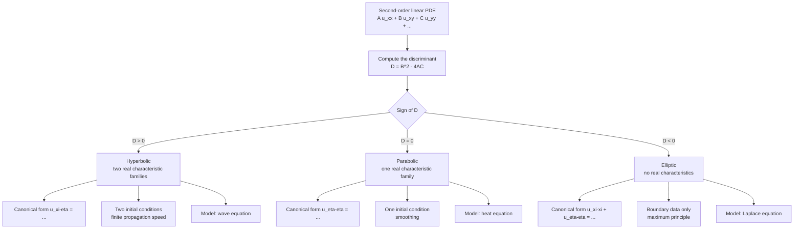

# Introduction to PDEs

> [Mathematics](../../README.md) › [Differential Equations](../README.md) · Level: Advanced · Prerequisites: [Multivariable Calculus](../../07-calculus/12-multivariable-calculus/README.md), [Sequences and Series in Calculus](../../07-calculus/11-sequences-and-series-in-calculus/README.md), [Techniques of Integration](../../07-calculus/08-techniques-of-integration/README.md), [Eigenvalues and Eigenvectors](../../08-linear-algebra/07-eigenvalues-and-eigenvectors/README.md), [Inner Product Spaces](../../08-linear-algebra/08-inner-product-spaces/README.md), [First-Order Differential Equations](../01-first-order-odes/README.md), [Second-Order Linear ODEs](../02-second-order-linear-odes/README.md) · Estimated time: 12 h

## 1. Introduction

An ordinary differential equation describes a quantity that depends on one variable. Almost nothing in the physical world is that simple. A metal rod has a temperature at every point *and* at every instant; a drum skin has a displacement at every point of its surface; the electric potential in a room has a value at every point of space. When the unknown is a function of several variables, the equation relating it to its rates of change is a **partial differential equation** (PDE), and the subject changes character in three important ways.

First, **the equation alone no longer determines the solution**. An ODE of order $n$ has an $n$-parameter family of solutions, and initial conditions at a single point pin one down. A PDE has infinitely many degrees of freedom — an arbitrary function of the space variables, in the simplest cases — and to select a solution one must supply data on a whole *curve* or *surface*: the state at time zero, and what happens at the ends of the rod or on the walls of the room. The data are not decoration; they are half of the problem, and the choice of which data to impose is dictated by the *type* of the equation.

Second, **the classical tools fail, and one invents new ones**. Integration no longer solves anything, because there is no single variable to integrate against. The two techniques that carry almost the whole classical theory are:

* **Separation of variables**, which looks for solutions that are a product of a function of $x$ and a function of $t$. The PDE then splits into two ODEs coupled by a constant, and the boundary conditions force that constant to take one of a discrete list of values — the **eigenvalues** of the problem. Because the equation is linear, these special solutions can be superposed, and the initial data are matched by expanding them in the resulting family of functions: a **Fourier series**.
* **Characteristics**, which for first-order equations (and for the wave equation) are curves along which the PDE becomes an ODE. Information travels along characteristics at a finite speed, and this is the geometric content of "hyperbolic".

Third, **the three archetypes behave in qualitatively different ways**. The heat equation smooths: an initial spike becomes a smooth bump immediately, and high frequencies die exponentially fast. The wave equation propagates: a plucked shape splits into two halves that travel in opposite directions and reflect off the ends, and information travels at exactly the speed $c$. Laplace's equation averages: a harmonic function at a point is the mean of its values on any circle around the point, so it cannot have a strict interior maximum. These are not three unrelated tricks; they are three *types*, distinguished by a single algebraic invariant — the discriminant of the second-order part — and the type decides what data make the problem well posed.

This tutorial builds those three archetypes from scratch:

$$\text{transport } u_t + c u_x = 0, \qquad \text{heat } u_t = \alpha u_{xx}, \qquad \text{wave } u_{tt} = c^2 u_{xx}, \qquad \text{Laplace } u_{xx} + u_{yy} = 0 .$$

Each is solved completely on a bounded interval or rectangle, each solution is checked numerically, and the common machinery — orthogonality, eigenfunction expansions, the maximum principle — is developed once and reused.

A word on rigour. The classical theory of PDEs is hard: existence and uniqueness for general equations is a graduate subject (Sobolev spaces, weak formulations, elliptic regularity). What is done here is the part that can be made completely rigorous at an advanced undergraduate level, plus careful statements of the rest. Every solution written down is verified by differentiation; every series coefficient is computed from an integral rather than quoted; every convergence claim is either proved or explicitly flagged as a standard theorem with its hypotheses. §7.10 explains, honestly, what a *weak* solution is and why numerical methods naturally produce them.

## 2. Prerequisites

**Multivariable calculus** ([Multivariable Calculus](../../07-calculus/12-multivariable-calculus/README.md)). Partial derivatives, the chain rule for functions of several variables (used in every characteristic computation), the second-derivative test, and double integrals over rectangles. The classification of §7.8 is a statement about the coefficients of a quadratic form, so familiarity with quadratic forms and their discriminants helps.

**Sequences and series** ([Sequences and Series in Calculus](../../07-calculus/11-sequences-and-series-in-calculus/README.md)). Convergence of series, absolute and uniform convergence, the Weierstrass $M$-test (used to justify differentiating a Fourier series term by term), and geometric series. The heat series converges so fast that term-by-term differentiation is easy; the wave series needs a little care.

**Integration** ([Techniques of Integration](../../07-calculus/08-techniques-of-integration/README.md)). Integration by parts — the source of every Fourier coefficient formula — and trigonometric identities. The single most-used integral in this topic is

$$\int_0^L \sin\frac{n\pi x}{L}\sin\frac{m\pi x}{L}\,dx = \begin{cases} 0, & n \ne m,\\[2pt] \dfrac{L}{2}, & n = m,\end{cases}$$

which is proved in §7.9 by the product-to-sum identity.

**Linear algebra** ([Eigenvalues and Eigenvectors](../../08-linear-algebra/07-eigenvalues-and-eigenvectors/README.md), [Inner Product Spaces](../../08-linear-algebra/08-inner-product-spaces/README.md)). The eigenvalue problem $X'' = -\lambda X$ with boundary conditions is an infinite-dimensional analogue of $A\mathbf{v} = \lambda\mathbf{v}$: the eigenfunctions are orthogonal, and expanding data in them is exactly the projection formula in an inner product space. Recognising this makes Fourier series feel inevitable rather than magical.

**Ordinary differential equations** ([First-Order Differential Equations](../01-first-order-odes/README.md), [Second-Order Linear ODEs](../02-second-order-linear-odes/README.md)). Separable first-order equations (for characteristics), and constant-coefficient second-order equations with the three cases of the characteristic equation (for the time factors in separation of variables). The ODE $X'' + \lambda X = 0$ with $\lambda > 0$, $\lambda = 0$ and $\lambda < 0$ is solved dozens of times here, and its three cases are exactly the source of the three PDE types.

## 3. Learning Objectives

After this tutorial you will be able to:

1. Define a partial differential equation, state its order, and classify it as linear, semilinear, quasilinear or nonlinear; test a given function for being a classical solution by differentiating it.
2. Distinguish initial conditions from boundary conditions, name the Dirichlet, Neumann, Robin, mixed and periodic conditions, and say which are appropriate for which type of equation.
3. State Hadamard's three requirements for well-posedness and explain, with the backward heat equation, how continuous dependence on the data can fail.
4. Solve the transport equation $u_t + c u_x = 0$, and its variable-coefficient and inhomogeneous variants, by the method of characteristics; interpret the solution as a travelling profile.
5. Derive the heat equation from conservation of energy and Fourier's law, solve the rod problem by separation of variables, compute the Fourier coefficients from the initial data, and describe the exponential decay of each mode.
6. Derive d'Alembert's solution of the wave equation, interpret it as two travelling waves, apply it to a plucked string (using odd extensions), and solve the same problem by separation of variables.
7. Define harmonic functions, state and prove the maximum principle, use it to prove uniqueness for the Dirichlet problem, and solve boundary value problems for Laplace's equation on a rectangle and a disc.
8. Classify a second-order linear PDE in two variables as elliptic, parabolic or hyperbolic from the discriminant $B^2 - 4AC$, explain why the type is invariant under change of variables, and describe the physical meaning of each type.
9. Expand a function in a Fourier sine or cosine series, prove the orthogonality relations, use Parseval's identity, and state the convergence theorem including the behaviour at a jump.
10. Describe what a weak solution is, why conservation laws need them, and how finite differences produce a numerical solution of the heat, wave and Laplace equations.

## 4. Intuition

**A PDE is a local rule that produces a global picture.** The heat equation says something absurdly local: *the rate at which a point warms is proportional to how much colder it is than the average of its immediate neighbours*. Written out, $u_t = \alpha u_{xx}$, and in one dimension $u_{xx}$ is positive exactly where the graph of $u$ is concave up, that is, where the point sits in a dip relative to its neighbours. A dip in temperature fills in; a bump in temperature drains. Nothing in the equation mentions the ends of the rod, yet the ends control everything, because they decide which dips and bumps are permitted. That is why boundary conditions are part of the equation rather than an afterthought.

**Fourier's idea: every shape is a sum of waves.** A vibrating string can be plucked into any shape at all, but it has a preferred set of motions — the fundamental and its harmonics — in which every point moves up and down sinusoidally, all at the same frequency. In a general motion, each harmonic evolves independently, at its own frequency, and the actual shape at any time is the sum of the harmonics with their amplitudes and phases chosen to match the initial shape. The heat equation is the same picture with a different rule for the time factor: instead of oscillating, each harmonic decays at a rate proportional to the square of its frequency. High harmonics decay very fast, which is why a complicated temperature profile becomes a single smooth hump and then fades away.

**Characteristics: information travels along curves.** For the transport equation $u_t + c u_x = 0$, imagine an observer moving with velocity $c$. The chain rule says the rate of change the observer sees is $u_t + c u_x$, which the equation sets to zero: the observer always sees the same value. So the solution at $(x,t)$ equals the initial datum at the point $x - ct$ from which the observer set out. The whole solution is the initial profile sliding to the right at speed $c$, rigidly and without distortion. For the wave equation, the same idea applies twice — there are two families of characteristics, $x - ct = \text{const}$ and $x + ct = \text{const}$ — so a pluck splits into a right-moving copy and a left-moving copy. The domain of dependence of a point is the segment $[x-ct, x+ct]$: what happens there determines the value here, and nothing outside it can.

**Elliptic equations average.** For Laplace's equation, the value at the centre of a circle is exactly the average of the values on the circle. A function with this property cannot bulge upward in the middle without being higher somewhere on the rim, so the largest and smallest values live on the boundary. Physically: a soap film stretched on a wire frame has no interior bumps; the shape is completely controlled by the frame.

The three archetypes were all in place by 1822. d'Alembert solved the vibrating string in 1747 and wrote down the travelling-wave formula; Euler generalised it; Fourier's *Théorie analytique de la chaleur* (1822) introduced both the heat equation and the series that carry his name; and Laplace's equation, which Lagrange and Laplace studied in celestial mechanics, turned out to be the prototype of elliptic theory. What was missing — and what took until the twentieth century — was a precise notion of solution, which is exactly the question §7.3 and §7.10 address.

## 5. Formal Definition

**Definition 5.1** (partial differential equation). Let $\Omega \subseteq \mathbb{R}^n$ be open, let $u : \Omega \to \mathbb{R}$, and let $m \ge 1$. A *partial differential equation of order $m$* is an equation

$$F\bigl(x,\, u(x),\, Du(x),\, D^2u(x),\, \dots,\, D^m u(x)\bigr) = 0 \qquad \text{for all } x \in \Omega,$$

where $F$ is a given function of its arguments and $D^k u$ denotes the collection of all partial derivatives of $u$ of order $k$. The *order* is the highest derivative that appears. A function $u \in C^m(\Omega)$ satisfying the equation pointwise is a **classical solution**.

When the equation is written with time singled out, we write points as $(x,t) \in \mathbb{R}^n \times [0,\infty)$ and call $x$ the space variable and $t$ the time.

**Definition 5.2** (linearity). A PDE is **linear** if it has the form

$$\mathcal{L}u := \sum_{\lvert\alpha\rvert \le m} a_\alpha(x)\, D^\alpha u = f(x),$$

with coefficient functions $a_\alpha$ and right-hand side $f$ depending on $x$ only — never on $u$ or its derivatives. It is **homogeneous** if $f \equiv 0$. It is **semilinear** if the coefficients of the highest-order derivatives depend only on $x$; **quasilinear** if the coefficients of the highest-order derivatives may depend on $u$ and derivatives of order below $m$; and **fully nonlinear** otherwise.

The decisive property of a linear equation is **superposition**: if $u_1, \dots, u_k$ solve $\mathcal{L}u = 0$ and $c_1, \dots, c_k \in \mathbb{R}$, then $\sum c_i u_i$ also solves $\mathcal{L}u = 0$; more generally $\mathcal{L}\bigl(\sum c_i u_i\bigr) = \sum c_i \mathcal{L}u_i$. Every series solution in this tutorial is justified by superposition plus a convergence argument. For an inhomogeneous equation, superposition takes the form: a particular solution plus any solution of the homogeneous equation.

**Definition 5.3** (data). Let $\Omega$ be a bounded domain with boundary $\partial\Omega$.

* An **initial condition** prescribes $u$ (and, for a second-order equation in time, $u_t$) on the set $t = 0$: $u(x,0) = f(x)$, $u_t(x,0) = g(x)$.
* A **boundary condition** prescribes relations on $\partial\Omega$:
  * **Dirichlet**: $u = h$ on $\partial\Omega$ — the value is fixed (temperature of the end of a rod held in ice; displacement of a clamped end of a string).
  * **Neumann**: $\partial u/\partial n = h$ on $\partial\Omega$, where $n$ is the outward unit normal — the flux is fixed (an insulated end; a free end of a string).
  * **Robin**: $\partial u/\partial n + \sigma u = h$ — a linear combination, modelling, for example, Newton's law of cooling into a surrounding medium.
  * **Periodic**: $u(a,t) = u(b,t)$ and $u_x(a,t) = u_x(b,t)$ — the domain is a circle.
  * **Mixed**: different conditions on different parts of the boundary.

**Definition 5.4** (well-posedness, Hadamard). A problem consisting of a PDE together with data is **well posed** if

1. **(Existence)** a solution exists;
2. **(Uniqueness)** the solution is unique;
3. **(Stability)** the solution depends continuously on the data: small changes in the data, measured in a suitable norm, produce small changes in the solution, in a norm appropriate to the problem.

If any one of the three fails, the problem is **ill posed**. Hadamard's own example of an ill-posed problem is the Cauchy problem for Laplace's equation, and the backward heat equation of §7.3 is the standard illustration.

**Definition 5.5** (classification of second-order linear equations in two variables). Let

$$A u_{xx} + B u_{xy} + C u_{yy} + D u_x + E u_y + F u = G,$$

where $A, \dots, G$ are functions of $(x,y)$ and not all of $A, B, C$ vanish. The **discriminant** is

$$\Delta := B^2 - 4AC .$$

The equation is **hyperbolic** at a point if $\Delta > 0$, **parabolic** if $\Delta = 0$, and **elliptic** if $\Delta < 0$. (Some texts write the cross term as $2B u_{xy}$ and use the discriminant $B^2 - AC$; the sign of the discriminant, which is all that matters, is the same.)

**Definition 5.6** (harmonic function). A function $u \in C^2(\Omega)$ with $\Omega \subseteq \mathbb{R}^2$ open is **harmonic** on $\Omega$ if

$$\Delta u := u_{xx} + u_{yy} = 0 \quad \text{on } \Omega .$$

In $\mathbb{R}^n$ the Laplacian is $\Delta u = \sum_{i=1}^n u_{x_i x_i}$.

## 6. Mathematical Notation

| Symbol | Read as | Meaning |
|---|---|---|
| $u(x,t)$ | $u$ of $x$ and $t$ | the unknown; value at position $x$, time $t$ |
| $u_t$, $\partial u/\partial t$ | partial of $u$ with respect to $t$ | derivative in $t$ with $x$ held fixed |
| $u_{xx}$, $\partial^2 u/\partial x^2$ | second partial in $x$ | likewise for higher derivatives |
| $u_{xy}$ | mixed partial | $\partial^2u/\partial x\,\partial y$ |
| $\nabla u$ | gradient of $u$ | $(u_x, u_y)$ in two dimensions |
| $\Delta u$, $\nabla^2 u$ | Laplacian of $u$ | $u_{xx} + u_{yy}$ (sum of unmixed second derivatives) |
| $\mathcal{L}$ | the operator | the differential expression defining the equation |
| $\Omega$, $\partial\Omega$ | domain, boundary | open region; its edge |
| $n$ | outward normal | unit vector perpendicular to $\partial\Omega$, pointing out |
| $\partial u/\partial n$ | normal derivative | $\nabla u \cdot n$ |
| $C^m(\Omega)$ | $C^m$ on $\Omega$ | continuous partial derivatives up to order $m$ |
| $\alpha$ | thermal diffusivity | constant in $u_t = \alpha u_{xx}$; units length$^2$/time |
| $c$ | wave speed (or transport speed) | units length/time |
| $L$ | length of the interval | the rod or string length |
| $\lambda_n$, $\mu_n$ | eigenvalues | separation constants allowed by the boundary conditions |
| $b_n$, $a_n$, $c_n$ | Fourier coefficients | amplitudes in the eigenfunction expansion |
| $\Delta = B^2 - 4AC$ | discriminant | decides hyperbolic / parabolic / elliptic |
| $\xi, \eta$ | characteristic coordinates | variables in which the PDE simplifies |
| $\langle f, g\rangle$ | inner product | $\int_0^L f g\,dx$ for real functions |
| $\lVert f\rVert_2$ | $L^2$ norm | $\sqrt{\langle f,f\rangle}$ |
| $\delta_{nm}$ | Kronecker delta | $1$ if $n = m$, $0$ otherwise |
| $O(h^p)$ | order $h^p$ | bounded by $C h^p$ as $h \to 0$ |

## 7. Core Concepts

### 7.1 What a PDE is; order, linearity and superposition

The simplest PDE worth the name is the **transport equation**

$$u_t + c\,u_x = 0, \qquad c > 0 \text{ constant},$$

which is first order and linear. The **heat equation** $u_t = \alpha u_{xx}$ and the **wave equation** $u_{tt} = c^2u_{xx}$ are second order and linear; Laplace's equation $u_{xx} + u_{yy} = 0$ is second order, linear, and contains no time at all. Burgers' equation $u_t + u u_x = 0$ is first order and quasilinear (the coefficient $u$ of $u_x$ is the unknown); the minimal surface equation $(1+u_y^2)u_{xx} - 2u_xu_yu_{xy} + (1+u_x^2)u_{yy} = 0$ is quasilinear; and $u_t + u_x^2 = 0$ is fully nonlinear.

Verifying that a function solves a PDE is pure differentiation. For example $u(x,t) = e^{-t}\sin x$ satisfies $u_t = -e^{-t}\sin x$ and $u_{xx} = -e^{-t}\sin x$, so $u_t = u_{xx}$: it is a solution of the heat equation. And $u(x,t) = \sin(x - ct)$ satisfies $u_{tt} = -c^2\sin(x-ct) = c^2 u_{xx}$: a solution of the wave equation. Note that in the second example $u$ is constant along the lines $x - ct = \text{const}$, which is the first hint of the method of characteristics.

Linearity is what makes the theory tractable. It gives **superposition**, and it gives **eigenfunction expansions**: the boundary conditions select a discrete set of spatial profiles, each of which evolves in time by a scalar ODE, and the general solution is a sum of these modes. Both ideas are used constantly below.

A caution about products: the product of two solutions of a linear PDE is normally *not* a solution. Superposition is about linear combinations, never products.

### 7.2 Initial and boundary conditions

A PDE by itself has far too many solutions; the data select one. Three questions must be answered.

**How much data?** The number of conditions at each point of the initial surface equals the order of the equation in that variable. For the heat equation, first order in $t$, one initial condition $u(x,0) = f(x)$ suffices. For the wave equation, second order in $t$, two are needed: $u(x,0) = f(x)$ and $u_t(x,0) = g(x)$.

**Where?** For a problem on a bounded interval $0 \le x \le L$ that evolves in time, the data are given on the *initial line* $t = 0$ and on the two *lateral boundaries* $x = 0$, $x = L$. For a steady-state problem (Laplace), there is no initial line at all, and data are given on the entire boundary $\partial\Omega$.

**Which type?** The type of the equation decides. For the heat equation one condition at each end (Dirichlet is the usual choice) gives a well-posed problem; for the wave equation one condition at each end is also correct (a clamped string), but prescribing both $u$ and $u_x$ at one end over-determines the problem. For Laplace's equation, a Dirichlet condition on the whole boundary is well posed, whereas a Cauchy problem — $u$ and $\partial u/\partial n$ prescribed on part of the boundary — is not, as §7.3 shows.

Dimension counting is a good but not infallible guide: a second-order equation in two variables has one characteristic conic through each point, and the *number of real characteristics* decides how many conditions may be imposed. One real characteristic family (parabolic) allows an initial condition on a non-characteristic curve; two families (hyperbolic) allow conditions on a curve that crosses both families; none (elliptic) forbids an initial-value problem altogether.

**Consistency at the corners.** Data given on $t = 0$ and on $x = 0$ must agree at $(0,0)$, otherwise no continuous solution can exist. In the heat problem with $u(x,0) = f(x)$ and $u(0,t) = 0$ one needs $f(0) = 0$. Ignoring corner compatibility is a common source of "the series does not converge at the corner" puzzles; the series is fine, the data were inconsistent.

### 7.3 Well-posedness

Hadamard's three requirements — existence, uniqueness, stability — are the right definition because they are exactly what a physical prediction needs. Existence says the model can be solved; uniqueness says it predicts rather than merely permits; stability says the prediction survives the inevitable errors in the measured data.

**Example 7.1** (the backward heat equation is ill posed). Consider

$$u_t = -u_{xx}, \qquad 0 < x < \pi,\ t > 0, \qquad u(0,t) = u(\pi,t) = 0, \qquad u(x,0) = f(x).$$

Separation of variables gives the modes $\sin(nx)$ with time factor $e^{+n^2t}$ — exponential *growth* instead of decay. Take the two initial data

$$f_1 \equiv 0, \qquad f_2(x) = \varepsilon \sin(nx) .$$

Their difference in the supremum norm is $\varepsilon$, arbitrarily small. The corresponding solutions are $u_1 \equiv 0$ and

$$u_2(x,t) = \varepsilon e^{n^2 t}\sin(nx), \qquad \lVert u_2(\cdot,t)\rVert_\infty = \varepsilon e^{n^2t}.$$

Given any target time $t_0 > 0$ and any tolerance $M$, choose $n$ so large that $\varepsilon e^{n^2 t_0} > M$. An arbitrarily small change in the data produces an arbitrarily large change in the solution: condition 3 fails. (The problem does have a unique solution when $f$ is smooth enough — uniqueness is not the difficulty. Existence fails for general $f$ as well.) $\square$

**Example 7.2** (Hadamard's Cauchy problem for Laplace). Solving $u_{xx} + u_{yy} = 0$ in the upper half-plane with $u(x,0) = 0$ and $u_y(x,0) = \varepsilon\sin(nx)/n$ gives $u = \varepsilon \sin(nx)\sinh(ny)/n^2$. Again the data tend to zero uniformly while the solution at height $y_0$ grows like $e^{ny_0}$. $\square$

The remedy in both cases is the same: replace the offending data by data on a boundary that the characteristics actually reach, or regularise the problem (Tikhonov regularisation is the standard technique in inverse problems). The moral for this tutorial is that "which conditions are allowed" is not an arbitrary convention but a consequence of the type of the equation.

For the problems solved below, well-posedness is a theorem:

**Theorem 7.1** (well-posedness of the model problems). Let $f$ be piecewise smooth and satisfy the corner compatibility conditions.

1. *Heat.* The problem $u_t = \alpha u_{xx}$, $u(0,t) = u(L,t) = 0$, $u(x,0) = f(x)$ has exactly one classical solution for $t > 0$, and for $t \ge t_0 > 0$ it depends continuously on $f$ in the supremum norm (the maximum principle gives $\lVert u(\cdot,t)\rVert_\infty \le \lVert f\rVert_\infty$).
2. *Wave.* The problem $u_{tt} = c^2u_{xx}$, $u(0,t) = u(L,t) = 0$, $u(x,0) = f(x)$, $u_t(x,0) = g(x)$ has exactly one classical solution when $f \in C^2$, $g \in C^1$ and the compatibility conditions $f(0) = f(L) = f''(0) = f''(L) = 0$, $g(0) = g(L) = 0$ hold; the solution obeys the energy identity of §7.6 and depends continuously on $(f,g)$ in the energy norm.
3. *Laplace.* For continuous boundary data on a bounded domain with smooth boundary, the Dirichlet problem has exactly one solution, and the maximum principle gives $\lVert u\rVert_\infty \le \max_{\partial\Omega}\lvert h\rvert$.

*Proof of the heat stability estimate.* If $u$ solves the heat equation, then $u$ satisfies the maximum principle of §7.5, which states that $\max_{\bar\Omega_T} u$ and $\min_{\bar\Omega_T} u$ are attained on the parabolic boundary (the initial line together with the lateral sides). Applying this to $u$ and to $-u$ gives $\lvert u(x,t)\rvert \le \lVert f\rVert_\infty$. The other statements are standard; see Strauss, *Partial Differential Equations*, Chapter 3, or Evans, *Partial Differential Equations*, §2.3. $\blacksquare$

### 7.4 The transport equation and characteristics

Consider

$$u_t + c\,u_x = 0, \qquad u(x,0) = f(x), \qquad x \in \mathbb{R},\ t > 0,$$

with $c$ a constant. Define the **characteristic curves** $x(t) = x_0 + ct$. Along such a curve,

$$\frac{d}{dt}\,u\bigl(x(t), t\bigr) = u_t\bigl(x(t),t\bigr) + c\,u_x\bigl(x(t),t\bigr) = 0 .$$

So $u$ is constant along each characteristic, and its constant value is the value at $t = 0$, namely $f(x_0) = f(x - ct)$. Hence

$$u(x,t) = f(x - ct).$$

Every point $(x,t)$ lies on exactly one characteristic (the one with $x_0 = x - ct$), which gives both existence and uniqueness directly, and shows that the solution is the initial profile translated rigidly to the right at speed $c$.

**Variable speed.** For $u_t + a(x)\,u_x = 0$ the characteristic equation is $\dot x = a(x)$. Solve it as a separable ODE, obtaining $x = \varphi(t; x_0)$, invert to find $x_0 = \psi(x,t)$, and then $u(x,t) = f(\psi(x,t))$. Two points matter: characteristics may fail to exist for all time (if $a$ blows up), and they may cross, in which case the data at two different $x_0$ compete for the same point and no classical solution exists.

**Inhomogeneous equation.** For $u_t + c\,u_x = g(x,t)$ the same computation gives $\frac{d}{dt}u(x(t),t) = g(x(t),t)$, so

$$u(x,t) = f(x - ct) + \int_0^t g\bigl(x - c(t-s),\, s\bigr)\,ds .$$

The integral is the accumulated effect of the source $g$ along the characteristic; this is the PDE analogue of Duhamel's principle.

**Quasilinear equations and shocks.** For

$$u_t + c(u)\,u_x = 0, \qquad u(x,0) = f(x),$$

the characteristics are straight lines, but their slope depends on the data: along the characteristic issued from $x_0$,

$$x = x_0 + c\bigl(f(x_0)\bigr)\,t, \qquad u = f(x_0)\ \text{on that line}.$$

Equivalently, $u$ is defined implicitly by $u = f\bigl(x - c(u)t\bigr)$. If $c'\ne 0$ and $f$ is not monotone, two characteristics with different speeds may meet at a positive time; at that point $u$ would have to take two values. The first such meeting time is the **breaking time**

$$t_b = -\frac{1}{\min_{x_0} \bigl(c(f(x_0))\bigr)'} = -\frac{1}{\min_{x_0} c'(f(x_0))\,f'(x_0)},$$

provided the minimum is negative. Beyond $t_b$ the classical solution ceases to exist and one must pass to a weak solution (a shock) — the subject of §7.10. For the traffic-flow model with $c(u) = u$ and $f(x) = 1/(1+x^2)$, one has $f'(x) = -2x/(1+x^2)^2$, whose minimum is $-9/(8\sqrt3) \approx -0.6495$ at $x = 1/\sqrt3$, giving $t_b = 8\sqrt3/9 \approx 1.5396$.

### 7.5 The heat equation: derivation, separation of variables, and the rod

**Derivation.** Consider a thin rod of uniform cross-section, insulated along its length, so that heat flows only in the $x$-direction. Let $u(x,t)$ be the temperature, $\rho$ the density, $c_p$ the specific heat and $k$ the thermal conductivity. In a slice between $x$ and $x + \Delta x$, conservation of energy says that the rate of change of heat content equals the net flux in:

$$\rho c_p \frac{\partial}{\partial t}\int_x^{x+\Delta x} u(s,t)\,ds = q(x,t) - q(x+\Delta x,t),$$

where $q$ is the heat flux (energy per unit time, positive to the right). Dividing by $\Delta x$ and letting $\Delta x \to 0$ gives $\rho c_p u_t = -q_x$. **Fourier's law** states that the flux is proportional to the negative temperature gradient, $q = -k u_x$ (heat flows from hot to cold). Substituting,

$$\rho c_p\, u_t = k\, u_{xx}, \qquad\text{that is}\qquad u_t = \alpha\, u_{xx}, \qquad \alpha := \frac{k}{\rho c_p} > 0 .$$

The constant $\alpha$ is the **thermal diffusivity**. It has units of length$^2$/time, and $\sqrt{\alpha t}$ is the characteristic distance heat diffuses in time $t$.

**Boundary conditions.** $u(0,t) = u(L,t) = 0$ models ends held at zero temperature (immersed in a bath of ice water, say). Insulation corresponds to $q = 0$, hence $u_x = 0$: a Neumann condition. Robin conditions model a rod losing heat to surrounding air at temperature $T_\infty$ according to Newton's law of cooling, $-k u_x(0,t) = h\bigl(u(0,t) - T_\infty\bigr)$.

**Separation of variables.** Look for solutions of the form $u(x,t) = X(x)T(t)$. Substituting into $u_t = \alpha u_{xx}$ and dividing by $\alpha XT$ (which is legitimate where $u \ne 0$; the general case follows by superposition and continuity) gives

$$\frac{T'(t)}{\alpha T(t)} = \frac{X''(x)}{X(x)} = -\lambda .$$

The left side depends only on $t$, the right only on $x$, so both equal a constant $-\lambda$. This is the standard **separation argument**: a function of $t$ alone that equals a function of $x$ alone for all $(x,t)$ must be constant. The result is two ODEs,

$$T' = -\alpha\lambda T, \qquad X'' + \lambda X = 0,$$

and the boundary conditions transfer to $X$: $X(0) = X(L) = 0$ (since $T \not\equiv 0$).

**The eigenvalue problem.** Solve $X'' + \lambda X = 0$, $X(0) = X(L) = 0$, considering all real $\lambda$.

* $\lambda < 0$: write $\lambda = -\mu^2$ with $\mu > 0$. Then $X = A\cosh\mu x + B\sinh\mu x$. $X(0) = 0$ gives $A = 0$; $X(L) = 0$ gives $B\sinh\mu L = 0$, and since $\sinh\mu L \ne 0$, $B = 0$. Only the trivial solution.
* $\lambda = 0$: $X = A + Bx$; both conditions force $A = B = 0$.
* $\lambda > 0$: write $\lambda = \mu^2$, $\mu > 0$. Then $X = A\cos\mu x + B\sin\mu x$. $X(0) = 0$ gives $A = 0$, and $X(L) = 0$ gives $B\sin\mu L = 0$ with $B \ne 0$, hence

$$\mu L = n\pi, \quad n = 1, 2, 3, \dots$$

So the admissible values are

$$\lambda_n = \left(\frac{n\pi}{L}\right)^2, \qquad X_n(x) = \sin\frac{n\pi x}{L}, \qquad n = 1,2,3,\dots$$

The eigenvalue problem has a *discrete* spectrum; this is the infinite-dimensional analogue of a matrix having isolated eigenvalues, and the discrete spectrum is what produces the Fourier series.

**Time factors and superposition.** For each $n$, $T_n(t) = e^{-\alpha\lambda_n t} = e^{-\alpha n^2\pi^2 t/L^2}$, so

$$u_n(x,t) = \sin\frac{n\pi x}{L}\,\exp\left(-\frac{\alpha n^2\pi^2 t}{L^2}\right)$$

solves the heat equation and the boundary conditions. By linearity, so does any finite sum, and (by the convergence theorem of §7.9, for $t>0$) any infinite sum

$$u(x,t) = \sum_{n=1}^{\infty} b_n \sin\frac{n\pi x}{L}\,\exp\left(-\frac{\alpha n^2\pi^2 t}{L^2}\right).$$

**Matching the initial data.** Setting $t = 0$ requires

$$f(x) = \sum_{n=1}^\infty b_n \sin\frac{n\pi x}{L}, \qquad 0 < x < L .$$

Multiply by $\sin(m\pi x/L)$ and integrate from $0$ to $L$. By the orthogonality relation of §7.9 every term with $n \ne m$ integrates to zero, and the term $n = m$ gives $b_m L/2$. Hence

$$b_n = \frac{2}{L}\int_0^L f(x)\sin\frac{n\pi x}{L}\,dx .$$

This is the complete solution of the **rod problem**.

**The decay law.** Mode $n$ decays with time constant $L^2/(\alpha n^2\pi^2)$, i.e. the time to fall by a factor $e$ is $L^2/(\alpha n^2\pi^2)$. Since the exponent is quadratic in $n$, high modes are killed extremely fast. After a time of order $L^2/(\alpha\pi^2)$ only the first mode survives, and the temperature profile is a single arch that then decays. This is the precise content of "the heat equation smooths": for any $t>0$ the series can be differentiated term by term any number of times, because each differentiation brings down a factor $(n\pi/L)^k$ while the exponential supplies $e^{-\alpha n^2\pi^2t/L^2}$, which beats any polynomial. A discontinuous initial temperature becomes a real-analytic function instantly.

**Non-zero end temperatures.** If $u(0,t) = A$ and $u(L,t) = B$, the steady state $u_s(x) = A + (B-A)x/L$ satisfies both the equation and the boundary conditions. Then $v = u - u_s$ solves the same heat equation with zero end data and initial value $f(x) - u_s(x)$, so the problem reduces to the one just solved. Steady states of the heat equation are linear in $x$ because $u_{xx} = 0$ and $u_t = 0$.

**Insulated ends.** If $u_x(0,t) = u_x(L,t) = 0$, the eigenvalue problem $X'' + \lambda X = 0$ with $X'(0) = X'(L) = 0$ gives $\lambda_n = (n\pi/L)^2$, $X_n = \cos(n\pi x/L)$, now with $n = 0$ included: $\lambda_0 = 0$, $X_0 = 1$. The constant mode does not decay, which is exactly the statement that heat is conserved when no heat escapes: the solution tends to the average

$$u(x,t) \to \frac{1}{L}\int_0^L f(s)\,ds \qquad (t\to\infty).$$

**The maximum principle for the heat equation.** If $u$ solves $u_t = \alpha u_{xx}$ on the rectangle $\Omega_T = (0,L)\times(0,T)$ and is continuous on its closure, then $u$ attains its maximum and minimum on the **parabolic boundary** $\Gamma_T$ consisting of the initial line $t = 0$ and the two lateral sides $x = 0$, $x = L$. The proof is the same perturbation trick as for harmonic functions (§7.7): at an interior maximum of a solution one has $u_t = 0$ and $u_{xx} \le 0$, so $u_t - \alpha u_{xx} \ge 0$, which is compatible with the equation only at a degenerate point; perturbing $u$ by $\varepsilon x^2$ removes the degeneracy. Consequences: the solution is bounded by its data, the problem is stable in the supremum norm, and a non-negative initial temperature can never produce a negative temperature.

**Energy decay.** Multiply the equation by $u$ and integrate:

$$\frac{d}{dt}\int_0^L \tfrac12 u^2\,dx = \int_0^L u u_t\,dx = \alpha\int_0^L u u_{xx}\,dx = -\alpha\int_0^L u_x^2\,dx \le 0 .$$

So the "thermal energy" $\frac12\int u^2$ decreases, and strictly unless $u$ is constant. This is a second, integration-based proof that solutions forget their initial data.

### 7.6 The wave equation: d'Alembert, travelling waves, and separation

**Derivation.** A taut string with linear density $\rho$ under tension $T$ is displaced transversally by $u(x,t)$. For small displacements the tension is nearly constant in magnitude and the net vertical force on a piece is $T\bigl(u_x(x+\Delta x) - u_x(x)\bigr)$. Newton's law gives $\rho\Delta x\,u_{tt} \approx T\bigl(u_x(x+\Delta x)-u_x(x)\bigr)$, and dividing by $\Delta x$ and letting $\Delta x\to0$,

$$u_{tt} = c^2 u_{xx}, \qquad c = \sqrt{T/\rho}.$$

**The general solution.** The differential operator factors:

$$\left(\frac{\partial^2}{\partial t^2} - c^2\frac{\partial^2}{\partial x^2}\right)u = \left(\frac{\partial}{\partial t} - c\frac{\partial}{\partial x}\right)\left(\frac{\partial}{\partial t} + c\frac{\partial}{\partial x}\right)u .$$

Introduce characteristic coordinates $\xi = x - ct$, $\eta = x + ct$. The chain rule gives $\partial_t = -c\partial_\xi + c\partial_\eta$ and $\partial_x = \partial_\xi + \partial_\eta$, and a short computation yields

$$u_{tt} - c^2u_{xx} = -4c^2 u_{\xi\eta}.$$

So the wave equation is equivalent to $u_{\xi\eta} = 0$, whose general solution is

$$u(\xi,\eta) = F(\xi) + G(\eta), \qquad\text{i.e.}\qquad u(x,t) = F(x-ct) + G(x+ct),$$

with $F$ and $G$ arbitrary twice-differentiable functions. This is **d'Alembert's general solution**: a sum of a right-moving wave $F(x-ct)$ and a left-moving wave $G(x+ct)$, each travelling rigidly at speed $c$ without changing shape.

**d'Alembert's formula.** Impose $u(x,0) = f(x)$ and $u_t(x,0) = g(x)$ on the whole line. From the general solution, $F(x) + G(x) = f(x)$ and $-cF'(x) + cG'(x) = g(x)$. Integrating the second relation from $x_0$ to $x$ and solving the resulting linear system gives

$$u(x,t) = \frac{f(x-ct) + f(x+ct)}{2} + \frac{1}{2c}\int_{x-ct}^{x+ct} g(s)\,ds .$$

Every term has a clean reading: the first is the average of the two initial data points that have travelled to $(x,t)$, and the second is the accumulated effect of the initial velocity over the interval between them.

**Domain of dependence and finite propagation speed.** The value $u(x,t)$ depends on $f$ only at the two points $x \pm ct$ and on $g$ only on the interval $[x-ct, x+ct]$. That interval is the **domain of dependence** of $(x,t)$, and it is exactly the set of initial points from which a signal travelling at speed at most $c$ can reach $(x,t)$. Conversely the **domain of influence** of a point $x_0$ is the cone $|x - x_0| \le ct$. Nothing travels faster than $c$: this is the mathematical statement of finite propagation speed, and it is why the wave equation is the right model for sound and light but not for heat.

**Separation of variables on a finite string.** With $u(0,t) = u(L,t) = 0$ the eigenvalue problem is the same as for the heat equation, $\lambda_n = (n\pi/L)^2$, $X_n = \sin(n\pi x/L)$, but the time factor now solves $T'' + c^2\lambda_n T = 0$, whose solutions oscillate:

$$T_n(t) = A_n\cos\omega_n t + B_n\sin\omega_n t, \qquad \omega_n = \frac{cn\pi}{L}.$$

Hence

$$u(x,t) = \sum_{n=1}^\infty \left(A_n\cos\frac{cn\pi t}{L} + B_n\sin\frac{cn\pi t}{L}\right)\sin\frac{n\pi x}{L},$$

with $A_n$ the Fourier coefficients of $f$ and $B_n = \frac{2}{cn\pi}\int_0^L g(x)\sin(n\pi x/L)\,dx$ (from $u_t(x,0) = g$). The $n$-th **normal mode** has frequency $\omega_n = cn\pi/L$ and period $2L/(cn)$. The lowest, $n=1$, is the fundamental; $n=2,3,\dots$ are the harmonics. The shape of a mode has $n-1$ interior nodes, which is why a string touched at its midpoint cannot sound the even harmonics.

**A plucked string via d'Alembert.** On a finite string the formula still applies, provided $f$ and $g$ are extended to the whole line as **odd, $2L$-periodic** functions. The odd extension enforces $u(0,t)=0$; the periodicity enforces $u(L,t) = 0$. Physically the extension is the method of images: a wave reflecting from a fixed end returns inverted, which is precisely what odd extension encodes. The initial velocity is extended oddly as well.

**Energy.** For the wave equation with fixed ends,

$$E(t) = \frac12\int_0^L \bigl(u_t^2 + c^2u_x^2\bigr)\,dx$$

is constant. Indeed

$$\frac{dE}{dt} = \int_0^L (u_tu_{tt} + c^2u_xu_{xt})\,dx = \int_0^L u_t\bigl(u_{tt} - c^2u_{xx}\bigr)\,dx + \bigl[c^2u_tu_x\bigr]_0^L = 0,$$

using the equation in the first term and $u_t = 0$ at $x = 0, L$ in the boundary term. The conserved quantity is the sum of kinetic energy ($\frac12\int u_t^2$) and potential energy ($\frac12\int c^2u_x^2$). Conservation of energy is the key to uniqueness: if two solutions share the same data, their difference has zero initial energy, hence zero energy for all time, hence is zero.

### 7.7 Laplace's equation, harmonic functions and the maximum principle

**Harmonic functions.** A $C^2$ function with $\Delta u = 0$ is harmonic. Examples worth memorising:

* $u = ax + by + c$ (linear functions are harmonic),
* $u = x^2 - y^2$ and $u = 2xy$ (real and imaginary parts of $z^2$),
* $u = e^x\sin y$ and $u = e^x\cos y$ (real and imaginary parts of $e^z$),
* $u = \log\sqrt{x^2+y^2} = \log r$ for $(x,y)\ne(0,0)$ (the fundamental solution in the plane),
* $u = r^n\cos n\theta$ and $r^n\sin n\theta$ for $n \ge 1$, and $r^{-n}\cos n\theta$, $r^{-n}\sin n\theta$ away from the origin.

The last family is what makes the Dirichlet problem on a disc solvable, because these functions are single-valued and harmonic inside the disc and their boundary values are trigonometric polynomials.

**Mean value property.** If $u$ is harmonic on a disc of radius $R$ centred at $p$, then

$$u(p) = \frac{1}{2\pi R}\int_0^{2\pi} u(p + R(\cos\theta,\sin\theta))\,d\theta = \frac{1}{\pi R^2}\iint_{B_R(p)} u\,dA .$$

A numerical check: for $u = x^2 - y^2$ and the circle of radius $0.5$ about $(0.2, 0.1)$, the average of $u$ over $200000$ equally spaced points is $0.0300000$, and indeed $u(0.2,0.1) = 0.04 - 0.01 = 0.03$. The mean value property is equivalent to harmonicity for continuous functions.

**Theorem 7.2** (weak maximum principle). Let $\Omega \subset \mathbb{R}^2$ be a bounded domain and let $u \in C^2(\Omega)\cap C(\bar\Omega)$ be harmonic in $\Omega$. Then

$$\max_{\bar\Omega} u = \max_{\partial\Omega} u \quad\text{and}\quad \min_{\bar\Omega} u = \min_{\partial\Omega} u .$$

*Proof.* It suffices to prove the statement for the maximum; the minimum follows by applying the result to $-u$.

First a strictness trick. For $\varepsilon > 0$ put $v(x,y) = u(x,y) + \varepsilon(x^2+y^2)$. Then

$$\Delta v = \Delta u + 4\varepsilon = 4\varepsilon > 0 \quad\text{in } \Omega .$$

We claim $v$ cannot attain its maximum at an interior point. Indeed, if $v$ had an interior maximum at $p$, then at $p$ the second-derivative test gives $v_{xx}(p) \le 0$ and $v_{yy}(p) \le 0$, hence $\Delta v(p) \le 0$, contradicting $\Delta v(p) = 4\varepsilon > 0$. Therefore the maximum of $v$ on the compact set $\bar\Omega$ is attained on $\partial\Omega$, and for every $x \in \bar\Omega$,

$$u(x) \le v(x) \le \max_{\partial\Omega} v \le \max_{\partial\Omega} u + \varepsilon\,\max_{\partial\Omega}(x^2+y^2) .$$

Letting $\varepsilon \to 0$ gives $u(x) \le \max_{\partial\Omega}u$ for all $x \in \bar\Omega$, which is the claim. $\blacksquare$

**Theorem 7.3** (strong maximum principle). If $u$ is harmonic on a *connected* domain $\Omega$ and attains its maximum at an interior point, then $u$ is constant.

*Sketch.* By the mean value property, if $u(p) = M$ is the maximum and $B_r(p) \subset \Omega$, then the average of $u$ over $\partial B_r(p)$ equals $M$; since $u \le M$ everywhere, $u \equiv M$ on that circle. Varying $r$ fills a ball, and connectedness propagates the conclusion to all of $\Omega$. $\blacksquare$

**Uniqueness and stability for the Dirichlet problem.** If $u_1,u_2$ both solve $\Delta u = 0$ in $\Omega$ with $u_1 = u_2 = h$ on $\partial\Omega$, then $w = u_1-u_2$ is harmonic with $w = 0$ on $\partial\Omega$. By Theorem 7.2, $\max_{\bar\Omega} w = 0$ and $\min_{\bar\Omega}w = 0$, so $w \equiv 0$. Moreover, if $|h_1 - h_2| \le \delta$ on the boundary then $|u_1-u_2| \le \delta$ in $\Omega$: continuous dependence with constant $1$. This is Hadamard stability in the supremum norm.

**Boundary value problem on a rectangle.** Let $\Omega = (0,a)\times(0,b)$ and impose $u = 0$ on the three sides $x = 0$, $x = a$, $y = 0$, and $u(x,b) = f(x)$ on the top. Separation, $u = X(x)Y(y)$, gives $X'' + \lambda X = 0$ with $X(0)=X(a)=0$, so $\lambda_n = (n\pi/a)^2$ and $X_n = \sin(n\pi x/a)$. The $y$-equation is $Y'' - \lambda_n Y = 0$, whose solutions are $\cosh$ and $\sinh$; the condition $Y(0) = 0$ kills $\cosh$, so $Y_n(y) = \sinh(n\pi y/a)$. Superposing,

$$u(x,y) = \sum_{n=1}^\infty b_n \sin\frac{n\pi x}{a}\,\frac{\sinh(n\pi y/a)}{\sinh(n\pi b/a)}, \qquad b_n = \frac{2}{a}\int_0^a f(x)\sin\frac{n\pi x}{a}\,dx,$$

where the denominator $\sinh(n\pi b/a)$ normalises the top boundary value to $b_n$. Because $\sinh$ grows exponentially, the ratio $\sinh(n\pi y/a)/\sinh(n\pi b/a) \approx e^{-n\pi(b-y)/a}$ for large $n$: the series converges extremely fast except near the top, and it is smooth in the interior. Note the structural difference from the heat equation: the "time" direction is now $y$, but the equation is $Y'' = +\lambda Y$, so the factors are $\sinh$ rather than $\sin$ — elliptic problems do not oscillate in the transverse direction, they grow or decay.

**A worked boundary value problem with constant data.** Take $a = b = 1$, $f(x) = 100$ on the bottom $y = 0$ and $u = 0$ on the other three sides (renaming the sides so the data sit at $y=0$: by symmetry this is the same computation with $y \mapsto 1-y$). Then $b_n = \frac{2}{1}\int_0^1 100\sin(n\pi x)\,dx = \frac{200(1-\cos n\pi)}{n\pi}$, which is $400/(n\pi)$ for odd $n$ and $0$ for even $n$. So

$$u(x,y) = \sum_{n\ \text{odd}} \frac{400}{n\pi}\sin(n\pi x)\,\frac{\sinh\bigl(n\pi(1-y)\bigr)}{\sinh(n\pi)} .$$

Numerically (500 terms, verified against a finite-difference solution on a $200\times200$ grid, which agrees to four decimal places):

| $(x,y)$ | $(0.5,1)$ | $(0.5,0.75)$ | $(0.5,0.5)$ | $(0.5,0.25)$ | $(0.5,0)$ | $(0.25,0.5)$ | $(0.1,0.1)$ |
|---|---|---|---|---|---|---|---|
| $u$ | $0$ | $9.5414$ | $25.0000$ | $54.0529$ | $99.6817$ | $18.2028$ | $48.9060$ |

The exact value at the centre is $25$; the value on the boundary at $x = 0.5$ is the average of the jump ($100$ below, $0$ above), which is why the series gives $99.68$ there and would give $50$ exactly at the corner in the limit. Values decay roughly like $e^{-\pi y}$ away from the hot side.

**The disc.** In polar coordinates $\Delta u = u_{rr} + \frac1r u_r + \frac{1}{r^2}u_{\theta\theta} = 0$. Separation $u = R(r)\Theta(\theta)$ gives $\Theta'' + n^2\Theta = 0$ (periodicity in $\theta$ forces integer $n$) and $r^2R'' + rR' - n^2R = 0$, an Euler equation with solutions $r^n$ and $r^{-n}$ (and $1, \log r$ for $n=0$). Requiring boundedness at the origin removes $r^{-n}$ and $\log r$, so

$$u(r,\theta) = \frac{a_0}{2} + \sum_{n=1}^\infty r^n\bigl(a_n\cos n\theta + b_n\sin n\theta\bigr),$$

with $a_n, b_n$ the Fourier coefficients of the boundary data $h(\theta)$. The sum is the **Poisson integral formula**,

$$u(r,\theta) = \frac{1}{2\pi}\int_0^{2\pi}\frac{(1-r^2)\,h(\phi)}{1 - 2r\cos(\theta-\phi) + r^2}\,d\phi,$$

which makes the mean value property transparent (set $r=0$) and gives an explicit solution operator for the disc. Check: $h(\theta) = \cos 2\theta$ gives $u = r^2\cos 2\theta$, so $u(0.5,0) = 0.25$ and $u(0.7,\pi/3) = -0.245$.

### 7.8 Classification of second-order linear equations

Consider the second-order linear equation in two variables

$$A u_{xx} + B u_{xy} + C u_{yy} + D u_x + E u_y + F u = G,$$

where $A,B,C$ do not all vanish. Only the **principal part** $Au_{xx} + Bu_{xy} + Cu_{yy}$ matters for the classification, because the first-order and zeroth-order terms do not affect the characteristic directions.

**Where the discriminant comes from.** Change to new coordinates $\xi = \xi(x,y)$, $\eta = \eta(x,y)$ with non-zero Jacobian $J = \xi_x\eta_y - \xi_y\eta_x$. The chain rule gives

$$u_x = u_\xi\xi_x + u_\eta\eta_x, \qquad u_{xx} = u_{\xi\xi}\xi_x^2 + 2u_{\xi\eta}\xi_x\eta_x + u_{\eta\eta}\eta_x^2 + u_\xi\xi_{xx} + u_\eta\eta_{xx},$$

and similarly for $u_{xy}$ and $u_{yy}$. Substituting, the coefficients of the second derivatives in the new variables are

$$\tilde A = A\xi_x^2 + B\xi_x\xi_y + C\xi_y^2, \qquad \tilde C = A\eta_x^2 + B\eta_x\eta_y + C\eta_y^2,$$
$$\tilde B = 2A\xi_x\eta_x + B(\xi_x\eta_y + \xi_y\eta_x) + 2C\xi_y\eta_y .$$

A direct expansion gives the **invariance identity**

$$\tilde B^2 - 4\tilde A\tilde C = J^2\bigl(B^2 - 4AC\bigr).$$

Since $J \ne 0$, the sign of the discriminant is unchanged by any smooth invertible change of coordinates. This is why "hyperbolic", "parabolic", "elliptic" are properties of the equation and not of the coordinates in which it happens to be written.

**Characteristic directions.** We want coordinates that kill $\tilde A$ and $\tilde C$ simultaneously. The condition $\tilde A = 0$ means that the level curves $\xi = \text{const}$ satisfy $A\xi_x^2 + B\xi_x\xi_y + C\xi_y^2 = 0$. On such a curve $d\xi = \xi_xdx + \xi_ydy = 0$, so $\xi_x/\xi_y = -dy/dx$, and dividing by $\xi_y^2$,

$$A\left(\frac{dy}{dx}\right)^2 - B\,\frac{dy}{dx} + C = 0 .$$

These are the **characteristic equations**, a quadratic for the slope with roots

$$\frac{dy}{dx} = \frac{B \pm \sqrt{B^2 - 4AC}}{2A}.$$

Everything follows from the discriminant:

* $B^2 - 4AC > 0$: two distinct real families of characteristics. Choosing $\xi, \eta$ constant on them makes $\tilde A = \tilde C = 0$ and the equation becomes $u_{\xi\eta} = \text{(lower order)}$, whose general solution is $F(\xi) + G(\eta)$. **Hyperbolic.**
* $B^2 - 4AC = 0$: one real family. Choose $\xi$ on it and $\eta$ arbitrary independent; then $\tilde A = \tilde B = 0$ and the equation becomes $u_{\eta\eta} = \text{(lower order)}$. **Parabolic.**
* $B^2 - 4AC < 0$: no real characteristics; the characteristics are complex conjugates. Taking $\xi$ and $\eta$ to be the real and imaginary parts of a complex solution gives $\tilde A = \tilde C$ and $\tilde B = 0$, so the equation becomes $u_{\xi\xi} + u_{\eta\eta} = \text{(lower order)}$. **Elliptic.**

**The canonical forms.** After a further harmless rescaling:

| Type | Canonical form | Model equation | General solution of the principal part |
|---|---|---|---|
| Hyperbolic | $u_{\xi\eta} = \dots$ (or $u_{\xi\xi} - u_{\eta\eta} = \dots$) | $u_{tt} = c^2u_{xx}$ | $F(\xi) + G(\eta)$ |
| Parabolic | $u_{\eta\eta} = \dots$ (or $u_\xi = u_{\eta\eta}$) | $u_t = \alpha u_{xx}$ | smooths immediately |
| Elliptic | $u_{\xi\xi} + u_{\eta\eta} = \dots$ | $u_{xx} + u_{yy} = 0$ | no elementary general formula |

**Worked classifications.**

* $u_{tt} = c^2u_{xx}$: write it as $-c^2u_{xx} + u_{tt} = 0$, so $A = -c^2$, $B = 0$, $C = 1$, giving $\Delta = 0 - 4(-c^2)(1) = 4c^2 > 0$. Hyperbolic; the roots are $dt/dx = \pm 1/c$, i.e. $x \mp ct = \text{const}$, the two families of characteristics. $\checkmark$
* $u_t = \alpha u_{xx}$: $\alpha u_{xx} - u_t = 0$, so $A = \alpha$, $B = 0$, $C = 0$, giving $\Delta = 0$. Parabolic; the single family is $t = \text{const}$. $\checkmark$
* $u_{xx} + u_{yy} = 0$: $A = C = 1$, $B = 0$, $\Delta = -4 < 0$. Elliptic. $\checkmark$
* $u_{xx} + 2u_{xy} + 5u_{yy} = 0$: $\Delta = 4 - 20 = -16 < 0$, elliptic. $\checkmark$
* $4u_{xx} + 4u_{xy} + u_{yy} = 0$: $\Delta = 16 - 16 = 0$, parabolic; indeed the principal part is $(2\partial_x + \partial_y)^2u$. $\checkmark$
* **Tricomi's equation** $y\,u_{xx} + u_{yy} = 0$: $A = y$, $B = 0$, $C = 1$, so $\Delta = -4y$. Elliptic for $y > 0$, parabolic on $y = 0$, hyperbolic for $y < 0$. The type changes across a curve, which is exactly what happens in transonic flow: the equation changes from elliptic (subsonic) to hyperbolic (supersonic).

**What the type means physically.** The type is not a label; it determines which problems are well posed and how solutions behave.

* **Elliptic** (equilibrium, no time): the solution is determined by data on the *whole boundary*; influences propagate infinitely fast (a change in the boundary data changes the solution everywhere at once); solutions are as smooth as the data and the coefficients allow; the maximum principle holds. Examples: electrostatics, steady-state heat flow, ideal fluid potential flow, minimal surfaces.
* **Parabolic** (diffusion): one initial condition plus boundary conditions; infinite propagation speed (a change at one end is felt, exponentially weakly, everywhere immediately); solutions are smoothed; the maximum principle holds. Examples: heat conduction, mass diffusion, the Black–Scholes equation after a change of variables.
* **Hyperbolic** (propagation): two initial conditions; finite propagation speed along characteristics; solutions preserve and transport singularities (a corner in the initial data stays a corner); energy is conserved. Examples: vibrating strings and membranes, acoustics, electromagnetism, elastodynamics.

The practical rule that follows: **never impose initial data on an elliptic problem, and never impose boundary data on all sides of a hyperbolic or parabolic problem in the time direction.** Doing so produces either no solution or an unstable one.

### 7.9 Fourier series and orthogonality

**The inner product.** On the space of piecewise continuous real functions on $[0,L]$ define

$$\langle f,g\rangle = \int_0^L f(x)g(x)\,dx, \qquad \lVert f\rVert_2 = \sqrt{\langle f,f\rangle}.$$

This is an inner product: symmetric, bilinear, and positive definite (up to the harmless identification of functions that differ on a finite set). The whole of Fourier theory is the projection theorem of linear algebra applied to this inner product.

**Orthogonality of the sine system.** For $n, m \ge 1$, the product-to-sum identity $\sin A\sin B = \frac12[\cos(A-B) - \cos(A+B)]$ gives

$$\int_0^L \sin\frac{n\pi x}{L}\sin\frac{m\pi x}{L}\,dx = \frac12\int_0^L\left[\cos\frac{(n-m)\pi x}{L} - \cos\frac{(n+m)\pi x}{L}\right]dx .$$

For $n \ne m$ both cosines integrate to zero over a whole number of half-periods, so the integral is $0$. For $n = m$ the first term is $1$ and the second integrates to $0$, giving $L/2$. Hence

$$\left\langle \sin\frac{n\pi x}{L}, \sin\frac{m\pi x}{L}\right\rangle = \frac{L}{2}\,\delta_{nm}.$$

Similarly, on $[-L,L]$ the full system $\{1, \cos(n\pi x/L), \sin(n\pi x/L)\}$ is orthogonal, with $\lVert 1\rVert_2^2 = 2L$ and $\lVert\cos(n\pi x/L)\rVert_2^2 = \lVert\sin(n\pi x/L)\rVert_2^2 = L$; and on $[0,L]$ the cosines are orthogonal with $\langle\cos(n\pi x/L),\cos(m\pi x/L)\rangle = \frac{L}{2}\delta_{nm}$ for $n,m \ge 1$, while $\langle 1, \cos(n\pi x/L)\rangle = 0$.

**The coefficient formula is a projection.** Suppose $f(x) = \sum_{n\ge1} b_n\sin(n\pi x/L)$ converges well enough to allow term-by-term integration. Taking the inner product with $\sin(m\pi x/L)$ and using orthogonality kills every term except $n = m$:

$$\langle f, \sin(m\pi x/L)\rangle = b_m\,\frac{L}{2} \quad\Longrightarrow\quad b_m = \frac{2}{L}\int_0^L f(x)\sin\frac{m\pi x}{L}\,dx .$$

This is exactly $\langle f, e_m\rangle/\langle e_m,e_m\rangle$ for an orthogonal basis $\{e_m\}$: the same formula as projecting a vector onto an orthogonal basis in $\mathbb{R}^n$. Nothing new is happening; the space is just infinite dimensional.

**The three expansions on an interval.**

| Series | Formula | Coefficients |
|---|---|---|
| Full Fourier on $[-L,L]$ | $\dfrac{a_0}{2} + \sum_{n\ge1}\left(a_n\cos\dfrac{n\pi x}{L} + b_n\sin\dfrac{n\pi x}{L}\right)$ | $a_n = \dfrac1L\int_{-L}^L f\cos\dfrac{n\pi x}{L}dx$, $b_n = \dfrac1L\int_{-L}^L f\sin\dfrac{n\pi x}{L}dx$ |
| Sine (half-range) on $[0,L]$ | $\sum_{n\ge1} b_n\sin\dfrac{n\pi x}{L}$ | $b_n = \dfrac{2}{L}\int_0^L f\sin\dfrac{n\pi x}{L}dx$ |
| Cosine (half-range) on $[0,L]$ | $\dfrac{a_0}{2} + \sum_{n\ge1} a_n\cos\dfrac{n\pi x}{L}$ | $a_n = \dfrac{2}{L}\int_0^L f\cos\dfrac{n\pi x}{L}dx$ |

The sine series is the Fourier series of the *odd* extension of $f$; the cosine series, of the *even* extension. Which one is needed is decided by the boundary conditions: Dirichlet data at both ends call for sines, Neumann data call for cosines.

**Convergence.** *Theorem (Dirichlet).* If $f$ is piecewise smooth on $[-L,L]$ — that is, $f$ and $f'$ are piecewise continuous — then the Fourier series converges at every $x$ to

$$\frac{f(x^+) + f(x^-)}{2},$$

the average of the one-sided limits. At a point where $f$ is continuous this is $f(x)$; at a jump it is the midpoint of the jump. At the endpoints of $[0,L]$ the sine series converges to $0$ (consistent with the odd extension) and the cosine series to the even extension's value.

*Theorem (uniform convergence).* If $f$ is continuous, $f'$ is piecewise continuous and $f(0) = f(L) = 0$, the sine series converges uniformly and absolutely on $[0,L]$; if moreover $f''$ is piecewise continuous and $f''(0)=f''(L)=0$, the series may be differentiated twice term by term.

**Bessel and Parseval.** For any $N$,

$$\sum_{n=1}^N b_n^2\,\frac{L}{2} = \left\lVert \sum_{n=1}^N b_n\sin\frac{n\pi x}{L}\right\rVert_2^2 \le \lVert f\rVert_2^2,$$

which is **Bessel's inequality** (the projection has smaller norm than the vector). Equality holds in the limit — **Parseval's identity**:

$$\frac{L}{2}\sum_{n=1}^\infty b_n^2 = \int_0^L f(x)^2\,dx .$$

Parseval is the infinite-dimensional Pythagoras theorem, and it is a surprisingly efficient way to sum numerical series. For the square wave $f(x) = 1$ on $(0,\pi)$ (extended oddly), $b_n = 4/(n\pi)$ for odd $n$, so Parseval gives $\sum_{n\ \text{odd}} 1/n^2 = \pi^2/8$.

**The Gibbs phenomenon.** At a jump, the partial sums do not converge uniformly, and they overshoot. For the square wave of half-height $1$, the partial sums exceed $1$ by about $0.17898$, that is $8.95\%$ of the total jump of $2$; the maximum of the partial sum tends to

$$\frac{2}{\pi}\int_0^\pi \frac{\sin t}{t}\,dt \approx 1.1789797$$

and does not decrease as $N$ grows — the overshoot merely moves closer to the jump. The numerical evidence is unmistakable:

| $N$ (terms) | $1$ | $5$ | $25$ | $101$ | $1001$ |
|---|---|---|---|---|---|
| partial sum at $x = \pi/2$ | $1.27324$ | $1.10347$ | $1.02445$ | $1.00624$ | $1.00064$ |

Away from the jump the convergence is fine (it is $O(1/N)$ at a jump, exponentially fast where $f$ is analytic and periodic). Gibbs' phenomenon is a genuine feature of Fourier series, not an artefact of truncation, and it is why image compression by Fourier methods produces ringing near sharp edges.

**Differentiating and integrating series.** A Fourier series may always be integrated term by term (the result converges uniformly). It may be differentiated term by term only if the differentiated series converges uniformly, which is why the heat series — with its exponential factors — is safe for $t > 0$ while the bare Fourier series of $f$ may not be.

### 7.10 Numerical and weak solutions

**Finite differences for the heat equation.** Put a grid $x_j = j\Delta x$, $t_n = n\Delta t$ and write $U_j^n \approx u(x_j,t_n)$. Replace $u_t$ by a forward difference and $u_{xx}$ by the central second difference:

$$\frac{U_j^{n+1} - U_j^n}{\Delta t} = \alpha\,\frac{U_{j+1}^n - 2U_j^n + U_{j-1}^n}{\Delta x^2}.$$

This is the **forward-time central-space (FTCS)** scheme, and it is explicit: $U_j^{n+1} = U_j^n + r\bigl(U_{j+1}^n - 2U_j^n + U_{j-1}^n\bigr)$ with $r = \alpha\Delta t/\Delta x^2$. A von Neumann analysis (substitute $U_j^n = \zeta^n e^{ikx_j}$) gives the amplification factor

$$\zeta = 1 - 4r\sin^2\frac{k\Delta x}{2},$$

so the scheme is stable for all wave numbers exactly when $r \le \frac12$. The practical consequence is brutal: halving $\Delta x$ requires quartering $\Delta t$.

A concrete test. For $u_t = u_{xx}$ on $[0,1]$ with $u(x,0) = 1$, $u(0,t)=u(1,t)=0$ and $\Delta x = 0.1$, the exact value at the midpoint at $t = 0.05$ is $0.7723$. The scheme gives

| $r$ | $0.4$ | $0.5$ | $0.6$ |
|---|---|---|---|
| $U_{5}$ at $t = 0.05$ | $0.7787$ | $0.7813$ | $1.0622$ (wrong) |

The first two are reasonable (the error is dominated by the time step); the third is not converging to the solution at all but growing, exactly as $r > 1/2$ predicts. Refining the grid with $r = 0.4$ fixed, for the smooth data $u(x,0) = \sin\pi x$ at $t = 0.1$:

| $N = 1/\Delta x$ | $10$ | $20$ | $40$ |
|---|---|---|---|
| $U$ at $x = 0.5$ | $0.368414$ | $0.371645$ | $0.372443$ |
| error | $-4.294\times10^{-3}$ | $-1.063\times10^{-3}$ | $-2.649\times10^{-4}$ |

The errors fall by a factor $4$ each time $\Delta x$ is halved: the scheme is second-order accurate in space, and with $r$ fixed the time error is of the same order.

**Finite differences for the wave equation.** The natural scheme is central in both variables,

$$U_j^{n+1} = 2U_j^n - U_j^{n-1} + \left(\frac{c\Delta t}{\Delta x}\right)^2\bigl(U_{j+1}^n - 2U_j^n + U_{j-1}^n\bigr),$$

which is stable under the **Courant–Friedrichs–Lewy (CFL) condition** $c\Delta t/\Delta x \le 1$. The CFL condition is the numerical shadow of finite propagation speed: in one time step the numerical solution may not influence more than one grid cell, whose width is $\Delta x$, so $c\Delta t \le \Delta x$.

**Finite differences for Laplace's equation.** The five-point stencil

$$\frac{U_{j+1,k} - 2U_{j,k} + U_{j-1,k}}{\Delta x^2} + \frac{U_{j,k+1} - 2U_{j,k} + U_{j,k-1}}{\Delta y^2} = 0$$

on a square grid says that each interior value is the average of its four neighbours. Solving the resulting linear system by Gauss–Seidel or Jacobi iteration is precisely a discrete version of the mean value property, and convergence is guaranteed by the discrete maximum principle. This is how the $25.0000$ at the centre of the table in §7.7 was confirmed independently of the series.

**Weak solutions.** A classical solution must be twice differentiable, and many physically meaningful solutions are not: a shock in a gas, a crack in an elastic body, an initial temperature that jumps. The remedy is to move the derivatives onto a smooth **test function**. Multiply $u_t = \alpha u_{xx}$ by $\varphi \in C_c^\infty$ and integrate by parts over space and time:

$$\int_0^\infty\int_{\mathbb{R}} u\,\varphi_t\,dx\,dt = -\alpha\int_0^\infty\int_{\mathbb{R}} u\,\varphi_{xx}\,dx\,dt .$$

Every derivative now falls on $\varphi$. A locally integrable function $u$ satisfying this identity for *every* test function $\varphi$ is a **weak solution**; the requirement is now only that $u$ be integrable, and the equation is satisfied "in the sense of distributions". Sobolev spaces $H^s$ are the natural home for such solutions: $H^1$ contains functions with one square-integrable weak derivative, which is enough for the wave equation's energy to be finite.

For conservation laws $u_t + f(u)_x = 0$ the notion is essential, because classical solutions break down at shocks (the breaking time of §7.4). Weak solutions are not unique, and the physical one is selected by an **entropy condition**; for a piecewise smooth weak solution with a jump from $u_L$ to $u_R$, the jump must move at the **Rankine–Hugoniot speed**

$$s = \frac{f(u_R) - f(u_L)}{u_R - u_L},$$

which is exactly the statement that the weak solution conserves the quantity across the discontinuity. For Burgers' equation $f(u) = u^2/2$ this gives $s = (u_L + u_R)/2$.

The practical moral: **numerical schemes compute weak solutions**, so a scheme can converge to a solution of the PDE and still disagree with the classical one at a shock. Modern shock-capturing schemes build the entropy condition into the discretisation.

## 8. Formulas and Properties

### 8.1 The model problems at a glance

| Problem | Equation and data | Solution |
|---|---|---|
| Transport | $u_t + cu_x = 0$, $u(x,0) = f(x)$ | $u = f(x - ct)$ |
| Inhomogeneous transport | $u_t + cu_x = g$, $u(x,0)=f(x)$ | $u = f(x-ct) + \int_0^t g(x-c(t-s),s)\,ds$ |
| Heat, Dirichlet | $u_t = \alpha u_{xx}$, $u(0,t)=u(L,t)=0$, $u(x,0)=f$ | $\sum b_n\sin\frac{n\pi x}{L}e^{-\alpha n^2\pi^2t/L^2}$ |
| Heat, Neumann | $u_t = \alpha u_{xx}$, $u_x(0,t)=u_x(L,t)=0$ | $\frac{a_0}{2} + \sum a_n\cos\frac{n\pi x}{L}e^{-\alpha n^2\pi^2t/L^2}$ |
| Wave, whole line | $u_{tt}=c^2u_{xx}$, $u(x,0)=f$, $u_t(x,0)=g$ | $\frac{f(x-ct)+f(x+ct)}{2} + \frac{1}{2c}\int_{x-ct}^{x+ct}g$ |
| Wave, finite string | $u_{tt}=c^2u_{xx}$, $u(0,t)=u(L,t)=0$ | $\sum\bigl(A_n\cos\frac{cn\pi t}{L}+B_n\sin\frac{cn\pi t}{L}\bigr)\sin\frac{n\pi x}{L}$ |
| Laplace, rectangle | $u_{xx}+u_{yy}=0$, $u=0$ on three sides, $u(x,b)=f(x)$ | $\sum b_n\sin\frac{n\pi x}{a}\frac{\sinh(n\pi y/a)}{\sinh(n\pi b/a)}$ |
| Laplace, disc | $\Delta u = 0$, $u(R,\theta)=h(\theta)$ | $\frac{a_0}{2}+\sum r^n(a_n\cos n\theta+b_n\sin n\theta)$ |

### 8.2 Coefficient formulas

For the heat equation on $[0,L]$ with Dirichlet data: $b_n = \dfrac2L\displaystyle\int_0^L f(x)\sin\dfrac{n\pi x}{L}\,dx$.

For Neumann data: $a_0 = \dfrac2L\displaystyle\int_0^L f(x)\,dx$ and $a_n = \dfrac2L\displaystyle\int_0^L f(x)\cos\dfrac{n\pi x}{L}\,dx$.

For the wave equation with initial velocity: $A_n = b_n$ (from $f$) and $B_n = \dfrac{2}{cn\pi}\displaystyle\int_0^L g(x)\sin\dfrac{n\pi x}{L}\,dx$.

### 8.3 Structural properties

| Property | Statement | Why it holds |
|---|---|---|
| Superposition | $\mathcal{L}\bigl(\sum c_iu_i\bigr) = \sum c_i\mathcal{L}u_i$ for linear $\mathcal{L}$ | linearity of differentiation |
| Orthogonality | $\langle \sin\frac{n\pi x}{L},\sin\frac{m\pi x}{L}\rangle = \frac L2\delta_{nm}$ | product-to-sum identity |
| Parseval | $\frac L2\sum b_n^2 = \int_0^L f^2$ | Pythagoras in $L^2$ |
| Heat decay | mode $n$ decays like $e^{-\alpha n^2\pi^2t/L^2}$ | $T' = -\alpha\lambda_nT$ |
| Heat smoothing | $u(\cdot,t)\in C^\infty$ for $t>0$ | exponential beats polynomial |
| Heat maximum principle | max, min on the parabolic boundary | interior maximum forces $u_t - \alpha u_{xx}\ge0$ |
| Heat energy | $\frac{d}{dt}\frac12\int u^2 = -\alpha\int u_x^2 \le 0$ | integration by parts |
| Wave travelling waves | $u = F(x-ct)+G(x+ct)$ | factorisation of the operator |
| Wave energy | $\frac12\int(u_t^2+c^2u_x^2)$ constant | boundary term vanishes |
| Wave finite speed | $u(x,t)$ depends on $[x-ct,x+ct]$ | d'Alembert's formula |
| Harmonic mean value | $u(p) = $ average over any circle about $p$ | divergence theorem |
| Maximum principle | harmonic $u$ takes extrema on $\partial\Omega$ | second-derivative test plus perturbation |
| Dirichlet uniqueness | at most one solution | apply maximum principle to the difference |
| Classification invariance | $\tilde B^2 - 4\tilde A\tilde C = J^2(B^2-4AC)$ | chain rule expansion |

### 8.4 Classification summary

| | Hyperbolic | Parabolic | Elliptic |
|---|---|---|---|
| Discriminant | $B^2-4AC>0$ | $=0$ | $<0$ |
| Characteristics | two real families | one real family | none (complex) |
| Canonical form | $u_{\xi\eta} = \dots$ | $u_{\eta\eta} = \dots$ | $u_{\xi\xi}+u_{\eta\eta} = \dots$ |
| Model | $u_{tt}=c^2u_{xx}$ | $u_t = \alpha u_{xx}$ | $u_{xx}+u_{yy}=0$ |
| Data | two initial conditions | one initial condition | boundary data |
| Propagation | finite speed $c$ | infinite speed | infinite speed |
| Smoothing | no | yes | solutions smooth if data are |
| Maximum principle | no | yes | yes |
| Energy | conserved | dissipated | not applicable (no time) |

### 8.5 Key estimates

* **Heat, decay of the tail.** If $f$ has Fourier coefficients $b_n$, then $\lVert u(\cdot,t)\rVert_2^2 = \frac L2\sum b_n^2e^{-2\alpha n^2\pi^2t/L^2}$, so the solution decays at least like $e^{-2\alpha\pi^2t/L^2}$ in $L^2$ up to the constant mode.
* **Heat, maximum norm.** $\lVert u(\cdot,t)\rVert_\infty \le \lVert f\rVert_\infty$ (maximum principle).
* **Dirichlet problem, stability.** $\lVert u\rVert_\infty \le \max_{\partial\Omega}\lvert h\rvert$.
* **Wave, energy.** $\frac12\int(u_t^2+c^2u_x^2)dx$ is independent of $t$.

## 9. Step-by-Step Examples

### 9.1 Verifying solutions and naming the type

**Problem.** (a) Show that $u(x,t) = e^{-4t}\sin 2x$ solves the heat equation $u_t = u_{xx}$. (b) Show that $u(x,t) = \sin(x-3t)$ solves a wave equation, and state the speed. (c) Show that $u(x,y) = x^2 - y^2 + 3x$ is harmonic. In each case state the order and the type of the equation.

**Solution.** (a) Differentiate:

$$u_t = -4e^{-4t}\sin 2x, \qquad u_x = 2e^{-4t}\cos 2x, \qquad u_{xx} = -4e^{-4t}\sin 2x .$$

Then $u_t = u_{xx}$, so $u$ solves the heat equation with $\alpha = 1$. The equation is second order: $A = 1$, $B = 0$, $C = 0$, so $\Delta = 0$ — parabolic. It is linear and homogeneous.

(b) $u_t = -3\cos(x-3t)$ and $u_{tt} = -9\sin(x-3t)$; $u_x = \cos(x-3t)$ and $u_{xx} = -\sin(x-3t)$. Hence $u_{tt} = 9u_{xx}$, i.e. $c^2 = 9$ and the wave speed is $c = 3$. The equation $u_{tt} - 9u_{xx} = 0$ has $A = -9$, $B = 0$, $C = 1$, so $\Delta = 36 > 0$: hyperbolic.

(c) $u_{xx} = 2$ and $u_{yy} = -2$, so $u_{xx}+u_{yy} = 0$: harmonic, and the equation is elliptic ($\Delta = -4 < 0$).

*Check.* In (a), the spatial profile $\sin 2x$ has wavenumber $k = 2$, and the decay rate should be $k^2 = 4$: the solution is $e^{-4t}\sin 2x$, consistent with the general mode $e^{-\alpha k^2t}\sin kx$. $\checkmark$

### 9.2 Characteristics with a variable coefficient

**Problem.** Solve $u_t + x\,u_x = 0$ for $t > 0$ with $u(x,0) = \dfrac{1}{1+x^2}$. Evaluate $u(2,\ln 2)$.

**Solution.** The characteristic equation is $\dfrac{dx}{dt} = x$, a separable ODE: $\dfrac{dx}{x} = dt$, so $\ln|x| = t + C$ and $x = x_0e^{t}$. Along a characteristic, $\dfrac{d}{dt}u(x(t),t) = u_t + x u_x = 0$, so $u$ is constant and equal to $u(x_0,0) = \dfrac{1}{1+x_0^2}$. Solving for $x_0$ gives $x_0 = xe^{-t}$, hence

$$u(x,t) = \frac{1}{1 + x^2e^{-2t}} .$$

At $(x,t) = (2,\ln 2)$: $e^{-t} = \frac12$, so $x_0 = 1$ and $u = \dfrac{1}{1+1} = \dfrac12$.

*Verification by differentiation.* Write $u = \bigl(1 + x^2e^{-2t}\bigr)^{-1}$. Then

$$u_t = -\frac{-2x^2e^{-2t}}{\left(1+x^2e^{-2t}\right)^2} = \frac{2x^2e^{-2t}}{\left(1+x^2e^{-2t}\right)^2}, \qquad u_x = -\frac{2xe^{-2t}}{\left(1+x^2e^{-2t}\right)^2},$$

so $u_t + xu_x = \dfrac{2x^2e^{-2t} - 2x^2e^{-2t}}{(\cdot)^2} = 0$. $\checkmark$

*Interpretation.* The characteristics are $x = x_0e^t$, so a point starting at $x_0 > 0$ accelerates away from the origin; the profile is stretched out near the ends and compressed near $x = 0$. Because $x = 0$ is itself a characteristic, information at the origin never leaves it, and the solution stays smooth for all time. Note also that $u \to 1$ as $t\to\infty$ for $x$ fixed: the stretching pushes every finite $x$ back towards the origin.

### 9.3 The heat equation with a single mode

**Problem.** Solve $u_t = 4u_{xx}$ on $0<x<1$ with $u(0,t) = u(1,t)=0$ and $u(x,0) = \sin 3\pi x$. Compute $u(0.5,t)$ at $t = 0.001, 0.005, 0.01$ and find the time at which the amplitude is $1\%$ of its initial value.

**Solution.** Separation gives $\lambda_n = (n\pi/L)^2 = n^2\pi^2$ with $L = 1$, and the time factor is $e^{-\alpha\lambda_nt} = e^{-4n^2\pi^2t}$. The initial data are already a single eigenfunction: $\sin3\pi x$ corresponds to $n = 3$, so $b_3 = 1$ and all other coefficients vanish. Therefore

$$u(x,t) = e^{-36\pi^2t}\sin 3\pi x .$$

At $x = 0.5$, $\sin(3\pi\cdot 0.5) = \sin(1.5\pi) = -1$, so $u(0.5,t) = -e^{-36\pi^2t}$.

| $t$ | $36\pi^2t$ | amplitude $e^{-36\pi^2t}$ |
|---|---|---|
| $0.001$ | $0.3553$ | $0.70095$ |
| $0.002$ | $0.7106$ | $0.49135$ |
| $0.005$ | $1.7765$ | $0.16919$ |
| $0.010$ | $3.5531$ | $0.028640$ |

The amplitude is $1\%$ when $e^{-36\pi^2t} = 0.01$, i.e. $36\pi^2t = \ln 100 = 4.60517$, so

$$t = \frac{4.60517}{355.306} = 0.012961 .$$

*Check.* The decay time constant is $1/(36\pi^2) = 0.002813$ s; four time constants reduce the amplitude by $e^{-4} \approx 0.0183$, and $t = 0.012961$ is $4.6$ time constants, giving $e^{-4.6}\approx0.0100$. $\checkmark$

*Moral.* The exponent scales like $n^2$: the third mode decays $9$ times faster than the first. This is why a general initial profile is dominated by its lowest modes after a short time.

### 9.4 The rod problem with a general initial profile

**Problem.** Solve $u_t = u_{xx}$ on $0<x<1$, $u(0,t)=u(1,t)=0$, $u(x,0) = 100x(1-x)$. Give the series, compute the coefficients, and tabulate $u(0.5,t)$.

**Solution.** With $L = 1$, $\alpha = 1$, the solution is $u = \sum b_n\sin(n\pi x)e^{-n^2\pi^2t}$ where

$$b_n = 2\int_0^1 100x(1-x)\sin(n\pi x)\,dx = 200\int_0^1\bigl(x - x^2\bigr)\sin(n\pi x)\,dx .$$

Compute the integral by parts twice. With $I_n = \int_0^1 x\sin(n\pi x)\,dx$:

$$I_n = \left[-\frac{x\cos n\pi x}{n\pi}\right]_0^1 + \int_0^1\frac{\cos n\pi x}{n\pi}\,dx = -\frac{\cos n\pi}{n\pi} + 0 = \frac{(-1)^{n+1}}{n\pi}.$$

With $J_n = \int_0^1x^2\sin(n\pi x)\,dx$:

$$J_n = \left[-\frac{x^2\cos n\pi x}{n\pi}\right]_0^1 + \frac{2}{n\pi}\int_0^1x\cos(n\pi x)\,dx = -\frac{\cos n\pi}{n\pi} + \frac{2}{n\pi}\cdot\frac{(-1)^n - 1}{n^2\pi^2},$$

where the last integral is $\left[\frac{x\sin n\pi x}{n\pi}\right]_0^1 - \int_0^1\frac{\sin n\pi x}{n\pi}dx = 0 + \frac{\cos n\pi - 1}{n^2\pi^2}$. Hence

$$I_n - J_n = \frac{(-1)^{n+1}}{n\pi} + \frac{(-1)^n}{n\pi} - \frac{2\bigl((-1)^n-1\bigr)}{n^3\pi^3} = \frac{2\bigl(1 - (-1)^n\bigr)}{n^3\pi^3},$$

and therefore

$$b_n = \frac{400\bigl(1-(-1)^n\bigr)}{n^3\pi^3} = \begin{cases}\dfrac{800}{n^3\pi^3}, & n \text{ odd},\\[6pt] 0, & n \text{ even}.\end{cases}$$

So

$$u(x,t) = \frac{800}{\pi^3}\sum_{n\ \text{odd}}\frac{1}{n^3}\sin(n\pi x)\,e^{-n^2\pi^2t}, \qquad \frac{800}{\pi^3} = 25.8012 .$$

| $t$ | $0$ | $0.005$ | $0.01$ | $0.02$ | $0.05$ | $0.1$ | $0.2$ |
|---|---|---|---|---|---|---|---|
| $u(0.5,t)$ | $25.0000$ | $24.0000$ | $23.0002$ | $21.0192$ | $15.7403$ | $9.6162$ | $3.5841$ |
| $u(0.25,t)$ | $18.7500$ | $17.7524$ | $16.7948$ | $15.0894$ | $11.1460$ | $6.7999$ | $2.5343$ |

*Check.* At $t = 0$ the series must reproduce the parabola: at $x = 0.5$ that is $100(0.5)(0.5) = 25$; with $100$ odd terms the sum is $24.9999984$, and with $200$ terms it is $24.9999998$. At $t = 0.005$ the single-mode approximation $b_1\sin(\pi x)e^{-\pi^2t}$ equals $25.8012\,e^{-0.049348} = 24.5587$, while the full sum is $24.0000$: the $n = 3$ mode still contributes $0.5587$, about $2.3\%$ of the total. By $t = 0.1$ the first mode alone is accurate to four decimals. $\checkmark$

*Remark on smoothness.* The initial profile is continuous but its odd extension has a corner at $x = 0$ (slope jumps from $+100$ to $-100$), so the coefficients decay only like $n^{-3}$ and the series cannot be differentiated term by term at $t = 0$. For any $t > 0$ the exponential factor makes every differentiated series converge uniformly, which is the smoothing property in action.

### 9.5 A plucked string by d'Alembert and by separation

**Problem.** A string of length $1$ is fixed at both ends and released from rest with triangular displacement

$$f(x) = \begin{cases}2x, & 0 \le x \le \tfrac12,\\[2pt] 2(1-x), & \tfrac12 < x \le 1,\end{cases} \qquad g \equiv 0, \qquad c = 1 .$$

Find $u(x,t)$ by d'Alembert's formula and by separation of variables, and evaluate at $(0.25,0.25)$, $(0.5,0.5)$, $(0.75,0.75)$ and $(0.3,1.3)$.

**Solution by d'Alembert.** Extend $f$ to an odd, $2$-periodic function $F$ on $\mathbb{R}$. With $g = 0$,

$$u(x,t) = \frac{F(x-t) + F(x+t)}{2}.$$

* At $(0.25,0.25)$: $u = \frac{F(0)+F(0.5)}{2} = \frac{0+1}{2} = 0.5$.
* At $(0.5,0.5)$: $F(0) + F(1)$; since $F$ is odd and $2$-periodic, $F(1) = F(-1) = -F(1)$, so $F(1) = 0$ and $u = 0$.
* At $(0.75,0.75)$: $u = \frac{F(0)+F(1.5)}{2} = \frac{F(-0.5)}{2} = \frac{-1}{2} = -0.5$.
* At $(0.3,1.3)$: $u = \frac{F(-1)+F(1.6)}{2} = \frac{0 + F(-0.4)}{2} = \frac{-0.8}{2} = -0.4$.

**Solution by separation.** The coefficients are

$$b_n = 2\int_0^1 f(x)\sin(n\pi x)\,dx = \frac{8\sin(n\pi/2)}{n^2\pi^2},$$

(the integral is evaluated in Exercise 20), so

$$u(x,t) = \sum_{n=1}^\infty \frac{8\sin(n\pi/2)}{n^2\pi^2}\sin(n\pi x)\cos(n\pi t).$$

Only odd $n$ contribute, and $\sin(n\pi/2) = (-1)^{(n-1)/2}$ alternates: $b_1 = 8/\pi^2 = 0.81057$, $b_3 = -8/(9\pi^2) = -0.09006$, $b_5 = 8/(25\pi^2) = 0.03242$.

| $(x,t)$ | series ($400$ terms) | d'Alembert | difference |
|---|---|---|---|
| $(0.25,0)$ | $0.500000$ | $0.500000$ | $<10^{-8}$ |
| $(0.5,0)$ | $0.998987$ | $1.000000$ | $-1.0\times10^{-3}$ |
| $(0.25,0.25)$ | $0.499493$ | $0.500000$ | $-5.1\times10^{-4}$ |
| $(0.5,0.5)$ | $0.000000$ | $0.000000$ | $<10^{-15}$ |
| $(0.75,0.75)$ | $-0.499493$ | $-0.500000$ | $5.1\times10^{-4}$ |
| $(0.3,1.3)$ | $-0.39999994$ | $-0.400000$ | $6\times10^{-8}$ |

*Why the small discrepancies?* The coefficients decay like $n^{-2}$, so the series converges only conditionally at points where the characteristics through $(x,t)$ hit the corner of $f$ — the Gibbs phenomenon of §7.9 — and truncation after $400$ terms leaves an error of order $10^{-3}$ there. Away from such points the agreement is excellent.

*Physics.* The initial triangle splits at $t=0$ into two half-height triangles travelling in opposite directions. At $t = 0.5$ the two halves have separated entirely and the string is flat at the centre and $\pm 0.5$ at the quarter points. At $t = 0.75$ the reflections have met, producing $-0.5$ at $x = 0.75$: the wave has bounced off the fixed end and returned inverted. The motion is periodic with period $2L/c = 2$.

### 9.6 Laplace's equation on a rectangle

**Problem.** Solve $u_{xx}+u_{yy} = 0$ on $0<x<1$, $0<y<1$ with $u = 0$ on $x = 0$, $x = 1$ and $y = 0$, and $u(x,1) = 100\sin\pi x$. Then solve the same problem with the top data replaced by the constant $100$ and compare values at the centre.

**Solution, single mode.** Separate: $u = X(x)Y(y)$ with $X'' + \lambda X = 0$, $X(0)=X(1)=0$, so $\lambda_n = n^2\pi^2$ and $X_n = \sin n\pi x$. The $y$-equation is $Y'' = n^2\pi^2Y$, and $Y(0)=0$ forces $Y_n = \sinh(n\pi y)$. Hence

$$u(x,y) = \sum_{n\ge1}b_n\sin(n\pi x)\sinh(n\pi y),$$

and the top condition requires $b_n\sinh(n\pi) = $ (the $n$-th sine coefficient of the top data). For the single-mode data $100\sin\pi x$, only $n=1$ survives: $b_1\sinh\pi = 100$, so

$$u(x,y) = 100\sin(\pi x)\,\frac{\sinh(\pi y)}{\sinh \pi}.$$

| $y$ | $0$ | $0.25$ | $0.5$ | $0.75$ | $1$ |
|---|---|---|---|---|---|
| $u(0.5,y)$ | $0$ | $7.5218$ | $19.9268$ | $45.2688$ | $100.0000$ |

**Solution, constant top data.** Now $b_n\sinh(n\pi) = \frac{2}{1}\int_0^1 100\sin(n\pi x)dx = \frac{200(1-\cos n\pi)}{n\pi}$, which vanishes for even $n$ and equals $400/(n\pi)$ for odd $n$. So

$$u(x,y) = \sum_{n\ \text{odd}}\frac{400}{n\pi}\,\frac{\sinh(n\pi y)}{\sinh(n\pi)}\,\sin(n\pi x) .$$

At the centre the value is exactly $25$. The full table was given in §7.7, and it was checked independently by a finite-difference solution on a $200\times200$ grid (agreement to four decimal places).

*Check.* Both solutions vanish on three sides and reproduce the top data. The values increase monotonically in $y$ (no interior extremum, consistent with the maximum principle), and the maximum $100$ is attained on the boundary, as Theorem 7.2 requires. The single-mode problem at $y = 1$ gives $100\sin\pi x$; at $x = 0.5$ that is $100$ ✓. $\checkmark$

*Why $\sinh$ and not $\sin$?* Because the equation in $y$ is $Y'' = +n^2\pi^2Y$, not $Y'' = -n^2\pi^2Y$. The elliptic equation does not oscillate in the direction transverse to the boundary; its solutions grow or decay exponentially, which is why boundary data on one side have an effect that decays like $e^{-n\pi y}$.

### 9.7 Classification, well-posedness, and the maximum principle in action

**Problem.** (a) Classify $u_{xx} + 2u_{xy} + 5u_{yy} = 0$, $4u_{xx} + 4u_{xy} + u_{yy} = 0$ and $y u_{xx} + u_{yy} = 0$. (b) For each, state what kind of data give a well-posed problem. (c) For the harmonic function $u = e^x\sin y$ on the rectangle $0\le x\le 1$, $0\le y\le \pi$, locate the maximum and verify the maximum principle numerically.

**Solution.** (a) Compute $\Delta = B^2 - 4AC$:

* $A=1$, $B=2$, $C=5$: $\Delta = 4 - 20 = -16 < 0$ — elliptic.
* $A=4$, $B=4$, $C=1$: $\Delta = 16 - 16 = 0$ — parabolic. Indeed $4\partial_x^2 + 4\partial_x\partial_y + \partial_y^2 = (2\partial_x + \partial_y)^2$.
* $A = y$, $B = 0$, $C = 1$: $\Delta = -4y$. Elliptic for $y>0$, parabolic on $y=0$, hyperbolic for $y<0$ (Tricomi).

(b) Elliptic: Dirichlet (or Neumann, or Robin) data on the *whole* boundary; no initial conditions. Parabolic: one initial condition on $y = \text{const}$ (here $y$ plays the role of time) plus one condition at each end of the $x$-interval. Hyperbolic (where $y<0$): two conditions on a non-characteristic curve, typically $u$ and $u_y$ on $y = y_0 < 0$. Imposing the same kind of data in the wrong region gives an ill-posed problem — for $y>0$ the equation is elliptic and a Cauchy problem is unstable, exactly as in Example 7.2.

(c) $u = e^x\sin y$ has $u_{xx} = e^x\sin y$, $u_{yy} = -e^x\sin y$, so $\Delta u = 0$: harmonic. On the rectangle, $u \ge 0$, and the maximum of $e^x\sin y$ is attained where $e^x$ is largest and $\sin y = 1$: at $(1,\pi/2)$, with value $e = 2.71828$.

A grid search over $201\times201$ interior points gives an interior maximum of $2.70472$, attained at the interior grid point nearest $(1,\pi/2)$ — strictly less than $e$, and approaching it as the grid is refined. The boundary maximum is $2.71828$. The minimum, $0$, is attained on the boundary segments $y = 0$ and $y = \pi$. Both extrema are on $\partial\Omega$, as Theorem 7.2 asserts.

*Check of the strong principle.* Had there been an interior point with $u = e$, then by Theorem 7.3 $u$ would be constant on the whole rectangle; but $u(0,0) = 0$, so no such point exists. $\checkmark$

## 10. Visual Explanations

The type of a second-order linear equation is decided by one number, and everything else follows:

The three archetypes differ along every axis that matters:

| Feature | Hyperbolic $u_{tt}=c^2u_{xx}$ | Parabolic $u_t=\alpha u_{xx}$ | Elliptic $u_{xx}+u_{yy}=0$ |
|---|---|---|---|
| Characteristics | $x \pm ct = $ const | $t = $ const | none |
| Domain of dependence of $(x,t)$ | the segment $[x-ct, x+ct]$ | the whole initial line | the whole boundary |
| Propagation speed | $c$ (finite) | infinite | infinite |
| Effect of a local change in data | confined to a cone | felt everywhere instantly, exponentially damped | felt everywhere instantly |
| Behaviour of a corner in the data | travels along characteristics, never smooths | instantly smoothed | instantly smoothed |
| Extrema | no maximum principle | on the parabolic boundary | on the boundary |
| Conserved quantity | energy $\frac12\int(u_t^2+c^2u_x^2)$ | energy decreases | none (no time) |

A picture of the characteristics is worth a page of algebra. For the wave equation, draw the two families $x - ct = $ const (sloping up-right) and $x + ct = $ const (sloping up-left). The value at a point is the sum of the two initial values carried along the two characteristics through that point. For the transport equation only one family exists, so only one initial value matters. For the heat equation the characteristics are the vertical lines $x = $ const, but they carry no information: the solution at $(x,t)$ depends on the *whole* initial line, which is the geometric statement of infinite propagation speed. For Laplace's equation there are no real characteristics at all, and this is why prescribing data along a curve inside the domain (a Cauchy problem) cannot work.

The eigenfunction picture is the second essential diagram: each mode is a standing wave, and its time behaviour is the whole difference between the equations.

| Mode $n$ | Spatial shape | Heat: time factor | Wave: time factor | Wave frequency |
|---|---|---|---|---|
| $1$ | half sine | $e^{-\alpha\pi^2t/L^2}$ | $\cos(\pi ct/L)$ | $c/(2L)$ |
| $2$ | full sine | $e^{-4\alpha\pi^2t/L^2}$ | $\cos(2\pi ct/L)$ | $c/L$ |
| $3$ | $1\frac12$ sine | $e^{-9\alpha\pi^2t/L^2}$ | $\cos(3\pi ct/L)$ | $3c/(2L)$ |
| $n$ | $n$ half-sines | $e^{-\alpha n^2\pi^2t/L^2}$ | $\cos(n\pi ct/L)$ | $nc/(2L)$ |

For the heat equation the decay rates are $1 : 4 : 9 : \dots$; for the wave equation the frequencies are $1 : 2 : 3 : \dots$. Both are quadratic in the eigenvalue $\lambda_n = (n\pi/L)^2$, seen once through $e^{-\alpha\lambda_nt}$ and once through $\cos(c\sqrt{\lambda_n}\,t)$.

## 11. Common Mistakes

1. **Forgetting that the data are part of the problem.** "Solve $u_t = u_{xx}$" has infinitely many solutions; without boundary and initial data there is nothing to solve. Conversely, adding more data than the type allows makes the problem ill posed, not better determined.

2. **Imposing initial conditions on an elliptic problem.** Laplace's equation has no time direction. A Cauchy problem for it is violently unstable (Example 7.2), and no amount of numerical care will fix it.

3. **Using the wrong sign convention in the discriminant.** With the cross term written $2Bu_{xy}$ the discriminant is $B^2 - AC$; with $Bu_{xy}$ it is $B^2 - 4AC$. Mixing the two conventions turns elliptic equations into "hyperbolic" ones. Fix a convention at the start and stick to it.

4. **Forgetting the odd extension for a string with fixed ends.** Applying d'Alembert's formula to the raw initial data on $[0,L]$ ignores the reflections and gives the wrong answer for $t > 0$. The extension must be odd *and* $2L$-periodic; for a free end it is even instead.

5. **Assuming the Fourier series equals $f$ everywhere.** At a jump it converges to the average of the one-sided limits; at the endpoints of a half-range expansion it converges to the value dictated by the extension (usually $0$ for a sine series). Gibbs overshoot is real and does not vanish as $N\to\infty$.

6. **Normalising the coefficient wrongly.** For a sine series on $[0,L]$ the factor is $2/L$, not $1/L$; the full series on $[-L,L]$ uses $1/L$. Using $1/L$ on a half-range produces a solution that is too small by a factor of $2$ and does not match the initial data.

7. **Cancelling $X$ or $T$ without checking for zeros.** The separation argument divides by $XT$. The zero solutions have to be treated separately (they are either trivial or handled by continuity), and forgetting this can lose the constant eigenfunction of a Neumann problem.

8. **Thinking the maximum principle says a harmonic function has a maximum inside.** It says the opposite: the maximum is on the boundary, and an interior maximum forces the function to be constant (strong principle). Similarly, "maximum" for the heat equation refers to the parabolic boundary, not just $\partial\Omega$ at a fixed time.

9. **Believing that a Fourier series can always be differentiated term by term.** Term-by-term differentiation requires uniform convergence of the differentiated series. The heat series is safe because of the exponentials; the bare sine series of a function with a corner is not.

10. **Confusing the roles of $t$ and $x$ in a series solution.** In the heat equation the time factor is a decaying exponential and the spatial factor is oscillatory; in Laplace's equation on a rectangle the "transverse" factor is a hyperbolic sine and the equation does not oscillate at all. Writing $\sinh$ where $\sin$ belongs (or vice versa) is the most common algebra slip in boundary value problems.

11. **Ignoring corner compatibility.** If $f(0) \ne 0$ while $u(0,t) = 0$, the data are inconsistent and the classical solution does not exist at the corner. The series still converges in the interior, but the initial condition is not attained continuously.

12. **Treating the diffusion coefficient and the wave speed as interchangeable.** They have different units and different roles: $\alpha$ sets the decay rate $\alpha n^2\pi^2/L^2$, while $c$ sets the frequency $cn\pi/L$. Doubling $\alpha$ halves the decay time; doubling $c$ doubles the pitch.

## 12. Applications

### 12.1 Heat conduction and diffusion

The heat equation is the prototype of all diffusion: mass diffusion (Fick's law gives the same equation with concentration in place of temperature), neutron diffusion in a reactor, and the spread of a pollutant in still air. The decay law of §7.5 explains why a house loses heat fastest when the temperature difference is largest and why the last few degrees take the longest: the surviving mode is the slowest one, with time constant $L^2/(\alpha\pi^2)$. It also explains **thermal inertia**: for a rod of length $1$ m of copper ($\alpha \approx 1.1\times10^{-4}$ m$^2$/s) the first-mode time constant is $1/(\alpha\pi^2) \approx 920$ s, about a quarter of an hour.

### 12.2 Vibrating strings and musical instruments

The wave equation governs strings (violin, guitar, piano), membranes (drums), air columns (wind instruments) and, in three dimensions, sound in a room. The frequencies $\omega_n = cn\pi/L$ with $c = \sqrt{T/\rho}$ explain why tightening a string raises the pitch, why a longer string sounds lower, and why the harmonic content — which depends on *where* the string is plucked and with what velocity profile — is what makes a violin and a flute sound different even when they play the same note.

### 12.3 Electrostatics and potential theory

In a region free of charge, the electric potential satisfies Laplace's equation; with charge present, Poisson's equation $\Delta u = -\rho/\varepsilon_0$. The maximum principle says that a potential cannot have a local maximum in empty space — Earnshaw's theorem, which is why no static arrangement of charges can stably trap another charge. The mean value property says the potential at the centre of a charged spherical shell is the average of the shell's potential, which is the classical shell theorem.

### 12.4 Fluid flow and conservation laws

The transport equation is the linearised version of every conservation law; the full nonlinear equations (Euler, Navier–Stokes) are systems of PDEs. Traffic flow is modelled by $u_t + (u\,v(u))_x = 0$, whose characteristics are the cars' trajectories and whose breaking time is the moment a traffic jam forms. The shock theory of §7.10 is the mathematics of jams, of flood waves in rivers, and of the sonic boom ahead of a supersonic aircraft.

### 12.5 Finance: the Black–Scholes equation

The Black–Scholes equation for the price $V(S,t)$ of an option is

$$V_t + \tfrac12\sigma^2S^2V_{SS} + rSV_S - rV = 0 .$$

Changing variables to $x = \log S$ and to a suitably scaled time turns it into the heat equation, with the log-price playing the role of space and the time-to-expiry playing the role of time. The "smoothing" property is exactly why option prices are smooth functions of the spot price even when the payoff is a step function. (This is an application of the technique, not financial advice.)

### 12.6 Numerical weather prediction and computer graphics

Weather models solve systems of hyperbolic and parabolic PDEs on the sphere; computer graphics solves the heat equation to smooth meshes and the wave equation to simulate cloth and water. Both are finite-difference or finite-element approximations of the kind sketched in §7.10, and both live or die by the CFL condition.

## 13. Exercises

The problem set is in [exercises.md](exercises.md): 36 problems graded from direct computation to proof and challenge level, covering characteristics, separation of variables, d'Alembert's formula, the maximum principle, classification, Fourier series and the numerics of §7.10. Attempt them before reading the solutions.

## 14. Solutions

Full worked solutions, with every algebraic step and with numerical tables, are in [solutions.md](solutions.md). Each solution states the strategy, carries out the computation, and ends with a verification — substitution into the PDE, a boundary check, or a limiting argument.

## 15. Summary

* A PDE relates a function of several variables to its partial derivatives; its **order** is the highest derivative present, and it is **linear** if the unknown and its derivatives appear only to the first power with coefficients independent of $u$.
* A PDE needs **data**: initial conditions in the time direction (as many as the order in $t$) and boundary conditions on the spatial boundary (*Dirichlet*, *Neumann*, *Robin*, *periodic*). Which data are admissible is decided by the type.
* **Hadamard well-posedness** = existence + uniqueness + continuous dependence. The backward heat equation fails the third condition: modes grow like $e^{n^2t}$.
* The **transport equation** $u_t + cu_x = 0$ is solved by characteristics: $u = f(x-ct)$. Variable coefficients make the characteristics solve $\dot x = a(x)$; quasilinear equations can break down at a finite time $t_b = -1/\min(c\circ f)'$.
* The **heat equation** $u_t = \alpha u_{xx}$ with zero end temperatures has the solution $\sum b_n\sin(n\pi x/L)e^{-\alpha n^2\pi^2t/L^2}$ with $b_n$ the sine coefficients of the initial data. Each mode decays at its own rate, high modes fastest, so solutions smooth immediately.
* The **wave equation** $u_{tt} = c^2u_{xx}$ has the general solution $F(x-ct)+G(x+ct)$ and, with initial data, **d'Alembert's formula** $u = \frac12[f(x-ct)+f(x+ct)] + \frac{1}{2c}\int_{x-ct}^{x+ct}g$. A plucked string is handled by the odd $2L$-periodic extension; the same problem by separation gives standing waves with frequencies $cn\pi/L$.
* **Laplace's equation** describes equilibrium. Harmonic functions satisfy the mean value property and the **maximum principle**, which yields uniqueness and stability for the Dirichlet problem. On a rectangle the solution is a sine series with $\sinh$ factors; on a disc it is a power series in $r$.
* The **discriminant** $B^2-4AC$ classifies second-order linear equations as hyperbolic ($>0$), parabolic ($=0$) or elliptic ($<0$); the type is invariant under change of variables (up to the Jacobian squared) and determines whether the physics is propagation, diffusion or equilibrium.
* **Fourier series** rest on orthogonality: $\langle\sin(n\pi x/L),\sin(m\pi x/L)\rangle = \frac L2\delta_{nm}$, so coefficients are projections, Parseval is Pythagoras, and the series converges to $\frac12[f(x^+)+f(x^-)]$ at jumps, with a Gibbs overshoot of about $9\%$ of the jump.
* **Numerically**, finite differences turn the PDEs into linear algebra: FTCS for the heat equation is stable only for $r = \alpha\Delta t/\Delta x^2 \le \frac12$; the wave scheme needs the CFL condition $c\Delta t \le \Delta x$; Laplace's equation becomes an averaging iteration. **Weak solutions** are the right notion when classical derivatives do not exist, and conservation laws require an entropy condition to select the physical one.

## 16. Further Learning

* [Numerical Solutions of ODEs](../06-numerical-solutions-of-odes/README.md) — the companion topic: Euler, Runge–Kutta, stability, stiffness and boundary value problems. The finite-difference and stability ideas of §7.10 are developed properly there.
* [Vector Calculus](../../07-calculus/13-vector-calculus/README.md) — the divergence theorem and Green's identities, which are the tools behind the mean value property and the energy identities in higher dimensions.
* [Riemann Integration](../../14-real-analysis/05-riemann-integration/README.md) and [Sequences and Series](../../14-real-analysis/02-sequences-and-series/README.md) — the convergence theorems that justify term-by-term integration and differentiation of the series used here.
* [Numerical Integration](../../19-numerical-analysis/04-numerical-integration/README.md) — quadrature, needed to compute the Fourier coefficients of realistic data.
* [Mathematical Modeling](../../22-mathematical-modeling/README.md) — how the heat, wave and Laplace equations arise from conservation laws in real systems.

Standard references, in increasing order of difficulty: W. A. Strauss, *Partial Differential Equations: An Introduction* (the best first book; Chapters 1–6 cover exactly this material); R. Haberman, *Applied Partial Differential Equations* (many worked examples on rods, strings and drums); L. C. Evans, *Partial Differential Equations* (the graduate standard, for Sobolev spaces and weak solutions); F. John, *Partial Differential Equations* (the classical treatment of classification and the maximum principle); P. D. Lax, *Hyperbolic Partial Differential Equations* (for conservation laws and shocks).

