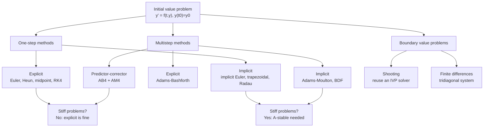

# Numerical Solutions of ODEs

> [Mathematics](../../README.md) › [Differential Equations](../README.md) · Level: Advanced · Prerequisites: [Derivatives](../../07-calculus/03-derivatives/README.md), [Differentiation Rules](../../07-calculus/04-differentiation-rules/README.md), [Sequences and Series in Calculus](../../07-calculus/11-sequences-and-series-in-calculus/README.md), [Floating Point Arithmetic](../../19-numerical-analysis/01-floating-point-arithmetic/README.md), [Root Finding](../../19-numerical-analysis/02-root-finding/README.md), [First-Order Differential Equations](../01-first-order-odes/README.md), [Second-Order Linear ODEs](../02-second-order-linear-odes/README.md), [Systems of ODEs](../03-systems-of-odes/README.md) · Estimated time: 8 h

## 1. Introduction

Most differential equations that arise in practice cannot be solved in closed form. A linear equation with constant coefficients can; so can a separable equation, an exact equation, and a handful of special equations with names attached to them. But the moment a coefficient depends on the solution, or the equation is coupled to two others, or the forcing is a measured data series rather than a formula, the closed-form route is closed. Even when a formula exists it may be useless: the solution of $y' = e^{-t^2}$ is an integral that must itself be evaluated numerically.

Numerical methods take a different attitude. Instead of asking for a formula $y(t)$ valid for all $t$, they ask for a table of numbers $y_0, y_1, \dots, y_N$ approximating $y$ at mesh points $t_0 < t_1 < \cdots < t_N$. That is a finite amount of information, obtainable by arithmetic, and it is exactly what a plot, a control system or a simulation needs. The price is that the answer is wrong — the only questions are *how* wrong, *in which direction*, and *whether the error stays bounded*.

Those three questions organise the whole subject:

* **Accuracy.** How large is the error, and how does it shrink as the step size $h$ shrinks? Euler's method has global error $O(h)$; the classical Runge–Kutta method has $O(h^4)$. Halving $h$ improves Euler by a factor $2$ and RK4 by a factor $16$.
* **Stability.** Does the computed solution stay near the true one, or does it blow up even though the true solution decays? This is a separate question from accuracy and it is the one that ruins naive computations. On $y' = -100y$ with $h = 0.1$, Euler is not inaccurate — it is violently unstable, producing $|y|\sim 10^{19}$ where the exact answer is $e^{-20}\approx 2\times10^{-9}$.
* **Cost.** How many function evaluations are needed to reach a given accuracy? RK4 costs four per step but allows far larger steps; a multistep method reuses old values and costs one per step but needs starting values and has a more delicate stability theory.

The organising idea behind all one-step methods is the **Taylor expansion**. The exact solution satisfies

$$y(t+h) = y(t) + h\,y'(t) + \frac{h^2}{2}y''(t) + \cdots = y(t) + h\,f\bigl(t,y(t)\bigr) + \frac{h^2}{2}y''(t) + \cdots .$$

Euler drops everything after the first term, replacing $y''$ by zero. Heun and the midpoint rule keep the $h^2$ term by evaluating $f$ at a cleverly chosen second point; RK4 keeps terms up to $h^4$ by evaluating $f$ at four points. The "cleverly chosen" is where the design work happens: the stages must be arranged so that the various occurrences of $f$, $f_t$, $f_y$ combine into exactly the Taylor coefficients of the exact solution. This is developed in §7.3.

Stiffness, the third idea, deserves a word up front because it is the reason implicit methods exist. A **stiff** equation has solutions with one very fast decaying component and one slow component. Explicit methods must resolve the fast component even after it has died, because their stability requires $h|\lambda| \le$ a constant for every eigenvalue. Implicit methods have unbounded stability regions and can take steps dictated by accuracy alone. The cost is that each step requires solving an algebraic equation, which for a linear equation is a linear solve and for a nonlinear one is a Newton iteration. That trade — many cheap explicit steps versus few expensive implicit ones — is the central engineering decision in ODE software.

This tutorial treats the classical material completely and rigorously at the undergraduate level: Euler's method with a full error analysis, the Runge–Kutta family with the order conditions, absolute stability with explicit stability functions, adaptive step-size control, Adams methods, and boundary value problems by shooting and finite differences. Every table of numbers in the text has been computed from the stated formulas, so the reader can reproduce it with a calculator or ten lines of code.

## 2. Prerequisites

**Calculus** ([Derivatives](../../07-calculus/03-derivatives/README.md), [Differentiation Rules](../../07-calculus/04-differentiation-rules/README.md)). Taylor's theorem with remainder is used in every error analysis in this topic; the chain rule for $f(t,y(t))$ gives $y'' = f_t + f f_y$, which is the engine of the order-2 derivation; the product and quotient rules appear when differentiating again for the third and fourth order conditions.

**Series** ([Sequences and Series in Calculus](../../07-calculus/11-sequences-and-series-in-calculus/README.md)). Geometric series, the ratio test for convergence, and the exponential series $e^z = \sum z^k/k!$, which is the model for a stability function.

**Floating point** ([Floating Point Arithmetic](../../19-numerical-analysis/01-floating-point-arithmetic/README.md)). Round-off, machine epsilon, and catastrophic cancellation. Every method here accumulates round-off at every step; the total is roughly $N\varepsilon$ for $N$ steps, and this is the floor below which truncation error cannot be pushed.

**Root finding** ([Root Finding](../../19-numerical-analysis/02-root-finding/README.md)). Newton's method and the secant method, needed for implicit methods (each step is a root-finding problem) and for the shooting method for boundary value problems.

**Differential equations** ([First-Order Differential Equations](../01-first-order-odes/README.md), [Second-Order Linear ODEs](../02-second-order-linear-odes/README.md), [Systems of ODEs](../03-systems-of-odes/README.md)). Existence and uniqueness (Picard–Lindelöf), the meaning of a Lipschitz condition, linear equations and their solutions in closed form (used to test the numerical ones), and the conversion of a higher-order equation to a first-order system, which is how every method here is actually applied. The eigenvalues of the linearisation determine stiffness, so the eigenvalue material of [Systems of ODEs](../03-systems-of-odes/README.md) is used directly in §7.5.

## 3. Learning Objectives

After this tutorial you will be able to:

1. Define the initial value problem, a mesh, a one-step method and the local truncation error; distinguish local from global error.
2. Derive Euler's method from the forward difference and from the truncated Taylor series; prove that its local truncation error is $O(h^2)$ and its global error is $O(h)$.
3. Derive the improved Euler (Heun) and midpoint methods from the order-2 conditions, and the classical Runge–Kutta method from the order-4 conditions; state the Butcher tableau of each.
4. State and use the relation between consistency, zero-stability and convergence, and prove the discrete Gronwall estimate that gives the $O(h^p)$ global error bound.
5. Analyse absolute stability on the test equation $y' = \lambda y$: compute stability functions, sketch or describe stability regions, and identify the real stability interval of Euler, Heun, midpoint and RK4.
6. Explain what stiffness is, why explicit methods collapse on stiff problems, and why implicit Euler and the trapezoidal rule do not.
7. Implement step-size control by step doubling and by embedded Runge–Kutta pairs; explain how the local error estimate is formed and how the step is accepted or rejected.
8. Derive and apply Adams–Bashforth and Adams–Moulton methods, use them in predictor–corrector mode, and state their orders and error constants.
9. Solve boundary value problems by shooting (with the secant method) and by finite differences (tridiagonal systems), and estimate the order of accuracy of each.
10. Produce error tables for a given problem and use them to estimate the observed order of convergence.

## 4. Intuition

**Euler's method is walking along the tangent line.** You are at a point $(t_n, y_n)$ and you know the slope there, $f(t_n,y_n)$ from the equation. Walk in that direction for a distance $h$ in $t$: you arrive at $(t_{n+1}, y_{n+1}) = (t_n+h,\, y_n + h f(t_n,y_n))$. Repeat. If the true solution curves away from the tangent, you drift; the drift per step is of order $h^2$ because a curve departs from its tangent quadratically, and over $1/h$ steps the drift accumulates to order $h$. That is the whole content of "Euler is first order".

**Better methods use a better estimate of the slope.** The exact change over one step is the average slope over the interval: $y(t+h) = y(t) + h\times(\text{mean of } y' \text{ over } [t,t+h])$. Euler uses the slope at the left end, which is a poor average. The trapezoidal rule uses the average of the slopes at the two ends — but the right end is unknown, so one *predicts* it with Euler and *corrects*: that is Heun's method. The midpoint rule samples the slope in the middle, which is a better average, and estimates the midpoint by an Euler half-step. Both are second order. RK4 samples four slopes — at the left end, at two different estimates of the midpoint, and at a predicted right end — and combines them with weights $\frac16,\frac13,\frac13,\frac16$, the same pattern as Simpson's rule. That is not a coincidence: RK4 is Simpson's rule applied to the integral form of the ODE.

**Error is a difference, not a size.** The numbers a method produces are not "the solution with some error"; they are the exact solution of a *nearby* problem (this is the backward error view). For Euler, the computed sequence is exactly the solution of $y' = f(t,y) + \frac h2 y''(\xi)$, so the method behaves as if the equation had a small extra forcing. This is why the global error is one power of $h$ worse than the local error: each step introduces a forcing of size $h^2$, and $1/h$ such forcings accumulate.

**Stability is about the transient, not the answer.** Consider $y' = -100y$ with $y(0)=1$. The solution is $e^{-100t}$, which is $10^{-44}$ by $t = 1$: numerically it is just zero after a microsecond. Yet explicit Euler with $h = 0.1$ produces $y_1 = 1 + 0.1(-100) = -9$, $y_2 = -9 + 0.1(900) = 81$, and so on, growing by a factor $9$ per step. The method is asked to track a decaying solution with a step so large that the numerical "solution" oscillates with growing amplitude. The criterion is $|1 + h\lambda| \le 1$, i.e. $h \le 2/100 = 0.02$ — nothing to do with accuracy, everything to do with stability.

**Stiffness is the same phenomenon with two time scales.** A chemical reaction with one fast and one slow reaction, a circuit with a tiny capacitance and a large inductance, a control system with a fast actuator — all give eigenvalues of vastly different magnitudes. The fast modes die almost instantly and contribute nothing to the answer, but an explicit method's step is frozen at the fast time scale forever. Implicit methods are stable for every $h\lambda$ in the left half-plane, so they can step at the slow scale.

## 5. Formal Definition

**Definition 5.1** (initial value problem). Let $f : [t_0,T]\times\mathbb{R}^m \to \mathbb{R}^m$ and $y_0 \in \mathbb{R}^m$. The **initial value problem (IVP)** is

$$y'(t) = f\bigl(t, y(t)\bigr), \qquad y(t_0) = y_0 .$$

A **solution** is a $C^1$ function $y : [t_0,T]\to\mathbb{R}^m$ satisfying both. Throughout, $f$ is assumed continuous in $t$ and **Lipschitz continuous in $y$** with constant $L$ on the region of interest:

$$\bigl\lVert f(t,u) - f(t,v)\bigr\rVert \le L\lVert u - v\rVert \quad\text{for all } t \in [t_0,T],\ u,v .$$

Under these hypotheses the Picard–Lindelöf theorem guarantees a unique solution (see [First-Order Differential Equations](../01-first-order-odes/README.md)).

**Definition 5.2** (mesh). A **mesh** (or grid) on $[t_0,T]$ is a finite set $t_0 < t_1 < \cdots < t_N = T$. The **step sizes** are $h_n = t_{n+1}-t_n$, and $h = \max_n h_n$. A mesh is **uniform** if all $h_n = h = (T-t_0)/N$. We write $y_n$ for the computed approximation to $y(t_n)$ and $e_n = y(t_n) - y_n$ for the **global error** at $t_n$.

**Definition 5.3** (one-step method). A one-step method has the form

$$y_{n+1} = y_n + h\,\Phi\bigl(t_n, y_n, h; f\bigr),$$

where the **increment function** $\Phi$ is built from evaluations of $f$. Euler has $\Phi = f(t_n,y_n)$; Heun has $\Phi = \frac12\bigl[f(t_n,y_n) + f(t_n+h, y_n+hf(t_n,y_n))\bigr]$.

**Definition 5.4** (local truncation error). The **local truncation error** is the amount by which the exact solution fails to satisfy the numerical formula, divided by $h$:

$$\tau_{n+1} = \frac{y(t_{n+1}) - y(t_n)}{h} - \Phi\bigl(t_n, y(t_n), h; f\bigr).$$

Equivalently, with the residual multiplied by $h$, the **local error** is $h\tau_{n+1}$, the error committed in one step if the exact value were known at the start.

**Definition 5.5** (order, consistency, convergence). A method is **consistent** if $\tau_{n+1}\to0$ as $h\to0$ uniformly on the interval. It has **order $p$** if $\tau_{n+1} = O(h^p)$. It is **convergent** if $y_n \to y(t_n)$ as $h\to0$ with $nh = t_n - t_0$ fixed, and **of order $p$** in the global sense if $\max_n\lVert e_n\rVert = O(h^p)$.

**Definition 5.6** (absolute stability). Apply the method to the **test equation**

$$y' = \lambda y, \qquad \lambda \in \mathbb{C}, \qquad y(0) = 1 .$$

A one-step method produces $y_{n+1} = R(z)y_n$ with $z = h\lambda$, where the **stability function** $R$ is determined by the method. The **region of absolute stability** is

$$\mathcal{S} = \{z \in \mathbb{C} : \lvert R(z)\rvert < 1\}.$$

For real $\lambda<0$ the **real stability interval** is $\mathcal{S}\cap\mathbb{R}$. A method is **A-stable** if $\mathcal{S} \supseteq \{\operatorname{Re}z < 0\}$: every decaying mode is computed as decaying, for every step size.

**Definition 5.7** (stiffness). The IVP is **stiff** on $[t_0,T]$ if the eigenvalues $\lambda_j(t)$ of the Jacobian $\partial f/\partial y$ satisfy

$$\frac{\max_j\lvert\operatorname{Re}\lambda_j\rvert}{\min_j\lvert\operatorname{Re}\lambda_j\rvert} \gg 1 \quad\text{with all } \operatorname{Re}\lambda_j < 0,$$

and the fast modes have already decayed in the region of interest. Operationally: the step size of an explicit method is limited by stability far below what accuracy would require.

**Definition 5.8** (linear multistep method). A **linear $k$-step method** has the form

$$\sum_{j=0}^k \alpha_j y_{n+j} = h\sum_{j=0}^k \beta_j f(t_{n+j}, y_{n+j}),$$

with $\alpha_k \ne 0$; it is **explicit** if $\beta_k = 0$ and **implicit** otherwise. Its **first characteristic polynomial** is $\rho(\zeta) = \sum_{j=0}^k\alpha_j\zeta^j$ and its **second** is $\sigma(\zeta) = \sum_j\beta_j\zeta^j$. The method satisfies the **root condition** (is **zero-stable**) if every root of $\rho$ lies in $|\zeta|\le1$ and every root on $|\zeta|=1$ is simple.

**Definition 5.9** (boundary value problem). A **two-point boundary value problem** prescribes the differential equation on $(a,b)$ and values or relations at both ends, for example

$$y'' = p(t)y' + q(t)y + r(t), \qquad y(a) = \alpha, \quad y(b) = \beta .$$

## 6. Mathematical Notation

| Symbol | Read as | Meaning |
|---|---|---|
| $y(t)$ | the exact solution | unknown function of $t$ |
| $y_n$ | the $n$-th approximation | computed value at $t_n$ |
| $f(t,y)$ | the right-hand side | the derivative prescribed by the equation |
| $h$ | step size | $t_{n+1}-t_n$ |
| $N$ | number of steps | $(T-t_0)/h$ for a uniform mesh |
| $e_n$ | global error | $y(t_n)-y_n$ |
| $\tau_{n+1}$ | local truncation error | residual of the formula, divided by $h$ |
| $\Phi$ | increment function | the method's recipe for the slope |
| $k_i$ (or $K_i$) | stage derivatives | evaluations of $f$ inside a step |
| $a_{ij}, b_i, c_i$ | Runge–Kutta coefficients | Butcher tableau entries |
| $R(z)$ | stability function | amplification factor on $y'=\lambda y$ |
| $z = h\lambda$ | scaled eigenvalue | the argument of $R$ |
| $\mathcal{S}$ | stability region | $\{z : \lvert R(z)\rvert<1\}$ |
| $L$ | Lipschitz constant | bound on $\lVert\partial f/\partial y\rVert$ |
| $M$ | derivative bound | $\max\lvert y^{(p+1)}\rvert$ on the interval |
| $p$ | order | exponent in the error law $O(h^p)$ |
| TOL | tolerance | target local error per step |
| $\alpha_j,\beta_j$ | multistep coefficients | weights in the $k$-step formula |
| $\rho(\zeta),\sigma(\zeta)$ | characteristic polynomials | determine zero-stability and order |
| $\varepsilon$ | machine epsilon | unit round-off |

## 7. Core Concepts

### 7.1 The initial value problem and discretisation

The IVP of Definition 5.1 asks for a function; a numerical method asks for finitely many numbers. The bridge is the mesh. Everything that follows rests on two facts:

* **The exact solution satisfies an integral equation.** Integrating $y' = f(t,y)$,

$$y(t_{n+1}) = y(t_n) + \int_{t_n}^{t_{n+1}} f\bigl(t, y(t)\bigr)\,dt .$$

Every one-step method is this identity with the integral replaced by a quadrature rule and $y$ inside the integrand replaced by what is known.

* **Higher-order equations become systems.** $y'' = g(t,y,y')$ is equivalent to the first-order system $u_1' = u_2$, $u_2' = g(t,u_1,u_2)$ with $u_1 = y$. Every method in this topic applies to systems componentwise, so nothing is lost by studying the scalar case and nothing is gained by treating systems separately. The only new phenomenon is that "$\lambda$" becomes a matrix eigenvalue, which is exactly where stiffness comes from.

The error of a computation has two sources. **Truncation error** comes from replacing the integral or the Taylor series by finitely many terms; it is deterministic and shrinks like $h^p$. **Round-off** comes from finite-precision arithmetic; it does not shrink with $h$ and in fact grows, because smaller $h$ means more steps and more accumulated rounding. Total error therefore behaves like

$$\text{error} \approx C h^p + \frac{D\varepsilon}{h},$$

which has a minimum at $h \sim (\varepsilon/C)^{1/(p+1)}$. Pushing $h$ below that is counterproductive. The point is worth remembering when a computation "refuses" to improve: often it is not a bug but the round-off floor.

### 7.2 Euler's method: local and global error

**Derivation.** Replace the derivative by the forward difference:

$$y'(t_n) \approx \frac{y(t_{n+1}) - y(t_n)}{h} \quad\Longrightarrow\quad y_{n+1} = y_n + h f(t_n, y_n).$$

Equivalently, truncate the Taylor series after the linear term, or use the left-endpoint rule for the integral $\int_{t_n}^{t_{n+1}}f\,dt \approx h f(t_n,y_n)$.

**Local truncation error.** By Taylor's theorem with a remainder, for some $\xi_n \in (t_n,t_{n+1})$,

$$y(t_{n+1}) = y(t_n) + h f\bigl(t_n,y(t_n)\bigr) + \frac{h^2}{2}y''(\xi_n) .$$

Therefore

$$\tau_{n+1} = \frac{y(t_{n+1})-y(t_n)}{h} - f\bigl(t_n,y(t_n)\bigr) = \frac h2 y''(\xi_n) = O(h).$$

The local error per step is $h\tau_{n+1} = \frac{h^2}{2}y''(\xi_n)$: **quadratic in $h$**. A concrete instance: for $y' = y - t^2 + 1$ with $y(0) = 0.5$ and $h = 0.2$, the exact value at $t = 0.2$ is $0.8292986209$ and one Euler step gives $0.5 + 0.2(1.5) = 0.8$, so the local error is $-0.0292986$. The prediction is $\frac{h^2}{2}y''(0) = \frac{0.04}{2}(1.5) = 0.03$ in magnitude — the actual value $0.0293$ is within $2.4\%$ of the prediction ✓.

**Global error.** Let $e_n = y(t_n)-y_n$ and let $L$ be the Lipschitz constant of $f$. Subtracting the numerical formula from the Taylor expansion,

$$e_{n+1} = e_n + h\bigl[f(t_n,y(t_n)) - f(t_n,y_n)\bigr] + \frac{h^2}{2}y''(\xi_n),$$

so, with $M = \max\lvert y''\rvert$,

$$\lvert e_{n+1}\rvert \le \lvert e_n\rvert + hL\lvert e_n\rvert + \frac{h^2}{2}M = (1+hL)\lvert e_n\rvert + \frac{h^2M}{2}.$$

**Lemma 7.1** (discrete Gronwall). If $a_{n+1} \le (1+A)a_n + B$ for $n\ge0$ with $A,B\ge0$, then

$$a_n \le e^{nA}a_0 + \frac{B}{A}\bigl(e^{nA}-1\bigr).$$

*Proof.* By induction, $a_n \le (1+A)^na_0 + B\sum_{k=0}^{n-1}(1+A)^k = (1+A)^na_0 + B\frac{(1+A)^n-1}{A}$. Now $(1+A)^n \le e^{nA}$ because $\ln(1+A)\le A$. $\blacksquare$

Applying the lemma with $a_n = \lvert e_n\rvert$, $A = hL$, $B = h^2M/2$ and $a_0 = 0$:

$$\lvert e_n\rvert \le \frac{h^2M/2}{hL}\bigl(e^{nhL}-1\bigr) = \frac{M}{2L}\bigl(e^{L(t_n-t_0)}-1\bigr)\,h .$$

Hence

$$\boxed{\ \max_n \lvert e_n\rvert \le C h, \qquad C = \frac{M}{2L}\bigl(e^{L(T-t_0)}-1\bigr).\ }$$

Euler's method is **first order**: halving the step halves the error. The bound also displays the two mechanisms: $M$ measures how much the solution curves away from its tangent, and $e^{LT}$ measures how much the equation amplifies a perturbation. If $L$ is large the constant is enormous, which is the first hint that stiff problems are hard.

*Numerical confirmation.* For $y'=y-t^2+1$, $y(0)=0.5$ on $[0,2]$ the final errors are $0.4397$, $0.2420$, $0.1275$, $0.0655$ for $h = 0.2, 0.1, 0.05, 0.025$; the ratios are $1.82$, $1.90$, $1.95$, approaching the predicted $2$ as $h\to0$ ✓.

### 7.3 Improved Euler, the Runge–Kutta family, and RK4

**Heun's method (improved Euler).** Use the trapezoidal rule on the integral, with the unknown right-end slope predicted by Euler:

$$\tilde y_{n+1} = y_n + h f(t_n,y_n), \qquad y_{n+1} = y_n + \frac h2\Bigl[f(t_n,y_n) + f(t_{n+1},\tilde y_{n+1})\Bigr].$$

In stage notation, $k_1 = f(t_n,y_n)$, $k_2 = f(t_n+h, y_n+hk_1)$, $y_{n+1} = y_n + \frac h2(k_1+k_2)$.

**Midpoint method.** Evaluate the slope at the midpoint, predicted by an Euler half-step:

$$k_1 = f(t_n,y_n), \qquad k_2 = f\Bigl(t_n+\frac h2,\, y_n + \frac h2k_1\Bigr), \qquad y_{n+1} = y_n + h k_2 .$$

**Why both are second order.** Write the exact Taylor expansion using $y' = f$, $y'' = f_t + f f_y$ (chain rule, with all functions evaluated at $(t_n,y(t_n))$):

$$y(t_{n+1}) = y + hf + \frac{h^2}{2}\bigl(f_t + ff_y\bigr) + O(h^3).$$

For Heun, expanding $k_2 = f\bigl(t+h, y+hf\bigr)$ to first order gives $k_2 = f + h(f_t + ff_y) + O(h^2)$, so

$$y + \frac h2(k_1+k_2) = y + \frac h2\bigl(2f + h(f_t+ff_y)\bigr) + O(h^3) = y + hf + \frac{h^2}{2}(f_t+ff_y)+O(h^3),$$

which matches. The midpoint method gives the same expansion. So both have local error $O(h^3)$ and global error $O(h^2)$.

**The general explicit two-stage method.** With $c_1 = 0$, $c_2 = a_{21}$,

$$k_1 = f(t_n,y_n), \quad k_2 = f(t_n + c_2h,\ y_n + a_{21}hk_1), \quad y_{n+1} = y_n + h(b_1k_1 + b_2k_2),$$

matching the Taylor expansion to $O(h^3)$ requires exactly

$$b_1 + b_2 = 1, \qquad b_2c_2 = \frac12 .$$

Heun is $b = (\frac12,\frac12)$, $c_2 = 1$; midpoint is $b = (0,1)$, $c_2 = \frac12$. Any $(b_2,c_2)$ with $b_2c_2 = \frac12$ works, giving a one-parameter family of second-order methods.

**The classical fourth-order method.** The Butcher tableau is

$$\begin{array}{c|cccc} 0 & & & & \\ \tfrac12 & \tfrac12 & & & \\ \tfrac12 & 0 & \tfrac12 & & \\ 1 & 0 & 0 & 1 & \\ \hline & \tfrac16 & \tfrac13 & \tfrac13 & \tfrac16 \end{array}$$

that is

$$k_1 = f(t_n,y_n), \qquad k_2 = f\Bigl(t_n+\tfrac h2, y_n+\tfrac h2k_1\Bigr), \qquad k_3 = f\Bigl(t_n+\tfrac h2, y_n+\tfrac h2k_2\Bigr),$$
$$k_4 = f\bigl(t_n+h, y_n+hk_3\bigr), \qquad y_{n+1} = y_n + \frac h6\bigl(k_1 + 2k_2 + 2k_3 + k_4\bigr).$$

**Derivation outline.** Expand both sides in powers of $h$ and match. The exact solution has

$$y(t+h) = y + hf + \frac{h^2}{2}(f_t+ff_y) + \frac{h^3}{6}\bigl(f_{tt} + 2ff_{ty} + f^2f_{yy} + f_tf_y + ff_y^2\bigr) + O(h^4),$$

and the numerical increment $h\sum b_ik_i$ produces a combination of the same elementary differentials. Matching the coefficients gives the **order conditions**. For an explicit method with $s$ stages, the conditions for order $\le4$ are

| Order | Conditions |
|---|---|
| 1 | $\sum_i b_i = 1$ |
| 2 | $\sum_i b_ic_i = \tfrac12$ |
| 3 | $\sum_i b_ic_i^2 = \tfrac13$, $\quad \sum_{i,j}b_ia_{ij}c_j = \tfrac16$ |
| 4 | $\sum_i b_ic_i^3 = \tfrac14$, $\quad \sum_{i,j}b_ic_ia_{ij}c_j = \tfrac18$, $\quad \sum_{i,j}b_ia_{ij}c_j^2 = \tfrac1{12}$, $\quad \sum_{i,j,k}b_ia_{ij}a_{jk}c_k = \tfrac1{24}$ |

Check the RK4 tableau: $\sum b_i = \frac16+\frac13+\frac13+\frac16 = 1$ ✓; $\sum b_ic_i = \frac13\cdot\frac12 + \frac13\cdot\frac12 + \frac16\cdot1 = \frac12$ ✓; $\sum b_ic_i^2 = \frac13\cdot\frac14+\frac13\cdot\frac14+\frac16\cdot1 = \frac16+\frac16 = \frac13$ ✓. The remaining five conditions also hold (each is a short computation with the tableau above). Because RK4 matches the Taylor series through $h^4$, its local error is $O(h^5)$ and its global error $O(h^4)$.

**The price of order.** An explicit $s$-stage method cannot have order greater than $s$, and for order $\ge5$ the number of stages exceeds the order: order 5 needs at least 6 stages, order 6 at least 7, order 7 at least 9, order 8 at least 11. This is the **Butcher barrier**. It is why RK4 with four stages (four evaluations per step) is the workhorse: it is the highest-order method that is still "one stage per order".

### 7.4 Truncation error, consistency, convergence

The three notions form a chain:

* **Consistency**: $\tau_{n+1}\to0$ as $h\to0$. For a one-step method with continuous $\Phi$, this is equivalent to $\Phi(t,y,0;f) = f(t,y)$: in the limit of zero step the method must reproduce the equation. Euler, Heun and RK4 all satisfy this.
* **Order**: $\tau = O(h^p)$ means the method reproduces the Taylor expansion to $p$ terms.
* **Convergence**: $\max_n\lvert e_n\rvert \to 0$. For one-step methods, consistency plus a Lipschitz condition on $\Phi$ gives convergence, and order $p$ in the local sense gives order $p$ in the global sense. The proof is the discrete Gronwall argument of §7.2, applied with the general local error $Ch^{p+1}$:

$$\lvert e_n\rvert \le \frac{C h^p}{L}\bigl(e^{L(t_n-t_0)}-1\bigr) = O(h^p).$$

So the global order is always one less than the local order, for exactly the reason that $1/h$ steps each contribute $h^{p+1}$.

**For multistep methods the chain acquires a middle link.** Consistency is not enough: the method must also be **zero-stable** (the root condition of Definition 5.8). The **Dahlquist equivalence theorem** states that for linear multistep methods,

$$\text{consistency} + \text{zero-stability} \iff \text{convergence}.$$

The name "zero-stability" refers to the behaviour as $h\to0$: the computed solution must not blow up for reasons unrelated to the equation. A method whose first characteristic polynomial has a root outside the unit circle will amplify round-off exponentially no matter how small $h$ is. The classic example is the midpoint (leapfrog) method $y_{n+1} = y_{n-1} + 2hf_n$: it has $\rho(\zeta) = \zeta^2-1$, with roots $\pm1$, both simple, so it *is* zero-stable — but the root $-1$ produces a spurious oscillating mode that never decays. Zero-stability is necessary, not sufficient, for pleasant behaviour.

**A useful diagnostic.** When a code converges more slowly than its advertised order, the usual causes are (i) a non-smooth right-hand side or solution (a corner in $f$ destroys the high-order Taylor terms), (ii) the step size not being small enough to be in the asymptotic regime, or (iii) a bug in the implementation. The observed order can be estimated from three meshes by

$$p \approx \log_2\frac{\lvert e_h\rvert}{\lvert e_{h/2}\rvert},$$

which is Richardson's estimate; it is only meaningful once the errors are in their asymptotic range.

### 7.5 Absolute stability, stiffness, and the linear test equation

**The test equation.** Apply a one-step method to $y' = \lambda y$, $y(0)=1$, with $\lambda\in\mathbb{C}$. Every explicit Runge–Kutta method then produces $y_{n+1} = R(z)y_n$ with $z = h\lambda$, where $R$ is a polynomial determined by the method:

| Method | $R(z)$ | Real stability interval |
|---|---|---|
| Euler | $1+z$ | $(-2,\,0)$ |
| Heun | $1+z+\frac{z^2}{2}$ | $(-2,\,0)$ |
| Midpoint | $1+z+\frac{z^2}{2}$ | $(-2,\,0)$ |
| RK3 | $1+z+\frac{z^2}{2}+\frac{z^3}{6}$ | $(-2.513,\,0)$ |
| RK4 | $1+z+\frac{z^2}{2}+\frac{z^3}{6}+\frac{z^4}{24}$ | $(-2.7853,\,0)$ |
| Implicit Euler | $\dfrac{1}{1-z}$ | $(-\infty,\,0)$ |
| Trapezoidal | $\dfrac{1+z/2}{1-z/2}$ | $(-\infty,\,0)$ |

The first four are Taylor polynomials of $e^z$; that is precisely why they have order equal to their degree. Implicit Euler and the trapezoidal rule have rational $R$ with a pole at $z=1$ (or $z=2$), which is outside the left half-plane, so $|R(z)|<1$ whenever $\operatorname{Re}z<0$: they are **A-stable**.

**Reading the table.** Euler's region is the disc $|1+z|<1$, of radius $1$ centred at $z=-1$; its real interval is $(-2,0)$ and its imaginary interval is just $\{0\}$ — Euler cannot integrate an oscillator at all. RK4's region is much larger, and on the imaginary axis

$$\lvert R(iy)\rvert^2 = 1 - \frac{y^6}{72} + \frac{y^8}{576} = 1 - \frac{y^6}{576}\bigl(8-y^2\bigr),$$

which is $\le1$ exactly for $|y|\le 2\sqrt2 = 2.8284$. That is why RK4 can integrate a harmonic oscillator with $h\omega \le 2.8284$ without artificial growth, and why the interval shrinks dramatically for higher frequencies.

**The numbers.** For $y' = -10y$, $y(0)=1$, Euler gives $y_n = (1-10h)^n$:

| $h$ | $1-10h$ | $y(1)$ | exact $e^{-10}$ |
|---|---|---|---|
| $0.10$ | $0$ | $0$ | $4.54\times10^{-5}$ |
| $0.19$ | $-0.9$ | $-0.59049$ | $4.54\times10^{-5}$ |
| $0.20$ | $-1$ | $-1$ | $4.54\times10^{-5}$ |
| $0.21$ | $-1.1$ | $-1.61051$ | $4.54\times10^{-5}$ |
| $0.25$ | $-1.5$ | $5.0625$ | $4.54\times10^{-5}$ |

At $h=0.1$ the factor is exactly $0$: the method annihilates the solution in one step, which is as wrong as it is spectacular. At $h=0.2$ the factor is $-1$: the computed solution oscillates with constant amplitude forever. At $h = 0.21$ it grows. The threshold $h < 2/\lvert\lambda\rvert$ is completely independent of the accuracy requirement — for accuracy you would want $h \sim 10^{-5}$ here, and for stability only $h<0.2$.

**Stiffness in practice.** Take

$$y' = 100\bigl(\cos t - y\bigr) - \sin t, \qquad y(0) = 0, \qquad y(t) = \cos t - e^{-100t}.$$

The solution is smooth and equals $\cos t$ to within $10^{-16}$ after $t=0.4$; the fast mode $e^{-100t}$ is irrelevant. Explicit Euler requires $h < 2/100 = 0.02$; at $h = 0.1$ it produces

$$y(2) \approx -1.2\times10^{19}$$

instead of $\cos 2\approx -0.416$. Implicit Euler, $\;y_{n+1} = y_n + h f(t_{n+1},y_{n+1})$, which for this linear-in-$y$ problem is the explicit formula $y_{n+1} = \bigl(y_n + 100h\cos t_{n+1} - h\sin t_{n+1}\bigr)/(1+100h)$, has no such restriction:

| $t$ | $0.1$ | $0.5$ | $1.0$ | $1.5$ | $2.0$ |
|---|---|---|---|---|---|
| implicit Euler, $h=0.1$ | $0.9036$ | $0.8771$ | $0.5400$ | $0.0707$ | $-0.4160$ |
| exact | $0.9950$ | $0.8776$ | $0.5403$ | $0.0707$ | $-0.4161$ |

The first step is inaccurate ($0.9036$ against $0.9950$) because the fast transient is not resolved — but the method recovers immediately and tracks the slow solution to three decimals with a step thirty times larger than the explicit stability limit.

**Why explicit methods cannot be A-stable.** If $R$ is a polynomial of degree $\ge1$, then $\lvert R(z)\rvert\to\infty$ as $z\to-\infty$ along the real axis. So no explicit Runge–Kutta method has a stability region containing the whole left half-plane. This is a theorem, not a limitation of a particular formula.

### 7.6 Step-size control and adaptive methods

**The idea.** A fixed step is wasteful: where the solution is smooth, a large step is accurate; where it bends sharply, a small one is needed. An adaptive method estimates the local error at every step and adjusts $h$ to keep that estimate near a target.

**Step doubling.** Compute the step twice: once with one step of size $h$ (call the result $y^{(1)}$), and once with two steps of size $h/2$ ($y^{(2)}$). For a method of order $p$, the two results have errors differing by a factor $2^p$ up to higher order:

$$y^{(1)} - y(t+h) = C h^{p+1} + O(h^{p+2}), \qquad y^{(2)} - y(t+h) = \frac{C h^{p+1}}{2^p} + O(h^{p+2}),$$

so

$$y^{(2)} - y^{(1)} \approx C h^{p+1}\Bigl(\frac{1}{2^p}-1\Bigr) \quad\Longrightarrow\quad \text{error of } y^{(2)} \approx \frac{y^{(2)}-y^{(1)}}{2^p-1}.$$

For RK4, $p=4$ and the divisor is $15$. A concrete instance at $t=0$ for $y'=y-t^2+1$: one step of $h=0.2$ gives $0.8292933$, two half-steps give $0.8292983$, so the estimate is $(0.8292983-0.8292933)/15 = 3.30\times10^{-7}$, and the true error of the two-half-step answer is $-3.45\times10^{-7}$ ✓. The estimate costs three times as many evaluations as a single step ($12$ against $4$), which is why embedded pairs are preferred when $f$ is expensive.

**Step selection.** Given an estimate $\eta$ of the local error and a tolerance TOL, the new step is chosen from the error model $\eta \propto h^{p+1}$:

$$h_{\text{new}} = h\cdot\min\Bigl(2,\ \max\Bigl(0.2,\ 0.9\Bigl(\frac{\text{TOL}}{\eta}\Bigr)^{1/(p+1)}\Bigr)\Bigr).$$

The factor $0.9$ is a safety margin; the bounds $0.2$ and $2$ prevent wild swings. If $\eta \le \text{TOL}$ the step is accepted, otherwise it is rejected and retried with the smaller step. The exponent $1/(p+1)$ (not $1/p$) is used because the *local* error, not the global one, is being controlled.

**Embedded pairs.** Rather than pay for two separate integrations, Runge–Kutta pairs compute two approximations of different order from the *same* stages. The classic is Runge–Kutta–Fehlberg 4(5), which uses six stages to produce a fourth-order and a fifth-order answer; their difference estimates the error of the lower-order one. The Dormand–Prince 5(4) pair (the basis of MATLAB's `ode45`) uses seven stages, of which the last is reused as the first stage of the next step (the **FSAL** property, "first same as last"), so each step costs six new evaluations.

**A worked adaptive run.** For $y' = y - t^2 + 1$, $y(0)=0.5$, on $[0,2]$ with TOL $=10^{-6}$ per step and step doubling with RK4, the controller produces nine steps:

| step | $t$ reached | $h$ used | estimated error |
|---|---|---|---|
| 1 | $0.2000$ | $0.2000$ | $3.3\times10^{-7}$ |
| 2 | $0.4247$ | $0.2248$ | $5.6\times10^{-7}$ |
| 3 | $0.6523$ | $0.2275$ | $5.4\times10^{-7}$ |
| 4 | $0.8839$ | $0.2316$ | $5.2\times10^{-7}$ |
| 5 | $1.1215$ | $0.2376$ | $4.9\times10^{-7}$ |
| 6 | $1.3682$ | $0.2468$ | $4.3\times10^{-7}$ |
| 7 | $1.6313$ | $0.2630$ | $3.0\times10^{-7}$ |
| 8 | $1.9334$ | $0.3021$ | $2.4\times10^{-7}$ |
| 9 | $2.0000$ | $0.0666$ | $6.8\times10^{-10}$ |

The final error is $-1.06\times10^{-5}$, about ten times the per-step tolerance, which is the expected accumulation over nine steps. Note that $h$ *grows* from $0.2$ to $0.3$ as the solution becomes smoother — exactly the behaviour a fixed step cannot deliver.

### 7.7 Multistep methods: Adams–Bashforth and Adams–Moulton

**The construction.** Integrate the ODE over one step and interpolate $f$ at the previously computed points:

$$y(t_{n+1}) = y(t_n) + \int_{t_n}^{t_{n+1}}f\bigl(t,y(t)\bigr)dt \approx y(t_n) + \int_{t_n}^{t_{n+1}}P(t)\,dt,$$

where $P$ is the polynomial interpolating $f$ at $k$ nodes. Interpolating at $t_n, t_{n-1}, \dots, t_{n-k+1}$ (values already known) gives an **explicit Adams–Bashforth** method; including $t_{n+1}$ as well gives an **implicit Adams–Moulton** method.

**Adams–Bashforth.** With $f_j := f(t_j, y_j)$:

| Method | Formula | Order | Local error constant |
|---|---|---|---|
| AB1 (= Euler) | $y_{n+1} = y_n + hf_n$ | $1$ | $\frac12 h^2y''$ |
| AB2 | $y_{n+1} = y_n + \frac h2\bigl(3f_n - f_{n-1}\bigr)$ | $2$ | $\frac{5}{12}h^3y'''$ |
| AB3 | $y_{n+1} = y_n + \frac{h}{12}\bigl(23f_n - 16f_{n-1} + 5f_{n-2}\bigr)$ | $3$ | $\frac38h^4y^{(4)}$ |
| AB4 | $y_{n+1} = y_n + \frac{h}{24}\bigl(55f_n - 59f_{n-1} + 37f_{n-2} - 9f_{n-3}\bigr)$ | $4$ | $\frac{251}{720}h^5y^{(5)}$ |

**Adams–Moulton.**

| Method | Formula | Order | Local error constant |
|---|---|---|---|
| AM1 (= implicit Euler) | $y_{n+1} = y_n + hf_{n+1}$ | $1$ | $-\frac12h^2y''$ |
| AM2 (= trapezoidal) | $y_{n+1} = y_n + \frac h2\bigl(f_{n+1}+f_n\bigr)$ | $2$ | $-\frac1{12}h^3y'''$ |
| AM3 | $y_{n+1} = y_n + \frac{h}{12}\bigl(5f_{n+1} + 8f_n - f_{n-1}\bigr)$ | $3$ | $-\frac1{24}h^4y^{(4)}$ |
| AM4 | $y_{n+1} = y_n + \frac{h}{24}\bigl(9f_{n+1} + 19f_n - 5f_{n-1} + f_{n-2}\bigr)$ | $4$ | $-\frac{19}{720}h^5y^{(5)}$ |

The implicit method of the same order always has a much smaller error constant ($19/720$ against $251/720$ for order 4). That is the reason for **predictor–corrector**: use AB4 to predict $\tilde y_{n+1}$, evaluate $f_{n+1} = f(t_{n+1},\tilde y_{n+1})$, and apply AM4 once to correct — one extra evaluation, but the accuracy of the implicit method.

**Starting values.** A $k$-step method needs $k-1$ starting values beyond $y_0$. These must be generated by a one-step method of at least the same order; a first-order start destroys the accuracy of a fourth-order method. In the tables below the starting values for AB4 are produced by RK4.

**Zero-stability and the root condition.** A multistep method's $h\to0$ behaviour is governed by $\rho(\zeta) = \sum\alpha_j\zeta^j$. For AB2, $\rho(\zeta) = \zeta^2-\zeta = \zeta(\zeta-1)$: roots $0$ and $1$, both simple, so AB2 is zero-stable. For the midpoint method, $\rho = \zeta^2-1$: roots $\pm1$, both simple — zero-stable but with a persistent spurious oscillation. A method with a double root on the unit circle, such as $y_{n+2} = 2y_{n+1}-y_n + h f_n$ (roots $1,1$), is **not** zero-stable and diverges like $h\sum f$ even for $h\to0$.

**Absolute stability of multistep methods.** Applying AB$k$ to $y'=\lambda y$ gives a recurrence whose characteristic polynomial has $z = h\lambda$ in its coefficients. The real stability intervals are:

| Method | Real stability interval |
|---|---|
| AB1 (Euler) | $(-2,\,0)$ |
| AB2 | $(-1,\,0)$ |
| AB3 | $(-6/11,\,0) \approx (-0.545,\,0)$ |
| AB4 | $(-3/10,\,0) = (-0.3,\,0)$ |
| AM1 (implicit Euler) | $(-\infty,\,0)$ |
| AM2 (trapezoidal) | $(-\infty,\,0)$ |

The intervals *shrink* as the order rises — the opposite of the one-step case. A fourth-order Adams–Bashforth method is stable only for $h\lvert\lambda\rvert < 0.3$, so on a stiff problem it is even more restricted than Euler. This is the price of the large error constant and the extra history.

**The Dahlquist barriers.** For linear multistep methods there are hard limits:

* **First barrier.** An A-stable linear multistep method has order at most $2$. The trapezoidal rule (AM2) attains order $2$ and is A-stable; nothing of order $3$ or more can be.
* **Second barrier.** If a multistep method is $A(\alpha)$-stable — its stability region contains the sector $\lvert\arg(-z)\rvert \le \alpha$ — then its order is bounded in terms of $\alpha$, and the bound falls below $90^\circ$ as the order rises.

The consequence is a genuine trade-off: high-order A-stable methods must be **implicit Runge–Kutta** methods (such as Radau or Gauss collocation), not multistep methods. That is why stiff ODE software uses implicit RK or BDF formulas rather than Adams methods.

### 7.8 Boundary value problems: shooting and finite differences

A BVP is not an initial value problem: the data are split between the two ends, so no marching scheme applies directly. Two families of methods do.

**Shooting.** Replace the missing initial condition by a parameter $s$, solve the resulting IVP, and choose $s$ so that the computed solution hits the target at the far end. For

$$y'' = g(t,y,y'), \qquad y(a) = \alpha, \qquad y(b) = \beta,$$

set $u_1 = y$, $u_2 = y'$ and integrate

$$u_1' = u_2, \qquad u_2' = g(t,u_1,u_2), \qquad u_1(a) = \alpha, \quad u_2(a) = s$$

from $a$ to $b$. The residual is $\varphi(s) = u_1(b;s) - \beta$, and $s$ is a root of $\varphi$. If the BVP is **linear**, $u_1(b;s)$ is an affine function of $s$, so two shots determine it exactly:

$$s = s_0 + (s_1-s_0)\frac{\beta - u_1(b;s_0)}{u_1(b;s_1)-u_1(b;s_0)} .$$

For nonlinear problems use the secant or Newton method on $\varphi$; Newton needs $\partial u_1(b;s)/\partial s$, obtained by integrating the variational equation alongside, or approximated by a finite difference.

*Worked instance*: $y'' = y$, $y(0)=1$, $y(1)=e$, solved by RK4 with $h=0.25$. Two shots give $u_1(1;0) = 1.5430521$ and $u_1(1;1) = 2.7182099$; the interpolation gives

$$s = 0 + \frac{e - 1.5430521}{2.7182099-1.5430521} = 1.0000612 .$$

Integrating with that $s$ reproduces $e^t$ at the interior points with errors $7.0\times10^{-6}$, $1.0\times10^{-5}$, $8.3\times10^{-6}$ — that is the RK4 discretisation error, not the shooting error, which is zero for a linear problem.

*The instability of shooting.* Shooting is an initial value problem, so it inherits the IVP's sensitivity. If the homogeneous solutions grow like $e^{\mu t}$, an error $\delta$ in $s$ produces an error $\delta e^{\mu(b-a)}$ at the far end, and the computed $s$ is wrong by the same factor. For $\mu(b-a)\approx20$ this is catastrophic; the remedy is multiple shooting (split the interval, match at interior points) or a finite-difference method.

**Finite differences.** Discretise the equation on a uniform mesh directly. For the linear model problem $y'' = p(t)y' + q(t)y + r(t)$ use central differences:

$$\frac{y_{i+1}-2y_i+y_{i-1}}{h^2} = p_i\frac{y_{i+1}-y_{i-1}}{2h} + q_iy_i + r_i, \qquad i = 1,\dots,N-1,$$

with $y_0 = \alpha$, $y_N = \beta$. Multiplying by $h^2$ and collecting terms gives a **tridiagonal linear system**

$$-\Bigl(1+\frac{h}{2}p_i\Bigr)y_{i-1} + \bigl(2 + h^2q_i\bigr)y_i - \Bigl(1-\frac{h}{2}p_i\Bigr)y_{i+1} = -h^2r_i,$$

solvable in $O(N)$ operations by the Thomas algorithm. The truncation error is $O(h^2)$, so the solution error is $O(h^2)$ — second order, as the tables below confirm. For $q\le0$ the matrix is an M-matrix (positive diagonal, non-positive off-diagonals, strictly dominant in the boundary rows), so the scheme is stable for every $h$ — which is why it is preferred for sensitive problems.

*Worked instance*: $y''=y$, $y(0)=1$, $y(1)=e$, exact $y=e^t$:

| $N$ | $h$ | max error |
|---|---|---|
| $4$ | $0.25$ | $9.84\times10^{-4}$ |
| $8$ | $0.125$ | $2.48\times10^{-4}$ |
| $10$ | $0.1$ | $1.59\times10^{-4}$ |
| $20$ | $0.05$ | $4.00\times10^{-5}$ |
| $40$ | $0.025$ | $1.00\times10^{-5}$ |

Each halving of $h$ divides the error by about $4$, confirming $O(h^2)$ ✓. Detail for $N=4$:

| $t$ | $0$ | $0.25$ | $0.5$ | $0.75$ | $1$ |
|---|---|---|---|---|---|
| $y_h$ | $1.00000000$ | $1.28470576$ | $1.64970563$ | $2.11781210$ | $2.71828183$ |
| $e^t$ | $1.00000000$ | $1.28402542$ | $1.64872127$ | $2.11700002$ | $2.71828183$ |
| error | $0$ | $6.80\times10^{-4}$ | $9.84\times10^{-4}$ | $8.12\times10^{-4}$ | $0$ |

A useful sanity check: the finite-difference scheme is **exact for polynomials of degree $\le3$**, because the central second difference is exact for cubics. Solving $y''=2$, $y(0)=0$, $y(1)=1$ (exact $y=t^2$) with $N=4$ gives errors of $10^{-16}$ — pure round-off ✓.

### 7.9 Comparisons on one problem

All methods on the same IVP

$$y' = y - t^2 + 1, \qquad y(0) = 0.5, \qquad y(t) = (t+1)^2 - \tfrac12e^t, \qquad t\in[0,2],$$

with $h = 0.2$ (ten steps). The exact values are $y(0)=0.5$, $y(1)=2.64085909$, $y(2)=5.30547195$.

| $t$ | exact | Euler | Heun | Midpoint | RK4 |
|---|---|---|---|---|---|
| $0.2$ | $0.82929862$ | $0.80000000$ | $0.82600000$ | $0.82800000$ | $0.82929333$ |
| $0.4$ | $1.21408765$ | $1.15200000$ | $1.20692000$ | $1.21136000$ | $1.21407621$ |
| $0.6$ | $1.64894060$ | $1.55040000$ | $1.63724240$ | $1.64465920$ | $1.64892202$ |
| $0.8$ | $2.12722954$ | $1.98848000$ | $2.11023573$ | $2.12128422$ | $2.12720268$ |
| $1.0$ | $2.64085909$ | $2.45817600$ | $2.61768759$ | $2.63316675$ | $2.64082269$ |
| $1.2$ | $3.17994154$ | $2.94981120$ | $3.14957886$ | $3.17046344$ | $3.17989417$ |
| $1.4$ | $3.73240002$ | $3.45177344$ | $3.69368621$ | $3.72116540$ | $3.73234007$ |
| $1.6$ | $4.28348379$ | $3.95012813$ | $4.23509717$ | $4.27062178$ | $4.28340950$ |
| $1.8$ | $4.81517627$ | $4.42815375$ | $4.75561855$ | $4.80095857$ | $4.81508569$ |
| $2.0$ | $5.30547195$ | $4.86578450$ | $5.23305463$ | $5.29036946$ | $5.30536300$ |

Final errors at $t=2$: Euler $-4.40\times10^{-1}$, Heun $-7.24\times10^{-2}$, midpoint $-1.51\times10^{-2}$, RK4 $-1.09\times10^{-4}$.

*Why midpoint beats Heun here.* Both are second order, but their error constants differ. Expanding the increment $y_{n+1}-y_n$ for $f = y - t^2 + 1$ gives

$$\text{Heun}: hf + \frac{h^2}{2}\bigl(f_t+ff_y\bigr) - \frac{h^3}{2} + O(h^4), \qquad \text{Midpoint}: hf + \frac{h^2}{2}\bigl(f_t+ff_y\bigr) - \frac{h^3}{4} + O(h^4),$$

so the two differ by $h^3/4$ at every step; accumulated over $1/h$ steps that is an $O(h^2)$ difference, and here it produces a factor $4.8$ between the final errors ($7.24\times10^{-2}$ against $1.51\times10^{-2}$). Order alone does not determine accuracy — the size of the error constant matters just as much.

**Order verification by halving.** Final error at $t=2$ as a function of $h$:

| $h$ | Euler | ratio | Heun | ratio | Midpoint | ratio | RK4 | ratio |
|---|---|---|---|---|---|---|---|---|
| $0.4$ | $7.46\times10^{-1}$ | — | $2.63\times10^{-1}$ | — | $5.92\times10^{-2}$ | — | $1.64\times10^{-3}$ | — |
| $0.2$ | $4.40\times10^{-1}$ | $1.70$ | $7.24\times10^{-2}$ | $3.63$ | $1.51\times10^{-2}$ | $3.92$ | $1.09\times10^{-4}$ | $15.05$ |
| $0.1$ | $2.42\times10^{-1}$ | $1.82$ | $1.89\times10^{-2}$ | $3.83$ | $3.75\times10^{-3}$ | $4.03$ | $6.99\times10^{-6}$ | $15.59$ |
| $0.05$ | $1.28\times10^{-1}$ | $1.90$ | $4.82\times10^{-3}$ | $3.92$ | $9.28\times10^{-4}$ | $4.04$ | $4.42\times10^{-7}$ | $15.81$ |
| $0.025$ | $6.55\times10^{-2}$ | $1.95$ | $1.22\times10^{-3}$ | $3.96$ | $2.30\times10^{-4}$ | $4.03$ | $2.78\times10^{-8}$ | $15.90$ |

The ratios approach $2, 4, 4, 16$ — the orders $1, 2, 2, 4$ ✓. The convergence is slow to reach its asymptotic value for Euler because the constant $C$ in the error bound depends on $e^{2L}$; at $h=0.4$ the solution is barely resolved.

**Multistep comparison.** Starting AB4 and ABM4 with the RK4 values at $t = 0, 0.2, 0.4, 0.6$:

| $t$ | exact | AB2 (Euler start) | AB4 | ABM4 (PECE) |
|---|---|---|---|---|
| $0.8$ | $2.12722954$ | $2.07982000$ | $2.12728925$ | $2.12720563$ |
| $1.0$ | $2.64085909$ | $2.58702600$ | $2.64105333$ | $2.64082860$ |
| $1.4$ | $3.73240002$ | $3.66419474$ | $3.73301859$ | $3.73235048$ |
| $1.8$ | $4.81517627$ | $4.73137990$ | $4.81659556$ | $4.81509636$ |
| $2.0$ | $5.30547195$ | $5.39920450$ | $5.30750818$ | $5.30537067$ |

Errors at $t=2$: AB2 $+9.37\times10^{-2}$, AB4 $+2.04\times10^{-3}$, ABM4 $-1.01\times10^{-4}$. The corrected method is twenty times more accurate than the predictor at the same step, which is the payoff of the implicit formula with a small error constant.

**Cost per unit accuracy.** Counting function evaluations to reach an error of about $10^{-6}$ at $t=2$, using the observed error constants (Euler: $2.6h$; Heun: $1.9h^2$; midpoint: $0.37h^2$; RK4: $0.070h^4$; ABM4: $0.063h^4$): Euler needs $h\approx3.8\times10^{-7}$ and $5.2\times10^6$ evaluations; Heun $h\approx7.2\times10^{-4}$ and about $5.6\times10^3$ evaluations; RK4 $h\approx0.06$ and about $130$ evaluations; ABM4 with $h\approx0.063$ about $35$ evaluations plus the start-up. This is the practical argument for high-order methods.

### 7.10 Practical matters

**Implementation.** An RK4 step for a system is nine lines of code: four calls to $f$ and one weighted sum. The important practical points are: store the solution in a vector, never recompute $f$ twice for the same argument, and keep the step size in a variable rather than hard-coding it.

**Dense output.** Adaptive codes usually provide an interpolant through the accepted steps (a continuous extension), so the solution can be evaluated between mesh points without extra integration. Dormand–Prince has a well-known fourth-order continuous extension.

**Error per step versus error per unit step.** A tolerance can be interpreted as the error allowed in each step or in each unit of $t$. The second is more natural for a global accuracy target and is what most codes use internally; the relation is TOL$_{\text{unit}} = h\cdot$TOL$_{\text{step}}$.

**Round-off and cancellation.** In the expression $y_{n+1}-y_n$ for a slowly varying solution, the two terms nearly cancel and the difference carries the absolute round-off of $y_n$ divided by $h$ — a relative error amplification of $1/h$. This is why explicit formulas are written in increment form (as above) rather than as differences of large numbers.

**Testing a code.** Always run it on a problem with a known solution and check the observed order by halving. An implementation that is "accurate" but of the wrong order has a bug that will appear at a different step size. The tables of §7.9 are the template.

## 8. Formulas and Properties

### 8.1 The methods at a glance

| Method | Formula | Order | Evaluations per step | Real stability interval |
|---|---|---|---|---|
| Euler | $y_n + hf_n$ | $1$ | $1$ | $(-2,\,0)$ |
| Implicit Euler | $y_n + hf_{n+1}$ | $1$ | — (solve) | $(-\infty,\,0)$ |
| Heun | $y_n + \frac h2(k_1+k_2)$, $k_2 = f(t_n+h, y_n+hk_1)$ | $2$ | $2$ | $(-2,\,0)$ |
| Midpoint | $y_n + hk_2$, $k_2 = f(t_n+\frac h2, y_n+\frac h2k_1)$ | $2$ | $2$ | $(-2,\,0)$ |
| Trapezoidal | $y_n + \frac h2(f_n + f_{n+1})$ | $2$ | — (solve) | $(-\infty,\,0)$ |
| RK4 | $y_n + \frac h6(k_1+2k_2+2k_3+k_4)$ | $4$ | $4$ | $(-2.7853,\,0)$ |
| AB2 | $y_n + \frac h2(3f_n - f_{n-1})$ | $2$ | $1$ | $(-1,\,0)$ |
| AB3 | $y_n + \frac{h}{12}(23f_n-16f_{n-1}+5f_{n-2})$ | $3$ | $1$ | $(-0.5455,\,0)$ |
| AB4 | $y_n + \frac{h}{24}(55f_n-59f_{n-1}+37f_{n-2}-9f_{n-3})$ | $4$ | $1$ | $(-0.3,\,0)$ |
| AM4 | $y_n + \frac{h}{24}(9f_{n+1}+19f_n-5f_{n-1}+f_{n-2})$ | $4$ | — (solve) | $(-\infty,\,0)$ |

### 8.2 Stability functions

For one-step methods applied to $y' = \lambda y$:

$$R_{\text{Euler}}(z) = 1+z, \qquad R_{\text{Heun}}(z) = R_{\text{mid}}(z) = 1+z+\frac{z^2}{2}, \qquad R_{\text{RK4}}(z) = \sum_{k=0}^{4}\frac{z^k}{k!},$$

and for the implicit methods

$$R_{\text{IE}}(z) = \frac{1}{1-z}, \qquad R_{\text{trap}}(z) = \frac{1+z/2}{1-z/2} = 1 + \frac{z}{1-z/2}.$$

The identity $|R_{\text{trap}}(iy)| = 1$ for real $y$ is worth noticing: the trapezoidal rule neither damps nor amplifies a pure oscillation, which makes it the method of choice for conservative systems and the bane of stiff ones (it can produce undamped numerical ringing).

### 8.3 Order conditions for explicit Runge–Kutta

| Order | Conditions (independent set) |
|---|---|
| $1$ | $\sum b_i = 1$ |
| $2$ | $\sum b_ic_i = \frac12$ |
| $3$ | $\sum b_ic_i^2 = \frac13$, $\sum_{ij}b_ia_{ij}c_j = \frac16$ |
| $4$ | $\sum b_ic_i^3 = \frac14$, $\sum_{ij}b_ic_ia_{ij}c_j = \frac18$, $\sum_{ij}b_ia_{ij}c_j^2 = \frac1{12}$, $\sum_{ijk}b_ia_{ij}a_{jk}c_k = \frac1{24}$ |

An explicit $s$-stage method has order at most $s$; order $5$ needs $s\ge6$, order $6$ needs $s\ge7$, order $7$ needs $s\ge9$, order $8$ needs $s\ge11$.

### 8.4 Error estimates

* **Global error, order $p$:** if $\lvert\tau\rvert \le Ch^p$ and $f$ is Lipschitz with constant $L$, then

$$\lvert y(t_n)-y_n\rvert \le \frac{Ch^p}{L}\bigl(e^{L(t_n-t_0)}-1\bigr) = O(h^p).$$

* **Local error from step doubling:** $\;\eta = \dfrac{\lVert y^{(2)}-y^{(1)}\rVert}{2^p-1}$, where $y^{(2)}$ uses two steps of $h/2$.
* **Observed order:** $\;p \approx \log_2\dfrac{\lvert e(h)\rvert}{\lvert e(h/2)\rvert}$.
* **New step from a tolerance:** $\;h_{\text{new}} = h\min\bigl(2,\max(0.2,\,0.9(\text{TOL}/\eta)^{1/(p+1)})\bigr)$.

### 8.5 Finite differences for $y'' = p(t)y' + q(t)y + r(t)$

With $y_0 = \alpha$, $y_N = \beta$ and $h = (b-a)/N$, for $i = 1,\dots,N-1$:

$$-\Bigl(1+\frac{h}{2}p_i\Bigr)y_{i-1} + \bigl(2+h^2q_i\bigr)y_i - \Bigl(1-\frac{h}{2}p_i\Bigr)y_{i+1} = -h^2r_i .$$

The matrix is tridiagonal, so the system is solved in $O(N)$ operations by the Thomas algorithm; the truncation error is $\frac{h^2}{12}y^{(4)}$, giving $O(h^2)$ accuracy. For $q\le0$ and $h\lvert p\rvert\le2$ it is an **M-matrix** — positive diagonal, non-positive off-diagonals, weakly diagonally dominant, with strict dominance in the two boundary rows — so it is nonsingular and the scheme is stable for every $h$.

## 9. Step-by-Step Examples

### 9.1 Euler's method by hand

**Problem.** Solve $y' = t - y$, $y(0) = 0$, by Euler's method with $h = 0.2$ on $[0,1]$, and compare with the exact solution $y = t - 1 + e^{-t}$.

**Solution.** The recurrence is $y_{n+1} = y_n + 0.2\,(t_n - y_n)$.

* $n=0$: $t_0 = 0$, $y_0 = 0$, slope $0 - 0 = 0$, so $y_1 = 0$.
* $n=1$: $t_1 = 0.2$, $y_1 = 0$, slope $0.2 - 0 = 0.2$, so $y_2 = 0 + 0.2(0.2) = 0.040000$.
* $n=2$: $t_2 = 0.4$, slope $0.4 - 0.04 = 0.36$, so $y_3 = 0.04 + 0.2(0.36) = 0.112000$.
* $n=3$: $t_3 = 0.6$, slope $0.6 - 0.112 = 0.488$, so $y_4 = 0.112 + 0.2(0.488) = 0.209600$.
* $n=4$: $t_4 = 0.8$, slope $0.8 - 0.2096 = 0.5904$, so $y_5 = 0.2096 + 0.2(0.5904) = 0.327680$.

| $t_n$ | $y_n$ (Euler) | $y(t_n)$ exact | error |
|---|---|---|---|
| $0.0$ | $0.000000$ | $0.000000$ | $0$ |
| $0.2$ | $0.000000$ | $0.018731$ | $-0.018731$ |
| $0.4$ | $0.040000$ | $0.070320$ | $-0.030320$ |
| $0.6$ | $0.112000$ | $0.148812$ | $-0.036812$ |
| $0.8$ | $0.209600$ | $0.249329$ | $-0.039729$ |
| $1.0$ | $0.327680$ | $0.367879$ | $-0.040199$ |

*Reading the error column.* The error grows from zero and then grows more slowly: the method starts exactly right, drifts by $0.019$ in the first step, and ends $0.040$ low. It is systematically **below** the true solution because the exact solution is convex there and Euler follows the tangent, which lies below a convex curve. With $h=0.1$ the final error is $-0.0192$, almost exactly half — the first-order signature ✓.

### 9.2 Heun and midpoint on the same problem

**Problem.** Repeat with Heun's method and the midpoint method, $h = 0.2$.

**Solution, Heun.** $y_{n+1} = y_n + \frac{0.2}{2}\bigl[f(t_n,y_n) + f(t_n+0.2,\, y_n + 0.2f(t_n,y_n))\bigr]$.

* $n=0$: $k_1 = 0$, $k_2 = 0.2 - 0 = 0.2$, so $y_1 = 0 + 0.1(0.2) = 0.020000$.
* $n=1$: $k_1 = 0.2-0.02 = 0.18$; predictor $0.02+0.2(0.18) = 0.056$; $k_2 = 0.4-0.056 = 0.344$; $y_2 = 0.02+0.1(0.18+0.344) = 0.072400$.
* $n=2$: $k_1 = 0.4-0.0724 = 0.3276$; predictor $0.0724+0.06552 = 0.13792$; $k_2 = 0.6-0.13792 = 0.46208$; $y_3 = 0.0724+0.1(0.78968) = 0.151368$.
* $n=3$: $k_1 = 0.448632$; predictor $0.2410944$; $k_2 = 0.5589056$; $y_4 = 0.151368+0.10075376 = 0.25212176$.
* $n=4$: $k_1 = 0.54787824$; predictor $0.361697408$; $k_2 = 0.638302592$; $y_5 = 0.37073984$.

**Solution, midpoint.** $k_2 = f(t_n+0.1, y_n+0.1k_1)$, $y_{n+1} = y_n + 0.2k_2$. For $f = t-y$ a direct calculation gives the same increments as Heun's, so the table is identical — a special feature of an affine $f$ with constant coefficients, not a general rule (see §7.9, where the two methods differ for $f = y-t^2+1$).

| $t_n$ | Heun / midpoint | exact | error |
|---|---|---|---|
| $0.0$ | $0.00000000$ | $0.00000000$ | $0$ |
| $0.2$ | $0.02000000$ | $0.01873075$ | $+0.00126925$ |
| $0.4$ | $0.07240000$ | $0.07032005$ | $+0.00207995$ |
| $0.6$ | $0.15136800$ | $0.14881164$ | $+0.00255636$ |
| $0.8$ | $0.25212176$ | $0.24932896$ | $+0.00279280$ |
| $1.0$ | $0.37073984$ | $0.36787944$ | $+0.00286040$ |

*Comparison.* The final error is $2.86\times10^{-3}$ against Euler's $4.02\times10^{-2}$ — a factor $14$ for one extra function evaluation per step. With $h = 0.1$ Heun's final error is $6.62\times10^{-4}$, a factor $4.3$ smaller, confirming order $2$ ✓.

### 9.3 Local versus global error for Euler

**Problem.** For $y' = y - t^2 + 1$, $y(0) = 0.5$, compute the local truncation error of one Euler step at $t=0$ with $h=0.2$, verify it against the Taylor prediction, and compare with the global error after ten steps.

**Solution.** The exact solution is $y(t) = (t+1)^2 - \frac12e^t$, so $y(0.2) = 0.8292986209$ and $y'' = 2 - \frac12e^t$, $y''(0) = 1.5$.

One Euler step from the exact value: $y_1 = 0.5 + 0.2\cdot f(0,0.5) = 0.5+0.2(1.5) = 0.8000000000$.

$$h\tau_1 = y(0.2) - y_1 = 0.0292986209, \qquad \tau_1 = \frac{0.0292986209}{0.2} = 0.1464931 .$$

Taylor's prediction: $h\tau_1 = \frac{h^2}{2}y''(0) = \frac{0.04}{2}(1.5) = 0.0300000$, i.e. $\tau_1 = 0.15$. The computed value $0.14649$ is within $2.3\%$ of the prediction (the difference is the next term in the Taylor series, $\frac{h^3}{6}y'''(0)$ with $y''' = -\frac12e^0 = -0.5$, giving $-0.000667$) ✓.

*Halving.* With $h=0.1$: $y(0.1) = 0.6574145352$, Euler gives $0.65$, so $h\tau = 0.0074145$ and $\tau = 0.074145$. The ratio of the local errors is $0.0292986/0.0074145 = 3.95$, i.e. $2^2$: the local error is $O(h^2)$ ✓.

*Global.* After ten steps of $h=0.2$ the error at $t=2$ is $-0.4397$, which is $15$ times the size of the single-step local error at $t=0$ — not because the method gets worse but because the errors accumulate: there are ten steps, each contributing about $0.03$, with a slowly varying sign and a growth factor from the equation. This is the phenomenon that makes the global order one lower than the local order.

*Moral.* Never judge a method by its local error alone. Halving $h$ reduces the local error by $4$ but the global error by only $2$.

### 9.4 Absolute stability on $y' = -10y$

**Problem.** For $y' = -10y$, $y(0)=1$, find the step sizes for which explicit Euler is stable, describe what happens at $h = 0.1$, $0.2$ and $0.21$, and find the corresponding limit for RK4.

**Solution.** Euler gives $y_n = (1-10h)^n$. Stability requires $|1-10h|<1$, i.e.

$$-1 < 1-10h < 1 \quad\Longrightarrow\quad 0 < h < 0.2 .$$

* $h = 0.1$: factor $1-1 = 0$. The computed solution is **annihilated in one step** and stays exactly zero, while the exact solution is $e^{-10t} = 4.54\times10^{-5}$ at $t=1$. The method is stable but grossly inaccurate — stability is necessary, not sufficient.
* $h = 0.19$: factor $-0.9$, so $y(1) = (-0.9)^5 = -0.59049$. The computed solution oscillates in sign with slowly decaying amplitude, while the exact solution is positive and tiny.
* $h = 0.2$: factor $-1$, so $y(1) = (-1)^5 = -1$. Persistent oscillation of constant amplitude — the boundary of the stability region.
* $h = 0.21$: factor $-1.1$, so $y(1) = (-1.1)^5 = -1.61051$. Exponential growth; the computation has failed.

For RK4 the stability condition is $|R(z)|\le1$ with $z = -10h$. The real boundary is $z = -2.7852936$, so RK4 needs

$$10h \le 2.7852936 \quad\Longrightarrow\quad h \le 0.27852936 .$$

At $h = 0.5$ the factor is $R(-5) = 1-5+12.5-20.8333+26.0417 = 13.7083$, which grows by a factor $13.7$ per step: the fourth-order method is *less* robust than Euler here, not more, because its stability interval is only $39\%$ longer while the step $h = 0.5$ is $2.5$ times Euler's stability limit.

*Moral.* Higher order buys accuracy inside the stability region, never a larger region. For strongly decaying problems the step is set by $h\lesssim2.8/\lvert\lambda\rvert$, not by the accuracy requirement.

### 9.5 A stiff problem: explicit collapse and implicit recovery

**Problem.** Solve $y' = 100(\cos t - y) - \sin t$, $y(0)=0$, exact $y = \cos t - e^{-100t}$, on $[0,2]$ with explicit Euler $h=0.1$ and implicit Euler $h=0.1$.

**Solution.** The Jacobian is $\partial f/\partial y = -100$, so the explicit stability limit is $h < 2/100 = 0.02$. With $h = 0.1$ the amplification factor for the homogeneous part is $1 - 100(0.1) = -9$: every step multiplies the deviation by $-9$.

Running the recursion: $y_1 = 0 + 0.1\bigl[100(\cos 0 - 0) - 0\bigr] = 10$, then $f(0.1,10) = 100(0.9950042-10) - 0.0998334 = -900.5994$ and $y_2 = 10 + 0.1(-900.5994) = -80.0599$. The magnitudes multiply by roughly $9$ per step ($10, 80.1, 730.3, 6563, \dots$). After $20$ steps:

$$y(2) \approx -1.2\times10^{19},$$

whereas the exact answer is $\cos 2 - e^{-200} = -0.4161468$. The computation has produced nothing of value, and it produced it in floating point without any warning (the numbers are still representable).

**Implicit Euler.** $y_{n+1} = y_n + h\bigl[100(\cos t_{n+1} - y_{n+1}) - \sin t_{n+1}\bigr]$. Collecting $y_{n+1}$:

$$y_{n+1} = \frac{y_n + 100h\cos t_{n+1} - h\sin t_{n+1}}{1+100h}, \qquad \frac{1}{1+100h} = \frac{1}{11} = 0.090909 .$$

| $t$ | $0.1$ | $0.5$ | $1.0$ | $1.5$ | $2.0$ |
|---|---|---|---|---|---|
| implicit Euler, $h=0.1$ | $0.903642$ | $0.877128$ | $0.540014$ | $0.070680$ | $-0.415959$ |
| exact | $0.994959$ | $0.877583$ | $0.540302$ | $0.070737$ | $-0.416147$ |
| error | $-9.1\times10^{-2}$ | $-4.5\times10^{-4}$ | $-2.9\times10^{-4}$ | $-5.7\times10^{-5}$ | $+1.9\times10^{-4}$ |

*Interpretation.* Implicit Euler damps the fast mode by the factor $1/11$ per step instead of amplifying it by $9$. The first step is badly wrong because the fast transient $e^{-100t}$ is not resolved at all (the exact solution is already $4.5\times10^{-5}$ at $t=0.1$, while the numerical value is $0.90$), but the error is *damped*, not amplified, and by $t = 0.5$ the method tracks the slow solution to four decimals. This is the defining behaviour of an $A$-stable method on a stiff problem.

*Check.* As $h\to0$ the formula reduces to the explicit one at first order, and the error at $t=2$ with $h=0.05$ is $9.8\times10^{-5}$, roughly half of the $h=0.1$ error — first order ✓.

### 9.6 RK4, AB4 and ABM4: accuracy against cost

**Problem.** On the comparison problem $y' = y-t^2+1$, $y(0)=0.5$, compare RK4, AB4 (RK4 start) and ABM4 at $h=0.2$ after ten steps, and estimate the work needed for an error of $10^{-6}$.

**Solution.** From §7.9 the final errors at $t=2$ are

| Method | $y(2)$ | error at $t=2$ | evaluations for the run |
|---|---|---|---|
| RK4 | $5.30536300$ | $-1.09\times10^{-4}$ | $40$ |
| AB4 | $5.30750818$ | $+2.04\times10^{-3}$ | $12$ (start-up) $+7 = 19$ |
| ABM4 | $5.30537067$ | $-1.01\times10^{-4}$ | $12 + 2\times7 = 26$ |

The exact value is $5.30547195$.

*Reading.* AB4 is an order of magnitude *less* accurate than RK4 at the same step despite having the same order: its error constant $251/720\approx0.35$ is much larger than RK4's, and its stability interval $(-0.3,0)$ is much smaller. ABM4 recovers RK4's accuracy at two thirds of the cost. The lesson is that order is only the exponent; the constant, the stability region and the cost per step all enter the decision.

*Work for $10^{-6}$.* Using the observed error laws (RK4: $0.070h^4$; ABM4: $0.063h^4$; Heun: $1.9h^2$; Euler: $2.6h$):

| Method | $h$ for error $10^{-6}$ | steps | evaluations |
|---|---|---|---|
| Euler | $3.8\times10^{-7}$ | $5.2\times10^6$ | $5.2\times10^6$ |
| Heun | $7.2\times10^{-4}$ | $2.8\times10^3$ | $5.6\times10^3$ |
| RK4 | $0.0615$ | $33$ | $130$ |
| ABM4 | $0.0630$ | $32$ | $\approx35$ |

A factor $40000$ in work separates Euler from RK4 at the same accuracy. This is why nobody uses Euler for anything but teaching.

### 9.7 A boundary value problem: shooting and finite differences

**Problem.** Solve $y'' = y$, $y(0)=1$, $y(1)=e$ (exact $y=e^t$) by (a) shooting with RK4, $h=0.25$; (b) finite differences with $N=4$ and $N=8$.

**Solution (a), shooting.** Write $u_1 = y$, $u_2 = y'$; then $u_1' = u_2$, $u_2' = u_1$, with $u_1(0)=1$, $u_2(0)=s$. Two shots:

* $s = 0$: $u_1(1;0) = 1.5430521$ (this is $\cosh 1$ up to the RK4 error).
* $s = 1$: $u_1(1;1) = 2.7182099$.

The problem is linear in $s$, so the correct slope is obtained by linear interpolation to the target $e = 2.7182818$:

$$s = 0 + (1-0)\frac{e - 1.5430521}{2.7182099-1.5430521} = 1.0000612 .$$

Integrating with $s = 1.0000612$:

| $t$ | $0$ | $0.25$ | $0.5$ | $0.75$ | $1$ |
|---|---|---|---|---|---|
| $y$ (shooting) | $1.0000000$ | $1.2840324$ | $1.6487314$ | $2.1170083$ | $2.7182818$ |
| $e^t$ | $1.0000000$ | $1.2840254$ | $1.6487213$ | $2.1170000$ | $2.7182818$ |
| error | $0$ | $7.0\times10^{-6}$ | $1.0\times10^{-5}$ | $8.3\times10^{-6}$ | $0$ |

The residual errors are the RK4 discretisation errors of the *initial value* solves; the shooting parameter itself introduces no additional error because the problem is linear. Note that the endpoint error is exactly zero: the linear interpolation forces it, which is a warning — the endpoint agreement is not evidence of accuracy.

**Solution (b), finite differences.** With $h = 1/N$ and $y''=y$ the scheme is

$$y_{i-1} - (2+h^2)y_i + y_{i+1} = 0, \qquad y_0 = 1,\quad y_N = e .$$

For $N=4$, $h=0.25$, $h^2 = 0.0625$, the three unknowns satisfy

$$\begin{pmatrix}-2.0625 & 1 & 0\\ 1 & -2.0625 & 1\\ 0 & 1 & -2.0625\end{pmatrix}\begin{pmatrix}y_1\\y_2\\y_3\end{pmatrix} = \begin{pmatrix}-1\\0\\-e\end{pmatrix}.$$

Solving gives $y_1 = 1.28470576$, $y_2 = 1.64970563$, $y_3 = 2.11781210$, compared with $e^{0.25}=1.28402542$, $e^{0.5}=1.64872127$, $e^{0.75}=2.11700002$.

| $N$ | $h$ | max error | ratio |
|---|---|---|---|
| $4$ | $0.25$ | $9.84\times10^{-4}$ | — |
| $8$ | $0.125$ | $2.48\times10^{-4}$ | $3.98$ |
| $10$ | $0.1$ | $1.59\times10^{-4}$ | — |
| $20$ | $0.05$ | $4.00\times10^{-5}$ | $3.96$ |
| $40$ | $0.025$ | $1.00\times10^{-5}$ | $4.00$ |

The ratios confirm second-order convergence ✓.

*Which method to prefer.* Shooting is simple and reuses a good IVP solver, but it inherits the IVP's exponential sensitivity: here the homogeneous solutions are $e^{t}$ and $e^{-t}$, so the sensitivity over $[0,1]$ is only $e$, and shooting is harmless. For $y'' = 400y$ on $[0,1]$ the sensitivity is $e^{20}\approx5\times10^8$ and shooting loses accuracy; finite differences, being a boundary-value method, do not. The general rule: shoot when the interval is short or the equation is not strongly unstable, and use finite differences (or collocation) otherwise.

## 10. Visual Explanations

The methods form a family, and the family tree explains what each one is for:

The stability regions differ in shape, not just size, and the shape decides which problems a method can handle:

| Method | Region contains | Real interval | Imaginary interval | Suitable for |
|---|---|---|---|---|
| Euler | disc $\lvert 1+z\rvert<1$ | $(-2,0)$ | $\{0\}$ | smooth non-stiff, small steps |
| Heun / midpoint | larger lobe | $(-2,0)$ | $\{0\}$ | smooth non-stiff |
| RK4 | large lobe | $(-2.785,0)$ | $(-2\sqrt2, 2\sqrt2)$ | general purpose, oscillators |
| Implicit Euler | whole left half-plane | $(-\infty,0)$ | all | stiff, strongly damped |
| Trapezoidal | whole left half-plane | $(-\infty,0)$ | all | stiff, conservative (no damping) |
| AB4 | small sliver | $(-0.3,0)$ | $\{0\}$ | smooth problems, cheap steps |

The scaling of error with step size is the other picture worth having in mind. On logarithmic axes, a method of order $p$ is a straight line of slope $p$:

| $h$ | Euler error | Heun error | RK4 error | slope of Euler | slope of Heun | slope of RK4 |
|---|---|---|---|---|---|---|
| $0.4$ | $7.5\times10^{-1}$ | $2.6\times10^{-1}$ | $1.6\times10^{-3}$ | — | — | — |
| $0.2$ | $4.4\times10^{-1}$ | $7.2\times10^{-2}$ | $1.1\times10^{-4}$ | $0.76$ | $1.86$ | $3.91$ |
| $0.1$ | $2.4\times10^{-1}$ | $1.9\times10^{-2}$ | $7.0\times10^{-6}$ | $0.86$ | $1.94$ | $3.96$ |
| $0.05$ | $1.3\times10^{-1}$ | $4.8\times10^{-3}$ | $4.4\times10^{-7}$ | $0.92$ | $1.97$ | $3.98$ |

The slopes approach $1$, $2$ and $4$. A quick sanity check on any new code: compute this table and see whether the slopes are right.

## 11. Common Mistakes

1. **Confusing local and global error.** The local truncation error of Euler is $O(h^2)$ per step; the global error is $O(h)$. Quoting "Euler is second order" because the Taylor remainder is $h^2/2$ is the single most common error in the subject.

2. **Using a step that is stable but far too large for accuracy — or vice versa.** On $y'=-100y$ with $h=0.02$ Euler is stable and produces garbage; on a smooth problem a tiny step is stable, accurate and wastefully slow. Stability and accuracy are independent constraints, and the binding one must be identified.

3. **Assuming a higher-order method is more robust.** At $h=0.5$ on $y'=-10y$, RK4 amplifies by $13.7$ per step while Euler amplifies by $4$. Higher order improves the error *inside* the stability region; it does not enlarge the region much.

4. **Applying an explicit method to a stiff problem and blaming the accuracy.** When the computed solution oscillates wildly or overflows while the true solution is smooth, the diagnosis is stability, not accuracy. Check $h\lvert\lambda_{\max}\rvert$ against the stability interval before anything else.

5. **Forgetting that halving $h$ quadruples the work of the time step but also doubles the number of steps.** The cost of a method is (steps) × (evaluations per step), and both depend on $h$: total work scales like $1/h$ for a fixed method, and like $\text{TOL}^{-1/p}$ for a given accuracy.

6. **Starting a multistep method with a lower-order method.** AB4 started with Euler has a first-order error component that swamps the fourth-order behaviour. Start-up values must come from a method of at least the same order (usually RK4).

7. **Ignoring the root condition.** A multistep method can be consistent and still diverge, because a spurious root outside the unit circle amplifies round-off. Always check $\rho(\zeta)$ before trusting a new formula.

8. **Using the same step for the whole interval.** Fixed steps are either wasteful where the solution is smooth or inaccurate where it is not. Adaptive control costs a little per step and saves a great deal overall.

9. **Interpreting endpoint agreement as accuracy.** In shooting a linear BVP, the interpolation forces the far-end value to match exactly by construction; the interior error is what matters (see §9.7). Similarly, a method that is exact at $t=0$ (all of them) is not thereby accurate.

10. **Expecting a smaller step to always improve the answer.** Below $h\sim(\varepsilon/C)^{1/(p+1)}$ round-off dominates and the error *grows*. A run that "gets worse when refined" is often at the round-off floor, not buggy.

11. **Confusing the two "orders" of a Runge–Kutta method.** The number of stages is not the order. A 4-stage method can be of order 1, 2, 3 or 4 depending on its coefficients; the order is determined by the order conditions of §7.3.

12. **Using a Neumann or periodic condition where a Dirichlet condition belongs (and vice versa) in a BVP.** The boundary conditions determine whether the finite-difference matrix is invertible. A pure Neumann problem for $y''=0$ has a one-parameter family of solutions and a singular matrix; the code will either fail or return an arbitrary member.

## 12. Applications

### 12.1 Simulation of physical systems

Every mechanical simulation — a pendulum, a spring-mass chain, a satellite orbit, a robot arm — is an ODE integration. The choice of method is dictated by the physics: conservative systems (orbits, molecular dynamics) need symplectic integrators that conserve energy over long times, dissipative systems are forgiving, and stiff systems (constrained multibody dynamics) need implicit methods. RK4 is the default for short, smooth, non-stiff problems.

### 12.2 Chemical kinetics and reaction engineering

Reaction networks produce extremely stiff systems: a fast radical reaction with a time constant of $10^{-9}$ s coupled to a slow bulk reaction with a time constant of seconds. The stiffness ratio can exceed $10^{12}$. All practical solvers for these systems (LSODA, VODE, CVODE) switch automatically between explicit Adams methods and implicit BDF methods depending on the local stiffness.

### 12.3 Circuit simulation

SPICE solves the modified nodal equations of a circuit, which are differential-algebraic equations with time constants spanning picoseconds to seconds. The transient analysis is an implicit multistep method (trapezoidal or Gear/BDF) with step-size control, precisely because the systems are stiff.

### 12.4 Control systems and real-time computing

A digital controller runs at a fixed sampling rate, which is a fixed-step ODE integration with a very tight time budget. The step must satisfy both the stability limit and the latency requirement; this is why control engineers care about the real stability interval of the discretisation far more than about its order.

### 12.5 Machine learning and optimisation

Gradient descent is Euler's method applied to the gradient flow $\dot\theta = -\nabla L(\theta)$; momentum methods are multistep methods; Nesterov acceleration corresponds to a particular choice of step and damping; neural ODEs are adaptive Runge–Kutta integrations embedded in a differentiable program. The stability analysis of this topic explains why a learning rate that is too large makes the loss diverge rather than merely converge slowly.

### 12.6 Ballistics, orbit determination and boundary value problems

Trajectory problems are naturally boundary value problems (launch from here, hit there) and are solved by shooting — the same method as §7.8, with Newton's method on the initial slope. Orbit determination and optimal control add more parameters and use multiple shooting or collocation.

## 13. Exercises

The problem set is in [exercises.md](exercises.md): 36 problems from direct hand computation of a few steps, through stability analysis and multistep methods, to proofs of the order conditions and the Dahlquist barriers. Attempt them before opening the solutions.

## 14. Solutions

Full worked solutions with every intermediate iterate and the numerical tables are in [solutions.md](solutions.md). Each solution shows the arithmetic step by step, states the strategy, and ends with a check — substitution, comparison with the exact solution, or an order estimate.

## 15. Summary

* A numerical method replaces the IVP by a **recurrence on a mesh**. The two error sources are truncation (shrinks like $h^p$) and round-off (grows like $\varepsilon/h$), so there is an optimal step size.
* **Euler's method** $y_{n+1} = y_n + hf_n$ has local truncation error $\frac h2y'' = O(h)$ in $\tau$ (i.e. $O(h^2)$ per step) and **global error $O(h)$**, with the bound $\lvert e_n\rvert \le \frac{M}{2L}(e^{L(t_n-t_0)}-1)h$ proved by discrete Gronwall.
* **Heun** and **midpoint** are the two standard second-order methods; the general two-stage conditions are $b_1+b_2=1$, $b_2c_2=\frac12$. **RK4** matches the Taylor expansion through $h^4$ and has global error $O(h^4)$; an explicit $s$-stage method has order at most $s$.
* **Consistency + zero-stability $\iff$ convergence** (Dahlquist). For one-step methods, local order $p$ implies global order $p$, and the observed order can be measured by halving $h$.
* **Absolute stability** is analysed on $y'=\lambda y$ with $z = h\lambda$: $y_{n+1} = R(z)y_n$, stable when $|R(z)|<1$. Euler: $(-2,0)$; Heun/midpoint: $(-2,0)$; RK4: $(-2.785,0)$ real and $(-2\sqrt2, 2\sqrt2)$ imaginary; implicit Euler and trapezoidal: the whole left half-plane (**A-stable**).
* **Stiffness** means the step is limited by stability, not accuracy. Explicit methods collapse ($10^{19}$ instead of $-0.416$ in §9.5); implicit methods do not, at the cost of solving an algebraic equation per step.
* **Adaptive steps** use step doubling ($\eta = \lVert y^{(2)}-y^{(1)}\rVert/(2^p-1)$) or embedded pairs, with $h_{\text{new}} = h\cdot0.9(\text{TOL}/\eta)^{1/(p+1)}$.
* **Adams–Bashforth** (explicit) and **Adams–Moulton** (implicit) interpolate $f$ at past points; orders 1–4, error constants $\frac{5}{12}, \frac38, \frac{251}{720}$ for AB and $-\frac1{12}, -\frac1{24}, -\frac{19}{720}$ for AM. Predictor–corrector combines them. Their stability intervals *shrink* with order, and the Dahlquist barriers limit A-stable multistep methods to order $2$.
* **Boundary value problems** are solved by **shooting** (root-finding on the missing initial slope) or **finite differences** (a tridiagonal system, second-order accurate). Shooting inherits the IVP's sensitivity; finite differences do not.

## 16. Further Learning

* [Introduction to PDEs](../05-introduction-to-pdes/README.md) — where the stability ideas of this topic reappear as the CFL condition and as the FTCS restriction $r\le\frac12$.
* [Numerical Integration](../../19-numerical-analysis/04-numerical-integration/README.md) — the quadrature rules behind Euler, Heun, AB and AM are derived there.
* [Root Finding](../../19-numerical-analysis/02-root-finding/README.md) — Newton's method is the solver inside every implicit step and inside the shooting method.
* [Floating Point Arithmetic](../../19-numerical-analysis/01-floating-point-arithmetic/README.md) — where the round-off term $\varepsilon/h$ comes from.
* [Systems of ODEs](../03-systems-of-odes/README.md) and [Second-Order Linear ODEs](../02-second-order-linear-odes/README.md) — the closed-form solutions used as test problems, and the eigenvalues that determine stiffness.
* [Mathematical Modeling](../../22-mathematical-modeling/README.md) — where the equations being integrated come from.

Standard references: J. C. Butcher, *Numerical Methods for Ordinary Differential Equations* (the definitive treatment of Runge–Kutta order theory); E. Hairer, S. P. Nørsett and G. Wanner, *Solving Ordinary Differential Equations I* (non-stiff problems, with the complete stability theory); E. Hairer and G. Wanner, *Solving Ordinary Differential Equations II* (stiff and differential-algebraic problems); J. D. Lambert, *Numerical Methods for Ordinary Differential Systems* (multistep methods and the Dahlquist theory); R. L. Burden and J. D. Faires, *Numerical Analysis* (the source of the comparison problem used in §7.9 and a good source of exercises).

