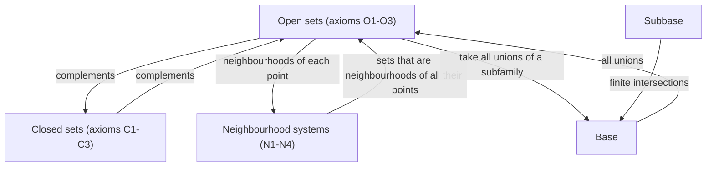
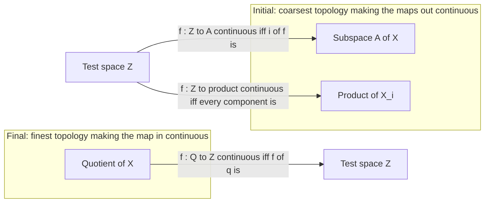
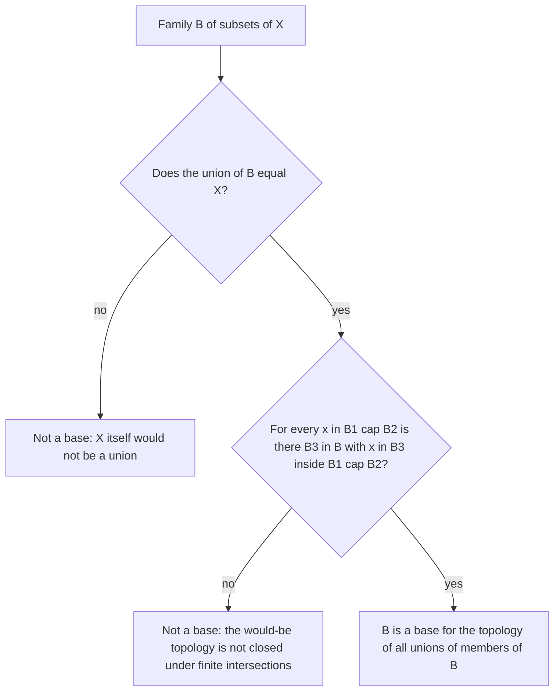

# Topological Spaces

> [Mathematics](../../README.md) › [Topology](../README.md) · Level: Advanced · Prerequisites: [Logic](../../00-foundations/02-logic/README.md), [Set Theory](../../00-foundations/03-set-theory/README.md), [Relations and Functions](../../00-foundations/05-relations-and-functions/README.md), [Metric Spaces](../../14-real-analysis/06-metric-spaces/README.md), [Continuity and Limits](../../14-real-analysis/03-continuity-and-limits/README.md) · Estimated time: 660 min

## 1. Introduction

In [Metric Spaces](../../14-real-analysis/06-metric-spaces/README.md) continuity was proved to be equivalent to a statement in which no distance appears:

$$
f : (X,d) \to (Y,\rho) \text{ is continuous}
\quad\Longleftrightarrow\quad
f^{-1}[V] \text{ is open in } X \text{ for every open } V \subseteq Y .
$$

Look at what that proof actually used. It used that a union of open balls is open, that a finite intersection of open sets is open, and that $\varnothing$ and the whole space are open. It never used the triangle inequality, symmetry, or the numerical value of any distance. The same is true of the proofs that limits are unique, that closed sets are complements of open sets, that a set is closed exactly when it contains its limit points, and that the closure is the smallest closed set containing a given set.

This chapter takes that observation seriously. We *throw away the distance* and keep only the family of open sets. Everything that can still be said — continuity, closure, limits, separation, quotients, products — is **topology**. Everything that cannot — lengths, angles, curvature, Cauchy sequences, completeness — is *geometry* or *uniform structure* and needs extra data.

Two things make this worthwhile rather than a pointless generalisation.

* **The theorems become more general at no extra cost.** The proofs of the basic theorems of point-set topology are the metric proofs with the words "open ball" replaced by "open set". One proof now covers $\mathbb{R}^n$, the Sorgenfrey line, $\mathbb{R}$ with the Zariski topology, the quotient $\mathbb{R}/\mathbb{Z}$, and the space of all functions $[0,1]\to[0,1]$ with the topology of pointwise convergence.
* **Many natural spaces carry no metric at all.** The Zariski topology of algebraic geometry is not metrisable whenever the dimension is at least $1$; the quotient of $\mathbb{R}\times\{0,1\}$ obtained by gluing the two copies along $\mathbb{R}\setminus\{0\}$ is not even Hausdorff; the topology of pointwise convergence on $C[0,1]$ is not metrisable; the Sorgenfrey plane is a well-behaved-looking space that fails to be normal. None of these could be discussed in metric terms.

The price is that intuition must be rebuilt. In a metric space "close" means "small distance". In a general space there is no distance, and many familiar facts become false: sequences no longer detect closures, limits need not be unique, and a continuous bijection need not be a homeomorphism. Each failure is a theorem here, with an example.

The plan of the chapter:

* **The axioms** (§7.1). Three requirements; the third is the subtle one, and the asymmetry between *arbitrary* unions and *finite* intersections is what makes the theory work.
* **Equivalent formulations** (§7.2–§7.3). A topology can be given by its open sets, by its closed sets, or by a neighbourhood system for each point. The three descriptions are intertranslatable, and the translations are proved.
* **Examples** (§7.4). Metric, discrete, indiscrete, cofinite, Sorgenfrey, Zariski. They are chosen so that between them they separate almost every axiom that appears later.
* **Bases and subbases** (§7.5). A topology is almost never listed set by set; it is *generated* from a smaller family. The exact condition under which a family generates a topology is proved.
* **Constructions** (§7.6–§7.8). Subspace, product, quotient. Each comes with a *universal property* — a statement that says exactly which maps into or out of the construction are continuous — and each universal property is proved, because in practice one uses the property and never the definition.
* **Closure, interior, boundary, limit points** (§7.9). Four interdefinable operations, with proofs that they behave as advertised.
* **Convergence and separation** (§7.10–§7.11). Hausdorffness is exactly the hypothesis that makes limits unique. The axioms T0–T4 stratify the ways a space can fail to be metrisable, and each gap in the hierarchy is exhibited by a specific space.

## 2. Prerequisites

**Sets and set operations.** Arbitrary unions $\bigcup_{i\in I}A_i$ and intersections over an arbitrary index set $I$, complements, De Morgan's laws, and the power set $\mathcal{P}(X)$. All of these are used constantly. See [Set Theory](../../00-foundations/03-set-theory/README.md).

**Images and preimages.** $f[A] = \{f(a) : a \in A\}$ and $f^{-1}[B] = \{x : f(x) \in B\}$. The preimage commutes with unions, intersections and complements; the image commutes with unions only. See [Relations and Functions](../../00-foundations/05-relations-and-functions/README.md).

**Quantifiers and proof technique.** Every axiom and theorem below is a quantified statement, and most proofs begin by negating one correctly. See [Logic](../../00-foundations/02-logic/README.md) and [Proof Techniques](../../00-foundations/04-proof-techniques/README.md).

**Metric spaces.** Open balls, open and closed sets, closure, limit points, continuity, and the equivalence of the $\varepsilon$-$\delta$ and preimage formulations. This chapter re-derives that material from weaker axioms, so the metric versions must be familiar. See [Metric Spaces](../../14-real-analysis/06-metric-spaces/README.md).

**Continuity in $\mathbb{R}$.** Pasting of functions defined piecewise, and the intermediate value theorem, are used in examples. See [Continuity](../../14-real-analysis/03-continuity-and-limits/README.md).

**The real numbers.** Density of $\mathbb{Q}$ in $\mathbb{R}$, countability and uncountability, and the fact that a nonempty open interval is uncountable. See [The Real Numbers and Completeness](../../14-real-analysis/01-real-numbers-and-completeness/README.md).

**Polynomials.** For the Zariski example: a nonzero polynomial in one variable has finitely many roots, and a nonzero polynomial in several variables does not vanish everywhere. See [Algebra](../../03-algebra/README.md).

## 3. Learning Objectives

By the end of this tutorial you will be able to

1. state the three axioms for a topology and verify them for the metric, discrete, indiscrete, cofinite, Sorgenfrey and Zariski topologies;
2. translate freely between the open-set, closed-set and neighbourhood formulations of a topology, proving each translation;
3. decide whether a given family of sets is a base or a subbase, and describe the topology it generates;
4. compute the subspace, product and quotient topology of a concrete example, and state and use the universal property of each construction;
5. prove that the closure of $A$ is the smallest closed set containing $A$, that it is the set of points every neighbourhood of which meets $A$, and that it satisfies the Kuratowski closure axioms;
6. compute interior, closure, boundary and derived set in each of the standard examples and explain how they differ from the metric case;
7. prove that limits of sequences are unique in a Hausdorff space, and give examples where they are not;
8. place the axioms T0, T1, T2, T3 and T4 in a strict hierarchy, with a specific space witnessing each strictness;
9. prove that every metric space is normal, and explain why the converse fails;
10. recognise which of the familiar metric theorems survive in a general space and which need extra hypotheses.

## 4. Intuition

**The open sets are the data.** A topology on $X$ is a declaration of which subsets count as *regions with room to spare*. A set $U$ is open when, for every point $x$ you stand at inside $U$, you can move a little and stay inside $U$. In a metric space "a little" means a ball $B_r(x)$; in a general space it means "some open set containing $x$ and contained in $U$". The declaration must be self-consistent: the empty region and the whole space have room to spare; combining regions with room to spare gives a region with room to spare; and if a point lies in two such regions, the overlap still has room to spare at that point. Those are exactly the three axioms.

**Why arbitrary unions but only finite intersections?** Take $U_n = (-1/n,\,1/n)$ in $\mathbb{R}$. Each $U_n$ has room to spare at $0$, but $\bigcap_n U_n = \{0\}$ does not: at $0$ there is no room in any direction. So an infinite intersection of open sets can fail to be open. A *finite* intersection cannot fail, because at a point $x \in U_1\cap\cdots\cap U_k$ the available room is the smallest of finitely many positive amounts, and a minimum of finitely many positive numbers is positive. Nothing similar holds for infinitely many. This single fact is responsible for most of the difference between metric and topological pathology.

**Neighbourhoods.** Instead of saying which sets are open, one may say, for each point $x$, which sets are *neighbourhoods of* $x$ — sets containing a region with room to spare around $x$. This is the local picture of the same information, and in analysis it is the more useful picture: continuity at a point, limits and convergence are all statements about neighbourhoods.

**Topology is geometry without distance.** Imagine a map that records which districts border which, but no distances. Two shapes that can be continuously deformed into each other have the same such map; a coffee cup and a doughnut do, a sphere and a torus do not. What survives the deformation is exactly what can be expressed with open sets. That is why topology is called *rubber-sheet geometry*, and why the correct notion of "same shape" is not "there is a continuous bijection" but "there is a continuous bijection whose inverse is also continuous" — see [Continuity and Homeomorphisms](../02-continuity-and-homeomorphisms/README.md).

**Where the intuition fails.** In a general space "close" has no meaning, and facts that feel obvious become false. A sequence may converge to two different points at once. The closure of a set may contain points that no sequence from the set approaches. A quotient of a perfectly good space may identify two points so violently that they cannot be separated by open sets. Each of these is treated below, with the example that shows intuition is not proof.

## 5. Formal Definition

**Definition 5.1 (Topology and topological space).** Let $X$ be a set. A *topology* on $X$ is a family $\tau \subseteq \mathcal{P}(X)$ such that

* **(O1)** $\varnothing \in \tau$ and $X \in \tau$;
* **(O2)** for every family $\{U_i\}_{i \in I}$ of members of $\tau$, $\bigcup_{i \in I} U_i \in \tau$ (arbitrary unions);
* **(O3)** for all $U, V \in \tau$, $U \cap V \in \tau$ (binary intersections).

The pair $(X,\tau)$ is a *topological space*, and the members of $\tau$ are the *open sets*. When no confusion is possible we write $X$ for $(X,\tau)$.

Axiom (O3) together with (O1) gives, by induction on $k$, that every *finite* intersection $U_1 \cap \cdots \cap U_k$ of open sets is open (the empty intersection, $k=0$, is $X$). Nothing is asserted about infinite intersections.

**Definition 5.2 (Closed set).** $F \subseteq X$ is *closed* if $X \setminus F$ is open.

**Definition 5.3 (Neighbourhood).** Let $x \in X$. A set $N \subseteq X$ is a *neighbourhood of $x$* if there exists $U \in \tau$ with $x \in U \subseteq N$. The family of all neighbourhoods of $x$ is written $\mathcal{N}(x)$ and called the *neighbourhood system* of $x$. A *neighbourhood base* at $x$ is a subfamily $\mathcal{B}_x \subseteq \mathcal{N}(x)$ such that every $N \in \mathcal{N}(x)$ contains some $B \in \mathcal{B}_x$.

Note carefully: a neighbourhood need not be open. In a metric space $B_r(x)$ is an *open* neighbourhood and $\{y : d(x,y)\le r\}$ is a neighbourhood that is not open.

**Definition 5.4 (Base and subbase).** A family $\mathcal{B} \subseteq \tau$ is a *base* (or *basis*) for $\tau$ if every $U \in \tau$ is a union of members of $\mathcal{B}$. Equivalently, for every $U \in \tau$ and every $x \in U$ there is $B \in \mathcal{B}$ with $x \in B \subseteq U$.

A family $\mathcal{S} \subseteq \tau$ is a *subbase* for $\tau$ if the family of all finite intersections of members of $\mathcal{S}$ (with the empty intersection interpreted as $X$) is a base for $\tau$.

**Definition 5.5 (Subspace topology).** Let $(X,\tau)$ be a space and $A \subseteq X$. The *subspace topology* on $A$ is

$$
\tau_A = \{U \cap A : U \in \tau\}.
$$

The space $(A,\tau_A)$ is a *subspace* of $X$.

**Definition 5.6 (Product topology).** Let $\{(X_i,\tau_i)\}_{i \in I}$ be a family of spaces and $X = \prod_{i \in I} X_i$ with projections $\pi_j\big((x_i)_{i\in I}\big) = x_j$. The *product topology* on $X$ is the topology generated by the subbase

$$
\mathcal{S} = \big\{\pi_i^{-1}[U] : i \in I,\ U \in \tau_i\big\}.
$$

Equivalently (Theorem 7.7.2), it has the base

$$
\Big\{\prod_{i\in I} U_i : U_i \in \tau_i \text{ for all } i,\ U_i = X_i \text{ for all but finitely many } i\Big\}.
$$

The *box topology* is the topology with base $\big\{\prod_i U_i : U_i \in \tau_i\big\}$, with no finiteness restriction. For finite $I$ the two coincide.

**Definition 5.7 (Quotient topology).** Let $(X,\tau)$ be a space, $Y$ a set and $q : X \to Y$ a surjection. The *quotient topology* on $Y$ is

$$
\tau_Y = \{V \subseteq Y : q^{-1}[V] \in \tau\},
$$

and $q$ is then called a *quotient map*. If $\sim$ is an equivalence relation on $X$, the quotient $X/{\sim}$ always carries this topology with $q$ the canonical map $x \mapsto [x]$.

**Definition 5.8 (Closure, interior, boundary).** Let $A \subseteq X$.

* The *closure* of $A$ is $\overline{A} = \bigcap\{F \subseteq X : F \text{ closed and } A \subseteq F\}$.
* The *interior* of $A$ is $A^{\circ} = \bigcup\{U \subseteq X : U \text{ open and } U \subseteq A\}$.
* The *boundary* of $A$ is $\partial A = \overline{A} \cap \overline{X \setminus A}$.
* $A$ is *dense* in $X$ if $\overline{A} = X$, and *nowhere dense* if $\overline{A}^{\circ} = \varnothing$.

Each is well defined: the family of closed supersets of $A$ is nonempty (it contains $X$), so its intersection contains $A$; the family of open subsets of $A$ is nonempty (it contains $\varnothing$), so its union is contained in $A$. Both are again closed, respectively open, by (O2) and (O3).

**Definition 5.9 (Limit point, derived set).** A point $x \in X$ is a *limit point* (or *accumulation point*) of $A$ if every neighbourhood $N$ of $x$ satisfies $N \cap (A \setminus \{x\}) \ne \varnothing$. The set of limit points of $A$ is the *derived set* $A'$. A point $a \in A$ that is not a limit point of $A$ is an *isolated point* of $A$.

**Definition 5.10 (Convergence).** A sequence $(x_n)_{n\in\mathbb{N}}$ in $X$ *converges to* $x \in X$ if for every neighbourhood $N$ of $x$ there is $n_0 \in \mathbb{N}$ such that $x_n \in N$ for all $n \ge n_0$. We write $x_n \to x$ and call $x$ a *limit* of the sequence.

**Definition 5.11 (Countability and separability).** $X$ is *first countable* if every point has a countable neighbourhood base, *second countable* if $\tau$ has a countable base, and *separable* if it has a countable dense subset.

**Definition 5.12 (Continuity).** Let $X, Y$ be spaces. A map $f : X \to Y$ is *continuous* if $f^{-1}[V]$ is open in $X$ for every open $V \subseteq Y$. It is *continuous at* $x \in X$ if for every neighbourhood $V$ of $f(x)$ there is a neighbourhood $U$ of $x$ with $f[U] \subseteq V$. These notions, their equivalence, and the maps continuous with continuous inverse are the subject of [Continuity and Homeomorphisms](../02-continuity-and-homeomorphisms/README.md); the present chapter uses them only in passing.

## 6. Mathematical Notation

| Symbol | Read as | Meaning |
|---|---|---|
| $(X,\tau)$ | the space $X$ with topology $\tau$ | a set together with its open sets |
| $\tau$ | tau, the topology | the family of open sets |
| $U, V, W$ | open sets | members of $\tau$ |
| $F, G$ | closed sets | complements of members of $\tau$ |
| $\mathcal{N}(x)$ | neighbourhood system of $x$ | all sets containing an open set containing $x$ |
| $\mathcal{B}, \mathcal{S}$ | base, subbase | generating families for $\tau$ |
| $A^{\circ}$ | interior of $A$ | largest open set inside $A$ |
| $\overline{A}$ | closure of $A$ | smallest closed set containing $A$ |
| $\partial A$ | boundary of $A$ | $\overline{A} \cap \overline{X\setminus A}$ |
| $A'$ | derived set | the limit points of $A$ |
| $X \setminus A$, $A^{\complement}$ | complement | points of $X$ not in $A$ |
| $x_n \to x$ | $x_n$ converges to $x$ | every neighbourhood of $x$ contains a tail |
| $\tau_A$ | subspace topology | $\{U \cap A : U \in \tau\}$ |
| $\prod_{i\in I} X_i$ | product | tuples, with the topology of Definition 5.6 |
| $\pi_j$ | projection | $(x_i)_{i\in I} \mapsto x_j$ |
| $X/{\sim}$, $X/A$ | quotient | classes of $\sim$, or $A$ collapsed to a point |
| $q$ | quotient map | the canonical surjection onto a quotient |
| $T_0, T_1, T_2, T_3, T_4$ | separation axioms | Kolmogorov, Fréchet, Hausdorff, regular, normal |
| $\mathbb{R}_\ell$ | Sorgenfrey line | $\mathbb{R}$ with base $\{[a,b)\}$ |
| $\mathbb{R}_K$ | $K$-topology on $\mathbb{R}$ | base $\{(a,b)\}\cup\{(a,b)\setminus K\}$, $K=\{1/n\}$ |
| $\mathbb{S}$ | Sierpiński space | $\{0,1\}$ with opens $\varnothing,\{1\},\{0,1\}$ |
| $\mathfrak{c}$ | the continuum | $\lvert\mathbb{R}\rvert = 2^{\aleph_0}$ |
## 7. Core Concepts

### 7.1 The Axioms and Their First Consequences

The axioms (O1)–(O3) are not a random list; each one is forced by a property of open sets in a metric space that the proof of some theorem needs.

**Proposition 7.1.1 (Elementary consequences).** In any topological space:

1. $\varnothing$ and $X$ are both open and closed;
2. arbitrary unions and finite intersections of open sets are open;
3. finite unions and arbitrary intersections of closed sets are closed;
4. if $\{\tau_j\}_{j\in J}$ is any family of topologies on $X$, then $\bigcap_{j\in J}\tau_j$ is a topology on $X$.

*Proof.* (1) is (O1) together with $X\setminus\varnothing = X$ and $X\setminus X = \varnothing$. (2) is (O2) and (O3) plus induction. For (3): if $\{F_i\}$ are closed, then $X\setminus\bigcup_{i=1}^{k}F_i = \bigcap_{i=1}^{k}(X\setminus F_i)$ is a finite intersection of open sets, hence open; and $X\setminus\bigcap_{i\in I}F_i = \bigcup_{i\in I}(X\setminus F_i)$ is an arbitrary union of open sets, hence open. For (4): $\varnothing$ and $X$ belong to every $\tau_j$; an arbitrary union of members of $\bigcap_j\tau_j$ is a union of members of each $\tau_j$, hence lies in every $\tau_j$; the same for a binary intersection. $\blacksquare$

**Definition 7.1.2 (Generated topology).** Let $\mathcal{A} \subseteq \mathcal{P}(X)$. The *topology generated by* $\mathcal{A}$ is

$$
\langle \mathcal{A}\rangle = \bigcap\{\tau : \tau \text{ is a topology on } X \text{ and } \mathcal{A} \subseteq \tau\}.
$$

The intersection is taken over a nonempty family, since $\mathcal{P}(X)$ is a topology containing $\mathcal{A}$, so by Proposition 7.1.1(4) it is a topology. It is the *coarsest* topology containing $\mathcal{A}$: every topology containing $\mathcal{A}$ contains $\langle \mathcal{A}\rangle$.

This is the device that makes Definitions 5.6 (product) and 5.7 (quotient) work: in each case a family of sets is prescribed and the topology is the coarsest one containing it.

### 7.2 Closed Sets

The complement of an open set is closed, so the family $\mathcal{F}$ of closed sets carries the same information as $\tau$. The following theorem says exactly which families can occur.

**Theorem 7.2.1 (Closed-set characterisation of a topology).** Let $X$ be a set and $\mathcal{F} \subseteq \mathcal{P}(X)$. Then $\mathcal{F}$ is the family of closed sets of a topology on $X$ if and only if

* **(C1)** $\varnothing \in \mathcal{F}$ and $X \in \mathcal{F}$;
* **(C2)** for every family $\{F_i\}_{i\in I} \subseteq \mathcal{F}$, $\bigcap_{i\in I}F_i \in \mathcal{F}$;
* **(C3)** for all $F, G \in \mathcal{F}$, $F \cup G \in \mathcal{F}$.

Moreover, when this holds the topology is uniquely determined, namely $\tau = \{X\setminus F : F \in \mathcal{F}\}$.

*Proof.* **Necessity.** Suppose $\mathcal{F} = \{X\setminus U : U \in \tau\}$. By (O1), $\varnothing = X\setminus X$ and $X = X\setminus\varnothing$ lie in $\mathcal{F}$, giving (C1). Given $\{F_i\}_{i\in I}$, write $F_i = X\setminus U_i$ with $U_i$ open. Then $\bigcap_i F_i = \bigcap_i(X\setminus U_i) = X\setminus\bigcup_i U_i$, which is closed because $\bigcup_i U_i$ is open by (O2); this is (C2). For two sets, $F\cup G = (X\setminus U)\cup(X\setminus V) = X\setminus(U\cap V)$, closed because $U\cap V$ is open by (O3); this is (C3).

**Sufficiency.** Let $\mathcal{F}$ satisfy (C1)–(C3) and put $\tau = \{X\setminus F : F \in \mathcal{F}\}$. Then $\varnothing = X\setminus X \in \tau$ and $X = X\setminus\varnothing \in \tau$ by (C1). If $U_i = X\setminus F_i \in \tau$ for $i\in I$, then $\bigcup_i U_i = X\setminus\bigcap_i F_i \in \tau$ by (C2). If $U = X\setminus F$ and $V = X\setminus G$ are in $\tau$, then $U\cap V = X\setminus(F\cup G)\in\tau$ by (C3). Hence $\tau$ is a topology, and its closed sets are exactly the members of $\mathcal{F}$, because $F\mapsto X\setminus F$ is an involution. **Uniqueness** is immediate: any topology with closed sets $\mathcal{F}$ must have open sets $\{X\setminus F : F\in\mathcal{F}\}$. $\blacksquare$

**Corollary 7.2.2.** In a metric space the metric notion of closed set and the topological notion agree, because the family of metric-open sets satisfies (O1)–(O3) — this is proved in [Metric Spaces](../../14-real-analysis/06-metric-spaces/README.md).

### 7.3 Neighbourhoods

A topology can also be reconstructed from the neighbourhood systems $\mathcal{N}(x)$. This formulation is the one used in analysis, and it is the reason the axioms (O1)–(O3) look asymmetric: they are the global shadow of four local conditions.

**Theorem 7.3.1 (Neighbourhood characterisation of a topology).** Let $X$ be a set and, for each $x \in X$, a family $\mathcal{N}(x) \subseteq \mathcal{P}(X)$. There is a topology $\tau$ on $X$ for which $\mathcal{N}(x)$ is exactly the set of neighbourhoods of $x$ if and only if, for all $x \in X$,

* **(N1)** $\mathcal{N}(x) \ne \varnothing$, and $N \in \mathcal{N}(x) \Rightarrow x \in N$;
* **(N2)** $N \in \mathcal{N}(x)$ and $N \subseteq M \Rightarrow M \in \mathcal{N}(x)$;
* **(N3)** $N_1, N_2 \in \mathcal{N}(x) \Rightarrow N_1 \cap N_2 \in \mathcal{N}(x)$;
* **(N4)** $N \in \mathcal{N}(x) \Rightarrow$ there is $M \in \mathcal{N}(x)$ with $M \subseteq N$ and $M \in \mathcal{N}(y)$ for every $y \in M$.

When these hold, $\tau = \{U \subseteq X : \forall x\in U,\ U \in \mathcal{N}(x)\}$, and this topology is unique.

*Proof.* **Necessity.** Assume $\mathcal{N}(x)$ comes from a topology. (N1): choose open $U$ with $x \in U \subseteq N$. (N2): the same $U$ witnesses $x \in U \subseteq M$. (N3): if $x \in U \subseteq N_1$ and $x \in V \subseteq N_2$ with $U,V$ open, then $x \in U\cap V \subseteq N_1\cap N_2$ and $U\cap V$ is open. (N4): take $M = U$, the open set itself; being open and containing $x$, it belongs to $\mathcal{N}(x)$, and it belongs to $\mathcal{N}(y)$ for every $y \in U$.

**Sufficiency.** Assume (N1)–(N4) and define $\tau$ by the displayed formula.

*$\tau$ is a topology.* $\varnothing \in \tau$ vacuously. $X \in \tau$: given $x$, choose (by the nonemptiness in (N1)) some $N \in \mathcal{N}(x)$; then $N \subseteq X$, so $X \in \mathcal{N}(x)$ by (N2). If $U_i \in \tau$ and $x \in \bigcup_i U_i$, pick $j$ with $x \in U_j$; then $U_j \in \mathcal{N}(x)$ and $U_j \subseteq \bigcup_i U_i$, so (N2) gives $\bigcup_i U_i \in \mathcal{N}(x)$. If $U, V \in \tau$ and $x \in U \cap V$, then $U, V \in \mathcal{N}(x)$, so $U\cap V \in \mathcal{N}(x)$ by (N3).

*The $\tau$-neighbourhoods are exactly the given ones.* Let $N \in \mathcal{N}(x)$ and put $U = \{y \in N : N \in \mathcal{N}(y)\}$. Then $x \in U$ by hypothesis. To see that $U \in \tau$, let $y \in U$: since $N \in \mathcal{N}(y)$, (N4) gives $M \in \mathcal{N}(y)$ with $M \subseteq N$ and $M \in \mathcal{N}(z)$ for all $z\in M$. For such $z$ we have $z \in N$ (as $M\subseteq N$) and $N \in \mathcal{N}(z)$ by (N2), so $z \in U$; hence $M \subseteq U$, and (N2) gives $U \in \mathcal{N}(y)$. So $U$ is open, $x \in U \subseteq N$, and $N$ is a $\tau$-neighbourhood of $x$. Conversely, if $N$ is a $\tau$-neighbourhood of $x$, there is $U \in \tau$ with $x \in U \subseteq N$; by definition of $\tau$, $U \in \mathcal{N}(x)$, so $N \in \mathcal{N}(x)$ by (N2).

*Uniqueness.* A topology is determined by its neighbourhood systems, since (Lemma 7.3.2) $U$ is open iff $U$ is a neighbourhood of each of its points. $\blacksquare$

**Lemma 7.3.2.** $U \subseteq X$ is open if and only if $U \in \mathcal{N}(x)$ for every $x \in U$.

*Proof.* If $U$ is open and $x\in U$, then $x \in U \subseteq U$ exhibits $U$ as a neighbourhood. Conversely, if $U \in \mathcal{N}(x)$ for all $x\in U$, choose for each $x$ an open $V_x$ with $x \in V_x \subseteq U$; then $U = \bigcup_{x\in U}V_x$ is open by (O2). $\blacksquare$

### 7.4 The Standard Examples

**7.4.1 Metric spaces.** If $(X,d)$ is a metric space, the family

$$
\tau_d = \{U \subseteq X : \forall x\in U\ \exists r>0,\ B_r(x)\subseteq U\}
$$

satisfies (O1)–(O3): for (O3), if $x \in U\cap V$ choose $r,s>0$ with $B_r(x)\subseteq U$ and $B_s(x)\subseteq V$, then $B_{\min(r,s)}(x) \subseteq U\cap V$. This is the *metric topology*. Different metrics may give the same topology: on any set, $d$ and $\min(d,1)$ induce the same open sets, and on $\mathbb{R}^n$ all norms do. A topology is *metrisable* if it arises from some metric; by Theorem 7.11.4 below, a metrisable topology is always Hausdorff and normal.

**7.4.2 Discrete topology.** $\tau = \mathcal{P}(X)$. Every set is open, hence every set is closed: every subset is *clopen*. A space is discrete iff every singleton is open iff every point is isolated. The discrete topology is the finest topology on $X$, and it is metrisable (the discrete metric $d(x,y) = 1$ for $x\ne y$).

**7.4.3 Indiscrete (trivial) topology.** $\tau = \{\varnothing, X\}$. The only closed sets are $\varnothing$ and $X$. For $\varnothing \ne A \subseteq X$ we have $\overline{A} = X$: the only closed superset of $A$ is $X$. Every sequence converges to every point, since the only neighbourhood of any point is $X$ itself. If $\lvert X\rvert \ge 2$ the space is not T0.

**7.4.4 Cofinite topology.** On a set $X$ let

$$
\tau_{\mathrm{cof}} = \{\varnothing\} \cup \{U \subseteq X : X\setminus U \text{ is finite}\}.
$$

*It is a topology.* $\varnothing$ and $X$ are listed. If $U_i \in \tau_{\mathrm{cof}}$ then $X\setminus\bigcup_i U_i = \bigcap_i (X\setminus U_i) \subseteq X\setminus U_j$ is finite whenever some $U_j \ne \varnothing$; if all $U_i = \varnothing$ the union is empty. If $U, V$ are nonempty cofinite, $X\setminus(U\cap V) = (X\setminus U)\cup(X\setminus V)$ is a union of two finite sets.

*Its closed sets* are the finite sets together with $X$. Hence every singleton is closed and the space is T1 (Theorem 7.11.1). If $X$ is infinite it is not Hausdorff: any two nonempty open sets $U,V$ satisfy $U \cap V \supseteq X\setminus\big((X\setminus U)\cup(X\setminus V)\big) \neq \varnothing$, because $X$ is infinite and the removed set is finite. So no two nonempty open sets are disjoint.

*It is the coarsest T1 topology.* If $\tau$ is T1, every singleton is closed, hence every finite set is closed (finite unions of closed sets), hence every cofinite set is open; so $\tau_{\mathrm{cof}} \subseteq \tau$. This example recurs throughout the chapter because it satisfies T1 and fails almost everything else.

**7.4.5 The Sorgenfrey line.** Let $\mathcal{B}_\ell = \{[a,b) : a<b\}$ and let $\mathbb{R}_\ell$ be $\mathbb{R}$ with the topology generated by $\mathcal{B}_\ell$. By Theorem 7.5.2 below, $\mathcal{B}_\ell$ is a base: it covers $\mathbb{R}$ (as $a \in [a,b)$), and if $x \in [a,b)\cap[c,d)$ then $[\max(a,c),\min(b,d))$ contains $x$ and lies in the intersection.

*Half-open intervals are clopen.* $[a,b)$ is open by definition. Its complement is $(-\infty,a)\cup[b,\infty)$, and $(-\infty,a) = \bigcup_{n\ge1}[a-n,a)$ and $[b,\infty) = \bigcup_{n\ge1}[b,b+n)$ are open unions of basic sets. So $[a,b)$ is also closed.

*The Sorgenfrey topology is strictly finer than the usual one.* Every open interval is a union of half-open ones: $(a,b) = \bigcup_{n\ge1}[a+1/n,\,b)$. Hence every usual-open set is Sorgenfrey-open. The set $[0,1)$ is Sorgenfrey-open but is not a usual neighbourhood of $0$, since every interval $(-\varepsilon,\varepsilon)$ contains negative numbers; so the inclusion is strict.

*$\mathbb{R}_\ell$ is separable but not second countable.* $\mathbb{Q}$ is dense: every nonempty basic set $[a,b)$ contains a rational, since $[a,b) \supseteq (a,b) \ne \varnothing$. If $\mathcal{C}$ is any base, then for each $x$ the set $[x,x+1)$ is an open neighbourhood of $x$, so there is $C_x \in \mathcal{C}$ with $x \in C_x \subseteq [x,x+1)$. Then $\inf C_x = x$: indeed $\inf C_x \le x$ because $C_x$ is a union of basic sets one of which contains $x$ and has infimum $\le x$; and $\inf C_x \ge x$ because $C_x \subseteq [x,x+1)$. Distinct $x$ therefore give distinct $C_x$, so every base is uncountable and there is no countable base. (Compare Exercise 24.)

**7.4.6 The Zariski topology (sketch).** Let $k$ be a field, $n \ge 1$, and $k[x_1,\dots,x_n]$ the polynomial ring. For $S \subseteq k[x_1,\dots,x_n]$ put

$$
V(S) = \{p \in k^n : f(p) = 0 \text{ for every } f \in S\}.
$$

The family $\mathcal{F} = \{V(S) : S \subseteq k[x_1,\dots,x_n]\}$ satisfies (C1)–(C3): $V(\{1\}) = \varnothing$, $V(\{0\}) = k^n$; $\bigcap_{i}V(S_i) = V\big(\bigcup_i S_i\big)$; and $V(S)\cup V(T) = V(ST)$ where $ST = \{fg : f\in S,\ g\in T\}$, because a product of two field elements is zero only if one factor is. By Theorem 7.2.1 these are the closed sets of a topology, the *Zariski topology*. Its open sets are the complements of algebraic sets, so they are enormous; for $n \ge 1$ and $k$ infinite it is T1 but not Hausdorff (Example 9.8). On $k = \mathbb{R}$ and $n = 1$ the algebraic sets are exactly the finite sets (a nonzero polynomial has finitely many roots), so the Zariski topology on $\mathbb{R}$ is the cofinite topology.

### 7.5 Bases and Subbases

A topology is rarely given by listing all open sets. The practical descriptions are "all unions of members of this family" (base) and "all finite intersections of members of that family, then all unions" (subbase).

**Lemma 7.5.1.** Let $\tau$ be a topology and $\mathcal{B} \subseteq \tau$. The following are equivalent:

1. every $U \in \tau$ is a union of members of $\mathcal{B}$;
2. for every $U\in\tau$ and $x \in U$ there is $B \in \mathcal{B}$ with $x \in B \subseteq U$;
3. for every $x$, the family $\mathcal{B}_x = \{B \in \mathcal{B} : x \in B\}$ is a neighbourhood base at $x$.

*Proof.* (1) $\Rightarrow$ (2): if $U = \bigcup_{i}B_i$ and $x\in U$, then $x \in B_i$ for some $i$, and $B_i \subseteq U$. (2) $\Rightarrow$ (3): given a neighbourhood $N$ of $x$, choose open $U$ with $x \in U \subseteq N$, then $B \in \mathcal{B}$ with $x \in B \subseteq U \subseteq N$. (3) $\Rightarrow$ (1): for $x \in U$, openness of $U$ makes $U$ a neighbourhood of $x$, so there is $B_x \in \mathcal{B}$ with $x \in B_x \subseteq U$; then $U = \bigcup_{x\in U}B_x$. $\blacksquare$

**Theorem 7.5.2 (Base criterion).** A family $\mathcal{B} \subseteq \mathcal{P}(X)$ is a base for some topology on $X$ if and only if

* **(B1)** $X = \bigcup_{B\in\mathcal{B}}B$;
* **(B2)** for all $B_1,B_2 \in \mathcal{B}$ and every $x \in B_1\cap B_2$ there exists $B_3 \in \mathcal{B}$ with $x \in B_3 \subseteq B_1\cap B_2$.

In that case the topology is $\tau_{\mathcal{B}} = \{\bigcup \mathcal{C} : \mathcal{C} \subseteq \mathcal{B}\}$ (the empty union being $\varnothing$), it is the coarsest topology containing $\mathcal{B}$, and $\mathcal{B}$ is a base for it.

*Proof.* **Necessity.** If $\mathcal{B}$ is a base for $\tau$, then $X \in \tau$ is a union of members of $\mathcal{B}$, which gives (B1). For (B2), $B_1\cap B_2$ is open and contains $x$, so by Lemma 7.5.1(2) there is $B_3\in\mathcal{B}$ with $x\in B_3\subseteq B_1\cap B_2$.

**Sufficiency.** Let $\tau$ be the family of all unions of members of $\mathcal{B}$, with $\varnothing$ allowed as the empty union. (O1) holds: $\varnothing\in\tau$ by convention and $X = \bigcup_{B\in\mathcal{B}}B \in \tau$ by (B1). (O2) holds because a union of unions is a union. For (O3), let $U = \bigcup_i B_i$ and $V = \bigcup_j C_j$ with $B_i, C_j \in \mathcal{B}$. Then

$$
U\cap V = \bigcup_{i,j}(B_i\cap C_j).
$$

Each $B_i\cap C_j$ is itself a union of members of $\mathcal{B}$: indeed, for $x \in B_i\cap C_j$, axiom (B2) supplies $B_3 \in \mathcal{B}$ with $x\in B_3\subseteq B_i\cap C_j$, so $B_i\cap C_j = \bigcup\{B \in \mathcal{B} : B \subseteq B_i\cap C_j\}$. Hence $U\cap V$ is an indexed union of unions of members of $\mathcal{B}$, therefore in $\tau$. So $\tau$ is a topology, and $\mathcal{B}\subseteq\tau$ by taking one-element unions, so $\mathcal{B}$ is a base for $\tau$ by construction.

**Coarsest.** Any topology $\sigma$ containing $\mathcal{B}$ contains all unions of members of $\mathcal{B}$ by (O2), hence $\tau \subseteq \sigma$. $\blacksquare$

**Theorem 7.5.3 (Subbase theorem).** Let $\mathcal{S} \subseteq \mathcal{P}(X)$ with $X = \bigcup_{S\in\mathcal{S}}S$. Then the family $\mathcal{B}$ of all finite intersections $S_1\cap\cdots\cap S_k$ of members of $\mathcal{S}$ (with $k=0$ giving $X$) is a base for a topology $\langle\mathcal{S}\rangle$, the *topology generated by* $\mathcal{S}$. It is the coarsest topology containing $\mathcal{S}$, and $\mathcal{S}$ is a subbase for it.

*Proof.* Apply Theorem 7.5.2. For (B1): $X\in\mathcal{B}$ by the empty intersection, so $\bigcup\mathcal{B} \supseteq X$. For (B2): if $B_1 = S_1\cap\cdots\cap S_m$ and $B_2 = T_1\cap\cdots\cap T_n$ are in $\mathcal{B}$, then $B_1\cap B_2 = S_1\cap\cdots\cap S_m\cap T_1\cap\cdots\cap T_n \in \mathcal{B}$, so taking $B_3 = B_1\cap B_2$ satisfies (B2). Hence $\mathcal{B}$ is a base for a topology $\tau$, and $\mathcal{S}\subseteq\mathcal{B}\subseteq\tau$. Any topology containing $\mathcal{S}$ contains every finite intersection of its members, hence contains $\mathcal{B}$, hence contains $\tau$ by (O2). $\blacksquare$

**Remark 7.5.4 (Why the covering condition is needed).** If $X \ne \bigcup\mathcal{S}$, the finite intersections do not satisfy (B1) and are not a base for a topology on $X$: no union of them can equal $X$. The topology generated by $\mathcal{S}$ in the sense of Definition 7.1.2 still exists, but $X$ is open only by axiom (O1), not as a union of basic sets (Exercise 12).

**Examples 7.5.5.** (a) In $\mathbb{R}^n$ the balls with rational centre and rational radius form a countable base, so $\mathbb{R}^n$ is second countable; so is every subspace of a second-countable space (Exercise 15). (b) The family of all intervals $(q,q')$ with $q,q'\in\mathbb{Q}$ is a base for the usual topology on $\mathbb{R}$, because between any two distinct reals there is a rational. (c) The family $\{(-\infty,a) : a\in\mathbb{R}\}\cup\{(b,\infty): b\in\mathbb{R}\}$ is a subbase for the usual topology on $\mathbb{R}$; finite intersections of its members are exactly the open intervals and rays. (d) A discrete space is second countable iff it is countable — every base must contain all singletons.
### 7.6 The Subspace Topology

**Lemma 7.6.1.** $\tau_A = \{U\cap A : U \in \tau\}$ is a topology on $A$.

*Proof.* $\varnothing = \varnothing\cap A$ and $A = X\cap A$ are in $\tau_A$. If $V_i = U_i\cap A$ then $\bigcup_i V_i = \bigl(\bigcup_i U_i\bigr)\cap A \in \tau_A$ and $V_1\cap V_2 = (U_1\cap U_2)\cap A \in \tau_A$. $\blacksquare$

**Lemma 7.6.2.** (a) If $\mathcal{B}$ is a base for $X$ then $\mathcal{B}_A = \{B\cap A : B\in\mathcal{B}\}$ is a base for $\tau_A$. (b) If $\mathcal{S}$ is a subbase for $X$ then $\mathcal{S}_A = \{S\cap A : S\in\mathcal{S}\}$ is a subbase for $\tau_A$. (c) The closed sets of $A$ are exactly the sets $F\cap A$ with $F$ closed in $X$.

*Proof.* (a) $\mathcal{B}_A$ covers $A$ since $A = X\cap A$ and $X$ is a union of members of $\mathcal{B}$; and (B2) is inherited, because $(B_1\cap A)\cap(B_2\cap A) = (B_1\cap B_2)\cap A$ and a $B_3 \subseteq B_1\cap B_2$ through $x$ gives $B_3\cap A \subseteq (B_1\cap B_2)\cap A$. Then every $U\cap A$ with $U$ open is a union of sets $B\cap A$. (b) Finite intersections commute with intersection by $A$: $\bigl(\bigcap_{k=1}^{m}S_k\bigr)\cap A = \bigcap_{k=1}^{m}(S_k\cap A)$. (c) $A\setminus(U\cap A) = (X\setminus U)\cap A$, and every closed $F$ of $X$ is $X\setminus U$ for an open $U$. $\blacksquare$

**Theorem 7.6.3 (Characteristic property of the subspace topology).** Let $A \subseteq X$ and $i : A \hookrightarrow X$ the inclusion.

1. $i$ is continuous.
2. For every space $Z$ and every map $f : Z \to A$, $f$ is continuous if and only if $i\circ f : Z \to X$ is continuous.
3. $\tau_A$ is the coarsest topology on $A$ making $i$ continuous.

*Proof.* (1) For open $U \subseteq X$, $i^{-1}[U] = U\cap A \in \tau_A$. (2) If $f$ is continuous then so is $i\circ f$, a composition of continuous maps. Conversely suppose $i\circ f$ is continuous and let $V \subseteq A$ be open. By definition of $\tau_A$ there is an open $U\subseteq X$ with $V = U\cap A$. Then $f^{-1}[V] = f^{-1}[i^{-1}[U]] = (i\circ f)^{-1}[U]$ is open in $Z$. (3) Any topology $\sigma$ on $A$ making $i$ continuous must contain $i^{-1}[U] = U\cap A$ for every open $U$, that is, must contain $\tau_A$. $\blacksquare$

Part (2) is the reason one never needs the definition of $\tau_A$ again: to check that a map *into* a subspace is continuous, check that the composite with the inclusion is.

**Lemma 7.6.4 (Transitivity).** If $A \subseteq B \subseteq X$ then the subspace topology $A$ inherits from $B$ equals the topology it inherits from $X$.

*Proof.* A basic open set of the subspace $B$ has the form $U\cap B$ with $U$ open in $X$; intersecting with $A$ gives $(U\cap B)\cap A = U\cap A$, and every set of the form $U\cap A$ arises this way (take $U\cap B$). ✓

**Example 7.6.5 (Relative openness).** In $X = \mathbb{R}$, the set $[0,1)$ is not open. In the subspace $A = [0,\infty)$ it *is* open, because $[0,1) = (-1,1)\cap A$. So "open" is not an absolute property of a set; it is relative to an ambient space. This is the most common source of errors with subspaces.

### 7.7 The Product Topology

**Lemma 7.7.1.** The family

$$
\mathcal{B}_p = \Big\{\prod_{i\in I}U_i \;:\; U_i \in \tau_i \text{ for all } i,\ U_i = X_i \text{ for all but finitely many } i\Big\}
$$

is a base for a topology on $\prod_i X_i$, and that topology is the one generated by the subbase $\{\pi_i^{-1}[U]\}$.

*Proof.* (B1): the whole product belongs to $\mathcal{B}_p$ (take every $U_i = X_i$). (B2): if $B = \prod U_i$ and $C = \prod V_i$ are in $\mathcal{B}_p$, then $B\cap C = \prod (U_i\cap V_i)$ and $U_i\cap V_i = X_i$ for all but finitely many $i$, so $B\cap C\in\mathcal{B}_p$; take $B_3 = B\cap C$. By Theorem 7.5.2 this is a base for a topology $\tau_{\mathcal{B}_p}$. A subbasic set $\pi_i^{-1}[U]$ equals $\prod_j U_j$ with $U_j = U$ for $j = i$ and $U_j = X_j$ otherwise, so it belongs to $\mathcal{B}_p$; hence $\langle \pi_i^{-1}[U]\rangle \subseteq \tau_{\mathcal{B}_p}$. Conversely every member of $\mathcal{B}_p$ is a finite intersection $\bigcap_{k=1}^{m}\pi_{i_k}^{-1}[U_{i_k}]$ (over the coordinates where $U_i \ne X_i$), hence lies in the topology generated by the subbase. $\blacksquare$

**Theorem 7.7.2 (Characteristic property of the product topology).** Let $P = \prod_{i\in I}X_i$ with projections $\pi_i : P \to X_i$.

1. Every $\pi_i$ is continuous.
2. A map $f : Z \to P$ is continuous if and only if $\pi_i\circ f$ is continuous for every $i\in I$.
3. The product topology is the coarsest topology on $P$ making all $\pi_i$ continuous.

*Proof.* (1) $\pi_i^{-1}[U] = U\times\prod_{j\ne i}X_j$ is subbasic open. (2) If $f$ is continuous, each $\pi_i\circ f$ is a composite of continuous maps. Conversely assume every $\pi_i\circ f$ is continuous. For a subbasic $S = \pi_i^{-1}[U]$, $f^{-1}[S] = (\pi_i\circ f)^{-1}[U]$ is open. For a basic $B = \bigcap_{k=1}^{m}\pi_{i_k}^{-1}[U_k]$, $f^{-1}[B] = \bigcap_{k=1}^{m}(\pi_{i_k}\circ f)^{-1}[U_k]$ is a finite intersection of open sets. For an arbitrary open $V = \bigcup_j B_j$, $f^{-1}[V] = \bigcup_j f^{-1}[B_j]$ is open. (3) A topology making all $\pi_i$ continuous contains every $\pi_i^{-1}[U]$ and hence, by (O2) and (O3), the topology they generate (Theorem 7.5.3). $\blacksquare$

**Remark 7.7.3 (Product versus box).** For infinite $I$ the box topology is strictly finer than the product topology. For example, with $X_n = \mathbb{R}$ and $I = \mathbb{N}$, the set $\prod_n(-\tfrac1n,\tfrac1n)$ is box-open but contains no product-basic set around $(0,0,\dots)$, since a product-basic set restricts only finitely many coordinates and is all of $\mathbb{R}$ in the others. The difference matters: the diagonal map $t \mapsto (t,t,t,\dots)$ from $\mathbb{R}$ to $\mathbb{R}^{\mathbb{N}}$ has continuous components, so it is continuous for the product topology by Theorem 7.7.2, but it is *not* continuous for the box topology, because the preimage of $\prod_n(-\tfrac1n,\tfrac1n)$ is $\{0\}$, which is not open (Exercise 30). Theorem 7.7.2 is exactly what fails for the box topology.

**Example 7.7.4.** For finite $I$ the product topology on $\mathbb{R}^m\times\mathbb{R}^n$ is the usual topology of $\mathbb{R}^{m+n}$ (Example 9.5). The space $2^{\mathbb{N}} = \prod_{n\in\mathbb{N}}\{0,1\}$ with $\{0,1\}$ discrete is the *Cantor space*; its basic open sets fix finitely many coordinates, so its elements are exactly the infinite binary sequences and a neighbourhood constrains only finitely many entries.

### 7.8 The Quotient Topology

**Lemma 7.8.1.** $\tau_Y = \{V \subseteq Y : q^{-1}[V] \in \tau\}$ is a topology on $Y$, and $q$ is continuous for it.

*Proof.* $q^{-1}[\varnothing] = \varnothing$ and $q^{-1}[Y] = X$ are open. Preimages commute with unions and intersections: $q^{-1}\big[\bigcup_i V_i\big] = \bigcup_i q^{-1}[V_i]$ and $q^{-1}[V_1\cap V_2] = q^{-1}[V_1]\cap q^{-1}[V_2]$. Hence (O1)–(O3) hold for $\tau_Y$, and continuity of $q$ is the definition. $\blacksquare$

**Lemma 7.8.2.** $\tau_Y$ is the *finest* topology on $Y$ making $q$ continuous.

*Proof.* If $\sigma$ is a topology on $Y$ and $q$ is continuous for $\sigma$, then for $V \in \sigma$ the set $q^{-1}[V]$ is open in $X$, so $V\in\tau_Y$ by definition. Hence $\sigma \subseteq \tau_Y$. $\blacksquare$

So the subspace and product topologies are the *coarsest* topologies making certain maps continuous, while the quotient is the *finest*; this is the beginning of the theory of initial and final topologies (§7 of [Continuity and Homeomorphisms](../02-continuity-and-homeomorphisms/README.md)).

**Theorem 7.8.3 (Characteristic property of the quotient topology).** Let $q : X \to Y$ be a quotient map. For every space $Z$ and every map $f : Y \to Z$, $f$ is continuous if and only if $f\circ q$ is continuous.

*Proof.* If $f$ is continuous then $f\circ q$ is a composite of continuous maps. Conversely assume $f\circ q$ is continuous and let $W\subseteq Z$ be open. Then $q^{-1}[f^{-1}[W]] = (f\circ q)^{-1}[W]$ is open in $X$, so $f^{-1}[W]$ is open in $Y$ by Definition 5.7. $\blacksquare$

**Definition 7.8.4 (Saturated sets).** $A \subseteq X$ is *saturated* with respect to $q$ if $A = q^{-1}[q[A]]$, that is, if $A$ is a union of fibres of $q$. A quotient map is open (respectively closed) if and only if it carries saturated open (respectively closed) sets to open (respectively closed) sets.

**Remark 7.8.5 (Quotient maps need not be open or closed).** Let $X = [0,1]\cup[2,3]$ with the subspace topology of $\mathbb{R}$ and $Y = [0,2]$, and define $q(x) = x$ for $x \in [0,1]$, $q(x) = x-1$ for $x\in[2,3]$. Then $q$ is a closed quotient map which is not open: $[0,1]$ is open in $X$ (it is $X\cap(-\tfrac12,\tfrac32)$) but $q\big[[0,1]\big] = [0,1]$ is not open in $[0,2]$. Dually $t\mapsto e^{2\pi i t}$ from $\mathbb{R}$ to $S^1$ is open but not closed: the closed set $\{n + 1/n : n \ge 2\}$ maps to a set whose limit point $1$ is missing.

**Examples 7.8.6 (Standard identifications).** The following quotients are homeomorphic to the stated spaces; the homeomorphisms are constructed by checking the characteristic property, and compactness arguments (Topic 3) settle the harder cases.

* $[0,1]/\{0,1\} \cong S^1$ and $\mathbb{R}/\mathbb{Z} \cong S^1$ (the circle);
* $[0,1]^2/{\sim}$ with $(s,0)\sim(s,1)$ and $(0,t)\sim(1,t)$ is the torus $\mathbb{R}^2/\mathbb{Z}^2$;
* $D^n/\partial D^n \cong S^n$ (collapse the boundary of the disc);
* $\mathbb{R}^{n+1}\setminus\{0\}$ modulo $x \sim \lambda x$ for $\lambda \ne 0$ is the real projective space $\mathbb{RP}^n$;
* $\mathbb{R}/{\sim}$ with $x \sim -x$ is the half-line $[0,\infty)$.

### 7.9 Closure, Interior, Boundary and Limit Points

**Theorem 7.9.1 (Properties of the closure).** For subsets $A, B$ of a space $X$ and $x \in X$:

1. $\overline A$ is closed, $A \subseteq \overline A$, and $\overline A$ is the smallest closed set containing $A$; consequently $A$ is closed iff $A = \overline A$;
2. $x \in \overline A$ if and only if every neighbourhood of $x$ meets $A$, if and only if every basic open set containing $x$ meets $A$;
3. $\overline A = A \cup A'$; in particular $A$ is closed iff $A' \subseteq A$;
4. $A \subseteq B \Rightarrow \overline A \subseteq \overline B$;
5. $\overline{A\cup B} = \overline A\cup\overline B$ and $\overline{A\cap B} \subseteq \overline A\cap\overline B$, the inclusion being strict in general;
6. $\overline{\overline A} = \overline A$, $\overline\varnothing = \varnothing$, $\overline X = X$.

*Proof.* (1) $\overline A$ is an intersection of closed sets, hence closed by (C2); it contains $A$ because every closed superset does; and if $F$ is closed with $A\subseteq F$ then $F$ occurs in the intersection, so $\overline A \subseteq F$.

(2) Suppose $x\notin\overline A$. Then $F = \overline A$ is closed, does not contain $x$, and $X\setminus F$ is an open neighbourhood of $x$ disjoint from $A$. Conversely, if $N$ is a neighbourhood of $x$ disjoint from $A$, choose open $U$ with $x \in U \subseteq N$; then $X\setminus U$ is closed and contains $A$, so $\overline A \subseteq X\setminus U$, and $x \notin \overline A$. The version with basic open sets follows from Lemma 7.5.1.

(3) $A \subseteq \overline A$. If $x \in A'$ and $x\notin\overline A$, part (2) gives a neighbourhood $N$ of $x$ with $N\cap A = \varnothing$, contradicting $N\cap(A\setminus\{x\}) \ne \varnothing$. So $A\cup A' \subseteq \overline A$. Conversely let $x \in \overline A$. If $x\in A$ we are done; otherwise every neighbourhood of $x$ meets $A$ at a point different from $x$, so $x \in A'$.

(4) Every closed set containing $B$ contains $A$, so the smallest one containing $A$ is inside the smallest one containing $B$.

(5) $A\cup B \subseteq \overline{A\cup B}$, which is closed, so $\overline A\cup\overline B \subseteq \overline{A\cup B}$. Conversely $A \subseteq A\cup B$ gives $\overline A\subseteq\overline{A\cup B}$ and likewise for $B$, whence $\overline A\cup\overline B$ is a closed set containing $A\cup B$, so it contains $\overline{A\cup B}$. For the intersection, $A\cap B\subseteq A$ gives $\overline{A\cap B}\subseteq\overline A$ and similarly for $B$. In $\mathbb{R}$ take $A = (0,1)$, $B = (1,2)$: then $\overline{A\cap B} = \overline\varnothing = \varnothing$ while $\overline A\cap\overline B = \{1\}$.

(6) $\overline A$ is closed, so by (1) it equals its own closure; $\varnothing$ and $X$ are closed. $\blacksquare$

**Theorem 7.9.2 (Properties of the interior).**

1. $A^{\circ}$ is open, $A^{\circ}\subseteq A$, and $A^{\circ}$ is the largest open subset of $A$; hence $A$ is open iff $A = A^{\circ}$;
2. $x\in A^{\circ}$ iff $A$ is a neighbourhood of $x$;
3. $X\setminus\overline A = (X\setminus A)^{\circ}$ and $X\setminus A^{\circ} = \overline{X\setminus A}$;
4. $(A\cap B)^{\circ} = A^{\circ}\cap B^{\circ}$ and $A^{\circ}\cup B^{\circ} \subseteq (A\cup B)^{\circ}$, the inclusion being strict in general.

*Proof.* (1) is (O2) applied to the definition. (2) $x\in A^\circ$ iff some open $U$ satisfies $x\in U\subseteq A$, which is exactly the definition of "$A$ is a neighbourhood of $x$". (3) $x \in (X\setminus A)^{\circ}$ iff there is an open $U$ with $x\in U\subseteq X\setminus A$, i.e. an open neighbourhood of $x$ disjoint from $A$, i.e. (Theorem 7.9.1(2)) $x \notin \overline A$. The second identity follows from the first applied to $X\setminus A$ and taking complements. (4) For intersections use (1): $A^\circ\cap B^\circ$ is open and contained in $A\cap B$, so it is contained in the largest such set; conversely $A^\circ \subseteq A$ and $B^\circ\subseteq B$ give $(A\cap B)^\circ \subseteq A^\circ$ and $\subseteq B^\circ$. For unions, $A^{\circ}\cup B^{\circ}$ is an open subset of $A\cup B$. It can be smaller: in $\mathbb{R}$, $A = [0,1]$ and $B = [1,2]$ give $A^{\circ}\cup B^{\circ} = (0,1)\cup(1,2)$ while $(A\cup B)^{\circ} = (0,2)$. $\blacksquare$

**Theorem 7.9.3 (Boundary).** For $A\subseteq X$:

1. $\partial A = \overline A\setminus A^{\circ} = \overline A\cap\overline{X\setminus A}$, and $\partial A$ is closed;
2. $x\in\partial A$ iff every neighbourhood of $x$ meets both $A$ and $X\setminus A$;
3. $\partial A = \partial(X\setminus A)$, and $A$ is clopen iff $\partial A = \varnothing$;
4. $X = A^{\circ}\;\sqcup\;\partial A\;\sqcup\;(X\setminus\overline A)$, a disjoint union of an open set, a closed set and an open set;
5. $\overline A = A\cup\partial A$ and $A^{\circ} = A\setminus\partial A$.

*Proof.* (1) By Theorem 7.9.2(3), $X\setminus A^{\circ} = \overline{X\setminus A}$, so $\overline A\setminus A^{\circ} = \overline A\cap\overline{X\setminus A} = \partial A$. It is closed as an intersection of closed sets.

(2) $x\in\partial A$ iff $x\in\overline A$ and $x\in\overline{X\setminus A}$, which by Theorem 7.9.1(2) is exactly the stated condition.

(3) The expression $\overline A\cap\overline{X\setminus A}$ is symmetric in $A$ and $X\setminus A$. If $A$ is clopen then $\overline A = A$ and $\overline{X\setminus A} = X\setminus A$, so the intersection is empty. Conversely if $\partial A = \varnothing$, then by (5) below $\overline A = A$, so $A$ is closed, and applying this to $X\setminus A$ shows $X\setminus A$ is closed, so $A$ is open.

(4) Let $x\in X$. If $x\notin\overline A$ then $x \in X\setminus\overline A$. If $x\in\overline A$ and $x\notin A^{\circ}$ then $x\in\partial A$ by (1). If $x \in A^{\circ}$ then $x\notin\partial A$ since $A^{\circ}$ is disjoint from $\overline{X\setminus A}$ by Theorem 7.9.2(3). The three sets are pairwise disjoint by (1) and by $\overline A\cap(X\setminus\overline A) = \varnothing$.

(5) $\overline A \subseteq A\cup\partial A$: if $x\in\overline A\setminus A$ then every neighbourhood of $x$ meets $A$ and also contains $x \notin A$, so it meets $X\setminus A$; hence $x\in\partial A$. The reverse inclusion is clear from (1). For the interior, $A^{\circ}\subseteq A$ and $A^{\circ}\cap\partial A = \varnothing$; conversely if $x\in A\setminus\partial A$ then $x\in\overline A$ (as $A\subseteq\overline A$) and $x\notin\partial A$, so $x\notin\overline{X\setminus A}$, whence $x\in (X\setminus(X\setminus A))^{\circ} = A^{\circ}$ by Theorem 7.9.2(3). $\blacksquare$

**Theorem 7.9.4 (Kuratowski closure axioms).** The operator $c(A) = \overline A$ satisfies

* **(K1)** $c(\varnothing) = \varnothing$;
* **(K2)** $A \subseteq c(A)$;
* **(K3)** $c(c(A)) = c(A)$;
* **(K4)** $c(A\cup B) = c(A)\cup c(B)$.

Conversely, if $c : \mathcal{P}(X)\to\mathcal{P}(X)$ satisfies (K1)–(K4), then the family $\mathcal{F} = \{A : c(A) = A\}$ satisfies (C1)–(C3), and in the resulting topology the closure of $A$ is exactly $c(A)$. Hence a topology on $X$ is the same thing as an operator on $\mathcal{P}(X)$ satisfying (K1)–(K4).

*Proof.* (K1)–(K4) are Theorem 7.9.1(6), (1), (6) and (5). Conversely, (C1): $c(\varnothing) = \varnothing$ and $X\subseteq c(X)\subseteq X$. First note that $c$ is monotone: if $A\subseteq B$ then $A\cup B = B$, so $c(A)\cup c(B) = c(B)$, giving $c(A)\subseteq c(B)$. (C2): if $c(A_i) = A_i$ for all $i$ and $A = \bigcap_i A_i$, then $A \subseteq A_i$ gives $c(A)\subseteq c(A_i) = A_i$ for every $i$, so $c(A)\subseteq A$. (C3): if $c(A) = A$ and $c(B) = B$ then $c(A\cup B) = A\cup B$. Let $\overline{\cdot}$ denote closure in the topology with closed sets $\mathcal{F}$. Since $c(A)$ is closed (it is fixed by $c$) and contains $A$, we get $\overline A \subseteq c(A)$. Since $\overline A$ is closed, $c(\overline A) = \overline A$, and $A\subseteq\overline A$ gives $c(A)\subseteq c(\overline A) = \overline A$. So $c(A) = \overline A$. $\blacksquare$

**Corollary 7.9.5 (Density).** $A$ is dense iff every nonempty open set meets $A$ iff every nonempty basic open set meets $A$ iff $(X\setminus A)^{\circ} = \varnothing$.

*Proof.* Combine Theorem 7.9.1(2) with Theorem 7.9.2(3). $\blacksquare$

**Remark 7.9.6 (Sequences do not detect closures in general).** In a first-countable space, $x\in\overline A$ iff some sequence in $A$ converges to $x$. Without first countability this fails. Let $X = \omega_1+1$ be the set of all countable ordinals together with their supremum $\omega_1$, with the order topology, and let $A = \omega_1$ be the set of countable ordinals. Then $\omega_1 \in \overline A$, since every neighbourhood of $\omega_1$ contains a set $(\alpha,\omega_1]$ which meets $A$. But no sequence $(a_n)$ in $A$ converges to $\omega_1$: the union of countably many countable ordinals is a countable ordinal $\beta$, so $a_n \le \beta < \omega_1$ for all $n$, and the neighbourhood $(\beta,\omega_1]$ of $\omega_1$ contains no term of the sequence. Hence the "sequential closure" of $A$ is strictly smaller than $\overline A$. This is one reason the theory of nets and filters exists.

### 7.10 Convergence and Hausdorffness

**Definition 7.10.1 (Hausdorff space).** $X$ is *Hausdorff*, or *$T_2$*, if for all distinct $x,y\in X$ there are disjoint open sets $U\ni x$ and $V\ni y$.

Hausdorffness is the minimal separation axiom under which the word "limit" is unambiguous.

**Theorem 7.10.2 (Uniqueness of limits).** Let $X$ be Hausdorff and $(x_n)$ a sequence in $X$. If $x_n \to x$ and $x_n \to y$, then $x = y$.

*Proof.* Suppose $x \ne y$. Choose disjoint open $U \ni x$ and $V \ni y$. Since $x_n\to x$ there is $n_1$ with $x_n \in U$ for all $n\ge n_1$; since $x_n \to y$ there is $n_2$ with $x_n \in V$ for all $n\ge n_2$. For $n \ge \max(n_1,n_2)$ we have $x_n \in U\cap V = \varnothing$, a contradiction. Hence $x = y$. $\blacksquare$

**Example 7.10.3 (Failure without Hausdorffness).** In the cofinite topology on $\mathbb{N}$, the sequence $x_n = n$ converges to every point: a neighbourhood of $k$ is a cofinite set $U$, and $x_n \notin U$ only for the finitely many $n \in \mathbb{N}\setminus U$, so $x_n\in U$ for all sufficiently large $n$. The same happens in the indiscrete topology. So Theorem 7.10.2 genuinely needs its hypothesis.

**Proposition 7.10.4 (Hereditary and productive).** (a) Every subspace of a Hausdorff space is Hausdorff. (b) Every product of Hausdorff spaces is Hausdorff.

*Proof.* (a) If $x\ne y$ in $A\subseteq X$, choose disjoint open $U,V$ in $X$ with $x\in U$, $y\in V$; then $U\cap A$ and $V\cap A$ are disjoint open sets in $A$ separating them. (b) If $x \ne y$ in $\prod_i X_i$ there is an index $j$ with $x_j \ne y_j$; choose disjoint open $U_j, V_j$ in $X_j$ separating them and take $\pi_j^{-1}[U_j]$, $\pi_j^{-1}[V_j]$. $\blacksquare$

**Proposition 7.10.5 (Diagonal criterion).** A space $X$ is Hausdorff iff the diagonal $\Delta = \{(x,x) : x\in X\}$ is closed in $X\times X$.

*Proof.* If $X$ is Hausdorff and $(x,y)\notin\Delta$, then $x\ne y$; disjoint open $U\ni x$, $V\ni y$ give the open set $U\times V$ containing $(x,y)$ and disjoint from $\Delta$. So $X\times X\setminus\Delta$ is open. Conversely if $\Delta$ is closed and $x\ne y$, then $(x,y)\notin\Delta$, so there is a basic open $U\times V$ with $(x,y)\in U\times V \subseteq X\times X\setminus\Delta$; then $U,V$ are disjoint open sets separating $x$ and $y$. $\blacksquare$

### 7.11 Separation Axioms $T_0$–$T_4$

**Definition 7.11.1 (The axioms).**

* **$T_0$ (Kolmogorov):** for all distinct $x,y$ there is an open set containing exactly one of them.
* **$T_1$ (Fréchet):** for all distinct $x,y$ there is an open set containing $x$ and not $y$, and one containing $y$ and not $x$.
* **$T_2$ (Hausdorff):** distinct points have disjoint open neighbourhoods.
* **$T_3$ (regular):** $X$ is $T_1$, and for every closed $F$ and every $x\notin F$ there are disjoint open $U\ni x$ and $V\supseteq F$.
* **$T_4$ (normal):** $X$ is $T_1$, and for any two disjoint closed sets $F,G$ there are disjoint open $U\supseteq F$ and $V\supseteq G$.

*Warning on conventions.* Many texts define *regular* as the separation property alone, without $T_1$, and write $T_3$ for "regular $+$ $T_1$". This repository follows the convention above, which is the one used in Munkres, so that $T_3 \Rightarrow T_2$ holds without extra hypotheses. When reading another book, check which convention is in force.

**Theorem 7.11.2 ($T_1$ and closed points).** A space is $T_1$ if and only if every singleton is closed. Consequently, in a $T_1$ space every finite set is closed.

*Proof.* Suppose $X$ is $T_1$ and $x\in X$. For each $y\ne x$ choose an open $U_y$ with $y\in U_y$ and $x\notin U_y$. Then $X\setminus\{x\} = \bigcup_{y\ne x}U_y$ is open, so $\{x\}$ is closed. Conversely, if every singleton is closed and $x\ne y$, then $X\setminus\{y\}$ is open, contains $x$ and not $y$, and $X\setminus\{x\}$ is open, contains $y$ and not $x$. Finite sets are finite unions of closed singletons. $\blacksquare$

**Theorem 7.11.3 (The hierarchy).** $T_4 \Rightarrow T_3 \Rightarrow T_2 \Rightarrow T_1 \Rightarrow T_0$.

*Proof.* $T_1\Rightarrow T_0$: the open set witnessing $T_1$ for the pair $(x,y)$ contains exactly one of the two points. $T_2\Rightarrow T_1$: if $U,V$ are disjoint open sets with $x\in U$, $y\in V$, then $U$ contains $x$ and not $y$, and $V$ contains $y$ and not $x$. $T_3\Rightarrow T_2$: given $x\ne y$, the set $\{y\}$ is closed by $T_1$ and does not contain $x$, so regularity provides disjoint open $U\ni x$ and $V\supseteq\{y\}$. $T_4\Rightarrow T_3$: given closed $F$ and $x\notin F$, the singleton $\{x\}$ is closed and disjoint from $F$, so normality separates them. $\blacksquare$

**Theorem 7.11.4 (Metric spaces are normal).** Every metrisable space is $T_4$, hence $T_3$, $T_2$, $T_1$ and $T_0$.

*Proof.* Let $d$ be a metric inducing the topology, and for $A\ne\varnothing$ put $d(x,A) = \inf\{d(x,a) : a\in A\}$.

*Claim 1:* $\lvert d(x,A) - d(y,A)\rvert \le d(x,y)$. For $a\in A$, the triangle inequality gives $d(x,a) \le d(x,y)+d(y,a)$; taking the infimum over $a$ gives $d(x,A) \le d(x,y)+d(y,A)$. Symmetry yields the claim, so $d(\cdot,A)$ is Lipschitz and hence continuous.

*Claim 2:* $d(x,A) = 0$ iff $x\in\overline A$. If $d(x,A) = 0$, then for every $\varepsilon>0$ there is $a\in A$ with $d(x,a)<\varepsilon$, so $B_\varepsilon(x)$ meets $A$; by Theorem 7.9.1(2), $x\in\overline A$. If $x\in\overline A$, then for every $\varepsilon>0$ the ball $B_\varepsilon(x)$ meets $A$, so there is $a\in A$ with $d(x,a)<\varepsilon$ and the infimum is $0$.

*$T_1$:* for $x\ne y$, the balls $B_{r}(x)$ and $B_r(y)$ with $r = d(x,y)/2>0$ are disjoint and open.

*$T_4$:* let $F,G$ be disjoint closed sets. If $F = \varnothing$ take $U = \varnothing$, $V = X$; otherwise both are nonempty. Define $h(x) = d(x,F) - d(x,G)$. By Claim 1, $h$ is continuous (a difference of Lipschitz functions), so $U = h^{-1}\big((-\infty,0)\big)$ and $V = h^{-1}\big((0,\infty)\big)$ are disjoint open sets. If $x\in F$ then $d(x,F) = 0$ by Claim 2 and $d(x,G)>0$ because $x\notin G = \overline G$; so $x\in U$ and $F\subseteq U$. Symmetrically $G\subseteq V$. $\blacksquare$

**Remark 7.11.5 (Normal but not metrisable).** The converse of Theorem 7.11.4 is false. The Sorgenfrey line $\mathbb{R}_\ell$ is normal — in fact perfectly normal, a standard result — and separable, but not second countable (§7.4.5 and Exercise 24). A separable metric space *is* second countable: if $D$ is countable and dense, then $\{B_{1/n}(d) : d\in D,\ n\in\mathbb{N}\}$ is a countable base, because given $x\in U$ open choose $n$ with $B_{2/n}(x)\subseteq U$ and then $d\in D$ with $d(x,d)<1/n$, which gives $x\in B_{1/n}(d)\subseteq B_{2/n}(x)\subseteq U$. Hence $\mathbb{R}_\ell$ carries no metric at all. (The general metrisation theorem — regular plus second countable implies metrisable — is Urysohn's; see §16.)

**Theorem 7.11.6 (The hierarchy is strict).**

1. The Sierpiński space $\mathbb{S}$ is $T_0$ but not $T_1$.
2. The cofinite topology on an infinite set is $T_1$ but not $T_2$.
3. $\mathbb{R}_K$ is $T_2$ but not $T_3$.
4. The Sorgenfrey plane is $T_3$ but not $T_4$.

*Proof.* (1) $\tau = \{\varnothing,\{1\},\{0,1\}\}$ on $\{0,1\}$. The open set $\{1\}$ contains exactly one of $0,1$, so the space is $T_0$. The only open set containing $0$ is $\{0,1\}$, which also contains $1$, so the space is not $T_1$.

(2) is §7.4.4: singletons are closed, but any two nonempty open sets meet.

(3) is Example 9.7: $\mathbb{R}_K$ is finer than the usual topology, hence Hausdorff, but $K = \{1/n\}$ is a closed set that cannot be separated from $0$.

(4) is Theorem 7.11.8 below.

$\blacksquare$

**Lemma 7.11.7 (Jones' lemma).** Let $X$ be a normal space, $D\subseteq X$ a dense subset and $L\subseteq X$ a closed discrete subspace (closed in $X$, and discrete in the subspace topology). Then $2^{\lvert L\rvert} \le 2^{\lvert D\rvert}$.

*Proof.* Every subset $A\subseteq L$ is closed in $L$ (the subspace is discrete), hence closed in $X$ because $L$ is closed in $X$. Also $L\setminus A$ is closed in $X$. By normality choose disjoint open $U_A\supseteq A$ and $V_A\supseteq L\setminus A$. The assignment $A\mapsto U_A\cap D$ is injective: if $A\ne A'$, take $x\in A\setminus A'$. Then $x\in U_A$ and $x\in L\setminus A'\subseteq V_{A'}$. If $U_A\cap D = U_{A'}\cap D$, then $U_A\subseteq\overline{U_A\cap D} = \overline{U_{A'}\cap D}\subseteq\overline{U_{A'}}$ because $D$ is dense; but $V_{A'}$ is an open neighbourhood of $x$ disjoint from $U_{A'}$, contradicting $x\in\overline{U_{A'}}$. So the map is injective into $\mathcal{P}(D)$ and $2^{\lvert L\rvert} = \lvert\mathcal{P}(L)\rvert \le \lvert\mathcal{P}(D)\rvert = 2^{\lvert D\rvert}$. $\blacksquare$

**Theorem 7.11.8 (Sorgenfrey plane).** $S = \mathbb{R}_\ell\times\mathbb{R}_\ell$ is $T_3$ but not $T_4$.

*Proof.* *$S$ is $T_3$.* Half-open intervals are clopen in $\mathbb{R}_\ell$ (§7.4.5), so the basic sets $[a,b)\times[c,d)$ are clopen in $S$: the complement is $\big((\mathbb{R}\setminus[a,b))\times\mathbb{R}\big)\cup\big(\mathbb{R}\times(\mathbb{R}\setminus[c,d))\big)$, a union of two open sets. Given closed $F\subseteq S$ and $x\notin F$, the open set $S\setminus F$ contains a basic clopen $C$ with $x\in C$, and then $C$ and $S\setminus C$ are disjoint open sets containing $x$ and $F$. Points are closed: if $x = (u,v)\ne (s,t) = y$ and $u \ne s$, say $u<s$, then $[u,u+\delta)\times[v,v+1)$ with $0<\delta\le s-u$ is a clopen set containing $x$ and not $y$; the case $u = s$, $v\ne t$ is symmetric. So $S$ is $T_1$, hence $T_3$.

*$S$ is not $T_4$.* The subspace $L = \{(x,-x) : x\in\mathbb{R}\}$ (the *antidiagonal*) is closed: if $u+v\ne 0$, the basic set $[u,u+\delta)\times[v,v+\delta)$ with $\delta = \lvert u+v\rvert/2$ contains no point of $L$, because $x\ge u$ and $-x\ge v$ force $u\le x\le -v$, i.e. $u+v\le 0$, which contradicts $\lvert u+v\rvert>0$ in one direction or the other. And $L$ is discrete: the basic set $[x,x+1)\times[-x,-x+1)$ meets $L$ exactly in $(x,-x)$, since $t\ge x$ and $-t\ge -x$ force $t = x$. Finally $S$ is separable, because $\mathbb{Q}\times\mathbb{Q}$ meets every basic set $[a,b)\times[c,d)$. Since $\lvert L\rvert = \mathfrak{c} = 2^{\aleph_0}$ and $\lvert\mathbb{Q}\times\mathbb{Q}\rvert = \aleph_0$, Jones' lemma would give $2^{\mathfrak{c}} \le 2^{\aleph_0}$ if $S$ were normal; but Cantor's theorem gives $2^\mathfrak{c} > \mathfrak{c} = 2^{\aleph_0}$. So $S$ is not normal. $\blacksquare$

**Remark 7.11.9 (What the separation axioms buy).** Beyond separating points, the axioms buy *continuous functions*: in a $T_4$ space, disjoint closed sets can be separated by a continuous $f : X\to[0,1]$ with $f = 0$ on one and $f = 1$ on the other (Urysohn's lemma), and every continuous real function on a closed subspace extends to the whole space (the Tietze extension theorem). Neither statement holds in a merely $T_3$ space. Both are proved in a first course in general topology; see §16 for references.
## 8. Formulas and Properties

This section is a reference sheet. Every row states the hypotheses under which the statement is true, because in topology the hypotheses are the whole content: the same formula can fail without them, and §11 lists the standard failures.

| Result | Hypotheses | Statement | Proved in |
|---|---|---|---|
| Closed-set axioms | none | Complements of open sets satisfy (C1)–(C3), and conversely | Theorem 7.2.1 |
| Neighbourhood axioms | none | Topologies correspond bijectively to systems satisfying (N1)–(N4) | Theorem 7.3.1 |
| Base criterion | (B1), (B2) | A family is a base for some topology iff it covers $X$ and is closed under "shrinking inside intersections" | Theorem 7.5.2 |
| Subbase theorem | $\bigcup\mathcal{S} = X$ | Finite intersections of $\mathcal{S}$ form a base for the coarsest topology containing $\mathcal{S}$ | Theorem 7.5.3 |
| Subspace property | $A\subseteq X$ | $f : Z\to A$ continuous iff $i\circ f : Z\to X$ continuous | Theorem 7.6.3 |
| Product property | any family | $f : Z\to\prod X_i$ continuous iff every $\pi_i\circ f$ is continuous | Theorem 7.7.2 |
| Quotient property | $q$ quotient | $f : Y\to Z$ continuous iff $f\circ q$ continuous | Theorem 7.8.3 |
| Closure as smallest closed set | none | $\overline A = \bigcap\{F : F \text{ closed}, A\subseteq F\}$ | Theorem 7.9.1 |
| Closure by neighbourhoods | none | $x\in\overline A$ iff every neighbourhood of $x$ meets $A$ | Theorem 7.9.1 |
| Closure versus derived set | none | $\overline A = A\cup A'$ | Theorem 7.9.1 |
| Kuratowski | none | $c(A) = \overline A$ satisfies (K1)–(K4), and every such $c$ comes from a unique topology | Theorem 7.9.4 |
| Interior duality | none | $X\setminus\overline A = (X\setminus A)^{\circ}$ and $X\setminus A^{\circ} = \overline{X\setminus A}$ | Theorem 7.9.2 |
| Boundary decomposition | none | $X = A^{\circ}\sqcup\partial A\sqcup(X\setminus\overline A)$ and $\overline A = A\cup\partial A$ | Theorem 7.9.3 |
| Unique limits | $X$ Hausdorff | $x_n\to x$ and $x_n\to y$ imply $x = y$ | Theorem 7.10.2 |
| Hereditary Hausdorff | $X$ Hausdorff | every subspace and every product of Hausdorff spaces is Hausdorff | Proposition 7.10.4 |
| Diagonal criterion | none | $X$ Hausdorff iff $\Delta_X$ is closed in $X\times X$ | Proposition 7.10.5 |
| $T_1$ and points | none | $T_1$ iff singleton subsets are closed | Theorem 7.11.2 |
| Hierarchy | conventions of Definition 7.11.1 | $T_4\Rightarrow T_3\Rightarrow T_2\Rightarrow T_1\Rightarrow T_0$ | Theorem 7.11.3 |
| Metric spaces | $X$ metrisable | $X$ is $T_4$, hence $T_3,\dots,T_0$; $d(x,A) = 0$ iff $x\in\overline A$ | Theorem 7.11.4 |
| Jones' lemma | $X$ normal, $D$ dense, $L$ closed discrete | $2^{\lvert L\rvert}\le 2^{\lvert D\rvert}$ | Lemma 7.11.7 |

The algebraic identities used most often, all with no hypotheses beyond the definitions:

$$
\overline{A\cup B} = \overline A\cup\overline B, \qquad
\overline{A\cap B}\subseteq \overline A\cap\overline B, \qquad
(A\cap B)^{\circ} = A^{\circ}\cap B^{\circ}, \qquad
A^{\circ}\cup B^{\circ}\subseteq (A\cup B)^{\circ},
$$

$$
\partial A = \overline A\setminus A^{\circ} = \overline A\cap\overline{X\setminus A}, \qquad
\partial A = \partial(X\setminus A), \qquad
A \text{ clopen} \iff \partial A = \varnothing,
$$

$$
A \text{ dense} \iff \overline A = X \iff (X\setminus A)^{\circ} = \varnothing \iff \text{every nonempty basic open set meets } A.
$$

In a metric space two more identities hold, and they are the ones that fail in a general space:

$$
\overline A = \{x : d(x,A) = 0\}, \qquad x\in\overline A \iff \exists (a_n)\subseteq A,\ a_n\to x.
$$

The second is the sequential description of the closure. It holds in every first-countable space and fails in general (Remark 7.9.6).

## 9. Step-by-Step Examples

### Example 9.1 (A four-point space: all four operations)

Let $X = \{a,b,c,d\}$ and $\tau = \{\varnothing,\{a\},\{a,b\},\{a,b,c\},X\}$.

**(a) $\tau$ is a topology.** The five members are linearly ordered by inclusion: $\varnothing\subsetneq\{a\}\subsetneq\{a,b\}\subsetneq\{a,b,c\}\subsetneq X$. A union of members is therefore the largest member used, and an intersection is the smallest, so (O1)–(O3) hold. This "chain" topology is the smallest topology in which $a$ is separated from $b$, $b$ from $c$, and $c$ from $d$, and it is a useful source of counterexamples.

**(b) Closed sets.** They are the complements: $X$, $\{b,c,d\}$, $\{c,d\}$, $\{d\}$, $\varnothing$.

**(c) $\overline{\{b\}}$.** The closed supersets of $\{b\}$ are $\{b,c,d\}$ and $X$, so $\overline{\{b\}} = \{b,c,d\}$. Note that $b$ is not isolated in the closure sense: $\{b\}$ is not closed, so a point of $A$ need not be interior to $\overline A$.

**(d) $\{b,c\}^{\circ}$.** The open subsets of $\{b,c\}$ are only $\varnothing$: $\{a\}\not\subseteq\{b,c\}$, $\{a,b\}\not\subseteq\{b,c\}$, and $\{a,b,c\}\not\subseteq\{b,c\}$. Hence $\{b,c\}^{\circ} = \varnothing$.

**(e) $\partial\{b,c\}$.** Its closure is $\{b,c,d\}$ (closed supersets: $\{b,c,d\}$ and $X$), so $\partial\{b,c\} = \{b,c,d\}\setminus\varnothing = \{b,c,d\}$. A set can have a large boundary even when it is "small"; here $\partial\{b,c\}$ has three points out of four.

**(f) Derived set.** Compute $(\{b,c\})'$. The point $d$ is in it, because the only open set containing $d$ is $X$, which meets $\{b,c\}$. The point $c$ is in it, because $\{a,b,c\}\ni c$ meets $\{b,c\}\setminus\{c\} = \{b\}$. The point $b$ is not: $\{a,b\}$ is a neighbourhood of $b$ disjoint from $\{b,c\}\setminus\{b\} = \{c\}$. The point $a$ is not: $\{a\}$ is such a neighbourhood. So $(\{b,c\})' = \{c,d\}$, and indeed $\{b,c\}\cup(\{b,c\})' = \{b,c,d\} = \overline{\{b,c\}}$, as Theorem 7.9.1(3) predicts.

**(g) Separation.** The points $b$ and $c$ belong to exactly the same open sets ($\{a,b\}$, $\{a,b,c\}$, $X$), so the space is not $T_0$; by the hierarchy it is none of $T_0,\dots,T_4$. This is the cheapest way to see that the separation axioms are not automatic.

### Example 9.2 (The cofinite topology on $\mathbb{N}$)

Let $\tau$ be the cofinite topology on $\mathbb{N}$ (§7.4.4).

**(a) Open and closed.** $U$ is open iff $U = \varnothing$ or $\mathbb{N}\setminus U$ is finite; $F$ is closed iff $F$ is finite or $F = \mathbb{N}$.

**(b) Closure.** If $A$ is finite then $A$ is closed, so $\overline A = A$. If $A$ is infinite, let $k\in\mathbb{N}$ and let $N$ be a neighbourhood of $k$; then $N$ contains a cofinite open $U\ni k$, so $\mathbb{N}\setminus U$ is finite and $A\setminus U \subseteq \mathbb{N}\setminus U$ is finite, hence $A\cap U$ is infinite and in particular nonempty. So $k\in\overline A$ and $\overline A = \mathbb{N}$.

**(c) Interior.** If $A$ is finite then the only open subset of $A$ is $\varnothing$, so $A^{\circ} = \varnothing$. If $A$ is cofinite then $A$ itself is open and $A^{\circ} = A$. If $A$ and $\mathbb{N}\setminus A$ are both infinite, then no nonempty open set is contained in $A$ — a nonempty open set is cofinite, hence infinite, and its complement (which contains the infinite set $\mathbb{N}\setminus A$) is not finite — so $A^{\circ} = \varnothing$.

**(d) Boundary.** By Theorem 7.9.3(1), $\partial A = \overline A\cap\overline{\mathbb{N}\setminus A}$. For $A$ finite and nonempty: $\partial A = A\cap\mathbb{N} = A$. For $A$ infinite and co-infinite: $\partial A = \mathbb{N}$. For $A$ cofinite with infinite complement: $\partial A = \mathbb{N}\cap(\mathbb{N}\setminus A) = \mathbb{N}\setminus A$.

**(e) No isolated points.** Every nonempty open set is cofinite in $\mathbb{N}$, hence infinite, so no singleton is open and the space has no isolated points. In particular a $T_1$ space can be countable, have no isolated points and still fail to be metrisable.

**(f) Convergence.** The sequence $x_n = n$ converges to every point of $\mathbb{N}$: given $k$ and a neighbourhood $U$ of $k$, the set $\mathbb{N}\setminus U$ is finite, so $x_n = n \in U$ for all $n > \max(\mathbb{N}\setminus U)$. This is Example 7.10.3.

### Example 9.3 (Closure, interior and boundary in the Sorgenfrey line)

Let $A = (0,1)$ and compute the three operations in $\mathbb{R}_\ell$, where the basic neighbourhoods are the half-open intervals $[a,b)$.

**(a) Closure.** A point $x$ lies in $\overline A$ iff every basic set $[a,b)$ containing $x$ meets $(0,1)$.

* If $0<x<1$: the point $x$ itself lies in $A$, so $x\in\overline A$.
* If $x = 0$: every $[0,\varepsilon)$ with $\varepsilon>0$ contains $\min(\varepsilon,1)/2 \in (0,1)$, so $0\in\overline A$.
* If $x<0$: choose $0<\delta<-x$; then $[x,x+\delta)\subseteq(-\infty,0)$ misses $A$, so $x\notin\overline A$.
* If $x = 1$: $[1,2)$ misses $(0,1)$, so $1\notin\overline A$. This is the crucial difference from the usual topology, where $1$ is a limit point of $(0,1)$: here the interval $(0,1)$ cannot approach $1$ from below, because a neighbourhood of $1$ must start *at* $1$.
* If $x>1$: $[x,x+1)$ misses $A$, so $x\notin\overline A$.

Hence $\overline{(0,1)} = [0,1)$ — not a closed interval. Notice that this set is closed, consistent with Theorem 7.9.1(1).

**(b) Interior.** If $0<x<1$, then $[x,x+\delta)\subseteq(0,1)$ for $\delta = (1-x)/2>0$, so $x\in A^{\circ}$. If $x = 0$, every basic set containing $0$ is $[0,\varepsilon)$, which contains $0\notin A$; so $0\notin A^{\circ}$. Hence $A^{\circ} = (0,1) = A$: the set $(0,1)$ is open but not closed in $\mathbb{R}_\ell$.

**(c) Boundary.** $\partial A = \overline A\setminus A^{\circ} = [0,1)\setminus(0,1) = \{0\}$. In the usual topology the boundary of $(0,1)$ is $\{0,1\}$; the boundary is not a metric invariant of the set, it depends on the topology.

**(d) The space is zero-dimensional.** By §7.4.5 every basic set $[a,b)$ is clopen, so every open set is a union of clopen sets: $\mathbb{R}_\ell$ has a base of clopen sets. It is not discrete, because no singleton $\{x\}$ is open: every basic set containing $x$ also contains points $>x$.

### Example 9.4 (Subspaces of $\mathbb{R}$)

**(a) $\mathbb{Z}$ is discrete.** For $n\in\mathbb{Z}$ we have $\{n\} = \mathbb{Z}\cap(n-\tfrac12, n+\tfrac12)$, an open subset of the subspace. So every subset of $\mathbb{Z}$ is open there, although no singleton is open in $\mathbb{R}$.

**(b) $A = \{0\}\cup\{1/n : n\in\mathbb{N}\}$ is not discrete.** Every $1/n$ is isolated: for $n\ge2$, $\{1/n\} = A\cap\big(\tfrac{1}{n+1},\tfrac{1}{n-1}\big)$, and $\{1\} = A\cap(\tfrac12,\tfrac32)$. But $0$ is not isolated, since $A\cap(-\varepsilon,\varepsilon)$ contains $1/n$ for all $n > 1/\varepsilon$. Hence $A$ has exactly one non-isolated point, and $A' = \{0\}$.

**(c) $\mathbb{Q}$ is not discrete and has no isolated points.** For every $q\in\mathbb{Q}$ and every $\varepsilon>0$ the interval $(q-\varepsilon,q+\varepsilon)\cap\mathbb{Q}$ is infinite, because it contains $q + \varepsilon'/k$ for suitable rationals.

**(d) Relative openness.** $[0,1)$ is open in $[0,\infty)$ and closed in $[0,1]$; it is neither open nor closed in $\mathbb{R}$. The three statements are consistent because the ambient space changes. By Lemma 7.6.4 the subspace topology is compatible with taking subspaces in stages, so "$[0,1)$ is open in $[0,\infty)$" is unambiguous once the ambient space is fixed.

### Example 9.5 (The product topology on $\mathbb{R}^2$ is the usual topology)

Let $\mathcal{B}_p = \{(a,b)\times(c,d)\}$ and let $\mathcal{B}_u$ be the family of open discs $B_r(z)$. We show that each family is a base for the topology generated by the other.

*Every rectangle is a union of discs.* If $w = (u,v)\in(a,b)\times(c,d)$, let $\varepsilon = \min(u-a,\,b-u,\,v-c,\,d-v) > 0$. Then the disc of radius $\varepsilon$ about $w$ is contained in the rectangle, because $\lvert u'-u\rvert < \varepsilon$ and $\lvert v'-v\rvert<\varepsilon$ keep both coordinates strictly inside the respective intervals. So every point of the rectangle has a disc around it inside the rectangle.

*Every disc is a union of rectangles.* If $\lVert w - z\rVert_2 < r$ put $\varepsilon = (r - \lVert w-z\rVert_2)/\sqrt2 > 0$. For any $w'$ with $\lvert w'_1 - w_1\rvert < \varepsilon$ and $\lvert w'_2-w_2\rvert < \varepsilon$ we have

$$
\lVert w'-z\rVert_2 \le \lVert w'-w\rVert_2 + \lVert w-z\rVert_2 < \sqrt2\,\varepsilon + \lVert w-z\rVert_2 = r,
$$

using $\lVert (s,t)\rVert_2 = \sqrt{s^2+t^2}\le\sqrt2\max(\lvert s\rvert,\lvert t\rvert)$. So the square $(w_1-\varepsilon,w_1+\varepsilon)\times(w_2-\varepsilon,w_2+\varepsilon)$ is inside the disc.

By Lemma 7.5.1(1) each family generates the same topology, so the product topology on $\mathbb{R}^2$ is the metric topology. The same computation, with $2$ replaced by $n$ and $\sqrt 2$ by $\sqrt n$, shows that the product of $n$ copies of $\mathbb{R}$ is $\mathbb{R}^n$ with its usual topology.

### Example 9.6 (A quotient of a Hausdorff space that is not Hausdorff)

Let $X = \mathbb{R}\times\{0,1\}$ with the product topology (so $\{0,1\}$ is discrete and the two copies of $\mathbb{R}$ are disjoint open sets). Define $\sim$ by $(x,0)\sim(x,1)$ for $x\ne0$, and let $Y = X/{\sim}$ with quotient map $q$. Write $0_0 = q(0,0)$ and $0_1 = q(0,1)$; these are the two *origins*. The space $Y$ is the *line with two origins*.

**(a) $Y$ is $T_1$.** The complement of the class $[x]$ with $x\ne0$ is $q^{-1}\big(Y\setminus\{[x]\}\big) = (\mathbb{R}\setminus\{x\})\times\{0,1\}$, which is open. The complement of the class $\{0_0,0_1\} = q^{-1}(Y\setminus\{0_0\}) = (\mathbb{R}\setminus\{0\})\times\{0,1\}$ is open as well. So all classes are closed.

**(b) $Y$ is not Hausdorff.** Any open set $V$ in $Y$ containing $0_0$ has $q^{-1}[V]$ open and containing $(0,0)$, hence containing $(-\varepsilon,\varepsilon)\times\{0\}$ for some $\varepsilon>0$. Similarly an open $W\ni 0_1$ has $q^{-1}[W]\supseteq(-\delta,\delta)\times\{1\}$. Let $\eta = \min(\varepsilon,\delta)$ and pick $x$ with $0<\lvert x\rvert<\eta$. Then $q(x,0) = [x] = q(x,1)$, so $[x]\in V\cap W$. Hence $V\cap W\ne\varnothing$: no two neighbourhoods of the origins are disjoint.

**(c) Consequences.** A quotient of a Hausdorff space need not be Hausdorff (here $X$ is Hausdorff, indeed metrisable). Since every metrisable space is Hausdorff, $Y$ is not metrisable either. This is why the quotient topology is defined as the *finest* topology making $q$ continuous: a coarser choice would make the quotient "see" fewer open sets, and nothing prevents the identification from destroying separation.

### Example 9.7 (The $K$-topology: Hausdorff but not regular)

Let $K = \{1/n : n\in\mathbb{N}\}$ and let $\mathcal{B}_K = \{(a,b)\}\cup\{(a,b)\setminus K\}$. First, $\mathcal{B}_K$ is a base: it covers $\mathbb{R}$ since it contains all open intervals, and it satisfies (B2) because the intersection of two members is again of one of the two forms — $(a,b)\cap(c,d) = (\max(a,c),\min(b,d))$, and intersecting with a set of the form $(c,d)\setminus K$ produces a set of the form $(\max,\min)\setminus K$, which is in $\mathcal{B}_K$ (or empty, which is also a union of no members). Let $\mathbb{R}_K$ be the resulting topology.

**(a) $\mathbb{R}_K$ is finer than the usual topology**, so it is Hausdorff: the usual topology separates points and adding open sets cannot destroy that.

**(b) $K$ is closed.** Its complement is

$$
\mathbb{R}\setminus K = (-\infty,0)\cup\bigcup_{n\in\mathbb{N}}\Big(\tfrac{1}{n+1},\tfrac{1}{n}\Big)\cup(1,\infty),
$$

a union of usual-open sets, hence open in the finer topology.

**(c) $0\notin K$, but $0$ cannot be separated from $K$.** Suppose $U\ni 0$ and $V\supseteq K$ are disjoint open sets. Since $U$ is a neighbourhood of $0$, it contains a basic set $B\ni 0$; necessarily $B = (a,b)$ or $(a,b)\setminus K$ with $a<0<b$, and in either case $(a,b)\setminus K\subseteq B\subseteq U$.

Choose $n$ with $0<1/n<b$ and $a<1/n$. Since $1/n\in K\subseteq V$ and $V$ is open, $V$ contains a basic set $B_n\ni 1/n$. Because $1/n\in K$, the set $B_n$ cannot be of the form $(c,d)\setminus K$ — such a set excludes all points of $K$ — so $B_n = (c,d)$ with $1/n\in(c,d)$.

Now $(a,b)\cap(c,d)$ is a nonempty open interval, hence uncountable, so it contains a point $t\notin K$ (a countable set cannot contain an interval). Then $t\in(a,b)\setminus K\subseteq U$ and $t\in(c,d)\subseteq V$, contradicting $U\cap V = \varnothing$.

**(d) Conclusion.** $\mathbb{R}_K$ is $T_1$ (it is finer than the usual topology, which is $T_1$) and $T_2$ by (a), but not $T_3$ by (c). This is the standard witness that $T_2 \not\Rightarrow T_3$.

### Example 9.8 (The Zariski topology on $\mathbb{R}^2$: $T_1$ but not $T_2$)

Let $\mathcal{F} = \{V(S) : S\subseteq\mathbb{R}[x,y]\}$ as in §7.4.6, and let $\tau_Z$ be the topology of complements of members of $\mathcal{F}$.

**(a) The axioms hold.** $V(\{1\}) = \varnothing$ and $V(\{0\}) = \mathbb{R}^2$. Intersections: $\bigcap_i V(S_i) = V\big(\bigcup_i S_i\big)$, since a point satisfies every $f\in S_i$ for all $i$ exactly when it satisfies every element of the union. Unions: we claim $V(S)\cup V(T) = V(ST)$ with $ST = \{fg : f\in S,\ g\in T\}$. If $p\in V(S)$ then every $f\in S$ vanishes at $p$, so every $fg$ does; the same if $p\in V(T)$. Conversely if $p\notin V(S)\cup V(T)$ there are $f\in S$, $g\in T$ with $f(p)g(p)\ne0$, so the product $fg$ does not vanish at $p$ and $p\notin V(ST)$. By Theorem 7.2.1 these are the closed sets of a topology.

**(b) $T_1$.** For $p = (u,v)$ we have $\{p\} = V(\{x-u,\,y-v\})$, so points are closed.

**(c) Not $T_2$, in the strongest possible form: any two nonempty open sets meet.** Let $U = \mathbb{R}^2\setminus V(S)$ and $W = \mathbb{R}^2\setminus V(T)$ be nonempty. Since $U\ne\varnothing$ there is $p\notin V(S)$, so some $f\in S$ satisfies $f(p)\ne0$ and in particular $f$ is not the zero polynomial; similarly some $g\in T$ is not zero. Then $V(S)\cup V(T)\subseteq V(f)\cup V(g) = V(fg)$, and $fg\ne0$, so $V(fg)\ne\mathbb{R}^2$: a nonzero polynomial in two variables does not vanish everywhere. To see this, write $fg = \sum_{i=0}^{d}a_i(x)y^i$ with some coefficient $a_i$ not the zero polynomial; since a nonzero one-variable polynomial has finitely many roots, choose $x_0$ with $a_i(x_0)\ne0$; then $y\mapsto (fg)(x_0,y)$ is a nonzero polynomial, so there is $y_0$ with $(fg)(x_0,y_0)\ne0$. Hence

$$
U\cap W = \mathbb{R}^2\setminus\big(V(S)\cup V(T)\big)\supseteq \mathbb{R}^2\setminus V(fg)\ne\varnothing.
$$

So the Zariski topology is far from Hausdorff: the open sets are so large that they cannot avoid each other. In the language of §7.11 this is a very strong failure of separation, and it is typical of the Zariski topology in every dimension $\ge1$.

## 10. Visual Explanations

**The four ways to specify one topology.** Each arrow is a construction that can be reversed; §7.2, §7.3 and §7.5 give the translations.

**Initial versus final constructions.** The two directions are dual, and the universal property always points the way.

**The standard examples at a glance.** A tick means the property holds for every space in the row; a dash means "not asserted". The rows are ordered by how much structure they carry.

| Space | $T_0$ | $T_1$ | $T_2$ | $T_3$ | $T_4$ | 2nd countable | separable | metrisable |
|---|---|---|---|---|---|---|---|---|
| Discrete on $\mathbb{R}$ | ✓ | ✓ | ✓ | ✓ | ✓ | ✗ | ✗ | ✓ |
| Indiscrete, $\lvert X\rvert\ge2$ | ✗ | ✗ | ✗ | ✗ | ✗ | ✓ | ✓ | ✗ |
| Cofinite on $\mathbb{N}$ | ✓ | ✓ | ✗ | ✗ | ✗ | ✓ | ✓ | ✗ |
| Usual $\mathbb{R}$ | ✓ | ✓ | ✓ | ✓ | ✓ | ✓ | ✓ | ✓ |
| Sorgenfrey line $\mathbb{R}_\ell$ | ✓ | ✓ | ✓ | ✓ | ✓ | ✗ | ✓ | ✗ |
| $\mathbb{R}_K$ | ✓ | ✓ | ✓ | ✗ | ✗ | ✓ | ✓ | ✗ |
| Zariski on $\mathbb{R}^2$ | ✓ | ✓ | ✗ | ✗ | ✗ | — | — | ✗ |
| Sorgenfrey plane | ✓ | ✓ | ✓ | ✓ | ✗ | ✗ | ✓ | ✗ |
| Line with two origins | ✓ | ✓ | ✗ | ✗ | ✗ | ✓ | ✓ | ✗ |

Reading the table: the cofinite topology on $\mathbb{N}$ is the cheapest $T_1$ topology and fails everything above $T_1$; the Sorgenfrey line is the standard separable non-metrisable space; $\mathbb{R}_K$ sits exactly at $T_2$; the Sorgenfrey plane sits exactly at $T_3$. The last two rows are the reason the hierarchy of Theorem 7.11.3 cannot be extended.

**A decision procedure for "is $\mathcal{B}$ a base?"** Run the two tests of Theorem 7.5.2 in order; the second is the one that is usually forgotten.

## 11. Common Mistakes

**1. "Open and closed are opposites."** They are not. $\varnothing$ and $X$ are both; $[0,1)$ in $\mathbb{R}$ is neither; a half-open interval is both in $\mathbb{R}_\ell$; every set is both in a discrete space. The correct duality is that $F$ is closed iff $X\setminus F$ is open, which says nothing about $F$ being open.

**2. "An arbitrary intersection of open sets is open."** It is not, and the failure is exactly what forces the asymmetry in (O2)/(O3). In $\mathbb{R}$, $\bigcap_{n}(-1/n,1/n) = \{0\}$. The dual error, "an arbitrary union of closed sets is closed", fails for the same reason: $\bigcup_n[1/n,1] = (0,1]$.

**3. "A topology is determined by its convergent sequences."** In a metric space it is; in general even the closure is not determined by sequences (Remark 7.9.6), let alone the topology. Two different topologies can have exactly the same convergent sequences and the same limits. Nets or filters repair this; sequences do not.

**4. "A neighbourhood of $x$ must be open."** A neighbourhood only has to contain an open set containing $x$. In $\mathbb{R}$, $[-1,1]$ is a neighbourhood of $0$ and is not open. Confusing the two leads to wrong proofs of "the intersection of neighbourhoods is a neighbourhood" and of continuity at a point.

**5. "Separable and second countable are the same thing."** In metric spaces they are (Remark 7.11.5), but in general only one implication holds: a second-countable space is separable, because choosing one point from each member of a countable base gives a countable dense set, while the Sorgenfrey line is separable and not second countable (§7.4.5). Both properties are hereditary for subspaces (Exercise 15, Exercise 21) and preserved by quotients (Exercise 23), but neither is preserved by arbitrary products.

**6. "Quotients preserve the separation axioms."** They do not. The line with two origins is a quotient of a metrisable space and is not Hausdorff (Example 9.6). Quotients preserve neither Hausdorffness nor first countability in general; they do preserve second countability and separability (Exercise 23).

**7. "If $A$ is dense in $X$ and $B$ is dense in $Y$, then $A\times B$ is dense in $X\times Y$ — and every dense set is a product."** The first statement is true and easy (Exercise 21); the second is nonsense. Density is a property of subsets, not of factors.

**8. "The boundary of $A$ is a property of $A$ alone."** It depends on the ambient topology: $\partial(0,1)$ is $\{0,1\}$ in $\mathbb{R}$ and $\{0\}$ in $\mathbb{R}_\ell$ (Example 9.3). Similarly the closure of the same set changes.

**9. "Every topology on a finite set is discrete."** Only if the space is $T_1$: a finite $T_1$ space is discrete, because a finite union of closed points is closed, so every subset is closed and hence every subset is open. Without $T_1$, a finite set can carry many non-discrete topologies (Example 9.1 has five open sets on four points).

**10. "The terms 'regular' and '$T_3$' mean the same in every book."** They do not. Some authors define regularity by the separation of a point from a closed set without requiring $T_1$, and then $T_3$ means regular $+$ $T_1$. This repository uses $T_3$ = regular $+$ $T_1$ (Definition 7.11.1), so that $T_3\Rightarrow T_2$. Always check the convention before quoting a theorem.

**11. "Adding open sets preserves all the good properties."** Refining a topology preserves $T_0$, $T_1$, $T_2$ and regularity, but it can destroy normality: the Sorgenfrey plane is a refinement of $\mathbb{R}^2$ (which is normal) and is not normal.

**12. "If a family covers $X$, all unions of its members form a topology."** They need not: closure under intersections can fail. On $X = \{1,2,3\}$ the family $\mathcal{B} = \{\{1,2\},\{2,3\}\}$ covers $X$, but the family of all unions is $\{\varnothing,\{1,2\},\{2,3\},X\}$, which is not closed under intersections, since $\{1,2\}\cap\{2,3\} = \{2\}$ is missing. Axiom (B2) is precisely what prevents this: at the point $2$ there must be a member of $\mathcal{B}$ inside $\{2\}$, which is impossible here.

## 12. Applications

**Functional analysis.** On an infinite-dimensional Banach space the norm topology is often the wrong one: the closed unit ball is compact for the *weak-$\ast$* topology (Banach–Alaoglu) and not for the norm topology, and the weak topology is coarser, so it has more compact sets. The weak topology is the initial topology defined by the continuous linear functionals $\ell : E\to\mathbb{R}$, an instance of the construction of §7 of [Continuity and Homeomorphisms](../02-continuity-and-homeomorphisms/README.md). Every theorem about weak convergence is a theorem about a topology that no metric describes.

**Algebraic geometry.** The Zariski topology (§7.4.6, Example 9.8) is the natural topology on the solution set of a system of polynomial equations. It is never Hausdorff in positive dimension, and its open sets are so large that any two meet. The apparent defect is the point: the interesting invariants are the *irreducible* closed sets and the sheaves of functions on them, and the "open sets" are the localisation data of the coordinate ring.

**Topological data analysis.** A point cloud $P \subset \mathbb{R}^n$ is turned into a filtered family of spaces, for example the Vietoris–Rips complexes $VR_t(P)$ with a simplex on every finite subset of diameter $<t$. Persistent homology records the bar codes of the homology along the filtration; the stability theorem says that a bounded perturbation of the point cloud produces a bounded change in the bar codes. The pipeline is topology plus metric, and the topological ingredient — a functorial assignment of spaces to parameters — is what makes the output stable.

**Shape comparison and computer graphics.** Two triangle meshes are considered the same shape when there is a homeomorphism between them; the classification of surfaces by genus and orientability (stated in §7 of the next topic) is the theoretical basis of mesh simplification, remeshing and morphing. For shapes up to continuous deformation one uses the fundamental group or homology; for shapes up to bending but not stretching one uses the Gromov–Hausdorff distance or the Procrustes distance; the choice of invariant encodes which deformations are allowed.

**Configuration spaces and robotics.** The set of all placements of a robot arm with $n$ joints is a subset of $\mathbb{T}^n = (S^1)^n$, and a motion plan is a path in it. That the configuration space of a planar arm with two joints is a torus, not a cylinder, is a topological statement about which gaits are possible, and the impossibility of certain continuous motions is a statement that a certain space is disconnected.

**Computer science.** In domain theory a datatype is a partially ordered set of "values of increasing information", and the *Scott topology* is defined by declaring certain upward-closed sets open. The statement that every computable function is continuous with respect to this topology is a theorem, not an analogy, and it underpins denotational semantics. Computability is also a topological notion in another sense: on $\mathbb{N}^{\mathbb{N}}$ with the product topology, the computable functions are exactly the continuous ones with a computable modulus.

**Physics.** The order parameter of a phase transition takes values in a manifold $M$, and the possible topological defects are classified by the homotopy groups $\pi_n(M)$. In condensed-matter physics the same topology explains why certain quantities (the quantum Hall conductance, the number of Dirac points) are integers stable under perturbation: they are invariant under continuous deformation of the Hamiltonian.

**Economics.** Spaces of preferences are topologised so that "close preferences give close demands"; the existence of a continuous utility representation and of a competitive equilibrium are fixed-point theorems on topological spaces, and the hypotheses are separation and compactness conditions of exactly the kind studied here.

## 13. Exercises

The problem set is in [exercises.md](exercises.md): 36 problems in four levels, from verifying the axioms on small finite sets through base and subbase manipulations to the Sorgenfrey plane, Jones' lemma and the Alexandrov correspondence between finite topologies and preorders. Nearly every problem asks for a proof.

## 14. Solutions

Complete worked solutions are in [solutions.md](solutions.md). Each solution is written in full, including the scratch work that motivates the choice of construction, because the choice of the right open set is the whole difficulty in this subject.

## 15. Summary

* A topology is a family of "open" sets closed under arbitrary unions and finite intersections, containing $\varnothing$ and $X$. The asymmetry between arbitrary and finite is forced by examples such as $\bigcap_n(-1/n,1/n) = \{0\}$.
* The same information can be carried by closed sets (axioms (C1)–(C3)) or by neighbourhood systems (axioms (N1)–(N4)); each translation was proved.
* The standard examples — metric, discrete, indiscrete, cofinite, Sorgenfrey, Zariski — are not decoration: between them they witness almost every failure of a metric theorem in a general space.
* A family is a base iff it covers $X$ and every point of every intersection of two members has a member between it and the intersection; a subbase is turned into a base by taking finite intersections.
* Subspace and product topologies are the *coarsest* making the inclusions and projections continuous; the quotient is the *finest* making the quotient map continuous. Each universal property replaces the definition in practice.
* The closure is the smallest closed set containing $A$, equivalently the set of points every neighbourhood of which meets $A$, equivalently $A\cup A'$; it satisfies the Kuratowski axioms, which characterise topologies completely.
* Interior and closure are interdefinable by complementation; the boundary is the closed set $\overline A\cap\overline{X\setminus A}$, and $X$ splits into interior, boundary and exterior.
* Sequences detect closures only in first-countable spaces. Sequences have unique limits only in Hausdorff spaces.
* The separation axioms form a strict hierarchy $T_4\Rightarrow T_3\Rightarrow T_2\Rightarrow T_1\Rightarrow T_0$, with witnesses $\mathbb{S}$, cofinite, $\mathbb{R}_K$ and the Sorgenfrey plane.
* Every metrisable space is normal; the converse fails (Sorgenfrey line: normal, separable, not second countable, hence not metrisable).

## 16. Further Learning

**Within this repository.** Continue with [Continuity and Homeomorphisms](../02-continuity-and-homeomorphisms/README.md), which turns the open-set definition into an algebra of continuous maps and invariants; then with compactness, connectedness and algebraic topology, the remaining topics of the [Topology](../README.md) discipline. For the metric origins of everything here, [Metric Spaces](../../14-real-analysis/06-metric-spaces/README.md) is the reference; for the algebra behind the Zariski topology, [Abstract Algebra](../../13-abstract-algebra/README.md).

**Standard texts.** The canonical first course is J. R. Munkres, *Topology* (2nd edition), chapters 2–4, whose ordering of topics this chapter follows; it is the source of the convention for $T_3$ and $T_4$ used above. S. Willard, *General Topology*, is more systematic on separation and on nets. R. Engelking, *General Topology*, is the encyclopaedic reference and states every hypothesis. J. L. Kelley, *General Topology*, is terse but contains the classical proofs.

**Counterexamples.** L. A. Steen and J. A. Seebach, *Counterexamples in Topology*, contains the Sorgenfrey line and plane, $\mathbb{R}_K$, the Tychonoff plank and about 140 other spaces, indexed by which axioms they satisfy. Reading it is the fastest way to learn which theorems have hypotheses that cannot be dropped.

**Algebraic topology.** A. Hatcher, *Algebraic Topology*, is freely available from the author and starts exactly where this discipline ends, with the fundamental group of the circle built from the quotient constructions of §7.8.

