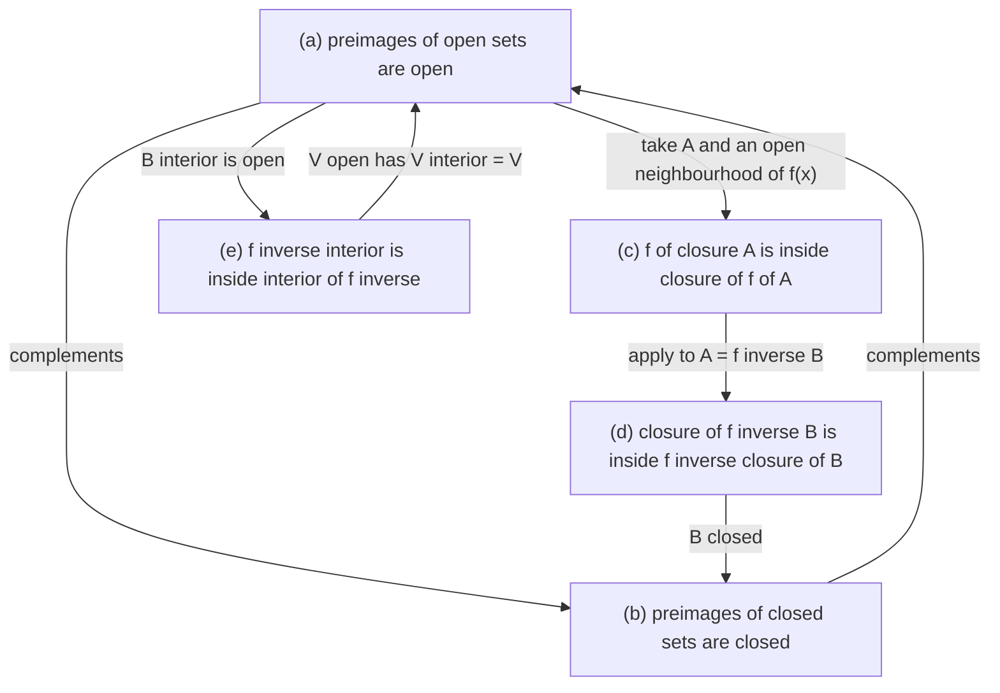
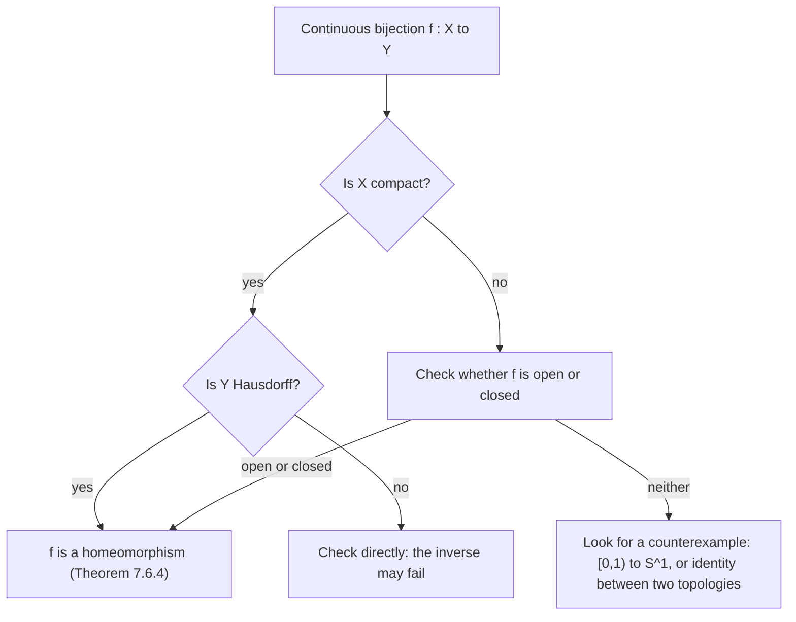

# Continuity and Homeomorphisms

> [Mathematics](../../README.md) › [Topology](../README.md) · Level: Advanced · Prerequisites: [Logic](../../00-foundations/02-logic/README.md), [Set Theory](../../00-foundations/03-set-theory/README.md), [Relations and Functions](../../00-foundations/05-relations-and-functions/README.md), [Continuity and Limits](../../14-real-analysis/03-continuity-and-limits/README.md), [Metric Spaces](../../14-real-analysis/06-metric-spaces/README.md), [Topological Spaces](../01-topological-spaces/README.md) · Estimated time: 600 min

## 1. Introduction

A topology was introduced in [Topological Spaces](../01-topological-spaces/README.md) as a family of open sets satisfying three axioms. The point of the axioms is that they are exactly what is needed to define *continuous map*, and the point of continuous maps is that they are the structure-preserving maps of the theory. This chapter develops that idea.

The central definition is one line long. A map $f : X \to Y$ between topological spaces is **continuous** if

$$
V \subseteq Y \text{ open} \quad\Longrightarrow\quad f^{-1}[V] \subseteq X \text{ open}.
$$

Nothing is said about points, distances, or limits: continuity is a statement about how $f$ transports the *open-set structure* of $Y$ back to $X$. Two things follow immediately, and they organise the whole chapter.

* **Continuity is a property of the pair (topology on $X$, topology on $Y$), not of a formula.** The same function $f(x) = x$ can be continuous or not depending on which topologies are put on its domain and codomain. Making the domain topology finer (more open sets) makes continuity harder; making the codomain topology coarser makes it easier. This is the content of §7.1 and is the reason the examples of §9.5 exist.
* **The maps that preserve the structure in both directions are the isomorphisms of the theory.** A **homeomorphism** is a continuous bijection whose inverse is also continuous. Two spaces are *topologically equivalent*, written $X \cong Y$, when such a map exists. From the topological point of view, homeomorphic spaces are the same object, and any property not preserved by homeomorphism is not a topological property.

The plan:

* **The four equivalent formulations of continuity** (§7.1): preimages of open sets, preimages of closed sets, the closure condition $f[\overline A]\subseteq\overline{f[A]}$, and the interior condition. The proofs are short and are given in full, because each formulation is the convenient one in some situation: closed sets for gluing, closures for density arguments, interiors for openness of maps.
* **Continuity at a point, and locality** (§7.2). A map is continuous iff it is continuous at every point, and continuity at a point depends only on the neighbourhoods of that point and of its image. In metric spaces this is the familiar $\varepsilon$-$\delta$ definition.
* **The pasting lemma** (§7.3). A function defined piecewise on closed (or on open) pieces is continuous provided the pieces agree on overlaps. This is the topological version of the statement that a function assembled from continuous pieces is continuous, and it is used constantly in analysis and in algebraic topology.
* **Homeomorphisms, equivalences and invariants** (§7.4–§7.5). Which properties are preserved; a catalogue of invariants; embeddings, which are homeomorphisms onto their image.
* **When a continuous bijection fails to be a homeomorphism** (§7.6). The examples are the ones that show the inverse has to be checked: $[0,1)\to S^1$ and the identity map of the Sorgenfrey line onto $\mathbb{R}$. The compact-to-Hausdorff theorem is proved here; it is the standard sufficient condition that rules out such failures.
* **The order topology** (§7.7). On $\mathbb{R}$ the usual topology can be defined from the order alone, with no distance mentioned. This is the cleanest illustration of the slogan *topology is geometry without distance*: the same open sets arise from any of infinitely many metrics, and also from the order relation, which is not a metric at all.
* **Initial and final topologies** (§7.8), the general construction behind subspaces, products, weak topologies, quotients and disjoint unions.
* **Manifolds** (§7.9). The classification of connected $1$-manifolds is stated: each is homeomorphic to $\mathbb{R}$ or to the circle $S^1$ (with boundary variants $[0,1)$ and $[0,1]$). Two dimensions already admit infinitely many classes, and the statement is a model of what a classification theorem looks like.

## 2. Prerequisites

**Topological spaces.** Open sets, closed sets, bases and subbases, closure, interior, subspace, product, quotient, Hausdorff spaces. This chapter uses all of them without pause; the reference is [Topological Spaces](../01-topological-spaces/README.md).

**Metric spaces.** Open balls, the equivalence of the $\varepsilon$-$\delta$ and preimage definitions of continuity, and the fact that different metrics may induce the same topology. See [Metric Spaces](../../14-real-analysis/06-metric-spaces/README.md).

**Continuity in $\mathbb{R}$.** The intermediate value theorem, the continuity of polynomials, $\exp$, $\sin$, $\cos$, and of quotients with nonvanishing denominator; these are used in the examples. See [Continuity and Limits](../../14-real-analysis/03-continuity-and-limits/README.md).

**Sets and functions.** Images, preimages, injectivity, surjectivity, bijections, composition, and the fact that $f^{-1}$ commutes with unions, intersections and complements, while $f$ commutes only with unions. See [Relations and Functions](../../00-foundations/05-relations-and-functions/README.md).

**Quantifiers and proof structure.** The equivalence of the four formulations of continuity is an exercise in proving implications in both directions; the pasting lemma is an exercise in manipulating preimages of closed sets. See [Logic](../../00-foundations/02-logic/README.md) and [Proof Techniques](../../00-foundations/04-proof-techniques/README.md).

**Compactness and connectedness, lightly.** A few statements — invariance of compactness, of path-connectedness, and the compact-to-Hausdorff theorem — need the definitions, which are recalled here and developed in the next topics of the discipline. See also [Metric Spaces](../../14-real-analysis/06-metric-spaces/README.md) §7.10 and §7.12.

**Ordered sets.** Linear orders, intervals, and the least upper bound property, for the order topology of §7.7. See [The Real Numbers and Completeness](../../14-real-analysis/01-real-numbers-and-completeness/README.md).

## 3. Learning Objectives

By the end of this tutorial you will be able to

1. decide whether a given map between topological spaces is continuous, using whichever of the four equivalent formulations is most convenient;
2. prove the equivalence of the open-set, closed-set, closure and interior formulations, and use continuity checked on a base or a subbase;
3. state and prove the pasting lemma in its closed and open versions, and explain why the closed version needs finiteness;
4. define homeomorphism and embedding, and prove that homeomorphism is an equivalence relation;
5. list the standard topological invariants and use them to prove that two spaces are not homeomorphic;
6. exhibit continuous bijections whose inverses are discontinuous, and explain how the compact-to-Hausdorff theorem excludes them under its hypotheses;
7. define the order topology of a linearly ordered set and prove that on $\mathbb{R}$ it agrees with the usual topology;
8. describe the initial and final topology of a family of maps, and recognise subspaces, products and quotients as special cases;
9. state the classification of connected $1$-manifolds and explain the role of second countability in it;
10. explain why continuity and homeomorphism are the right notions of "same shape", with examples from data analysis and shape comparison.

## 4. Intuition

**Continuity is about preimages, not images.** A continuous map may collapse a large set to a point, so the image of an open set need not be open; what continuity forbids is *tearing* the domain. The precise way to say "no tearing" is that pulling back an open set — a region with room to spare in the target — must give a region with room to spare in the source. If $f$ jumped at a point $x_0$, then a small target region around $f(x_0)$ would fail to have room to spare around $x_0$ in its preimage, because points just on the other side of the jump would be missing. That is exactly what fails in Example 9.3.

**Continuity at a point is a local promise.** "For every neighbourhood $V$ of $f(x)$ there is a neighbourhood $U$ of $x$ with $f[U]\subseteq V$" says: however tightly you constrain the output near $f(x)$, you can constrain the input near $x$ enough to comply. In a metric space "tightly" is measured by $\varepsilon$ and "enough" by $\delta$, which is the familiar definition.

**Gluing.** Most continuous functions in practice are defined by cases: the absolute value, the floor function on each half-open interval, a piecewise polynomial spline, the attaching maps in a CW complex. The pasting lemma says that if the pieces are closed (or open) and the definitions agree where they overlap, the result is continuous. It is the licence to build continuous maps by hand.

**Homeomorphism is "same shape".** A homeomorphism is a bijection that is continuous and whose inverse is continuous: a deformation that neither tears nor glues. Lengths, angles, curvature and distances are not preserved, which is why a coffee cup and a doughnut are the same from this point of view, while a sphere and a torus are not. What *is* preserved is everything expressible in terms of open sets: compactness, connectedness, the number of pieces after removing a point, and the dimension.

**Why the inverse needs a separate check.** A continuous bijection can still "unzip" a space: the map $t\mapsto e^{2\pi i t}$ from $[0,1)$ to the circle is continuous and bijective, but its inverse has to break the circle open at $1$ to return to an interval. Continuity of $f$ constrains how $f$ pulls back open sets; it says nothing about how $f$ pushes forward open sets. A homeomorphism has to do both, and the compact-to-Hausdorff theorem (§7.6) says that in that setting the second condition comes free.

**Geometry without distance.** On $\mathbb{R}$ the intervals $(a,b)$, together with the rays, are the basic open sets. They can be described using only the order: $(a,b) = \{x : a<x<b\}$. So the usual topology of the real line is determined by the order structure, and any two ordered sets with the same order type have homeomorphic order topologies. Distance is one way to produce a topology, order is another, and often they agree; when they do not, the difference is a genuinely topological phenomenon, as the Sorgenfrey line shows.

## 5. Formal Definition

**Definition 5.1 (Continuity at a point).** Let $X,Y$ be spaces, $f : X\to Y$ and $x_0\in X$. Then $f$ is *continuous at $x_0$* if for every neighbourhood $V$ of $f(x_0)$ there is a neighbourhood $U$ of $x_0$ with $f[U]\subseteq V$. Equivalently, for every open $V\subseteq Y$ with $f(x_0)\in V$ there is an open $U\subseteq X$ with $x_0\in U$ and $f[U]\subseteq V$.

**Definition 5.2 (Continuity).** $f : X\to Y$ is *continuous* if $f^{-1}[V]$ is open in $X$ for every open $V\subseteq Y$.

**Definition 5.3 (Open and closed maps).** $f : X\to Y$ is *open* if $f[U]$ is open in $Y$ for every open $U\subseteq X$, and *closed* if $f[F]$ is closed in $Y$ for every closed $F\subseteq X$. Continuity, openness and closedness are independent conditions: a map may have any combination of them.

**Definition 5.4 (Homeomorphism).** A bijection $f : X\to Y$ is a *homeomorphism* if $f$ and $f^{-1}$ are continuous. We write $X\cong Y$ and say that $X$ and $Y$ are *homeomorphic* or *topologically equivalent*. A property $P$ of spaces is a *topological invariant* (or *topological property*) if $X\cong Y$ and $P(X)$ imply $P(Y)$.

**Definition 5.5 (Embedding).** An injective map $f : X\to Y$ is an *embedding* if the bijection $f : X\to f[X]$ is a homeomorphism, where $f[X]\subseteq Y$ carries the subspace topology. Equivalently, $f$ is continuous and injective, and for every open $U\subseteq X$ there is an open $V\subseteq Y$ with $f[U] = f[X]\cap V$.

**Definition 5.6 (Initial topology).** Let $X$ be a set, $\{(Y_i,\sigma_i)\}_{i\in I}$ spaces, and $f_i : X\to Y_i$ maps. The *initial topology* on $X$ with respect to the family $(f_i)$ is the coarsest topology making every $f_i$ continuous. Its subbase is $\{f_i^{-1}[V] : i\in I,\ V\in\sigma_i\}$.

**Definition 5.7 (Final topology).** Let $Y$ be a set, $\{(X_i,\tau_i)\}_{i\in I}$ spaces, and $g_i : X_i\to Y$ maps. The *final topology* on $Y$ is the finest topology making every $g_i$ continuous; explicitly, $U\subseteq Y$ is open iff $g_i^{-1}[U]$ is open in $X_i$ for every $i$.

**Definition 5.8 (Order topology).** Let $(L,<)$ be a linearly ordered set. The *order topology* on $L$ is the topology generated by the subbase of open rays

$$
(a,\infty) = \{x\in L : x>a\}, \qquad (-\infty,a) = \{x\in L : x<a\}, \qquad a\in L .
$$

Its basic open sets are the open intervals $(a,b)$, the rays, and — when $L$ has a least element $a_0$ or a greatest element $b_0$ — the half-open intervals $[a_0,b)$ and $(a,b_0]$.

**Definition 5.9 (Manifold).** A space $M$ is an *$n$-dimensional topological manifold* if it is second countable and Hausdorff, and every point has an open neighbourhood homeomorphic to an open subset of $\mathbb{R}^n$. A *manifold with boundary* is defined in the same way with $\mathbb{R}^n$ replaced by the half-space $\mathbb{H}^n = \{(x_1,\dots,x_n) : x_1\ge0\}$. A *$1$-manifold* is a manifold of dimension $1$.

**Definition 5.10 (Cut point).** Let $X$ be a connected space and $x\in X$. Then $x$ is a *cut point* of $X$ if $X\setminus\{x\}$ is disconnected; otherwise $x$ is a *non-cut point*.

Connectedness and compactness are used in this chapter as invariants. For reference: $X$ is *connected* if it admits no separation $X = U\cup V$ with $U,V$ nonempty, disjoint and open; it is *path-connected* if for all $p,q\in X$ there is a continuous $\gamma : [0,1]\to X$ with $\gamma(0) = p$, $\gamma(1) = q$; and it is *compact* if every open cover has a finite subcover. The first two are developed in the metric setting in [Metric Spaces](../../14-real-analysis/06-metric-spaces/README.md) and in general in the later topics of this discipline.

## 6. Mathematical Notation

| Symbol | Read as | Meaning |
|---|---|---|
| $f : X\to Y$ | $f$ maps $X$ to $Y$ | domain $X$, codomain $Y$ |
| $f^{-1}[V]$ | preimage of $V$ | $\{x\in X : f(x)\in V\}$ |
| $f[A]$ | image of $A$ | $\{f(a) : a\in A\}$ |
| $f|_A$ | restriction of $f$ to $A$ | the map $A\to Y$, $a\mapsto f(a)$ |
| $\mathrm{id}_X$ | identity map | $x\mapsto x$ |
| $X\cong Y$ | $X$ is homeomorphic to $Y$ | a homeomorphism exists |
| $\operatorname{Homeo}(X)$ | homeomorphism group | bijections $X\to X$ continuous with continuous inverse |
| $f\times g$ | product map | $(x,y)\mapsto(f(x),g(x))$ |
| $\Delta_X$ | diagonal | $\{(x,x) : x\in X\}\subseteq X\times X$ |
| $S^1$ | the circle | $\{z\in\mathbb{C} : \lvert z\rvert = 1\}$ |
| $D^n$ | the closed disc | $\{x\in\mathbb{R}^n : \lVert x\rVert\le1\}$ |
| $\mathbb{H}^n$ | half-space | $\{(x_1,\dots,x_n) : x_1\ge0\}$ |
| $\mathbb{R}_\ell$ | Sorgenfrey line | $\mathbb{R}$ with base $\{[a,b)\}$ |
| $\tau_{\mathrm{fine}}, \tau_{\mathrm{coarse}}$ | finer and coarser topologies | $\tau_{\mathrm{coarse}}\subseteq\tau_{\mathrm{fine}}$ |
| $\langle\mathcal{S}\rangle$ | topology generated by $\mathcal{S}$ | the coarsest topology containing $\mathcal{S}$ |
| $\gamma : [0,1]\to X$ | path in $X$ | a continuous curve with endpoints $\gamma(0),\gamma(1)$ |
| $\partial M$ | boundary of a manifold | points with neighbourhoods like $\mathbb{H}^n$ but not $\mathbb{R}^n$ |
## 7. Core Concepts

### 7.1 Continuity and Its Four Formulations

**Theorem 7.1.1 (Characterisations of continuity).** Let $X,Y$ be spaces and $f : X\to Y$. The following are equivalent.

* **(a)** $f^{-1}[V]$ is open in $X$ for every open $V\subseteq Y$.
* **(b)** $f^{-1}[F]$ is closed in $X$ for every closed $F\subseteq Y$.
* **(c)** $f[\overline A]\subseteq\overline{f[A]}$ for every $A\subseteq X$.
* **(d)** $\overline{f^{-1}[B]}\subseteq f^{-1}[\overline B]$ for every $B\subseteq Y$.
* **(e)** $f^{-1}[B^{\circ}]\subseteq\big(f^{-1}[B]\big)^{\circ}$ for every $B\subseteq Y$.

*Proof.* **(a) $\Leftrightarrow$ (b).** For $F\subseteq Y$ the identity $f^{-1}[Y\setminus F] = X\setminus f^{-1}[F]$ holds, because $x\mapsto f(x)$ is in $Y\setminus F$ exactly when it is not in $F$. If $F$ is closed then $Y\setminus F$ is open; so $f^{-1}[F]$ is closed iff $X\setminus f^{-1}[F]$ is open iff $f^{-1}[Y\setminus F]$ is open. Varying $F$ over the closed sets and $Y\setminus F$ over the open sets gives the equivalence.

**(a) $\Rightarrow$ (c).** Let $A\subseteq X$ and $x\in\overline A$. Let $V$ be an open neighbourhood of $f(x)$. Then $f^{-1}[V]$ is an open neighbourhood of $x$, so it meets $A$ by Theorem 7.9.1(2) of [Topological Spaces](../01-topological-spaces/README.md). Pick $a\in A\cap f^{-1}[V]$; then $f(a)\in V\cap f[A]$. So every neighbourhood of $f(x)$ meets $f[A]$, i.e. $f(x)\in\overline{f[A]}$.

**(c) $\Rightarrow$ (d).** Apply (c) to the set $A = f^{-1}[B]$:

$$
f\big[\overline{f^{-1}[B]}\big]\subseteq\overline{f\big[f^{-1}[B]\big]}\subseteq\overline B,
$$

where the last inclusion holds because $f[f^{-1}[B]]\subseteq B$. Hence $\overline{f^{-1}[B]}\subseteq f^{-1}[\overline B]$, since $f(y)\in\overline B$ means $y\in f^{-1}[\overline B]$.

**(d) $\Rightarrow$ (b).** Let $F\subseteq Y$ be closed, so $\overline F = F$. By (d) with $B = F$,
$\overline{f^{-1}[F]}\subseteq f^{-1}[F]$. The reverse inclusion $f^{-1}[F]\subseteq\overline{f^{-1}[F]}$ always holds, so $f^{-1}[F]$ equals its closure and is closed.

**(a) $\Rightarrow$ (e).** If $B\subseteq Y$ then $B^{\circ}$ is open, so $f^{-1}[B^{\circ}]$ is open by (a) and it is contained in $f^{-1}[B]$. Since $\big(f^{-1}[B]\big)^{\circ}$ is the largest open subset of $f^{-1}[B]$, the inclusion follows.

**(e) $\Rightarrow$ (a).** If $V\subseteq Y$ is open then $V^{\circ} = V$, so (e) gives $f^{-1}[V]\subseteq\big(f^{-1}[V]\big)^{\circ}$, hence equality and $f^{-1}[V]$ is open. $\blacksquare$

**Remark 7.1.2 (Which formulation to use).** Formulation (a) is the definition and is best for algebraic manipulations; (b) is the right one when a function is defined piecewise on closed sets (§7.3); (c) is used to prove that $f$ extends from a dense subset, and to prove that a map is *not* a homeomorphism; (d) and (e) are the "preimage of closure" and "preimage of interior" inequalities, useful when one side is easier to compute than the other. Note that (c) and (d) are dual in a precise sense: (c) says $f$ sends closures into closures of images, (d) says closures of preimages fall inside preimages of closures.

**Corollary 7.1.3 (Checking continuity on a base or subbase).** Let $\mathcal{B}$ be a base for the topology of $Y$, or more generally let $\mathcal{S}$ be a subbase with $\bigcup\mathcal{S} = Y$.

1. If $f^{-1}[B]$ is open for every $B\in\mathcal{B}$, then $f$ is continuous.
2. If $f^{-1}[S]$ is open for every $S\in\mathcal{S}$, then $f$ is continuous.

*Proof.* (1) An open $V\subseteq Y$ is a union $\bigcup_i B_i$ of base elements, so $f^{-1}[V] = \bigcup_i f^{-1}[B_i]$ is a union of open sets. (2) By Theorem 7.5.3 of [Topological Spaces](../01-topological-spaces/README.md), every open set is a union of finite intersections of members of $\mathcal{S}$; preimages commute with finite intersections, so $f^{-1}$ of such a finite intersection is a finite intersection of open sets, and $f^{-1}[V]$ is a union of these. $\blacksquare$

**Proposition 7.1.4 (Closure properties of continuity).** Let $f : X\to Y$ and $g : Y\to Z$ be continuous.

1. $g\circ f : X\to Z$ is continuous.
2. For $A\subseteq X$ the restriction $f|_A : A\to Y$ is continuous, where $A$ has the subspace topology.
3. If $f[X]\subseteq Z\subseteq Y$ and $Z$ has the subspace topology, then $f$ is continuous as a map $X\to Z$ (the *corestriction*).
4. If $g' : W\to Y$ is also continuous then $(f,g') : W\to X\times Y$, $w\mapsto(f(w),g'(w))$, is continuous.

*Proof.* (1) $(g\circ f)^{-1}[W] = f^{-1}\big[g^{-1}[W]\big]$, and $g^{-1}[W]$ is open when $W$ is. (2) If $V\subseteq Y$ is open then $(f|_A)^{-1}[V] = f^{-1}[V]\cap A$, which is open in $A$ by definition of the subspace topology. (3) If $W = Z\cap V$ with $V\subseteq Y$ open, then $f^{-1}[W] = f^{-1}[V]\cap f^{-1}[Z] = f^{-1}[V]$ is open. (4) For $U\subseteq X$ and $V\subseteq Y$ open, $(f,g')^{-1}[U\times V] = f^{-1}[U]\cap (g')^{-1}[V]$ is open; by Corollary 7.1.3 and the description of a base for $X\times Y$ this suffices. $\blacksquare$

**Proposition 7.1.5 (Continuity and density).** If $f, g : X\to Y$ are continuous with $Y$ Hausdorff and $f = g$ on a dense subset $D\subseteq X$, then $f = g$ on $X$.

*Proof.* Suppose $f(x)\ne g(x)$ for some $x$. Choose disjoint open $U\ni f(x)$, $V\ni g(x)$. Then $f^{-1}[U]\cap g^{-1}[V]$ is an open neighbourhood of $x$, so it meets $D$. At a point $d$ of the intersection, $f(d)\in U$ and $g(d)\in V$; but $f(d) = g(d)$ since $d\in D$, and $U\cap V = \varnothing$. Contradiction. $\blacksquare$

This is the standard "uniqueness of continuous extensions" statement: a continuous function on a dense subset of a Hausdorff space has at most one continuous extension.

### 7.2 Continuity at a Point and Local Characterisations

**Theorem 7.2.1 (Pointwise versus global continuity).** $f : X\to Y$ is continuous if and only if it is continuous at every point of $X$.

*Proof.* Suppose $f$ is continuous, let $x\in X$ and let $V$ be a neighbourhood of $f(x)$. Choose open $W$ with $f(x)\in W\subseteq V$. Then $U = f^{-1}[W]$ is open, contains $x$, and satisfies $f[U]\subseteq W\subseteq V$; so $f$ is continuous at $x$.

Conversely assume $f$ is continuous at every point, and let $V\subseteq Y$ be open. For $x\in f^{-1}[V]$, the set $V$ is a neighbourhood of $f(x)$, so there is a neighbourhood $U_x$ of $x$ with $f[U_x]\subseteq V$, i.e. $U_x\subseteq f^{-1}[V]$. Choose an open $O_x$ with $x\in O_x\subseteq U_x$. Then

$$
f^{-1}[V] = \bigcup_{x\in f^{-1}[V]}O_x
$$

is a union of open sets, hence open. $\blacksquare$

**Proposition 7.2.2 (Continuity is local).** $f : X\to Y$ is continuous iff every point of $X$ has an open neighbourhood $U$ such that $f|_U : U\to Y$ is continuous.

*Proof.* If $f$ is continuous then $f|_{X}$ is continuous. Conversely, let $V\subseteq Y$ be open and let $x\in f^{-1}[V]$. Choose an open neighbourhood $U_x$ of $x$ on which $f$ is continuous. Then

$$
f^{-1}[V]\cap U_x = (f|_{U_x})^{-1}[V]
$$

is open in $U_x$, hence — because $U_x$ is open in $X$ — open in $X$. Therefore $f^{-1}[V] = \bigcup_{x}(f^{-1}[V]\cap U_x)$ is open. $\blacksquare$

**Proposition 7.2.3 (The metric case).** Let $(X,d)$ and $(Y,\rho)$ be metric spaces. Then $f : X\to Y$ is continuous at $x_0$ if and only if

$$
\forall\varepsilon>0\ \exists\delta>0\ \forall x\in X:\quad d(x,x_0)<\delta \Longrightarrow \rho(f(x),f(x_0))<\varepsilon .
$$

*Proof.* The balls $B_\delta(x_0)$ and $B_\varepsilon(f(x_0))$ are neighbourhood bases at $x_0$ and at $f(x_0)$ respectively (Lemma 7.5.1 of [Topological Spaces](../01-topological-spaces/README.md)). By Definition 5.1, continuity at $x_0$ means that for every neighbourhood $V$ of $f(x_0)$ there is a neighbourhood $U$ of $x_0$ with $f[U]\subseteq V$. It is enough to test $V = B_\varepsilon(f(x_0))$ and to take $U = B_\delta(x_0)$, since every neighbourhood contains a ball. The resulting condition is exactly the displayed one. $\blacksquare$

**Remark 7.2.4 (Sequences).** In a first-countable space, continuity at $x$ is equivalent to sequential continuity: $x_n\to x$ implies $f(x_n)\to f(x)$. The implication "continuous $\Rightarrow$ sequentially continuous" holds in every space; the converse needs first countability. In the co-countable topology of Exercise 36 of [Topological Spaces](../01-topological-spaces/README.md) it fails: every sequence with infinite range converges everywhere, so every map is sequentially continuous, while not every map is continuous.

**Proposition 7.2.5 (Algebra of continuous real functions).** If $f, g : X\to\mathbb{R}$ are continuous, then so are $f+g$, $fg$, $\max(f,g)$, $\min(f,g)$ and $\lvert f\rvert$; and $f/g$ is continuous on the open set where $g\ne0$.

*Proof.* The map $X\to\mathbb{R}^2$, $x\mapsto(f(x),g(x))$, is continuous by Proposition 7.1.4(4). Addition and multiplication are continuous maps $\mathbb{R}^2\to\mathbb{R}$ (they are polynomials, hence continuous for the usual topology), so the composites $f+g$ and $fg$ are continuous. The maps $\max$ and $\lvert\cdot\rvert$ are continuous on $\mathbb{R}^2$ and $\mathbb{R}$ respectively, and $f/g$ is the composite of $x\mapsto(f(x),g(x))$ with the continuous map $(u,v)\mapsto u/v$ defined on $\{(u,v) : v\ne0\}$. $\blacksquare$

### 7.3 The Pasting Lemma

**Lemma 7.3.1.** If $A\subseteq X$ is closed in $X$ and $G\subseteq A$ is closed in the subspace $A$, then $G$ is closed in $X$.

*Proof.* By definition of the subspace topology, $G = A\cap H$ with $H\subseteq X$ closed. An intersection of two closed sets is closed. $\blacksquare$

**Theorem 7.3.2 (Pasting lemma, closed version).** Let $X = A\cup B$ with $A$ and $B$ closed in $X$. If $f : X\to Y$ is a function whose restrictions $f|_A$ and $f|_B$ are continuous, then $f$ is continuous.

*Proof.* By Theorem 7.1.1(b) it suffices to show that $f^{-1}[F]$ is closed for every closed $F\subseteq Y$. Now

$$
f^{-1}[F] = \big(f^{-1}[F]\cap A\big)\cup\big(f^{-1}[F]\cap B\big) = (f|_A)^{-1}[F]\cup(f|_B)^{-1}[F].
$$

Since $f|_A$ is continuous, $(f|_A)^{-1}[F]$ is closed in $A$, hence closed in $X$ by Lemma 7.3.1. Similarly $(f|_B)^{-1}[F]$ is closed in $X$. A union of two closed sets is closed. $\blacksquare$

**Theorem 7.3.3 (Pasting lemma, open version).** Let $X = \bigcup_{i\in I}U_i$ with each $U_i$ open in $X$, and let $f : X\to Y$ be a function such that every restriction $f|_{U_i}$ is continuous. Then $f$ is continuous. No finiteness assumption on $I$ is needed.

*Proof.* Let $V\subseteq Y$ be open. For each $i$,

$$
f^{-1}[V]\cap U_i = (f|_{U_i})^{-1}[V]
$$

is open in $U_i$, hence open in $X$ because $U_i$ is open in $X$. Therefore $f^{-1}[V] = \bigcup_i\big(f^{-1}[V]\cap U_i\big)$ is a union of open sets. $\blacksquare$

**Remark 7.3.4 (Why the closed version needs finiteness).** In Theorem 7.3.2 the union is a *finite* union of closed sets, and that is what makes $f^{-1}[F]$ closed. With countably many closed pieces the argument breaks: a countable union of closed sets need not be closed. And the result is genuinely false. On $\mathbb{R}$ let $F_0 = (-\infty,0]$ and $F_n = [1/n,\infty)$ for $n\ge1$; these are closed, their union is $\mathbb{R}$, and the function equal to $0$ on $F_0$ and to $1$ on each $F_n$ is well defined (the pieces are consistent on overlaps, since the $F_n$ with $n\ge1$ overlap each other but not $F_0$) and has continuous restriction to every piece, yet it is the step function, which is discontinuous at $0$. The correct generalisation replaces finiteness by *local finiteness*: a family $\{F_i\}$ is locally finite if every point has a neighbourhood meeting only finitely many $F_i$, and the pasting lemma holds for locally finite closed covers, because closedness is then a local condition.

**Corollary 7.3.5 (Gluing along an open cover).** If $\{U_i\}$ is an open cover of $X$ and $f_i : U_i\to Y$ are continuous with $f_i = f_j$ on $U_i\cap U_j$ for all $i,j$, then there is a unique continuous $f : X\to Y$ with $f|_{U_i} = f_i$ for all $i$.

*Proof.* For $x\in X$ choose any $i$ with $x\in U_i$ and set $f(x) = f_i(x)$; the overlap condition makes this independent of the choice of $i$. Continuity is Theorem 7.3.3. $\blacksquare$

### 7.4 Homeomorphisms and Topological Invariants

**Theorem 7.4.1 (Elementary properties).**

1. $\mathrm{id}_X : X\to X$ is a homeomorphism.
2. If $f : X\to Y$ is a homeomorphism then $f^{-1} : Y\to X$ is a homeomorphism.
3. If $f : X\to Y$ and $g : Y\to Z$ are homeomorphisms then $g\circ f : X\to Z$ is a homeomorphism.
4. Consequently $\cong$ is an equivalence relation on topological spaces, and $\operatorname{Homeo}(X) = \{f : X\to X : f \text{ homeomorphism}\}$ is a group under composition.

*Proof.* (1) The identity is its own inverse and is continuous. (2) The inverse of $f^{-1}$ is $f$, and both are continuous by hypothesis. (3) $g\circ f$ is a continuous bijection with inverse $f^{-1}\circ g^{-1}$, a composite of continuous maps. (4) is immediate from (1)–(3); the group axioms are associativity of composition (automatic for functions), the identity (1) and inverses (2). $\blacksquare$

**Definition 7.4.2 (Topological invariant).** A property $P$ is a *topological invariant* if whenever $X\cong Y$, $X$ has $P$ if and only if $Y$ has $P$.

**Theorem 7.4.3 (The standard invariants).** Let $f : X\to Y$ be a homeomorphism. Then:

1. $\lvert X\rvert = \lvert Y\rvert$, and $f$ induces a bijection between the open sets of $X$ and those of $Y$;
2. $X$ is $T_0$, $T_1$, $T_2$, $T_3$ or $T_4$ if and only if $Y$ is;
3. $X$ is first countable, second countable or separable if and only if $Y$ is;
4. $X$ is compact if and only if $Y$ is;
5. $X$ is connected if and only if $Y$ is, and path-connected if and only if $Y$ is;
6. $f$ maps the cut points of $X$ bijectively onto the cut points of $Y$;
7. $f$ maps $\overline A$ onto $\overline{f[A]}$, $A^{\circ}$ onto $f[A]^{\circ}$ and $\partial A$ onto $\partial f[A]$, for every $A\subseteq X$.

*Proof.* (1) $f$ is a bijection. Openness of $f$ follows from continuity of $f^{-1}$, and openness of $f^{-1}$ from continuity of $f$; so $U\subseteq X$ is open iff $f[U]\subseteq Y$ is open.

(2) $T_0,T_1$: two points $x\ne x'$ are separated by an open $U$ with $x\in U$, $x'\notin U$ exactly when $f(x),f(x')$ are separated by the open set $f[U]$; this uses (1). $T_2$: if $U,V$ are disjoint open neighbourhoods of $x,x'$, then $f[U],f[V]$ are disjoint open neighbourhoods of $f(x),f(x')$; and symmetrically using $f^{-1}$. $T_3,T_4$: $f$ carries closed sets to closed sets and disjoint pairs to disjoint pairs, so the separating open sets transport in both directions.

(3) If $\mathcal{B}$ is a base for $X$ then $f[\mathcal{B}]$ is a base for $Y$: it consists of open sets, and for $y\in V$ open in $Y$, the point $f^{-1}(y)$ lies in the open set $f^{-1}[V]$, so there is $B\in\mathcal{B}$ with $f^{-1}(y)\in B\subseteq f^{-1}[V]$, whence $y\in f[B]\subseteq V$. A homeomorphism carries countable sets to countable sets, so countability of a base is preserved both ways. Separability: if $D$ is dense in $X$ then $f[D]$ is dense in $Y$, because $f[\overline D] = \overline{f[D]}$ by (7); both directions follow.

(4) If $X$ is compact and $\{V_i\}$ is an open cover of $Y$, then $\{f^{-1}[V_i]\}$ is an open cover of $X$; a finite subcover of $X$ gives a finite subcover of $Y$. Symmetrically with $f^{-1}$.

(5) If $X = U\cup V$ is a separation, then $Y = f[U]\cup f[V]$ is a separation, since $f[U],f[V]$ are nonempty, open and disjoint; and symmetrically. For path-connectedness: if $\gamma : [0,1]\to X$ joins $p$ to $q$, then $f\circ\gamma$ joins $f(p)$ to $f(q)$; and symmetrically with $f^{-1}$.

(6) The restriction $f|_{X\setminus\{x\}} : X\setminus\{x\}\to Y\setminus\{f(x)\}$ is a homeomorphism (it is a continuous bijection with continuous inverse). By (5), $X\setminus\{x\}$ is connected iff $Y\setminus\{f(x)\}$ is, so $x$ is a cut point iff $f(x)$ is.

(7) The first identity is the combination of (c) and (d) of Theorem 7.1.1 applied to $f$ and to $f^{-1}$: $f[\overline A]\subseteq\overline{f[A]}$ and $\overline A = f^{-1}\big[f[\overline A]\big]\supseteq f^{-1}\big[\overline{f[A]}\big]\supseteq\overline A$, hence equality. Then $f[A^{\circ}] = f\big[X\setminus\overline{X\setminus A}\big] = Y\setminus\overline{f[X\setminus A]} = Y\setminus\overline{Y\setminus f[A]} = f[A]^{\circ}$, and the boundary claim follows from $\partial A = \overline A\setminus A^{\circ}$. $\blacksquare$

**Remark 7.4.4 (Properties that are not topological).** Boundedness, diameter, completeness and being an open subset of $\mathbb{R}^n$ are *not* topological invariants. The interval $(0,1)$ is homeomorphic to $\mathbb{R}$ (Example 9.4) but is bounded and incomplete in the usual metric, while $\mathbb{R}$ is neither. Likewise $[0,1)$ is not open in $\mathbb{R}$ but is homeomorphic to $[0,\infty)$, which *is* closed in $\mathbb{R}$ — "being open" depends on the ambient space, and a homeomorphism between two spaces does not see an ambient space. Completeness can be turned into a topological property only after restricting to *uniformly continuous* homeomorphisms, i.e. after adding uniform structure.

### 7.5 Embeddings

An embedding is a homeomorphism onto its image. The distinction between "injective continuous map" and "embedding" is exactly the distinction between "$f$ is continuous" and "$f^{-1}$ is continuous on the image".

**Proposition 7.5.1 (Characterisation of embeddings).** Let $f : X\to Y$ be injective and continuous. The following are equivalent.

1. $f$ is an embedding.
2. For every open $U\subseteq X$ there is an open $V\subseteq Y$ with $f[U] = f[X]\cap V$.
3. For every $A\subseteq X$, $f[\overline A] = f[X]\cap\overline{f[A]}$.

*Proof.* (1) $\Leftrightarrow$ (2): $f : X\to f[X]$ is a homeomorphism iff it is open as a map onto $f[X]$ (the inverse is continuous iff $f$ is open), and a subset of $f[X]$ is open in the subspace topology exactly when it has the form $f[X]\cap V$ with $V$ open in $Y$.

(2) $\Rightarrow$ (1): condition (2) says precisely that the continuous bijection $f : X\to f[X]$ is an open map. A continuous bijection is a homeomorphism if and only if it is open: if $f$ is open then for open $U\subseteq X$ the set $(f^{-1})^{-1}[U] = f[U]$ is open, so $f^{-1}$ is continuous.

(1) $\Rightarrow$ (3): apply Theorem 7.4.3(7) to the homeomorphism $f : X\to f[X]$, whose closed sets are the traces $f[X]\cap F$ of closed sets of $Y$.

(3) $\Rightarrow$ (1): by (c) of Theorem 7.1.1 applied to $f : X\to f[X]$, the map $f$ is continuous; and for the inverse, if $B = f[A]\subseteq f[X]$ then
$f^{-1}[\overline B] = f^{-1}\big[f[X]\cap\overline{f[A]}\big] = f^{-1}\big[f[\overline A]\big] = \overline A = \overline{f^{-1}[B]}$, so $f^{-1}$ is continuous by Theorem 7.1.1(c). $\blacksquare$

**Examples 7.5.2.**

1. The inclusion $A\hookrightarrow X$ of a subspace is an embedding.
2. $\mathbb{R}\to\mathbb{R}^2$, $t\mapsto(t,0)$, is an embedding: the image is the $x$-axis with the subspace topology, and $t\mapsto(t,0)$ is a homeomorphism onto it.
3. $\mathbb{R}\to\mathbb{R}^2$, $t\mapsto(t,t^2)$, is an embedding. The image is the parabola, and the inverse is $(u,v)\mapsto u$ on the parabola, which is continuous because it is the restriction of the continuous projection $\pi_1$.
4. $[0,1)\to S^1$, $t\mapsto e^{2\pi i t}$, is injective and continuous but **not** an embedding: its image is all of $S^1$, and the inverse is discontinuous at $1$ (§7.6).
5. $\mathbb{Q}\hookrightarrow\mathbb{R}$ is an embedding, but $\mathbb{Q}$ is not a closed subspace; an embedding need not have closed image.
6. The map $\mathbb{R}\to S^1\times S^1$, $t\mapsto(e^{2\pi i t}, e^{2\pi i\alpha t})$ with $\alpha$ irrational is an embedding with dense image (the *irrational winding line* on the torus). Its image is dense, so it is not closed.

### 7.6 Continuous Bijections with Discontinuous Inverses

A continuous bijection need not be a homeomorphism. Three examples, in increasing order of generality.

**Example 7.6.1 ($[0,1)\to S^1$).** Let $q : [0,1)\to S^1$ be $q(t) = e^{2\pi i t}$. It is a continuous bijection. Its inverse $g : S^1\to[0,1)$ is not continuous: the set $U = [0,\tfrac12)$ is open in $[0,1)$ (it is $[0,1)\cap(-\tfrac12,\tfrac12)$), but

$$
g^{-1}[U] = q[U] = \{e^{2\pi i t} : 0\le t<\tfrac12\}
$$

is not open in $S^1$, because every neighbourhood of the point $1 = q(0)$ contains points $e^{2\pi i t}$ with $t$ close to $1$, and those points are not in $q[U]$. Intuitively, $g$ has to cut the circle at $1$ to lay it out as a half-open interval, and a continuous inverse cannot cut.

**Example 7.6.2 (Identity between two topologies).** Let $\tau_{\mathrm{usual}}\subseteq\tau_\ell$ be the usual and Sorgenfrey topologies on $\mathbb{R}$. The identity map

$$
\mathrm{id} : (\mathbb{R},\tau_\ell)\to(\mathbb{R},\tau_{\mathrm{usual}})
$$

is continuous, because $\mathrm{id}^{-1}[V] = V$ and every usual-open set is Sorgenfrey-open. It is a bijection. Its inverse is the identity $(\mathbb{R},\tau_{\mathrm{usual}})\to(\mathbb{R},\tau_\ell)$, which is *not* continuous: $[0,1)$ is Sorgenfrey-open but not usual-open. So the identity map of a set onto itself can be a continuous bijection without being a homeomorphism.

**Example 7.6.3 (Finer to coarser, in general).** More generally, if $\tau_1,\tau_2$ are topologies on $X$ with $\tau_2\subseteq\tau_1$, then $\mathrm{id} : (X,\tau_1)\to(X,\tau_2)$ is a continuous bijection; it is a homeomorphism iff $\tau_1 = \tau_2$. This is the cleanest way to remember which direction of refinement helps continuity: *coarsening the codomain* or *refining the domain* makes a map more likely to be continuous.

**Theorem 7.6.4 (Continuous bijections out of compact spaces).** Let $f : X\to Y$ be a continuous bijection. If $X$ is compact and $Y$ is Hausdorff, then $f$ is a homeomorphism.

The proof uses three standard facts about compactness, each proved here in full.

**Lemma 7.6.5.** A closed subset of a compact space is compact.

*Proof.* Let $X$ be compact, $F\subseteq X$ closed, and $\{V_i\}_{i\in I}$ an open cover of $F$. Then $\{V_i\}_{i\in I}\cup\{X\setminus F\}$ is an open cover of $X$. By compactness it has a finite subcover; discarding $X\setminus F$ if present leaves finitely many $V_i$ that cover $F$. $\blacksquare$

**Lemma 7.6.6.** A compact subset of a Hausdorff space is closed.

*Proof.* Let $X$ be Hausdorff, $K\subseteq X$ compact, and $y\in X\setminus K$. For each $x\in K$ choose disjoint open sets $U_x\ni x$ and $V_x\ni y$. The family $\{U_x : x\in K\}$ covers $K$, so finitely many $U_{x_1},\dots,U_{x_n}$ cover $K$. Then $V = V_{x_1}\cap\cdots\cap V_{x_n}$ is an open neighbourhood of $y$ disjoint from $U_{x_1}\cup\cdots\cup U_{x_n}\supseteq K$. Hence $X\setminus K = \bigcup_{y\notin K}V_y$ is open and $K$ is closed. $\blacksquare$

**Lemma 7.6.7.** The continuous image of a compact space is compact.

*Proof.* Let $f : X\to Y$ be continuous with $X$ compact, and let $\{V_i\}$ be an open cover of $f[X]$. Then $\{f^{-1}[V_i]\}$ is an open cover of $X$; a finite subcover $f^{-1}[V_{i_1}],\dots,f^{-1}[V_{i_n}]$ yields $f[X]\subseteq V_{i_1}\cup\cdots\cup V_{i_n}$. $\blacksquare$

*Proof of Theorem 7.6.4.* It suffices to prove that $f$ is a closed map, since then $f^{-1}$ is continuous: for closed $F\subseteq X$ we have $(f^{-1})^{-1}[F] = f[F]$, and the closed-set formulation of continuity (Theorem 7.1.1(b)) applies to $f^{-1}$.

So let $F\subseteq X$ be closed. By Lemma 7.6.5, $F$ is compact; by Lemma 7.6.7, $f[F]$ is compact; by Lemma 7.6.6 applied in the Hausdorff space $Y$, $f[F]$ is closed. $\blacksquare$

**Corollary 7.6.8.** A continuous injection $f : X\to Y$ with $X$ compact and $Y$ Hausdorff is an embedding.

*Proof.* The map $f : X\to f[X]$ is a continuous bijection onto the subspace $f[X]$, which is Hausdorff because subspaces of Hausdorff spaces are Hausdorff. By Theorem 7.6.4 it is a homeomorphism. $\blacksquare$

**Remark 7.6.9 (Both hypotheses are needed).** In Example 7.6.1 the domain $[0,1)$ is not compact; in Example 7.6.2 the space $\mathbb{R}_\ell$ is not compact. Neither hypothesis can be dropped: if $X$ is not compact the inverse may fail to be continuous (Example 7.6.1), and if $Y$ is not Hausdorff it may fail too — take $X$ a two-point discrete space and $Y$ a two-point indiscrete space; the identity is a continuous bijection which is not a homeomorphism.

### 7.7 The Order Topology on $\mathbb{R}$

**Lemma 7.7.1.** Let $(L,<)$ be a linearly ordered set. The family consisting of all open intervals $(a,b)$, all rays $(-\infty,a)$ and $(a,\infty)$, together with $L$ itself, is a base for the order topology.

*Proof.* By definition the order topology is generated by the subbase of rays, so by Theorem 7.5.3 of [Topological Spaces](../01-topological-spaces/README.md) it is enough to note that a finite intersection of rays is again an interval, a ray, $L$ or $\varnothing$:

$$
(-\infty,a)\cap(-\infty,b) = (-\infty,\min(a,b)), \qquad
(a,\infty)\cap(b,\infty) = (\max(a,b),\infty),
$$

$$
(a,\infty)\cap(-\infty,b) = \begin{cases}(a,b) & \text{if } a<b,\\ \varnothing & \text{if } a\ge b,\end{cases}
$$

and analogously for longer intersections. This family is closed under finite intersections, so it is the base produced by the subbase theorem. $\blacksquare$

**Theorem 7.7.2 (The usual topology of $\mathbb{R}$ is its order topology).** On $\mathbb{R}$ the order topology coincides with the metric topology.

*Proof.* Every ray is usual-open: $(-\infty,a) = \bigcup_{n\in\mathbb{N}}(a-n,a)$ and $(a,\infty) = \bigcup_{n\in\mathbb{N}}(a,a+n)$. Since the rays generate the order topology, every order-open set is usual-open.

Conversely, for $a<b$ the interval $(a,b) = (-\infty,b)\cap(a,\infty)$ is order-open, being a finite intersection of subbasic sets. Every usual-open set is a union of open intervals, hence order-open. $\blacksquare$

**Proposition 7.7.3 (Three more examples).**

1. On $\mathbb{Z}$ the order topology is the discrete topology: for $n\in\mathbb{Z}$, the interval $(n-1,n+1)$ equals $\{n\}$.
2. On $\mathbb{Q}$ the order topology is the usual (subspace) topology; the proof of Theorem 7.7.2 applies verbatim, using only that intervals are the basic sets in both descriptions.
3. On $[0,1]$ the order topology equals the subspace topology inherited from $\mathbb{R}$: the order-basic sets $[0,b)$ and $(a,1]$ are traces of the usual-open rays $(-1,b)$ and $(a,2)$, and conversely $[0,1]\cap(a,b)$ is an order interval.

**Remark 7.7.4 (Why topology is geometry without distance).** Theorem 7.7.2 is more than a coincidence. The order topology is defined using only the relation $<$, with no metric, no arithmetic and no notion of closeness. It follows that the usual topology of $\mathbb{R}$ is an *order-theoretic* object: it is determined by the order type of the real line. Consequences:

* Every order isomorphism between two linearly ordered sets is a homeomorphism for the respective order topologies. For instance $x\mapsto x^3$ is an order isomorphism of $\mathbb{R}$ and hence a homeomorphism, and $x\mapsto\arctan x$ is an order isomorphism $\mathbb{R}\to(-\pi/2,\pi/2)$, hence a homeomorphism onto its image.
* Any two metrics giving the same open sets are indistinguishable topologically: $d$, $2d$, $\min(d,1)$ and $\lvert\arctan x-\arctan y\rvert$ all give the usual topology of $\mathbb{R}$. The topology remembers the qualitative structure, not the numbers.
* The same ordered set can carry different topologies. The Sorgenfrey line is a topology on $\mathbb{R}$ strictly finer than the usual one, in which $[a,b)$ is open; it is not obtained from the usual order by the recipe of Definition 5.8, and in fact it is the order topology of no linear order on $\mathbb{R}$. This is the precise sense in which "topology is geometry without distance": a topology is extra structure on a set, sometimes induced by a metric, sometimes by an order, sometimes by neither.

### 7.8 Initial and Final Topologies

**Theorem 7.8.1 (Initial topology).** Let $X$ be a set, $\{(Y_i,\sigma_i)\}_{i\in I}$ a nonempty family of spaces and $f_i : X\to Y_i$ maps. Then the initial topology $\tau$ on $X$ exists, has the subbase $\mathcal{S} = \{f_i^{-1}[V] : i\in I,\ V\in\sigma_i\}$, and satisfies the characteristic property

$$
g : Z\to X \text{ is continuous} \iff f_i\circ g : Z\to Y_i \text{ is continuous for every } i\in I .
$$

*Proof.* The family $\mathcal{S}$ covers $X$, since for any fixed $i$ the set $f_i^{-1}[Y_i] = X$ belongs to $\mathcal{S}$. By Theorem 7.5.3 of [Topological Spaces](../01-topological-spaces/README.md), $\mathcal{S}$ generates a topology $\tau$, the coarsest topology containing $\mathcal{S}$. Since each $f_i^{-1}[V]\in\tau$, each $f_i$ is continuous; and any topology making all $f_i$ continuous contains every $f_i^{-1}[V]$, hence contains $\mathcal{S}$, hence contains $\tau$. So $\tau$ is the coarsest such topology.

For the characteristic property: if $g$ is continuous then each $f_i\circ g$ is a composite of continuous maps. Conversely, if all $f_i\circ g$ are continuous and $S = f_i^{-1}[V]$ is subbasic, then $g^{-1}[S] = (f_i\circ g)^{-1}[V]$ is open; by Corollary 7.1.3 the map $g$ is continuous. $\blacksquare$

**Theorem 7.8.2 (Final topology).** Let $Y$ be a set, $\{(X_i,\tau_i)\}_{i\in I}$ a family of spaces and $g_i : X_i\to Y$ maps. Then

$$
\tau = \{U\subseteq Y : g_i^{-1}[U]\in\tau_i \text{ for every } i\in I\}
$$

is the finest topology on $Y$ making every $g_i$ continuous, and it satisfies

$$
h : Y\to Z \text{ is continuous} \iff h\circ g_i : X_i\to Z \text{ is continuous for every } i\in I .
$$

*Proof.* That $\tau$ is a topology follows because preimages commute with unions and intersections and each $\tau_i$ is a topology: $g_i^{-1}\big[\bigcup_j U_j\big] = \bigcup_j g_i^{-1}[U_j]$ and $g_i^{-1}[U\cap V] = g_i^{-1}[U]\cap g_i^{-1}[V]$. Each $g_i$ is continuous by the definition of $\tau$. If $\sigma$ is a topology making all $g_i$ continuous and $U\in\sigma$, then $g_i^{-1}[U]\in\tau_i$ for all $i$, so $U\in\tau$; hence $\sigma\subseteq\tau$ and $\tau$ is the finest.

For the characteristic property: if $h$ is continuous then $h\circ g_i$ is continuous. Conversely, if all $h\circ g_i$ are continuous and $W\subseteq Z$ is open, then $g_i^{-1}[h^{-1}[W]] = (h\circ g_i)^{-1}[W]$ is open in $X_i$ for every $i$; by the definition of $\tau$, $h^{-1}[W]\in\tau$. $\blacksquare$

**Remark 7.8.3 (The catalogue).** Initial topologies include the subspace topology (one injection), the product topology (the projections), and the *weak topology* of functional analysis (the maps $x\mapsto\langle x,y\rangle$). Final topologies include the quotient topology (one surjection), the disjoint-union topology (the inclusions), and the coequaliser topologies used to glue spaces together. The two theorems above are the machine that converts a definition into a universal property, and in practice one uses the universal property and forgets the definition.

### 7.9 Manifolds and the Classification of One-Dimensional Manifolds

Recall Definition 5.9: an $n$-manifold is a second-countable Hausdorff space locally homeomorphic to $\mathbb{R}^n$; a manifold with boundary uses the half-space $\mathbb{H}^n$ instead.

**Examples 7.9.1.** $\mathbb{R}^n$, $S^n$, the torus $S^1\times S^1$, every open subset of $\mathbb{R}^n$, and the real projective space $\mathbb{RP}^n$ are $n$-manifolds. The half-open interval $[0,1)$ and the closed disc $D^2$ are manifolds with boundary; their manifold boundaries are $\{0\}$ and $S^1$. The union of the two coordinate axes in $\mathbb{R}^2$ is *not* a $1$-manifold: at the origin every sufficiently small neighbourhood looks like four rays meeting, and no neighbourhood of the origin is homeomorphic to an interval. The figure-eight curve fails for the same reason at its crossing point.

**Theorem 7.9.2 (Classification of connected $1$-manifolds, stated).**

1. Every connected $1$-manifold without boundary is homeomorphic to $\mathbb{R}$ or to $S^1$.
2. Every connected $1$-manifold with boundary is homeomorphic to exactly one of $\mathbb{R}$, $[0,\infty)$, $S^1$, $[0,1)$ and $[0,1]$.
3. Consequently every compact connected $1$-manifold is homeomorphic to $[0,1]$ or to $S^1$, and every compact connected $1$-manifold with nonempty boundary is homeomorphic to $[0,1]$.

*Remarks on the statement.* The second countability hypothesis cannot be dropped: the *long ray* is a connected space that is Hausdorff and locally homeomorphic to $\mathbb{R}$, but it is not second countable and is homeomorphic to none of the five spaces listed. Both countability and Hausdorffness are part of Definition 5.9. The theorem is a genuine classification: it gives an explicit and finite list of homeomorphism classes. Compactness separates $[0,1]$ and $S^1$ from the rest, and the number of boundary points ($0$, $1$ or $2$) separates $\mathbb{R}$, $[0,\infty)$, $[0,1)$ and $[0,1]$.

**Sketch of proof.** Cover the manifold by countably many open intervals, each with a homeomorphism to an interval in $\mathbb{R}$. Start from one chart and walk along the manifold in both directions, using the order on each interval and the uniqueness of charts on overlaps to decide where to continue. Either the walk terminates, which produces an endpoint and hence a closed interval, a half-open interval or a ray; or it closes up, which produces a circle; or it continues forever in both directions, which produces a line. Second countability is what guarantees that countably many steps suffice to reach every point rather than a transfinite sequence of charts — and that is exactly how the long ray escapes the list. The details occupy several pages in a standard reference and are not needed elsewhere in this repository.

**Why the classification is worth stating.** Dimension $1$ is the last dimension in which the classification of manifolds is a short explicit list, and the first in which one sees the three phenomena that recur later: *compact versus non-compact*, *with versus without boundary*, and *the need for a countability hypothesis*. In dimension $2$ the list is still finite but grows: every compact connected surface is a sphere, a connected sum of $g$ tori for $g\ge1$, or a connected sum of $k$ projective planes for $k\ge1$, distinguished by orientability and the Euler characteristic. In dimension $3$ there is no such list; geometrisation decomposes a $3$-manifold into geometric pieces instead. In dimension $4$ the classification is undecidable in a precise sense (Markov). The jump from $1$ to $2$ already shows that classification is a luxury and that invariants, not lists, are the general tool.
## 8. Formulas and Properties

A reference sheet. Each row states the exact hypothesis, because continuity statements are false without them.

| Result | Hypotheses | Statement | Proved in |
|---|---|---|---|
| Open-preimage criterion | none | $f$ continuous iff $f^{-1}[V]$ is open for every open $V$ | Definition 5.2 |
| Closed-preimage criterion | none | $f$ continuous iff $f^{-1}[F]$ is closed for every closed $F$ | Theorem 7.1.1 |
| Closure criterion | none | $f$ continuous iff $f[\overline A]\subseteq\overline{f[A]}$ for all $A$ | Theorem 7.1.1 |
| Interior criterion | none | $f$ continuous iff $f^{-1}[B^{\circ}]\subseteq(f^{-1}[B])^{\circ}$ for all $B$ | Theorem 7.1.1 |
| Base/subbase test | $\mathcal{B}$ a base, or $\mathcal{S}$ a subbase with $\bigcup\mathcal{S} = Y$ | it suffices to test members of $\mathcal{B}$ (or of $\mathcal{S}$) | Corollary 7.1.3 |
| Pointwise criterion | none | $f$ continuous iff continuous at every point | Theorem 7.2.1 |
| Locality | none | $f$ continuous iff every point has an open neighbourhood on which $f$ is continuous | Proposition 7.2.2 |
| Metric form | metric spaces | continuity at $x_0$ iff $\forall\varepsilon\exists\delta$ | Proposition 7.2.3 |
| Restriction, corestriction | subspace topologies | both preserve continuity | Proposition 7.1.4 |
| Composition | none | a composite of continuous maps is continuous | Proposition 7.1.4 |
| Pasting, closed | $X = A\cup B$, $A,B$ closed | continuous restrictions imply $f$ continuous | Theorem 7.3.2 |
| Pasting, open | $X = \bigcup_i U_i$, $U_i$ open | continuous restrictions imply $f$ continuous | Theorem 7.3.3 |
| Compact to Hausdorff | $X$ compact, $Y$ Hausdorff | a continuous bijection is a homeomorphism | Theorem 7.6.4 |
| Compact embedding | $X$ compact, $Y$ Hausdorff | a continuous injection is an embedding | Corollary 7.6.8 |
| Order topology on $\mathbb{R}$ | usual order | coincides with the metric topology | Theorem 7.7.2 |
| Initial topology | nonempty family of maps | coarsest topology, characteristic property | Theorem 7.8.1 |
| Final topology | family of maps | finest topology, characteristic property | Theorem 7.8.2 |

The identities used most often, all valid without extra hypotheses:

$$
f^{-1}\Big[\bigcup_i V_i\Big] = \bigcup_i f^{-1}[V_i], \qquad
f^{-1}\Big[\bigcap_i V_i\Big] = \bigcap_i f^{-1}[V_i], \qquad
f^{-1}[Y\setminus V] = X\setminus f^{-1}[V],
$$

$$
f\Big[\bigcup_i A_i\Big] = \bigcup_i f[A_i], \qquad
f\Big[\bigcap_i A_i\Big] \subseteq \bigcap_i f[A_i] \ \text{(not an equality in general)} .
$$

The second line is the reason preimages are the tool of choice: they commute with everything, images do not. A map is continuous precisely when it pulls back open sets correctly, and this asymmetry is built into the definition.

**Topological invariants.** Preserved by every homeomorphism: cardinality; the axioms $T_0$–$T_4$; first and second countability; separability; compactness; connectedness and path-connectedness; the set of cut points; dimension (for manifolds); the number of components; the fundamental group and the homology groups. **Not** preserved: boundedness, diameter, completeness (as a metric notion), differentiability, angles, curvature, being an open subset of a particular ambient space.

## 9. Step-by-Step Examples

### Example 9.1 (Continuity of $x\mapsto x^2$ by preimages)

Let $f : \mathbb{R}\to\mathbb{R}$, $f(x) = x^2$, with the usual topology. By Corollary 7.1.3 it suffices to show that $f^{-1}\big[(a,b)\big]$ is open for every open interval, since intervals form a base. Four cases, according to the position of $(a,b)$ relative to $0$:

* If $b\le 0$, then no square lies in $(a,b)$, so $f^{-1}[(a,b)] = \varnothing$.
* If $a<0<b$, then $x^2<b$ iff $\lvert x\rvert<\sqrt b$, so $f^{-1}[(a,b)] = (-\sqrt b,\sqrt b)$.
* If $0\le a<b$, then $x^2\in(a,b)$ iff $\sqrt a<\lvert x\rvert<\sqrt b$, so
  $f^{-1}[(a,b)] = (-\sqrt b,-\sqrt a)\cup(\sqrt a,\sqrt b)$.
* If $a<b\le0$, we are in the first case.

Each preimage is a union of open intervals, hence open. So $f$ is continuous. Note that the argument never used a metric beyond the description of the base, and it would work verbatim for $x\mapsto x^2$ on any subspace of $\mathbb{R}$, since preimages of traces are traces of preimages.

### Example 9.2 (Pasting: a continuous function that is not differentiable)

Define $f : \mathbb{R}\to\mathbb{R}$ by

$$
f(x) = \begin{cases} x^2 & \text{if } x\le 0,\\ x & \text{if } x\ge 0.\end{cases}
$$

The two formulas agree at $x = 0$, where both give $0$, so $f$ is well defined. The sets $A = (-\infty,0]$ and $B = [0,\infty)$ are closed, their union is $\mathbb{R}$, and $f|_A$ and $f|_B$ are restrictions of polynomials, hence continuous. By the pasting lemma (Theorem 7.3.2), $f$ is continuous.

The function is not differentiable at $0$: the left difference quotient is $(h^2-0)/h = h\to0$, while the right one is $(h-0)/h = 1\to1$. So pasting gives continuity and nothing more; additional hypotheses would be needed for differentiability, and there is no topological hypothesis that gives it.

### Example 9.3 (A discontinuity detected by a preimage)

Let $H : \mathbb{R}\to\mathbb{R}$ be the Heaviside function $H(x) = 0$ for $x<0$ and $H(x) = 1$ for $x\ge0$. The open set $V = (\tfrac12,\tfrac32)$ has preimage

$$
H^{-1}[V] = \{x : H(x) = 1\} = [0,\infty),
$$

which is not open in $\mathbb{R}$: the point $0$ belongs to it, but every interval $(-\varepsilon,\varepsilon)$ contains negative numbers, where $H = 0\notin V$. So $H$ is discontinuous at $0$ by Definition 5.2.

The same computation read locally shows that $H$ is continuous at every $x_0\ne0$: if $x_0>0$ then $H = 1$ on the neighbourhood $(0,\infty)$, and if $x_0<0$ then $H = 0$ on $(-\infty,0)$; constant maps are continuous, so Proposition 7.2.2 applies. This is exactly the content of "continuity is local": the failure is concentrated at one point, and the preimage test finds it.

### Example 9.4 (A homeomorphism: $[0,1)\cong[0,\infty)$)

Let $f : [0,1)\to[0,\infty)$ be $f(x) = \dfrac{x}{1-x}$. Since $1-x>0$ on the domain and the denominator is continuous and nowhere zero, $f$ is continuous. It is strictly increasing: if $0\le x<y<1$ then

$$
f(y)-f(x) = \frac{y}{1-y}-\frac{x}{1-x} = \frac{y(1-x)-x(1-y)}{(1-y)(1-x)} = \frac{y-x}{(1-y)(1-x)}>0 .
$$

It is surjective: for $t\ge0$ the equation $t = x/(1-x)$ gives $x = t/(1+t)$, which lies in $[0,1)$. So $f$ is a continuous bijection, and its inverse $g(t) = t/(1+t)$ is continuous on $[0,\infty)$ (a quotient of continuous functions with nonvanishing denominator). Hence $f$ is a homeomorphism.

Two consequences worth recording. First, composing with $\ln$ gives $(0,1)\cong(0,\infty)\cong\mathbb{R}$, so "bounded" and "has finite diameter" are not topological properties. Second, the same formula shows $[0,1)\cong[0,\infty)$ although the first is a bounded interval and the second is unbounded; what distinguishes $[0,1)$ from $[0,1]$ is not size but compactness (Exercise 27) or the number of boundary points.

### Example 9.5 (A continuous bijection with discontinuous inverse)

Let $X = [0,1]\cup(2,3]\subseteq\mathbb{R}$ with the subspace topology, $Y = [0,2]$, and

$$
f(x) = \begin{cases} x & \text{if } 0\le x\le 1,\\ x-1 & \text{if } 2<x\le 3.\end{cases}
$$

*$f$ is a bijection.* On $[0,1]$ it maps onto $[0,1]$; on $(2,3]$ it maps onto $(1,2]$. The two images are disjoint and their union is $[0,2]$, and each restriction is injective. So $f$ is bijective.

*$f$ is continuous.* The sets $[0,1] = X\cap(-1,1.5)$ and $(2,3] = X\cap(1.5,4)$ are open in $X$ and cover $X$, and on each of them $f$ agrees with a continuous affine function. By the open pasting lemma (Theorem 7.3.3), $f$ is continuous.

*$f^{-1}$ is not continuous.* Let $U = (\tfrac12,1]$, which is open in $X$ because $U = X\cap(\tfrac12,1.5)$. Then

$$
(f^{-1})^{-1}[U] = f[U] = \big(\tfrac12,\,1\big],
$$

which is not open in $Y = [0,2]$: the point $1$ belongs to it, but every interval $(1-\varepsilon,1+\varepsilon)\cap[0,2]$ contains points greater than $1$, which do not belong to $f[U]$.

The example does not contradict Theorem 7.6.4 because $X$ is not compact: $X$ is not closed in $\mathbb{R}$, since $2$ is a limit point of $X$ outside $X$ (and $X$ is bounded, so by Heine–Borel it would have to be closed to be compact).

### Example 9.6 (An embedding, and a map that is not one)

**(a) $t\mapsto(t,t^2)$ is an embedding.** Let $f : \mathbb{R}\to\mathbb{R}^2$, $f(t) = (t,t^2)$. It is continuous (components are continuous and the product topology is initial, Theorem 7.8.1) and injective ($t\mapsto t$ is injective). To apply Proposition 7.5.1(2), let $U\subseteq\mathbb{R}$ be open and put $V = U\times\mathbb{R}$, which is open in $\mathbb{R}^2$. Then

$$
f[\mathbb{R}]\cap V = \{(u,v) : v = u^2,\ u\in U\} = f[U].
$$

So $f$ is an embedding. Its image is closed in $\mathbb{R}^2$ (it is the zero set of the continuous function $(u,v)\mapsto v-u^2$), so here the embedding is even closed.

**(b) The identity from a finer topology is not an embedding.** Let $X$ be $\mathbb{R}$ with the discrete topology and $Y = \mathbb{R}$ with the usual topology; the identity $\mathrm{id} : X\to Y$ is continuous (every subset of $X$ is open) and bijective, hence injective. But the image $\mathbb{R}$ with the usual topology is not homeomorphic to the discrete space: $\{0\}$ is open in the domain but $\mathrm{id}[\{0\}] = \{0\}$ is not of the form $\mathbb{R}\cap V$ with $V$ open... it *is* of that form only if $\{0\}$ is open in $\mathbb{R}$, which it is not. So condition (2) of Proposition 7.5.1 fails and $\mathrm{id}$ is not an embedding.

**(c) $[0,1)\to S^1$ is not an embedding.** As in Example 7.6.1, the image is all of $S^1$ but the domain and the image are not homeomorphic: the domain is not compact while the circle is.

### Example 9.7 (Order topologies)

**(a) $\mathbb{R}$.** By Theorem 7.7.2 the order topology is the usual topology. Concretely, the subbasic rays generate the intervals, and the intervals generate the usual topology.

**(b) $\mathbb{Z}$.** For $n\in\mathbb{Z}$ the interval $(n-1,n+1)$ equals $\{n\}$, so every singleton is open and the order topology is discrete. The same happens on $\mathbb{N}$.

**(c) $\mathbb{Q}$.** The order topology equals the subspace topology. The two descriptions of the base agree: an order interval $(a,b)\cap\mathbb{Q}$ is a rational interval, and every subspace-open set is a union of sets $\mathbb{Q}\cap(a,b)$.

**(d) Reversing the order changes nothing.** The map $x\mapsto-x$ is an order isomorphism of $(\mathbb{R},<)$ with $(\mathbb{R},>)$, and by Remark 7.7.4 it is a homeomorphism of the respective order topologies. So the order topology of the reversed order is again the usual topology — a reminder that the topology records the *order type*, not the orientation.

### Example 9.8 (An initial topology: pointwise convergence)

Let $X = C[0,1]$ be the set of continuous real functions on $[0,1]$, and for each $t\in[0,1]$ let $\mathrm{ev}_t : X\to\mathbb{R}$, $\mathrm{ev}_t(f) = f(t)$ be evaluation. The *topology of pointwise convergence* is by definition the initial topology with respect to the family $(\mathrm{ev}_t)_{t\in[0,1]}$ (Definition 5.6). By Theorem 7.8.1, a map $g : Z\to X$ is continuous for this topology if and only if every composite $\mathrm{ev}_t\circ g$ is continuous; and a basic neighbourhood of $f$ has the form

$$
\{g\in X : \lvert g(t_i)-f(t_i)\rvert<\varepsilon \text{ for } i = 1,\dots,n\}
$$

for finitely many points $t_1,\dots,t_n$ and some $\varepsilon>0$. Consequently a sequence $(f_k)$ converges to $f$ in this topology if and only if $f_k(t)\to f(t)$ for every $t$: a basic neighbourhood constrains only finitely many coordinates, so it is eventually satisfied exactly when each coordinate converges.

This is the standard example of a topology that is *not* metrisable and not first countable when the index set is uncountable (Exercise 35 of [Topological Spaces](../01-topological-spaces/README.md) is the same phenomenon for $\mathbb{R}^I$), yet it is defined by the clean universal property of Theorem 7.8.1. It is the topologist's explanation of why pointwise convergence is well behaved for statements about finitely many points and badly behaved for statements about integrals and derivatives: those involve infinitely many evaluations at once.

## 10. Visual Explanations

**The four formulations of continuity, and how to move between them.** Every arrow is proved in Theorem 7.1.1.

**Is a continuous bijection a homeomorphism?** The decision procedure used throughout §7.6.

**Invariants and non-invariants at a glance.** Use the left column to prove that two spaces are *different*; do not use the right column for that purpose.

| Preserved by homeomorphism | Not preserved |
|---|---|
| cardinality | boundedness, diameter |
| $T_0,\dots,T_4$ | completeness of a metric |
| first countable, second countable, separable | differentiability of a chart |
| compactness | being open in $\mathbb{R}^n$ |
| connected, path-connected | angles, curvature, length |
| number of cut points | being a closed subset |
| number of connected components | being a metric space with a given metric |
| dimension (for manifolds) | uniform continuity of a given map |

## 11. Common Mistakes

**1. "A continuous map sends open sets to open sets."** It does not; that is openness, a different property. $f(x) = x^2$ from $\mathbb{R}$ to $\mathbb{R}$ is continuous and sends the open set $(-1,1)$ to $[0,1)$, which is not open. Continuity is about preimages.

**2. "A continuous bijection is a homeomorphism."** False, and the counterexamples are exactly the content of §7.6. The inverse must be checked, or the compact-to-Hausdorff theorem invoked with both hypotheses verified.

**3. "Continuity can be tested on images."** The condition $f[\overline A]\subseteq\overline{f[A]}$ is about images, but it is a *consequence* of continuity proved from the preimage condition; the naive converse "images of open sets are open" is strictly stronger and defines open maps. Note also the direction of the inclusion: it is $\subseteq$, not $=$.

**4. "If $f$ is continuous and bijective, then $f^{-1}$ is continuous because inverse functions are continuous."** Inverse functions of bijections are not continuous in general, and the formula $f^{-1}$ says nothing about the topology. Only the compact-to-Hausdorff theorem, or a direct argument, gives continuity.

**5. "The pasting lemma works for any closed cover."** It works for *finite* closed covers (Theorem 7.3.2) and for *locally finite* closed covers. For countable closed covers it fails, as Remark 7.3.4 shows. The open version, by contrast, needs no finiteness.

**6. "A function that is continuous at every point of a dense subset is continuous."** No: the Heaviside function is continuous on $\mathbb{R}\setminus\{0\}$, which is dense, and discontinuous at $0$. Continuity at a point is local, but the point itself must be covered.

**7. "Continuity is preserved when the codomain topology is refined."** It is the opposite: refining the codomain makes continuity *harder* (there are more open sets to pull back), and refining the domain makes it *easier*. Example 7.6.3 gives the precise statement for identities.

**8. "Homeomorphic spaces have the same metric properties."** They have the same *topological* properties. Boundedness, completeness and diameter are metric, not topological: $(0,1)\cong\mathbb{R}$ (Example 9.4). Conversely, "being a Cauchy sequence" is not a topological notion.

**9. "Two spaces with the same cardinality and the same number of open sets are homeomorphic."** There is no such theorem. The right test is an invariant: exhibit a topological property that one space has and the other does not. For example $\mathbb{Q}$ and $\mathbb{N}$ are both countable and both have countably many open sets, but $\mathbb{Q}$ has no isolated points while $\mathbb{N}$ is discrete.

**10. "An embedding is a map whose image is homeomorphic to the domain, so any injective continuous map is an embedding."** The phrase "whose image is homeomorphic to the domain" is the definition, and it is a *condition on the map*, not a consequence of injectivity and continuity. Two continuous injective maps with homeomorphic images can differ in whether they are embeddings, because the topology on the image is the subspace topology, which may be strictly coarser than the topology transported from the domain.

**11. "The order topology is the only topology compatible with an order."** The Sorgenfrey line is a strictly finer topology on $\mathbb{R}$, and there is no linear order on $\mathbb{R}$ whose order topology is the Sorgenfrey topology. The order determines a topology only when one uses the recipe of Definition 5.8.

**12. "Every topological space is metrisable, or at least comes from some order."** Neither is true. The Sorgenfrey line is not metrisable (Remark 7.11.5 and Exercise 24 of [Topological Spaces](../01-topological-spaces/README.md)); the Zariski topology is neither metrisable nor an order topology; and the class of topological spaces is far larger than either class.

## 12. Applications

**Topological data analysis.** A point cloud is turned into a filtered family of simplicial complexes, and the persistent homology of the filtration is a stable summary of its shape. The key topological inputs are continuity (the maps between complexes at different scales are continuous, so homology maps between them) and homeomorphism-invariance (the output depends on the shape, not on the coordinates). Stability theorems quantify how much the output changes when the input is perturbed in the Hausdorff or Gromov–Hausdorff distance, which is a metric statement layered on top of topology.

**Shape comparison.** Deciding whether two shapes are "the same" requires first fixing which transformations are allowed. If only rigid motions are allowed, one compares with the Procrustes distance. If bending is allowed but not tearing, one compares with the Gromov–Hausdorff distance or with topological invariants such as the fundamental group, the number of components, or the genus. Homeomorphism is the most permissive of the standard equivalence relations, and the classification of surfaces (§7.9) is what makes "same shape" decidable for compact surfaces: compute the orientability and the Euler characteristic.

**Computer graphics and mesh processing.** A triangle mesh is a $2$-dimensional simplicial complex; algorithms for remeshing, parameterisation and morphing presuppose that the mesh is a manifold and often that it is homeomorphic to a sphere or a disc. Detecting handles, boundaries and non-manifold vertices is exactly the local homeomorphism test of Definition 5.9, and the genus computed from the Euler characteristic governs the complexity of the parameterisation.

**Continuum mechanics and materials.** A deformation of a body is a continuous map from a reference configuration to a current one; the physical requirement that matter not interpenetrate is that the map be injective, and the requirement that the deformation be reversible is that it be a homeomorphism onto its image. Fracture is precisely the failure of injectivity or of continuity, and the topological classification of defects (dislocations, disclinations, vortices) uses the homotopy classes of the order-parameter field.

**Machine learning.** The "manifold hypothesis" — that high-dimensional data concentrate near a low-dimensional manifold — is a statement about local homeomorphism type, and dimensionality-reduction algorithms are attempts to find charts. The topological viewpoint explains both the success (local Euclidean structure) and the failure modes (a manifold with non-trivial topology, such as a sphere or a torus, cannot be parameterised by a single chart without a cut).

**Robotics and control.** The configuration space of a mechanism is a manifold whose topology constrains the possible motions; a continuous feedback law is a continuous map on that space, and the existence of a continuous choice of gait or of a global section is a topological obstruction, not an analytic one. The classical statement that there is no continuous nonvanishing tangent vector field on the sphere (the hairy ball theorem) is a statement about continuous maps and is proved with the tools of this chapter and the next.

**Physics.** Phase transitions are classified by the topology of the order-parameter space, and the stability of a topological defect is the statement that its class in a homotopy group cannot change under a continuous deformation of the field. The invariance is continuity plus compactness, exactly as in §7.6.

## 13. Exercises

The problem set is in [exercises.md](exercises.md): 36 problems in four levels, from testing continuity of explicit maps through the equivalence of the four formulations and the pasting lemma to embeddings, counterexamples, the order topology and the classification of $1$-manifolds.

## 14. Solutions

Complete worked solutions are in [solutions.md](solutions.md). Each solution states the strategy before the computation and names the theorem used at every step.

## 15. Summary

* $f : X\to Y$ is continuous iff $f^{-1}[V]$ is open for every open $V$; equivalently iff preimages of closed sets are closed, iff $f[\overline A]\subseteq\overline{f[A]}$ for all $A$, iff $f^{-1}[B^{\circ}]\subseteq(f^{-1}[B])^{\circ}$ for all $B$.
* Continuity is local: it suffices to check it at every point, or on the members of an open cover, or on a base or a subbase of the codomain.
* The pasting lemma glues continuous functions on a finite closed cover or on an arbitrary open cover; the closed version fails for countable covers without local finiteness.
* Homeomorphism is an equivalence relation, and $\operatorname{Homeo}(X)$ is a group. Topological invariants — cardinality, separation axioms, countability, compactness, connectedness, cut points, dimension — are the tools for proving that spaces differ.
* A continuous bijection need not be a homeomorphism; $[0,1)\to S^1$ and the identity between two topologies on the same set are the standard witnesses.
* If the domain is compact and the codomain Hausdorff, every continuous bijection is a homeomorphism, and every continuous injection is an embedding.
* An embedding is a homeomorphism onto its image, not merely an injective continuous map.
* The order topology of $\mathbb{R}$ coincides with the usual topology, so the topology of the line is determined by the order and not by a distance; this is the precise sense in which topology is geometry without distance.
* Initial topologies (subspace, product, weak) are the coarsest making given maps out of the space continuous; final topologies (quotient, disjoint union) are the finest making given maps into the space continuous.
* The connected $1$-manifolds are $\mathbb{R}$, $[0,\infty)$, $S^1$, $[0,1)$ and $[0,1]$; second countability is essential to the list.

## 16. Further Learning

**Within this repository.** The preceding topic, [Topological Spaces](../01-topological-spaces/README.md), contains all the point-set material used here. The later topics of the [Topology](../README.md) discipline build on this chapter: compactness uses the closed-map theorem of §7.6 as a tool, connectedness uses the invariance of §7.4, and algebraic topology begins with the fundamental group, which is a homeomorphism invariant constructed from continuous maps up to homotopy. For the analytic background, [Continuity and Limits](../../14-real-analysis/03-continuity-and-limits/README.md) and [Metric Spaces](../../14-real-analysis/06-metric-spaces/README.md).

**Standard texts.** J. R. Munkres, *Topology* (2nd edition), chapters 2 and 3, covers continuity, the pasting lemma, homeomorphisms, the order topology and the classification of $1$-manifolds in the same order as this chapter. S. Willard, *General Topology*, treats initial and final topologies systematically as *weak* and *strong* topologies. R. Engelking, *General Topology*, is the reference for the exact hypotheses.

**Manifolds.** J. M. Lee, *Introduction to Topological Manifolds*, proves the classification of $1$-manifolds in full and develops the surface classification; it is the natural continuation after this chapter.

**Applied topology.** G. Carlsson, "Topology and data", *Bulletin of the AMS* 46 (2009), is the standard survey of topological data analysis and explains the persistence pipeline in the language of this chapter.

