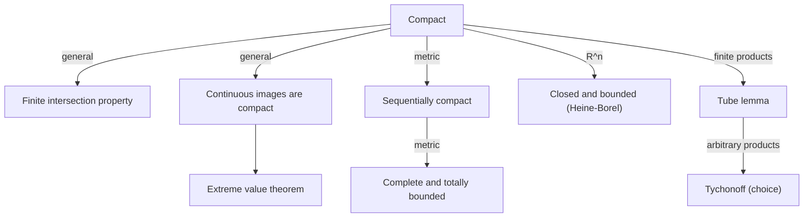

# Compactness

> [Mathematics](../../README.md) › [Topology](../README.md) · Level: Advanced · Prerequisites: [Topological Spaces](../01-topological-spaces/README.md), [Metric Spaces](../../14-real-analysis/06-metric-spaces/README.md), [The Real Numbers and Completeness](../../14-real-analysis/01-real-numbers-and-completeness/README.md) · Estimated time: 10 h

## 1. Introduction

Compactness is the topological property that makes infinite sets behave like finite ones. A space is
**compact** if every open cover of it has a finite subcover. That single sentence is the source of most of the
existence theorems in analysis: a continuous function on a compact set attains its maximum, a continuous
function on a compact metric space is uniformly continuous, a decreasing sequence of nonempty closed sets in a
compact space has a common point, and a product of compact spaces is compact.

The definition looks abstract because it is. In a metric space, compactness is equivalent to two more
concrete conditions: the space is **complete** and **totally bounded**. In $\mathbb{R}^n$ it is equivalent to
being **closed and bounded**, the Heine–Borel theorem. The passage from the concrete to the abstract is the
content of this chapter:

* **The cover definition** (§7.1). Open covers, subcovers, and the finite-subcover property. It is the
  definition that generalises to arbitrary topological spaces and survives products and quotients.
* **The basic theorems** (§7.2–§7.3). Closed subsets of compact spaces are compact; compact subsets of
  Hausdorff spaces are closed; continuous images of compact spaces are compact; the extreme value theorem.
* **Heine–Borel** (§7.4). A complete proof in $\mathbb{R}^n$, by bisection in one dimension and by the tube
  lemma in higher dimensions.
* **The finite intersection property** (§7.5). An equivalent formulation in terms of families of closed sets,
  and the Cantor intersection theorem.
* **Sequential compactness** (§7.6). In metric spaces, compactness is equivalent to the Bolzano–Weierstrass
  property that every sequence has a convergent subsequence. The proof uses total boundedness and the
  Lebesgue number lemma.
* **Local compactness and compactification** (§7.7). Spaces that are locally compact but not compact can be
  compactified by adding one point; $\mathbb{R}^n$ becomes the sphere $S^n$.
* **Products and Tychonoff's theorem** (§7.8). Finite products of compact spaces are compact; arbitrary
  products are compact by Tychonoff's theorem, a choice principle (equivalent to the axiom of choice for
  arbitrary compact spaces).
* **Why the open interval fails** (§7.9). The finite-subcover condition is exactly what prevents a sequence
  from escaping to a missing endpoint.

Historically, the idea developed in stages. Heine (1872) proved that every continuous function on a closed
bounded interval is uniformly continuous; Borel (1895) extracted the finite-subcover property of closed bounded
intervals; Lebesgue (1904) and Fréchet (1906) generalised it to metric spaces; Alexandrov and Urysohn (1929)
gave the open-cover definition for arbitrary topological spaces; Tychonoff (1930) proved the product theorem.
The modern definition is thus a compression of several decades of analysis into one topological axiom.

A warning about terminology. Some authors reserve "compact" for the open-cover property **plus** Hausdorff,
and use "quasi-compact" for the open-cover property alone. This repository follows the more common modern
convention: **compact means every open cover has a finite subcover**, with no separation hypothesis. When
Hausdorff is needed it is stated explicitly.

## 2. Prerequisites

* **Topological spaces:** open and closed sets, bases, subspaces, products, Hausdorff spaces, and continuity
  via preimages — from [Topological Spaces](../01-topological-spaces/README.md).
* **Metric spaces:** open balls, closed sets, closure, completeness, total boundedness, and the equivalence of
  the $\varepsilon$-$\delta$ and preimage definitions of continuity — from
  [Metric Spaces](../../14-real-analysis/06-metric-spaces/README.md).
* **The real numbers:** the nested interval theorem, the Bolzano–Weierstrass theorem, and the completeness
  axiom — from [The Real Numbers and Completeness](../../14-real-analysis/01-real-numbers-and-completeness/README.md).
* **Sequences and series:** subsequences, Cauchy sequences, and convergence — from
  [Sequences and Series](../../14-real-analysis/02-sequences-and-series/README.md).
* **Basic set theory:** arbitrary unions and intersections, De Morgan's laws, and the finite intersection
  property — from [Set Theory](../../00-foundations/03-set-theory/README.md).
* **Proof technique:** proof by contradiction, quantifier negation, and induction — from
  [Proof Techniques](../../00-foundations/04-proof-techniques/README.md).
* **Linear algebra:** the Euclidean norm and the geometry of $\mathbb{R}^n$ — from
  [Linear Algebra](../../08-linear-algebra/README.md).

## 3. Learning Objectives

After this tutorial you will be able to:

1. State the definition of an open cover, a subcover, and a compact space, and verify compactness directly for
   finite, indiscrete and cofinite spaces.
2. Prove that closed subsets of compact spaces are compact and that compact subsets of Hausdorff spaces are
   closed.
3. Prove that continuous images of compact sets are compact, and recover the extreme value theorem.
4. Prove the Heine–Borel theorem in $\mathbb{R}^n$ using bisection, the tube lemma, and the closed-subset
   theorem.
5. Translate compactness into the finite intersection property and use it to prove the Cantor intersection
   theorem.
6. Define sequential compactness and prove its equivalence with compactness in metric spaces.
7. Prove the Lebesgue number lemma and use it to prove uniform continuity on compact metric spaces.
8. Define local compactness, construct the one-point compactification, and identify $\mathbb{R}^n\cup\{\infty\}$
   with $S^n$.
9. State Tychonoff's theorem, prove the finite-product case via the tube lemma, and explain why the infinite
   case requires choice.
10. Explain why $(0,1)$ is not compact, using an explicit open cover with no finite subcover.
11. Recognise the common false statements ("compact = closed and bounded" in every space, "sequentially compact
    = compact" in every space) and give counterexamples.

## 4. Intuition

### 4.1 Finiteness in the large

A finite set is easy to handle: a continuous function on it attains a maximum, every sequence has a convergent
subsequence, and every open cover has a finite subcover (the whole set is already finite). Compactness is a
way of granting an infinite set the same privileges without pretending that it is finite.

The definition says: *however you try to cover the space by open sets, finitely many of them already suffice*.
An open cover is a collection of "patches" that covers the space. If the space is compact, no matter how
finely you slice the cover, you never need more than finitely many patches. This is a strong statement: it
must hold for **every** open cover, including covers whose members are tiny and whose index set is enormous.

The phrase "finite subcover" is the whole intuition. A compact space cannot be spread out over infinitely many
patches in an essential way: any attempt to cover it has a finite subcover. Equivalently (via complements),
a nested family of closed sets in a compact space cannot shrink to nothing: if every finite subfamily meets,
then the whole family meets. That is the **finite intersection property**, and it is often the most useful
form of compactness.

### 4.2 Why the open interval fails

The open interval $(0,1)$ is bounded, but it is not compact. The cover
$$\mathcal{U}=\left\{\left(\frac1n,1\right):n=2,3,4,\dots\right\}$$
consists of open sets whose union is $(0,1)$: for any $x\in(0,1)$, choose $n>1/x$, and then $x\in(1/n,1)$.
But no finite subcollection covers $(0,1)$: if $n_1,\dots,n_k$ are finitely many indices and
$N=\max\{n_1,\dots,n_k\}$, then the union is $(1/N,1)$, which misses every $x\le 1/N$, in particular
$x=1/(N+1)$.

What goes wrong is that the cover "chases" the missing endpoint $0$: the patches get thinner and thinner near
$0$, and no finite number of them reaches all the way. The same phenomenon occurs at the missing endpoint $1$
for $[0,1)$, and at the missing endpoint $0$ for $(0,1]$. A closed bounded interval $[0,1]$ has no such escape route: any
open cover must cover the endpoints too, and compactness follows (Heine–Borel). This is the intuition behind
the proof by bisection: if a cover had no finite subcover, one half of the interval would inherit that
failure, and iterating would produce a nested sequence of intervals shrinking to a point; but near that point
a single member of the cover would swallow a whole small interval, a contradiction.

### 4.3 Sequences cannot escape

In a metric space, compactness is equivalent to **sequential compactness**: every sequence has a convergent
subsequence. The open interval fails this too: the sequence $1/n$ has no subsequence converging to a point of
$(0,1)$, because its only limit in $\mathbb{R}$ is $0$, which is not in the space. A compact space has no
"holes" and no "ends" at infinity: every sequence must accumulate somewhere inside.

The equivalence is not true in arbitrary topological spaces. It is a metric-space theorem, and it rests on
two metric notions: **total boundedness** (for every $\varepsilon>0$, finitely many balls of radius
$\varepsilon$ cover the space) and **completeness** (every Cauchy sequence converges). A metric space is
compact exactly when it is complete and totally bounded. In $\mathbb{R}^n$, total boundedness is equivalent
to boundedness, and completeness is automatic for closed subsets; this is Heine–Borel.

### 4.4 Why the definition is useful

The open-cover definition is not the easiest to check, but it is the easiest to *use*. Three examples:

* **Continuous images.** If $f:X\to Y$ is continuous and $X$ is compact, then $f[X]$ is compact: pull an open
  cover of $f[X]$ back to $X$, extract a finite subcover, and push it forward. This proves the extreme value
  theorem in one line.
* **Products.** The tube lemma proves that a product of two compact spaces is compact; induction handles
  finite products; Tychonoff handles arbitrary products. The finite-subcover definition is exactly what makes
  the tube lemma work.
* **Existence theorems.** In analysis and geometry, compactness is the standard hypothesis that turns an
  open condition into a closed one and thereby guarantees a maximum, a minimiser, a convergent subsequence, or
  a fixed point. The pattern is always the same: compactness prevents the object from escaping.

## 5. Formal Definition

### 5.1 Covers and compactness

**Definition 5.1 (Open cover).** Let $X$ be a topological space. An **open cover** of $X$ is a family
$\mathcal{U}=\{U_i\}_{i\in I}$ of open subsets of $X$ such that $X=\bigcup_{i\in I}U_i$. A **subcover** is a
subfamily $\mathcal{V}\subseteq\mathcal{U}$ that still covers $X$. A **finite subcover** is a subcover with
finitely many members.

**Definition 5.2 (Compact space).** A topological space $X$ is **compact** if every open cover of $X$ has a
finite subcover.

**Definition 5.3 (Compact subset).** A subset $K\subseteq X$ is **compact** if $K$, with the subspace topology,
is a compact space. Equivalently, every family of open subsets of $X$ whose union contains $K$ has a finite
subfamily whose union contains $K$.

The equivalence in Definition 5.3 holds because open sets in the subspace $K$ are exactly the intersections
$K\cap U$ with $U$ open in $X$.

**Definition 5.4 (Finite intersection property).** A family $\mathcal{F}$ of subsets of a set $X$ has the
**finite intersection property** (FIP) if every finite subfamily has nonempty intersection:
$$F_1\cap\cdots\cap F_n\ne\varnothing\quad\text{for all }F_1,\dots,F_n\in\mathcal{F}.$$
The family is *centred* if it has the FIP.

**Definition 5.5 (Sequential compactness).** A topological space $X$ is **sequentially compact** if every
sequence $(x_n)$ in $X$ has a subsequence converging to a point of $X$. A subset $K\subseteq X$ is
sequentially compact if it is sequentially compact as a subspace.

**Definition 5.6 (Local compactness).** A topological space $X$ is **locally compact** if every point has a
compact neighbourhood: for every $x\in X$ there is a compact set $K$ and an open set $U$ with
$x\in U\subseteq K$. In a Hausdorff space this is equivalent to every point having a neighbourhood base of
compact sets; we use the neighbourhood formulation.

### 5.2 First examples

* **Finite spaces** are compact: any open cover of a finite set has a finite subcover (choose one member for
  each point).
* **The indiscrete topology** on any set is compact: the only nonempty open set is $X$.
* **The cofinite topology** on any set is compact (§9.2): an open cover has a member whose complement is
  finite, and the remaining finitely many points are covered by finitely many further members.
* **The discrete topology** on $X$ is compact exactly when $X$ is finite: the cover by singleton sets has no
  proper subcover.
* **The real line** is not compact: $\{(-n,n):n\in\mathbb{N}\}$ is an open cover with no finite subcover.
* **The closed interval** $[0,1]$ is compact (Heine–Borel, §7.4).
* **The open interval** $(0,1)$ is not compact (§4.2).
* **The Cantor set** is compact: it is closed and bounded in $\mathbb{R}$.
* **The unit sphere** $S^{n-1}\subseteq\mathbb{R}^n$ is compact: closed and bounded.
* **The real projective space** $\mathbb{RP}^n$ is compact: it is a continuous image of $S^n$.

### 5.3 Equivalent formulations

The following are equivalent for a topological space $X$:

1. $X$ is compact.
2. Every family of closed subsets of $X$ with the FIP has nonempty intersection.
3. Every open cover of $X$ has a finite subcover (the definition).

The equivalence of 1 and 2 is proved in §7.5. In metric spaces, compactness is also equivalent to sequential
compactness (§7.6) and to completeness plus total boundedness. In general spaces neither equivalence holds:
there are compact spaces that are not sequentially compact, and sequentially compact spaces that are not
compact.

## 6. Mathematical Notation

| Symbol | Read as | Meaning |
|---|---|---|
| $\mathcal{U},\mathcal{V}$ | script U, script V | families of open sets (covers) |
| $\bigcup_{i\in I}U_i$ | union over $I$ | the set of points in at least one $U_i$ |
| $\mathcal{V}\subseteq\mathcal{U}$ | script V is a subfamily | a subcover when it still covers |
| $X\setminus F$ | complement of $F$ | $\{x\in X:x\notin F\}$ |
| FIP | finite intersection property | every finite subfamily meets |
| $B_r(x)$ | open ball | $\{y:d(x,y)<r\}$ |
| $\overline{A}$ | closure of $A$ | smallest closed set containing $A$ |
| $\operatorname{diam}A$ | diameter of $A$ | $\sup\{d(x,y):x,y\in A\}$ |
| $X^*$ | one-point compactification | $X\cup\{\infty\}$ |
| $\prod_{i\in I}X_i$ | product | tuples $(x_i)_{i\in I}$ with $x_i\in X_i$ |
| $\lambda$ | Lebesgue number | a scale below which every set lies in a cover member |
| $\chi(S)$ | Euler characteristic | a topological invariant (used only in remarks) |

## 7. Core Concepts

### 7.1 Open covers and first examples

The definition is easiest to absorb by checking a few spaces directly.

**Finite spaces.** If $X$ is finite, an open cover $\{U_i\}$ covers each of the finitely many points; for each
point choose one $U_i$ containing it. The resulting subfamily is finite and covers $X$. So every finite space is
compact (in every topology).

**Discrete spaces.** If $X$ is discrete, the cover by singletons $\{\{x\}:x\in X\}$ has no proper subcover. It
has a finite subcover exactly when $X$ is finite. Hence an infinite discrete space is not compact.

**Cofinite spaces.** Let $X$ carry the cofinite topology, and let $\{U_i\}_{i\in I}$ be an open cover. Choose
one nonempty $U_{i_0}$. Its complement $X\setminus U_{i_0}$ is finite, say $\{x_1,\dots,x_m\}$. For each $j$,
choose $U_{i_j}$ containing $x_j$. Then $U_{i_0},U_{i_1},\dots,U_{i_m}$ cover $X$. Hence every cofinite space
is compact, including the cofinite topology on an uncountable set.

**The real line.** The cover $\{(-n,n):n\in\mathbb{N}\}$ has no finite subcover, since a finite union equals
$(-N,N)$ for the largest $N$. So $\mathbb{R}$ is not compact. The same cover shows that $\mathbb{R}^n$ is not
compact.

**The open interval.** The cover $\{(1/n,1):n\ge2\}$ of $(0,1)$ has no finite subcover, as shown in §4.2. So
$(0,1)$ is not compact, even though it is bounded.

**Closed intervals.** $[0,1]$ is compact; the proof is the bisection argument of §7.4. This is the fundamental
example from which Heine–Borel is built.

### 7.2 Closed subsets of compact spaces, and compact subsets of Hausdorff spaces

**Theorem 7.1.** Every closed subset of a compact space is compact.

*Proof.* Let $X$ be compact, $F\subseteq X$ closed, and $\{U_i\}_{i\in I}$ an open cover of $F$ by open sets
of $X$. Then $\{U_i\}\cup\{X\setminus F\}$ is an open cover of $X$: every point of $F$ lies in some $U_i$, and
every point outside $F$ lies in $X\setminus F$. By compactness, finitely many of these sets cover $X$; discard
$X\setminus F$ if it is among them. The remaining $U_i$'s form a finite subcover of $F$. ∎

**Theorem 7.2.** Every compact subset of a Hausdorff space is closed.

*Proof.* Let $K\subseteq X$ be compact and $X$ Hausdorff. We show $X\setminus K$ is open. Fix $x\notin K$.
For each $k\in K$, Hausdorffness gives disjoint open sets $U_k\ni x$ and $V_k\ni k$. The family $\{V_k\}_{k\in K}$
is an open cover of $K$; by compactness, $K\subseteq V_{k_1}\cup\cdots\cup V_{k_n}$ for finitely many $k_j$.
Let $U=U_{k_1}\cap\cdots\cap U_{k_n}$. Then $U$ is an open neighbourhood of $x$, and $U\cap K=\varnothing$:
if $y\in K$, then $y\in V_{k_j}$ for some $j$, and $U\subseteq U_{k_j}$ is disjoint from $V_{k_j}$. Hence
$U\subseteq X\setminus K$, so $X\setminus K$ is open. ∎

**Corollary 7.3.** In a metric space, every compact subset is closed and bounded.

*Proof.* Closed by Theorem 7.2 (metric spaces are Hausdorff). For boundedness, cover $K$ by the balls
$B_m(x_0)$, $m\in\mathbb{N}$; a finite subcover has a largest radius $M$, so $K\subseteq B_M(x_0)$. ∎

The converse is false in a general metric space: an infinite set with the discrete metric is closed and bounded
but not compact. In $\mathbb{R}^n$ the converse is true, and that is Heine–Borel (§7.4).

### 7.3 Continuous images and the extreme value theorem

**Theorem 7.4.** If $f:X\to Y$ is continuous and $X$ is compact, then $f[X]$ is compact.

*Proof.* Let $\{V_i\}_{i\in I}$ be an open cover of $f[X]$ by open sets of $Y$. Then
$\{f^{-1}[V_i]\}_{i\in I}$ is an open cover of $X$, because $f$ is continuous and every $x\in X$ has $f(x)$ in
some $V_i$. By compactness of $X$, finitely many preimages $f^{-1}[V_{i_1}],\dots,f^{-1}[V_{i_n}]$ cover $X$.
For any $y\in f[X]$, write $y=f(x)$; then $x\in f^{-1}[V_{i_j}]$ for some $j$, so $y\in V_{i_j}$. Hence
$V_{i_1},\dots,V_{i_n}$ cover $f[X]$. ∎

**Theorem 7.5 (Extreme value theorem).** Let $X$ be a nonempty compact space and $f:X\to\mathbb{R}$ continuous.
Then $f$ attains a maximum and a minimum on $X$.

*Proof.* By Theorem 7.4, $f[X]$ is a compact subset of $\mathbb{R}$. By Corollary 7.3 it is closed and bounded.
Let $M=\sup f[X]$, which exists because $f[X]$ is nonempty and bounded. Since $f[X]$ is closed, it contains
its limit points, so $M\in f[X]$: there is $x_{\max}\in X$ with $f(x_{\max})=M$. Applying the same argument to
$-f$ gives a minimum. ∎

**Corollary 7.6.** A continuous bijection from a compact space to a Hausdorff space is a homeomorphism.

*Proof.* Let $f:X\to Y$ be a continuous bijection, $X$ compact, $Y$ Hausdorff. It suffices to show that $f$ is
a closed map, because a bijective closed continuous map has continuous inverse. If $F\subseteq X$ is closed,
then $F$ is compact by Theorem 7.1; $f[F]$ is compact by Theorem 7.4; and $f[F]$ is closed in $Y$ by Theorem
7.2. Hence $f$ is closed. ∎

This corollary is a standard way to prove that two spaces are homeomorphic: exhibit a continuous bijection in
the compact-to-Hausdorff direction. It also shows that the hypothesis "Hausdorff" cannot be dropped.

### 7.4 The Heine–Borel theorem in $\mathbb{R}^n$

**Lemma 7.7.** Every closed bounded interval $[a,b]\subseteq\mathbb{R}$ is compact.

*Proof.* Suppose, for contradiction, that an open cover $\mathcal{U}$ of $[a,b]$ has no finite subcover. Set
$I_0=[a,b]$. Given $I_n=[a_n,b_n]$ with no finite subcover, bisect it at $m_n=(a_n+b_n)/2$. The two halves
$[a_n,m_n]$ and $[m_n,b_n]$ cover $I_n$; if both had finite subcovers, their union would be a finite subcover of
$I_n$. Hence at least one half has no finite subcover; choose it as $I_{n+1}$. This produces nested closed
intervals
$$[a,b]=I_0\supseteq I_1\supseteq I_2\supseteq\cdots,\qquad
b_n-a_n=\frac{b-a}{2^n}\to0,$$
none of which has a finite subcover. By the nested interval theorem, $\bigcap_n I_n=\{x\}$ for some $x\in[a,b]$.
Choose $U\in\mathcal{U}$ containing $x$. Since $U$ is open, there is $\varepsilon>0$ with
$(x-\varepsilon,x+\varepsilon)\subseteq U$. For $n$ large, $b_n-a_n<\varepsilon$ and $x\in I_n$, so
$I_n\subseteq(x-\varepsilon,x+\varepsilon)\subseteq U$. Thus the single set $U$ covers $I_n$, contradicting the
construction. Hence $\mathcal{U}$ has a finite subcover. ∎

**Lemma 7.8 (Tube lemma).** Let $X,Y$ be topological spaces with $Y$ compact, and let $N\subseteq X\times Y$ be
open with $\{x_0\}\times Y\subseteq N$. Then there is an open neighbourhood $W$ of $x_0$ such that
$W\times Y\subseteq N$.

*Proof.* For each $y\in Y$, choose a basic open set $U_y\times V_y$ with
$(x_0,y)\in U_y\times V_y\subseteq N$. The family $\{V_y\}_{y\in Y}$ covers $Y$; by compactness, finitely many
$V_{y_1},\dots,V_{y_m}$ cover $Y$. Let $W=U_{y_1}\cap\cdots\cap U_{y_m}$, an open neighbourhood of $x_0$. For
$(x,y)\in W\times Y$, choose $j$ with $y\in V_{y_j}$; then $x\in W\subseteq U_{y_j}$, so
$(x,y)\in U_{y_j}\times V_{y_j}\subseteq N$. ∎

**Lemma 7.9.** If $X$ and $Y$ are compact, then $X\times Y$ is compact.

*Proof.* Let $\mathcal{U}$ be an open cover of $X\times Y$. Fix $x\in X$. The slice $\{x\}\times Y$ is compact,
being homeomorphic to $Y$, so finitely many members $U_1,\dots,U_m$ of $\mathcal{U}$ cover it. Their union $N$
is an open set containing $\{x\}\times Y$; by the tube lemma (with $Y$ compact) there is an open neighbourhood
$W_x$ of $x$ with $W_x\times Y\subseteq N$. The family $\{W_x\}_{x\in X}$ covers $X$; by compactness of $X$,
finitely many $W_{x_1},\dots,W_{x_k}$ cover $X$. The corresponding finite collections of $U$'s cover each
$W_{x_i}\times Y$, hence cover $X\times Y$. ∎

**Corollary 7.10.** Every closed box $[a_1,b_1]\times\cdots\times[a_n,b_n]$ is compact.

*Proof.* Induct on $n$. For $n=1$ this is Lemma 7.7. For $n>1$,
$$[a_1,b_1]\times\cdots\times[a_n,b_n]
=\bigl([a_1,b_1]\times\cdots\times[a_{n-1},b_{n-1}]\bigr)\times[a_n,b_n],$$
a product of two compact spaces by the induction hypothesis and Lemma 7.7; Lemma 7.9 applies. ∎

**Theorem 7.11 (Heine–Borel).** A subset $K\subseteq\mathbb{R}^n$ is compact if and only if $K$ is closed and
bounded.

*Proof.* (⇒) If $K$ is compact, it is closed by Theorem 7.2 (applied in the Hausdorff space $\mathbb{R}^n$),
and bounded by Corollary 7.3.

(⇐) If $K$ is closed and bounded, choose $M>0$ with $K\subseteq[-M,M]^n$. The box $[-M,M]^n$ is compact by
Corollary 7.10. Since $K$ is closed in $\mathbb{R}^n$, the set $K=K\cap[-M,M]^n$ is closed in the subspace
$[-M,M]^n$. A closed subset of a compact space is compact (Theorem 7.1), so $K$ is compact. ∎

**Second proof of the hard direction.** One can also argue sequentially: a bounded sequence in $\mathbb{R}^n$
has a convergent subsequence (Bolzano–Weierstrass), and a closed set contains the limits of its convergent
sequences; hence a closed bounded set is sequentially compact, and sequential compactness is equivalent to
compactness in metric spaces (§7.6). The bisection-plus-tube proof above is included because it uses only the
open-cover definition and generalises to products.

### 7.5 The finite intersection property

**Theorem 7.12.** A topological space $X$ is compact if and only if every family of closed subsets of $X$ with
the finite intersection property has nonempty intersection.

*Proof.* (⇒) Let $\{F_i\}_{i\in I}$ be a family of closed sets with the FIP. Suppose
$\bigcap_{i\in I}F_i=\varnothing$. Then $\{X\setminus F_i\}_{i\in I}$ is an open cover of $X$ (De Morgan). By
compactness, finitely many $X\setminus F_{i_1},\dots,X\setminus F_{i_n}$ cover $X$, so
$F_{i_1}\cap\cdots\cap F_{i_n}=\varnothing$, contradicting the FIP.

(⇐) Let $\{U_i\}_{i\in I}$ be an open cover of $X$ with no finite subcover. Then the closed sets
$F_i=X\setminus U_i$ have the property that no finite subfamily has empty intersection: if
$F_{i_1}\cap\cdots\cap F_{i_n}=\varnothing$, then $U_{i_1}\cup\cdots\cup U_{i_n}=X$, a finite subcover. Hence
$\{F_i\}$ has the FIP. By hypothesis, $\bigcap_i F_i\ne\varnothing$; but
$\bigcap_i(X\setminus U_i)=X\setminus\bigcup_i U_i=\varnothing$, since the $U_i$ cover $X$. Contradiction.
Hence every open cover has a finite subcover. ∎

**Corollary 7.13 (Cantor intersection theorem).** Let $K_1\supseteq K_2\supseteq\cdots$ be a decreasing sequence
of nonempty compact subsets of a Hausdorff space. Then $\bigcap_{n=1}^{\infty}K_n\ne\varnothing$. If the space is
a metric space and $\operatorname{diam}K_n\to0$, the intersection is a single point.

*Proof.* The family $\{K_n\}$ consists of closed sets (compact subsets of a Hausdorff space are closed) and has
the FIP, because any finite subfamily has intersection $K_N$ for the largest index $N$, which is nonempty. By
Theorem 7.12, the total intersection is nonempty. If $\operatorname{diam}K_n\to0$ and $x\ne y$ both lie in the
intersection, then $d(x,y)\le\operatorname{diam}K_n$ for every $n$, so $d(x,y)=0$, a contradiction. Hence the
intersection is a single point. ∎

### 7.6 Sequential compactness in metric spaces

Recall that $X$ is **sequentially compact** if every sequence in $X$ has a convergent subsequence. In a metric
space this is equivalent to compactness. The proof has three ingredients: total boundedness, the Lebesgue
number lemma, and completeness.

**Theorem 7.14.** Every compact metric space is sequentially compact.

*Proof.* Let $(x_n)$ be a sequence in a compact metric space $X$. Suppose it has no convergent subsequence.
Then no $x\in X$ is the limit of a subsequence. We claim that for each $x\in X$ there is $\varepsilon_x>0$ such
that $B_{\varepsilon_x}(x)$ contains only finitely many terms of the sequence. If not, then for some $x$ every
ball $B_{1/k}(x)$ contains infinitely many terms; choose indices $n_1<n_2<\cdots$ with
$x_{n_k}\in B_{1/k}(x)$. Then $x_{n_k}\to x$, a convergent subsequence, contradiction.

The balls $B_{\varepsilon_x}(x)$ cover $X$; by compactness, finitely many of them cover $X$. Each contains only
finitely many terms of the sequence, so their union contains only finitely many terms. But the union is $X$, and
the sequence has infinitely many terms (indices), a contradiction. Hence $(x_n)$ has a convergent
subsequence. ∎

**Lemma 7.15.** Every sequentially compact metric space is totally bounded: for every $\varepsilon>0$ there are
finitely many points $x_1,\dots,x_m$ with $X=\bigcup_{i=1}^m B_\varepsilon(x_i)$.

*Proof.* Suppose some $\varepsilon>0$ admits no finite $\varepsilon$-net. Choose $x_1\in X$; having chosen
$x_1,\dots,x_n$, choose $x_{n+1}\notin\bigcup_{i=1}^n B_\varepsilon(x_i)$, which is possible by hypothesis. Then
$d(x_i,x_j)\ge\varepsilon$ for all $i\ne j$, so the sequence $(x_n)$ has no Cauchy subsequence and hence no
convergent subsequence, contradicting sequential compactness. ∎

**Lemma 7.16 (Lebesgue number lemma).** Let $X$ be a sequentially compact metric space and $\mathcal{U}$ an open
cover of $X$. Then there is $\lambda>0$ such that every subset $A\subseteq X$ with
$\operatorname{diam}A<\lambda$ is contained in some member of $\mathcal{U}$.

*Proof.* Suppose no such $\lambda$ exists. Then for every $n$ there is a set $A_n$ with
$\operatorname{diam}A_n<1/n$ that is not contained in any member of $\mathcal{U}$. Choose $x_n\in A_n$. By
sequential compactness, a subsequence $x_{n_k}$ converges to some $x\in X$. Choose $U\in\mathcal{U}$ containing
$x$; since $U$ is open, there is $r>0$ with $B_r(x)\subseteq U$. For $k$ large, $d(x_{n_k},x)<r/2$ and
$1/n_k<r/2$. Then for every $y\in A_{n_k}$,
$$d(y,x)\le d(y,x_{n_k})+d(x_{n_k},x)<\frac1{n_k}+\frac r2<r,$$
so $A_{n_k}\subseteq B_r(x)\subseteq U$, contradicting the choice of $A_{n_k}$. ∎

**Lemma 7.17.** Every sequentially compact metric space is complete.

*Proof.* Let $(x_n)$ be Cauchy. By sequential compactness, a subsequence $x_{n_k}$ converges to some $x$. Given
$\varepsilon>0$, choose $K$ with $d(x_{n_k},x)<\varepsilon/2$ for $k\ge K$, and $N$ with
$d(x_n,x_m)<\varepsilon/2$ for $n,m\ge N$. Choose $k\ge K$ with $n_k\ge N$. For $n\ge N$,
$$d(x_n,x)\le d(x_n,x_{n_k})+d(x_{n_k},x)<\frac\varepsilon2+\frac\varepsilon2=\varepsilon.$$
Hence $x_n\to x$, so the space is complete. ∎

**Theorem 7.18.** Every sequentially compact metric space is compact.

*Proof.* Let $\mathcal{U}$ be an open cover and let $\lambda$ be a Lebesgue number (Lemma 7.16). By total
boundedness (Lemma 7.15), choose finitely many points $x_1,\dots,x_m$ with
$X=\bigcup_{i=1}^m B_{\lambda/3}(x_i)$. Each ball $B_{\lambda/3}(x_i)$ has diameter at most $2\lambda/3<\lambda$,
so it is contained in some $U_i\in\mathcal{U}$. Then $U_1,\dots,U_m$ cover $X$, a finite subcover. ∎

**Corollary 7.19.** For a metric space $X$, the following are equivalent:

1. $X$ is compact;
2. $X$ is sequentially compact;
3. $X$ is complete and totally bounded.

*Proof.* Theorem 7.14 gives 1 ⇒ 2. Theorem 7.18 gives 2 ⇒ 1. The implication 2 ⇒ 3 is Lemmas 7.15 and 7.17.
It remains to prove 3 ⇒ 1. Assume $X$ is complete and totally bounded, and suppose an open cover
$\mathcal{U}$ has no finite subcover. We construct nested nonempty closed sets
$$F_0=X\supseteq F_1\supseteq F_2\supseteq\cdots$$
such that $\operatorname{diam}F_n\le2^{-n+1}$ for $n\ge1$ and no $F_n$ has a finite subcover by $\mathcal{U}$.
Given $F_n$, total boundedness with radius $2^{-n-1}$ gives finitely many open balls $B_{2^{-n-1}}(x_i)$
covering $X$, hence
covering $F_n$. The sets $F_n\cap\overline{B_{2^{-n-1}}(x_i)}$ are closed and cover $F_n$; if each had a finite
subcover, finitely many of them would give a finite subcover of $F_n$, a contradiction. Choose $i$ such that
$F_{n+1}=F_n\cap\overline{B_{2^{-n-1}}(x_i)}$ has no finite subcover. Then $F_{n+1}$ is closed, nonempty (the
empty set has the empty finite subcover), and has diameter at most $2^{-n}$.

Choose $x_n\in F_n$. Since the diameters tend to $0$, $(x_n)$ is Cauchy; by completeness it converges to some
$x$. For each $n$, all but finitely many $x_m$ lie in $F_n$, and $F_n$ is closed, so $x\in F_n$. Thus
$x\in\bigcap_nF_n$. Choose $U\in\mathcal{U}$ containing $x$ and $r>0$ with $B_r(x)\subseteq U$. For $n$ large,
$\operatorname{diam}F_n<r$ and $x\in F_n$, so $F_n\subseteq B_r(x)\subseteq U$. Thus the single set $U$ covers
$F_n$, contradicting the construction. Hence $\mathcal{U}$ has a finite subcover. ∎

### 7.7 Local compactness and one-point compactification

**Definition 7.20.** A space $X$ is **locally compact** if every point has a compact neighbourhood: for every
$x\in X$ there are an open set $U$ and a compact set $K$ with $x\in U\subseteq K$.

Examples: $\mathbb{R}^n$ is locally compact (closed balls are compact); every compact space is locally
compact (take $K=X$); every discrete space is locally compact (singletons are compact). The rationals
$\mathbb{Q}$ are **not** locally compact: if $K$ were a compact neighbourhood of $x\in\mathbb{Q}$, then $K$
would contain an interval $(x-\varepsilon,x+\varepsilon)\cap\mathbb{Q}$, and a sequence of rationals in that
interval converging to an irrational $\alpha$ would be a Cauchy sequence in $K$ with no convergent subsequence
in $\mathbb{Q}$, contradicting the sequential compactness of the compact metric space $K$.

**Construction 7.21 (One-point compactification).** Let $X$ be a locally compact Hausdorff space. Put
$X^*=X\cup\{\infty\}$ with $\infty\notin X$, and declare a subset $U\subseteq X^*$ open if either

* $U$ is open in $X$, or
* $\infty\in U$ and $X^*\setminus U=X\setminus U$ is compact in $X$.

**Theorem 7.22.** Let $X$ be a locally compact Hausdorff space. Then:

1. $X^*$ is compact;
2. $X^*$ is Hausdorff;
3. $X$ is open in $X^*$, and $X$ is dense in $X^*$ if $X$ is not compact.

*Proof.* (1) Let $\{U_i\}$ be an open cover of $X^*$. Choose $U_{i_0}$ containing $\infty$; then
$K=X^*\setminus U_{i_0}$ is compact. The remaining open sets cover $K$; by compactness of $K$, finitely many of
them cover $K$. Together with $U_{i_0}$ they cover $X^*$.

(2) Points of $X$ are separated by the Hausdorff property of $X$. For $x\in X$ and $\infty$, local compactness
gives an open $V$ with $x\in V\subseteq K$ and $K$ compact. Then $V$ is an open neighbourhood of $x$ and
$X^*\setminus K$ is an open neighbourhood of $\infty$ disjoint from $V$.

(3) $X=X^*\setminus\{\infty\}$ is open because $\{\infty\}$ is closed (its complement $X$ is open). If $X$ is
not compact and $U$ is a nonempty open neighbourhood of $\infty$, then $U=X^*\setminus K$ for some compact $K$;
$X\setminus K$ is nonempty (otherwise $X=K$ would be compact), so $U$ meets $X$. Hence $X$ is dense. ∎

The construction is unique up to a homeomorphism fixing $X$ pointwise; this is Exercise 33.

Examples: $\mathbb{R}^*$ is homeomorphic to the circle $S^1$ (via $x\mapsto(\cos 2\arctan x,\sin 2\arctan x)$,
with $\infty$ mapping to $(-1,0)$); $(\mathbb{R}^n)^*$ is homeomorphic to $S^n$ (stereographic projection);
$\mathbb{C}^*$ is the Riemann sphere; $\mathbb{N}^*$ (with $\mathbb{N}$ discrete) is homeomorphic to
$\{0\}\cup\{1/n:n\in\mathbb{N}\}$ with the subspace topology of $\mathbb{R}$, by $n\mapsto1/n$ and
$\infty\mapsto0$.

### 7.8 Products and Tychonoff's theorem

Lemma 7.9 already proves that a product of two compact spaces is compact. Induction gives:

**Theorem 7.23.** A finite product $X_1\times\cdots\times X_n$ of compact spaces is compact.

**Theorem 7.24 (Tychonoff).** An arbitrary product $\prod_{i\in I}X_i$ of compact spaces is compact in the
product topology.

The proof for infinite products is beyond the scope of this chapter; it uses ultrafilters or Zorn's lemma. The
finite case above is elementary and is the one used in most of analysis. Tychonoff's theorem is a choice
principle: it is not provable in ZF alone. For arbitrary compact spaces it is equivalent to the axiom of
choice; for compact Hausdorff spaces it is equivalent to the ultrafilter lemma (the Boolean prime ideal
theorem). The product topology is the topology of pointwise convergence: a net converges in $\prod_i X_i$ iff
each coordinate converges.

### 7.9 Compactness as finite subcover, and why open intervals fail

The finite-subcover condition is exactly what rules out "escape to a missing endpoint or to infinity". The
following table collects the standard counterexamples.

| Space | Open cover with no finite subcover | Why no finite subcover |
|---|---|---|
| $(0,1)$ | $\{(1/n,1):n\ge2\}$ | a finite union is $(1/N,1)$, missing $(0,1/N]$ |
| $[0,1)$ | $\{[0,1-1/n):n\ge2\}$ | a finite union is $[0,1-1/N)$, missing $1-1/N$ |
| $(0,1]$ | $\{(1/n,2):n\ge2\}$ | a finite union is $(1/N,2)$, missing $1/N$ |
| $\mathbb{R}$ | $\{(-n,n):n\in\mathbb{N}\}$ | a finite union is $(-N,N)$ |
| $\mathbb{Q}\cap[0,1]$ | $\{(-\infty,r_n)\cap(\mathbb{Q}\cap[0,1]):r_n\uparrow\sqrt2\}$ | a finite union stops at $r_N<\sqrt2$ |
| $\mathbb{Z}$ (discrete) | $\{\{n\}:n\in\mathbb{Z}\}$ | no proper subcover at all |

In each case the space is "missing" something: an endpoint, a limit point, or a point at infinity. Compactness
supplies the missing points in the form of a finite subcover. This is why the one-point compactification is the
natural repair for a locally compact space: it adds exactly the missing point at infinity.

### 7.10 Uniform continuity and closed maps

**Theorem 7.25 (Lebesgue number for compact metric spaces).** Let $X$ be a compact metric space and
$\mathcal{U}$ an open cover. Then there is $\lambda>0$ such that every subset of diameter less than $\lambda$ is
contained in a member of $\mathcal{U}$.

*Proof.* Compact metric spaces are sequentially compact (Theorem 7.14), so Lemma 7.16 applies. ∎

**Theorem 7.26.** Let $X$ be a compact metric space and $Y$ a metric space. Every continuous $f:X\to Y$ is
uniformly continuous.

*Proof.* Let $\varepsilon>0$. Cover $Y$ by the balls $B_{\varepsilon/2}(y)$, $y\in Y$. Their preimages form an
open cover of $X$; let $\lambda$ be a Lebesgue number. If $d(x,x')<\lambda$, then the two-point set
$\{x,x'\}$ has diameter less than $\lambda$, so it lies in some $f^{-1}[B_{\varepsilon/2}(y)]$. Hence
$f(x),f(x')$ both lie in $B_{\varepsilon/2}(y)$, and $d(f(x),f(x'))<\varepsilon$. Thus $\lambda$ is a uniform
continuity modulus for $\varepsilon$. ∎

**Theorem 7.27.** Let $X$ be compact, $Y$ Hausdorff, and $f:X\to Y$ continuous. Then $f$ is a closed map: the
image of every closed subset of $X$ is closed in $Y$.

*Proof.* If $F\subseteq X$ is closed, then $F$ is compact (Theorem 7.1); $f[F]$ is compact (Theorem 7.4); and a
compact subset of a Hausdorff space is closed (Theorem 7.2). ∎

**Dini's theorem (stated).** If $X$ is compact, $(f_n)$ is a sequence of continuous real-valued functions
converging pointwise monotonically to a continuous $f$, then $f_n\to f$ uniformly. The proof is Exercise 31.

**Theorem 7.28.** Every compact Hausdorff space is normal.

*Proof.* Let $A,B$ be disjoint closed subsets. For each $a\in A$ and $b\in B$, choose disjoint open sets
$U_{a,b}\ni a$ and $V_{a,b}\ni b$. Fix $a$. The family $\{V_{a,b}\}_{b\in B}$ covers the compact set $B$, so
finitely many $V_{a,b_1},\dots,V_{a,b_n}$ cover $B$. Put
$$U_a=U_{a,b_1}\cap\cdots\cap U_{a,b_n},\qquad V_a=V_{a,b_1}\cup\cdots\cup V_{a,b_n}.$$
Then $U_a$ is an open neighbourhood of $a$, $V_a$ is an open neighbourhood of $B$, and $U_a\cap V_a=\varnothing$.
Now $\{U_a\}_{a\in A}$ covers the compact set $A$; choose finitely many $a_1,\dots,a_m$ with
$A\subseteq U_{a_1}\cup\cdots\cup U_{a_m}$. Set $U=\bigcup_j U_{a_j}$ and $V=\bigcap_j V_{a_j}$. Then $U$ and
$V$ are disjoint open neighbourhoods of $A$ and $B$. ∎

## 8. Formulas and Properties

The following table collects the main results, their hypotheses, and where each is proved. The "proof" column
is a reference within this chapter; every entry is proved or explicitly noted as a standard theorem, with
Tychonoff's theorem stated and its finite case proved.

| Result | Hypotheses | Conclusion | Proof |
|---|---|---|---|
| Closed subsets | $X$ compact, $F\subseteq X$ closed | $F$ compact | Theorem 7.1 |
| Compact in Hausdorff | $X$ Hausdorff, $K\subseteq X$ compact | $K$ closed | Theorem 7.2 |
| Continuous image | $f:X\to Y$ continuous, $X$ compact | $f[X]$ compact | Theorem 7.4 |
| Extreme value | $X\ne\varnothing$ compact, $f:X\to\mathbb{R}$ continuous | $f$ attains max and min | Theorem 7.5 |
| Heine–Borel | $K\subseteq\mathbb{R}^n$ | $K$ compact $\iff$ closed and bounded | Theorem 7.11 |
| FIP | $X$ topological | compact $\iff$ every FIP family of closed sets meets | Theorem 7.12 |
| Cantor intersection | decreasing nonempty compact $K_n$ in a Hausdorff space | $\bigcap K_n\ne\varnothing$ | Corollary 7.13 |
| Sequential compactness | $X$ metric | compact $\iff$ sequentially compact | Theorems 7.14, 7.18 |
| Completeness + total boundedness | $X$ metric | compact $\iff$ complete and totally bounded | Corollary 7.19 |
| Lebesgue number | $X$ compact metric, open cover | $\exists\lambda>0$: diam $<\lambda$ lies in a member | Theorem 7.25 |
| Uniform continuity | $X$ compact metric, $f:X\to Y$ continuous | $f$ uniformly continuous | Theorem 7.26 |
| Closed map | $X$ compact, $Y$ Hausdorff, $f:X\to Y$ continuous | $f$ is closed | Theorem 7.27 |
| Normality | $X$ compact Hausdorff | $X$ normal | Theorem 7.28 |
| One-point compactification | $X$ locally compact Hausdorff | $X^*$ compact Hausdorff, $X$ open and dense | Theorem 7.22 |
| Finite products | $X_1,\dots,X_n$ compact | $X_1\times\cdots\times X_n$ compact | Theorem 7.23 |
| Tychonoff | $X_i$ compact for all $i\in I$ | $\prod_iX_i$ compact | Theorem 7.24 (stated) |
| Homeomorphism | $f:X\to Y$ continuous bijection, $X$ compact, $Y$ Hausdorff | $f$ is a homeomorphism | Corollary 7.6 |

**The formulas worth memorising.**

1. **Finite subcover:** $X$ compact $\iff$ every open cover has a finite subcover.
2. **Closed sets:** $X$ compact $\iff$ every family of closed sets with the FIP has nonempty intersection.
3. **Heine–Borel:** in $\mathbb{R}^n$, compact $=$ closed $+$ bounded.
4. **Continuous images:** $X$ compact and $f$ continuous $\Rightarrow$ $f[X]$ compact; hence the EVT.
5. **Metric equivalence:** compact $\iff$ sequentially compact $\iff$ complete $+$ totally bounded.
6. **Lebesgue number:** every open cover of a compact metric space has a positive Lebesgue number.
7. **Products:** finite products are compact; arbitrary products are compact by Tychonoff.
8. **Compactification:** a locally compact Hausdorff space embeds as an open dense subset of a compact
   Hausdorff space with one extra point.

**Why these are true — the one-paragraph proofs.** Closed subsets inherit covers by adding the complement;
compact subsets of Hausdorff spaces are closed by separating each exterior point from the compact set;
continuous images are compact by pulling back covers; Heine–Borel reduces to the bisection lemma for $[a,b]$
and the tube lemma for products; the FIP is the complement of the open-cover definition; sequential compactness
is proved by contradiction using balls that meet the sequence finitely often, and the converse uses total
boundedness plus a Lebesgue number; uniform continuity follows from the Lebesgue number applied to the cover by
$\varepsilon/2$-balls; and the one-point compactification is compact because a neighbourhood of $\infty$ has
compact complement.

**Edge cases.** The empty space is compact: the empty family is an open cover and is already finite. A finite
union of compact sets is compact (cover the union, extract a finite subcover from each piece). An arbitrary
union of compact sets need not be compact: $\bigcup_{n}[ -n,n]=\mathbb{R}$. A compact subset of a general space
need not be closed: in the Sierpiński space $\{0,1\}$ with opens $\varnothing,\{1\},\{0,1\}$, the set $\{1\}$ is
compact but not closed. The Hausdorff hypothesis in Theorem 7.2 is therefore essential.

## 9. Step-by-Step Examples

**Example 9.1 (Finite and discrete spaces).** A finite space is compact: for each point choose one open set
containing it. A discrete space is compact exactly when it is finite: the cover by singletons has no proper
subcover. ✓

**Example 9.2 (Cofinite topology).** Let $X$ be cofinite and $\{U_i\}$ an open cover. Pick a nonempty $U_{i_0}$;
its complement is finite, say $\{x_1,\dots,x_m\}$. Choose $U_{i_j}$ containing $x_j$. Then
$U_{i_0},U_{i_1},\dots,U_{i_m}$ cover $X$, so $X$ is compact. ✓

**Example 9.3 ($(0,1)$ is not compact).** The cover $\mathcal{U}=\{(1/n,1):n\ge2\}$ covers $(0,1)$: given
$x\in(0,1)$, choose $n>1/x$. A finite subcover has a largest index $N$, and its union is $(1/N,1)$, which misses
$1/(N+1)\in(0,1)$. Hence no finite subcover exists. ✓

**Example 9.4 ($[0,1]$ is compact).** Suppose a cover has no finite subcover. Bisect $[0,1]$; one half has no
finite subcover; iterate to obtain nested closed intervals $I_n$ of length $2^{-n}$, none finitely covered, with
$\bigcap I_n=\{x\}$. Choose a cover member $U$ containing $x$; since $U$ is open, $I_n\subseteq U$ for large
$n$, a contradiction. ✓

**Example 9.5 ($S^1$ is compact).** $S^1=\{(x,y):x^2+y^2=1\}$ is closed and bounded in $\mathbb{R}^2$, so it is
compact by Heine–Borel. Alternatively, $S^1$ is the continuous image of $[0,1]$ under $t\mapsto e^{2\pi it}$,
and $[0,1]$ is compact. ✓

**Example 9.6 (Cantor set).** The Cantor set $C=\bigcap_n C_n$, where $C_0=[0,1]$ and $C_{n+1}$ is obtained by
removing the open middle third of each interval of $C_n$, is closed (intersection of closed sets) and bounded,
hence compact. It is also nonempty: $0\in C_n$ for every $n$. ✓

**Example 9.7 (One-point compactification of $\mathbb{N}$).** With $\mathbb{N}$ discrete, $\mathbb{N}^*$ is
$\mathbb{N}\cup\{\infty\}$ with neighbourhoods of $\infty$ the complements of finite sets. The map
$n\mapsto1/n$, $\infty\mapsto0$ is a continuous bijection onto $K=\{0\}\cup\{1/n:n\in\mathbb{N}\}$. The domain
is compact (Theorem 7.22) and $K$ is Hausdorff, so by Corollary 7.6 it is a homeomorphism. ✓

**Example 9.8 (The unit ball of $C[0,1]$ is not compact).** Let $f_n(x)=x^n$ in the closed unit ball of
$C[0,1]$ with the sup norm. The pointwise limit is $0$ on $[0,1)$ and $1$ at $1$, which is discontinuous. If a
subsequence converged uniformly, its limit would be continuous and would equal the pointwise limit, a
contradiction. Hence the closed unit ball is not sequentially compact, so it is not compact. ✓

**Example 9.9 ($\mathbb{Q}$ is not locally compact).** If $K$ were a compact neighbourhood of $x\in\mathbb{Q}$,
it would contain $(x-\varepsilon,x+\varepsilon)\cap\mathbb{Q}$. Choose an irrational $\alpha$ in that interval
and rationals $q_n\to\alpha$. Then $(q_n)$ is Cauchy in $K$ with no convergent subsequence in $\mathbb{Q}$,
contradicting the sequential compactness of the compact metric space $K$. ✓

## 10. Visual Explanations

The implications between the main compactness notions are summarised below. Solid arrows hold in general;
the label "metric" marks implications that require a metric space.

| Space | Compact? | Reason |
|---|---|---|
| finite set | yes | finite subcover by points |
| indiscrete space | yes | only nonempty open set is the whole space |
| cofinite space | yes | complement of one open set is finite |
| infinite discrete space | no | singleton cover has no proper subcover |
| $(0,1)$ | no | cover $(1/n,1)$ has no finite subcover |
| $[0,1]$ | yes | Heine–Borel / bisection |
| $\mathbb{R}$ | no | cover $(-n,n)$ |
| $S^{n-1}$ | yes | closed and bounded in $\mathbb{R}^n$ |
| Cantor set | yes | closed and bounded in $\mathbb{R}$ |
| unit ball of $C[0,1]$ | no | sequence $x^n$ has no convergent subsequence |
| $\mathbb{Q}$ | no | not complete; compact subsets have empty interior |

## 11. Common Mistakes

* **"Compact means closed and bounded."** This is true in $\mathbb{R}^n$ (Heine–Borel) but false in a general
  metric space: an infinite set with the discrete metric is closed and bounded but not compact. In a general
  topological space neither implication holds without hypotheses.
* **"An open cover must be countable."** No: covers may be indexed by an arbitrary set. Compactness quantifies
  over all of them.
* **"A finite subcover is a finite cover."** A finite subcover is a finite subfamily of the *given* cover. It
  must consist of sets from that cover, not arbitrary new sets.
* **"Compact subsets are always closed."** Only in Hausdorff spaces (or spaces with enough separation). The
  Sierpiński space has a compact subset that is not closed.
* **"The preimage of a compact set is compact."** False. $\sin:\mathbb{R}\to[-1,1]$ is continuous and
  $[-1,1]$ is compact, but $\sin^{-1}([-1,1])=\mathbb{R}$ is not compact. Compactness is preserved by
  continuous images, not by preimages.
* **"Sequential compactness equals compactness in every space."** It is a metric-space theorem. In general
  topological spaces compactness does not imply sequential compactness; the product $[0,1]^{[0,1]}$ is compact
  by Tychonoff but not sequentially compact.
* **"The one-point compactification is always Hausdorff."** It requires $X$ to be locally compact and Hausdorff.
  For $\mathbb{Q}$, the one-point compactification is compact but not Hausdorff.
* **"$\mathbb{Q}$ is locally compact because it looks like $\mathbb{R}$ locally."** It is not: compact subsets
  of $\mathbb{Q}$ have empty interior, and sequences can converge to missing irrationals.

## 12. Applications

* **Optimisation and the extreme value theorem.** A continuous objective on a compact feasible set attains a
  maximum and a minimum; this is the foundational existence theorem of optimisation.
* **Uniform continuity and numerical analysis.** Continuous functions on compact metric spaces are uniformly
  continuous, which is what makes error estimates uniform and allows interchange of limits and integrals.
* **Differential equations.** Peano's existence theorem uses compactness (Ascoli–Arzelà) to extract a
  convergent subsequence of approximate solutions.
* **Functional analysis.** The Banach–Alaoglu theorem (the closed unit ball of a dual space is weak-* compact)
  and the Arzelà–Ascoli theorem (compactness in $C(K)$) are compactness results with vast applications.
* **Algebraic topology and geometry.** Compact manifolds have finite covers by coordinate charts, and
  compactness is used in covering-space theory, Morse theory and the classification of surfaces.
* **Logic and economics.** The compactness theorem for first-order logic says a set of sentences has a model
  iff every finite subset does; in economics, compactness of the strategy space yields existence of Nash
  equilibria.

## 13. Exercises

The problem set is in [exercises.md](exercises.md): 36 problems, graded Beginner to Challenge, covering direct
verifications, proofs, counterexamples and applications.

## 14. Solutions

Complete worked solutions for every problem are in [solutions.md](solutions.md).

## 15. Summary

* A space is compact when every open cover has a finite subcover; this is the topological version of finiteness.
* Closed subsets of compact spaces are compact; compact subsets of Hausdorff spaces are closed.
* Continuous images of compact sets are compact, which yields the extreme value theorem.
* In $\mathbb{R}^n$, compact $=$ closed $+$ bounded (Heine–Borel), proved by bisection and the tube lemma.
* Compactness is equivalent to the finite intersection property, and to sequential compactness in metric spaces.
* In metric spaces, compact $=$ sequentially compact $=$ complete $+$ totally bounded.
* Locally compact Hausdorff spaces have a one-point compactification; $\mathbb{R}^n$ becomes $S^n$.
* Finite products of compact spaces are compact; arbitrary products are compact by Tychonoff's theorem.
* $(0,1)$ fails compactness because its cover $(1/n,1)$ has no finite subcover: the space escapes to a missing
  endpoint.

## 16. Further Learning

Within this repository, continue with [Topological Spaces](../01-topological-spaces/README.md) for the
point-set foundations, [Metric Spaces](../../14-real-analysis/06-metric-spaces/README.md) for completeness and
total boundedness, and [Real Analysis](../../14-real-analysis/README.md) for the applications to continuity,
integration and function spaces. [Linear Algebra](../../08-linear-algebra/README.md) supplies the geometry of
$\mathbb{R}^n$ used in Heine–Borel, and [Advanced Topics](../../24-advanced-topics/README.md) continues with
functional analysis and algebraic topology.

Standard references: James Munkres, *Topology* (the standard introduction, with the tube lemma and Tychonoff);
John Kelley, *General Topology* (the classical reference); Walter Rudin, *Principles of Mathematical Analysis*
(Heine–Borel, compactness in metric spaces, and the EVT); Stephen Willard, *General Topology*; Ryszard
Engelking, *General Topology* (the encyclopaedic reference); James Dugundji, *Topology*.

