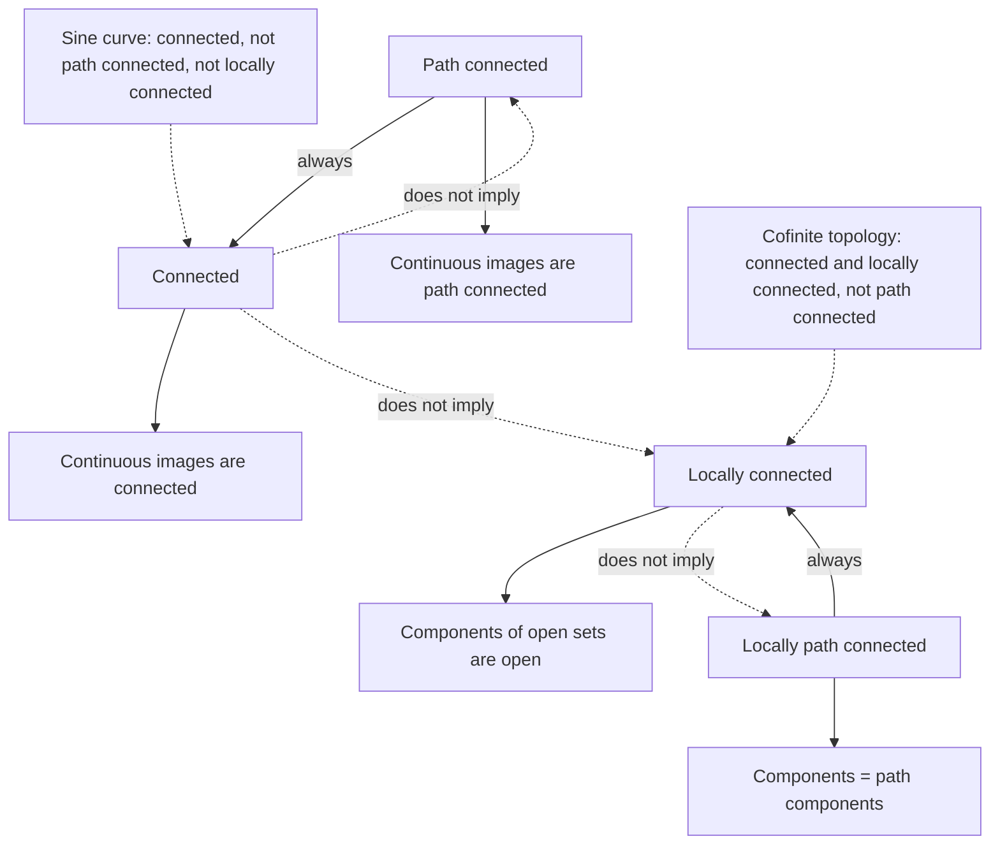
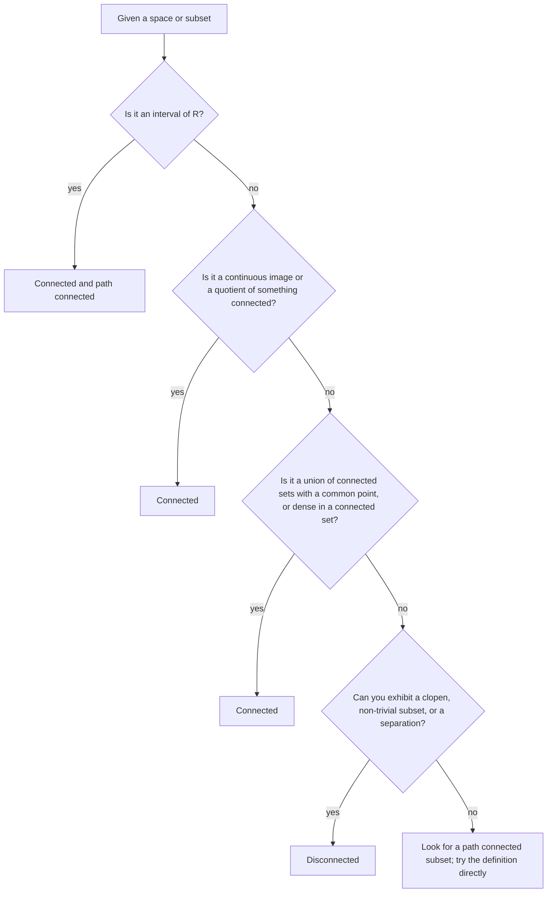

# Connectedness

> [Mathematics](../../README.md) › [Topology](../README.md) · Level: Advanced · Prerequisites: [Topological Spaces](../01-topological-spaces/README.md), [Metric Spaces](../../14-real-analysis/06-metric-spaces/README.md), [Continuity and Limits](../../14-real-analysis/03-continuity-and-limits/README.md), [Real Numbers and Completeness](../../14-real-analysis/01-real-numbers-and-completeness/README.md) · Estimated time: 540 min

## 1. Introduction

A homeomorphism is a bijection that preserves open sets in both directions. Everything a topologist can say
about a space must therefore be phrased in terms of open sets, and the two most useful things to say are
*how much of the space there is* (compactness) and *how many pieces there are*. This chapter is about the
second question.

The naive idea is "one piece". The definition that survives all the abstractions is not about pieces you can
see, but about a *failure*: a space is connected when you cannot split it into two non-empty open parts. That
single sentence is strong enough to prove the intermediate value theorem, to show that $\mathbb{R}$ and
$\mathbb{R}^2$ are not homeomorphic, to distinguish the circle from an interval, and to explain why a
continuous function cannot jump.

Three features of the subject deserve to be advertised before we start.

* **The definition is negative, so proofs are usually by contradiction.** To prove that a space is connected,
  assume a separation exists and derive an absurdity, almost always by producing a point that must lie on
  both sides. This is genuinely the technique; §7 is a long series of variations on it.
* **Intuition drawn from $\mathbb{R}$ is incomplete.** $\mathbb{R}$ and all its intervals are connected, and
  the connected subsets of $\mathbb{R}$ are exactly the intervals. But in $\mathbb{R}^2$ there are connected
  sets that are not path connected, and the topologist's sine curve (§7.7) is the standard warning: it is a
  single piece in the connected sense, yet you cannot draw it in one stroke.
* **There are two inequivalent notions, and the difference is the interesting part.** Path connectedness — the
  existence of a continuous path between any two points — implies connectedness (§7.6), and the converse
  fails. Components (§7.8) are the maximal connected pieces, path components the maximal path connected
  pieces; both partition the space, and comparing the two partitions measures how badly the space fails to be
  path connected.

The plan of the chapter:

* **Separations** (§7.1). The definition, its negations, and the first reformulation as "no non-trivial
  clopen subset".
* **Equivalent characterisations** (§7.2). Five statements equivalent to connectedness, each proved, because
  different proofs need different ones.
* **Intervals** (§7.3). The complete proof that a subset of $\mathbb{R}$ is connected exactly when it is an
  interval. Both directions need care; the hard direction uses the supremum property, and it is the only
  place in the chapter where completeness of $\mathbb{R}$ is indispensable.
* **Continuous images and the IVT** (§7.4). The image of a connected set under a continuous map is connected;
  the intermediate value theorem is a corollary, recovered rather than assumed.
* **Building connected sets** (§7.5). Closures of connected sets are connected, unions of connected sets that
  meet are connected, and quotients of connected spaces are connected. These three lemmas do most of the work
  in practice.
* **Path connectedness** (§7.6) and the topologist's sine curve (§7.7), which separates the two notions.
* **Components and local connectedness** (§7.8–§7.9). The maximal pieces, when they are open, and the
  hypothesis under which components and path components coincide.
* **Products** (§7.10). A product of connected spaces is connected, with a complete proof for finitely many
  factors and the standard dense-subset proof for arbitrary products.
* **A gallery** (§7.11). One table of spaces, each connected, disconnected or locally connected for a
  specific reason.

## 2. Prerequisites

**Open and closed sets, and the algebra of each.** Arbitrary unions of open sets and finite unions of closed
sets; finite intersections of open sets and arbitrary intersections of closed sets; a set is closed exactly
when its complement is open. See [Topological Spaces](../01-topological-spaces/README.md), §7.1–§7.2.

**The subspace topology.** For $A \subseteq X$, the open sets of $A$ are exactly the sets $U \cap A$ with
$U$ open in $X$, and the closed sets are exactly the $F \cap A$ with $F$ closed in $X$. The crucial
consequence used throughout: *if $A \subseteq B \subseteq X$ and $C \subseteq A$, then $C$ is open in $A$ iff
$C = A \cap U$ for some $U$ open in $B$*, so openness in a subspace is relative. See
[Topological Spaces](../01-topological-spaces/README.md), Theorem 7.6.3.

**Closure and interior.** $\overline A$ is the smallest closed set containing $A$, and for a subspace,
$A$ is dense in $B$ whenever $A \subseteq B \subseteq \overline A$. Two facts are used constantly: $A$ is
clopen iff $\partial A = \varnothing$, and a set is clopen iff its complement is. See
[Topological Spaces](../01-topological-spaces/README.md), §7.9.

**Continuity.** $f : X \to Y$ is continuous iff $f^{-1}[V]$ is open in $X$ for every open $V \subseteq Y$,
equivalently iff $f^{-1}[F]$ is closed for every closed $F$. Continuity is preserved by composition and by
restriction to a subspace. See [Continuity and Limits](../../14-real-analysis/03-continuity-and-limits/README.md)
and [Metric Spaces](../../14-real-analysis/06-metric-spaces/README.md), §7.7.

**The supremum property of $\mathbb{R}$.** Every non-empty subset of $\mathbb{R}$ that is bounded above has a
least upper bound. Every proof in this chapter that a particular subset of $\mathbb{R}$ is connected uses it,
and there is no substitute: over $\mathbb{Q}$ the statement "connected subsets of $\mathbb{Q}$ are intervals
of $\mathbb{Q}$" remains true, but "intervals are connected" fails, because $(0,1)\cap\mathbb{Q}$ is an
interval in $\mathbb{Q}$ and is disconnected. See
[Real Numbers and Completeness](../../14-real-analysis/01-real-numbers-and-completeness/README.md).

**Paths and intervals.** A path in $X$ is a continuous map $[0,1] \to X$. Familiarity with $[0,1]$ and with
the interval notation $(a,b)$, $[a,b]$, $(a,b]$ is assumed.

**Groups (only for §16).** The words *group*, *homomorphism* and *isomorphism* appear when we point forward
to algebraic topology; they are not used in the mathematics of this chapter. See
[Groups](../../13-abstract-algebra/01-groups/README.md).

## 3. Learning Objectives

By the end of this chapter you will be able to:

1. State the definition of a separation and of a connected space, and negate it correctly: produce, for a
   given disconnected space, two disjoint non-empty open sets whose union is the whole space.
2. Prove that connectedness is equivalent to each of: no separation; only $\varnothing$ and $X$ are clopen;
   every continuous map to the two-point discrete space is constant; $X$ is not the union of two disjoint
   non-empty closed sets.
3. Prove that a subset of $\mathbb{R}$ is connected if and only if it is an interval, including the
   supremum argument in the non-trivial direction.
4. Prove that the continuous image of a connected set is connected, and derive the intermediate value
   theorem, including the version saying that every continuous self-map of $[0,1]$ has a fixed point.
5. Prove that a union of connected sets with a common point is connected, that the closure of a connected set
   is connected, and that quotients of connected spaces are connected.
6. Define path connectedness, prove that it implies connectedness, describe the topologist's sine curve, and
   explain why it is connected but not path connected.
7. Compute components and path components of concrete spaces, and prove that components are closed, that they
   partition the space, and that every connected subset lies in a component.
8. State and use the characterisation of local connectedness by "components of open sets are open", and prove
   that a connected, locally path connected space is path connected.
9. Prove that a finite product of connected spaces is connected, and outline the dense-subset proof for
   arbitrary products.
10. Decide, for the standard examples (intervals, $\mathbb{Q}$, $\mathbb{R}^n$, spheres, the cofinite and
    lower-limit topologies, matrix groups), which of the four properties — connected, path connected, locally
    connected, locally path connected — hold, and justify each answer.

## 4. Intuition

### 4.1 One piece, and what "piece" can mean

Take a sheet of paper and cut it in two. The two halves are the pieces. Notice what the cut did: it produced
two subsets whose union is the sheet, which do not overlap, and each of which contains a little margin around
every one of its points — each is *open in the sheet*, because the cut creates a boundary and a boundary
belongs to neither half in the idealised model. That is exactly what a separation is: a division of the space
into two non-empty open parts that do not touch.

Now imagine the sheet is the rational line $\mathbb{Q}$. It is full of infinitesimal holes. Can you cut it in
two open halves? Yes: $\mathbb{Q}\cap(-\infty,\sqrt2)$ and $\mathbb{Q}\cap(\sqrt2,\infty)$ are both open in
$\mathbb{Q}$, both non-empty, and their union is $\mathbb{Q}$ because $\sqrt2$ is not rational. So
$\mathbb{Q}$ comes apart — into infinitely many pieces — although it looks like a line. This is the first
warning that connectedness is about the *topology*, not about the picture.

The second warning goes the other way. The topologist's sine curve (§7.7) *looks* like two pieces — an
oscillating curve and a vertical bar it accumulates on — and yet it is one connected piece, because no
separation can separate the bar from the curve: the curve crowds arbitrarily close to every point of the bar,
so any open set containing a point of the bar must contain points of the curve. It is not path connected,
though: you cannot travel from the bar to the curve in finite time at a continuous rate. So "connected" and
"you can walk from here to there" are different ideas, and both deserve names.

### 4.2 The separation is invisible from inside

A useful way to feel the definition: a separation of $X$ is a continuous map from $X$ onto the two-point
discrete space $\{0,1\}$. Continuous means that the preimage of every open set is open; the preimages of
$\{0\}$ and $\{1\}$ are then two disjoint open sets covering $X$. So

> $X$ is connected $\iff$ every continuous map $X \to \{0,1\}$ is constant.

A continuous map to a discrete space cannot change its mind gradually, so on a connected space it cannot
change its mind at all. This reformulation generalises best: replace $\{0,1\}$ by any discrete space $D$ and
you get *every continuous map from a connected space to a discrete space is constant*, which is how
connectedness is used in practice ("a continuously varying integer is constant").

### 4.3 Why intervals are the connected subsets of $\mathbb{R}$

An interval is a set with no gaps: if it contains $u$ and $v$ it contains everything between. A gap is
precisely a place where a cut can be made, and a cut is precisely a separation. So in $\mathbb{R}$ the two
notions should coincide, and they do (§7.3). The proof that an interval cannot be split uses the one
ingredient that distinguishes $\mathbb{R}$ from $\mathbb{Q}$: the supremum of the set of points on one side
of the alleged cut exists, it must lie on one side or the other, and either choice is absurd.

That argument is the engine behind almost every theorem in elementary analysis that says "there exists a
point where something happens": the maximum of a continuous function on $[a,b]$, the intermediate value
theorem, the existence of a fixed point of a continuous self-map of $[0,1]$, the existence of a real root of
a polynomial of odd degree. All of them are statements about connectedness of an interval in disguise, and
the disguise is removed in §7.4.

### 4.4 Paths

A path connected space is one in which any two points can be joined by a continuous curve. This is the
*constructive* version of connectedness and matches the physical intuition of "one piece". Path connected
implies connected, because a path is a continuous image of the connected interval $[0,1]$, and a connected
set cannot be split by a continuous map. The converse fails because a path must traverse the space in finite
time at a continuous rate, and some connected spaces contain points that are "infinitely far apart" in the
only sense the topology provides.

## 5. Formal Definition

Throughout, $X$ is a topological space with topology $\mathcal{T}$, and subsets of $X$ carry the subspace
topology unless stated otherwise.

**Definition 5.1 (Separation).** A *separation* of a topological space $X$ is a pair $(U,V)$ of subsets of
$X$ such that

$$U \neq \varnothing, \qquad V \neq \varnothing, \qquad U \cap V = \varnothing, \qquad U \cup V = X,$$

and both $U$ and $V$ are open in $X$. Equivalently both are closed in $X$: $U = X\setminus V$ with $V$ open,
so $U$ is closed, and symmetrically.

**Definition 5.2 (Connected space).** $X$ is *connected* if it admits no separation. Otherwise $X$ is
*disconnected*, and the separation is said to *disconnect* $X$.

**Definition 5.3 (Connected subset).** A subset $A \subseteq X$ is *connected* if $A$ with the subspace
topology is connected. Explicitly, $A$ is connected iff there are no sets $U, V$ open in $X$ with

$$A \cap U \neq \varnothing, \quad A \cap V \neq \varnothing, \quad (A\cap U)\cap(A\cap V) = \varnothing, \quad A \subseteq U \cup V .$$

Note that $U$ and $V$ need not be disjoint in $X$; only their intersections with $A$ must be. This is the
single most common source of error in the subject; see §11.

**Definition 5.4 (Path, path connected).** A *path* in $X$ from $x$ to $y$ is a continuous map
$\gamma : [0,1] \to X$ with $\gamma(0) = x$ and $\gamma(1) = y$. The *reverse* of $\gamma$ is
$\bar\gamma(t) = \gamma(1-t)$, a path from $y$ to $x$. If $\gamma$ is a path from $x$ to $y$ and $\delta$ a
path from $y$ to $z$, their *concatenation* is

$$(\gamma * \delta)(t) = \begin{cases} \gamma(2t), & 0 \le t \le \tfrac12,\\[2pt] \delta(2t-1), & \tfrac12 \le t \le 1,\end{cases}$$

which is continuous by the pasting lemma: the two formulas agree at $t = \tfrac12$, where both give $y$, and
the two closed pieces $[0,\tfrac12]$ and $[\tfrac12,1]$ cover $[0,1]$.

$X$ is *path connected* if for all $x, y \in X$ there is a path in $X$ from $x$ to $y$. A subset $A \subseteq X$
is path connected if $A$ with the subspace topology is path connected.

**Definition 5.5 (Component).** Define a relation on $X$ by

$$x \sim y \quad :\Longleftrightarrow \quad \text{there is a connected } C \subseteq X \text{ with } x, y \in C .$$

Proposition 7.8.1 shows that $\sim$ is an equivalence relation. Its classes are the *(connected) components*
of $X$; the component of $x$ is written $C_x$.

**Definition 5.6 (Path component).** Define $x \sim_p y$ iff there is a path in $X$ from $x$ to $y$. This is an
equivalence relation (Proposition 7.8.4), and its classes are the *path components* of $X$. The path
component of $x$ is written $P_x$.

**Definition 5.7 (Local connectedness).** $X$ is *locally connected at* $x \in X$ if every neighbourhood of
$x$ contains a connected neighbourhood of $x$. Explicitly: for every open $U \ni x$ there is a set $V$ with
$x \in V \subseteq U$, $V$ connected, and $V$ a neighbourhood of $x$ (that is, $x \in V^{\circ}$). $X$ is
*locally connected* if it is locally connected at every point. Replacing "connected" by "path connected" in
these two sentences defines *locally path connected at $x$* and *locally path connected*.

**Definition 5.8 (Totally disconnected).** $X$ is *totally disconnected* if its only connected subsets are
$\varnothing$ and the singletons; equivalently, if every component is a point.

**Remark 5.9.** Connectedness of $X$ is a property of the pair $(X,\mathcal{T})$, hence invariant under
homeomorphism; so are path connectedness and local connectedness. All three are therefore legitimate tools
for proving that two spaces are *not* homeomorphic — the use made of them in §9.5 and throughout
[Introduction to Algebraic Topology](../05-algebraic-topology/README.md).

## 6. Mathematical Notation

| Symbol | Read as | Meaning |
|---|---|---|
| $(U,V)$ | a separation | two disjoint non-empty open sets covering $X$ |
| $X = U \sqcup V$ | $X$ is the disjoint union of $U$ and $V$ | $U\cup V = X$ and $U\cap V = \varnothing$ |
| $\mathcal{T}$ | the topology | the family of open sets |
| $A^{\complement}$ | complement of $A$ | $X\setminus A$ |
| $\overline A$, $A^{\circ}$, $\partial A$ | closure, interior, boundary | topological operations in the ambient space |
| $f[A]$ | image of $A$ under $f$ | $\{f(a) : a \in A\}$ |
| $f^{-1}[B]$ | preimage of $B$ | $\{x : f(x) \in B\}$ |
| $\gamma$, $\delta$ | paths | continuous maps $[0,1] \to X$ |
| $\bar\gamma$ | reverse path | $t \mapsto \gamma(1-t)$ |
| $\gamma * \delta$ | concatenation | traverse $\gamma$, then $\delta$, each at double speed |
| $c_x$ | constant path at $x$ | $c_x(t) = x$ for all $t$ |
| $S^n$ | the $n$-sphere | $\{x \in \mathbb{R}^{n+1} : \lVert x\rVert = 1\}$ |
| $D^n$ | the closed $n$-ball | $\{x \in \mathbb{R}^n : \lVert x\rVert \le 1\}$ |
| $C_x$ | component of $x$ | the maximal connected subset containing $x$ |
| $P_x$ | path component of $x$ | the maximal path connected subset containing $x$ |
| $\{0,1\}$ | the two-point discrete space | both singletons are open |
| $\mathbb{R}_\ell$ | the Sorgenfrey line | $\mathbb{R}$ with the topology generated by the intervals $[a,b)$ |
| $\cong$, $\not\cong$ | homeomorphic, not homeomorphic | related by a homeomorphism |
| $\blacksquare$ | end of proof | |

Reading aloud: "$X = U \sqcup V$ with $U, V$ non-empty and open" is read "a separation of $X$ exists"; and
"$A \subseteq B \subseteq \overline A$" is read "$A$ is dense in $B$".

## 7. Core Concepts

### 7.1 Separations

The whole chapter rests on one definition, so we begin by extracting everything it says.

**Proposition 7.1.1 (A separation consists of clopen sets).** If $(U,V)$ is a separation of $X$, then $U$ and
$V$ are both open and closed in $X$.

*Proof.* Both are open by definition. Since $U = X\setminus V$ and $V$ is open, $U$ is closed; since
$V = X\setminus U$ and $U$ is open, $V$ is closed. $\blacksquare$

So a separation is the same thing as a partition of $X$ into two non-empty clopen sets. The point of the
reformulation is that it is symmetric: no information is lost by forgetting which of the two parts was
called "open".

**Lemma 7.1.2 (A connected set lies entirely on one side).** Let $(U,V)$ be a separation of $X$ and let
$A \subseteq X$ be connected. Then $A \subseteq U$ or $A \subseteq V$.

*Proof.* The sets $A\cap U$ and $A\cap V$ are open in $A$ (they are traces of open sets), they are disjoint,
and their union is $A$. They are therefore a separation of $A$ unless one of them is empty. Since $A$ is
connected, one is empty, which is exactly the assertion. $\blacksquare$

This lemma is used so often that it is worth memorising: **a connected set cannot meet both sides of a
separation.** For example, $(-\infty,\sqrt2)$ and $(\sqrt2,\infty)$ separate
$\mathbb{R}\setminus\{\sqrt2\}$, so every connected subset of $\mathbb{R}\setminus\{\sqrt2\}$ lies entirely
below $\sqrt2$ or entirely above it. (The same reasoning does *not* apply to $\mathbb{Q}$: it is true that a
connected subset of $\mathbb{R}$ cannot contain both a rational and an irrational, but the reason is
Theorem 7.3.3, not Lemma 7.1.2, because $\mathbb{Q}$ is not open in $\mathbb{R}$.)

**Proposition 7.1.3 (Negation of the definition).** For a space $X$ the following are equivalent:

1. $X$ is disconnected;
2. there is a set $A$ with $\varnothing \neq A \neq X$ that is both open and closed in $X$;
3. $X$ is the union of two disjoint non-empty closed sets.

*Proof.* (1)$\Rightarrow$(2): a separation $(U,V)$ gives such an $A = U$ by Proposition 7.1.1.
(2)$\Rightarrow$(3): $X = A \sqcup (X\setminus A)$, and both are non-empty and closed.
(3)$\Rightarrow$(1): if $X = F \sqcup G$ with $F,G$ non-empty and closed, then $F$ and $G$ are also open
(complements of each other), so $(F,G)$ is a separation. $\blacksquare$

**Proposition 7.1.4 (The trivial cases).** The empty space and every one-point space are connected. Every
space with the indiscrete topology is connected. A discrete space is connected if and only if it has at most
one point.

*Proof.* $\varnothing$ has no non-empty subsets at all, so it has no separation; a singleton $\{x\}$ has only
the subsets $\varnothing$ and $\{x\}$, which cannot both be non-empty. In the indiscrete topology the only
open sets are $\varnothing$ and $X$, so a separation is impossible. In a discrete space every subset is
clopen, so Proposition 7.1.3 gives a separation as soon as there are two points. $\blacksquare$

One warning before we go on. Connectedness is *not* inherited by subspaces (§7.5 has the counterexample
$\mathbb{Q} \subseteq \mathbb{R}$) and is *not* detected by sequences: a sequence can converge in a
disconnected space just as well as in a connected one, so no amount of sequential information decides
connectedness. This is the first property in the discipline that is genuinely about the *shape of the family
of open sets* rather than about limits.

### 7.2 Equivalent Characterisations of Connectedness

Five equivalent formulations are collected here. Each is used somewhere later: (c) is the one that makes
proofs about closures work, (d) is the one that turns "continuous integer-valued functions are constant" into
a theorem, and (e) is the one that is easiest to negate.

**Theorem 7.2.1 (Characterisations of connectedness).** For a topological space $X$ the following are
equivalent.

(a) $X$ is connected.
(b) $X$ has no separation.
(c) The only subsets of $X$ that are both open and closed are $\varnothing$ and $X$.
(d) Every continuous map $f : X \to D$, where $D$ is a discrete space, is constant.
(e) $X$ is not the union of two disjoint non-empty closed subsets.
(f) Every continuous map $f : X \to \{0,1\}$, where $\{0,1\}$ carries the discrete topology, is constant.

*Proof.* (a)$\Leftrightarrow$(b) is the definition.

(b)$\Rightarrow$(c): let $A \subseteq X$ be clopen. If $A \neq \varnothing$ and $A \neq X$, then
$(A, X\setminus A)$ is a pair of non-empty disjoint open sets covering $X$, a separation. So $A$ is
$\varnothing$ or $X$.

(c)$\Rightarrow$(b): if $(U,V)$ is a separation, then $U$ is clopen and is neither $\varnothing$ nor $X$,
contradicting (c).

(c)$\Rightarrow$(d): let $D$ be discrete and $f : X \to D$ continuous. For $d \in D$ the singleton $\{d\}$ is
open and closed in $D$, so $f^{-1}[\{d\}]$ is open and closed in $X$. By (c) each $f^{-1}[\{d\}]$ is
$\varnothing$ or $X$. If $f^{-1}[\{d\}] = X$ then $f$ is constant with value $d$. Since the sets
$f^{-1}[\{d\}]$, $d \in D$, partition $X$ and $X \neq \varnothing$, exactly one of them is non-empty, hence
equal to $X$.

(d)$\Rightarrow$(f): $\{0,1\}$ is discrete.

(f)$\Rightarrow$(c): let $A \subseteq X$ be clopen. The indicator $\mathbf{1}_A : X \to \{0,1\}$ is
continuous, because the preimages of $\varnothing$, $\{1\}$, $\{0\}$ and $\{0,1\}$ are $\varnothing$, $A$,
$X\setminus A$ and $X$, all open. By (f) it is constant, so $A = \varnothing$ or $A = X$.

(b)$\Leftrightarrow$(e): a pair of disjoint non-empty closed sets with union $X$ is the complement of a pair
of disjoint non-empty open sets with union $X$, by taking complements of each part. $\blacksquare$

**Proposition 7.2.2 (Connectedness of a subset, unwound).** For $A \subseteq X$ the following are
equivalent.

1. $A$ is connected.
2. There do not exist open sets $U, V$ of $X$ with $A\cap U \neq \varnothing$, $A \cap V \neq \varnothing$,
   $(A\cap U)\cap(A\cap V) = \varnothing$ and $A \subseteq U\cup V$.
3. There is no subset $B$ of $A$ with $\varnothing \neq B \neq A$ that is open in $A$ and closed in $A$.

*Proof.* The open sets of the subspace $A$ are exactly the traces $A \cap U$ with $U$ open in $X$
(Theorem 7.6.3 of [Topological Spaces](../01-topological-spaces/README.md)), so (1) and (2) say the same
thing, and (3) is Proposition 7.1.3 applied to the space $A$. $\blacksquare$

The subtlety in (2) is worth repeating: $U$ and $V$ are open in the *ambient* space and need not be disjoint
there; what must be disjoint is $A\cap U$ and $A\cap V$, i.e. $A \cap U \cap V = \varnothing$. For example,
the set $A = [0,1]\cup[2,3] \subseteq \mathbb{R}$ is disconnected, witnessed by $U = (-1,1.5)$ and
$V = (1.5,4)$: these are disjoint, but one could equally use $U = (-1,2)$ and $V = (1,4)$, which overlap
heavily and still satisfy $A\cap U\cap V = \varnothing$ and $A \subseteq U\cup V$.

**Corollary 7.2.3 (A finite clopen partition).** A space $X$ is connected if and only if every representation
of $X$ as a union of finitely many pairwise disjoint non-empty open sets has exactly one member. More
generally, if $X = U_1 \sqcup \cdots \sqcup U_n$ with each $U_i$ clopen, then $X$ is connected iff $n = 1$.

*Proof.* If $n \ge 2$, then $U_1$ is a non-trivial clopen set. Conversely a non-trivial clopen set $A$ gives
the partition $X = A \sqcup (X\setminus A)$. $\blacksquare$

### 7.3 Connected Subsets of $\mathbb{R}$: Exactly the Intervals

**Definition 7.3.1 (Interval).** A subset $A \subseteq \mathbb{R}$ is an *interval* if it is convex in the
order: whenever $a, b \in A$ with $a < b$ and $a < c < b$, then $c \in A$.

The empty set and every singleton are intervals vacuously. The terminology matches the familiar list, and we
record the standard classification because it is used in examples.

**Lemma 7.3.2 (Classification of intervals).** Every non-empty interval $A \subseteq \mathbb{R}$ is one of

$$\{a\},\quad (a,b),\quad [a,b),\quad (a,b],\quad [a,b],\quad (a,\infty),\quad [a,\infty),\quad
(-\infty,b),\quad (-\infty,b],\quad \mathbb{R},$$

with $a < b$ real.

*Proof.* Let $a = \inf A \in [-\infty,\infty)$ and $b = \sup A \in (-\infty,\infty]$; these exist in the
extended sense because $\mathbb{R}$ is complete and $A \neq \varnothing$. If $a < x < b$, then $x$ is not a
lower bound of $A$ and not an upper bound, so there are $p, q \in A$ with $p < x < q$; since $A$ is an
interval, $x \in A$. Hence $(a,b) \subseteq A \subseteq [a,b]$, and $A$ is obtained from $(a,b)$ by
adjoining any of the endpoints that belong to $A$ and are finite. Reading off the four possibilities for
$a \in A$ and $b \in A$ (and the infinite cases) gives exactly the list. $\blacksquare$

**Theorem 7.3.3 (Connected subsets of $\mathbb{R}$).** A subset $A \subseteq \mathbb{R}$ is connected if and
only if $A$ is an interval.

*Proof of "connected $\Rightarrow$ interval".* We prove the contrapositive. Suppose $A$ is not an interval.
Then there are $a, b \in A$ with $a < b$ and a point $c$ with $a < c < b$ and $c \notin A$. Put

$$U = A \cap (-\infty, c), \qquad V = A \cap (c,\infty).$$

Both are open in $A$; $a \in U$ and $b \in V$, so both are non-empty; they are disjoint; and
$U \cup V = A$ because $c \notin A$ and every real number is $<c$, $=c$ or $>c$. Hence $(U,V)$ is a
separation of $A$, and $A$ is disconnected.

*Proof of "interval $\Rightarrow$ connected".* Suppose $A$ is an interval and that $A$ is disconnected. Then
there are $U, V$ open in $A$, both non-empty, with $U \cap V = \varnothing$ and $U \cup V = A$. Choose
$u \in U$ and $v \in V$. Interchanging the names of $U$ and $V$ if necessary, assume $u < v$.

Because $A$ is an interval and $u, v \in A$, the whole interval $[u,v]$ is contained in $A$. Let

$$S = U \cap [u,v], \qquad s = \sup S .$$

The set $S$ is non-empty ($u \in S$) and bounded above by $v$, so $s$ exists by completeness of
$\mathbb{R}$, and $u \le s \le v$. Since $[u,v] \subseteq A$, we have $s \in A = U \sqcup V$, so exactly one
of the following two cases occurs.

*Case $s \in U$.* Since $U$ is open in $A$, there is $\varepsilon > 0$ with
$(s-\varepsilon, s+\varepsilon)\cap A \subseteq U$. Because $s \in U$ and $U \cap V = \varnothing$ while
$v \in V$, we have $s \neq v$, hence $s < v$. Put $\delta = \min\{\varepsilon, v - s\} > 0$. Then
$s + \delta/2 \in [u,v] \subseteq A$ and $s + \delta/2 < s + \varepsilon$, so
$s+\delta/2 \in (s-\varepsilon,s+\varepsilon)\cap A \subseteq U$. Thus $s + \delta/2 \in S$ with
$s + \delta/2 > s$, contradicting the definition of $s$ as an upper bound of $S$.

*Case $s \in V$.* Since $V$ is open in $A$, there is $\varepsilon > 0$ with
$(s-\varepsilon, s+\varepsilon)\cap A \subseteq V$. Because $s = \sup S$, there is $x \in S$ with
$x > s - \varepsilon$; also $x \le s$. Then $x \in U$ and $x \in (s-\varepsilon, s] \subseteq
(s-\varepsilon,s+\varepsilon)$, and $x \in [u,v] \subseteq A$, so $x \in V$ as well, contradicting
$U \cap V = \varnothing$.

Both cases are impossible, so no separation of $A$ exists and $A$ is connected. $\blacksquare$

It is worth isolating what the proof used. The only non-trivial ingredient is the existence of
$\sup S$, that is, completeness of $\mathbb{R}$; the interval property was used twice — once to conclude
$[u,v] \subseteq A$, and once (implicitly) to know that $s \in A$ rather than in a hole. Over $\mathbb{Q}$ the
same proof breaks down exactly at the supremum, and the conclusion is false:
$\mathbb{Q}\cap(-\infty,\sqrt2)$ is an interval of $\mathbb{Q}$ and is disconnected.

**Corollary 7.3.4 (The standard connected and disconnected subsets).** $\mathbb{R}$ is connected, as is every
interval. The following are disconnected: $\mathbb{Q}$, $\mathbb{R}\setminus\mathbb{Q}$, $\mathbb{Z}$, any
set with at least two points all of whose points are isolated in the subspace topology (for instance
$\{1/n : n \in \mathbb{N}\}\cup\{0\}$ is *not* of this kind, but $\{1/n : n \in \mathbb{N}\}$ is).

*Proof.* $\mathbb{R}$ is an interval. $\mathbb{Q}$ is not an interval, because $0 < \sqrt2/2 < 1$ with
$0, 1 \in \mathbb{Q}$ and $\sqrt 2/2 \notin \mathbb{Q}$; the same argument with a small irrational between two
rationals shows that $\mathbb{R}\setminus\mathbb{Q}$ is not an interval. $\mathbb{Z}$ is not an interval.
Finally, if $A$ has two points $x \neq y$ that are both isolated in $A$, then $\{x\}$ is a non-trivial clopen
subset of $A$. $\blacksquare$

### 7.4 Continuous Images and the Intermediate Value Theorem

**Theorem 7.4.1 (Continuous images of connected sets are connected).** Let $f : X \to Y$ be continuous and
let $A \subseteq X$ be connected. Then $f[A]$ is connected.

*Proof.* Suppose $f[A] = P \sqcup Q$ is a separation, with $P,Q$ open in $f[A]$ and non-empty. Then
$f^{-1}[P] \cap A$ and $f^{-1}[Q] \cap A$ are open in $A$ (preimages of open sets under the continuous map
$f|_A : A \to f[A]$), they are non-empty (choose $p \in P$, write $p = f(a)$ with $a\in A$), they are
disjoint, and their union is $A$. That is a separation of $A$, contradicting connectedness. $\blacksquare$

**Corollary 7.4.2 (Intermediate value theorem).** Let $f : [a,b] \to \mathbb{R}$ be continuous with $a < b$.
If $y$ lies between $f(a)$ and $f(b)$ — that is, $f(a) \le y \le f(b)$ or $f(b) \le y \le f(a)$ — then there
is $x \in [a,b]$ with $f(x) = y$.

*Proof.* The interval $[a,b]$ is connected by Theorem 7.3.3, so $f[[a,b]]$ is connected by Theorem 7.4.1,
hence an interval by Theorem 7.3.3. Both $f(a)$ and $f(b)$ belong to this interval, so every number between
them does too. Thus $y = f(x)$ for some $x \in [a,b]$. $\blacksquare$

**Corollary 7.4.3 (Fixed points of self-maps of $[0,1]$).** Every continuous map $f : [0,1] \to [0,1]$ has a
fixed point, i.e. there is $x \in [0,1]$ with $f(x) = x$.

*Proof.* Define $g(x) = f(x) - x$, continuous. Then $g(0) = f(0) \ge 0$ because $f$ takes values in
$[0,1]$, and $g(1) = f(1) - 1 \le 0$. If $g(0) = 0$ or $g(1) = 0$ we are done; otherwise
$g(1) < 0 < g(0)$ and Corollary 7.4.2 applied to $g$ on $[0,1]$ produces $x$ with $g(x) = 0$. $\blacksquare$

**Corollary 7.4.4 (Odd-degree polynomials have real roots).** Let $p(x) = x^n + a_{n-1}x^{n-1} + \cdots + a_0$
with $n$ odd. Then $p$ has a real root.

*Proof.* For $x \neq 0$,

$$p(x) = x^n\Bigl(1 + \frac{a_{n-1}}{x} + \cdots + \frac{a_0}{x^n}\Bigr),$$

and the bracket tends to $1$ as $\lvert x\rvert \to \infty$. Hence $p(x) \to +\infty$ as $x \to +\infty$ and
$p(x) \to -\infty$ as $x \to -\infty$ (here $n$ odd is used: $x^n$ has the sign of $x$). Choose $M$ with
$p(M) > 0 > p(-M)$; then Corollary 7.4.2 on $[-M,M]$ gives $x$ with $p(x) = 0$. $\blacksquare$

**Corollary 7.4.5 (A continuous integer-valued function on a connected space is constant).** If $X$ is
connected and $f : X \to \mathbb{Z}$ (with $\mathbb{Z}$ discrete) is continuous, then $f$ is constant. More
generally, the image of a connected space under a continuous map is connected, so if the target is totally
disconnected the map is constant.

*Proof.* This is Theorem 7.2.1(d) with $D = \mathbb{Z}$. $\blacksquare$

Corollary 7.4.3 is the one-dimensional case of *Brouwer's fixed point theorem*; the two-dimensional case is
proved in [Introduction to Algebraic Topology](../05-algebraic-topology/README.md), where it is shown that no
such argument from connectedness alone can work in higher dimensions.

### 7.5 Building New Connected Sets: Closures, Unions and Quotients

Connectedness is not inherited by arbitrary subsets, but it is preserved by three constructions that cover
almost every application.

**Theorem 7.5.1 (Union of connected sets with a common point).** Let $\{A_i\}_{i \in I}$ be a family of
connected subsets of $X$ with $\bigcap_{i\in I} A_i \neq \varnothing$. Then $\bigcup_{i\in I} A_i$ is
connected.

*Proof.* Let $A = \bigcup_i A_i$ and suppose $(U,V)$ is a separation of $A$. Each $A_i$ is connected, so by
Lemma 7.1.2 each $A_i$ is contained in $U$ or in $V$. Fix $p \in \bigcap_i A_i$; say $p \in U$. Then every
$A_i$ contains $p$, so no $A_i$ is contained in $V$ (as $V$ is disjoint from $U$), hence every $A_i$ is
contained in $U$. Therefore $A \subseteq U$ and $V = \varnothing$, contradicting that $V$ is non-empty.
$\blacksquare$

**Corollary 7.5.2 (Two overlapping connected sets).** If $A$ and $B$ are connected subsets of $X$ with
$A \cap B \neq \varnothing$, then $A \cup B$ is connected.

*Proof.* Apply Theorem 7.5.1 to the two-element family $\{A,B\}$. $\blacksquare$

**Theorem 7.5.3 (The closure of a connected set is connected).** Let $A \subseteq X$ be connected and let $B$
satisfy $A \subseteq B \subseteq \overline A$. Then $B$ is connected. In particular $\overline A$ is
connected.

*Proof.* Suppose $C \subseteq B$ is non-empty and both open and closed in $B$; by Theorem 7.2.1 it suffices
to show that every such $C$ equals $B$. The set $C \cap A$ is open in $A$ and closed in $A$, so by the
connectedness of $A$ it is either $\varnothing$ or $A$.

If $C \cap A = \varnothing$, then $A \subseteq B\setminus C$; since $C$ is closed in $B$, the set
$B\setminus C$ is open in $B$, hence $B\setminus C$ is an open set of $B$ containing $A$. Therefore $B$
contains the closure of $A$ taken in $B$; that closure is $B$ itself, because $A \subseteq B \subseteq
\overline A$ implies $\operatorname{cl}_B(A) = B \cap \overline A = B$. Hence $B \subseteq B \setminus C$,
forcing $C = \varnothing$.

If $C \cap A = A$, then $A \subseteq C$; since $C$ is closed in $B$, it contains
$\operatorname{cl}_B(A) = B$, so $C = B$. $\blacksquare$

The hypothesis $B \subseteq \overline A$ cannot be dropped: $A = (0,1)$ and $B = (0,1)\cup\{2\}$ shows that a
superset of a connected set can be disconnected.

**Corollary 7.5.4 (A chain of connected sets).** If $A_1, \dots, A_n$ are connected and
$A_i \cap A_{i+1} \neq \varnothing$ for $i = 1,\dots,n-1$, then $A_1 \cup \cdots \cup A_n$ is connected.

*Proof.* Induction on $n$: the case $n=1$ is trivial, and for $n \ge 2$ the set
$A_1\cup\cdots\cup A_{n-1}$ is connected by the induction hypothesis and meets $A_n$, so Corollary 7.5.2
applies. $\blacksquare$

Corollary 7.5.4 is the workhorse behind all statements of the form "this picture is connected": you join the
pieces one at a time along points (or arcs) they share.

**Corollary 7.5.5 (Quotients and continuous images).** Let $q : X \to Y$ be a continuous surjection. If $X
is connected then $Y$ is connected. In particular a quotient of a connected space is connected.

*Proof.* $Y = q[X]$ is a continuous image of a connected set, so Theorem 7.4.1 applies. $\blacksquare$

**Proposition 7.5.6 (Connectedness is not hereditary, and intersections can fail).** (a) A subset of a
connected space need not be connected: $\mathbb{Q} \subseteq \mathbb{R}$. (b) Even an *open* subset of a
connected space can be disconnected: $\mathbb{R}\setminus\{0\}$ is open in $\mathbb{R}$ and is separated by
$(-\infty,0)$ and $(0,\infty)$. (c) The intersection of two connected sets need not be connected: let $A$ be
the unit circle and $B$ the union of the two unit circles centred at $(1,0)$ and $(-1,0)$. Then $B$ is
connected because the two circles meet at $(0,0)$, and
$A \cap B = \{(\pm\tfrac12, \pm\tfrac{\sqrt3}2)\}$ consists of four points, hence is disconnected.

*Proof.* For (c): $A\cap B$ is computed by subtracting equations, as in the verification
$(x-1)^2 + y^2 = 1$ with $x^2+y^2 = 1$ forces $x = \tfrac12$. A four-point discrete set is disconnected by
Proposition 7.1.4. $\blacksquare$

### 7.6 Path Connectedness

**Theorem 7.6.1 (Path connected implies connected).** Every path connected space is connected.

*Proof.* Let $X$ be path connected and suppose $(U,V)$ is a separation of $X$. Choose $x \in U$ and
$y \in V$; by hypothesis there is a path $\gamma : [0,1] \to X$ from $x$ to $y$. Then
$\gamma^{-1}[U]$ and $\gamma^{-1}[V]$ are open in $[0,1]$ (continuity of $\gamma$), they are non-empty
(they contain $0$ and $1$ respectively), they are disjoint, and their union is $[0,1]$. This is a separation
of $[0,1]$, contradicting the connectedness of the interval $[0,1]$ (Theorem 7.3.3). $\blacksquare$

**Proposition 7.6.2 (Images and products behave).** Let $f : X \to Y$ be continuous. If $A \subseteq X$ is
path connected then $f[A]$ is path connected. Consequently quotients of path connected spaces are path
connected, and a finite product of path connected spaces is path connected.

*Proof.* Given $f(x), f(x') \in f[A]$ and a path $\gamma$ in $A$ from $x$ to $x'$, the composite
$f \circ \gamma$ is a path in $f[A]$ from $f(x)$ to $f(x')$. For a finite product use the path
$t \mapsto (\gamma_1(t),\dots,\gamma_n(t))$. $\blacksquare$

**Proposition 7.6.3 (One basepoint suffices).** A space $X$ is path connected if and only if there is a point
$x_0 \in X$ such that every point of $X$ can be joined to $x_0$ by a path.

*Proof.* Necessity is trivial. For sufficiency, given $x,y \in X$ choose paths $\gamma$ from $x$ to $x_0$ and
$\delta$ from $x_0$ to $y$; then $\bar\gamma * \delta$ is a path from $x$ to $y$, by the concatenation
construction of Definition 5.4. $\blacksquare$

**Proposition 7.6.4 (Convex sets are path connected).** Every convex subset of $\mathbb{R}^n$ is path
connected; in particular $\mathbb{R}^n$, every ball and every interval is path connected. Every translate and
every dilation of a convex set is convex.

*Proof.* If $C$ is convex and $x,y \in C$, the straight-line path $\gamma(t) = (1-t)x + ty$ lies in $C$ by
convexity, is continuous (its coordinates are polynomials in $t$), and joins $x$ to $y$. $\blacksquare$

**Proposition 7.6.5 (Spheres are path connected).** For $n \ge 1$, $S^n = \{x \in \mathbb{R}^{n+1} :
\lVert x\rVert = 1\}$ is path connected. $S^0 = \{-1,1\}$ is not connected.

*Proof.* Let $u, v \in S^n$. If $v \neq -u$, define

$$\gamma(t) = \frac{(1-t)u + tv}{\lVert (1-t)u + tv\rVert}, \qquad 0 \le t \le 1 .$$

The denominator never vanishes: if $(1-t)u + tv = 0$ then $(1-t)u = -tv$, and taking norms gives $1-t = t$
(since $\lVert u\rVert = \lVert v\rVert = 1$ with $t \in [0,1]$), so $t = \tfrac12$ and $u = -v$, contrary to
the assumption. The formula is continuous into $S^n$ and joins $u$ to $v$ along the shorter great-circle arc.
If $v = -u$, choose a unit vector $w$ with $w \neq \pm u$ — for $n\ge1$ there is one, e.g. $w = e_2$ rotated
into a direction orthogonal to $u$ — and concatenate the paths $u \to w$ and $w \to -u$. Finally
$S^0 = \{-1\}\sqcup\{1\}$ is a separation. $\blacksquare$

**Remark 7.6.6.** For subsets of $\mathbb{R}$ the three notions *interval*, *connected* and *path connected*
coincide: every interval is convex, hence path connected (Proposition 7.6.4), hence connected
(Theorem 7.6.1), and every connected subset of $\mathbb{R}$ is an interval (Theorem 7.3.3). This coincidence
is special to the line; it fails already in $\mathbb{R}^2$, as the next section shows.

### 7.7 The Topologist's Sine Curve

The converse of Theorem 7.6.1 is false, and the standard counterexample deserves a name.

**Definition 7.7.1 (Topologist's sine curve).** Let

$$G = \Bigl\{\bigl(x,\sin \tfrac1x\bigr) : 0 < x \le 1\Bigr\} \subseteq \mathbb{R}^2, \qquad
T = G \cup \bigl(\{0\}\times[-1,1]\bigr).$$

$T$ is the *topologist's sine curve*.

**Theorem 7.7.2.** $T$ is connected, closed and bounded, hence compact.

*Proof.* The interval $(0,1]$ is connected (Theorem 7.3.3), and $x \mapsto (x,\sin\frac1x)$ is continuous on
$(0,1]$, so $G$ is connected (Theorem 7.4.1).

We show that $\overline G = T$. First $T$ is closed: let
$(x_k,y_k) \in T$ with $(x_k,y_k) \to (x,y)$. If $x > 0$, then for all large $k$ we have $x_k > x/2 > 0$, so
$y_k = \sin(1/x_k) \to \sin(1/x)$ by continuity, giving $(x,y) = (x,\sin\frac1x) \in G$. If $x = 0$, then
$y = \lim y_k \in [-1,1]$ because all $y_k \in [-1,1]$ and $[-1,1]$ is closed, so $(x,y) \in
\{0\}\times[-1,1]$. A sequence in $T$ cannot converge to a point with $x<0$ because all $x_k \ge 0$. Closedness
is detected by sequences in a metric space, so $T$ is closed. Conversely, for $y \in [-1,1]$ and
$x_k = 1/(\arcsin y + 2\pi k) \to 0^+$ we have $(x_k,\sin\frac1{x_k}) = (x_k,y) \to (0,y)$; hence
$\overline G \supseteq \{0\}\times[-1,1]$ and so $\overline G = T$. Being closed and contained in the square
$[0,1]\times[-1,1]$, $T$ is bounded, hence compact.

Now $G \subseteq T \subseteq \overline G$ with $G$ connected, so $T$ is connected by Theorem 7.5.3.
$\blacksquare$

**Theorem 7.7.3.** $T$ is not path connected. In fact, there is no path in $T$ from a point of
$\{0\}\times[-1,1]$ to a point of $G$.

*Proof.* Suppose $\gamma = (\gamma_1,\gamma_2) : [0,1] \to T$ is a path with
$\gamma(0) \in \{0\}\times[-1,1]$ and $\gamma(1) \in G$. Put

$$Z = \{t \in [0,1] : \gamma_1(t) = 0\} .$$

$Z$ is closed (it is the preimage of the closed set $\{0\}$ under the continuous map $\gamma_1$), it contains
$0$, and it does not contain $1$ because $\gamma_1(1) > 0$. Let $t_0 = \max Z$, which exists because $Z$ is a
non-empty closed subset of the compact set $[0,1]$. Then $t_0 < 1$ and $\gamma_1(t) \neq 0$ for every
$t \in (t_0,1]$.

Since $\gamma_1$ is continuous on the connected interval $[t_0,1]$ and takes a non-zero value at $1$, its
image is a connected subset of $\mathbb{R}\setminus\{0\}$ containing $\gamma_1(1) > 0$; by Theorem 7.3.3 and
the fact that $\mathbb{R}\setminus\{0\} = (-\infty,0)\sqcup(0,\infty)$ is a separation, that image lies in
$(0,\infty)$. Hence

$$\gamma_1(t) > 0 \text{ for all } t \in (t_0,1], \quad\text{and therefore}\quad
\gamma(t) \in G, \quad \gamma_2(t) = \sin\frac{1}{\gamma_1(t)} \text{ for all } t \in (t_0,1].$$

For $k \ge 0$ put $a_k = 1/(\tfrac{\pi}2 + 2\pi k)$ and $b_k = 1/(\tfrac{3\pi}2 + 2\pi k)$, so that
$a_k, b_k \in (0,1]$, $a_k \to 0$, $b_k \to 0$, $\sin(1/a_k) = 1$ and $\sin(1/b_k) = -1$. Choose $k$ large
enough that $a_k < \gamma_1(1)$ and $b_k < \gamma_1(1)$. Applying the intermediate value theorem
(Corollary 7.4.2) to $\gamma_1$ on $[t_0,1]$, whose values at the endpoints are $0$ and $\gamma_1(1)$, we find
$t_k \in (t_0,1)$ with $\gamma_1(t_k) = a_k$, and $s_k \in (t_0,1)$ with $\gamma_1(s_k) = b_k$. Then

$$\gamma_2(t_k) = \sin\frac{1}{a_k} = 1, \qquad \gamma_2(s_k) = \sin\frac{1}{b_k} = -1 .$$

*Claim: $t_k \to t_0$ and $s_k \to t_0$.* Suppose, for the sequence $(t_k)$, that this fails. Then there is
$\delta > 0$ and a subsequence with $t_{k_j} \ge t_0 + \delta$. By compactness of $[t_0+\delta,1]$ a further
subsequence converges to some $t^* \in [t_0+\delta,1]$, and by continuity of $\gamma_1$ we get
$\gamma_1(t^*) = \lim_j a_{k_j} = 0$, contradicting $\gamma_1 > 0$ on $(t_0,1]$. The same argument applies
to $(s_k)$.

Now $\gamma_2$ is continuous at $t_0$, so
$\gamma_2(t_0) = \lim_k \gamma_2(t_k) = 1$ and simultaneously
$\gamma_2(t_0) = \lim_k \gamma_2(s_k) = -1$. This is impossible, so no such path exists. $\blacksquare$

**Remark 7.7.4 (What the example shows).**

* $T$ is connected but not path connected, so Theorem 7.6.1 has no converse.
* The path components of $T$ are exactly the two sets $\{0\}\times[-1,1]$ and $G$: each is path connected
  (the segment and the graph of a continuous function on an interval are, by Propositions 7.6.4 and 7.6.2),
  and Theorem 7.7.3 says no path joins them. The component of $T$ is $T$ itself.
* The path component $G$ is not closed in $T$ (its closure is $T$), which shows that path components need not
  be closed, in contrast with components (§7.8).
* $T$ is not locally connected at any point of $\{0\}\times[-1,1]$: every small ball around such a point
  meets infinitely many distinct arcs of $G$, so it contains no connected neighbourhood (Exercise 34).
* Variants are useful. Removing the segment gives back $G$, which is path connected. The "comb" and
  "deleted comb" spaces of Exercise 31 have the same moral: connectedness tolerates infinitely much
  oscillation, path connectedness does not.

### 7.8 Components and Path Components

**Proposition 7.8.1 (Components are the maximal connected pieces).** The relation $\sim$ of Definition 5.5 is
an equivalence relation, and the component $C_x$ of $x$ equals the union of all connected subsets of $X$ that
contain $x$. That union is connected and is the largest connected subset containing $x$.

*Proof.* Reflexivity: $\{x\}$ is connected. Symmetry is clear. Transitivity: if $x,y$ lie in a connected set
$A$ and $y,z$ in a connected set $B$, then $A\cup B$ is connected by Corollary 7.5.2 and contains $x,z$. So
$\sim$ is an equivalence relation. Let $U_x$ be the union of all connected subsets containing $x$; this family
is non-empty and has the common point $x$, so $U_x$ is connected by Theorem 7.5.1. Any connected $A \ni x$
satisfies $A \subseteq U_x$ by construction. Hence $U_x$ is the largest connected set containing $x$, and the
class of $x$ is $\{y : x\sim y\} = U_x$. $\blacksquare$

**Theorem 7.8.2 (Properties of components).** Let $X$ be a space.

(a) The components of $X$ partition $X$; distinct components are disjoint.
(b) Every component is closed in $X$.
(c) Every connected subset of $X$ is contained in a unique component.
(d) If $X \neq \varnothing$, then $X$ is connected if and only if $X$ has exactly one component.
(e) If $K \subseteq X$ is connected and $K \cap C_x \neq \varnothing$, then $K \subseteq C_x$.

*Proof.* (a) is the statement that equivalence classes partition a set. (e) If $k \in K \cap C_x$, then $K$ is
a connected set containing $k$, so $K \subseteq C_k = C_x$ by maximality; this also gives (c) with
$K = A$ and any $x \in A$. (b) $\overline{C_x}$ is connected by Theorem 7.5.3 and contains $C_x$, so by
maximality $\overline{C_x} = C_x$, i.e. $C_x$ is closed. (d) If $X$ is connected, then $X$ itself is a
connected set containing every point, so $C_x = X$ for every $x$. Conversely if there is exactly one component
then $X = C_x$ is connected. $\blacksquare$

**Proposition 7.8.3 ($\mathbb{Q}$ is totally disconnected).** The components of $\mathbb{Q}$ are its points;
$\mathbb{Q}$ is totally disconnected and not discrete. The same holds for $\mathbb{R}\setminus\mathbb{Q}$.

*Proof.* A connected subset of $\mathbb{Q}$ is an interval of $\mathbb{Q}$ (the proof of Theorem 7.3.3 uses
only the order, not completeness, for this direction). But any interval of $\mathbb{Q}$ with two distinct
points $p<q$ contains an irrational between them, so it is not a subset of $\mathbb{Q}$; hence the only
connected subsets are $\varnothing$ and singletons. The set $\{0\}$ is not open in $\mathbb{Q}$, so
$\mathbb{Q}$ is not discrete. The same argument works for the irrationals, since any interval contains a
rational. $\blacksquare$

**Proposition 7.8.4 (Path components).** The relation $\sim_p$ of Definition 5.6 is an equivalence relation;
the path component $P_x$ is the largest path connected subset containing $x$; each path component is
contained in a component; and path components need not be closed.

*Proof.* Reflexivity: the constant path $c_x$. Symmetry: the reverse path $\bar\gamma$. Transitivity: the
concatenation $\gamma * \delta$ of Definition 5.4 is continuous by the pasting lemma. The class of $x$ is
path connected: any $y$ in it is joined to $x$ by a path, and any two such points are joined through $x$ by
Proposition 7.6.3. Maximality is immediate, and every path connected set is connected (Theorem 7.6.1), so it
lies in a component. In the topologist's sine curve the path component $G$ is not closed
(Remark 7.7.4). $\blacksquare$

**Remark 7.8.5 (The two partitions compared).** Every path component lies in a component, so the partition
into path components is *finer*: there are at least as many path components as components. Both partitions
consist of connected sets; components are always closed, path components need not be; components are
connected but need not be path connected, path components are both. In a locally path connected space the two
partitions coincide (§7.9).

### 7.9 Local Connectedness

Connectedness is a global property. *Local* connectedness says that the space is built from small connected
pieces; it is a hypothesis about neighbourhoods, and it is exactly what makes components well behaved.

**Theorem 7.9.1 (Characterisation of local connectedness).** A space $X$ is locally connected if and only if
for every open set $U \subseteq X$, every component of the space $U$ is open in $X$.

*Proof.* ($\Rightarrow$) Let $U$ be open, let $C$ be a component of $U$ and let $x \in C$. Since $U$ is a
neighbourhood of $x$ and $X$ is locally connected, there is a connected neighbourhood $V$ of $x$ with
$V \subseteq U$. As $V$ is connected and contains $x \in U$, maximality of the component $C$ of $U$ gives
$V \subseteq C$. Since $V$ is a neighbourhood of $x$, some open $W$ satisfies $x \in W \subseteq V \subseteq C$.
Hence $C$ is open.

($\Leftarrow$) Let $x \in X$ and let $U$ be an open neighbourhood of $x$. Let $C$ be the component of $x$ in
$U$. By hypothesis $C$ is open, so it is a neighbourhood of $x$; it is connected and $C \subseteq U$. Hence
$C$ is a connected neighbourhood of $x$ inside $U$, and $X$ is locally connected at $x$. $\blacksquare$

**Corollary 7.9.2.** In a locally connected space every component is open, hence clopen. In a locally path
connected space every path component is open, hence clopen.

*Proof.* Apply Theorem 7.9.1 to $U = X$; and apply its path-connected analogue, whose proof is identical with
"connected" replaced by "path connected". $\blacksquare$

**Theorem 7.9.3.** If $X$ is locally path connected, then its components and its path components coincide,
and each is both open and closed.

*Proof.* By Corollary 7.9.2 every path component $P$ is open; the path components partition $X$, so
$X\setminus P$ is a union of open sets, hence open, and $P$ is closed. $P$ is path connected, hence connected,
and it is a clopen connected set; if $C$ is the component containing $P$, then $P$ is clopen in $C$, so
connectedness of $C$ forces $P = C$. $\blacksquare$

**Theorem 7.9.4 (Connected plus locally path connected implies path connected).** A connected, locally path
connected space is path connected.

*Proof.* By Theorem 7.9.3 the path components are the components; by hypothesis there is only one component.
$\blacksquare$

**Corollary 7.9.5 (Open connected sets in $\mathbb{R}^n$).** Every open connected subset of $\mathbb{R}^n$ is
path connected; in particular the connected open subsets of $\mathbb{R}$ are exactly the open intervals.

*Proof.* Every point of an open set $U \subseteq \mathbb{R}^n$ has a ball $B_r(x) \subseteq U$, and balls are
convex, hence path connected (Proposition 7.6.4). So $U$ is locally path connected; Theorem 7.9.4 applies. In
$\mathbb{R}$ the open connected sets are the open intervals by Theorem 7.3.3 and Lemma 7.3.2.
$\blacksquare$

**Proposition 7.9.6 (Local connectedness is independent of connectedness).** (a) $\mathbb{R}\setminus\{0\}$ is
locally connected but not connected. (b) The topologist's sine curve is connected but not locally connected at
any point of $\{0\}\times[-1,1]$. (c) $\mathbb{Q}$ is neither. (d) A discrete space is locally connected and
totally disconnected.

*Proof.* (a) is clear. (c) follows from Proposition 7.8.3 and the fact that the components of an open
neighbourhood in $\mathbb{Q}$ are points, which are not open. (d) every singleton is open and connected.
(b) is Exercise 34. $\blacksquare$

### 7.10 Products of Connected Spaces

**Theorem 7.10.1 (Finite products).** If $X$ and $Y$ are connected, then $X\times Y$ is connected.

*Proof.* If $X$ or $Y$ is empty the product is empty and there is nothing to prove, so assume both are
non-empty and fix $(x_0,y_0) \in X\times Y$. For $y \in Y$ put

$$T_y = \bigl(X\times\{y\}\bigr) \cup \bigl(\{x_0\}\times Y\bigr).$$

The set $X\times\{y\}$ is homeomorphic to $X$ (the map $x \mapsto (x,y)$ is a homeomorphism onto it), hence
connected; $\{x_0\}\times Y$ is homeomorphic to $Y$, hence connected; and the two meet at $(x_0,y)$. So $T_y$
is connected by Corollary 7.5.2. Every $T_y$ contains $(x_0,y_0)$, so $\bigcup_{y\in Y}T_y$ is connected by
Theorem 7.5.1. Finally $\bigcup_{y\in Y}T_y = X\times Y$, because every $(x,y)$ lies in $T_y$.
$\blacksquare$

**Corollary 7.10.2.** $\mathbb{R}^n$ is connected and path connected for every $n \ge 0$; more generally, a
finite product of connected (respectively path connected) spaces is connected (respectively path connected).

*Proof.* Induction on the number of factors using Theorem 7.10.1, or directly Proposition 7.6.2 for the path
connected case; $\mathbb{R}$ is connected by Corollary 7.3.4. $\blacksquare$

**Theorem 7.10.3 (Arbitrary products).** Let $\{X_i\}_{i\in I}$ be a family of non-empty connected spaces.
Then $\prod_{i\in I}X_i$ is connected.

*Proof.* Fix $a = (a_i) \in \prod_i X_i$. Let $J$ range over the finite subsets of $I$ and put

$$B_J = \Bigl\{x \in \prod_i X_i : x_i = a_i \text{ for all } i \notin J\Bigr\}.$$

Each $B_J$ is homeomorphic to the finite product $\prod_{i\in J}X_i$, hence connected by Corollary 7.10.2, and
each $B_J$ contains $a$. Therefore $F := \bigcup_{J \text{ finite}} B_J$ is connected by Theorem 7.5.1. A basic
open set of the product has the form $\prod_i U_i$ with $U_i$ open in $X_i$ and $U_i = X_i$ for all $i$
outside a finite set $J$; choosing $u_i \in U_i$ for $i \in J$ and $u_i = a_i$ otherwise gives a point of
$F$ inside it (here non-emptiness of the factors is used). Hence $F$ is dense, and
$\prod_i X_i = \overline F$ is connected by Theorem 7.5.3. $\blacksquare$

**Corollary 7.10.4.** The torus $T^2 = S^1\times S^1$, the cylinder $S^1\times[0,1]$, the infinite torus
$(S^1)^{\mathbb{N}}$ and $\mathbb{R}^I$ for any index set $I$ are connected; all are path connected as well.

*Proof.* Products of connected spaces are connected (Theorems 7.10.1, 7.10.3), and products of path connected
spaces are path connected (Proposition 7.6.2). $\blacksquare$

### 7.11 A Gallery of Connected and Disconnected Spaces

| Space | Connected | Path connected | Locally connected | Components | Why |
|---|---|---|---|---|---|
| $\varnothing$ | yes | yes | yes | none | no non-empty subsets exist |
| a singleton | yes | yes | yes | one | only two subsets |
| any interval of $\mathbb{R}$ | yes | yes | yes | one | Theorem 7.3.3, Proposition 7.6.4 |
| two-point discrete space | no | no | yes | two | singletons are clopen |
| indiscrete space | yes | yes | yes | one | only $\varnothing$ and $X$ are open |
| $\mathbb{R}\setminus\{0\}$ | no | no | yes | two | separated by the sign |
| $\mathbb{Q}$ | no | no | no | points | Proposition 7.8.3 |
| Cantor set | no | no | no | points | totally disconnected, no isolated points |
| cofinite topology on an infinite set | yes | no | yes | one | any two non-empty open sets meet |
| Sorgenfrey line $\mathbb{R}_\ell$ | no | no | no | points | §9.7 |
| $S^n$, $n\ge1$ | yes | yes | yes | one | Proposition 7.6.5 |
| topologist's sine curve $T$ | yes | no | no | one | Theorems 7.7.2, 7.7.3 |
| $\mathrm{GL}(n,\mathbb{R})$ | no | no | yes | two | $\det$ and §9.8 |

Three entries deserve a word, because they show that no two of the four columns determine each other.

* The cofinite topology on an infinite set is connected and locally connected but not path connected: any two
  non-empty open sets intersect (so no separation and every open set is connected), yet every path has compact
  image and infinite subsets of a cofinite space are not compact, so every path is constant (§9.6).
* The topologist's sine curve is connected but neither path connected nor locally connected.
* A discrete space is locally connected, totally disconnected, and disconnected as soon as it has two points.

## 8. Formulas and Properties

Every row is a theorem of this chapter; the column *Hypotheses* records exactly what must be assumed, and
*Why it is true* the one idea that makes the proof work.

| Result | Statement | Hypotheses | Why it is true |
|---|---|---|---|
| Proposition 7.1.1 | the parts of a separation are clopen | — | each is the complement of an open set |
| Proposition 7.1.3 | disconnected iff a non-trivial clopen set exists | — | take one part of a separation |
| Theorem 7.2.1 | connected iff no separation iff only trivial clopen sets iff every map to a discrete space is constant | — | preimages of singletons are clopen |
| Lemma 7.1.2 | a connected set lies on one side of every separation | $A$ connected | the two traces are a separation of $A$ |
| Theorem 7.3.3 | $A \subseteq \mathbb{R}$ is connected iff $A$ is an interval | — | a gap gives a separation; conversely $\sup(U\cap[u,v])$ cannot lie on either side |
| Theorem 7.4.1 | continuous image of a connected set is connected | $f$ continuous | pull a separation back along $f$ |
| Corollary 7.4.2 | intermediate value theorem | $f$ continuous on $[a,b]$ | $[a,b]$ connected, images of connected sets in $\mathbb{R}$ are intervals |
| Corollary 7.4.3 | every continuous $f:[0,1]\to[0,1]$ has a fixed point | $f$ continuous, target $[0,1]$ | $f(x)-x$ changes sign |
| Theorem 7.5.1 | a union of connected sets with a common point is connected | common point | each piece lies on one side of any separation |
| Corollary 7.5.2 | $A\cup B$ connected if $A,B$ connected and meet | $A\cap B\neq\varnothing$ | special case of Theorem 7.5.1 |
| Theorem 7.5.3 | $A$ connected, $A\subseteq B\subseteq\overline A$ $\Rightarrow$ $B$ connected | $A$ connected | a clopen piece meeting $A$ must be all of $B$ |
| Corollary 7.5.5 | continuous image, hence quotient, of connected is connected | surjective continuous | Theorem 7.4.1 |
| Theorem 7.6.1 | path connected $\Rightarrow$ connected | — | pull a separation back to $[0,1]$ |
| Proposition 7.6.5 | $S^n$ is connected and path connected for $n\ge1$ | $n \ge 1$ | great-circle paths; $S^0$ is two points |
| Theorem 7.7.2 | the topologist's sine curve is connected and compact | — | it is the closure of a connected set |
| Theorem 7.7.3 | the topologist's sine curve is not path connected | — | any path leaving the segment forces $\sin(1/x)$ to have two limits |
| Theorem 7.8.2 | components partition, are closed, and contain all connected subsets | — | closure of a connected set is connected |
| Proposition 7.8.3 | $\mathbb{Q}$ is totally disconnected | — | intervals in $\mathbb{Q}$ are not intervals in $\mathbb{R}$ |
| Theorem 7.9.1 | locally connected iff components of open sets are open | — | shrink a connected neighbourhood inside a component |
| Theorem 7.9.3 | locally path connected $\Rightarrow$ components $=$ path components | locally path connected | path components are clopen |
| Theorem 7.9.4 | connected $+$ locally path connected $\Rightarrow$ path connected | both | only one component |
| Theorem 7.10.1 | product of two connected spaces is connected | both non-empty (else trivial) | slices and verticals meet at a common point |
| Theorem 7.10.3 | arbitrary product of non-empty connected spaces is connected | factors non-empty | finitely-supported points are dense |

**The logical landscape.** In complete generality the implications are

$$\text{path connected} \;\Longrightarrow\; \text{connected}, \qquad
\text{locally path connected} \;\Longrightarrow\; \text{locally connected},$$

and no other implication holds between the four properties. Under the extra hypothesis of local path
connectedness the first arrow reverses (Theorem 7.9.4), so locally path connected spaces have
connected $\iff$ path connected.

## 9. Step-by-Step Examples

### Example 9.1 (easy): four small spaces

Take $X = \{a,b\}$. The only topologies are: indiscrete (connected, Proposition 7.1.4), discrete
(disconnected: $\{a\}$ is clopen), and the two Sierpiński topologies $\{\varnothing,\{a\},X\}$ and
$\{\varnothing,\{b\},X\}$. In the first of these the clopen sets are $\varnothing$ and $X$ only: $\{a\}$ is
open but not closed (its complement $\{b\}$ is not open), and $\{b\}$ is not open. So by Theorem 7.2.1(c) the
space is connected. Now take $Y = \{a,b,c\}$ with topology
$\mathcal{T} = \{\varnothing,\{a\},\{b\},\{a,b\},Y\}$. The open sets are $\varnothing$, $\{a\}$, $\{b\}$,
$\{a,b\}$, $Y$; the closed sets are $\varnothing$, $\{b,c\}$, $\{a,c\}$, $\{c\}$, $Y$. The only set in both
lists is $\varnothing$ and $Y$, so $Y$ is connected. Its components: one, namely $Y$.

### Example 9.2 (easy): subsets of $\mathbb{R}$ decided by the interval test

By Theorem 7.3.3 we only have to ask "is it an interval?".

| $A$ | interval? | connected? | reason if not |
|---|---|---|---|
| $[0,1]\cup[2,3]$ | no | no | $1<\tfrac32<2$ with $\tfrac32\notin A$ |
| $[0,2]\setminus\{1\}$ | no | no | $0<1<2$ with $1\notin A$ |
| $(0,1)\cup\{2\}$ | no | no | $0<\tfrac12<2$ with $2$ excluded as a gap |
| $\mathbb{R}\setminus\mathbb{Z}$ | no | no | gaps at each integer |
| $\mathbb{Q}\cap(0,1)$ | no | no | contains $0.4$ and $0.5$ but not $\sqrt2/3$ |
| $\{1/n : n \in \mathbb{N}\}$ | no | no | $0<\tfrac{1}{100}<\tfrac12$ and $0 \notin A$ |
| $[0,\infty)$ | yes | yes | interval |

Notice that "no gaps" is checked by exhibiting a triple $a<c<b$ with $a,b \in A$ and $c \notin A$; that is
exactly the separation $A\cap(-\infty,c)$, $A\cap(c,\infty)$.

### Example 9.3 (medium): graphs of continuous functions

Let $I \subseteq \mathbb{R}$ be an interval and $f : I \to \mathbb{R}$ continuous. Then
$G_f = \{(x,f(x)) : x \in I\}$ is connected, because it is the image of the connected set $I$ under the
continuous map $x \mapsto (x,f(x))$ (Theorem 7.4.1). It is also path connected, being homeomorphic to $I$ via
the projection $(x,f(x))\mapsto x$, whose inverse is continuous.

By contrast the hyperbola $H = \{(x,y) : xy = 1\}$ is disconnected: the two sets
$H_+ = H \cap \{x>0\}$ and $H_- = H\cap\{x<0\}$ are non-empty, disjoint, and open in $H$ (they are the
preimages of the open sets $(0,\infty)$ and $(-\infty,0)$ under the continuous map $x$), and they cover $H$.
Its components are $H_+$ and $H_-$; each is homeomorphic to $(0,\infty)$ and hence connected.

### Example 9.4 (medium): $\mathbb{R}^n$ minus the origin

For $n \ge 2$, $\mathbb{R}^n\setminus\{0\}$ is path connected. Given $x,y \neq 0$: if the segment
$[x,y]$ does not contain $0$, use $\gamma(t) = (1-t)x+ty$. If it does, then $y = -\lambda x$ with
$\lambda > 0$; choose $z$ not on the line through $x$ (possible because $n \ge 2$, e.g. a vector orthogonal to
$x$), and concatenate the segments $x\to z$ and $z \to y$, neither of which contains $0$ (the first because
$z \notin \mathbb{R} x$, the second because $y \notin \mathbb{R} z$; a segment from $u$ to $v$ contains $0$
only if $v \in \mathbb{R}u$ with opposite sign). Hence the space is path connected, so connected.

For $n = 1$ the space $\mathbb{R}\setminus\{0\} = (-\infty,0)\cup(0,\infty)$ is disconnected. Consequently
$\mathbb{R}\setminus\{p\}$ and $\mathbb{R}^2\setminus\{q\}$ are not homeomorphic, so $\mathbb{R}$ and
$\mathbb{R}^2$ are not homeomorphic: a homeomorphism would carry $\mathbb{R}\setminus\{p\}$ onto
$\mathbb{R}^2\setminus\{h(p)\}$, preserving the number of components.

### Example 9.5 (medium): components of a matrix group

Let $X = \mathrm{GL}(n,\mathbb{R})$, an open subset of $\mathbb{R}^{n^2}$ (the complement of
$\det^{-1}(0)$, and $\det$ is continuous). The map $\det : X \to \mathbb{R}\setminus\{0\}$ is continuous and
surjective, so $X = X_+ \sqcup X_-$ where $X_+ = \{A : \det A > 0\}$ and $X_- = \{A : \det A < 0\}$; both
parts are non-empty ($I$ and $\mathrm{diag}(-1,1,\dots,1)$), open (preimages of the open sets $(0,\infty)$ and
$(-\infty,0)$), and disjoint. So $X$ is disconnected.

In fact $X_+$ and $X_-$ are the components. Each is path connected: by Gram–Schmidt every $A \in X_+$ can be
written $A = QR$ with $Q$ orthogonal and $R$ upper triangular with positive diagonal; the straight-line path
$R_t = (1-t)R + tI$ consists of upper triangular matrices with positive diagonal, hence is invertible, and
$A_t = QR_t$ joins $A$ to $Q$; finally $Q$ can be joined to $I$ inside $SO(n)$ (a classical fact about
orthogonal matrices, proved from the canonical block-diagonal form). Since $\det$ is continuous and
$\mathbb{R}\setminus\{0\}$ has two components, no path can join $X_+$ to $X_-$. Hence $X$ has exactly two
components, both open and closed, and $X$ is locally path connected (it is open in $\mathbb{R}^{n^2}$).

### Example 9.6 (medium–hard): the Sorgenfrey line is totally disconnected

Let $\mathbb{R}_\ell$ be $\mathbb{R}$ with the topology generated by the half-open intervals $[a,b)$. For
$a<b$ the set $[a,b)$ is clopen: it is open by definition, and its complement
$(-\infty,a)\cup[b,\infty)$ is open, since $[x,a)$ is a neighbourhood of each $x<a$ and $[x,x+1)$ is a
neighbourhood of each $x \ge b$.

Now let $A \subseteq \mathbb{R}_\ell$ contain two points $a < b$. Then $A\cap[a,b)$ is a subset of $A$ that is
open in $A$ and closed in $A$, contains $a$ and not $b$, so it is a non-trivial clopen subset of $A$. By
Theorem 7.2.1, $A$ is disconnected. Hence the only connected subsets of $\mathbb{R}_\ell$ are the singletons,
i.e. $\mathbb{R}_\ell$ is totally disconnected — although its underlying set is $\mathbb{R}$ and the topology
is finer than the usual one, not coarser. Since the basic open sets $[a,b)$ are themselves totally
disconnected, $\mathbb{R}_\ell$ is not locally connected.

### Example 9.7 (hard): an infinite set with the cofinite topology

Let $X$ be infinite with the cofinite topology: $U$ is open iff $U = \varnothing$ or $X\setminus U$ is finite.
Any two non-empty open sets meet, because $X\setminus(U\cap V) = (X\setminus U)\cup(X\setminus V)$ is finite
and $X$ is infinite. Hence every open subset of $X$ is connected, so $X$ is connected and locally connected.

$X$ is not path connected. Let $\gamma : [0,1] \to X$ be continuous. Its image $\gamma[[0,1]]$ is compact, and
in the cofinite topology the compact subsets are exactly the finite ones: if $A \subseteq X$ is infinite, the
open cover $\{A\setminus\{a\} : a \in A\}$ (each is open in $A$ because $\{a\}$ is closed) has no finite
subcover. So $\gamma$ has finite image; a finite $T_1$ space is discrete, and a connected discrete space with
more than one point is disconnected (Proposition 7.1.4), so $\gamma$ is constant. Thus no two distinct points
are joined by a path.

### Example 9.8 (hard): components that are not open

Let $A = \mathbb{R}\setminus\{1/n : n \in \mathbb{N}\}$. Its components are

$$(-\infty,0], \qquad \Bigl(\tfrac{1}{n+1}, \tfrac{1}{n}\Bigr) \ (n \ge 1), \qquad (1,\infty).$$

Each is an interval of $\mathbb{R}$, hence connected. They are maximal: a connected subset of
$\mathbb{R}$ is an interval (Theorem 7.3.3), and an interval containing a point of $(-\infty,0]$ and a
positive point would contain $[0,x]$ with $x>0$, hence some $1/m < x$, which is not in $A$. An interval
meeting two of the open intervals $(\tfrac1{n+1},\tfrac1n)$ would contain the deleted point $\tfrac1n$ or
$\tfrac1{n+1}$ between them. The component $(-\infty,0]$ is not open in $A$
(every neighbourhood of $0$ contains some $1/n$), so $A$ is not locally connected, in accordance with
Theorem 7.9.1.

## 10. Visual Explanations

### 10.1 The four notions and the examples separating them

### 10.2 Which example refutes which implication

| Implication tested | Counterexample |
|---|---|
| connected $\Rightarrow$ path connected | topologist's sine curve $T$ (§7.7) |
| connected $\Rightarrow$ locally connected | $T$ at a point of $\{0\}\times[-1,1]$ (Exercise 34) |
| locally connected $\Rightarrow$ path connected | cofinite topology on an infinite set (Example 9.7) |
| path connected $\Rightarrow$ locally path connected | the comb space $\bigl([0,1]\times\{0\}\bigr)\cup\bigcup_n\bigl(\{1/n\}\times[0,1]\bigr)\cup\bigl(\{0\}\times[0,1]\bigr)$ is path connected but not locally connected at $(0,y)$ for $0<y\le1$ |
| locally path connected $\Rightarrow$ connected | $\mathbb{R}\setminus\{0\}$ |
| every component is open (false in general) | $\mathbb{R}\setminus\{1/n\}$ (Example 9.8) |

### 10.3 A decision procedure for "is this space connected?"

## 11. Common Mistakes

1. **Forgetting that openness is relative.** For $A \subseteq X$, one must find $U,V$ open in $X$ with
   $A\cap U$, $A\cap V$ non-empty, disjoint and covering $A$. It is *not* required that $U$ and $V$ be
   disjoint, and it is *not* enough that $U\cap V\cap A$ be empty if $U$ and $V$ are not open in $X$.
2. **Thinking that $A$ and $B$ must both be open *and* closed.** A separation needs both parts open, which
   automatically makes both closed; but a *subset* used to witness disconnectedness only has to be clopen,
   and finding an open non-closed subset proves nothing.
3. **Believing that a connected subset must meet every other connected subset.** Connected subsets of a
   connected space can be disjoint, e.g. two distinct points of $\mathbb{R}$.
4. **Confusing "connected" with "path connected".** True for intervals of $\mathbb{R}$ and for open subsets of
   $\mathbb{R}^n$, false in general: the topologist's sine curve is connected but not path connected.
5. **Assuming components are open.** They are always closed; they are open exactly when the space is locally
   connected. In $\mathbb{Q}$ and in $\mathbb{R}\setminus\{1/n\}$ they are not.
6. **Assuming a continuous image of a disconnected space is disconnected.** Only the *positive* statement
   holds: continuous images of connected sets are connected. A constant map from a two-point space to a point
   destroys all information.
7. **Using the converse of the intermediate value theorem.** $f$ taking every intermediate value does not
   imply continuity, and $f$ need not be monotone; only "continuous $\Rightarrow$ intermediate values".
8. **Proving that a space is connected by showing that it is a union of connected sets.** The union of two
   disjoint connected sets is disconnected; the extra hypothesis (common point, or density, or a chain) is
   essential.
9. **Forgetting the non-emptiness clause.** $\varnothing = \varnothing \sqcup \varnothing$ is not a
   separation, which is why $\varnothing$ is connected; similarly $\{x\} = \varnothing\cup\{x\}$ is not.
10. **Treating "locally connected" as "every neighbourhood is connected".** It says every neighbourhood
    *contains* a connected neighbourhood; an open set in a locally connected space need not itself be
    connected.

## 12. Applications

**Root finding and the intermediate value theorem.** Bisection works because a sign change forces a zero; the
theorem behind it is Corollary 7.4.2, hence Theorem 7.3.3. Every numerical solver that brackets a root relies
on connectedness of the interval.

**Existence of fixed points and equilibria.** Corollary 7.4.3 is the one-dimensional Brouwer theorem. In
economics it gives existence of a price vector clearing a market (a continuous self-map of a simplex has a
fixed point); in dynamical systems it produces periodic orbits from return maps of an interval.

**Borsuk–Ulam in one dimension.** Exercise 18: for every continuous temperature function on a circle there are
antipodal points with equal temperature. In two dimensions the same theorem says that at every moment there
are antipodal points on the Earth with equal temperature and equal pressure — the standard "you can always
find two antipodal points with the same weather" statement.

**Connected components in imaging and data analysis.** Connected-component labelling is the standard
segmentation primitive: pixels of one class, joined by paths inside the class, form components. The same
computation underlies clustering by single-linkage (connected components of a threshold graph), percolation
thresholds, and the analysis of pore space in materials.

**Motion planning and configuration spaces.** A robot arm's configurations form a space; a motion from one
configuration to another exists exactly when they lie in the same path component. Connectivity of the
configuration space, and the number of its components, are the first questions in robotics; for planar
linkages the configuration space is often a torus or a surface of higher genus.

**Phase transitions.** In statistical mechanics, the set of parameters at which a system has a unique
equilibrium is often an open set whose connected components are the *phases*. Non-analyticity across a
component boundary is a phase transition, and connectedness arguments show that order parameters cannot jump
continuously.

**Computer graphics and GIS.** Deciding whether a point is inside a polygon, whether two regions of a map are
connected, and whether a curve can be deformed to another without crossing an obstacle are all
connected-component questions in the plane or on a surface.

**Algebraic topology.** The fundamental group refines connectedness: it distinguishes spaces that are
connected but not simply connected. See
[Introduction to Algebraic Topology](../05-algebraic-topology/README.md).

## 13. Exercises

The problem set is in [exercises.md](exercises.md): **36 problems** in four levels.

* **Beginner (1–11)** — deciding connectedness of explicit subsets of $\mathbb{R}$ from the interval theorem,
  the trivial spaces, two- and three-point topologies, components of finite unions of intervals, and the first
  reformulations of the definition.
* **Intermediate (12–21)** — closures and unions of connected sets, connectedness via a common point, the
  characterisation through connected subsets joining pairs of points, quotients, the general intermediate
  value theorem, locally constant maps, the antipodal-points argument on $S^1$, spheres and punctured spaces.
* **Advanced (22–30)** — the topologist's sine curve in full, connected plus locally path connected, the
  characterisation of local connectedness, open subsets of $\mathbb{R}^n$ and of $\mathbb{R}$, finite and
  arbitrary products, and the uncountability of connected metric spaces.
* **Challenge (31–36)** — the deleted comb space, the non-existence of a continuous injection $S^1 \to
  \mathbb{R}$, invariance of dimension for $\mathbb{R}$ versus $\mathbb{R}^n$, failure of local connectedness
  for the sine curve, the Cantor set, and the cardinality of intervals.

Numbering runs continuously from 1 to 36. Each problem is solvable from §5–§7 and the prerequisites; the
challenge problems ask for longer constructions, not for extra theory.

## 14. Solutions

Full worked solutions are in [solutions.md](solutions.md), with the same numbering.

Every solution states the strategy before the computation, writes out the separation or the proof of its
impossibility explicitly, and checks the hypotheses of each theorem cited. Proof problems receive complete
proofs; where a second route exists (typically, a proof by contradiction versus a direct proof using clopen
sets) it is indicated.

## 15. Summary

* A space is **connected** if it admits no **separation**: no two disjoint, non-empty open sets whose union is
  the whole space. Equivalently, the only clopen sets are $\varnothing$ and $X$, equivalently every continuous
  map to a discrete space is constant.
* **Continuous images** of connected sets are connected. This is the source of the **intermediate value
  theorem**, of the fixed-point theorem for self-maps of $[0,1]$, and of "a continuously varying integer is
  constant".
* A subset of $\mathbb{R}$ is connected **exactly when it is an interval**; the proof that intervals are
  connected uses completeness of $\mathbb{R}$ through the supremum property.
* **Unions of connected sets with a common point are connected**, chains of connected sets are connected, and
  **the closure of a connected set is connected** — but a superset of a connected set need not be, and neither
  need an intersection.
* **Path connectedness** means any two points are joined by a continuous path. It implies connectedness;
  the converse fails, with the **topologist's sine curve** as the standard counterexample.
* **Components** are the maximal connected subsets; they partition the space, are closed, and can be
  singletons without being open. **Path components** refine components and need not be closed. In a **locally
  path connected** space the two coincide and both are open.
* **Local connectedness** is equivalent to "the components of every open set are open"; together with
  connectedness it upgrades connectedness to path connectedness. Open subsets of $\mathbb{R}^n$ are locally
  path connected, so their components are path components and are open.
* **Products** of connected spaces are connected: for finitely many factors via slices through a fixed point,
  for arbitrary products because the points differing from a basepoint in finitely many coordinates are dense.
* Connectedness is a **homeomorphism invariant**, so it distinguishes spaces ($\mathbb{R}\not\cong\mathbb{R}^n$
  for $n\ge2$, $S^1\not\cong[0,1]$), but it is a coarse invariant: it cannot see holes, which is why the next
  topic builds the fundamental group.

## 16. Further Learning

* [Topological Spaces](../01-topological-spaces/README.md) — the axioms, subspaces, products, quotients and
  separation, all used here without proof.
* [Introduction to Algebraic Topology](../05-algebraic-topology/README.md) — the next topic, where the
  fundamental group refines connectedness and computes the holes that connectedness cannot see.
* [Metric Spaces](../../14-real-analysis/06-metric-spaces/README.md) — the metric versions of §7.3, §7.4 and
  §7.6, including the topologist's sine curve in a metric setting.
* [Real Numbers and Completeness](../../14-real-analysis/01-real-numbers-and-completeness/README.md) — the
  supremum property, which is the engine of Theorem 7.3.3.
* [Paths and Connectivity](../../21-graph-theory/03-paths-and-connectivity/README.md) — the combinatorial
  analogue: connected graphs, cut vertices and the components of a graph.
* [Complex Analysis](../../15-complex-analysis/README.md) — connected and simply connected domains, where
  connectedness hypotheses control analytic continuation.
* Standard texts: James Munkres, *Topology* (Chapters 3 and 8) for the definitive treatment of connectedness;
  Stephen Willard, *General Topology* (Chapter 6) for the counterexamples; Lynn Steen and J. Arthur Seebach,
  *Counterexamples in Topology* for the sine curve, the comb and the Sorgenfrey line; Ryszard Engelking,
  *General Topology* for the sharpest statements about components and local connectedness.
