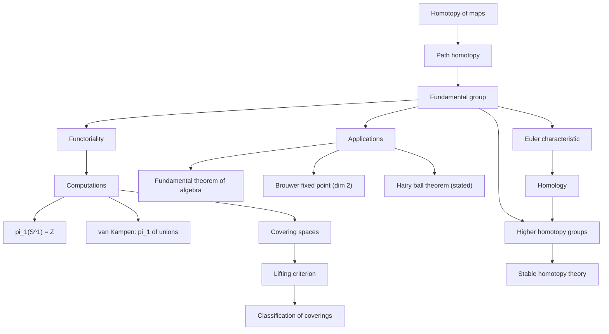
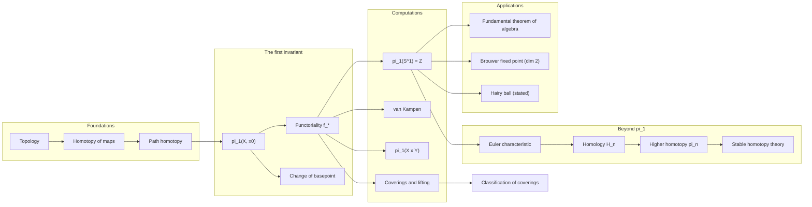
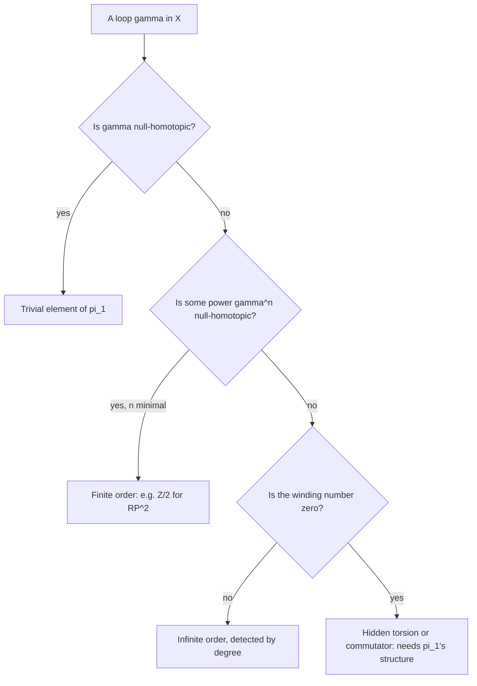

# Introduction to Algebraic Topology

> [Mathematics](../../README.md) › [Topology](../README.md) · Level: Advanced · Prerequisites: [Topological Spaces](../01-topological-spaces/README.md), [Connectedness](../04-connectedness/README.md), [Groups](../../13-abstract-algebra/01-groups/README.md), [Metric Spaces](../../14-real-analysis/06-metric-spaces/README.md) · Estimated time: 720 min

## 1. Introduction

Topology began with the problem of deciding when two spaces are the same. The definition of a homeomorphism
is easy to state and almost impossible to apply: to show that two spaces *are* homeomorphic one exhibits a
formula, but to show that they are *not* one must prove a negative statement about every bijection, and there
are too many bijections. What is needed is an **invariant**: a construction that assigns an algebraic object to
a space, in such a way that homeomorphic spaces receive isomorphic objects. Then a computation decides the
question.

This chapter constructs the first and most important such invariant, the **fundamental group** $\pi_1(X,x_0)$,
whose elements are the loops in $X$ based at $x_0$ up to continuous deformation. The construction has a second
and deeper feature: it is not merely a function on spaces, it is a **functor**. A continuous map $f:X\to Y$
induces a group homomorphism $f_*:\pi_1(X,x_0)\to\pi_1(Y,f(x_0))$, composition of maps corresponds to
composition of homomorphisms, and homotopic maps induce the same homomorphism. Consequences follow
mechanically:

* $S^1$ is not homeomorphic to $[0,1]$ or to $\mathbb{R}^2$, because $\pi_1(S^1)\cong\mathbb{Z}$ while the
  other two groups are trivial.
* Every continuous self-map of the closed disk has a fixed point (**Brouwer**), because a retraction onto the
  boundary would give a homomorphism $\mathbb{Z}\to 0\to\mathbb{Z}$ whose composite is the identity.
* Every non-constant complex polynomial has a root (**the fundamental theorem of algebra**), because a loop of
  large radius winds $n$ times around $0$ while a loop in the image of a map out of a contractible space
  winds $0$ times.
* The two-sphere admits no continuous non-vanishing tangent field (**the hairy ball theorem**, stated here,
  proved with degree theory).

The chapter is deliberately the first half of a much larger subject. We develop homotopy, the fundamental
group, covering spaces and the Euler characteristic, and we stop where the machinery becomes expensive:
homology and the higher homotopy groups are described in §7.10, with their definitions, their basic
properties and pointers to the literature, but not computed in detail.

The plan:

* **Homotopy** (§7.1). Continuous deformation of maps, homotopy equivalence, contractible spaces.
* **Path homotopy and reparametrisation** (§7.2). The technical lemmas that make concatenation of loops
  well behaved.
* **The fundamental group** (§7.3). Loops modulo path homotopy form a group; associativity, identity and
  inverses are proved by explicitly reparametrising the interval.
* **Basepoints** (§7.4). Changing the basepoint conjugates the group; path connected spaces therefore have a
  basepoint-free fundamental group up to isomorphism.
* **Functoriality** (§7.5). $f\mapsto f_*$ preserves identities and compositions, and homotopic maps induce
  equal homomorphisms. This is the engine of every application.
* **$\pi_1(S^1)\cong\mathbb{Z}$** (§7.6). The degree (winding number) computed by lifting loops to the real
  line.
* **Covering spaces** (§7.7). The lifting criterion, which decides exactly when a map lifts through a
  covering, and the classification of coverings by subgroups.
* **Applications** (§7.8). The fundamental theorem of algebra, Brouwer's fixed point theorem in dimension two,
  and the hairy ball theorem.
* **The Euler characteristic** (§7.9). A computable homotopy invariant, defined combinatorially and equal to
  the alternating sum of Betti numbers.
* **Higher invariants** (§7.10). $\pi_n$ and $H_n$, what they see, and why they are hard.

## 2. Prerequisites

**Topological spaces, continuity, subspaces, products, quotients.** Open and closed sets, the subspace
topology, the product topology on $X\times Y$ and on $X\times[0,1]$, and quotient maps. In particular the
pasting lemma: a map defined by two formulas on two closed pieces that agree on the overlap is continuous. See
[Topological Spaces](../01-topological-spaces/README.md).

**Compactness and connectedness.** $[0,1]$ and $S^1$ are compact and connected; $S^1$ is path connected; a
closed interval is connected. See [Connectedness](../04-connectedness/README.md) and
[Metric Spaces](../../14-real-analysis/06-metric-spaces/README.md).

**Groups.** Group axioms, homomorphisms, kernels and images, cyclic groups, the free group on a set of
generators, abelianisation $G^{\mathrm{ab}} = G/[G,G]$, and quotients. See
[Groups](../../13-abstract-algebra/01-groups/README.md).

**Complex numbers and the exponential map.** $e^{2\pi i t} = \cos 2\pi t + i\sin 2\pi t$, its periodicity, and
the fact that $e^{z}$ is a local homeomorphism. See
[Complex Numbers and Geometry](../../15-complex-analysis/01-complex-numbers-and-geometry/README.md).

**The intermediate value theorem and the extreme value theorem.** Used in the lifting lemmas and in the
existence of the retraction in Brouwer's theorem. See
[Continuity and Limits](../../14-real-analysis/03-continuity-and-limits/README.md).

**Polynomials.** The fundamental theorem of algebra is *proved* here, so nothing about roots may be assumed;
only the triangle inequality and the growth estimate of a polynomial at infinity are used.

## 3. Learning Objectives

By the end of this chapter you will be able to:

1. Define homotopy of maps and of paths, homotopy relative to a subspace, homotopy equivalence and
   contractibility, and prove that homotopy is an equivalence relation compatible with composition.
2. Define the fundamental group and prove in full that it is a group, including the reparametrisation lemma
   and the three group axioms.
3. Prove that the induced map $f_*$ is a well-defined group homomorphism, that $(g\circ f)_* = g_*\circ f_*$
   and $(\operatorname{id})_* = \operatorname{id}$, and that homotopic maps induce the same homomorphism.
4. Prove that $\pi_1(S^1,1)\cong\mathbb{Z}$ by the lifting (winding number) argument, and compute the degree of
   explicit loops.
5. Define covering space, prove unique path lifting, state homotopy lifting, and use the lifting criterion to
   decide when a map lifts.
6. Prove the fundamental theorem of algebra and Brouwer's fixed point theorem in dimension two from
   $\pi_1(S^1)\cong\mathbb{Z}$, and state the hairy ball theorem correctly.
7. Define the Euler characteristic of a finite CW complex, compute it for the standard surfaces, and explain
   why it is a topological (indeed homotopy) invariant.
8. State the definitions of the higher homotopy groups and of singular homology, explain what each measures,
   and quote the Hurewicz theorem and the classification of coverings.
9. Distinguish spaces using invariants: produce, for a pair of non-homeomorphic spaces, an invariant that
   separates them and a proof that it does.

## 4. Intuition

### 4.1 Holes are the obstruction

A disk has no hole; an annulus has one; a sphere has a hollow inside but no hole *through* it; a torus has two
independent holes. These informal statements can be made precise by asking which loops can be shrunk to a
point without leaving the space. On a disk every loop shrinks. On an annulus a loop that goes once around the
hole cannot shrink, and a loop that goes twice around cannot shrink either, while a loop that goes once around
and then once back the other way can. So the loops up to deformation form a set with a *group* structure: you
can run one loop after another, and you can run a loop backwards. That group is the fundamental group.

The same idea in one dimension lower: on the real line, every loop (a closed path) is constant up to
deformation, because you can always pull it tight; on the circle, loops are classified by how many times they
wind around, an integer.

### 4.2 Why a group and not just a set

Because loops can be concatenated and reversed. The concatenation of two loops is not associative on the nose —
$(f*g)*h$ runs $f$ at quadruple speed on the first quarter of the interval, while $f*(g*h)$ runs it at double
speed — but the two differ only by a continuous change of parametrisation, and reparametrising a loop does not
change its homotopy class. Passing to homotopy classes therefore turns concatenation into an associative
operation, with the constant loop as the identity and the reversed loop as the inverse. The verification of
these three axioms occupies §7.3, and it is the only place where the technical work is unavoidable.

The group is generally non-abelian: in a figure-eight space, going around the left lobe then the right lobe is
not deformable to going around the right lobe then the left. That non-commutativity is information — it
detects the order in which the holes are traversed — and it disappears if one abelianises, which is what
homology does.

### 4.3 What the invariant can and cannot see

$\pi_1$ sees the *two-dimensional* hole structure: it notices a missing point in the plane, a handle on a
surface, a removed circle in three-space. It does not see a hollow sphere in $\mathbb{R}^3$, because every loop
in $S^2$ shrinks; for that one needs $\pi_2$ or $H_2$. It also does not distinguish spaces of different
dimension if both are simply connected (a point, a ball, and a 5-ball all have trivial $\pi_1$). This is why
the chapter ends with the higher invariants: an invariant is a lens, and different lenses reveal different
features.

There is a second moral, about *functoriality*. The assignments $X\mapsto\pi_1(X,x_0)$ and
$f\mapsto f_*$ turn a geometric problem (is there a continuous map with such and such properties?) into an
algebraic one (is there a homomorphism with such and such properties?), and algebraic obstructions are often
easy to find: a homomorphism from $\mathbb{Z}$ to the trivial group cannot be injective, and a homomorphism
that is the identity cannot factor through the trivial group. Both of the classical applications in §7.8 are
of exactly this form.

### 4.4 The shape of the subject

The upper branch is what this chapter proves. The lower branch is described in §7.9–§7.10 and pursued in
[Advanced Topics](../../24-advanced-topics/README.md).

## 5. Formal Definition

**Definition 5.1 (Homotopy).** Let $f, g : X \to Y$ be continuous. A *homotopy* from $f$ to $g$ is a
continuous map $H : X\times[0,1] \to Y$ with

$$H(x,0) = f(x), \qquad H(x,1) = g(x) \quad \text{for all } x \in X .$$

We write $f \simeq g$ and say that $f$ and $g$ are *homotopic*. If $A \subseteq X$ and $H(a,t)$ is independent
of $t$ for every $a \in A$, then $H$ is a homotopy *relative to $A$* (or *rel $A$*), written
$f \simeq g \ (\mathrm{rel}\ A)$; in that case $f|_A = g|_A$ is required.

**Definition 5.2 (Homotopy equivalence).** A map $f : X \to Y$ is a *homotopy equivalence* if there is a map
$h : Y \to X$ with $h\circ f \simeq \operatorname{id}_X$ and $f\circ h \simeq \operatorname{id}_Y$. Such an $h$
is a *homotopy inverse* of $f$, and $X, Y$ are *homotopy equivalent*, written $X\simeq Y$. A space homotopy
equivalent to a point is *contractible*. A map homotopic to a constant map is *null-homotopic*.

**Definition 5.3 (Path homotopy).** A *path homotopy* between paths $\gamma_0, \gamma_1 : [0,1] \to X$ with the
same endpoints is a homotopy $H : [0,1]\times[0,1]\to X$ rel $\{0,1\}$; equivalently
$H(s,0) = \gamma_0(s)$, $H(s,1) = \gamma_1(s)$, and $H(0,t) = \gamma_0(0)$, $H(1,t) = \gamma_0(1)$ for all
$t$. We write $\gamma_0 \simeq_p \gamma_1$ and let $[\gamma]$ denote the class of $\gamma$.

**Definition 5.4 (Fundamental group).** Let $X$ be a topological space and $x_0 \in X$. A *loop at $x_0$* is a
path $\gamma:[0,1]\to X$ with $\gamma(0) = \gamma(1) = x_0$. The *fundamental group* is

$$\pi_1(X,x_0) = \{[\gamma] : \gamma \text{ a loop at } x_0\}, \qquad [\gamma]\cdot[\delta] = [\gamma*\delta],$$

where $\gamma*\delta$ is the concatenation of Definition 5.4 of
[Connectedness](../04-connectedness/README.md). That the product is well defined and satisfies the group
axioms is Theorem 7.3.2.

**Definition 5.5 (Covering space).** Let $p : \tilde X \to X$ be continuous. An open set $U \subseteq X$ is
*evenly covered* by $p$ if $p^{-1}[U]$ is a disjoint union of open sets $V_i$ of $\tilde X$, each mapped
homeomorphically by $p$ onto $U$. The map $p$ is a *covering map* (and $(\tilde X,p)$ a *covering space* of
$X$) if every point of $X$ has an evenly covered neighbourhood. The *fibre* over $x$ is $p^{-1}[\{x\}]$; if
every fibre has $n$ elements, $p$ is an *$n$-sheeted* covering. A *lift* of a map $f : Y \to X$ is a map
$\tilde f : Y \to \tilde X$ with $p\circ \tilde f = f$.

**Definition 5.6 (Simply connected).** $X$ is *simply connected* if it is path connected and
$\pi_1(X,x_0) = \{1\}$ for some (equivalently, by Corollary 7.4.2, for every) $x_0 \in X$.

**Definition 5.7 (CW complex and Euler characteristic).** A *finite CW complex* is a space obtained from a
finite discrete set $X^{(0)}$ by attaching finitely many closed $k$-cells $D^k$ along their boundaries, in
increasing order of $k$; $X^{(k)}$ denotes the $k$-skeleton and $c_k$ the number of $k$-cells. Its *Euler
characteristic* is

$$\chi(X) = \sum_{k\ge0} (-1)^k c_k .$$

Theorem 7.9.1 shows that $\chi$ does not depend on the cell decomposition and is a homotopy invariant.

**Definition 5.8 (Higher homotopy groups and homology).** For $n\ge1$ and $x_0 \in X$,
$\pi_n(X,x_0) = \{(S^n, s_0) \to (X,x_0)\}/\simeq$ is the set of homotopy classes of based maps, made into a
group by "pinching the equator" (§7.10.1). For $n \ge 0$, the *$n$-th singular homology group* $H_n(X)$ is the
$n$-th homology of the chain complex of singular $n$-simplices of $X$ (§7.10.2).

## 6. Mathematical Notation

| Symbol | Read as | Meaning |
|---|---|---|
| $f \simeq g$ | $f$ is homotopic to $g$ | there is a homotopy from $f$ to $g$ |
| $f \simeq g \ (\mathrm{rel}\ A)$ | homotopic relative to $A$ | the homotopy is constant on $A$ |
| $X \simeq Y$ | $X$ is homotopy equivalent to $Y$ | there is a homotopy equivalence |
| $X\simeq *$ | $X$ is contractible | homotopy equivalent to a one-point space |
| $[0,1]$, $I$ | the unit interval | the parameter space of every homotopy |
| $\gamma$, $\delta$ | paths | continuous maps $I \to X$ |
| $\gamma*\delta$ | concatenation | first $\gamma$, then $\delta$, at double speed |
| $\bar\gamma$ | reverse path | $t\mapsto\gamma(1-t)$ |
| $c_{x_0}$ | constant loop at $x_0$ | the identity of $\pi_1$ |
| $[\gamma]$ | homotopy class of $\gamma$ | an element of $\pi_1$ |
| $\pi_1(X,x_0)$ | the fundamental group | loops at $x_0$ modulo path homotopy |
| $f_*$ | the induced homomorphism | $[\gamma]\mapsto[f\circ\gamma]$ |
| $\pi_n(X,x_0)$ | the $n$-th homotopy group | based maps $S^n\to X$ modulo homotopy |
| $H_n(X)$ | the $n$-th homology group | cycles modulo boundaries |
| $G^{\mathrm{ab}}$, $[G,G]$ | abelianisation, commutator subgroup | $G/[G,G]$ |
| $p : \tilde X \to X$ | covering map | locally a homeomorphism, evenly covered |
| $\tilde\gamma$ | lift of $\gamma$ | a path with $p\circ\tilde\gamma = \gamma$ |
| $\deg\gamma$ | degree (winding number) of a loop in $S^1$ | the net number of turns |
| $\chi(X)$ | Euler characteristic | alternating count of cells, or of Betti numbers |
| $b_k$ | $k$-th Betti number | rank of $H_k(X)$ |
| $D^n$, $S^{n-1}$ | closed $n$-ball, its boundary | $\partial D^n = S^{n-1}$ |
| $F_n$ | free group on $n$ generators | $\pi_1$ of a wedge of $n$ circles |
| $\cong$, $\ncong$ | isomorphic / not isomorphic; homeomorphic / not | context decides |
| $\operatorname{id}_X$ | identity map of $X$ | the unit for composition |
| $\ast$ | a one-point space | the terminal and initial object |
| $\blacksquare$ | end of proof | |

Reading aloud: "$f\simeq g\ (\mathrm{rel}\ A)$" is read "$f$ and $g$ are homotopic relative to $A$"; and
"$\pi_1(S^1)\cong\mathbb{Z}$" is read "the fundamental group of the circle is infinite cyclic".

## 7. Core Concepts

### 7.1 Homotopy of Maps

**Proposition 7.1.1 (Homotopy is an equivalence relation).** For continuous maps $X \to Y$, the relation
$\simeq$ is reflexive, symmetric and transitive. The same holds for $\simeq$ rel $A$.

*Proof.* Reflexive: $H(x,t) = f(x)$. Symmetric: if $H$ joins $f$ to $g$, then
$\tilde H(x,t) = H(x,1-t)$ joins $g$ to $f$ and is constant on $A$ whenever $H$ is. Transitive: if $H_1$ joins
$f$ to $g$ and $H_2$ joins $g$ to $h$, define

$$H(x,t) = \begin{cases} H_1(x,2t), & 0\le t\le \tfrac12,\\ H_2(x,2t-1), & \tfrac12\le t\le 1.\end{cases}$$

The two formulas agree at $t = \tfrac12$, both giving $g(x)$; the closed sets $X\times[0,\tfrac12]$ and
$X\times[\tfrac12,1]$ cover $X\times[0,1]$, so $H$ is continuous by the pasting lemma. If $H_1,H_2$ are
constant on $A$ with the common value $f|_A$, so is $H$. $\blacksquare$

**Proposition 7.1.2 (Composition preserves homotopy).** If $f \simeq g : X \to Y$, then for every continuous
$h : Y \to Z$ and every continuous $k : W \to X$,

$$h\circ f \simeq h\circ g, \qquad f\circ k \simeq g\circ k .$$

*Proof.* If $H$ joins $f$ to $g$, then $h\circ H$ joins $h\circ f$ to $h\circ g$ and $H\circ(k\times
\operatorname{id}_I)$ joins $f\circ k$ to $g\circ k$. $\blacksquare$

**Proposition 7.1.3 (Convex targets are contractible in the strongest sense).** Let $C \subseteq \mathbb{R}^n$
be convex and non-empty. Then any two continuous maps $f, g : X \to C$ are homotopic, by
$H(x,t) = (1-t)f(x) + tg(x)$. In particular $C$ is contractible, and $\mathbb{R}^n$, every ball and every
interval are contractible.

*Proof.* Convexity makes the formula take values in $C$; it is continuous in $(x,t)$, and at $t=0,1$ it equals
$f,g$. Taking $f = \operatorname{id}_C$ and $g$ the constant map at any $c_0 \in C$ gives a homotopy from the
identity to a constant, i.e. contractibility. $\blacksquare$

**Proposition 7.1.4 (Homotopy equivalence is an equivalence relation).** On topological spaces, $\simeq$ is
reflexive, symmetric and transitive; the composite of two homotopy equivalences is a homotopy equivalence.

*Proof.* Reflexivity: the identity is a homotopy inverse of itself. Symmetry is built into the definition. For
transitivity let $f : X\to Y$ and $g : Y \to Z$ be homotopy equivalences with homotopy inverses $f', g'$. Then
$f'\circ g' : Z \to X$ satisfies
$(f'\circ g')\circ(g\circ f) = f'\circ(g'\circ g)\circ f \simeq f'\circ\operatorname{id}_Y\circ f \simeq
f'\circ f \simeq \operatorname{id}_X$, using Proposition 7.1.2 twice, and symmetrically on the other side.
So $g\circ f$ is a homotopy equivalence. $\blacksquare$

**Definition 7.1.5 (Deformation retraction).** A *retraction* of $X$ onto $A\subseteq X$ is a continuous
$r : X \to A$ with $r|_A = \operatorname{id}_A$. If moreover $i\circ r \simeq \operatorname{id}_X$ rel $A$,
where $i : A\hookrightarrow X$ is the inclusion, then $r$ is a *deformation retraction* and $A$ is a
*deformation retract* of $X$.

**Proposition 7.1.6.** A deformation retract is a homotopy equivalence; in particular
$\mathbb{R}^n\setminus\{0\}$ is homotopy equivalent to $S^{n-1}$.

*Proof.* With $r$ and $i$ as above, $r\circ i = \operatorname{id}_A$ and $i\circ r\simeq \operatorname{id}_X$,
so $r$ is a homotopy equivalence with homotopy inverse $i$. For the second claim, $r(x) = x/\lVert x\rVert$ is
a retraction of $\mathbb{R}^n\setminus\{0\}$ onto $S^{n-1}$, and
$H(x,t) = (1-t)x + t\,x/\lVert x\rVert$ is a homotopy rel $S^{n-1}$ from the identity to $i\circ r$: it never
vanishes, because it equals $x\bigl((1-t) + t/\lVert x\rVert\bigr)$ with a positive scalar factor.
$\blacksquare$

### 7.2 Path Homotopy and Reparametrisation

**Lemma 7.2.1.** On the set of paths in $X$ with fixed endpoints, $\simeq_p$ is an equivalence relation.

*Proof.* The three constructions of Proposition 7.1.1 preserve the condition "endpoints fixed": they are
constant in $t$ at $s=0$ and $s=1$ if the given homotopies are. $\blacksquare$

**Lemma 7.2.2 (Reparametrisation).** Let $\gamma : [0,1]\to X$ be a path and let
$\varphi : [0,1]\to[0,1]$ be continuous with $\varphi(0) = 0$ and $\varphi(1) = 1$. Then
$\gamma\circ\varphi \simeq_p \gamma$.

*Proof.* Define $H(s,t) = \gamma\bigl((1-t)\varphi(s) + ts\bigr)$. This is continuous (composition of
continuous maps), and $H(s,0) = \gamma(\varphi(s))$, $H(s,1) = \gamma(s)$. At $s=0$ the argument is
$(1-t)\cdot 0 + t\cdot 0 = 0$, so $H(0,t) = \gamma(0)$; at $s=1$ it is $(1-t)\cdot1 + t\cdot 1 = 1$, so
$H(1,t) = \gamma(1)$. Hence $H$ is a path homotopy. $\blacksquare$

**Lemma 7.2.3 (Concatenation respects path homotopy).** Suppose $\gamma_0 \simeq_p \gamma_1$ and
$\delta_0 \simeq_p \delta_1$, where $\gamma_i$ is a path from $x$ to $y$ and $\delta_i$ a path from $y$ to $z$.
Then $\gamma_0*\delta_0 \simeq_p \gamma_1*\delta_1$.

*Proof.* Let $G$ be a path homotopy from $\gamma_0$ to $\gamma_1$ and $D$ one from $\delta_0$ to $\delta_1$.
Define

$$K(s,t) = \begin{cases} G(2s,t), & 0 \le s \le \tfrac12,\\ D(2s-1,t), & \tfrac12\le s\le 1.\end{cases}$$

At $s = \tfrac12$ both formulas give $G(1,t) = y = D(0,t)$. So $K$ is continuous by the pasting lemma. At
$t=0$ it is $\gamma_0*\delta_0$, at $t=1$ it is $\gamma_1*\delta_1$, and at $s=0$ and $s=1$ it is constantly $x$
and $z$ respectively. $\blacksquare$

### 7.3 The Fundamental Group Is a Group

**Theorem 7.3.1 (The product is well defined).** For loops $\gamma,\delta$ at $x_0$, the class
$[\gamma*\delta]$ depends only on $[\gamma]$ and $[\delta]$.

*Proof.* This is Lemma 7.2.3 with $x = y = z = x_0$. $\blacksquare$

**Theorem 7.3.2 (Group axioms).** Let $X$ be a topological space and $x_0\in X$. The set
$\pi_1(X,x_0) = \{[\gamma] : \gamma \text{ loop at } x_0\}$ with the operation $[\gamma][\delta] =
[\gamma*\delta]$ is a group. Its identity is the class $[c_{x_0}]$ of the constant loop, and the inverse of
$[\gamma]$ is $[\bar\gamma]$, where $\bar\gamma(t) = \gamma(1-t)$.

*Proof.* Well-definedness is Theorem 7.3.1; closure is clear since a concatenation of loops at $x_0$ is a loop
at $x_0$.

*Associativity.* Let $f,g,h$ be loops at $x_0$ and define the "triple concatenation"

$$k(s) = \begin{cases} f(3s), & 0\le s\le\tfrac13,\\ g(3s-1), & \tfrac13\le s\le\tfrac23,\\ h(3s-2), &\tfrac23\le s\le 1,\end{cases}$$

continuous by the pasting lemma. A direct computation gives

$$(f*g)*h = k\circ\varphi_1, \qquad \varphi_1(s) = \begin{cases}\tfrac43 s, & 0\le s\le\tfrac12,\\[2pt]
\tfrac{2s+1}{3}, & \tfrac12\le s\le1,\end{cases}$$

$$f*(g*h) = k\circ\varphi_2, \qquad \varphi_2(s) = \begin{cases}\tfrac23 s, & 0\le s\le\tfrac12,\\[2pt]
\tfrac{4s-1}{3}, & \tfrac12\le s\le1.\end{cases}$$

Let us check the first identity on each piece. For $s\le\frac14$,
$\bigl((f*g)*h\bigr)(s) = (f*g)(2s) = f(4s) = k\bigl(\frac{4s}{3}\bigr)$, since $\frac{4s}{3}\le\frac13$. For
$\frac14\le s\le\frac12$, $\bigl((f*g)*h\bigr)(s) = (f*g)(2s) = g(4s-1)$ and
$k\bigl(\frac{4s}{3}\bigr) = g\bigl(3\cdot\frac{4s}{3}-1\bigr) = g(4s-1)$. For $s\ge\frac12$,
$\bigl((f*g)*h\bigr)(s) = h(2s-1)$ and $k\bigl(\frac{2s+1}{3}\bigr) = h\bigl(3\cdot\frac{2s+1}{3}-2\bigr) =
h(2s-1)$. The verification of the second identity is analogous. Both $\varphi_1$ and $\varphi_2$ are
continuous (the two pieces agree at $s = \tfrac12$), satisfy $\varphi_i(0) = 0$ and $\varphi_i(1) = 1$, so
Lemma 7.2.2 gives

$$(f*g)*h = k\circ\varphi_1 \simeq_p k \simeq_p k\circ\varphi_2 = f*(g*h).$$

Hence $([f][g])[h] = [f]([g][h])$.

*Identity.* Let $c = c_{x_0}$. Then $(c*f)(s)$ equals $x_0 = f(0)$ for $s\le\frac12$ and $f(2s-1)$ for
$s\ge\frac12$, i.e. $c*f = f\circ\psi$ with $\psi(s) = \max\{0, 2s-1\}$. The map $\psi$ is continuous with
$\psi(0) = 0$, $\psi(1) = 1$, so $c*f\simeq_p f$ by Lemma 7.2.2. Similarly $f*c = f\circ\psi'$ with
$\psi'(s) = \min\{1,2s\}$, so $f*c\simeq_p f$. Therefore $[c][f] = [f] = [f][c]$.

*Inverses.* Define

$$H(s,t) = \begin{cases} f\bigl((1-t)\,2s\bigr), & 0\le s\le\tfrac12,\\[2pt]
f\bigl((1-t)(2-2s)\bigr), & \tfrac12\le s\le1.\end{cases}$$

At $s=\tfrac12$ both pieces equal $f(1-t)$, so $H$ is continuous. At $t=0$ it equals
$f(2s)$ for $s\le\frac12$ and $f(2-2s) = \bar f(2s-1)$ for $s\ge\frac12$, that is $f*\bar f$; at $t=1$ it is
constantly $f(0) = x_0$; and $H(0,t) = H(1,t) = f(0) = x_0$. Hence $f*\bar f \simeq_p c_{x_0}$. The same
formula with $f$ replaced by $\bar f$ gives $\bar f*f\simeq_p c_{x_0}$. Therefore
$[f][\bar f] = [\bar f][f] = [c_{x_0}]$. $\blacksquare$

**Corollary 7.3.3.** If $X$ is a one-point space, then $\pi_1(X,x_0)$ is the trivial group: the only loop is
the constant one.

### 7.4 Basepoints

The group $\pi_1(X,x_0)$ depends on $x_0$, but only up to conjugation, and in a path connected space only up to
isomorphism.

**Theorem 7.4.1 (Change of basepoint).** Let $\gamma$ be a path in $X$ from $x_0$ to $x_1$. Then

$$\gamma_\# : \pi_1(X,x_1) \to \pi_1(X,x_0), \qquad [\alpha] \mapsto [\gamma*\alpha*\bar\gamma],$$

is a group isomorphism, with inverse $\bar\gamma_\#$.

*Proof.* The map is well defined by Lemma 7.2.3 (pre- and post-composing a path homotopy with the fixed paths
$\gamma$ and $\bar\gamma$). It is a homomorphism: for loops $\alpha,\beta$ at $x_1$,

$$\gamma_\#([\alpha])\gamma_\#([\beta])
= [\gamma*\alpha*\bar\gamma*\gamma*\beta*\bar\gamma]
\simeq_p [\gamma*\alpha*\beta*\bar\gamma]
= \gamma_\#([\alpha][\beta]),$$

where the middle step uses $\bar\gamma*\gamma \simeq_p c_{x_1}$ (Theorem 7.3.2) together with associativity and
Lemma 7.2.3. That the inverse is $\bar\gamma_\#$ follows from the same computation with $\gamma$ replaced by
$\bar\gamma$: $\bar\gamma_\#\circ\gamma_\#([\alpha]) = [\bar\gamma*\gamma*\alpha*\bar\gamma*\gamma]
\simeq_p [\alpha]$. $\blacksquare$

**Corollary 7.4.2.** If $X$ is path connected, then for any $x_0,x_1 \in X$ the groups $\pi_1(X,x_0)$ and
$\pi_1(X,x_1)$ are isomorphic. We then write $\pi_1(X)$ and speak of *the* fundamental group of $X$, with the
understanding that the isomorphism is not canonical (it depends on the chosen path).

**Proposition 7.4.3 (Convex sets are simply connected).** If $X \subseteq \mathbb{R}^n$ is convex and
non-empty, then $\pi_1(X,x_0) = \{1\}$ for every $x_0 \in X$. In particular $\mathbb{R}^n$, $D^n$ and every
interval have trivial fundamental group.

*Proof.* For a loop $\gamma$ at $x_0$, the map $H(s,t) = (1-t)\gamma(s) + t x_0$ is continuous, takes values in
$X$ by convexity, and satisfies $H(s,0) = \gamma(s)$, $H(s,1) = x_0$, $H(0,t) = H(1,t) = x_0$. So
$\gamma\simeq_p c_{x_0}$. $\blacksquare$

### 7.5 Functoriality

**Definition 7.5.1 (Induced homomorphism).** Let $f : X \to Y$ be continuous and $x_0\in X$. Define

$$f_* : \pi_1(X,x_0)\to\pi_1(Y,f(x_0)), \qquad f_*([\gamma]) = [f\circ\gamma].$$

**Theorem 7.5.2 (Functoriality).** (a) $f_*$ is well defined. (b) $f_*$ is a group homomorphism. (c)
$(g\circ f)_* = g_*\circ f_*$ for composable continuous maps. (d) $(\operatorname{id}_X)_* =
\operatorname{id}_{\pi_1(X,x_0)}$.

*Proof.* (a) If $H$ is a path homotopy from $\gamma$ to $\gamma'$, then $f\circ H$ is a path homotopy from
$f\circ\gamma$ to $f\circ\gamma'$ (and is constant at the endpoints where $H$ is).

(b) For loops $\gamma,\delta$ at $x_0$, the path $f\circ(\gamma*\delta)$ is given by
$s\mapsto f(\gamma(2s))$ for $s\le\frac12$ and $s\mapsto f(\delta(2s-1))$ for $s\ge\frac12$, which is exactly
$(f\circ\gamma)*(f\circ\delta)$. Hence $f_*([\gamma][\delta]) = f_*([\gamma])f_*([\delta])$.

(c) $(g\circ f)_*([\gamma]) = [g\circ f\circ\gamma] = g_*([f\circ\gamma]) = g_*(f_*([\gamma]))$.

(d) $\operatorname{id}_*([\gamma]) = [\gamma]$. $\blacksquare$

**Theorem 7.5.3 (Homotopic maps induce the same homomorphism).** Let $f, g : X \to Y$ be continuous and
homotopic rel $\{x_0\}$, i.e. there is a homotopy $H$ from $f$ to $g$ with $H(x_0,t) = f(x_0) = g(x_0)$ for all
$t$. Then $f_* = g_* : \pi_1(X,x_0)\to\pi_1(Y,f(x_0))$.

*Proof.* Let $\gamma$ be a loop at $x_0$ and put $K(s,t) = H(\gamma(s),t)$. Then $K$ is continuous,
$K(s,0) = f(\gamma(s))$, $K(s,1) = g(\gamma(s))$, and $K(0,t) = K(1,t) = H(x_0,t) = f(x_0)$, so $K$ is a path
homotopy from $f\circ\gamma$ to $g\circ\gamma$. Hence $[f\circ\gamma] = [g\circ\gamma]$ for every $\gamma$.
$\blacksquare$

**Corollary 7.5.4 (Homotopy invariance).** If $f : X \to Y$ is a homotopy equivalence and $x_0 \in X$, then
$f_* : \pi_1(X,x_0)\to\pi_1(Y,f(x_0))$ is an isomorphism. In particular homeomorphic spaces have isomorphic
fundamental groups.

*Proof.* Let $h : Y \to X$ be a homotopy inverse of $f$ and let $H : X\times I \to X$ be a homotopy from
$\operatorname{id}_X$ to $h\circ f$. Put $\beta(t) = H(x_0,t)$, a path from $x_0$ to $h(f(x_0))$; by
Theorem 7.4.1, $\beta_\#$ is an isomorphism.

*Claim: $\beta_\#\bigl((h\circ f)_*[\gamma]\bigr) = [\gamma]$ for every loop $\gamma$ at $x_0$.* Set
$K(s,t) = H(\gamma(s),t)$. Then $K(0,t) = K(1,t) = \beta(t)$, $K(s,0) = \gamma(s)$ and
$K(s,1) = (h\circ f)(\gamma(s))$. The loop obtained by traversing the boundary of the square $I\times I$ —
along $t=0$ from $s=0$ to $1$, then $t$ from $0$ to $1$ at $s=1$, then back along $t=1$, then down at $s=0$ — is
the loop $\gamma * \beta * \overline{(h\circ f)\circ\gamma} * \bar\beta$, and it factors as $K$ composed with
the boundary parametrisation of the square. Since the square is convex, that boundary parametrisation is
null-homotopic in $I\times I$, so the composite loop is null-homotopic in $X$. Hence

$$[\gamma]\,[\beta]\,\bigl[(h\circ f)\circ\gamma\bigr]^{-1}[\beta]^{-1} = 1,
\qquad\text{i.e.}\qquad
[\gamma] = [\beta]^{-1}\bigl[(h\circ f)\circ\gamma\bigr][\beta] = \bigl[\bar\beta * (h\circ f)\circ\gamma *
\beta\bigr],$$

which is exactly the claim.

So $\beta_\#\circ(h\circ f)_* = \operatorname{id}$, which forces $(h\circ f)_*$ to be injective (compose with
the isomorphism $\beta_\#$), hence $f_*$ injective. The same argument applied to the other composite
$f\circ h \simeq \operatorname{id}_Y$ shows that $(f\circ h)_*$ is an isomorphism, hence $f_*$ is surjective.
Therefore $f_*$ is an isomorphism. $\blacksquare$

**Corollary 7.5.5.** A contractible space has trivial fundamental group. More generally, if $X \simeq Y$ then
$\pi_1(X,x_0)\cong\pi_1(Y,y_0)$ whenever the basepoints correspond under a homotopy equivalence.

*Proof.* A contractible space is homotopy equivalent to a point; apply Corollary 7.5.4 and
Corollary 7.3.3. $\blacksquare$

**Corollary 7.5.6 (How the invariant is used).** If $\pi_1(X,x_0)$ is not isomorphic to $\pi_1(Y,y_0)$, then $X$
is not homeomorphic to $Y$ and not even homotopy equivalent to $Y$.

*Proof.* Contrapositive of Corollary 7.5.4. $\blacksquare$

### 7.6 $\pi_1(S^1)\cong\mathbb{Z}$: the Winding Number

Write $S^1 = \{z \in \mathbb{C} : \lvert z\rvert = 1\}$ and let $p : \mathbb{R}\to S^1$, $p(t) = e^{2\pi i t}$.
The key technical fact is that loops in $S^1$ can be lifted to paths in $\mathbb{R}$, where the interval is
contractible and every loop is therefore trivial.

**Lemma 7.6.1 (Path lifting for $p(t) = e^{2\pi i t}$).** Let $\gamma : [0,1]\to S^1$ be continuous and let
$t_0\in\mathbb{R}$ satisfy $p(t_0) = \gamma(0)$. Then there is exactly one continuous
$\tilde\gamma : [0,1]\to\mathbb{R}$ with $p\circ\tilde\gamma = \gamma$ and $\tilde\gamma(0) = t_0$.

*Proof.* *Existence.* For each $s \in [0,1]$ choose $\varepsilon_s>0$ such that
$\gamma\bigl((s-\varepsilon_s,s+\varepsilon_s)\cap[0,1]\bigr)$ is contained in $S^1\setminus\{-\gamma(s)\}$,
which is an evenly covered open set; this is possible by continuity at $s$. The intervals
$(s-\varepsilon_s,s+\varepsilon_s)$ cover $[0,1]$, so by compactness — or directly by the Lebesgue number
lemma — there are $0 = s_0 < s_1 < \cdots < s_n = 1$ such that each $\gamma\bigl([s_{k-1},s_k]\bigr)$ misses
some point $z_k\in S^1$. Now $p^{-1}\bigl(S^1\setminus\{z_k\}\bigr) = \mathbb{R}\setminus(t_k+\mathbb{Z})$,
where $p(t_k) = z_k$, and this is a disjoint union of open intervals (the intervals $(t_k + m, t_k+m+1)$,
$m\in\mathbb{Z}$) on each of which $p$ is a homeomorphism onto $S^1\setminus\{z_k\}$.

Construct $\tilde\gamma$ inductively. Suppose it is defined on $[0,s_{k-1}]$ with $p\circ\tilde\gamma =
\gamma$ there. Let $J$ be the open interval of $\mathbb{R}\setminus(t_k+\mathbb{Z})$ containing
$\tilde\gamma(s_{k-1})$; the inverse branch $\psi_k : S^1\setminus\{z_k\} \to J$ of $p$ is continuous, and we
set $\tilde\gamma(s) = \psi_k(\gamma(s))$ for $s\in[s_{k-1},s_k]$. This is continuous, extends the previous
definition (both agree at $s_{k-1}$), and satisfies $p\circ\tilde\gamma = \gamma$ there. After $n$ steps the
lift is defined on $[0,1]$.

*Uniqueness.* If $\tilde\gamma_1,\tilde\gamma_2$ are two lifts with the same initial value, the set
$E = \{s : \tilde\gamma_1(s) = \tilde\gamma_2(s)\}$ is non-empty and closed. It is also open: if
$\tilde\gamma_1(s_0) = \tilde\gamma_2(s_0) = u$, take an arc $S^1\setminus\{z\}$ around $\gamma(s_0)$ and the
branch domain $J\ni u$; by continuity both lifts map a small interval around $s_0$ into $J$, where
$p$ is injective, so they coincide there. Hence $E$ is a non-empty clopen subset of the connected set
$[0,1]$, i.e. $E = [0,1]$. $\blacksquare$

**Definition 7.6.2 (Degree of a loop).** For a loop $\gamma$ in $S^1$, choose a lift $\tilde\gamma$ and define

$$\deg(\gamma) = \tilde\gamma(1) - \tilde\gamma(0) \in \mathbb{Z}.$$

The difference is an integer because $p(\tilde\gamma(1)) = \gamma(1) = \gamma(0) = p(\tilde\gamma(0))$
forces $\tilde\gamma(1) - \tilde\gamma(0)\in\mathbb{Z}$. It is independent of the lift: two lifts differ by a
continuous function $[0,1]\to\mathbb{Z}$ (as $p(u) = p(v)$ iff $u-v\in\mathbb{Z}$), which is constant because
$[0,1]$ is connected.

**Lemma 7.6.3 (Properties of the degree).**

(a) $\deg$ depends only on the path homotopy class of $\gamma$.
(b) $\deg(\gamma*\delta) = \deg(\gamma) + \deg(\delta)$.
(c) For $\gamma_n(s) = e^{2\pi i n s}$ we have $\deg(\gamma_n) = n$; in particular $\deg$ is onto
    $\mathbb{Z}$.
(d) $\deg$ of a constant loop is $0$.

*Proof.* (c) and (d) are immediate from the lifts $\tilde\gamma_n(s) = ns$ and $\tilde\gamma(s) = t_0$.

(a) Let $H : [0,1]^2 \to S^1$ be a path homotopy from $\gamma$ to $\gamma'$. By the two-dimensional version
of the lifting lemma (the same partition argument applied to the square, using compactness) there is a lift
$\tilde H$ of $H$ with $\tilde H(0,0) = \tilde\gamma(0)$. Because $H(0,t)$ and $H(1,t)$ are constant in $t$,
their lifts $\tilde H(0,\cdot)$ and $\tilde H(1,\cdot)$ are constant (uniqueness of lifts of paths). Hence

$$\deg(\gamma') = \tilde H(1,1) - \tilde H(0,1) = \tilde H(1,0) - \tilde H(0,0) = \tilde\gamma(1) -
\tilde\gamma(0) = \deg(\gamma).$$

(b) Let $\tilde\gamma$ be a lift of $\gamma$ and let $\tilde\delta$ be the lift of $\delta$ with
$\tilde\delta(0) = \tilde\gamma(1)$, which exists by Lemma 7.6.1 applied to $\delta$ and the point
$\tilde\gamma(1)$. Then the concatenation $\tilde\gamma * \tilde\delta$ is continuous and
$p\circ(\tilde\gamma*\tilde\delta) = \gamma*\delta$, so it is a lift of $\gamma*\delta$; therefore

$$\deg(\gamma*\delta) = (\tilde\gamma*\tilde\delta)(1) - (\tilde\gamma*\tilde\delta)(0) =
\tilde\delta(1) - \tilde\gamma(0) = \bigl(\tilde\delta(1)-\tilde\delta(0)\bigr) +
\bigl(\tilde\gamma(1)-\tilde\gamma(0)\bigr) = \deg(\delta)+\deg(\gamma). \quad\blacksquare$$

**Theorem 7.6.4 (The fundamental group of the circle).** The map

$$\Phi : \pi_1(S^1,1)\to\mathbb{Z}, \qquad \Phi([\gamma]) = \deg(\gamma),$$

is a group isomorphism.

*Proof.* *Well defined:* Lemma 7.6.3(a). *Homomorphism:* Lemma 7.6.3(b). *Surjective:* $\Phi([\gamma_n]) = n$
by Lemma 7.6.3(c). *Injective:* suppose $\deg(\gamma) = 0$. Choose the lift with $\tilde\gamma(0) = 0$; then
$\tilde\gamma(1) = 0$, so $\tilde\gamma$ is a loop at $0$ in $\mathbb{R}$. The interval $\mathbb{R}$ is convex,
so $H(s,t) = (1-t)\tilde\gamma(s)$ is a path homotopy from $\tilde\gamma$ to the constant loop at $0$
(Proposition 7.4.3). Then $p\circ H$ is a path homotopy from $p\circ\tilde\gamma = \gamma$ to the constant loop
at $1$; hence $[\gamma]$ is the identity of $\pi_1(S^1,1)$. $\blacksquare$

**Corollary 7.6.5.** The loop $\gamma_1(s) = e^{2\pi i s}$ is not null-homotopic, $S^1$ is not contractible,
and $S^1$ is not homotopy equivalent — hence not homeomorphic — to $\mathbb{R}$, to $[0,1]$, to $D^2$ or to
$\mathbb{R}^2$, all of which are contractible (Proposition 7.1.3).

**Remark 7.6.6 (The winding-number picture).** Geometrically, $\deg(\gamma)$ is the net number of times the
loop winds counterclockwise around $0$: the lift $\tilde\gamma$ is the angle traversed (in turns), and its
total change counts turns with sign. This is the same integer that complex analysis calls the winding number
$\frac{1}{2\pi i}\oint_\gamma \frac{dz}{z}$, and the same integer that measures the *degree* of the map
$\gamma : S^1 \to S^1$. For a loop in $\mathbb{C}\setminus\{0\}$ one defines the degree after composing with
the radial projection $z\mapsto z/\lvert z\rvert$, which is a homotopy equivalence by Proposition 7.1.6; the
degree is then a homotopy invariant of loops in $\mathbb{C}\setminus\{0\}$ as well.

### 7.7 Covering Spaces and the Lifting Criterion

**Example 7.7.1 (The standard coverings).**

1. $p : \mathbb{R}\to S^1$, $p(t) = e^{2\pi i t}$. Every arc $S^1\setminus\{z\}$ is evenly covered: its
   preimage is a disjoint union of intervals of length $1$.
2. $p : \mathbb{C}\to\mathbb{C}^\times = \mathbb{C}\setminus\{0\}$, $p(z) = e^{z}$. Every slit plane
   $\mathbb{C}\setminus(-\infty,0]$ is evenly covered, the branches being the strips
   $\{\operatorname{Im} z \in (2\pi k, 2\pi(k+1))\}$.
3. $p : S^n \to \mathbb{RP}^n$, the quotient by the antipodal action ($2$-sheeted).
4. $p_n : S^1 \to S^1$, $p_n(z) = z^n$ ($n$-sheeted) — note that $S^1$ here is both the covering space and
   the base.

**Theorem 7.7.2 (Unique path lifting).** Let $p : \tilde X \to X$ be a covering map, $\gamma : [0,1]\to X$ a
path, and $\tilde x_0 \in p^{-1}[\{\gamma(0)\}]$. Then there is exactly one path
$\tilde\gamma : [0,1]\to\tilde X$ with $p\circ\tilde\gamma = \gamma$ and $\tilde\gamma(0) = \tilde x_0$.

*Proof.* Identical to Lemma 7.6.1, with "$S^1\setminus\{z_k\}$" replaced by "an evenly covered neighbourhood
$U_k$" and "branch domain $J$" by "the sheet $V_k$ over $U_k$ containing the current point". Existence uses
compactness of $[0,1]$ to subdivide the parameter interval so that each subinterval maps into an evenly
covered set; uniqueness uses that the set where two lifts agree is non-empty, open (local injectivity of $p$
on a sheet) and closed. $\blacksquare$

**Theorem 7.7.3 (Homotopy lifting).** Let $p : \tilde X \to X$ be a covering, $H : Y\times[0,1]\to X$ a
homotopy, and $\tilde H_0 : Y \to \tilde X$ a lift of $H(\cdot,0)$. If $Y$ is locally connected and locally
compact — in particular if $Y$ is a disc, a sphere or an interval — then $H$ has a unique lift
$\tilde H : Y\times[0,1]\to\tilde X$ extending $\tilde H_0$.

*Proof.* This is the standard homotopy lifting theorem. The proof subdivides $Y\times[0,1]$ into small pieces
each mapped into an evenly covered set and lifts piece by piece, exactly as in Theorem 7.7.2; the details are
lengthy but entirely routine. We omit them and refer to Allen Hatcher, *Algebraic Topology*, Theorem 1.30.
$\blacksquare$

**Theorem 7.7.4 ($p_*$ is injective).** If $p : (\tilde X,\tilde x_0)\to(X,x_0)$ is a covering map, then

$$p_* : \pi_1(\tilde X,\tilde x_0)\to\pi_1(X,x_0)$$

is injective.

*Proof.* Let $\tilde\gamma$ be a loop at $\tilde x_0$ with $p_*[\tilde\gamma] = 1$, i.e. $p\circ\tilde\gamma$
is path homotopic to the constant loop at $x_0$. Let $H$ be such a path homotopy and lift it to
$\tilde H$ with $\tilde H(0,0) = \tilde x_0$ (Theorem 7.7.3 with $Y = [0,1]$). Then $\tilde H(\cdot,0)$ is a
lift of $p\circ\tilde\gamma$ starting at $\tilde x_0$, hence equals $\tilde\gamma$ by uniqueness of path
lifting. The path $t\mapsto\tilde H(0,t)$ lifts the constant path at $x_0$ and starts at $\tilde x_0$, so it
is constant, and the path $t \mapsto \tilde H(1,t)$ lifts the same constant path, so it is constant too; hence
$\tilde H$ is a path homotopy from $\tilde\gamma$ to a constant loop. Thus $[\tilde\gamma] = 1$ and $p_*$ is
injective. $\blacksquare$

**Theorem 7.7.5 (Lifting criterion).** Let $p : (\tilde X,\tilde x_0)\to(X,x_0)$ be a covering, let $Y$ be
path connected and locally path connected, and let $f : (Y,y_0)\to(X,x_0)$ be continuous. Then there is a lift
$\tilde f : (Y,y_0)\to(\tilde X,\tilde x_0)$ with $p\circ\tilde f = f$ if and only if

$$f_*\bigl(\pi_1(Y,y_0)\bigr)\subseteq p_*\bigl(\pi_1(\tilde X,\tilde x_0)\bigr).$$

*Proof (with the routine continuity step indicated).* *Necessity:* if $\tilde f$ exists then
$f = p\circ\tilde f$, so $f_* = p_*\circ\tilde f_*$ (Theorem 7.5.2) and the image of $f_*$ is contained in the
image of $p_*$.

*Sufficiency.* For $y\in Y$ choose a path $\alpha$ in $Y$ from $y_0$ to $y$ (possible since $Y$ is path
connected). Then $f\circ\alpha$ is a path in $X$ from $x_0$ to $f(y)$; let $\widetilde{f\circ\alpha}$ be its
lift starting at $\tilde x_0$, and define $\tilde f(y) = \widetilde{f\circ\alpha}(1)$.

*Well defined.* If $\beta$ is another path from $y_0$ to $y$, then $\alpha*\bar\beta$ is a loop at $y_0$, so
$\bigl[f\circ(\alpha*\bar\beta)\bigr] = f_*[\alpha*\bar\beta] \in p_*\pi_1(\tilde X,\tilde x_0)$ by hypothesis.
Hence there is a loop $\tilde\sigma$ at $\tilde x_0$ with $p_*[\tilde\sigma] =
[f\circ(\alpha*\bar\beta)]$. Lifting the path homotopy from $p\circ\tilde\sigma$ to $f\circ(\alpha*\bar\beta)$
(Theorem 7.7.3) shows that the lift of $f\circ(\alpha*\bar\beta)$ starting at $\tilde x_0$ is path homotopic to
$\tilde\sigma$, hence is a loop. That lift is the concatenation of the lift of $f\circ\alpha$ from $\tilde x_0$
(ending at $\tilde f(y)$ as defined) and the lift $\gamma$ of $\overline{f\circ\beta}$ starting there; being a
loop, $\gamma$ ends at $\tilde x_0$. On the other hand, the reverse of the lift of $f\circ\beta$ starting at
$\tilde x_0$ is also a lift of $\overline{f\circ\beta}$ ending at $\tilde x_0$, and two lifts of the same path
with the same endpoint coincide (reverse them and use uniqueness of path lifting). Hence the two starting
points agree, i.e. $\tilde f(y)$ equals the endpoint of the lift of $f\circ\beta$. So $\tilde f$ is well
defined. Clearly $p(\tilde f(y)) = f(y)$ and $\tilde f(y_0) = \tilde x_0$.

*Continuity.* Let $y\in Y$ and let $U$ be an evenly covered neighbourhood of $f(y)$, with sheet $V$ over $U$
containing $\tilde f(y)$. Since $Y$ is locally path connected, $y$ has a path connected neighbourhood $W$ with
$f[W]\subseteq U$. For $w\in W$, the path $\alpha * (\text{a path in }W\text{ from }y\text{ to }w)$ is a path
from $y_0$ to $w$, and its lift ends in $V$ (because the lift of the last leg lies in the sheet over $U$
containing $\tilde f(y)$, by uniqueness). Hence $\tilde f[W]\subseteq V$ and, on $W$,
$\tilde f = \psi\circ f$ where $\psi : U \to V$ is the inverse of the homeomorphism $p|_V$. So $\tilde f$ is
continuous at $y$. $\blacksquare$

**Theorem 7.7.6 (Classification of coverings; stated).** Let $X$ be path connected, locally path connected and
semilocally simply connected (every point has a neighbourhood $U$ such that every loop in $U$ is null-homotopic
in $X$). Then connected covering spaces of $X$ correspond, up to isomorphism over $X$, to conjugacy classes of
subgroups of $\pi_1(X,x_0)$; and the number of sheets of the covering corresponding to a subgroup $H$ equals
the index $[\pi_1(X,x_0):H]$. The covering is *regular* (equivalently, the subgroup normal) exactly when the
group of deck transformations acts transitively on each fibre.

*Proof.* Beyond our scope; see Hatcher, *Algebraic Topology*, §1.3, Theorem 1.38. $\blacksquare$

**Corollary 7.7.7.** If $X$ is simply connected, path connected and locally path connected, then every
connected covering $p : \tilde X \to X$ is a homeomorphism.

*Proof.* By Theorem 7.7.4, $p_*$ is injective; by Theorem 7.7.5 applied to $f = \operatorname{id}_X$ (whose
image is the trivial subgroup of the trivial group $\pi_1(X)$), the identity lifts to $\tilde X$, which forces
$p$ to be a homeomorphism. Alternatively, by Theorem 7.7.6 the number of sheets is the index of
$p_*\pi_1(\tilde X)$ in the trivial group, namely $1$. $\blacksquare$

### 7.8 Applications: Algebra Proves Geometry

**Theorem 7.8.1 (Fundamental theorem of algebra).** Every non-constant polynomial with complex coefficients has
a complex root.

*Proof.* Let $p(z) = z^n + a_{n-1}z^{n-1}+\cdots+a_0$ with $n\ge1$ (dividing by the leading coefficient does
not change the roots, so the monic case suffices), and suppose $p(z)\neq0$ for every $z$. Then $p$ maps $\mathbb{C}$ into $\mathbb{C}^\times$, so it induces
$p_* : \pi_1(\mathbb{C})\to\pi_1(\mathbb{C}^\times)$. Since $\mathbb{C}$ is contractible,
$\pi_1(\mathbb{C}) = 1$ (Corollary 7.5.5), so $p_*$ is trivial: **the image of every loop under $p$ is
null-homotopic in $\mathbb{C}^\times$.**

For $r>0$ let $\sigma_r(s) = re^{2\pi i s}$ and $\gamma_r = p\circ\sigma_r$, a loop in $\mathbb{C}^\times$
based at $p(r)$. Put $\eta_r(s) = r^n e^{2\pi i n s}$.

*Step 1: for $r$ large, $\gamma_r$ and $\eta_r$ are homotopic in $\mathbb{C}^\times$.* Define

$$H(s,t) = p\bigl(re^{2\pi i s}\bigr) - t\Bigl(a_{n-1}\bigl(re^{2\pi is}\bigr)^{n-1} + \cdots +
a_1 re^{2\pi is} + a_0\Bigr)$$

so that $H(s,1) = (re^{2\pi is})^n = \eta_r(s)$ and $H(s,0) = \gamma_r(s)$. For $\lvert z\rvert = r$,

$$\lvert p(z) - z^n\rvert \le \sum_{k=0}^{n-1}\lvert a_k\rvert r^k < r^n = \lvert z^n\rvert$$

provided $r$ is large enough that $\sum_k \lvert a_k\rvert r^{k} < r^n$ (possible since the left side is a
polynomial of degree $n-1$ in $r$). Hence $H(s,t)\neq0$ for all $(s,t)$: it is a sum of $z^n$ and a vector of
smaller norm. So $H$ is a homotopy in $\mathbb{C}^\times$.

*Step 2: their degrees differ.* By Remark 7.6.6 the degree is a homotopy invariant of loops in
$\mathbb{C}^\times$, and $\deg(\eta_r) = n$ (after radial projection, $\eta_r$ is the standard $n$-fold loop);
hence $\deg(\gamma_r) = n \neq 0$.

*Step 3: contradiction.* But $\gamma_r = p\circ\sigma_r = p_*[\sigma_r]$, and $[\sigma_r]$ lies in the trivial
group $\pi_1(\mathbb{C})$, so $\gamma_r$ is null-homotopic in $\mathbb{C}^\times$, i.e. $\deg(\gamma_r) = 0$.
This contradicts Step 2. Hence $p$ has a root. $\blacksquare$

**Lemma 7.8.2 (No retraction of the disc onto its boundary).** There is no continuous map $r : D^2\to S^1$ with
$r(x) = x$ for all $x\in S^1$.

*Proof.* Suppose such an $r$ exists. Let $i : S^1\hookrightarrow D^2$ be the inclusion, so that
$r\circ i = \operatorname{id}_{S^1}$. Applying $\pi_1$ and Theorem 7.5.2,

$$r_*\circ i_* = (r\circ i)_* = (\operatorname{id}_{S^1})_* = \operatorname{id}_{\mathbb{Z}} :
\mathbb{Z}\to\mathbb{Z}.$$

But $D^2$ is convex, so $\pi_1(D^2) = 1$ (Proposition 7.4.3) and $i_* : \mathbb{Z}\to 1$ is the zero map;
hence $r_*\circ i_*$ is the zero map, contradiction. $\blacksquare$

**Theorem 7.8.3 (Brouwer's fixed point theorem in dimension 2).** Every continuous map $f : D^2 \to D^2$ has a
fixed point.

*Proof.* Suppose $f(x)\neq x$ for every $x\in D^2$. For $x\in D^2$ let $v(x) = x - f(x)\neq0$ and define
$r(x) = x + t(x)v(x)$, where $t(x)\ge0$ is the number for which $\lVert r(x)\rVert = 1$; geometrically,
$r(x)$ is the point where the ray from $f(x)$ through $x$ meets the circle. Existence and uniqueness of
$t(x)\ge0$: the quadratic

$$q(t) = \lVert x + tv(x)\rVert^2 - 1 = \lVert v(x)\rVert^2 t^2 + 2\langle x, v(x)\rangle t + \lVert x\rVert^2 - 1$$

satisfies $q(0) = \lVert x\rVert^2 - 1 \le 0$ and $q(t)\to+\infty$, and the product of its roots is
$(\lVert x\rVert^2-1)/\lVert v(x)\rVert^2 \le 0$, so there is exactly one non-negative root, namely

$$t(x) = \frac{-\langle x,v(x)\rangle + \sqrt{\langle x,v(x)\rangle^2 + \lVert v(x)\rVert^2
\bigl(1 - \lVert x\rVert^2\bigr)}}{\lVert v(x)\rVert^2}.$$

Since $x\mapsto \lVert v(x)\rVert$ is continuous and positive on the compact set $D^2$, it attains a positive
minimum, so $t$ is continuous; hence $r$ is continuous, takes values in $S^1$ (by construction) and satisfies
$r(x) = x$ for $x\in S^1$ (there $q(0) = 0$ and the other root is $\le0$, so $t(x) = 0$). Thus $r$ is a
retraction $D^2\to S^1$, contradicting Lemma 7.8.2. Therefore $f$ has a fixed point. $\blacksquare$

**Theorem 7.8.4 (The hairy ball theorem; stated).** For $n\ge1$ the sphere $S^n$ admits a continuous
nowhere-vanishing tangent vector field if and only if $n$ is odd. In particular there is no continuous
$v : S^2 \to \mathbb{R}^3$ with $v(x)\perp x$ and $v(x)\neq 0$ for all $x\in S^2$.

*Why it is true.* One computes the *index* of an isolated zero of a tangent field and proves the
Poincaré–Hopf theorem: the sum of the indices of the zeros of a tangent field on a closed surface equals
$\chi(S^2) = 2$. A field with no zeros would give sum $0 \neq 2$. The proof requires degree theory for maps
$S^1\to S^1$ around small circles enclosing each zero; it is beyond the scope of this chapter (see Hatcher,
*Algebraic Topology*, §2.2, or Milnor, *Topology from the Differentiable Viewpoint*). On $S^1$ a non-vanishing
field exists (the unit tangent), and on $S^3$ one uses the multiplication of unit quaternions; both have odd
dimension, in accordance with the theorem.

*Consequences.* At every instant there is a point of the Earth's surface at which the horizontal wind vanishes;
a hairy ball cannot be combed flat without a bald spot or a crown.

### 7.9 The Euler Characteristic

The fundamental group is powerful but expensive: it is non-abelian, often infinite, and hard to compute. The
Euler characteristic is the opposite: one integer, computable by counting cells, and still a homotopy
invariant.

**Theorem 7.9.1 (Euler–Poincaré).** Let $X$ be a finite CW complex with $c_k$ cells of dimension $k$, and let
$b_k = \operatorname{rank} H_k(X)$ be its Betti numbers. Then

$$\chi(X) = \sum_{k\ge0}(-1)^k c_k = \sum_{k\ge0}(-1)^k b_k .$$

Consequently $\chi(X)$ does not depend on the chosen cell decomposition, and $\chi$ is a homotopy invariant.

*Proof.* The Euler–Poincaré formula is a theorem of homology theory: the cellular chain complex of $X$ is a
finite complex of finitely generated free abelian groups, and for such a complex the alternating sum of the
ranks of the chain groups equals the alternating sum of the ranks of the homology groups. Rank-nullity applied
to each boundary map gives the identity. See Hatcher, *Algebraic Topology*, Theorem 2.44. Homotopy invariance
follows because homotopy equivalences induce isomorphisms on homology, so the Betti numbers — and hence
$\chi$ — are unchanged. $\blacksquare$

**Theorem 7.9.2 (Computational rules).** (a) $\chi(\ast) = 1$ and $\chi(\varnothing) = 0$.
(b) $\chi(S^n) = 1 + (-1)^n$: thus $\chi(S^1) = 0$, $\chi(S^2) = 2$, $\chi(S^3) = 0$.
(c) $\chi(X\times Y) = \chi(X)\,\chi(Y)$.
(d) If $X = A\cup B$ with $A,B$ subcomplexes, then $\chi(X) = \chi(A) + \chi(B) - \chi(A\cap B)$.
(e) If $p : \tilde X \to X$ is an $n$-sheeted covering of finite CW complexes, then
$\chi(\tilde X) = n\,\chi(X)$.
(f) For a connected graph with $V$ vertices and $E$ edges, $\chi = V - E = 1 - b_1$.
(g) For a closed orientable surface of genus $g$, $\chi = 2 - 2g$; $\chi(\mathbb{RP}^2) = 1$ and
$\chi(\text{Klein bottle}) = 0$.
(h) $\chi(M\# N) = \chi(M) + \chi(N) - 2$ for connected sums of closed surfaces.

*Proof.* (a) A point has one $0$-cell. (b) $S^n$ has a cell decomposition with one $0$-cell and one $n$-cell,
so $\chi = 1 + (-1)^n$. (c) The product cell structure has $c_k(X\times Y) = \sum_i c_i(X)c_{k-i}(Y)$, and the
alternating sum of a convolution of two alternating sums is the product. (d) The cellular chains split into
those of $A$, of $B$ and of $A\cap B$ with signs, giving the inclusion–exclusion formula at the level of chain
groups. (e) Choose a CW structure on $X$ such that $p$ is cellular (this is possible for a covering of finite
CW complexes); then $p^{-1}$ of each $k$-cell is a disjoint union of $n$ $k$-cells of $\tilde X$.
(f) A graph is a CW complex with $V$ $0$-cells and $E$ $1$-cells; for connected graphs $b_1 = E - V + 1$ is
the number of independent cycles, so $\chi = 1 - b_1$. (g) A genus-$g$ surface has a cell decomposition with
$V = 1$, $E = 2g$, $F = 1$ (a $4g$-gon with identifications), so $\chi = 1 - 2g + 1 = 2-2g$; the projective
plane and Klein bottle have $V=1$, $E=2$, $F=1$ and so $\chi = 0$ for the Klein bottle and, with the
non-orientable identification giving $V = 1$, $E = 1$, $F = 1$, $\chi = 1$ for $\mathbb{RP}^2$.
(h) Removing a small open disc from a closed surface subtracts $1$ from $\chi$ (the disc has $\chi = 1$); gluing
two surfaces with discs removed along the boundary circles produces $M\#N$, and the intersection is a circle
with $\chi = 0$; so $\chi(M\#N) = (\chi(M)-1)+(\chi(N)-1)-\chi(S^1) = \chi(M)+\chi(N)-2$.
$\blacksquare$

**Proposition 7.9.3 ($\chi$ is not a complete invariant).** $\chi(\mathbb{RP}^2) = 1 = \chi(\ast)$, but
$\mathbb{RP}^2$ is not contractible: $\pi_1(\mathbb{RP}^2) = \mathbb{Z}/2 \neq 1$. Also
$\chi(S^1\times S^1) = 0 = \chi(\text{Klein bottle})$, but the two are not homotopy equivalent, since
$\pi_1(S^1\times S^1) = \mathbb{Z}^2$ is abelian while the fundamental group of the Klein bottle is not.

*Proof.* The Euler characteristics are computed in Theorem 7.9.2. For $\mathbb{RP}^2$ the fundamental group is
computed in §7.10.4 (or from the double cover $S^2\to\mathbb{RP}^2$ and Theorem 7.7.6: the index is $2$). The
Klein bottle has the presentation $\langle a,b \mid abab^{-1}\rangle$, which is non-abelian, whereas
$\mathbb{Z}^2$ is abelian; by Corollary 7.5.4 a homotopy equivalence would give an isomorphism of fundamental
groups. $\blacksquare$

### 7.10 Higher Homotopy Groups and Homology

**7.10.1 Homotopy groups.** For $n\ge1$ and $x_0\in X$ define

$$\pi_n(X,x_0) = \bigl\{(S^n,s_0)\to(X,x_0)\bigr\}\big/\simeq,$$

the set of homotopy classes of based maps. For $n=1$ this is $\pi_1$. For $n\ge2$ the group structure is
defined by "pinching an equator": represent $S^n$ as two copies of $D^n$ glued along $S^{n-1}$, map the equator
to $x_0$, and let $f\cdot g$ be $f$ on the first ball, $g$ on the second, and $x_0$ on the equator. The result
is a group, and it is **abelian for $n\ge2$** (the Eckmann–Hilton argument: the two ways of composing
coordinates of $S^n\times S^n$ coincide).

Known computations: $\pi_n(S^n)\cong\mathbb{Z}$ (degree); $\pi_k(S^n) = 0$ for $k<n$;
$\pi_3(S^2)\cong\mathbb{Z}$ (Hopf fibration); $\pi_4(S^3)\cong\mathbb{Z}/2$; $\pi_{n+1}(S^n)\cong\mathbb{Z}/2$
for $n\ge3$ (Freudenthal). Computing $\pi_k(S^n)$ in general is a hard open-ended problem; the stable range
$k<2n-1$ is governed by the Freudenthal suspension theorem, and the stable homotopy groups of spheres are still
not known in closed form. A space with $\pi_1 = 1$ and $\pi_k = 0$ for $2\le k<n$ is called
$(n-1)$-connected; $S^n$ is $(n-1)$-connected but not $n$-connected.

**7.10.2 Homology.** Singular homology is constructed from maps of simplices. Let
$\Delta^n = \{(t_0,\dots,t_n) : t_i\ge0,\ \sum t_i = 1\}$; a *singular $n$-simplex* is a continuous map
$\sigma:\Delta^n\to X$. Let $C_n(X)$ be the free abelian group on singular $n$-simplices and let
$\partial_n : C_n(X)\to C_{n-1}(X)$ be the alternating sum of the face maps,
$\partial_n = \sum_{i=0}^{n}(-1)^i \partial_i$, where $\partial_i\sigma$ restricts $\sigma$ to the $i$-th face.
Since $\partial\circ\partial = 0$, the groups $Z_n = \ker\partial_n$ (cycles) and $B_n =
\operatorname{im}\partial_{n+1}$ (boundaries) satisfy $B_n\subseteq Z_n$, and

$$H_n(X) = Z_n/B_n .$$

Basic facts (all standard; see Hatcher, Chapters 2 and 3): $H_n$ is a functor to graded abelian groups;
$H_0(X)$ is free abelian of rank equal to the number of path components of $X$; $H_n(\ast) = 0$ for $n\ge1$;
$H_n(S^n)\cong\mathbb{Z}$ and $H_k(S^n) = 0$ for $k\neq n,0$; $H_1(X)\cong\pi_1(X,x_0)^{\mathrm{ab}}$ for path
connected $X$ (the Hurewicz theorem in degree $1$); and Mayer–Vietoris computes $H_*(X)$ from $H_*(A)$,
$H_*(B)$ and $H_*(A\cap B)$ when $X = A^{\circ}\cup B^{\circ}$.

Homology is coarser than homotopy — it abelianises — but far easier to compute: it satisfies dimension axioms,
and for a finite CW complex there is a chain complex of finitely generated free groups whose homology is
$H_*(X)$, which makes the Euler characteristic a matrix-rank computation. A map inducing isomorphisms on all
$\pi_n$ is a homotopy equivalence for CW complexes (Whitehead's theorem), so no information is lost in
principle; the difficulty is computational.

**7.10.3 The comparison.**

| Invariant | Definition | Values in | Sees | Difficulty |
|---|---|---|---|---|
| $\pi_1$ | loops up to homotopy | groups (non-abelian) | one-dimensional holes, handles | computable by van Kampen |
| $\pi_n$, $n\ge2$ | based maps $S^n\to X$ up to homotopy | abelian groups | $n$-dimensional holes | very hard in general |
| $H_n$ | cycles modulo boundaries | abelian groups | $n$-dimensional holes, with multiplicity | computable by linear algebra |
| $\chi$ | alternating count | integers | Euler number of cells or Betti numbers | trivial to compute, coarse |

**Theorem 7.10.4 (van Kampen).** Let $X = U\cup V$ with $U,V$ open and path connected, $U\cap V$ path connected
and non-empty, and let $x_0\in U\cap V$. Then

$$\pi_1(X,x_0)\cong \pi_1(U,x_0) *_{\pi_1(U\cap V,x_0)}\pi_1(V,x_0),$$

the amalgamated free product. Consequences: a wedge of $n$ circles has $\pi_1 = F_n$, the free group on $n$
generators (take $U$ = one circle plus a bit, $V$ = the rest, with contractible intersection);
$\pi_1(S^1\times S^1)\cong\mathbb{Z}^2$; $\pi_1(\mathbb{RP}^2)\cong\mathbb{Z}/2$;
$\pi_1(\text{Klein bottle})\cong\langle a,b \mid abab^{-1}\rangle$. The theorem is proved in Hatcher, §1.2;
we use it only for these computations.

## 8. Formulas and Properties

| Result | Statement | Hypotheses | Why it is true |
|---|---|---|---|
| Proposition 7.1.1 | homotopy is an equivalence relation | — | paste two homotopies along $t=\frac12$ |
| Proposition 7.1.2 | homotopy is compatible with composition | — | compose the homotopy with the maps |
| Proposition 7.1.3 | maps into a convex set are homotopic | target convex | straight-line homotopy |
| Proposition 7.1.6 | deformation retract $\Rightarrow$ homotopy equivalence | retraction $r$, $i\circ r\simeq\mathrm{id}$ rel $A$ | definitions |
| Lemma 7.2.2 | reparametrising a path does not change its class | $\varphi(0)=0$, $\varphi(1)=1$ | straight-line homotopy of parameters |
| Lemma 7.2.3 | concatenation respects path homotopy | matching endpoints | paste two homotopies |
| Theorem 7.3.2 | $\pi_1$ is a group | — | explicit reparametrisations of $[0,1]$ |
| Theorem 7.4.1 | change of basepoint is an isomorphism | $\gamma$ a path from $x_0$ to $x_1$ | conjugation by $\gamma$ |
| Theorem 7.5.2 | $f\mapsto f_*$ is a functor | $f$ continuous | precomposition with $f$ |
| Theorem 7.5.3 | homotopic rel basepoint $\Rightarrow$ equal induced maps | homotopy fixes $x_0$ | compose the homotopy with the loop |
| Corollary 7.5.4 | homotopy equivalence $\Rightarrow$ $\pi_1$ isomorphism | homotopy equivalence | square argument plus basepoint change |
| Theorem 7.6.4 | $\pi_1(S^1)\cong\mathbb{Z}$ | — | lift loops to $\mathbb{R}$; degree |
| Lemma 7.6.3 | degree is homotopy invariant and additive | — | lift the homotopy; lifts add |
| Theorem 7.7.2 | unique path lifting | $p$ a covering | subdivide $[0,1]$, lift along sheets |
| Theorem 7.7.4 | $p_*$ is injective | $p$ a covering | lift the null-homotopy |
| Theorem 7.7.5 | lifting criterion | $Y$ path connected, locally path connected | build the lift from path lifts |
| Theorem 7.7.6 | coverings $\leftrightarrow$ subgroups | $X$ semilocally simply connected | classification theorem |
| Theorem 7.8.1 | every non-constant complex polynomial has a root | $n\ge1$ | degree argument on large circles |
| Lemma 7.8.2 | no retraction $D^2\to S^1$ | — | $\mathrm{id}_\mathbb{Z}$ cannot factor through $0$ |
| Theorem 7.8.3 | Brouwer in dimension 2 | $f$ continuous | ray construction gives a retraction |
| Theorem 7.9.1 | $\chi = \sum(-1)^kc_k = \sum(-1)^kb_k$ | finite CW complex | Euler–Poincaré |
| Theorem 7.9.2 | multiplicativity, inclusion–exclusion, coverings | finite CW complexes | cellular chain counting |
| Theorem 7.10.4 | van Kampen | $U,V,U\cap V$ path connected, open | amalgamation of loops |

**The shape of the argument.** Every application has the same form:

$$\text{a geometric hypothesis} \;\Longrightarrow\; \text{a diagram of groups} \;\Longrightarrow\;
\text{an algebraic contradiction}.$$

For Brouwer the diagram is $\mathbb{Z}\xrightarrow{i_*}0\xrightarrow{r_*}\mathbb{Z}$ with composite
$\operatorname{id}$; for the fundamental theorem of algebra it is $1 = \pi_1(\mathbb{C})\xrightarrow{p_*}
\pi_1(\mathbb{C}^\times) = \mathbb{Z}$ with the image of the loop of degree $n$ on one side and the trivial
subgroup on the other.

## 9. Step-by-Step Examples

### Example 9.1 (easy): trivial fundamental groups

*Convex sets.* By Proposition 7.4.3, $\pi_1(\mathbb{R}^n,x_0) = 1$, $\pi_1(D^n,x_0) = 1$ and
$\pi_1((a,b),t_0) = 1$: given a loop $\gamma$, the homotopy $H(s,t) = (1-t)\gamma(s) + tx_0$ contracts it.

*Discrete spaces.* If $X$ is discrete, every path in $X$ is constant (the image of the connected set $[0,1]$ is
a point), so $\pi_1(X,x_0) = 1$.

*Trivial $\pi_1$ does not mean contractible.* For $n\ge2$, $S^n$ is simply connected: every loop in $S^n$
misses some point (a loop is compact, and a compact subset of $S^n$ with $n\ge2$ cannot be all of $S^n$ —
for instance a loop is the image of $[0,1]$, and $S^n$ minus a point is homeomorphic to $\mathbb{R}^n$, which is
simply connected), so the loop can be contracted inside the complement of a point. But $S^n$ is not
contractible: $H_n(S^n)\cong\mathbb{Z}\neq0$, and $\chi(S^n) = 2 \neq 1 = \chi(\ast)$. This is the standard
first example showing that $\pi_1$ is not a complete invariant.

### Example 9.2 (easy): degrees of explicit loops

1. $\gamma_n(s) = e^{2\pi i n s}$ has lift $\tilde\gamma_n(s) = ns$, so $\deg\gamma_n = n$.
2. The reverse loop $\bar\gamma_n(s) = e^{-2\pi i n s}$ has lift $-ns$, so $\deg\bar\gamma_n = -n$.
3. $\gamma(s) = e^{2\pi i(3s + \sin 2\pi s)}$: the function $\tilde\gamma(s) = 3s + \sin 2\pi s$ is continuous,
   satisfies $e^{2\pi i\tilde\gamma(s)} = \gamma(s)$, and $\tilde\gamma(0) = 0$, so it is *the* lift and
   $\deg\gamma = \tilde\gamma(1) - \tilde\gamma(0) = 3$.
4. If $\gamma$ has degree $d$ then the loop $s\mapsto\gamma(s)^k$ has degree $kd$: its lift is $k\tilde\gamma$.
   In particular $\deg(\gamma*\gamma) = 2d$, in accordance with additivity.
5. A loop that traverses the circle once clockwise and once counterclockwise in succession has degree
   $1 + (-1) = 0$ and is null-homotopic.

### Example 9.3 (medium): the punctured plane and the annulus

By Proposition 7.1.6, $r(z) = z/\lvert z\rvert$ is a deformation retraction of $\mathbb{C}^\times$ onto $S^1$,
with homotopy $H(z,t) = (1-t)z + t\,z/\lvert z\rvert = z\bigl((1-t)+t/\lvert z\rvert\bigr)$, whose scalar factor
lies between $\min(1,1/\lvert z\rvert)$ and $\max(1,1/\lvert z\rvert)$ and is therefore positive. Hence
$\pi_1(\mathbb{C}^\times)\cong\pi_1(S^1)\cong\mathbb{Z}$ by Corollary 7.5.4.

The annulus $A = \{z : 1 < \lvert z\rvert < 2\}$ also retracts onto $S^1$ by the same formula (the radial
projection lands in $S^1\subseteq A$), so $\pi_1(A)\cong\mathbb{Z}$: the annulus has exactly one hole. The
open disk $D^2$ has trivial group, and a closed disk with $k$ points removed has $\pi_1 = F_k$ (a free group on
$k$ generators), by van Kampen.

### Example 9.4 (medium): torus versus wedge of circles

$\pi_1(T^2)\cong\mathbb{Z}^2$: by Theorem 7.10.4 (van Kampen) applied to two open overlapping rectangles whose
union is the torus and whose intersection is an annulus, or directly from
$T^2 = S^1\times S^1$ and the product formula $\pi_1(X\times Y)\cong\pi_1(X)\times\pi_1(Y)$ (Exercise 15),
which gives $\mathbb{Z}\times\mathbb{Z}$.

$\pi_1(S^1\vee S^1)\cong F_2 = \langle a,b\rangle$, the free group on two generators: van Kampen with $U$, $V$
the two circles thickened, meeting in a contractible set.

The two groups are not isomorphic — $\mathbb{Z}^2$ is abelian, $F_2$ is not ($ab \neq ba$) — so the torus and
the figure-eight are not homotopy equivalent, although both are compact connected surfaces/1-complexes of
"one hole" and both have Euler characteristic $0$. This is the standard example of the extra information
carried by $\pi_1$ compared with $\chi$.

### Example 9.5 (medium): when does a loop lift through $p_n$?

Let $p_n : S^1\to S^1$, $p_n(z) = z^n$, an $n$-sheeted covering. Its induced map on $\pi_1$ is multiplication
by $n$: the loop $\gamma_1(s) = e^{2\pi is}$ lifts to $\tilde\gamma_1(s) = e^{2\pi i s/n}$, which is a loop
only after $n$ turns, so $(p_n)_*(\pi_1(S^1)) = n\mathbb{Z}$.

For a map $f : S^1\to S^1$ with $\deg f = d$, the lifting criterion (Theorem 7.7.5) with $Y = S^1$ reads:
$f$ lifts through $p_n$ iff $f_*(\mathbb{Z}) = d\mathbb{Z}\subseteq n\mathbb{Z}$, i.e. **iff $n$ divides
$d$**.

*Concretely.* $f(z) = z^6$ lifts through $p_3$: take $\tilde f(z) = z^2$, then $p_3(\tilde f(z)) = z^6$. But
$f(z) = z$ does not lift through $p_2$: a lift $\tilde f$ would satisfy $\tilde f(z)^2 = z$ for all $z$, which
is impossible (the square of a continuous function $S^1\to S^1$ has even degree, whereas $\deg = 1$ is odd).
The obstruction is exactly the failure of the subgroup condition.

### Example 9.6 (medium–hard): Brouwer's theorem applied

Take $f(x,y) = \bigl(\tfrac{x+1}{2}, \tfrac{y+1}{2}\bigr)$ on $D^2$. It maps $D^2$ into $[0,1]^2\subseteq D^2$.
Its fixed points solve $x = (x+1)/2$ and $y = (y+1)/2$, giving $(x,y) = (1,1)$, which lies on the boundary
circle $S^1$. So the fixed point need not be interior, and the theorem correctly predicts at least one.

Take $f(x,y) = (y,x)$: fixed points solve $x = y$, so the whole diagonal segment is fixed.

Now check the ray construction of Theorem 7.8.3 at a point. Let $f(0,0) = (-\tfrac12, 0)$ and $x = (0,0)$; then
$v = x - f(x) = (\tfrac12, 0)$ and
$t = \dfrac{-\langle x,v\rangle + \sqrt{\langle x,v\rangle^2 + \lVert v\rVert^2(1-\lVert x\rVert^2)}}
{\lVert v\rVert^2} = \dfrac{0 + \sqrt{0 + \tfrac14}}{\tfrac14} = 2$. Hence
$r(x) = x + 2v = (1,0)\in S^1$: the ray from $(-\tfrac12,0)$ through $(0,0)$ meets the circle at $(1,0)$, as it
should.

### Example 9.7 (hard): Euler characteristic computations

*Tetrahedron.* $V = 4$, $E = 6$, $F = 4$, so $\chi = 4-6+4 = 2 = \chi(S^2)$, as it must be: the tetrahedron is
homeomorphic to $S^2$. *Cube:* $8 - 12 + 6 = 2$. *Octahedron:* $6 - 12 + 8 = 2$.

*Torus.* The standard square model has one vertex class, two edge classes and one face:
$\chi(T^2) = 1 - 2 + 1 = 0$, agreeing with $2 - 2g$ at $g = 1$.

*Klein bottle.* The square with the two pairs of sides identified in opposite senses: one vertex class, two
edge classes, one face, so $\chi = 1 - 2 + 1 = 0$.

*Projective plane.* Square with antipodal boundary identification: one vertex class, one edge class, one face,
so $\chi = 1 - 1 + 1 = 1$. Check with Theorem 7.9.2(e): the double cover $S^2\to\mathbb{RP}^2$ gives
$\chi(S^2) = 2\chi(\mathbb{RP}^2) = 2$, consistent.

*Connected sums.* $\chi(T^2\# T^2) = 0 + 0 - 2 = -2 = 2 - 2\cdot2$, the genus-$2$ surface.
$\chi(\mathbb{RP}^2\#\mathbb{RP}^2) = 1+1-2 = 0$, which is the Klein bottle: correct, since
$\mathbb{RP}^2\#\mathbb{RP}^2$ is the Klein bottle.

### Example 9.8 (hard): what the invariants fail to see

*Same $\chi$, different $\pi_1$.* $\chi(\mathbb{RP}^2) = 1 = \chi(\ast)$, but $\pi_1(\mathbb{RP}^2) =
\mathbb{Z}/2\neq1$, so $\mathbb{RP}^2$ is not contractible. $\chi(S^1\times S^1) = 0 = \chi(\text{Klein})\), but
the fundamental groups $\mathbb{Z}^2$ and $\langle a,b\mid abab^{-1}\rangle$ are not isomorphic.

*Same $\pi_1$, different homotopy type?* Two spaces with isomorphic $\pi_1$ can be very different: $S^2$ and a
point both have trivial $\pi_1$, yet $S^2\not\simeq\ast$ (different $H_2$ and different $\chi$). So no single
invariant decides everything; Whitehead's theorem says that the *family* $(\pi_n)_{n\ge1}$ does decide homotopy
type among CW complexes.

*Complete but useless without computation.* One can also use $\chi$ as a quick filter: if two finite CW
complexes have different Euler characteristics, they are not homotopy equivalent. That is how
$S^2\not\simeq T^2$ is settled in one line ($2\neq0$) without computing any fundamental group.

## 10. Visual Explanations

### 10.1 The map of the subject

### 10.2 Which invariant separates which pair

| Pair of spaces | Separating invariant | Value on the first | Value on the second |
|---|---|---|---|
| $S^1$ and $\mathbb{R}$ | $\pi_1$ | $\mathbb{Z}$ | $1$ |
| $S^1$ and $[0,1]$ | $\pi_1$ | $\mathbb{Z}$ | $1$ |
| $S^1\vee S^1$ and $S^1\times S^1$ | $\pi_1$ (abelian or not) | $F_2$ | $\mathbb{Z}^2$ |
| $\mathbb{RP}^2$ and a point | $\pi_1$ | $\mathbb{Z}/2$ | $1$ |
| $S^2$ and $T^2$ | $\chi$ | $2$ | $0$ |
| $S^2$ and a point | $H_2$ or $\chi$ | $\mathbb{Z}$, $2$ | $0$, $1$ |
| $\mathbb{R}^2$ and $\mathbb{R}^3$ | $\pi_1$ of the punctured space | $\mathbb{Z}$ | $1$ |
| Klein bottle and $T^2$ | $\pi_1$ | non-abelian | $\mathbb{Z}^2$ |

### 10.3 The three ways a loop can fail to be trivial

## 11. Common Mistakes

1. **Confusing a homotopy with a path.** A homotopy deforms *maps*; a path is a map out of $[0,1]$. A homotopy
   of maps $X\to Y$ can be viewed as a path in the space of maps, but that space is not the space $Y$.
2. **Forgetting the basepoint.** $f_*$ is only defined when $f(x_0) = y_0$; a free homotopy of loops does not
   necessarily induce equality in $\pi_1$, only conjugacy.
3. **Claiming that homotopic maps induce equal homomorphisms without fixing the basepoint.** Theorem 7.5.3
   needs the homotopy to be relative to $\{x_0\}$; a free homotopy conjugates.
4. **Assuming that trivial $\pi_1$ implies contractible.** $S^2$ is simply connected and not contractible;
   $\pi_1$ sees only one-dimensional holes.
5. **Assuming that $\chi$ determines the space.** $\chi(\mathbb{RP}^2) = \chi(\ast)$; $\chi(T^2) =
   \chi(\text{Klein bottle})$; Euler characteristic is a coarse filter, not a classification.
6. **Believing that a continuous bijection is a homeomorphism.** For covering maps one needs the covering
   hypotheses, and the lifting criterion is the correct tool.
7. **Using "$p$ is a local homeomorphism" as the definition of covering.** A covering requires the *same*
   evenly covered neighbourhood for all sheets, and every point must have one. The map
   $(0,2)\to S^1$, $t\mapsto e^{2\pi i t}$, is a local homeomorphism onto its image but is not a covering of
   $S^1$ (it is not surjective).
8. **Forgetting that the degree is signed.** $\deg(\bar\gamma) = -\deg(\gamma)$ and a loop that goes once each
   way has degree $0$.
9. **Computing $\pi_1$ of a union by taking a free product blindly.** van Kampen requires open, path connected
   $U,V$ with path connected intersection, and the amalgamation is over $\pi_1(U\cap V)$, which need not be
   trivial.
10. **Applying Brouwer's theorem outside its hypotheses.** The theorem is about continuous self-maps of a
    compact convex set; it fails for $S^1$ (the antipodal map) and for open disks (the map $x\mapsto (x+1)/2$
    on $(-1,1)$ has no fixed point).

## 12. Applications

**Physics: topological defects.** In condensed matter and cosmology, order parameters take values in a space
$M$; a defect of dimension $d$ is classified by $\pi_{n-d-1}(M)$. Vortices in a superfluid are classified by
$\pi_1(M) = \mathbb{Z}$ when $M = S^1$, which is why circulation is quantised; monopoles and textures use
$\pi_2$ and $\pi_3$.

**Robotics: configuration spaces.** A robot arm with $n$ joints has configuration space a torus $(S^1)^n$; the
fundamental group $\mathbb{Z}^n$ detects the winding of a motion, and its non-trivial elements obstruct
returning to the initial configuration by a different route without unwinding.

**Data analysis: persistent homology.** The homology of a nested family of simplicial complexes built from data
(the Vietoris–Rips or Čech filtration) produces a barcode; the zero-dimensional part is clustering, the
one-dimensional part detects loops in the data. The algebra used is that of §7.10.

**Knot theory and biology.** A knot is an embedding $S^1\hookrightarrow\mathbb{R}^3$; the fundamental group of
its complement is a complete invariant up to reflection for knots (a theorem of Gordon and Luecke), and the
Euler characteristic of Seifert surfaces gives genus. DNA topology uses linking numbers and the topology of
circular DNA.

**Chemistry: fullerenes.** A trivalent polyhedron with pentagons and hexagons satisfies Euler's formula
$V-E+F=2$; counting incidences gives the constraint that exactly twelve pentagons are needed, which is why
$C_{60}$ has the shape it has.

**Computer graphics and mesh processing.** Euler characteristic, genus and the number of boundary components of
a triangle mesh are computed by counting cells; they drive simplification, parameterisation and the detection
of handles and holes.

**Quantum computing.** Anyons in two-dimensional systems have braiding statistics governed by the fundamental
group of the configuration space of indistinguishable particles; non-abelian anyons are the basis of
topological quantum computation.

**Everywhere in mathematics.** The Brouwer fixed point theorem is used in game theory (Nash equilibrium),
economics (existence of equilibria), numerical analysis (existence of solutions) and differential equations
(periodic orbits). The fundamental theorem of algebra is the first theorem of complex analysis, and the
Jordan curve theorem, covering spaces and the theory of Riemann surfaces all rest on the ideas of this
chapter.

## 13. Exercises

The problem set is in [exercises.md](exercises.md): **37 problems** in four levels.

* **Beginner (1–10)** — checking the definitions: homotopy as an equivalence relation, convex targets, trivial
  fundamental groups, reversals and concatenations, and the first degree computations.
* **Intermediate (11–20)** — the induced homomorphism and its two functorial laws, change of basepoint, the
  product formula, explicit path lifting for the exponential covering, injectivity of $p_*$, and the degree
  isomorphism.
* **Advanced (21–30)** — Brouwer in dimension two, the fundamental theorem of algebra, invariance of dimension
  via $\pi_1$, the fundamental group of a graph, and the Euler characteristic with its product, inclusion–exclusion
  and covering formulas.
* **Challenge (31–37)** — the full computation of $\pi_1(S^1)$, $\pi_1$ of a topological group, presentation
  complexes, $\pi_1(\mathbb{RP}^2)$, $\pi_1(SO(3))$, the Klein bottle, and an essay on $\pi_2(S^2)$ and
  $\pi_3(S^2)$.

Numbering is continuous from 1 to 37, and each problem is solvable from §5–§7 together with the prerequisites.
Quoted theorems (van Kampen, classification of coverings, homotopy lifting, Euler–Poincaré) are explicitly
allowed where the statement says so.

## 14. Solutions

Full worked solutions are in [solutions.md](solutions.md), with the same numbering.

Each solution states the strategy, writes the relevant diagram of spaces and groups, and verifies every
hypothesis before invoking a theorem. Proof problems receive complete proofs; computations of degrees and Euler
characteristics are carried out cell by cell, and applications always name the invariant that does the work.

## 15. Summary

* **Homotopy** is a continuous deformation of maps; it is an equivalence relation compatible with composition.
  A **homotopy equivalence** is an isomorphism in the homotopy category; a **contractible** space is one
  equivalent to a point.
* **Paths** are homotoped relative to their endpoints; concatenation respects path homotopy, and
  reparametrising the interval does not change the class. These two lemmas make the loop classes into a group.
* **$\pi_1(X,x_0)$** is the group of loops at $x_0$ modulo path homotopy, with identity the constant loop and
  inverse the reversed loop. A different basepoint gives an isomorphic group (conjugation by a path), so for
  path connected spaces one writes $\pi_1(X)$.
* **Functoriality:** $f\mapsto f_*$ preserves identities and compositions, and homotopic maps (rel basepoint)
  induce the same homomorphism. Hence homeomorphic — even homotopy equivalent — spaces have isomorphic
  fundamental groups, which is how the invariant is used to prove non-existence results.
* **$\pi_1(S^1)\cong\mathbb{Z}$**, with the isomorphism given by the **degree**: lift the loop to $\mathbb{R}$
  through $t\mapsto e^{2\pi i t}$ and record the total change of the lift.
* **Covering spaces** are locally trivial fibre bundles with discrete fibre. Paths lift uniquely, $p_*$ is
  injective, and the **lifting criterion** states that $f$ lifts iff
  $f_*\pi_1(Y)\subseteq p_*\pi_1(\tilde X)$. Connected coverings classify subgroups of $\pi_1$ up to
  conjugacy, with the number of sheets equal to the index.
* **Two classical applications:** every continuous self-map of $D^2$ has a fixed point (a retraction onto
  $S^1$ would force $\operatorname{id}_\mathbb{Z}$ to factor through $0$), and every non-constant complex
  polynomial has a root (the loop $p(re^{2\pi is})$ has degree $n$ for large $r$ but lies in the image of a map
  out of a contractible space). The **hairy ball theorem** forbids a non-vanishing tangent field on $S^2$;
  its proof needs degree theory.
* **Euler characteristic** $\chi = \sum(-1)^kc_k = \sum(-1)^kb_k$ is a homotopy invariant, multiplicative on
  products, additive with inclusion–exclusion, multiplicative under finite coverings, equal to $2-2g$ on
  orientable surfaces, and zero on odd-dimensional closed manifolds.
* **Higher invariants:** $\pi_n$ (abelian for $n\ge2$) and $H_n$ (always abelian, computable by linear
  algebra) detect higher-dimensional holes; $H_1\cong\pi_1^{\mathrm{ab}}$, and $\chi$ is their alternating sum.
  No single invariant is complete, but the whole family $(\pi_n)$ is, for CW complexes (Whitehead).

## 16. Further Learning

* [Connectedness](../04-connectedness/README.md) — path connectedness, components and the sine curve, the
  geometric substrate of every construction here.
* [Topological Spaces](../01-topological-spaces/README.md) — quotient and product topologies, used constantly
  for $S^1 = \mathbb{R}/\mathbb{Z}$, for $X\times[0,1]$ and for CW complexes.
* [Groups](../../13-abstract-algebra/01-groups/README.md) — free groups, presentations, abelianisation and
  quotients, the algebra that $\pi_1$ produces.
* [Complex Integration](../../15-complex-analysis/03-complex-integration/README.md) — the winding number as
  $\frac{1}{2\pi i}\oint dz/z$, Cauchy's theorem, and the analytic proof of the fundamental theorem of
  algebra.
* [Analytic Functions](../../15-complex-analysis/02-analytic-functions/README.md) — covering maps as local
  homeomorphisms, branches of the logarithm and analytic continuation.
* [Graph Basics](../../21-graph-theory/01-graph-basics/README.md) — the combinatorial cousin: a connected graph
  with $V$ vertices and $E$ edges has $\pi_1 = F_{E-V+1}$ and $\chi = V - E$.
* [Solid Geometry](../../04-geometry/05-solid-geometry/README.md) — polyhedra and Euler's formula
  $V - E + F = 2$.
* [Advanced Topics](../../24-advanced-topics/README.md) — where homology, cohomology and the higher homotopy
  groups continue.
* Standard texts: Allen Hatcher, *Algebraic Topology* (Chapters 1–2) for the definitive treatment of
  $\pi_1$, coverings, van Kampen and homology; James Munkres, *Topology* (Chapter 9) for a slower treatment of
  the fundamental group; William Massey, *A Basic Course in Algebraic Topology* for the classical viewpoint;
  John Milnor, *Topology from the Differentiable Viewpoint* for degree theory and the hairy ball theorem;
  Joseph Rotman, *An Introduction to Algebraic Topology* for a gentle bridge to homology.
