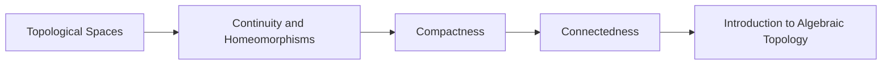

<!-- Generated by tools/build_indexes.py from tools/curriculum.json. Do not edit by hand. -->

# Topology

*Continuity without distance*

[Mathematics](../README.md) › Topology

Open sets, compactness, connectedness and the classification of spaces. Topology is geometry stripped to its essential structure.

## At a glance

| | |
|---|---|
| Topics | 5 (5 complete, 0 draft, 0 planned) |
| Estimated study time | ~52 hours |
| Prerequisites | [00-foundations](../00-foundations/README.md), [14-real-analysis](../14-real-analysis/README.md) |

## Study order

The numbers are the recommended order. Study a topic only after the ones before it —
the dependency chain below is the shortest safe route through the discipline.

## Topic inventory

| # | Topic | Level | Est. time | Status | Materials |
|---|---|---|---|---|---|
| 1 | [Topological Spaces](01-topological-spaces/README.md) | Advanced | 11 h | Complete | [Tutorial](01-topological-spaces/README.md) · [Exercises](01-topological-spaces/exercises.md) · [Solutions](01-topological-spaces/solutions.md) |
| 2 | [Continuity and Homeomorphisms](02-continuity-and-homeomorphisms/README.md) | Advanced | 10 h | Complete | [Tutorial](02-continuity-and-homeomorphisms/README.md) · [Exercises](02-continuity-and-homeomorphisms/exercises.md) · [Solutions](02-continuity-and-homeomorphisms/solutions.md) |
| 3 | [Compactness](03-compactness/README.md) | Advanced | 10 h | Complete | [Tutorial](03-compactness/README.md) · [Exercises](03-compactness/exercises.md) · [Solutions](03-compactness/solutions.md) |
| 4 | [Connectedness](04-connectedness/README.md) | Advanced | 9 h | Complete | [Tutorial](04-connectedness/README.md) · [Exercises](04-connectedness/exercises.md) · [Solutions](04-connectedness/solutions.md) |
| 5 | [Introduction to Algebraic Topology](05-algebraic-topology/README.md) | Advanced | 12 h | Complete | [Tutorial](05-algebraic-topology/README.md) · [Exercises](05-algebraic-topology/exercises.md) · [Solutions](05-algebraic-topology/solutions.md) |

### What each topic covers

- **Topological Spaces** — Open sets, bases, subspaces, quotient and product topologies, separation.
- **Continuity and Homeomorphisms** — Continuity via preimages, homeomorphism, invariance of topological properties.
- **Compactness** — Open covers, Heine-Borel, sequential compactness, Tychonoff's theorem.
- **Connectedness** — Connected and path-connected spaces, components and the intermediate value theorem.
- **Introduction to Algebraic Topology** — Homotopy, the fundamental group, covering spaces and Euler characteristic.

## Related disciplines

- [14-real-analysis](../14-real-analysis/README.md)
- [24-advanced-topics](../24-advanced-topics/README.md)
- [04-geometry](../04-geometry/README.md)

## Status key

- **Complete** — tutorial, exercises and full solutions exist and the tutorial meets the
  [authoring standard](../CONTRIBUTING.md).
- **Draft** — some material exists but the topic is not finished.
- **Planned** — identified in the curriculum, not written yet.

Overall progress and the full topic inventory live in [ROADMAP.md](../ROADMAP.md).
