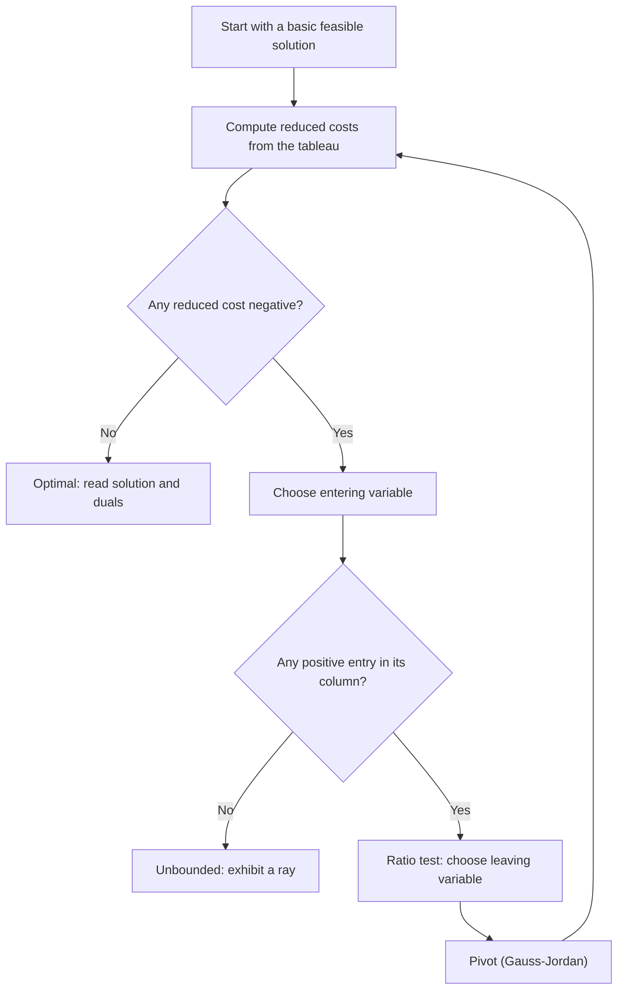
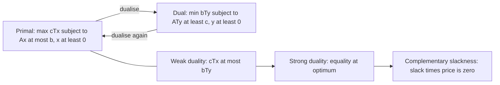

# Linear Programming

> [Mathematics](../../README.md) › [Optimization](../README.md) · Level: Intermediate · Prerequisites: [Systems of Linear Equations](../../08-linear-algebra/03-systems-of-linear-equations/README.md), [Matrices](../../08-linear-algebra/02-matrices/README.md), [Inequalities](../../03-algebra/03-inequalities/README.md), [Coordinate Geometry](../../04-geometry/04-coordinate-geometry/README.md) · Estimated time: 9 h

## 1. Introduction

A refinery must decide how much of each crude oil to buy, a railway how many locomotives to assign to each line, a dietitian how to combine foods so that every nutritional requirement is met at minimum cost, and a factory how to split machine time between products. In each case a finite list of numbers must be chosen, the choices are restricted by *linear* inequalities, and one linear quantity is to be made as large or as small as possible. Such a problem is a **linear program** (LP), and linear programming is the theory of these problems: how to recognise them, how to solve them, and what the solution means.

The subject began as a practical question. Kantorovich formulated production-planning LPs in 1939, Koopmans modelled Allied shipping in the 1940s, and in 1947 Dantzig invented the **simplex method**, an algorithm that walks from vertex to vertex of the feasible region and reaches an optimum in finitely many steps in practice. Linear programming became the first optimisation technique to be used routinely in industry, and it remains the computational core of logistics, scheduling, finance and combinatorial optimisation.

Three ideas organise the whole topic.

1. **Geometry.** The feasible region is a polyhedron. A linear function on a polyhedron, if it has a maximum at all, has one at a *vertex*. This reduces an infinite search to a finite one.
2. **Algebra.** Vertices correspond to *basic feasible solutions* of a linear system, so the search can be carried out with matrices and Gauss–Jordan elimination. That is the simplex method.
3. **Duality.** Every LP has a shadow LP, its **dual**, whose variables are prices. Weak duality says every dual feasible price vector bounds the primal objective; strong duality says the best bound is exact. The dual explains sensitivity: how much a constraint is worth, and which activities pay for themselves.

The chapter treats all three, then extends the model to integer decisions (branch-and-bound) and to three classical application families: transportation, scheduling and blending. The worked examples are complete: every tableau, every pivot and every optimal value can be checked by hand.

## 2. Prerequisites

**Linear systems and matrices** ([Systems of Linear Equations](../../08-linear-algebra/03-systems-of-linear-equations/README.md), [Matrices](../../08-linear-algebra/02-matrices/README.md)). You must be able to write a system as $Ax=b$, perform Gauss–Jordan elimination, recognise a pivot, invert a small matrix, and compute a determinant. The simplex tableau *is* Gauss–Jordan elimination applied to a specially chosen system, and the basis inverse $B^{-1}$ drives every sensitivity formula.

**Inequalities and coordinate geometry** ([Inequalities](../../03-algebra/03-inequalities/README.md), [Coordinate Geometry](../../04-geometry/04-coordinate-geometry/README.md)). You must be able to draw a line $ax+by=c$, decide which side is $ax+by\le c$, intersect two lines, and read off a polygon from its boundary lines. The two-variable geometry of §7.2 uses nothing more.

**Basic proof technique** ([Proof Techniques](../../00-foundations/04-proof-techniques/README.md)). The fundamental theorem of §7.3 is proved by a minimal-counterexample argument, and weak duality by a chain of inequalities. Both are written out in full.

No calculus and no probability are needed. The one place where calculus appears is the derivative of a value function in sensitivity analysis (§7.10–§7.11), and there it is used only to name a rate of change.

## 3. Learning Objectives

After this tutorial you will be able to:

1. Translate a word problem into a linear program, identifying decision variables, objective, constraints and non-negativity, and check that every expression is linear and dimensionally consistent.
2. Draw the feasible region of a two-variable LP, list its vertices, evaluate the objective at each, and identify the optimum and any alternative optima.
3. State the fundamental theorem of linear programming and reproduce the proof that an optimal basic feasible solution exists whenever an optimum exists.
4. Convert any LP to standard form with slack and surplus variables, and explain why free and non-positive variables need substitution.
5. Set up a simplex tableau, choose an entering variable, perform the ratio test, pivot, and recognise optimality and unboundedness.
6. Carry out a complete simplex solution of a multi-constraint problem and read the optimal solution, slacks and objective from the final tableau.
7. Explain degeneracy and cycling, and state Bland's rule with its termination guarantee.
8. Construct the dual of a primal LP, prove weak duality, state strong duality, and verify complementary slackness at an optimal pair.
9. Interpret dual variables as shadow prices and reduced costs, and compute the allowable range of a right-hand side or objective coefficient from the final tableau.
10. Formulate and solve a small integer program by branch-and-bound, and explain when the LP relaxation is automatically integral.
11. Model transportation, scheduling and blending problems as LPs and interpret their solutions.

## 4. Intuition

**A linear program is a flat landscape with straight fences.** The objective $c^{T}x$ is a linear function: on the plane it is a tilted sheet, and its level sets $c^{T}x=z$ are parallel lines (in higher dimensions, parallel hyperplanes). The constraints cut the space with straight fences, each fence a half-space, and their intersection is the **feasible region**. To maximise $c^{T}x$ is to push the level line as far as possible in the direction $c$ while it still touches the region. When it can go no farther, it is touching a corner — or a whole edge, or a face — of the region. That is the geometric content of the fundamental theorem: **the last contact between a moving hyperplane and a polyhedron is made at a vertex** (or along a face containing vertices).

**A vertex is a place where constraints are tight.** In two dimensions a vertex is the intersection of two boundary lines; in $n$ dimensions it is a point where at least $n$ constraints are active. Algebraically, a vertex is a solution of a square system obtained by setting enough variables to zero. Since there are only finitely many ways to choose which variables vanish, there are only finitely many candidate vertices, at most $\binom{n}{m}$ in standard form. The infinite problem has become a finite checklist.

**The simplex method is a walk along edges.** Start at a vertex. Look at the edges leaving it. If one of them goes uphill (for a maximisation), walk along it until you hit the next vertex. Repeat. Because the region has finitely many vertices and each step strictly improves the objective (apart from degenerate steps), the walk cannot continue forever, and it stops when no edge goes uphill — at a local, hence global, maximum, because a linear function has no other kind of stationary point.

**Duality is pricing.** Think of the constraints as resources. The dual variable $y_i$ of resource $i$ is its **shadow price**: the most you would pay for one more unit of it. If a resource is not fully used, an extra unit is worth nothing, so $y_i=0$. If an activity is used at a positive level, it must exactly break even against the resource prices, so its reduced cost is zero. These two sentences are complementary slackness, and they are the economic content of the theory.

## 5. Formal Definition

Throughout, $\mathbb{R}^{n}$ is the set of $n$-tuples of real numbers, a **vector** is such a tuple written as a column, $c^{T}x=\sum_{j=1}^{n}c_jx_j$ is the dot product, and inequalities between vectors hold componentwise.

> **Definition 5.1 (linear program).** Let $c\in\mathbb{R}^{n}$, $A\in\mathbb{R}^{m\times n}$ and $b\in\mathbb{R}^{m}$. A **linear program in symmetric form** is the problem
> $$\text{maximise } z=c^{T}x \quad \text{subject to } Ax\le b,\quad x\ge 0.$$
> The function $c^{T}x$ is the **objective function**, the system $Ax\le b$ together with $x\ge0$ is the **constraint set**, and a vector $x$ satisfying all constraints is **feasible**.

> **Definition 5.2 (feasible region; optimal solution; optimal value).** The **feasible region** is $P=\{x\in\mathbb{R}^{n}: Ax\le b,\ x\ge0\}$. A feasible $x^{*}$ is an **optimal solution** if $c^{T}x^{*}\ge c^{T}x$ for every feasible $x$. The common value is the **optimal value** $z^{*}$. If no feasible point exists the LP is **infeasible**; if feasible points have arbitrarily large objective values the LP is **unbounded**.

An LP is therefore exactly one of three things: infeasible, unbounded, or has a finite optimum. If an optimum exists it is attained (§7.3), so "finite optimum" and "optimal solution exists" coincide for LPs.

> **Definition 5.3 (standard form).** An LP is in **standard form** if it reads
> $$\text{maximise } z=c^{T}x \quad \text{subject to } Ax=b,\quad x\ge0,$$
> with $b\ge0$ and $\operatorname{rank}A=m\le n$. The rank condition says the equations are consistent and none is redundant.

Any LP can be put in standard form; the translation is given in §7.4.

> **Definition 5.4 (basis and basic feasible solution).** Consider $Ax=b$ with $A$ of rank $m$. Choose $m$ columns whose indices form a set $B$, and write $x_B$ for those variables and $x_N$ for the rest. If the $m\times m$ matrix $A_B$ is invertible, $B$ is a **basis** and $A_B$ is the **basis matrix**. Setting $x_N=0$ gives the **basic solution** $x_B=A_B^{-1}b$. It is a **basic feasible solution** (bfs) if $x_B\ge0$. It is **degenerate** if some component of $x_B$ is zero.

> **Definition 5.5 (extreme point).** A point $x$ of a convex set $P$ is an **extreme point** (or **vertex**) if it cannot be written as $x=\lambda u+(1-\lambda)v$ with $u,v\in P$, $u\ne v$ and $0<\lambda<1$.

> **Definition 5.6 (dual problem).** The **dual** of the LP in Definition 5.1 is
> $$\text{minimise } w=b^{T}y \quad \text{subject to } A^{T}y\ge c,\quad y\ge0.$$
> The original problem is then called the **primal**.

> **Definition 5.7 (integer program).** If some or all components of $x$ are required to be integers, the problem is an **integer program** (IP). If all are required to be integers it is a **pure** integer program; if only some are, a **mixed** integer program. Dropping the integrality requirement gives the **LP relaxation**.

**Standing assumptions.** All data are real numbers, $m$ and $n$ are finite, and $A$ has full row rank in standard form. These assumptions are what make the theory finite and linear; nonlinear objectives and infinitely many constraints belong to other chapters.

## 6. Mathematical Notation

| Symbol | Read as | Meaning |
|---|---|---|
| $n$ | en | number of decision variables |
| $m$ | em | number of functional constraints |
| $x=(x_1,\dots,x_n)$ | the decision vector | quantities chosen by the model |
| $c=(c_1,\dots,c_n)$ | cost or profit vector | coefficients of the objective |
| $A=(a_{ij})$ | the constraint matrix | coefficient of $x_j$ in constraint $i$ |
| $b=(b_1,\dots,b_m)$ | right-hand side | available amount of each resource |
| $z=c^{T}x$ | zed | value of the objective |
| $P$ | the feasible region | $\{x: Ax\le b,\ x\ge0\}$ |
| $x^{*}$, $z^{*}$ | x-star, z-star | optimal solution and optimal value |
| $s_i$ | slack of constraint $i$ | unused amount $b_i-a_i^{T}x$ |
| $e_i$ | surplus of constraint $i$ | excess in a $\ge$ constraint |
| $B$, $N$ | basis, non-basis | sets of basic and non-basic indices |
| $A_B$ | basis matrix | columns of $A$ indexed by $B$ |
| $B^{-1}$ | inverse of the basis | the matrix that turns $b$ into $x_B$ |
| $\bar c_j$ | reduced cost | $c_B^{T}B^{-1}A_j-c_j$ |
| $y_i$ | dual variable, shadow price | value of one more unit of resource $i$ |
| $w=b^{T}y$ | dual objective | value of the resource bundle |
| $z_{\mathrm{LP}}$ | LP bound | relaxation value in integer programming |
| $\lfloor v\rfloor$, $\lceil v\rceil$ | floor, ceiling | greatest integer $\le v$, least integer $\ge v$ |

Two conventions are used throughout. First, a **row vector** $c^{T}$ multiplies a column vector $x$, so $c^{T}x$ is a scalar, while $A^{T}y$ is a column vector. Second, for maximisation a reduced cost $\bar c_j<0$ means that increasing $x_j$ increases the objective, so such a variable is a candidate to enter the basis; for minimisation the sign is reversed, and this chapter always converts minimisation to maximisation of $-z$ to avoid the confusion.

## 7. Core Concepts

### 7.1 Formulating a linear program

Every LP model is built in the same five steps.

1. **Name the decisions.** Introduce one variable per quantity that can actually be chosen, with a unit attached: $x_1$ = tonnes of crude A per day, $x_2$ = hours of machine 2 per week. A model with the wrong variables cannot be repaired by algebra.
2. **Write the objective.** Decide whether it is a profit, a cost, a distance or a number of staff, and write it as a linear combination of the variables with the correct units. Maximise profit or minimise cost; do not mix the two.
3. **Write one constraint per restriction.** Resources give $\le$ constraints, requirements give $\ge$ constraints, and accounting identities give $=$ constraints. Each constraint must be linear and must balance in units.
4. **Impose non-negativity.** Physical quantities cannot be negative, so $x_j\ge0$. If a decision may be negative (a net export, a temperature increment), either shift the origin or split the variable as in §7.4.
5. **Check linearity.** No products $x_ix_j$, no powers, no ratios of variables, no "either-or" conditions. If a condition is logical ("if we open the plant then ..."), the model is a mixed integer program, not an LP.

A useful discipline is to write the units above each column of the model. A constraint whose left side is in kilograms and right side in hours is wrong before any mathematics is done.

**A first formulation.** A workshop makes chairs ($x$) and tables ($y$). A chair uses 4 units of wood and 2 hours of labour and earns 30; a table uses 6 units of wood and 5 hours and earns 55. There are 120 units of wood and 100 hours of labour. The model is

$$\text{maximise } 30x+55y \quad \text{subject to } 4x+6y\le120,\quad 2x+5y\le100,\quad x,y\ge0.$$

The coefficients of the first constraint are in wood units, those of the second in hours, and the objective in money. Nothing else is allowed into the rows.

### 7.2 The geometry of feasible regions

A **half-space** is a set $\{x: a^{T}x\le b\}$ with $a\ne0$. A **polyhedron** is the intersection of finitely many half-spaces; a bounded polyhedron is a **polytope**. The feasible region of an LP is a polyhedron, because each constraint is a half-space and $x_j\ge0$ is the half-space $-e_j^{T}x\le0$.

In two variables the geometry can be drawn. The recipe is:

1. Draw each boundary line $a_i^{T}x=b_i$.
2. Decide the feasible side by testing one point, usually the origin.
3. Shade the intersection of the feasible sides.
4. List the vertices: intersections of pairs of boundary lines that satisfy every constraint.
5. Evaluate $z$ at each vertex and take the largest (for a maximisation).

**Example 7.1 (graphical solution).** Maximise $z=2x+3y$ subject to $x+y\le4$, $x+3y\le6$, $x,y\ge0$.

The boundary lines meet the axes at $(4,0)$, $(0,4)$ and $(6,0)$, $(0,2)$. The feasible polygon has vertices

| Vertex | How obtained | $z=2x+3y$ |
|---|---|---|
| $(0,0)$ | origin | 0 |
| $(4,0)$ | $x+y=4$ with $y=0$ | 8 |
| $(3,1)$ | $x+y=4$ and $x+3y=6$ | 9 |
| $(0,2)$ | $x+3y=6$ with $x=0$ | 6 |

The largest value is $9$ at $(3,1)$. Feasibility check: $3+1=4\le4$ and $3+3=6\le6$. The point is a vertex because two independent constraints are tight.

Three outcomes are possible in the picture. The polygon may be empty (infeasible), it may be unbounded in a direction that increases $z$ (unbounded), or the level line may leave the polygon through a vertex or along an edge. The last case is the normal one, and it is the content of the next subsection.

### 7.3 Why optima occur at vertices

The central theorem of linear programming says that the continuous problem can be solved by checking finitely many points. It has a geometric form and an algebraic form, and the algebraic form is the one the simplex method uses.

> **Theorem 7.1 (fundamental theorem of linear programming).** Let $P=\{x\in\mathbb{R}^{n}: Ax=b,\ x\ge0\}$ with $\operatorname{rank}A=m$. If the LP $\max\{c^{T}x: x\in P\}$ has an optimal solution, then it has an optimal **basic feasible solution**.

The proof rests on two lemmas.

> **Lemma 7.2.** A point $x\in P$ is an extreme point of $P$ if and only if $x$ is a basic feasible solution.

**Proof.** Suppose first that $x$ is a bfs and that $x=\lambda u+(1-\lambda)v$ with $u,v\in P$ and $0<\lambda<1$. If $x_j=0$ then $0=\lambda u_j+(1-\lambda)v_j$ with $u_j,v_j\ge0$, so $u_j=v_j=0$. Hence $u$ and $v$ vanish outside the support $S=\{j:x_j>0\}$. On that support, $A_Su_S=A_Sv_S=b$, and the columns of $A_S$ are linearly independent because $x$ is basic. Therefore $u_S=v_S$, so $u=v$, and $x$ is extreme.

Conversely, suppose $x$ is not a bfs. Then the columns $\{A_j:j\in S\}$ are linearly dependent, so there is $d\ne0$ with $Ad=0$ and $d_j=0$ outside $S$. For small $\varepsilon>0$, both $x+\varepsilon d$ and $x-\varepsilon d$ are non-negative and satisfy $A(x\pm\varepsilon d)=b$; they are distinct feasible points whose midpoint is $x$. Hence $x$ is not extreme. $\blacksquare$

> **Lemma 7.3.** If an optimal solution exists, then among all optimal solutions there is one with the fewest positive components.

**Proof.** The set of optimal solutions is non-empty by hypothesis. Assign to each optimal solution the number of its positive components, a non-negative integer. A non-empty set of non-negative integers has a least element, so an optimal solution with the fewest positive components exists. $\blacksquare$

**Proof of Theorem 7.1.** Let $x^{*}$ be an optimal solution of minimum support size, and suppose its support columns are dependent. Then there is $d\ne0$ with $Ad=0$ and $d_j=0$ outside the support. For all small $\theta>0$, both $x^{*}+\theta d$ and $x^{*}-\theta d$ are feasible. Since $x^{*}$ is optimal, $c^{T}(x^{*}+\theta d)\le c^{T}x^{*}$ and $c^{T}(x^{*}-\theta d)\le c^{T}x^{*}$, so $c^{T}d=0$. Replace $d$ by $-d$ if necessary so that $d$ has a negative component, and set

$$\bar\theta=\min_{j:\,d_j<0}\frac{x_j^{*}}{-d_j}>0.$$

Then $x^{*}+\bar\theta d$ is feasible, optimal (its objective is $c^{T}x^{*}+\bar\theta c^{T}d=c^{T}x^{*}$), and at least one previously positive component is now zero, while no zero component has become positive (because $d$ vanishes outside the support). This contradicts minimality. Hence the support columns are independent and $x^{*}$ is a bfs. $\blacksquare$

**Geometric corollary.** If $P$ is a non-empty polyhedron containing no line and the objective is bounded above on $P$, the maximum is attained at a vertex. Indeed, every non-empty polyhedron without lines has at least one vertex and is the convex hull of its vertices plus its recession cone; on a bounded-above objective the recession cone contributes nothing to the maximum, and a linear function on a convex hull attains its maximum at a vertex. The algebraic proof above is the elementary version of this statement, and it does not require boundedness of $P$ — only that an optimal solution exists.

**What the theorem does not say.** It does not say that the optimum is unique. If two vertices are optimal, every point of the edge joining them is optimal, because $c^{T}(\lambda u+(1-\lambda)v)=\lambda c^{T}u+(1-\lambda)c^{T}v=z^{*}$. The set of optimal solutions is then an **optimal face** of $P$. The simplex method stops at one vertex of that face; the other optimal vertices are found by looking for zero reduced costs among non-basic variables (§7.5).

**Counting candidates.** In standard form with $m$ equations and $n$ variables there are at most $\binom{n}{m}$ bases, hence at most that many basic solutions. For $m=10$, $n=20$ this is $184756$, small enough for a computer but far too many to enumerate by hand. The simplex method examines only a tiny fraction of them.

### 7.4 Standard form and slack variables

The simplex method needs equations and non-negative variables. The following table converts every other form.

| Original form | Replacement | New variables |
|---|---|---|
| $\max z=c^{T}x$ | $\max z$ | none |
| $\min z=c^{T}x$ | $\max -z=-c^{T}x$ | none |
| $a^{T}x\le b$ | $a^{T}x+s=b$ | slack $s\ge0$ |
| $a^{T}x\ge b$ | $a^{T}x-e=b$ | surplus $e\ge0$ |
| $a^{T}x=b$ | unchanged | none |
| $x_j\le0$ | $x_j=-x_j'$ | $x_j'\ge0$ |
| $x_j$ free | $x_j=x_j'-x_j''$ | $x_j',x_j''\ge0$ |
| $b_i<0$ | multiply the row by $-1$ | none |

A slack measures unused capacity; a surplus measures the amount by which a requirement is exceeded. Both are non-negative and both have zero objective coefficient.

**Example 7.2 (standard form).** Put the following LP in standard form:

$$\max\ 2x_1-x_2+3x_3 \quad\text{s.t.}\quad x_1+x_2\le5,\quad 2x_1-x_3\ge1,\quad x_1,x_3\ge0,\quad x_2\text{ free}.$$

Introduce $x_2=x_2'-x_2''$ with $x_2',x_2''\ge0$, a slack $s_1\ge0$ in the first constraint and a surplus $s_2\ge0$ in the second:

$$\max\ 2x_1-x_2'+x_2''+3x_3$$
$$\text{s.t.}\quad x_1+x_2'-x_2''+s_1=5,\qquad 2x_1-x_3-s_2=1,$$
$$x_1,x_2',x_2'',x_3,s_1,s_2\ge0.$$

The surplus column is $-e_2$, not $+e_2$; this sign is the most common source of error in hand calculations. A surplus variable cannot serve as an initial basic variable because its coefficient is $-1$, which is why the two-phase method or Big-M is needed when a $\ge$ constraint is present (§9.3).

### 7.5 The simplex method

Consider the standard-form LP $\max c^{T}x$ subject to $Ax=b$, $x\ge0$, with $m$ equations and rank $m$. Choose a basis $B$ of $m$ columns. Multiply the system by $A_B^{-1}$:

$$x_B+A_B^{-1}A_Nx_N=A_B^{-1}b.$$

The objective is

$$z=c_B^{T}x_B+c_N^{T}x_N=c_B^{T}A_B^{-1}b+\bigl(c_N^{T}-c_B^{T}A_B^{-1}A_N\bigr)x_N.$$

Rearranging gives the **tableau**

$$z+\sum_{j\in N}\bar c_jx_j=z_0,\qquad \bar c_j=c_B^{T}A_B^{-1}A_j-c_j,\qquad z_0=c_B^{T}A_B^{-1}b.$$

The numbers $\bar c_j$ are the **reduced costs**. Since $x_N\ge0$ and $z=z_0-\sum\bar c_jx_j$, increasing a non-basic variable $x_j$ changes $z$ at rate $-\bar c_j$. Therefore:

* **Optimality test.** If $\bar c_j\ge0$ for every non-basic $j$, the current bfs is optimal. (Increasing any $x_j$ cannot increase $z$.)
* **Entering variable.** If some $\bar c_j<0$, choose one such $j$; increasing it increases $z$.
* **Ratio test.** Increasing $x_j$ by $t$ changes the basic variables to $x_B=A_B^{-1}b-t\,A_B^{-1}A_j$. A basic variable can only decrease. If $(A_B^{-1}A_j)_i>0$, the variable $x_{B_i}$ reaches zero at $t=(A_B^{-1}b)_i/(A_B^{-1}A_j)_i$. Hence the largest feasible step is
$$t^{*}=\min\left\{\frac{(A_B^{-1}b)_i}{(A_B^{-1}A_j)_i}:\ (A_B^{-1}A_j)_i>0\right\}.$$
If the set is empty, $x_j$ can increase without bound and the LP is **unbounded**.
* **Leaving variable.** The basic variable attaining the minimum ratio leaves the basis.
* **Pivot.** Perform Gauss–Jordan elimination on the pivot element, which replaces the leaving column by the entering column in the basis.

Each pivot is one step along an edge of the feasible region, from one vertex to an adjacent one. The objective never decreases, and it strictly increases unless the ratio is zero (degeneracy, §7.7).

**Starting basis.** When the LP comes from $\le$ constraints with $b\ge0$, the slacks form the identity matrix and give an immediate bfs $x_B=b$, $x_N=0$. This is why the symmetric form is the natural starting point. For $\ge$ and $=$ constraints, artificial variables and a two-phase procedure are needed.

**Termination.** There are finitely many bases and the objective is non-decreasing. If no basis repeats, the method terminates. A repeat is possible only through degeneracy, and it is called cycling (§7.7). With Bland's rule, repeats cannot occur.

**Complexity.** The simplex method is not a polynomial-time algorithm: Klee and Minty constructed LPs on which Dantzig's rule visits all $2^{n}$ vertices. In practice it is fast, and interior-point methods (Karmarkar 1984) give polynomial worst-case bounds; modern solvers combine both.

### 7.6 A full tableau worked example

Solve

$$\max z=3x_1+5x_2\quad\text{s.t.}\quad x_1\le4,\quad 2x_2\le12,\quad 3x_1+2x_2\le18,\quad x_1,x_2\ge0.$$

Introduce slacks $s_1,s_2,s_3\ge0$:

$$x_1+s_1=4,\qquad 2x_2+s_2=12,\qquad 3x_1+2x_2+s_3=18.$$

The initial basis is $\{s_1,s_2,s_3\}$, the initial bfs is $(0,0;4,12,18)$, and $z=0$. Each tableau below lists the row of $z$ (with the coefficient of $z$ suppressed) followed by the constraint rows.

**Tableau 1 (initial).**

| Basis | $x_1$ | $x_2$ | $s_1$ | $s_2$ | $s_3$ | RHS |
|---|---|---|---|---|---|---|
| $z$ | $-3$ | $-5$ | $0$ | $0$ | $0$ | $0$ |
| $s_1$ | $1$ | $0$ | $1$ | $0$ | $0$ | $4$ |
| $s_2$ | $0$ | $2$ | $0$ | $1$ | $0$ | $12$ |
| $s_3$ | $3$ | $2$ | $0$ | $0$ | $1$ | $18$ |

The most negative reduced cost is $-5$, so $x_2$ enters. The ratios are $4/0$ (undefined, because the entry is $0$), $12/2=6$ and $18/2=9$; only positive entries count, so the minimum is $6$ and $s_2$ leaves.

**Tableau 2 (after pivoting on the $(s_2,x_2)$ entry, value $2$).**

| Basis | $x_1$ | $x_2$ | $s_1$ | $s_2$ | $s_3$ | RHS |
|---|---|---|---|---|---|---|
| $z$ | $-3$ | $0$ | $0$ | $5/2$ | $0$ | $30$ |
| $s_1$ | $1$ | $0$ | $1$ | $0$ | $0$ | $4$ |
| $x_2$ | $0$ | $1$ | $0$ | $1/2$ | $0$ | $6$ |
| $s_3$ | $3$ | $0$ | $0$ | $-1$ | $1$ | $6$ |

The operations were: divide the $s_2$ row by $2$; subtract twice the new row from the $s_3$ row; add five times the new row to the $z$ row. The new bfs is $(0,6;4,0,6)$ with $z=30$. Check: $2\cdot6=12$ and $3\cdot0+2\cdot6=12\le18$.

Now $\bar c_1=-3<0$, so $x_1$ enters. The ratios are $4/1=4$ and $6/3=2$; the $x_2$ row has a zero entry in the $x_1$ column and does not constrain the step. The minimum is $2$, so $s_3$ leaves.

**Tableau 3 (after pivoting on the $(s_3,x_1)$ entry, value $3$).**

| Basis | $x_1$ | $x_2$ | $s_1$ | $s_2$ | $s_3$ | RHS |
|---|---|---|---|---|---|---|
| $z$ | $0$ | $0$ | $0$ | $3/2$ | $1$ | $36$ |
| $s_1$ | $0$ | $0$ | $1$ | $1/3$ | $-1/3$ | $2$ |
| $x_2$ | $0$ | $1$ | $0$ | $1/2$ | $0$ | $6$ |
| $x_1$ | $1$ | $0$ | $0$ | $-1/3$ | $1/3$ | $2$ |

All reduced costs are non-negative ($0,0,0,3/2,1$), so the tableau is optimal. The solution is

$$x_1=2,\qquad x_2=6,\qquad s_1=2,\qquad s_2=0,\qquad s_3=0,\qquad z=36.$$

**Verification.** $x_1=2\le4$ with slack $2$; $2x_2=12$ exactly; $3(2)+2(6)=18$ exactly; and $z=3(2)+5(6)=6+30=36$. The objective row also gives the dual solution $y=(0,3/2,1)$, which is checked in §9.4.

**Reading the tableau.** The coefficient of a slack $s_i$ in the $z$ row is the shadow price $y_i$ of constraint $i$. Here $y_1=0$ because constraint 1 is slack, and $y_2=3/2$, $y_3=1$ because constraints 2 and 3 are binding. The entries of the slack columns in the constraint rows are the columns of $A_B^{-1}$, which is exactly what the sensitivity analysis of §7.11 needs.

### 7.7 Degeneracy and cycling

A bfs is **degenerate** when one or more basic variables equal zero. Degeneracy is not a rare accident: it occurs whenever more than $n$ constraints pass through the same vertex, and it is common in models with redundant or tightly balanced constraints.

The effect on the simplex method is that a ratio test can return $t^{*}=0$. The entering variable then increases by zero, the basis changes, but the vertex and the objective do not. Such a step is called a **degenerate pivot**. A sequence of degenerate pivots can, in principle, return to a basis already visited; the method then cycles forever and never reaches the optimum.

> **Example 7.3 (a cycling example of Beale).** The LP
> $$\max\ 10x_1-57x_2-9x_3-24x_4$$
> subject to
> $$0.5x_1-5.5x_2-2.5x_3+9x_4\le0,\qquad 0.5x_1-1.5x_2-0.5x_3+x_4\le0,\qquad x_1\le1,\qquad x\ge0$$
> cycles under the rule "enter the most negative reduced cost". After six pivots the initial basis recurs, with the objective unchanged at $0$. The example is historically important because it shows that a natural pivot rule can fail.

Cycling is avoided by a **pivot rule** with a proved termination guarantee.

> **Theorem 7.4 (Bland's rule, 1977).** Suppose that at every iteration:
> 1. among all non-basic variables with $\bar c_j<0$, the one with the **smallest index** enters;
> 2. among all basic variables attaining the minimum ratio, the one with the **smallest index** leaves.
>
> Then the simplex method terminates after finitely many pivots, for every LP in standard form.

The proof shows that no basis can repeat under this rule; it is not reproduced here. Bland's rule can be slow in practice, so commercial solvers use it only as a fallback when a cycle is detected. Two other remedies are common: **perturb** the right-hand side by small distinct amounts $b_i+\varepsilon_i$, which removes degeneracy, and use the **lexicographic rule**, which breaks ratio ties by comparing the rows of $A_B^{-1}$ lexicographically. Both guarantee termination and are usually faster than Bland's rule.

Degeneracy also has an economic meaning. If a basic slack is zero, the corresponding resource is exactly exhausted even though its shadow price may be zero; the dual solution is then not unique, and a small change in the right-hand side may move the optimum along a face instead of changing its value smoothly (§9.5).

### 7.8 Duality

Every LP has a companion LP obtained by exchanging the roles of the objective and the right-hand side, and of the constraint matrix and its transpose.

> **Definition 7.5 (symmetric dual pair).** The primal
> $$\max\ c^{T}x\quad\text{s.t.}\quad Ax\le b,\ x\ge0$$
> has dual
> $$\min\ b^{T}y\quad\text{s.t.}\quad A^{T}y\ge c,\ y\ge0.$$

The correspondence is mechanical:

| Primal (max) | Dual (min) |
|---|---|
| objective coefficient $c_j$ | constraint $j$ has right-hand side $c_j$ |
| constraint $i$ has right-hand side $b_i$ | objective coefficient of $y_i$ is $b_i$ |
| constraint $i$ is $\le$ | $y_i\ge0$ |
| variable $x_j\ge0$ | constraint $j$ is $\ge$ |
| column $A_j$ of $A$ | row $A_j^{T}$ of the dual |
| $m$ constraints, $n$ variables | $n$ constraints, $m$ variables |

For other forms the rule is to convert to the symmetric form first, or to use the general table: a primal constraint that is $\ge$ gives $y_i\le0$, an equality constraint gives $y_i$ free, a primal variable $x_j\le0$ gives a dual constraint $\le$, and a free primal variable gives a dual equality. The safest procedure is always to convert to the symmetric form, dualise, and simplify.

> **Theorem 7.6 (weak duality).** If $x$ is feasible for the primal and $y$ is feasible for the dual, then
> $$c^{T}x\le b^{T}y.$$

**Proof.** Since $y\ge0$ and $Ax\le b$, multiplying the vector inequality $Ax\le b$ by $y^{T}\ge0$ preserves it:

$$y^{T}Ax\le y^{T}b.$$

Since $x\ge0$ and $A^{T}y\ge c$, multiplying $A^{T}y\ge c$ by $x^{T}\ge0$ gives

$$x^{T}A^{T}y\ge x^{T}c.$$

The left sides are equal, because $x^{T}A^{T}y=(Ax)^{T}y=y^{T}Ax$. Combining the two inequalities,

$$c^{T}x\le x^{T}A^{T}y=y^{T}Ax\le b^{T}y. \qquad\blacksquare$$

Weak duality has three immediate consequences.

1. Every dual feasible $y$ gives an **upper bound** $b^{T}y$ on every primal feasible value. This is how a solver certifies that a candidate solution is optimal: exhibit $x$ and $y$ with $c^{T}x=b^{T}y$.
2. If the primal is unbounded above, the dual is infeasible.
3. If the dual is unbounded below, the primal is infeasible.

> **Theorem 7.7 (strong duality).** If either the primal or the dual has a finite optimal solution, then so does the other, and the two optimal values are equal:
> $$\max\{c^{T}x:Ax\le b,\ x\ge0\}=\min\{b^{T}y:A^{T}y\ge c,\ y\ge0\}.$$

**Proof sketch.** Run the simplex method on the primal with Bland's rule. It terminates at an optimal basis $B$. Set $y^{T}=c_B^{T}A_B^{-1}$. For every column $A_j$, the final reduced cost is $\bar c_j=c_B^{T}A_B^{-1}A_j-c_j=y^{T}A_j-c_j$. Optimality gives $\bar c_j\ge0$, hence $A^{T}y\ge c$. For the slack columns, whose objective coefficients are zero, the same computation gives $y_i=\bar c_{s_i}\ge0$, hence $y\ge0$. Finally,
$$b^{T}y=b^{T}(A_B^{-1})^{T}c_B=c_B^{T}A_B^{-1}b=c_B^{T}x_B=c^{T}x,$$
so the dual feasible $y$ attains the primal value. By weak duality no dual value can be smaller, so $y$ is optimal and the values are equal. $\blacksquare$

The proof uses the simplex method, which is legitimate once termination is guaranteed; alternatively, strong duality follows from Farkas' lemma or from a separating-hyperplane argument. The four possible combinations are summarised below.

| Primal \ Dual | Finite optimum | Unbounded | Infeasible |
|---|---|---|---|
| **Finite optimum** | equal values | impossible | impossible |
| **Unbounded** | impossible | impossible | possible |
| **Infeasible** | impossible | possible | possible |

The entry "primal unbounded, dual infeasible" is consequence 2 above. The entry "both infeasible" is possible: the primal $x\ge1$, $x\le0$ is infeasible, and its dual is also infeasible.

**Dual of the dual.** Applying Definition 7.5 twice returns the primal. The dual of $\min\{b^{T}y:A^{T}y\ge c,\ y\ge0\}$ is $\max\{c^{T}x:Ax\le b,\ x\ge0\}$, after writing the minimisation as a maximisation of $-b^{T}y$ and simplifying. Duality is therefore symmetric: the two problems are partners, not a hierarchy.

### 7.9 Complementary slackness

Weak duality compares $c^{T}x$ and $b^{T}y$ through the chain

$$c^{T}x\le x^{T}A^{T}y=y^{T}Ax\le b^{T}y.$$

At an optimal pair the two ends are equal, so both inner inequalities must be equalities. This observation is the complementary slackness theorem.

> **Theorem 7.8 (complementary slackness).** Let $x$ and $y$ be feasible for the primal and dual of Definition 7.5. Then $x$ and $y$ are both optimal if and only if
> $$y_i\,(b_i-a_i^{T}x)=0\quad\text{for every }i,\qquad x_j\,((A^{T}y)_j-c_j)=0\quad\text{for every }j.$$

**Proof.** Suppose first that $x$ and $y$ are optimal. By strong duality $c^{T}x=b^{T}y$, so both inequalities in the chain are equalities. The difference $b^{T}y-y^{T}Ax=y^{T}(b-Ax)$ is a sum of terms $y_i(b_i-a_i^{T}x)$ with $y_i\ge0$ and $b_i-a_i^{T}x\ge0$; the sum is zero only if every term is zero. This is the first family of conditions. The second follows similarly from $x^{T}(A^{T}y-c)=0$, whose terms are $x_j((A^{T}y)_j-c_j)$ with $x_j\ge0$ and $(A^{T}y)_j-c_j\ge0$.

Conversely, if the conditions hold, then $y^{T}(b-Ax)=0$ and $x^{T}(A^{T}y-c)=0$, so $b^{T}y=y^{T}Ax=c^{T}x$. By weak duality, both common values are optimal. $\blacksquare$

In words:

* if a constraint has **slack** ($b_i-a_i^{T}x>0$), its dual variable is **zero**;
* if a dual variable is **positive**, its constraint is **binding**;
* if a variable is **positive** ($x_j>0$), its dual constraint is **binding** (reduced cost zero);
* if a dual constraint has **slack** ($(A^{T}y)_j>c_j$), the corresponding primal variable is **zero**.

Complementary slackness turns a candidate pair into a certificate. Given an optimal primal solution, one can solve the linear system consisting of the binding dual constraints and the zero dual variables, and recover the dual optimum without running the dual simplex. §9.4 does this on the tableau of §7.6.

### 7.10 The economic interpretation of dual variables

Write the primal as a resource-allocation problem: $x_j$ is the level of activity $j$, $c_j$ its profit per unit, $a_{ij}$ the amount of resource $i$ consumed per unit, and $b_i$ the amount of resource $i$ available. The dual variable $y_i$ is the **shadow price** (or **marginal value**) of resource $i$.

**Why $y_i$ is a price.** Suppose the optimal basis stays optimal when $b_i$ is increased by a small amount $\Delta$. Then $x_B=A_B^{-1}b$ changes by $\Delta\,A_B^{-1}e_i$, and the objective changes by

$$\Delta z=c_B^{T}A_B^{-1}e_i\,\Delta=y_i\,\Delta.$$

Thus $y_i=\partial z^{*}/\partial b_i$: one more unit of resource $i$ is worth $y_i$ units of objective. A positive $y_i$ means the resource is binding and scarce; $y_i=0$ typically means it is not fully used, so an extra unit is worthless. Degeneracy is the exception: a binding constraint can also have price zero, as §9.5 shows.

**Why reduced costs are prices too.** The reduced cost of activity $j$ is

$$\bar c_j=c_B^{T}A_B^{-1}A_j-c_j=y^{T}A_j-c_j.$$

The term $y^{T}A_j$ is the value of the resources that one unit of activity $j$ would consume, valued at shadow prices. The reduced cost is therefore *opportunity cost minus profit*. At an optimum, no activity earns more than its opportunity cost: $\bar c_j\ge0$ means $c_j\le y^{T}A_j$. If an activity is used, $x_j>0$, complementary slackness forces $\bar c_j=0$, so it earns exactly its opportunity cost. This is the LP version of an efficient market: at equilibrium no available activity yields more than the marginal value of the resources it uses.

**An example.** In §7.6 the dual solution is $y=(0,3/2,1)$. Resource 1 (the bound $x_1\le4$) is not binding, so its price is zero. Resource 2 ($2x_2\le12$) is worth $1.5$ per unit: relaxing it from $12$ to $13$ raises profit from $36$ to $37.5$. Resource 3 ($3x_1+2x_2\le18$) is worth $1$ per unit: raising it from $18$ to $19$ raises profit to $37$. Both statements hold only within the ranges computed in §7.11.

### 7.11 Sensitivity analysis

Sensitivity analysis asks how the optimal value changes when one coefficient moves, and how far it can move before the current basis ceases to be optimal. All the answers are read from the final tableau.

Let $B$ be the optimal basis, $x_B=A_B^{-1}b$, and $y^{T}=c_B^{T}A_B^{-1}$.

**Right-hand side $b_i$.** Only $x_B=A_B^{-1}b$ depends on $b$. Writing $A_B^{-1}$ column by column, $x_B=A_B^{-1}b$ is linear in $b_i$ with coefficient equal to the $i$-th column of $A_B^{-1}$. The basis remains primal feasible as long as $x_B\ge0$, which gives an interval
$$b_i\in[\underline b_i,\overline b_i].$$
On that interval $z^{*}(b_i)=z^{*}+y_i(b_i-b_i^{0})$, a straight line of slope $y_i$. Outside it a different basis is optimal and the formula no longer applies. If the interval is empty, the basis is optimal only at the current value, which happens under degeneracy.

**Objective coefficient $c_j$.** Changing $c_j$ changes the reduced costs of all non-basic variables. If $j$ is non-basic, only $\bar c_j$ changes, by $c_j^{\text{new}}-c_j^{\text{old}}$; the basis stays optimal while $\bar c_j\ge0$. If $j$ is basic, its coefficient appears in $c_B$, so every reduced cost changes: $\bar c_k^{\text{new}}=\bar c_k+(c_j^{\text{new}}-c_j^{\text{old}})(A_B^{-1}A_k)_j$. The basis stays optimal while all these remain non-negative. In both cases the optimal *vertex* is unchanged, and $z^{*}$ changes by $x_j\,(c_j^{\text{new}}-c_j^{\text{old}})$.

**Shadow prices and degeneracy.** At a non-degenerate optimum the shadow prices are unique and the value function is differentiable. At a degenerate optimum there may be several dual optimal solutions, and $z^{*}$ can have a kink; the left and right derivatives may differ. The tableau gives one subgradient, not the whole story; §9.5 gives an example in which $y_1=0$ but reducing $b_1$ still lowers the optimum.

**A summary of the formulas.** With the final tableau written as $x_B+(A_B^{-1}A_N)x_N=A_B^{-1}b$ and $z+\bar c_Nx_N=z_0$:

| Quantity | Formula | Range condition |
|---|---|---|
| shadow price of resource $i$ | $y_i=\bar c_{s_i}$ | basis unchanged |
| reduced cost of activity $j$ | $\bar c_j=y^{T}A_j-c_j$ | basis unchanged |
| change in value from $b_i$ | $\Delta z=y_i\,\Delta b_i$ | $x_B\ge0$ |
| change in value from $c_j$ (basic) | $\Delta z=x_j\,\Delta c_j$ | all $\bar c\ge0$ |
| change in value from $c_j$ (non-basic) | $\Delta z=0$ | $\bar c_j+\Delta c_j\ge0$ |

**Worked range calculations for §7.6.** The final basis is $\{s_1,x_2,x_1\}$, listed in that order so that $x_B=(s_1,x_2,x_1)$, and from the slack columns of Tableau 3,

$$A_B^{-1}=\begin{pmatrix}1&1/3&-1/3\\0&1/2&0\\0&-1/3&1/3\end{pmatrix}.$$

For $b_1$: $x_B=A_B^{-1}(b_1,12,18)^{T}=(b_1-2,\,6,\,2)$, so feasibility needs $b_1\ge2$ and there is no upper bound. Since $y_1=0$, the value stays $36$ for $b_1\ge2$; if $b_1$ falls below $2$ the basis changes, and the left derivative is $+3$.

For $b_2$: $x_B=(b_2/3-2,\,b_2/2,\,6-b_2/3)$, so $6\le b_2\le18$ and $z=18+\tfrac32b_2$, giving $y_2=3/2$. At $b_2=13$ the basic values are $(7/3,\,13/2,\,5/3)$, and $z=3(5/3)+5(13/2)=5+32.5=37.5$.

For $b_3$: $x_B=A_B^{-1}(4,12,b_3)^{T}=(8-b_3/3,\,6,\,b_3/3-4)$, so feasibility gives $12\le b_3\le24$ and $z=18+b_3$, giving $y_3=1$. At $b_3=20$ the basic values are $(4/3,\,6,\,8/3)$, that is $s_1=4/3$, $x_2=6$, $x_1=8/3$; then $x_1+s_1=4$, $2x_2=12$, $3x_1+2x_2=8+12=20$, and $z=8+30=38$.

For $c_1$: $x_1$ is basic, so $c_B=(0,5,c_1)$ and
$$y^{T}=(0,\tfrac52-\tfrac{c_1}{3},\tfrac{c_1}{3}).$$
Dual feasibility $y\ge0$ gives $0\le c_1\le7.5$. At $c_1=7.5$ the reduced cost of $s_2$ is zero and an alternative optimum appears at $(4,3)$, with the same value $45$.

For $c_2$: $c_B=(0,c_2,3)$ and $y^{T}=(0,\tfrac{c_2}{2}-1,1)$, so $c_2\ge2$ with no upper bound.

These ranges are *individual*: they assume one coefficient changes while all others stay fixed. For simultaneous changes the current basis may fail even when each change is inside its own interval, and the only safe procedure is to recompute the reduced costs (or re-solve).

### 7.12 Integer programming and branch-and-bound

Many decisions are indivisible: build or not build, buy 3 trucks, assign a worker to a shift. Requiring $x_j\in\mathbb{Z}$ turns an LP into an **integer program**. The LP obtained by dropping the integrality condition is the **LP relaxation**; its optimal value bounds the integer optimum. For a maximisation,
$$z_{\mathrm{IP}}\le z_{\mathrm{LP}},$$
and the difference is the **integrality gap**. Rounding an LP solution is not a solution method: rounding can violate constraints, and the gap can be large.

**Branch-and-bound.** The standard exact method is a guided enumeration.

1. Solve the LP relaxation of the current subproblem.
2. If it is infeasible, **fathom** the node (no integer solution there).
3. If its optimal value is no better than the best integer solution found so far (the **incumbent**), fathom by bound.
4. If the LP optimum is integral, update the incumbent and fathom.
5. Otherwise pick a variable $x_j$ whose LP value $v$ is fractional and create two subproblems:
   $$x_j\le\lfloor v\rfloor \quad\text{and}\quad x_j\ge\lceil v\rceil.$$
6. Continue until every node is fathomed; the incumbent is optimal.

The two subproblems cover every integer point of the parent, because no integer lies strictly between $\lfloor v\rfloor$ and $\lceil v\rceil$. The LP bounds are valid because each child's feasible region is a subset of the parent's. The method terminates when the feasible region is bounded: each branch fixes an integer bound on a variable, the variables range over finitely many integers, and the tree is finite. In the worst case the tree has exponentially many nodes, and integer programming is NP-hard (Karp 1972); branch-and-bound with cutting planes and heuristics is the practical compromise.

**When the LP is already integral.** If $A$ is **totally unimodular** — every square submatrix has determinant $0$, $1$ or $-1$ — and $b$ is integral, then every basic feasible solution of $Ax\le b$, $x\ge0$ is integral. Indeed, for a basis $B$, Cramer's rule gives $(x_B)_i=\det B_i/\det B$ with both determinants integers and $\det B=\pm1$. The transportation and assignment constraint matrices are totally unimodular, which is why their LPs can be solved as continuous problems without losing integrality.

**Example 7.4 (a small branch-and-bound).** Maximise $5x_1+4x_2$ subject to $6x_1+4x_2\le24$, $x_1+2x_2\le6$, $x_1,x_2\ge0$ integer. The LP relaxation has optimum $21$ at $(3,1.5)$. Branching on $x_2$:

* $x_2\le1$: the LP optimum is $62/3\approx20.67$ at $(10/3,1)$. Branching on $x_1$ gives $x_1\le3$ with value $19$ at $(3,1)$, and $x_1\ge4$ with value $20$ at $(4,0)$, an integer solution.
* $x_2\ge2$: the LP optimum is $18$ at $(2,2)$, already integer. Since $18<20$, this node is fathomed by bound.

The incumbent $20$ at $(4,0)$ is optimal. The tree has five nodes: the root, the two children of the $x_2$ branch, and the two children of the $x_1$ branch under $x_2\le1$.

### 7.13 Applications: transportation, scheduling and blending

**Transportation.** Sources $i=1,\dots,p$ have supplies $s_i$, destinations $j=1,\dots,q$ have demands $d_j$, and $c_{ij}$ is the cost of shipping one unit from $i$ to $j$. The decision is the flow $x_{ij}\ge0$:

$$\min\sum_{i=1}^{p}\sum_{j=1}^{q}c_{ij}x_{ij}\quad\text{s.t.}\quad \sum_{j=1}^{q}x_{ij}=s_i\ \ \forall i,\qquad \sum_{i=1}^{p}x_{ij}=d_j\ \ \forall j.$$

The problem is feasible exactly when $\sum_i s_i=\sum_j d_j$ (balanced case); if not, a dummy source or destination absorbs the difference at zero cost. The constraint matrix has one $+1$ in a source row and one $+1$ in a destination row in each column. Multiplying the destination rows by $-1$ turns it into a network matrix, which is totally unimodular, and row sign changes preserve total unimodularity; hence an integral optimum exists whenever supplies and demands are integers. §9.6 solves a $2\times3$ instance by the transportation simplex.

**Scheduling.** A common model is **staff scheduling**. On day $t$ the demand is $r_t$ employees, and each employee works a pattern $P$ of consecutive days. Let $x_P$ be the number of employees assigned to pattern $P$. Then

$$\min\sum_{P}x_P\quad\text{s.t.}\quad \sum_{P\ni t}x_P\ge r_t\ \ \forall t,\qquad x_P\ge0\ \text{integer}.$$

The LP relaxation is a covering problem; its value is a lower bound on the integer optimum, and for interval-structured patterns the matrix is often totally unimodular. Real rosters add rest days, skills, and shift lengths, which are handled by the same covering skeleton with more rows. §9.8 formulates a three-day instance and computes its integrality gap.

**Blending.** A blend is a mixture of ingredients $j=1,\dots,n$ with proportions $x_j$ (often $\sum_jx_j=1$ or $\sum_jx_j=Q$). Ingredient $j$ costs $c_j$ per unit and contains $a_{ij}$ of nutrient $i$. The blend must contain at least $r_i$ of nutrient $i$ and at most $u_i$ of nutrient $i$:

$$\min\sum_j c_jx_j\quad\text{s.t.}\quad \sum_j a_{ij}x_j\ge r_i,\quad \sum_j a_{ij}x_j\le u_i,\quad \sum_j x_j=Q,\quad x_j\ge0.$$

Petrol blending, animal feed, steel alloys and portfolio construction all fit this pattern; the constraints are linear because nutrient content is proportional to quantity. §9.7 solves a two-ingredient diet problem graphically, and the dual variables price each nutrient.

**Other application areas.** The same structure models production planning (resources and recipes), trim-loss problems in paper and steel (cutting stock), network flows (shortest path, max flow, min-cost flow), game theory (a matrix game is a pair of dual LPs), and the LP relaxations used inside machine-learning and combinatorial algorithms. The common feature is a linear objective, linear constraints and divisible decision variables; when divisibility fails, integer programming takes over.

## 8. Formulas and Properties

This section collects the statements that are used repeatedly. Each is accompanied by the reason it holds, so that the formula can be reconstructed rather than memorised.

### 8.1 Forms and conversions

> **Property 8.1.** Every LP can be written in standard form $\max\{c^{T}x:Ax=b,\ x\ge0\}$ with $b\ge0$ and $\operatorname{rank}A=m$.

*Why.* Slack and surplus variables convert inequalities to equations, a free variable is the difference of two non-negative variables, a non-positive variable is the negative of a non-negative one, and a negative right-hand side is removed by multiplying its row by $-1$. The rank condition is enforced by deleting dependent rows (or by adding artificial variables in a two-phase solve).

> **Property 8.2.** The number of basic solutions of a standard-form LP is at most $\binom{n}{m}$, and a bfs exists whenever the feasible region is non-empty.

*Why.* A basis is a choice of $m$ columns out of $n$. If the feasible region is non-empty, the fundamental theorem applied to the constant objective $c=0$ (or the minimal-support argument of Theorem 7.1) produces a bfs.

### 8.2 Optimality

> **Property 8.3 (optimality criterion).** A bfs with basis $B$ is optimal for the maximisation if and only if $\bar c_j=c_B^{T}B^{-1}A_j-c_j\ge0$ for every non-basic $j$.

*Why.* The objective is $z=z_0-\sum_{j\in N}\bar c_jx_j$. If all $\bar c_j\ge0$, increasing any non-basic variable cannot increase $z$; since every feasible point differs from the bfs by a non-negative combination of non-basic directions, no feasible point does better. If some $\bar c_j<0$, increasing $x_j$ increases $z$ until a basic variable hits zero, so the bfs is not optimal.

> **Property 8.4 (unboundedness criterion).** If the entering column satisfies $A_B^{-1}A_j\le0$, the LP is unbounded above.

*Why.* Then $x_B=A_B^{-1}b-tA_B^{-1}A_j\ge0$ for every $t\ge0$, so $x_j=t$ is feasible for arbitrarily large $t$ and $z=z_0-\bar c_jt\to+\infty$ when $\bar c_j<0$.

### 8.3 Duality

> **Property 8.5 (weak duality).** For feasible $x$ and $y$ of the symmetric pair, $c^{T}x\le b^{T}y$.

> **Property 8.6 (strong duality).** If either problem has a finite optimum, both do and the optimal values are equal.

> **Property 8.7 (dual of the dual).** The dual of the dual is the primal.

*Why.* Weak duality is the chain $c^{T}x\le x^{T}A^{T}y\le b^{T}y$; strong duality follows from the final simplex tableau by $y^{T}=c_B^{T}B^{-1}$; the double dual is checked by applying the conversion rules twice and simplifying.

### 8.4 Complementary slackness

> **Property 8.8.** Feasible $x,y$ are optimal if and only if $y_i(b_i-a_i^{T}x)=0$ for all $i$ and $x_j((A^{T}y)_j-c_j)=0$ for all $j$.

*Why.* Both are equivalent to $y^{T}(b-Ax)=0$ and $x^{T}(A^{T}y-c)=0$, which is exactly the equality case of the weak-duality chain.

### 8.5 Sensitivity

> **Property 8.9.** If the basis $B$ remains optimal, then $z^{*}(b)=c_B^{T}B^{-1}b$ and $\nabla_bz^{*}=(c_B^{T}B^{-1})^{T}=y$. The basis remains primal feasible exactly while $A_B^{-1}b\ge0$.

> **Property 8.10.** If $B$ remains optimal, the allowable range of a non-basic objective coefficient is determined by $\bar c_j\ge0$, and that of a basic one by all reduced costs staying non-negative after $c_B$ changes.

*Why.* $x_B=A_B^{-1}b$ is linear in $b$, and $z=c_B^{T}x_B$; the reduced costs are affine in $c_B$. Both statements are direct consequences of the tableau formulas.

### 8.6 Integer programming

> **Property 8.11 (LP bound).** For a maximisation IP, $z_{\mathrm{IP}}\le z_{\mathrm{LP}}$; for a minimisation, $z_{\mathrm{IP}}\ge z_{\mathrm{LP}}$.

> **Property 8.12 (total unimodularity).** If $A$ is totally unimodular and $b$ is integral, every bfs of $Ax\le b$, $x\ge0$ is integral.

*Why.* The relaxation contains every integer point, giving the bound. For 8.12, Cramer's rule writes each basic variable as a ratio of two integer determinants, and total unimodularity makes the denominator $\pm1$.

## 9. Step-by-Step Examples

The examples run from a two-variable graphical problem to a scheduling model with an integrality gap. Every optimum is checked by substituting it into the constraints and evaluating the objective. Section 7.6 already contains a complete simplex tableau, and §7.12 a complete branch-and-bound tree; those are not repeated here.

### 9.1 Example 1: production planning by graphics

A workshop makes two products. Each unit of $A$ earns 40 and needs 2 machine-hours and 1 labour-hour; each unit of $B$ earns 30 and needs 1 machine-hour and 2 labour-hours. There are 80 machine-hours, 70 labour-hours, and demand limits $A$ to 35 units. Maximise profit.

**Model.**

$$\max z=40x+30y\quad\text{s.t.}\quad 2x+y\le80,\quad x+2y\le70,\quad x\le35,\quad x,y\ge0.$$

**Vertices.**

| Vertex | Active constraints | $z$ |
|---|---|---|
| $(0,0)$ | none | $0$ |
| $(35,0)$ | $x=35$, $y=0$ | $1400$ |
| $(35,10)$ | $x=35$, $2x+y=80$ | $1400+300=1700$ |
| $(30,20)$ | $2x+y=80$, $x+2y=70$ | $1200+600=1800$ |
| $(0,35)$ | $x+2y=70$, $x=0$ | $1050$ |

The largest value is $1800$ at $(30,20)$. Check: $2(30)+20=80$, $30+2(20)=70$, $30\le35$. The binding constraints are machine-hours and labour-hours; the demand cap is slack by 5 units.

**Reading the answer.** The workshop should make 30 units of $A$ and 20 of $B$, using all machine and labour capacity, and leaving 5 units of the demand cap unused. The profit is 1800.

### 9.2 Example 2: formulation and standard form

A factory makes three products with two resources and one demand cap:

$$\max z=5x_1+4x_2+3x_3\quad\text{s.t.}\quad 2x_1+3x_2+x_3\le10,\quad x_1+2x_2+2x_3\le8,\quad x_2\le3,\quad x\ge0.$$

Introducing slacks $s_1,s_2,s_3\ge0$ gives the standard form

$$\max z=5x_1+4x_2+3x_3$$
$$\text{s.t.}\quad 2x_1+3x_2+x_3+s_1=10,\quad x_1+2x_2+2x_3+s_2=8,\quad x_2+s_3=3,$$
$$x_1,x_2,x_3,s_1,s_2,s_3\ge0.$$

The initial bfs is $(0,0,0;10,8,3)$ with $z=0$. The LP optimum is $26$ at $(4,0,2)$: check $2(4)+0+2=10$, $4+0+4=8$, and $z=20+0+6=26$. The demand cap $x_2\le3$ is not binding, so $s_3=3$ at the optimum and the shadow price of the cap is zero.

### 9.3 Example 3: two-phase simplex for a minimisation

Minimise $z=2x_1+3x_2$ subject to $x_1+x_2\ge5$, $2x_1+x_2\ge8$, $x\ge0$. Convert to a maximisation of $w=-z=-2x_1-3x_2$ and introduce surplus variables and artificial variables:

$$x_1+x_2-s_1+a_1=5,\qquad 2x_1+x_2-s_2+a_2=8,\qquad x,a,s\ge0.$$

**Phase 1.** Maximise $w_1=-a_1-a_2$. Eliminating the basic artificials gives

$$w_1-3x_1-2x_2+s_1+s_2=-13.$$

| Basis | $x_1$ | $x_2$ | $s_1$ | $s_2$ | $a_1$ | $a_2$ | RHS |
|---|---|---|---|---|---|---|---|
| $w_1$ | $-3$ | $-2$ | $1$ | $1$ | $0$ | $0$ | $-13$ |
| $a_1$ | $1$ | $1$ | $-1$ | $0$ | $1$ | $0$ | $5$ |
| $a_2$ | $2$ | $1$ | $0$ | $-1$ | $0$ | $1$ | $8$ |

Enter $x_1$ (most negative), ratios $5$ and $4$, so $a_2$ leaves. Pivot on the entry $2$:

| Basis | $x_1$ | $x_2$ | $s_1$ | $s_2$ | $a_1$ | $a_2$ | RHS |
|---|---|---|---|---|---|---|---|
| $w_1$ | $0$ | $-1/2$ | $1$ | $-1/2$ | $0$ | $3/2$ | $-1$ |
| $a_1$ | $0$ | $1/2$ | $-1$ | $1/2$ | $1$ | $-1/2$ | $1$ |
| $x_1$ | $1$ | $1/2$ | $0$ | $-1/2$ | $0$ | $1/2$ | $4$ |

Enter $x_2$, ratios $1/(1/2)=2$ and $4/(1/2)=8$, so $a_1$ leaves. Pivot on $1/2$:

| Basis | $x_1$ | $x_2$ | $s_1$ | $s_2$ | $a_1$ | $a_2$ | RHS |
|---|---|---|---|---|---|---|---|
| $w_1$ | $0$ | $0$ | $0$ | $0$ | $1$ | $1$ | $0$ |
| $x_2$ | $0$ | $1$ | $-2$ | $1$ | $2$ | $-1$ | $2$ |
| $x_1$ | $1$ | $0$ | $1$ | $-1$ | $-1$ | $1$ | $3$ |

The phase-1 optimum is $w_1=0$: the artificials are zero and $(x_1,x_2)=(3,2)$ is feasible with $z=12$. This is a vertex, not yet the optimum.

**Phase 2.** Drop the artificial columns and restore the original objective $w=-2x_1-3x_2$. The rows are

$$x_1+s_1-s_2=3,\qquad x_2-2s_1+s_2=2,$$

and eliminating the basic variables from $w+2x_1+3x_2=0$ gives

$$w+4s_1-s_2=-12.$$

Enter $s_2$ (coefficient $-1$), ratio $2$ in the $x_2$ row ($3/(-1)$ is negative and ignored), so $x_2$ leaves:

| Basis | $x_1$ | $x_2$ | $s_1$ | $s_2$ | RHS |
|---|---|---|---|---|---|
| $w$ | $0$ | $1$ | $2$ | $0$ | $-10$ |
| $x_1$ | $1$ | $1$ | $-1$ | $0$ | $5$ |
| $s_2$ | $0$ | $1$ | $-2$ | $1$ | $2$ |

All reduced costs are non-negative, so $w^{*}=-10$, hence $z^{*}=10$, at $x_1=5$, $x_2=0$, $s_1=0$, $s_2=2$. Check: $5+0=5$ and $2(5)+0=10\ge8$; $z=2(5)+3(0)=10$. The surplus $s_2=2$ is the excess over the second requirement.

### 9.4 Example 4: duality and complementary slackness

The primal of §7.6 is

$$\max\ 3x_1+5x_2\quad\text{s.t.}\quad x_1\le4,\quad 2x_2\le12,\quad 3x_1+2x_2\le18,\quad x\ge0.$$

Its dual is

$$\min\ 4y_1+12y_2+18y_3\quad\text{s.t.}\quad y_1+3y_3\ge3,\quad 2y_2+2y_3\ge5,\quad y\ge0.$$

The final tableau of §7.6 gave $y=(0,3/2,1)$. Check dual feasibility: $0+3(1)=3\ge3$ and $2(3/2)+2(1)=5\ge5$. The dual value is $4(0)+12(3/2)+18(1)=36$, equal to the primal optimum.

Complementary slackness holds term by term:

| Condition | Check |
|---|---|
| $x_1=2>0$ | $y_1+3y_3=3$ (tight) |
| $x_2=6>0$ | $2y_2+2y_3=5$ (tight) |
| $s_1=2>0$ | $y_1=0$ |
| $y_2=3/2>0$ | $2x_2=12$ (tight) |
| $y_3=1>0$ | $3x_1+2x_2=18$ (tight) |

Every binding primal constraint has a positive price, and every positive price belongs to a binding constraint. The slack constraint has price zero. This is the pattern promised by Theorem 7.8.

### 9.5 Example 5: sensitivity analysis

Continuing §7.6, the individual allowable ranges are collected below.

| Coefficient | Range | Optimal value on the range |
|---|---|---|
| $b_1$ | $[2,\infty)$ | $36$ (price $0$) |
| $b_2$ | $[6,18]$ | $18+\tfrac32b_2$ |
| $b_3$ | $[12,24]$ | $18+b_3$ |
| $c_1$ | $[0,7.5]$ | $30+2c_1$ |
| $c_2$ | $[2,\infty)$ | $6+6c_2$ |

The formulas for $c_1$ and $c_2$ come from the optimal vertex $(2,6)$, whose objective is $c_1(2)+5(6)=2c_1+30$ and $3(2)+c_2(6)=6+6c_2$. At $c_2=5$ the second formula returns $36$, as it must.

**Endpoint checks.** At $b_2=18$: $x_B=(s_1,x_2,x_1)=(4,9,0)$, so $(x_1,x_2)=(0,9)$ and $z=45=18+27$ ✓. At $b_2=6$: $x_B=(0,3,4)$, so $(x_1,x_2)=(4,3)$ and $z=12+15=27=18+9$ ✓; the constraints give $x_1=4$, $2x_2=6$, $3x_1+2x_2=18$ ✓.

At $b_3=24$: $x_B=(0,6,4)$, so $(x_1,x_2)=(4,6)$ and $z=12+30=42=18+24$ ✓. At $b_3=12$: $x_B=(4,6,0)$, so $(x_1,x_2)=(0,6)$ and $z=30=18+12$ ✓.

At $c_1=0$: the optimum is $(0,6)$ with $z=30=30+2(0)$ ✓. At $c_1=7.5$: the optimal face is the edge from $(2,6)$ to $(4,3)$. At $(2,6)$, $z=7.5(2)+5(6)=15+30=45$; at $(4,3)$, $z=7.5(4)+5(3)=30+15=45$; both equal $30+2(7.5)$ ✓. The zero reduced cost of $s_2$ at $c_1=7.5$ is exactly the signal of this alternative optimum.

**One-sided sensitivity.** At $b_1=2$ the optimum is still $(2,6)$ with $s_1=0$. For $b_1<2$ the constraint $x_1\le b_1$ binds, but now the second constraint $2x_2\le12$ binds as well, so $x_2=6$ and $x_1=b_1$; the third constraint has slack $18-3b_1-12=6-3b_1>0$. The value is $z=3b_1+30$. The right derivative at $b_1=2$ is $y_1=0$; the left derivative is $3$. The value function has a kink: adding capacity is worthless, but removing it is costly. A shadow price of zero is therefore a one-sided statement, and the value function is concave in $b$ with non-increasing slopes.

### 9.6 Example 6: a transportation problem

Two warehouses supply three shops. Supplies are $s=(30,40)$, demands are $d=(20,30,20)$, and the unit costs are

$$C=\begin{pmatrix}2&3&1\\5&2&4\end{pmatrix}.$$

The LP is $\min\sum c_{ij}x_{ij}$ subject to $\sum_jx_{ij}=s_i$, $\sum_ix_{ij}=d_j$, $x\ge0$. The totals agree ($70=70$), so the problem is balanced and feasible.

**Initial solution by the north-west corner rule.** Fill the top-left cell as much as possible, then move right or down:

$$x_{11}=20,\quad x_{12}=10,\quad x_{22}=20,\quad x_{23}=20,$$

with cost $20(2)+10(3)+20(2)+20(4)=40+30+40+80=190$. The basic cells form a tree, as they must: four cells for $2+3-1=4$.

**Optimality test.** Choose potentials $u_i+v_j=c_{ij}$ on basic cells. With $u_1=0$: $v_1=2$, $v_2=3$, $u_2=2-3=-1$, $v_3=4-(-1)=5$. The reduced costs of the non-basic cells are $c_{ij}-u_i-v_j$:

| Cell | $c_{ij}$ | $u_i+v_j$ | Reduced cost |
|---|---|---|---|
| $(1,3)$ | $1$ | $0+5=5$ | $-4$ |
| $(2,1)$ | $5$ | $-1+2=1$ | $4$ |

The negative reduced cost in cell $(1,3)$ means the solution can be improved by shipping more from warehouse 1 to shop 3.

**Improving cycle.** The cycle is $(1,3)\to(2,3)\to(2,2)\to(1,2)\to(1,3)$, with signs $+,-,+,-$. The largest feasible step is $\theta=\min(x_{23},x_{12})=\min(20,10)=10$. The new solution is

$$x_{13}=10,\quad x_{23}=10,\quad x_{22}=30,\quad x_{11}=20,\quad x_{12}=0,$$

with cost $20(2)+10(1)+30(2)+10(4)=40+10+60+40=150$. The new basic cells are $(1,1),(1,3),(2,2),(2,3)$. Feasibility check: supplies are $20+0+10=30$ and $0+30+10=40$; demands are $20$, $0+30=30$ and $10+10=20$.

**Second optimality test.** With $u_1=0$: $v_1=2$, $v_3=1$, $u_2=4-1=3$, $v_2=2-3=-1$. Reduced costs: $(1,2)$ is $3-0-(-1)=4\ge0$; $(2,1)$ is $5-3-2=0$. All are non-negative, so the solution is optimal, with cost $150$. The zero reduced cost in cell $(2,1)$ signals an alternative optimum; pivoting there gives another optimal solution with the same cost.

**Integrality.** Supplies and demands are integers, and the transportation matrix is totally unimodular, so the optimal solution found by the continuous LP is integral. No branch-and-bound is needed.

### 9.7 Example 7: blending and dual prices

A feed must contain at least 8 units of protein and 12 units of carbohydrate. Ingredient $A$ costs 2 per kg and contains 2 units of protein and 4 of carbohydrate per kg; ingredient $B$ costs 3 per kg and contains 4 units of protein and 2 of carbohydrate per kg. Minimise cost.

$$\min z=2x+3y\quad\text{s.t.}\quad 2x+4y\ge8,\quad 4x+2y\ge12,\quad x,y\ge0.$$

**Graphical solution.** The protein line $2x+4y=8$ meets the axes at $(4,0)$ and $(0,2)$; the carbohydrate line $4x+2y=12$ meets them at $(3,0)$ and $(0,6)$. The feasible region is above both lines, so the vertices are $(4,0)$, $(0,6)$, and the intersection

$$2x+4y=8,\quad 4x+2y=12\ \Longrightarrow\ x=\frac83,\ y=\frac23.$$

The point $(3,0)$ lies on the carbohydrate line but not on the protein line: $2(3)+0=6<8$, so it is infeasible and is not a vertex. The feasible vertices and their costs are

| Vertex | Feasibility | $z=2x+3y$ |
|---|---|---|
| $(4,0)$ | $8\ge8$, $16\ge12$ | $8$ |
| $(8/3,2/3)$ | $8\ge8$, $12\ge12$ | $16/3+2=22/3\approx7.33$ |
| $(0,6)$ | $24\ge8$, $12\ge12$ | $18$ |

The minimum is $22/3$ at $(8/3,2/3)$. The objective is linear and the feasible region is a polyhedron, so the minimum is attained at a vertex; since all three vertices have been checked, no other point can do better.

**Dual and prices.** The dual is

$$\max\ 8u+12v\quad\text{s.t.}\quad 2u+4v\le2,\quad 4u+2v\le3,\quad u,v\ge0.$$

At the optimum both primal constraints bind and both primal variables are positive, so both dual constraints bind:

$$2u+4v=2,\qquad 4u+2v=3\ \Longrightarrow\ u=\frac23,\ v=\frac16.$$

The dual value is $8(2/3)+12(1/6)=16/3+2=22/3$, matching the primal. Protein is worth $2/3$ per unit and carbohydrate $1/6$ per unit. A small increase in the protein requirement raises the cost by about $0.67$ per unit, and one in carbohydrate by about $0.17$ per unit, as long as the same two constraints stay binding.

**Verification.** $x=8/3$, $y=2/3$: protein $=8$, carbohydrate $=12$, cost $=22/3$. The dual is feasible and attains the same value, so both are optimal.

### 9.8 Example 8: staff scheduling and an integrality gap

A call centre needs 6 staff on Monday, 5 on Tuesday and 4 on Wednesday. Each employee works two consecutive days. The patterns are $A$ (Monday–Tuesday), $B$ (Tuesday–Wednesday) and $C$ (Monday–Wednesday, interpreted as Monday and Wednesday for this three-day model). Minimise the number of employees.

$$\min x_A+x_B+x_C\quad\text{s.t.}\quad x_A+x_C\ge6,\quad x_A+x_B\ge5,\quad x_B+x_C\ge4,\quad x\ge0.$$

**LP relaxation.** Adding the three constraints gives $2(x_A+x_B+x_C)\ge15$, so the total is at least $7.5$. The equalities $x_A+x_C=6$, $x_A+x_B=5$, $x_B+x_C=4$ have the solution

$$x_A=3.5,\quad x_B=1.5,\quad x_C=2.5,$$

with total $7.5$. It is feasible ($3.5+2.5=6$, $3.5+1.5=5$, $1.5+2.5=4$), so the LP optimum is $7.5$.

**Integer solution.** The LP solution is fractional, so the LP does not answer the staffing question. The integer optimum is at least $\lceil7.5\rceil=8$, and $x=(3,2,3)$ gives $3+3=6$, $3+2=5$, $2+3=5\ge4$, with total $8$. Hence the integer optimum is $8$ and the integrality gap is $0.5$.

**Interpretation.** The LP says "seven and a half employees", which is not an answer; rounding up to eight is optimal here because a feasible schedule with eight exists. In general rounding up can fail, which is why integer programming (§7.12) is needed. The example also shows the value of the LP bound: it proves that no schedule with seven employees can work, without enumerating schedules.

## 10. Visual Explanations

The simplex method is a loop of tests and pivots. The diagram shows the decisions that terminate the loop.

The geometry and the algebra describe the same objects:

| Geometric object | Algebraic object | Where it appears |
|---|---|---|
| feasible region | $\{x:Ax=b,\ x\ge0\}$ | §5, §7.2 |
| vertex | basic feasible solution | Lemma 7.2 |
| edge | direction with one entering and one leaving variable | §7.5 |
| moving level line | reduced-cost test | Theorem 7.1, §7.5 |
| supporting hyperplane at a vertex | dual solution $y$ | §7.8 |
| normal cone at a vertex | set of optimal dual solutions | §7.7, §7.10 |

The primal-dual relationship is a two-way street:

## 11. Common Mistakes

1. **Forgetting non-negativity.** A variable that represents a physical quantity is non-negative unless the model explicitly allows disposal or negative inventory. If it is free, split it as $x=x^{+}-x^{-}$; if it is non-positive, substitute $x=-x'$.
2. **Reversing an inequality when multiplying by $-1$.** Multiplying $2x_1-x_3\ge1$ by $-1$ gives $-2x_1+x_3\le-1$; the direction flips. The same care is needed when converting a minimisation to a maximisation.
3. **Adding a surplus instead of subtracting it.** A $\ge$ constraint $a^{T}x\ge b$ becomes $a^{T}x-e=b$ with $e\ge0$. Writing $+e$ makes the equation describe $a^{T}x\le b$.
4. **Using a surplus as an initial basic variable.** Its coefficient is $-1$, so the starting solution would be negative. Artificial variables (or the two-phase method) are required.
5. **Stopping at the first non-negative objective.** The optimality test is *all* reduced costs non-negative, not one of them.
6. **Ratio-testing a negative or zero entry.** Only strictly positive entries of the entering column limit the step. A negative entry means the basic variable increases, not decreases, and a zero entry means it does not move.
7. **Confusing the primal and dual slack conditions.** A slack primal constraint has zero dual variable; a positive dual variable belongs to a binding constraint. The pairing is "slack with price", not "slack with slack".
8. **Reading the shadow price from the primal solution.** Shadow prices are the z-row coefficients of the slack columns, or the dual solution; they are not the values of the primal variables.
9. **Extrapolating a shadow price.** The price $y_i$ is valid only while the same basis stays optimal. Beyond the range, the value function bends; §9.5 shows a case where the right derivative is $0$ and the left derivative is $3$.
10. **Assuming that a fractional LP solution can be rounded.** Rounding may violate constraints, and even when it does not, it may be far from optimal. Use branch-and-bound for integer problems.
11. **Believing that "LP relaxation" means "approximate answer" for integer problems.** The relaxation gives an exact bound, not an approximate solution; the bound is a certificate.
12. **Treating a degenerate vertex as a unique optimum.** Several bases can describe the same vertex, and several dual solutions can share the same primal optimum. Degeneracy explains both.

## 12. Applications

**Logistics and supply chains.** Transportation, transshipment and assignment problems are LPs (often with integral optima by total unimodularity). Fleet routing uses LP relaxations inside branch-and-bound and cutting-plane methods. Inventory models with linear holding and ordering costs are LPs when order quantities are continuous.

**Manufacturing and scheduling.** Production planning, machine loading, cutting stock and shift scheduling are LPs or mixed integer programs. The dual prices identify bottleneck resources; the reduced costs identify products that do not pay for the resources they consume. Sensitivity analysis answers "what if we add a shift?" without re-solving from scratch.

**Finance.** Portfolio problems with linear transaction costs, cash-flow matching, and asset-liability management are LPs. The dual variables price each cash-flow constraint, which is the marginal cost of capital in each period. Robust versions replace uncertain coefficients by worst-case constraints and remain LPs.

**Energy and the environment.** Blending gasoline, allocating water among users, and planning power generation with linear costs are LPs. The shadow price of an emission constraint is the marginal abatement cost, a quantity used directly in carbon-market design.

**Computer science and machine learning.** LP duality underlies max-flow/min-cut, game theory (von Neumann's minimax theorem for matrix games), and the relaxations used in approximation algorithms. Support-vector machines solve a quadratic program whose dual is structurally similar to the LP dual; the LP relaxation of a combinatorial problem is the first tool for proving approximation ratios.

**Economics.** Linear activity analysis, the von Neumann growth model and linear expenditure models are LPs. The dual variables are competitive prices; complementary slackness is the statement that in equilibrium no activity earns excess profit and no resource with a positive price is wasted.

## 13. Exercises

The problem set is in [exercises.md](exercises.md). It contains 36 problems in four bands: direct graphical and formulation work, simplex and duality computations, proofs of the main theorems, and challenge problems on sensitivity, integrality and total unimodularity. Attempt each problem before opening the solutions.

## 14. Solutions

Full worked solutions, including every algebraic step and a feasibility check, are in [solutions.md](solutions.md). Each solution states the strategy first, then the computation, then the verification.

## 15. Summary

* A **linear program** maximises or minimises a linear objective over a polyhedron. Data are $A$, $b$, $c$; decisions are $x\ge0$.
* The **fundamental theorem** says that if an optimum exists, an optimal **basic feasible solution** exists. Vertices are finite in number, so the search is finite.
* **Standard form** is $\max\{c^{T}x:Ax=b,\ x\ge0\}$; slacks convert $\le$, surpluses convert $\ge$, and free variables split into differences.
* The **simplex method** moves between adjacent vertices by pivoting. Optimality is $\bar c\ge0$; unboundedness is detected when the entering column has no positive entry.
* **Degeneracy** can cause zero-length pivots and cycling; **Bland's rule** guarantees termination, and perturbation or lexicographic rules are practical alternatives.
* The **dual** of $\max\{c^{T}x:Ax\le b,\ x\ge0\}$ is $\min\{b^{T}y:A^{T}y\ge c,\ y\ge0\}$.
* **Weak duality** holds for every feasible pair; **strong duality** says the optimal values are equal; **complementary slackness** characterises optimality.
* **Dual variables are shadow prices**; **reduced costs** are profit minus opportunity cost. Sensitivity ranges tell how far a coefficient can move before the basis changes.
* **Integer programs** are solved exactly by branch-and-bound; the LP relaxation supplies the bound. **Total unimodularity** explains when the LP is already integral.
* **Transportation**, **scheduling** and **blending** are the three canonical application families, and their duals have direct economic readings.

## 16. Further Learning

**Next in this discipline.** The natural sequel is convex optimization (the planned topic 18-optimization/02-convex-optimization), where the linear objective and linear constraints are replaced by convex functions and the duality theory of §7.8 becomes the general Lagrangian duality. After that, Lagrange multipliers (topic 18-optimization/03-lagrange-multipliers) treat equality and inequality constraints with calculus, and gradient methods (topic 18-optimization/04-gradient-methods) solve large smooth problems iteratively.

**Within the repository.** [Systems of Linear Equations](../../08-linear-algebra/03-systems-of-linear-equations/README.md) supplies the elimination theory behind pivoting; [Matrices](../../08-linear-algebra/02-matrices/README.md) the algebra of $A_B^{-1}$; [Inequalities](../../03-algebra/03-inequalities/README.md) the geometry of half-spaces; [Coordinate Geometry](../../04-geometry/04-coordinate-geometry/README.md) the two-dimensional pictures. [Numerical Analysis](../../19-numerical-analysis/README.md) treats the floating-point and stability questions that arise when the tableau is computed on a machine, and [Mathematical Modeling](../../22-mathematical-modeling/README.md) discusses the modelling judgement that precedes any LP.

**Standard texts.** Dantzig's *Linear Programming and Extensions* is the historical source; Chvátal's *Linear Programming* is the clearest proof-oriented treatment; Bertsimas and Tsitsiklis, *Introduction to Linear Optimization*, is the standard modern reference for duality and sensitivity; Hillier and Lieberman, *Introduction to Operations Research*, has the largest collection of applied models; Vanderbei, *Linear Programming: Foundations and Extensions*, covers the simplex and interior-point methods together. For integer programming, Wolsey's *Integer Programming* and Schrijver's *Theory of Linear and Integer Programming* are the standard references.
