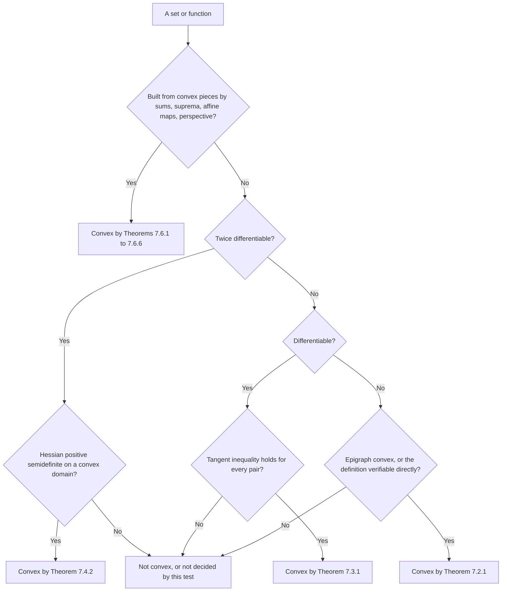

# Convex Optimization

> [Mathematics](../../README.md) › [Optimization](../README.md) · Level: Advanced · Prerequisites: [Vectors](../../08-linear-algebra/01-vectors/README.md), [Matrices](../../08-linear-algebra/02-matrices/README.md), [Eigenvalues and Eigenvectors](../../08-linear-algebra/07-eigenvalues-and-eigenvectors/README.md), [Inner Product Spaces](../../08-linear-algebra/08-inner-product-spaces/README.md), [Multivariable Calculus](../../07-calculus/12-multivariable-calculus/README.md), [Inequalities](../../03-algebra/03-inequalities/README.md), [Proof Techniques](../../00-foundations/04-proof-techniques/README.md), [Linear Programming](../01-linear-programming/README.md) · Estimated time: 660 min

## 1. Introduction

Optimisation is the mathematics of choosing well. A problem in *standard form* asks for the point $x$
minimising a cost $f_0(x)$ subject to constraints $f_i(x)\le0$ and $h_j(x)=0$; diet planning, bridge design,
portfolio selection and neural-network training are instances.

General nonlinear optimisation is hopeless in the worst case: deciding whether a smooth function has a local
minimum below a given value can encode combinatorial search, and every method can be fooled by a suitable
landscape. Convex optimisation is the part of the subject that is not hopeless, and one structural property is
responsible: the feasible set has no holes and the objective has no valleys.

* **Is a candidate optimal?** Every local minimiser is global (Theorem 7.5.2), and multipliers satisfying KKT
  certify optimality with no search (Theorem 7.10.1).
* **How large is the duality gap?** The dual always gives a lower bound, and under Slater's condition it is
  exact (Theorem 7.9.2).
* **How fast can a method converge?** Gradient descent with step $1/L$ is within $O(1/k)$ after $k$ steps
  (Theorem 7.12.2), with an explicit constant.

Sections 7.1–7.7 build the geometry and catalogue the four standard families; Sections 7.8–7.10 develop duality
and KKT with a fully cross-checked example; Section 7.11 treats nondifferentiable functions; Section 7.12 proves
the $O(1/k)$ rate; Section 7.13 mentions proximal methods.

Two warnings. Convexity is a property of the *pair* (objective, feasible set). Minimising $(x-\tfrac12)^2$ over
the nonconvex set $\lvert x\rvert\ge1$ has a convex objective and a local minimum at $x=-1$ that is not global. And
the theory gives optimality *conditions*, not algorithms; a certificate is useful only if it can be computed.

## 2. Prerequisites

**Linear algebra.** Vectors, matrices, eigenvalues of symmetric matrices, the spectral theorem, positive
semidefiniteness and quadratic forms $x^{\mathsf T}Ax$: every second-order argument is a statement about the
Hessian. See [Vectors](../../08-linear-algebra/01-vectors/README.md),
[Matrices](../../08-linear-algebra/02-matrices/README.md),
[Eigenvalues and Eigenvectors](../../08-linear-algebra/07-eigenvalues-and-eigenvectors/README.md) and
[Inner Product Spaces](../../08-linear-algebra/08-inner-product-spaces/README.md).

**Multivariable calculus.** Partial derivatives, the gradient, the Hessian, the chain rule, and the second-order
Taylor expansion; the first-order characterisation is proved by letting a parameter tend to zero in a difference
quotient. See [Multivariable Calculus](../../07-calculus/12-multivariable-calculus/README.md).

**One-variable convexity.** That $f''\ge0$ implies convexity, and that convexity is equivalent to monotone secant
slopes. Both are proved in [Differentiation](../../14-real-analysis/04-differentiation/README.md); Lemma 7.4.1
below recalls the argument.

**Inequalities, proof technique, linear programming.** Cauchy–Schwarz, the triangle inequality, completing the
square; induction and contradiction; feasible regions, vertices and LP duality, the model for Section 7.8. See
[Inequalities](../../03-algebra/03-inequalities/README.md),
[Proof Techniques](../../00-foundations/04-proof-techniques/README.md) and
[Linear Programming](../01-linear-programming/README.md).

## 3. Learning Objectives

By the end of this tutorial you will be able to

1. decide whether a subset of $\mathbb{R}^n$ is convex, by definition, intersection, or affine mapping;
2. use the equivalent forms of convexity: Jensen, epigraph, monotone slopes;
3. prove both directions of the first-order characterisation and derive inequalities such as $e^x\ge1+x$;
4. prove both directions of the second-order characterisation, including the reduction to a line;
5. prove that every local minimiser is global, and deduce optimality, convexity of the optimal set, and
   uniqueness under strict convexity;
6. apply the convexity-preserving operations and justify each;
7. recognise an LP, a convex QP, an SOCP and an SDP, and reformulate problems into each;
8. form the Lagrangian, compute the dual function, and prove weak duality;
9. state Slater's condition and give a convex problem where strong duality fails;
10. write and use the KKT conditions, and solve a constrained QP completely;
11. compute subgradients, use $0\in\partial f(x^\star)$, and state the $O(1/\sqrt k)$ rate;
12. prove the $O(1/k)$ rate of gradient descent with step $1/L$, and explain proximal methods.

## 4. Intuition

**A landscape with one basin.** Picture the graph of $f$ as a landscape with altitude $f(x)$. A general
landscape has many valleys at different depths, and finding the deepest requires visiting them all. A convex
landscape is a single bowl: water poured anywhere runs to the same place, and "locally lowest" is the same as
"lowest". That is Theorem 7.5.2, and it is why an algorithm that keeps descending cannot get trapped.

**Convexity is about chords, not curves.** A set is convex when the segment joining any two of its points stays
inside. A function is convex when, along every segment, the graph lies *below* the chord — the chord being the
pessimistic forecast from the endpoints. Concavity reverses the inequality and describes $\log x$ and entropy.

**Tangents as global supports.** For a differentiable convex function the tangent line at any point lies below
the whole graph: a local object, the gradient at one point, controls the function globally. That inequality,
$f(y)\ge f(x)+\nabla f(x)^{\mathsf T}(y-x)$, proves that stationary points are global minima, bounds the
progress of gradient descent, and defines subgradients.

**Prices as multipliers.** The multiplier $\lambda_i$ of $f_i(x)\le0$ is the rate at which the optimal value
improves when that constraint is relaxed by one unit — a shadow price. Complementary slackness,
$\lambda_if_i(x^\star)=0$, says a constraint either binds or is free, never both irrelevant and expensive.

**Certificates rather than search.** To convince someone that $x^\star$ solves a convex problem you exhibit
multipliers satisfying KKT; anyone can check them in polynomial time. Hence the use of convex models in
safety-critical engineering, and the interest of the dual even when the primal is easy.

## 5. Formal Definition

Throughout, $\mathbb{R}^n$ carries $\langle x,y\rangle = x^{\mathsf T}y = \sum_ix_iy_i$ and
$\lVert x\rVert = \langle x,x\rangle^{1/2}$.

**Definition 5.1 (convex combination).** $z$ is a convex combination of $x_1,\dots,x_k$ if
$z=\sum_{i=1}^k\theta_ix_i$ with $\theta_i\ge0$ and $\sum_i\theta_i=1$. For $k=2$ this is
$z=\theta x_1+(1-\theta)x_2$ with $\theta\in[0,1]$.

**Definition 5.2 (convex set).** $C\subseteq\mathbb{R}^n$ is *convex* if for all $x,y\in C$ and
$\theta\in[0,1]$, $\theta x+(1-\theta)y\in C$. The empty set and singletons are convex; so is
$\mathbb{R}^n$.

**Definition 5.3 (convex function).** Let $f:\mathbb{R}^n\to\mathbb{R}\cup\{+\infty\}$ and
$\operatorname{dom}f=\{x:f(x)<+\infty\}$. Then $f$ is *convex* if $\operatorname{dom}f$ is convex and
$f(\theta x+(1-\theta)y)\le\theta f(x)+(1-\theta)f(y)$ for all $x,y\in\operatorname{dom}f$ and
$\theta\in[0,1]$; *strictly convex* if the inequality is strict when $x\neq y$ and $0<\theta<1$; and
*$\mu$-strongly convex* if
$$
f(\theta x+(1-\theta)y)\le\theta f(x)+(1-\theta)f(y)-\tfrac{\mu}{2}\theta(1-\theta)\lVert x-y\rVert^2 .
$$
$g$ is *concave* when $-g$ is convex; $f$ is *proper* if it is finite somewhere and never $-\infty$.

**Definition 5.4 (epigraph, sublevel set).** $\operatorname{epi}f=\{(x,t):f(x)\le t\}$ and
$S_\alpha=\{x:f(x)\le\alpha\}$.

**Definition 5.5 (indicator).** $I_C(x)=0$ for $x\in C$ and $+\infty$ otherwise. Then
$\min_{x\in C}f(x)=\min_x\bigl(f(x)+I_C(x)\bigr)$, and $I_C$ is convex exactly when $C$ is.

**Definition 5.6 (standard form).** A *convex problem in standard form* is
$$
\operatorname{minimise}\ f_0(x)\quad\operatorname{subject\ to}\ f_i(x)\le0\ (i\le m),\quad h_j(x)=0\ (j\le p),
$$
with $f_0,\dots,f_m$ convex and $h_1,\dots,h_p$ affine. Its feasible set is $\mathcal{F}$ and its optimal value
$p^\star=\inf_{x\in\mathcal{F}}f_0(x)$, with $p^\star=+\infty$ if $\mathcal{F}=\varnothing$; $x^\star$ is
*optimal* if $f_0(x^\star)=p^\star$, and *strictly feasible* if $f_i(x)<0$ for all $i$ and $h_j(x)=0$ for
all $j$.

**Definition 5.7 (Lagrangian, dual).** With $\lambda\in\mathbb{R}^m$ and $\nu\in\mathbb{R}^p$,
$$
L(x,\lambda,\nu)=f_0(x)+\sum_{i=1}^m\lambda_if_i(x)+\sum_{j=1}^p\nu_jh_j(x),\qquad
g(\lambda,\nu)=\inf_xL(x,\lambda,\nu).
$$
The *dual problem* maximises $g$ over $\lambda\succeq0$ (componentwise), and $d^\star$ is its optimal value.

**Definition 5.8 (smoothness).** $f$ is *$L$-smooth* on convex $C$ if
$\lVert\nabla f(x)-\nabla f(y)\rVert\le L\lVert x-y\rVert$ for all $x,y\in C$. If $f$ is twice
differentiable this holds when $\lVert\nabla^2f\rVert\le L$ in the operator norm.

**Definition 5.9 (subgradient).** For convex proper $f$, $g$ is a *subgradient* at $x\in\operatorname{dom}f$
if $f(y)\ge f(x)+\langle g,y-x\rangle$ for all $y$. The set of such $g$ is $\partial f(x)$; it may be empty at
boundary points.

## 6. Mathematical Notation

| Symbol | Read as | Meaning |
|---|---|---|
| $x,y,z$ | vectors in $\mathbb{R}^n$ | column vectors, $x_i$ the $i$-th coordinate |
| $\langle x,y\rangle$, $x^{\mathsf T}y$ | inner product | $\sum_ix_iy_i$ |
| $\lVert x\rVert$ | Euclidean norm | $\langle x,x\rangle^{1/2}$ |
| $\operatorname{dom}f$ | domain | $\{x:f(x)<+\infty\}$ |
| $\operatorname{epi}f$ | epigraph | $\{(x,t):f(x)\le t\}$ |
| $\nabla f(x)$, $\nabla^2f(x)$ | gradient, Hessian | first and second derivatives |
| $A\succeq0$, $A\succ0$ | positive semidefinite, definite | $v^{\mathsf T}Av\ge0$, resp. $>0$ for $v\neq0$ |
| $A\preceq B$ | Loewner order | $B-A\succeq0$ |
| $\theta$ | theta | convex-combination weight in $[0,1]$ |
| $p^\star$, $d^\star$ | primal, dual optimal value | $\inf$ primal, $\sup$ dual |
| $x^\star$ | optimal point | $f_0(x^\star)=p^\star$ |
| $\lambda,\nu$ | multipliers | $\lambda\succeq0$ for inequalities, $\nu$ free for equalities |
| $L(x,\lambda,\nu)$ | Lagrangian | $f_0+\sum\lambda_if_i+\sum\nu_jh_j$ |
| $g(\lambda,\nu)$ | dual function | $\inf_xL$ |
| $\partial f(x)$ | subdifferential | set of subgradients |
| $\operatorname{prox}_h(v)$ | proximal operator | $\arg\min_u\bigl(h(u)+\tfrac12\lVert u-v\rVert^2\bigr)$ |
| $\mu$, $L$, $\kappa$ | strong-convexity modulus, smoothness, condition number | $\kappa=L/\mu$ |
| $\alpha$ | step size | also written $\eta$ or $t$ elsewhere |
| $\mathbb{S}^n_+$ | positive semidefinite cone | $\{X\in\mathbb{S}^n:X\succeq0\}$ |
| $x\preceq y$ | componentwise order | $x_i\le y_i$ for all $i$ |

## 7. Core Concepts

### 7.1 Convex Sets

Most convex sets are convex for one of three reasons: they are defined by linear inequalities, they are
intersections of simpler convex sets, or they are affine images or preimages of convex sets.

* *Halfspaces* $\{x:a^{\mathsf T}x\le b\}$: if $a^{\mathsf T}x,a^{\mathsf T}y\le b$ then
  $a^{\mathsf T}(\theta x+(1-\theta)y)\le b$, because a convex combination of two numbers at most $b$ is at
  most $b$. Hyperplanes and *polyhedra* $\{x:Ax\preceq b,\ Gx=d\}$ are intersections of these.
* *Balls* $B(c,r)$: by the triangle inequality,
  $\lVert\theta x+(1-\theta)y-c\rVert\le\theta\lVert x-c\rVert+(1-\theta)\lVert y-c\rVert\le r$.
* *The positive orthant* $\mathbb{R}^n_+$ and the probability simplex $\{x\succeq0:\mathbf{1}^{\mathsf T}x=1\}$.
* *The Lorentz cone* $Q=\{(x,t):\lVert x\rVert\le t\}$:
  $\lVert\theta x_1+(1-\theta)x_2\rVert\le\theta\lVert x_1\rVert+(1-\theta)\lVert x_2\rVert\le\theta t_1+(1-\theta)t_2$.
* *The PSD cone* $\mathbb{S}^n_+$: $X\succeq0$ means $v^{\mathsf T}Xv\ge0$ for every $v$, an intersection of
  halfspaces in $X$.

Non-examples: the unit circle (the segment from $(1,0)$ to $(-1,0)$ passes through $0$), $\mathbb{Z}$, and
$\{x:x_1\ge1\}\cup\{x:x_1\le-1\}$ (it contains $-2$ and $2$ but not $0$). A nonnegative combination stays in a
convex set only when the coefficients sum to one.

**Lemma 7.1.1 (intersections, affine images).** If $\{C_\alpha\}$ are convex then $\bigcap_\alpha C_\alpha$ is
convex; if $A$ is a matrix then $\{Ax+b:x\in C\}$ and $\{x:Ax+b\in C\}$ are convex for convex $C$.

*Proof.* For the intersection, $x,y\in\bigcap_\alpha C_\alpha$ implies $\theta x+(1-\theta)y\in C_\alpha$ for
every $\alpha$. For the image, $\theta(Ax_1+b)+(1-\theta)(Ax_2+b)=A(\theta x_1+(1-\theta)x_2)+b$ with the
bracket in $C$. For the preimage, $A(\theta x_1+(1-\theta)x_2)+b=\theta(Ax_1+b)+(1-\theta)(Ax_2+b)\in C$.
$\blacksquare$

Every polyhedron and every spectrahedron $\{X\succeq0:\langle A_i,X\rangle=b_i\}$ is convex by this lemma.

### 7.2 Equivalent Forms of Convexity

**Theorem 7.2.1.** Let $f$ be proper with $\operatorname{dom}f$ convex. The following are equivalent:
(i) $f$ is convex; (ii) Jensen's inequality $f\bigl(\sum_i\theta_ix_i\bigr)\le\sum_i\theta_if(x_i)$ holds for
every finite convex combination; (iii) $\operatorname{epi}f$ is convex.

*Proof.* (i)$\Rightarrow$(ii) by induction on $k$: for $k\ge3$ with $\theta_k<1$, put
$s=1-\theta_k>0$ and $z=\sum_{i<k}(\theta_i/s)x_i$; then
$$
f\Bigl(\sum_{i\le k}\theta_ix_i\Bigr)=f(sz+\theta_kx_k)\le sf(z)+\theta_kf(x_k)\le s\sum_{i<k}\frac{\theta_i}{s}f(x_i)+\theta_kf(x_k).
$$
(ii)$\Rightarrow$(iii): if $f(x)\le s$ and $f(y)\le t$ then
$f(\theta x+(1-\theta)y)\le\theta s+(1-\theta)t$, so $\operatorname{epi}f$ contains the segment.
(iii)$\Rightarrow$(i): the points $(x,f(x))$ and $(y,f(y))$ lie in $\operatorname{epi}f$, hence so does
$\bigl(\theta x+(1-\theta)y,\ \theta f(x)+(1-\theta)f(y)\bigr)$, which is the defining inequality.
$\blacksquare$

This is why convex functions are studied through sets: a convex function is one whose epigraph is convex, and
the indicator $I_C$ has epigraph $C\times[0,\infty)$.

### 7.3 The First-Order Characterisation

**Theorem 7.3.1.** Let $f$ be differentiable with convex domain. Then $f$ is convex if and only if
$$
f(y)\ge f(x)+\nabla f(x)^{\mathsf T}(y-x)\qquad\text{for all }x,y\in\operatorname{dom}f .
$$

*Proof.* ($\Rightarrow$) Fix $x,y$ and $t\in(0,1]$. Convexity gives
$f(x+t(y-x))\le(1-t)f(x)+tf(y)$, hence
$$
f(y)\ge f(x)+\frac{f(x+t(y-x))-f(x)}{t}.
$$
The fraction tends to $\nabla f(x)^{\mathsf T}(y-x)$ as $t\downarrow0$, and the inequality survives the limit.

($\Leftarrow$) Fix $x,y$ and put $g(t)=f(x+t(y-x))$ on $[0,1]$, so $g'(t)=\nabla f(x+t(y-x))^{\mathsf T}(y-x)$.
Apply the hypothesis at $u=x+t(y-x)$ with target $x$, so that $x-u=-t(y-x)$:
$$
f(x)\ge f(u)-t\,\nabla f(u)^{\mathsf T}(y-x)=g(t)-tg'(t),\qquad\text{that is}\qquad g'(t)\ge\frac{g(t)-g(0)}{t}.
$$
For $\varphi(t)=(g(t)-g(0))/t$ on $(0,1]$ this gives
$\varphi'(t)=\bigl(g'(t)-\varphi(t)\bigr)/t\ge0$, so $\varphi$ is nondecreasing and
$\varphi(t)\le\varphi(1)=g(1)-g(0)$. Multiplying by $t\le1$ gives $g(t)\le(1-t)g(0)+tg(1)$, which is the
required convexity. $\blacksquare$

Geometrically: the graph lies above every tangent plane, so each tangent plane is a global underestimator.

**Corollary 7.3.2.** Under the same hypotheses, $f$ is strictly convex if and only if the inequality is strict
for $x\neq y$, and $\mu$-strongly convex if and only if
$$
f(y)\ge f(x)+\nabla f(x)^{\mathsf T}(y-x)+\tfrac{\mu}{2}\lVert y-x\rVert^2\qquad\text{for all }x,y .
$$
The second claim applies Theorem 7.3.1 to $f-\tfrac{\mu}{2}\lVert\cdot\rVert^2$, whose gradient is
$\nabla f(x)-\mu x$.

**Example 7.3.3.** With $f(x)=e^x$ at the point $0$: $e^y\ge1+y$ for all $y$, equality only at $0$. With
$f(x)=-\log x$ at $x=1$: $-\log y\ge-(y-1)$, that is $\log y\le y-1$. Both are "the tangent supports the
graph". Conversely, midpoint convexity of $t\mapsto t^2$ gives $\bigl(\tfrac{a+b}{2}\bigr)^2\le\tfrac{a^2+b^2}{2}$,
which expands to $2ab\le a^2+b^2$: convexity is often a known inequality in disguise.

### 7.4 The Second-Order Characterisation

**Lemma 7.4.1 (one variable).** A differentiable $g:(a,b)\to\mathbb{R}$ is convex if and only if $g'$ is
nondecreasing; if $g$ is twice differentiable, if and only if $g''\ge0$.

*Proof.* If $g$ is convex and $s<t<u$, the definition with $t$ as the intermediate point gives the
secant-slope inequality $\dfrac{g(t)-g(s)}{t-s}\le\dfrac{g(u)-g(t)}{u-t}$. Letting $u\downarrow t$ gives
$\dfrac{g(t)-g(s)}{t-s}\le g'(t)$, and letting $s\uparrow t$ in the same inequality gives
$g'(t)\le\dfrac{g(u)-g(t)}{u-t}$; hence $g'(s)\le g'(t)$. Conversely, if $g'$ is nondecreasing, the mean value
theorem gives $\xi_1\in(s,t)$ and $\xi_2\in(t,u)$ with
$\dfrac{g(t)-g(s)}{t-s}=g'(\xi_1)\le g'(\xi_2)=\dfrac{g(u)-g(t)}{u-t}$, which is the secant inequality;
setting $s=0$, $t=\theta$, $u=1$ and rearranging gives convexity. Finally $g'$ is nondecreasing exactly when
$g''\ge0$, by the mean value theorem applied to $g'$. $\blacksquare$

**Theorem 7.4.2.** Let $f$ be twice continuously differentiable on an open convex $C\subseteq\mathbb{R}^n$.
Then $f$ is convex on $C$ if and only if $\nabla^2f(x)\succeq0$ for every $x\in C$.

*Proof.* ($\Rightarrow$) Fix $x\in C$ and $v\neq0$. Choose $\varepsilon>0$ with $x+tv\in C$ for
$\lvert t\rvert<\varepsilon$ and set $g(t)=f(x+tv)$. Then $g$ is convex because
$g(\theta s+(1-\theta)r)=f(\theta(x+sv)+(1-\theta)(x+rv))\le\theta g(s)+(1-\theta)g(r)$, and it is twice
differentiable with $g''(t)=v^{\mathsf T}\nabla^2f(x+tv)v$. By Lemma 7.4.1, $0\le g''(0)=v^{\mathsf T}\nabla^2f(x)v$;
since $v$ is arbitrary, $\nabla^2f(x)\succeq0$.

($\Leftarrow$) If $\nabla^2f\succeq0$ on $C$, then for $x,y\in C$ the function $g(t)=f(x+t(y-x))$ has
$g''(t)=(y-x)^{\mathsf T}\nabla^2f(x+t(y-x))(y-x)\ge0$, so $g$ is convex by Lemma 7.4.1 and
$g(\theta)\le(1-\theta)g(0)+\theta g(1)$, which is the defining inequality for $f$. $\blacksquare$

**Warning.** Semidefiniteness gives convexity, not strict convexity: $f(x)=x^4$ has $f''(0)=0$ and is strictly
convex, while $f(x_1,x_2)=x_1^2$ has a singular Hessian and is convex but not strictly. Positive definiteness
at a point gives strict convexity only locally.

**Example 7.4.3.** For $f(x,y)=x^2+2xy+3y^2-4x+y$,
$$
\nabla f=\binom{2x+2y-4}{2x+6y+1},\qquad \nabla^2f=\begin{pmatrix}2&2\\2&6\end{pmatrix}.
$$
The leading minors are $2>0$ and $2\cdot6-2\cdot2=8>0$, so the Hessian is positive definite and $f$ is
strictly convex. Solving $\nabla f=0$ gives $x=2-y$ and $2(2-y)+6y+1=0$, so $y=-\tfrac54$,
$x=\tfrac{13}{4}$, and
$f\bigl(\tfrac{13}{4},-\tfrac54\bigr)=\tfrac{169-130+75}{16}-13-\tfrac54=\tfrac{114}{16}-\tfrac{57}{4}=-\tfrac{57}{8}$.
By Corollary 7.5.3 this stationary point is the unique global minimiser.

### 7.5 Every Local Minimum Is Global

**Definition 7.5.1.** $x\in\mathcal{F}$ is a *local minimiser* of $f_0$ over $\mathcal{F}$ if some $r>0$ has
$f_0(x)\le f_0(z)$ for every $z\in\mathcal{F}$ with $\lVert z-x\rVert\le r$; it is a *global minimiser* if
$f_0(x)\le f_0(z)$ for every $z\in\mathcal{F}$.

**Theorem 7.5.2.** Let $f_0$ be convex and let $\mathcal{F}$ be a convex set on which $f_0$ is finite. Then
every local minimiser of $f_0$ over $\mathcal{F}$ is global.

*Proof.* Let $x$ be a local minimiser with radius $r$ and suppose $y\in\mathcal{F}$ has $f_0(y)<f_0(x)$. For
$\theta\in(0,1]$ put $z_\theta=(1-\theta)x+\theta y\in\mathcal{F}$; then
$\lVert z_\theta-x\rVert=\theta\lVert y-x\rVert\le r$ for $\theta$ small, so $f_0(x)\le f_0(z_\theta)$.
But convexity gives $f_0(z_\theta)\le(1-\theta)f_0(x)+\theta f_0(y)<f_0(x)$, a contradiction. $\blacksquare$

Both hypotheses are needed. $f(x)=x^4-x^2$ has local minima at $\pm1/\sqrt2$ with value $-1/4$ and a local
maximum at $0$: the objective is not convex. And $f_0(x)=(x-\tfrac12)^2$ over
$\mathcal{F}=\{x:\lvert x\rvert\ge1\}$ has local minima at $-1$ (value $2.25$) and $1$ (value $0.25$): the
feasible set is not convex.

**Corollary 7.5.3 (optimality condition).** Let $f_0$ be convex and differentiable on the convex set
$\mathcal{F}$. Then $x^\star\in\mathcal{F}$ minimises $f_0$ over $\mathcal{F}$ if and only if
$$
\nabla f_0(x^\star)^{\mathsf T}(y-x^\star)\ge0\qquad\text{for all }y\in\mathcal{F}.
$$
In particular, for $\mathcal{F}=\mathbb{R}^n$, optimality is equivalent to $\nabla f_0(x^\star)=0$.

*Proof.* If the inequality holds, then $f_0(y)\ge f_0(x^\star)+\nabla f_0(x^\star)^{\mathsf T}(y-x^\star)\ge f_0(x^\star)$
for all feasible $y$ by Theorem 7.3.1. Conversely, if $x^\star$ is optimal, then
$x^\star+t(y-x^\star)\in\mathcal{F}$ for $t\in(0,1]$ and $f_0$ there is at least $f_0(x^\star)$; subtract,
divide by $t$ and let $t\downarrow0$. For $\mathcal{F}=\mathbb{R}^n$ apply the inequality to $y=x^\star\pm v$.
$\blacksquare$

The geometric reading: $-\nabla f_0(x^\star)$ must point out of the feasible set. At an interior optimum the
gradient vanishes; at a boundary optimum the gradient is balanced by the constraints, which is what the
multipliers of Section 7.10 quantify.

**Corollary 7.5.4.** The optimal set $\mathcal{F}^\star$ is convex, and it is a single point when $f_0$ is
strictly convex.

*Proof.* If $x,y\in\mathcal{F}^\star$ then
$f_0(\theta x+(1-\theta)y)\le\theta p^\star+(1-\theta)p^\star=p^\star$, with the reverse inequality because
$p^\star$ is minimal, so the combination is optimal. If $f_0$ is strictly convex and $x\neq y$ were both
optimal, the same display would be strict, contradicting minimality. $\blacksquare$

**Remark 7.5.5.** The converse fails: $f(x)=x^3$ is not convex and has no local minimiser, so "every local
minimiser is global" holds vacuously. Functions with convex sublevel sets (*quasiconvex* functions) share the
property without being convex, and the algorithms of this chapter do not apply to them.

### 7.6 Operations That Preserve Convexity

**Theorem 7.6.1 (nonnegative sums).** If $f_1,\dots,f_k$ are convex and $w_i\ge0$ then $\sum_iw_if_i$ is
convex.

*Proof.* $\sum_iw_if_i(\theta x+(1-\theta)y)\le\sum_iw_i\bigl(\theta f_i(x)+(1-\theta)f_i(y)\bigr)=\theta f(x)+(1-\theta)f(y)$.
$\blacksquare$

The weights must be nonnegative: $x^2-2x^2=-x^2$ is concave.

**Theorem 7.6.2 (affine substitution).** If $f$ is convex then $g(x)=f(Ax+b)$ is convex.

*Proof.* $g(\theta x+(1-\theta)y)=f\bigl(\theta(Ax+b)+(1-\theta)(Ay+b)\bigr)\le\theta g(x)+(1-\theta)g(y)$.
$\blacksquare$

Hence $\lVert Ax-b\rVert^2+\lambda\lVert x\rVert^2$ is convex: both terms are affine compositions of
$\lVert\cdot\rVert^2$.

**Theorem 7.6.3 (pointwise supremum).** For any family $\{f_\alpha\}$ of convex functions, $f=\sup_\alpha f_\alpha$
is convex.

*Proof.* $f_\alpha(\theta x+(1-\theta)y)\le\theta f_\alpha(x)+(1-\theta)f_\alpha(y)\le\theta f(x)+(1-\theta)f(y)$,
and the supremum over $\alpha$ preserves the bound. $\blacksquare$

The family may be infinite and the supremum need not be attained. Consequences: $\max_i(a_i^{\mathsf T}x+b_i)$
is convex (piecewise-linear), and so is
$$
\lambda_{\max}(X)=\sup_{\lVert u\rVert=1}u^{\mathsf T}Xu,
$$
because each $X\mapsto u^{\mathsf T}Xu$ is linear.

**Theorem 7.6.4 (partial minimisation).** If $f(x,y)$ is jointly convex then $g(x)=\inf_yf(x,y)$ is convex.

*Proof.* Let $\varepsilon>0$ and choose $y_i$ with $f(x_i,y_i)\le g(x_i)+\varepsilon$. Then
$$
g(\theta x_1+(1-\theta)x_2)\le f\bigl(\theta x_1+(1-\theta)x_2,\theta y_1+(1-\theta)y_2\bigr)\le\theta f(x_1,y_1)+(1-\theta)f(x_2,y_2)\le\theta g(x_1)+(1-\theta)g(x_2)+\varepsilon,
$$
and $\varepsilon\downarrow0$. $\blacksquare$

**Theorem 7.6.5 (perspective).** If $f$ is convex then $g(x,t)=tf(x/t)$ is convex on $t>0$.

*Proof.* Put $T=\theta t_1+(1-\theta)t_2>0$. The point $(\theta x_1+(1-\theta)x_2)/T$ equals
$\frac{\theta t_1}{T}\frac{x_1}{t_1}+\frac{(1-\theta)t_2}{T}\frac{x_2}{t_2}$, a convex combination, so
$$
g(\theta x_1+(1-\theta)x_2,T)=Tf\Bigl(\frac{\theta x_1+(1-\theta)x_2}{T}\Bigr)\le T\Bigl[\frac{\theta t_1}{T}f\Bigl(\frac{x_1}{t_1}\Bigr)+\frac{(1-\theta)t_2}{T}f\Bigl(\frac{x_2}{t_2}\Bigr)\Bigr]=\theta g(x_1,t_1)+(1-\theta)g(x_2,t_2). \ \blacksquare
$$

With $f(u)=u^2$ this gives $x^2/t$ convex on $t>0$, whose Hessian
$\begin{pmatrix}2/t&-2x/t^2\\-2x/t^2&2x^2/t^3\end{pmatrix}$ has determinant $0$: the function is affine along
rays through the origin, so one eigenvalue vanishes.

**Theorem 7.6.6 (monotone composition).** If $h$ is convex and nondecreasing and $g$ is convex, then $h\circ g$
is convex; if $h$ is convex and nonincreasing and $g$ is concave, then $h\circ g$ is convex.

*Proof.* $h(g(\theta x+(1-\theta)y))\le h(\theta g(x)+(1-\theta)g(y))\le\theta h(g(x))+(1-\theta)h(g(y))$;
the first inequality uses monotonicity and convexity of $g$, the second convexity of $h$. The second claim is
the same argument with both inequalities reversed. $\blacksquare$

Thus $\exp(g)$ is convex for convex $g$, $1/g$ is convex for concave positive $g$, and
$\log\sum_ie^{a_i^{\mathsf T}x}$ is convex: it is $\log$ (concave, increasing) of a sum of exponentials of
linear functions. That function, *log-sum-exp*, is the standard smooth surrogate for $\max_i a_i^{\mathsf T}x$.

**What fails.** Products of convex functions need not be convex: $x^2(x-1)^2$ has second derivative
$12x^2-12x+2$, which is $-1$ at $x=\tfrac12$. Pointwise minima need not be convex:
$\min\{x^2,(x-1)^2\}$ equals $0$ at $0$ and $1$ but $\tfrac14$ at $\tfrac12$. Maxima are safe, minima are not.

### 7.7 The Standard Problem Classes

**Linear program.** Minimise $c^{\mathsf T}x$ subject to $Gx\preceq h$, $Ax=b$: affine data, polyhedral
feasible set. *Instance:* minimise $-x_1-x_2$ subject to $x_1+2x_2\le4$, $4x_1+2x_2\le12$, $x\succeq0$. The
vertices are $(0,0)$, $(3,0)$, $(0,2)$, $(8/3,2/3)$, where the objective equals $0,-3,-2,-10/3$; the optimum
is $-10/3$ at $(8/3,2/3)$.

**Convex quadratic program.** Minimise $\tfrac12x^{\mathsf T}Px+q^{\mathsf T}x+r$ subject to $Gx\preceq h$,
$Ax=b$, with $P\succeq0$. *Instance:* minimise $x_1^2+2x_2^2-2x_1-8x_2$ subject to $x_1+x_2\le2$. The
unconstrained minimiser is $(1,2)$ with value $-9$, but $1+2>2$. On the line $x_2=2-x_1$,
$$
x_1^2+2(2-x_1)^2-2x_1-8(2-x_1)=3x_1^2-2x_1-8,
$$
minimised at $x_1=\tfrac13$, giving $x_2=\tfrac53$ and value $\tfrac13-\tfrac23-8=-\tfrac{25}{3}$. Section 7.10
re-derives this and confirms $\lambda=\tfrac43>0$.

**Second-order cone program.** Minimise $f^{\mathsf T}x$ subject to $\lVert A_ix+b_i\rVert_2\le c_i^{\mathsf T}x+d_i$.
*Instance:* minimise $t$ subject to $\lVert x\rVert\le t$ and $x_1+x_2=2$. Cauchy–Schwarz gives
$2=x_1+x_2\le\sqrt2\lVert x\rVert$, so $t\ge\sqrt2$, with equality at $x=(1,1)$.

**Semidefinite program.** Minimise $\langle C,X\rangle$ subject to $\langle A_i,X\rangle=b_i$ and $X\succeq0$,
with $X$ symmetric; equivalently minimise $c^{\mathsf T}x$ subject to $\sum_ix_iA_i\preceq B$. *Instance:*
$C=\begin{pmatrix}0&-1\\-1&0\end{pmatrix}$ with $X_{11}=X_{22}=1$ and $X\succeq0$. The objective is $-2X_{12}$,
and positive semidefiniteness with unit diagonal gives $\lvert X_{12}\rvert\le\sqrt{X_{11}X_{22}}=1$. The
optimum is $-2$ at $X=\begin{pmatrix}1&1\\1&1\end{pmatrix}$, whose eigenvalues are $2$ and $0$.

**Hierarchy.** $\text{LP}\subsetneq\text{QP}\subsetneq\text{SOCP}\subsetneq\text{SDP}$. LP is QP with $P=0$; a
convex QP becomes an SOCP after factoring $P=FF^{\mathsf T}$ and writing
$\tfrac12\lVert F^{\mathsf T}x\rVert^2\le t-q^{\mathsf T}x-r$ as a rotated cone constraint; an SOCP becomes an
SDP through $\lVert x\rVert\le t\Leftrightarrow\begin{pmatrix}tI&x\\x^{\mathsf T}&t\end{pmatrix}\succeq0$
(Schur complement). Each inclusion is strict, and each level buys modelling power at the price of speed.

| Family | Objective | Constraints | Typical use |
|---|---|---|---|
| LP | affine | affine | scheduling, transport, blending |
| QP | convex quadratic | affine | portfolio, bounded least squares, SVM dual |
| SOCP | affine | affine plus norm bounds | robust regression, filter design |
| SDP | affine in $X$ | affine plus $X\succeq0$ | relaxations, linear matrix inequalities |

### 7.8 Duality: the Lagrangian and Weak Duality

**Lemma 7.8.1.** For any problem, convex or not, $g(\lambda,\nu)=\inf_xL(x,\lambda,\nu)$ is concave in
$(\lambda,\nu)$, and $g(\lambda,\nu)\le p^\star$ whenever $\lambda\succeq0$.

*Proof.* For fixed $x$ the map $(\lambda,\nu)\mapsto L(x,\lambda,\nu)$ is affine, and an infimum of affine
functions is concave (Theorem 7.6.3 applied to $-g$). If $x$ is feasible and $\lambda\succeq0$ then
$\lambda_if_i(x)\le0$ and $\nu_jh_j(x)=0$, so $L(x,\lambda,\nu)\le f_0(x)$; taking infima gives
$g(\lambda,\nu)\le p^\star$. $\blacksquare$

**Theorem 7.8.2 (weak duality).** $d^\star\le p^\star$; the difference $p^\star-d^\star\ge0$ is the *duality
gap*.

*Proof.* Every dual feasible point satisfies $g(\lambda,\nu)\le p^\star$; take the supremum. If either problem
is infeasible the inequality is vacuous. $\blacksquare$

Weak duality certifies bounds: a feasible primal point with value $v$ and a feasible dual point with value
$w$ give $p^\star\in[w,v]$, and $v-w$ bounds the error of the incumbent $v$.

**Example 7.8.3.** For $\min\{x_1^2+x_2^2:x_1+2x_2\ge5,\ x_1\ge0\}$, written with multipliers on
$5-x_1-2x_2\le0$ and $-x_1\le0$,
$$
L=x_1^2+x_2^2-\lambda_1(x_1+2x_2-5)-\lambda_2x_1,\qquad
g(\lambda)=-\frac{(\lambda_1+\lambda_2)^2}{4}-\lambda_1^2+5\lambda_1,
$$
obtained by minimising the strictly convex quadratic in $x$. Since
$\partial g/\partial\lambda_2=-(\lambda_1+\lambda_2)/2\le0$ with equality only at $\lambda=0$, the maximum
over $\lambda_2\ge0$ is at $\lambda_2=0$. Then $g(\lambda_1,0)=-\tfrac54\lambda_1^2+5\lambda_1$ is maximal at
$\lambda_1=2$ with value $5$. The primal optimum is the projection $(1,2)$ of the origin onto the halfspace,
also with value $5$: the gap is zero.

### 7.9 Strong Duality and Slater's Condition

**Definition 7.9.1 (Slater).** The convex problem of Definition 5.6 satisfies *Slater's condition* if some
$x\in\operatorname{relint}\operatorname{dom}f_0$ has $f_i(x)<0$ for all $i$ and $h_j(x)=0$ for all $j$. If some
$f_i$ are affine, strictness is required only for the non-affine ones.

**Theorem 7.9.2 (strong duality).** If the problem is convex and satisfies Slater's condition, then
$d^\star=p^\star$; if $p^\star$ is finite the dual optimum is attained.

The proof is a separation argument. The set
$\mathcal{A}=\{(u,v,t):\exists x,\ f_i(x)\le u_i,\ h_j(x)=v_j,\ f_0(x)\le t\}$ is convex, and $(0,0,p^\star)$
lies on its boundary; a supporting hyperplane there has normal $(\lambda,\nu,1)$ with $\lambda\succeq0$, and
the hyperplane inequality is $g(\lambda,\nu)\ge p^\star$. The details are in the references of Section 16.

**Example 7.9.3.** In Example 7.8.3 the point $(2,2)$ satisfies $x_1+2x_2=6>5$ and $x_1=2>0$, so Slater holds
and indeed $d^\star=p^\star=5$.

**Example 7.9.4 (failure).** Minimise $e^{-x}$ subject to $x^2/y\le0$ and $y>0$. The objective is convex and
$x^2/y$ is convex on $y>0$ (Theorem 7.6.5 with $f(u)=u^2$). The constraint forces $x=0$, so the feasible set
is $\{(0,y):y>0\}$ and $p^\star=1$. No strictly feasible point exists, so Slater fails. For $\lambda>0$,
$$
g(\lambda)=\inf_{x,\ y>0}\Bigl(e^{-x}+\lambda\frac{x^2}{y}\Bigr)=\inf_xe^{-x}+0=0,
$$
because for $x\neq0$ the second term can be driven to $0$ by $y\to\infty$, and then $\inf_xe^{-x}=0$. Hence
$d^\star=0<1=p^\star$: the gap is a property of the problem, not of the computation.

### 7.10 The Karush–Kuhn–Tucker Conditions

**Theorem 7.10.1 (KKT).** Consider the problem of Definition 5.6 with $f_0,\dots,f_m$ differentiable and
$h_1,\dots,h_p$ affine.

*Sufficiency.* If a feasible $x^\star$ and multipliers $\lambda^\star\in\mathbb{R}^m$, $\nu^\star\in\mathbb{R}^p$
satisfy

1. *primal feasibility:* $f_i(x^\star)\le0$ and $h_j(x^\star)=0$;
2. *dual feasibility:* $\lambda^\star\succeq0$;
3. *complementary slackness:* $\lambda_i^\star f_i(x^\star)=0$ for all $i$;
4. *stationarity:* $\nabla f_0(x^\star)+\sum_i\lambda_i^\star\nabla f_i(x^\star)+\sum_j\nu_j^\star\nabla h_j(x^\star)=0$;

then $x^\star$ is optimal. This direction needs convexity of $f_0,\dots,f_m$ and affinity of the $h_j$, but no
constraint qualification.

*Necessity.* If the problem is convex, satisfies Slater's condition, and $x^\star$ is optimal, then multipliers
satisfying 1–4 exist.

*Proof of sufficiency.* Let $x$ be feasible. Since $f_0$ is convex,
$f_0(x)\ge f_0(x^\star)+\nabla f_0(x^\star)^{\mathsf T}(x-x^\star)$, so it suffices to show that the gradient
term is nonnegative. By stationarity it equals
$$
-\sum_i\lambda_i^\star\nabla f_i(x^\star)^{\mathsf T}(x-x^\star)-\sum_j\nu_j^\star\nabla h_j(x^\star)^{\mathsf T}(x-x^\star).
$$
For each $i$, convexity of $f_i$ gives
$\nabla f_i(x^\star)^{\mathsf T}(x-x^\star)\le f_i(x)-f_i(x^\star)\le-f_i(x^\star)$, hence
$-\lambda_i^\star\nabla f_i(x^\star)^{\mathsf T}(x-x^\star)\ge\lambda_i^\star f_i(x^\star)=0$ by
complementary slackness. For each $j$, affinity gives
$\nabla h_j(x^\star)^{\mathsf T}(x-x^\star)=h_j(x)-h_j(x^\star)=0$. Hence every term is nonnegative and
$f_0(x)\ge f_0(x^\star)$. $\blacksquare$

*Proof of necessity.* Under Slater, $d^\star=p^\star$ and the dual optimum is attained. For optimal
$x^\star,(\lambda^\star,\nu^\star)$,
$$
f_0(x^\star)=g(\lambda^\star,\nu^\star)=\inf_xL(x,\lambda^\star,\nu^\star)\le L(x^\star,\lambda^\star,\nu^\star)=f_0(x^\star)+\sum_i\lambda_i^\star f_i(x^\star)+\sum_j\nu_j^\star h_j(x^\star)\le f_0(x^\star),
$$
so both inequalities are equalities. The first says $x^\star$ minimises $L(\cdot,\lambda^\star,\nu^\star)$,
giving stationarity; the second says $\sum_i\lambda_i^\star f_i(x^\star)=0$, and each term is $\le0$, so each
is $0$: complementary slackness. $\blacksquare$

**Remark 7.10.2 (sign convention).** We write constraints as $f_i\le0$ and add $+\lambda_if_i$ with
$\lambda_i\ge0$. The opposite convention flips the signs. The check is always the same: a binding constraint
whose relaxation would improve the objective must have $\lambda_i>0$.

**Example 7.10.3 (worked KKT).** Solve $\min\{x_1^2+x_2^2:x_1+2x_2\ge5,\ x_1\ge0\}$.

*Setup.* The constraints are $f_1=5-x_1-2x_2\le0$ and $f_2=-x_1\le0$. The problem is convex (Hessian $2I$,
affine constraints) and $(3,3)$ is strictly feasible, so Slater holds. With
$L=x_1^2+x_2^2+\lambda_1(5-x_1-2x_2)+\lambda_2(-x_1)$, stationarity is
$$
2x_1-\lambda_1-\lambda_2=0,\qquad 2x_2-2\lambda_1=0 .
$$

*Active set.* The unconstrained minimiser $(0,0)$ is infeasible, so $\lambda_1>0$ and the first constraint
binds. With $x_1+2x_2=5$, stationarity gives $x_2=\lambda_1$ and $x_1=\tfrac12(\lambda_1+\lambda_2)$, hence
$5\lambda_1+\lambda_2=10$. If $\lambda_2=0$ then $\lambda_1=2$, $x=(1,2)$, and $x_1=1>0$ is consistent with
inactivity. If $\lambda_2>0$ then $x_1=0$, $x_2=\tfrac52$, $\lambda_1=\tfrac52$ and
$\lambda_2=10-5\lambda_1=-\tfrac52<0$, which violates dual feasibility. So $\lambda_2=0$.

*Answer.* $x^\star=(1,2)$, $\lambda^\star=(2,0)$, $p^\star=5$.

*Verification of the four conditions.* Feasibility: $1+4=5\ge5$ ✓ and $1\ge0$ ✓. Dual feasibility:
$(2,0)\succeq0$ ✓. Complementary slackness: $2\cdot0=0$ and $0\cdot(-1)=0$ ✓. Stationarity:
$(2,4)+2(-1,-2)+0=\mathbf{0}$ ✓.

*Independent check.* The projection of the origin onto the halfspace is $\tfrac{5}{1+4}(1,2)=(1,2)$ with squared
norm $5$; and Cauchy–Schwarz gives $\lVert x\rVert\sqrt5\ge x_1+2x_2\ge5$ for every feasible $x$, so
$\lVert x\rVert^2\ge5$. ✓

*Dual check and shadow price.* From Example 7.8.3, $g(2,0)=-1-4+10=5=p^\star$. Relaxing to
$x_1+2x_2\ge5-\varepsilon$ gives the projection value $(5-\varepsilon)^2/5$, whose derivative at
$\varepsilon=0$ is $-2=-\lambda_1^\star$: the multiplier is the rate of change of the optimal value. ✓

### 7.11 Subgradients

Convex functions need not be differentiable: $\lvert x\rvert$, $\max_ia_i^{\mathsf T}x$ and $\lambda_{\max}(X)$
have corners. At a corner the gradient does not exist, but the first-order inequality can still be satisfied by
a whole set of vectors.

**Definition 7.11.1.** For convex $f$ and $x\in\operatorname{dom}f$, $g$ is a *subgradient* at $x$ if
$f(y)\ge f(x)+\langle g,y-x\rangle$ for all $y$; the set of them is $\partial f(x)$, and $f$ is
*subdifferentiable* at $x$ if this set is nonempty.

**Lemma 7.11.2 (examples).**

* $f(x)=\lvert x\rvert$: $\partial f(0)=[-1,1]$, $\partial f(x)=\{\operatorname{sign}x\}$ for $x\neq0$.
* $f(x)=\max(0,x)$: $\partial f(0)=[0,1]$, and $\{1\}$, $\{0\}$ for $x>0$, $x<0$.
* $f(x)=\lVert x\rVert_2$: $\partial f(0)=\{g:\lVert g\rVert\le1\}$ and $\partial f(x)=\{x/\lVert x\rVert\}$ for $x\neq0$.
* $f(x)=\lVert x\rVert_1$: $g_i=\operatorname{sign}x_i$ where $x_i\neq0$, and $\lvert g_i\rvert\le1$ where $x_i=0$.
* $f=\max_i f_i$ with $f_i$ differentiable: $\partial f(x)=\operatorname{conv}\{\nabla f_i(x):f_i(x)=f(x)\}$.

*Proof of the first two and the last.* For $\lvert x\rvert$ at $0$ the inequality $\lvert y\rvert\ge gy$ for all
$y$ holds exactly when $\lvert g\rvert\le1$ (test $y=\pm1$). For $\max(0,x)$ at $0$ it holds exactly for
$g\in[0,1]$. For a maximum, an active $i$ gives
$f(y)\ge f_i(y)\ge f_i(x)+\nabla f_i(x)^{\mathsf T}(y-x)=f(x)+\nabla f_i(x)^{\mathsf T}(y-x)$, so active
gradients are subgradients, and so are their convex combinations because $\partial f(x)$ is convex. The reverse
inclusion is a separation argument, stated here and used in the exercises. $\blacksquare$

**Lemma 7.11.3.** If $f$ is convex and differentiable at $x$ then $\partial f(x)=\{\nabla f(x)\}$.

*Proof.* $\nabla f(x)$ is a subgradient by Theorem 7.3.1. If $g$ is a subgradient then
$f(x+tv)\ge f(x)+t\langle g,v\rangle$ for $t>0$, so $\langle g,v\rangle\le\nabla f(x)^{\mathsf T}v$; applying
this to $-v$ gives equality for all $v$, hence $g=\nabla f(x)$. $\blacksquare$

**Theorem 7.11.4 (optimality).** For proper convex $f$, $x^\star$ minimises $f$ if and only if
$0\in\partial f(x^\star)$.

*Proof.* $0\in\partial f(x^\star)$ means $f(y)\ge f(x^\star)$ for all $y$; conversely if $x^\star$ minimises
then $f(y)\ge f(x^\star)=f(x^\star)+\langle0,y-x^\star\rangle$. $\blacksquare$

With constraints the condition becomes $0\in\partial f_0(x^\star)+\sum_i\lambda_i\partial f_i(x^\star)$ with
$\lambda_i\ge0$ and $\lambda_if_i(x^\star)=0$: KKT with subdifferentials.

**Example 7.11.5.** Minimise $f(x)=\lvert x_1\rvert+2\lvert x_2\rvert$ subject to $x_1+x_2=1$. At $(1,0)$,
$\partial f=\{1\}\times[-2,2]$ contains $(1,1)$, which is proportional to the constraint normal $(1,1)$, so
$(1,0)$ is optimal with value $1$. At $(0,1)$, $\partial f=[-1,1]\times\{2\}$ contains no vector with equal
coordinates, so $(0,1)$ is not optimal.

**Theorem 7.11.6 (subgradient method).** Let $f$ be convex with minimiser $x^\star$, let
$R=\lVert x_0-x^\star\rVert$, and suppose every computed subgradient satisfies $\lVert g_k\rVert\le G$. The
iteration $x_{k+1}=x_k-\alpha g_k$ with $g_k\in\partial f(x_k)$ and constant step $\alpha>0$ satisfies
$$
\min_{0\le k\le K-1}f(x_k)-f(x^\star)\le\frac{R^2}{2\alpha K}+\frac{\alpha G^2}{2},
$$
and the choice $\alpha=R/(G\sqrt K)$ gives $RG/\sqrt K$.

*Proof.* Expanding the squared distance,
$\lVert x_{k+1}-x^\star\rVert^2=\lVert x_k-x^\star\rVert^2-2\alpha\langle g_k,x_k-x^\star\rangle+\alpha^2\lVert g_k\rVert^2$,
and $\langle g_k,x_k-x^\star\rangle\ge f(x_k)-f(x^\star)$ by the subgradient inequality. Hence
$$
2\alpha\bigl(f(x_k)-f(x^\star)\bigr)\le\lVert x_k-x^\star\rVert^2-\lVert x_{k+1}-x^\star\rVert^2+\alpha^2G^2 .
$$
Summing over $k<K$ telescopes the distances:
$2\alpha\sum_{k<K}\bigl(f(x_k)-f(x^\star)\bigr)\le R^2+K\alpha^2G^2$, and the minimum is at most the average.
$\blacksquare$

Two remarks. The method is *not* a descent method — $f(x_{k+1})>f(x_k)$ is possible — which is why the bound
concerns the best iterate. And the $O(1/\sqrt K)$ rate is optimal for methods that see one subgradient per
step, so smoothness is worth assuming: it buys $O(1/k)$ below.

### 7.12 Convergence of Gradient Descent on Smooth Convex Functions

**Lemma 7.12.1 (descent lemma).** Let $\nabla f$ be $L$-Lipschitz on a convex set containing $[x,y]$. Then
$$
f(y)\le f(x)+\nabla f(x)^{\mathsf T}(y-x)+\frac{L}{2}\lVert y-x\rVert^2 .
$$

*Proof.* With $\varphi(t)=f(x+t(y-x))$ the fundamental theorem of calculus gives
$\varphi(1)-\varphi(0)=\int_0^1\nabla f(x+t(y-x))^{\mathsf T}(y-x)\,dt$. Subtracting
$\nabla f(x)^{\mathsf T}(y-x)=\int_0^1\nabla f(x)^{\mathsf T}(y-x)\,dt$ and using Cauchy–Schwarz,
$$
\varphi(1)-\varphi(0)-\nabla f(x)^{\mathsf T}(y-x)=\int_0^1\bigl[\nabla f(x+t(y-x))-\nabla f(x)\bigr]^{\mathsf T}(y-x)\,dt\le\int_0^1Lt\lVert y-x\rVert^2dt=\frac{L}{2}\lVert y-x\rVert^2 . \ \blacksquare
$$

**Theorem 7.12.2 ($O(1/k)$ rate).** Let $f$ be convex and differentiable with $\nabla f$ $L$-Lipschitz, let
$x^\star$ minimise $f$, and let $x_{k+1}=x_k-\alpha\nabla f(x_k)$ with $0<\alpha\le1/L$. Then for every $k\ge1$,
$$
f(x_k)-f(x^\star)\le\frac{\lVert x_0-x^\star\rVert^2}{2\alpha k};
\qquad\text{in particular, with }\alpha=\tfrac1L,\quad f(x_k)-f(x^\star)\le\frac{L\lVert x_0-x^\star\rVert^2}{2k}.
$$

*Proof.* Write $g_k=\nabla f(x_k)$ and $\delta_k=f(x_k)-f(x^\star)$. The descent lemma with
$y=x_k-\alpha g_k$ gives
$$
f(x_{k+1})\le f(x_k)-\alpha\lVert g_k\rVert^2+\frac{L\alpha^2}{2}\lVert g_k\rVert^2=f(x_k)-\alpha\Bigl(1-\frac{L\alpha}{2}\Bigr)\lVert g_k\rVert^2\le f(x_k)-\frac{\alpha}{2}\lVert g_k\rVert^2,
$$
using $L\alpha\le1$. Hence the *gain inequality* $\tfrac{\alpha}{2}\lVert g_k\rVert^2\le\delta_k-\delta_{k+1}$.
On the other hand, expanding the distance and using convexity,
$$
\lVert x_{k+1}-x^\star\rVert^2=\lVert x_k-x^\star\rVert^2-2\alpha g_k^{\mathsf T}(x_k-x^\star)+\alpha^2\lVert g_k\rVert^2,
\qquad g_k^{\mathsf T}(x_k-x^\star)\ge\delta_k,
$$
so
$$
\delta_k\le\frac{\lVert x_k-x^\star\rVert^2-\lVert x_{k+1}-x^\star\rVert^2}{2\alpha}+\frac{\alpha}{2}\lVert g_k\rVert^2
\le\frac{\lVert x_k-x^\star\rVert^2-\lVert x_{k+1}-x^\star\rVert^2}{2\alpha}+\delta_k-\delta_{k+1},
$$
that is, $\delta_{k+1}\le\bigl(\lVert x_k-x^\star\rVert^2-\lVert x_{k+1}-x^\star\rVert^2\bigr)/(2\alpha)$.
Summing from $k=0$ to $K-1$ telescopes:
$\sum_{k=0}^{K-1}\delta_{k+1}\le\lVert x_0-x^\star\rVert^2/(2\alpha)$. Since $\delta_k$ is nonincreasing by the
gain inequality, $K\delta_K\le\sum_{k=0}^{K-1}\delta_{k+1}$, and the claim follows. $\blacksquare$

**Example 7.12.3.** Let $f(x)=\tfrac12x^{\mathsf T}Qx$ with $Q=\operatorname{diag}(100,1)$, so $L=100$,
$x^\star=0$, and take $x_0=(1,1)$, $\alpha=0.01$. The bound is $f(x_k)\le100/k$; computation gives
$f(x_{10})=0.409$, $f(x_{100})=0.0670$, $f(x_{1000})=9.3\times10^{-10}$, all below it. The bound is loose because
motion along the stiff eigendirection decays geometrically, while the component along the flat direction decays
by the factor $1-1/100$ per step, so $10^4$ steps are needed for four more digits there.

**Remark 7.12.4.** The proof uses only convexity (to turn a gradient into a function-value gap) and
$L$-smoothness (to bound the error of one step). Strong convexity would give a geometric rate instead; the
step $1/L$ is the largest for which this argument works.

### 7.13 Proximal Methods

Many convex objectives have the form $f(x)+h(x)$ with $f$ smooth and convex and $h$ convex, nonsmooth and
simple, such as $h=\lambda\lVert\cdot\rVert_1$ or an indicator $I_C$.

**Definition 7.13.1.** For proper convex $h$ and $\alpha>0$,
$\operatorname{prox}_{\alpha h}(v)=\arg\min_u\bigl(h(u)+\tfrac{1}{2\alpha}\lVert u-v\rVert^2\bigr)$; the
minimiser exists and is unique because the objective is strongly convex.

The operator trades small $h$ against closeness to $v$. For $h=I_C$ it is the Euclidean projection onto $C$;
for $h=\lambda\lVert\cdot\rVert_1$ it is *soft thresholding*,
$$
\operatorname{prox}_{\alpha\lambda\lVert\cdot\rVert_1}(v)_i=\operatorname{sign}(v_i)\max\bigl(\lvert v_i\rvert-\alpha\lambda,0\bigr),
$$
which shrinks every coordinate and sets small ones to zero exactly.

**Algorithm 7.13.2 (proximal gradient).** Start from $x_0$ and iterate
$$
x_{k+1}=\operatorname{prox}_{\alpha h}\bigl(x_k-\alpha\nabla f(x_k)\bigr),\qquad 0<\alpha\le1/L .
$$
Each step is a gradient step on the smooth part followed by a proximal step on the nonsmooth part. For
$f(x)=\tfrac12\lVert Ax-b\rVert^2$ and $h=\lambda\lVert\cdot\rVert_1$ this is ISTA for the LASSO, and it
satisfies the same $O(1/k)$ bound as Theorem 7.12.2; the accelerated variant FISTA attains $O(1/k^2)$.

### 7.14 Certificates

| Situation | Certificate | Reference |
|---|---|---|
| $f$ differentiable, unconstrained | $\nabla f(x^\star)=0$ | Corollary 7.5.3 |
| $f$ convex, convex feasible set | $\nabla f(x^\star)^{\mathsf T}(y-x^\star)\ge0$ for feasible $y$ | Corollary 7.5.3 |
| Smooth constraints | KKT conditions 1–4 | Theorem 7.10.1 |
| Nonsmooth objective | $0\in\partial f(x^\star)$ | Theorem 7.11.4 |

Each certificate is checkable without search, and KKT multipliers come with the dual value
$g(\lambda^\star,\nu^\star)$, which equals $p^\star$ under Slater. A solver returning a primal point and
multipliers therefore returns a proof, not a guess.

## 8. Formulas and Properties

| Statement | Hypotheses | Content | Why true |
|---|---|---|---|
| Convexity, epigraph, Jensen | — | chord, epigraph, and finite-combination forms | Definition 5.3, Theorem 7.2.1 |
| First-order criterion | differentiable, convex domain | $f(y)\ge f(x)+\nabla f(x)^{\mathsf T}(y-x)$ | Theorem 7.3.1 |
| Second-order criterion | twice differentiable, open convex domain | $f$ convex $\Leftrightarrow$ $\nabla^2f\succeq0$ | Theorem 7.4.2 |
| Local implies global; optimal set | convex $f$, convex $\mathcal{F}$ | every local minimiser global; $\mathcal{F}^\star$ convex | Theorems 7.5.2, 7.5.4 |
| Sum, supremum | $w_i\ge0$; any family | $\sum w_if_i$ and $\sup_\alpha f_\alpha$ convex | Theorems 7.6.1, 7.6.3 |
| Affine, perspective | $f$ convex | $f(Ax+b)$ and $tf(x/t)$ convex | Theorems 7.6.2, 7.6.5 |
| Weak and strong duality | any problem; convex with Slater | $d^\star\le p^\star$; $d^\star=p^\star$ | Theorems 7.8.2, 7.9.2 |
| KKT | convex, differentiable, affine $h$ | KKT sufficient; necessary under Slater | Theorem 7.10.1 |
| Subgradient optimality | $f$ convex | $0\in\partial f(x^\star)\Leftrightarrow$ minimal | Theorem 7.11.4 |
| Subgradient method | $\lVert g\rVert\le G$, step $\alpha$ | $\min_k(f(x_k)-f^\star)\le\frac{R^2}{2\alpha K}+\frac{\alpha G^2}{2}$ | Theorem 7.11.6 |
| Descent lemma | $\nabla f$ $L$-Lipschitz | $f(y)\le f(x)+\nabla f(x)^{\mathsf T}(y-x)+\frac L2\lVert y-x\rVert^2$ | Lemma 7.12.1 |
| Gradient descent | convex, $L$-smooth, $\alpha\le1/L$ | $f(x_k)-f^\star\le\frac{\lVert x_0-x^\star\rVert^2}{2\alpha k}$ | Theorem 7.12.2 |

## 9. Step-by-Step Examples

### Example 9.1 (easy): Three Ways to See Convexity

Let $f(x)=x^2-4x+7$. *By the definition:* expanding,
$$
\theta f(x)+(1-\theta)f(y)-f(\theta x+(1-\theta)y)=\theta(1-\theta)(x-y)^2\ge0 .
$$
At $x=0$, $y=4$, $\theta=\tfrac12$ the two sides are $7$ and $3$, and indeed $3\le7$. *By the second derivative:*
$f''=2>0$, so $f$ is strictly convex by Theorem 7.4.2. *By completing the square:* $f(x)=(x-2)^2+3$ is a translate
of $x^2$, and translation is affine substitution (Theorem 7.6.2). The minimiser solves $2x-4=0$, so $x^\star=2$,
$f(x^\star)=3$, unique by strict convexity.

### Example 9.2 (easy–medium): A Non-Quadratic Hessian

For $f(x,y)=x^4+y^4+x^2+y^2+xy$,
$$
\nabla f=\binom{4x^3+2x+y}{4y^3+2y+x},\qquad
\nabla^2f=\begin{pmatrix}12x^2+2&1\\1&12y^2+2\end{pmatrix}.
$$
The leading entry is at least $2$, and the determinant is $(12x^2+2)(12y^2+2)-1\ge4-1=3>0$, so the Hessian is
positive definite everywhere and $f$ is strictly convex. At a stationary point, subtracting the two equations
gives $(x-y)\bigl(4(x^2+xy+y^2)+1\bigr)=0$, and the second factor is positive because $x^2+xy+y^2\ge0$; hence
$x=y$ and then $x(4x^2+3)=0$, so the unique stationary point is $(0,0)$, the global minimiser, with $f=0$.
Along the diagonal $f(t,t)=2t^4+3t^2\ge0$, and along $y=-x$, $f(t,-t)=2t^4+t^2\ge0$.

### Example 9.3 (medium): Inequalities from Convexity

(a) For $f(t)=e^t$ with $x=a$, $y=b$, $\theta=\tfrac12$: $e^{(a+b)/2}\le\tfrac12(e^a+e^b)$, strictly unless
$a=b$. With $a=0$, $b=2$: $2.71828\le4.19453$. ✓

(b) Let $M=\max_ia_i$ and $j$ the number of indices attaining $M$. Then
$\sum_ie^{a_i}\le j\,e^{M}\le ne^{M}$, so $\log\sum_ie^{a_i}\le M+\log n$. With $(1,2,3)$:
$\log(e+e^2+e^3)=3.4076$ and $3+\log3=4.0986$. ✓ The bound is uniform in $a$, which is why log-sum-exp is
called a smooth maximum.

### Example 9.4 (medium): A Nonsmooth Minimum

Let $f(x)=\max\{x^2,(x-1)^2\}$. The quadratics are equal at $x=\tfrac12$, and
$f(x)=x^2$ for $x\le\tfrac12$, $f(x)=(x-1)^2$ for $x\ge\tfrac12$. So $f$ decreases on $(-\infty,0]$, increases
on $[0,\tfrac12]$, decreases on $[\tfrac12,1]$, increases on $[1,\infty)$, and the candidates are
$f(0)=1$, $f(1)=1$, $f(\tfrac12)=\tfrac14$. The minimum is $\tfrac14$ at $x=\tfrac12$. Since $f$ is a maximum of
convex functions it is convex, and at the kink
$\partial f(\tfrac12)=\operatorname{conv}\{1,-1\}=[-1,1]\ni0$, which certifies optimality by Theorem 7.11.4.

### Example 9.5 (medium–hard): KKT with Two Active Constraints

Solve $\min\{x_1^2+x_2^2:x_1+x_2\ge2,\ x_1\le\tfrac12\}$.

Write $f_1=2-x_1-x_2\le0$, $f_2=x_1-\tfrac12\le0$ and
$L=x_1^2+x_2^2+\lambda_1(2-x_1-x_2)+\lambda_2(x_1-\tfrac12)$. Stationarity is
$2x_1-\lambda_1+\lambda_2=0$ and $2x_2-\lambda_1=0$.

The unconstrained minimiser $(0,0)$ is infeasible and the projection $(1,1)$ onto the halfspace violates
$x_1\le\tfrac12$, so both constraints bind: $x_1=\tfrac12$, $x_2=\tfrac32$. Then $\lambda_1=2x_2=3$ and
$\lambda_2=\lambda_1-2x_1=2$, both positive. Check: feasibility $2\ge2$ ✓, $\tfrac12\le\tfrac12$ ✓;
complementary slackness is automatic since both constraints are equalities at $x^\star$; stationarity
$(1,3)+3(-1,-1)+2(1,0)=(0,0)$ ✓. Value $f_0=\tfrac14+\tfrac94=\tfrac52$.

Independent check: for $x_1\le\tfrac12$ the constraint gives $x_2\ge2-x_1\ge\tfrac32>0$, so
$g(x_1)=x_1^2+(2-x_1)^2$ is the objective on the boundary, with $g'=4x_1-4<0$ there; the minimum is at
$x_1=\tfrac12$, giving $\tfrac52$. ✓

### Example 9.6 (hard): A Dual Problem Solved Exactly

Minimise $\tfrac12\lVert x\rVert^2$ subject to $Ax=b$, with $A=\begin{pmatrix}1&1&0\\0&1&1\end{pmatrix}$ and
$b=(2,3)^{\mathsf T}$.

With $\nu\in\mathbb{R}^2$, $L=\tfrac12\lVert x\rVert^2+\nu^{\mathsf T}(Ax-b)$ gives $\nabla_xL=x+A^{\mathsf T}\nu=0$,
so $x=-A^{\mathsf T}\nu$ and
$$
g(\nu)=-\tfrac12\nu^{\mathsf T}AA^{\mathsf T}\nu-\nu^{\mathsf T}b .
$$
Maximising the concave quadratic gives $AA^{\mathsf T}\nu=-b$, that is $\nu^\star=-(AA^{\mathsf T})^{-1}b$, and
$d^\star=\tfrac12b^{\mathsf T}(AA^{\mathsf T})^{-1}b$.

Now $AA^{\mathsf T}=\begin{pmatrix}2&1\\1&2\end{pmatrix}$ with inverse
$\tfrac13\begin{pmatrix}2&-1\\-1&2\end{pmatrix}$, so
$$
\nu^\star=-\tfrac13\binom{1}{4}=\Bigl(-\tfrac13,-\tfrac43\Bigr),\qquad
x^\star=-A^{\mathsf T}\nu^\star=\Bigl(\tfrac13,\tfrac53,\tfrac43\Bigr).
$$
Check: $x_1+x_2=2$ ✓ and $x_2+x_3=3$ ✓. Values: $p^\star=\tfrac12\bigl(\tfrac19+\tfrac{25}{9}+\tfrac{16}{9}\bigr)=\tfrac73$
and $d^\star=\tfrac12b^{\mathsf T}(AA^{\mathsf T})^{-1}b=\tfrac16(2+12)=\tfrac73$: zero gap, as Theorem 7.9.2
predicts (only equality constraints, feasible). The multiplier $\nu^\star_1=-\tfrac13$ is the sensitivity:
$\nabla_bp^\star=(AA^{\mathsf T})^{-1}b=\tfrac13(1,4)=-\nu^\star$. ✓

### Example 9.7 (hard): Soft Thresholding Verified by Subgradients

With $b=(3,-0.5,2)^{\mathsf T}$ and $\lambda=1$, solve
$\min\tfrac12\lVert x-b\rVert^2+\lVert x\rVert_1$.

The subdifferential of the objective is $(x-b)+\partial\lVert x\rVert_1$. At $x^\star=(2,0,1)$: the first
coordinate contributes $2-3=-1$ and $\partial\lvert\cdot\rvert(2)=\{1\}$, so $0$ belongs; the second contributes
$0+0.5=0.5$ and $\partial\lvert\cdot\rvert(0)=[-1,1]$, so $0$ belongs with subgradient $-0.5$; the third
contributes $1-2=-1$ and $\partial\lvert\cdot\rvert(1)=\{1\}$, so $0$ belongs. Hence $0\in\partial f(x^\star)$ and
$x^\star$ is optimal, with value $\tfrac12(1+0.25+1)+3=4.125$. Two comparisons:
$x=(2.5,0.5,1)$ gives $1.125+4=5.125$ and $x=(2.2,0.1,1)$ gives $1+3.3=4.3$, both larger. The general formula
$\operatorname{sign}(b_i)\max(\lvert b_i\rvert-\lambda,0)$ reproduces $x^\star$: $3-1=2$, $\lvert-0.5\rvert\le1$
so $0$, and $2-1=1$.

## 10. Visual Explanations

A decision procedure for the tests of Sections 7.1–7.6, cheapest first:

The hierarchy LP $\subset$ QP $\subset$ SOCP $\subset$ SDP is captured by the labels of that diagram: each
step buys modelling power and costs solver speed.

## 11. Common Mistakes

**1. Ignoring the feasible set.** $\min\{(x-\tfrac12)^2:\lvert x\rvert\ge1\}$ has a convex objective and local
minima at $x=-1$ (value $2.25$) and $x=1$ (value $0.25$); the first is local but not global. Theorem 7.5.2
needs both hypotheses.

**2. A stationary point is not automatically a minimum.** For nonconvex $f$, $\nabla f=0$ may be a maximum or a
saddle. Corollary 7.5.3 requires convexity, and one should always say which hypothesis does the work.

**3. Convex sublevel sets do not imply convexity.** Every convex function has convex sublevel sets, but
$f(x)=\sqrt{\lvert x\rvert}$ has convex sublevel sets and is not convex. Such functions are *quasiconvex*, and
the local-to-global theorem fails for them.

**4. Wrong multiplier sign.** With $f_i\le0$ one adds $+\lambda_if_i$ and requires $\lambda_i\ge0$; the opposite
convention describes the maximisation problem. Check: a binding constraint whose relaxation would help must have
$\lambda_i>0$.

**5. Forgetting complementary slackness.** Setting every multiplier positive usually contradicts primal or dual
feasibility. Enumerate active sets, as in Example 7.10.3.

**6. KKT without convexity.** Sufficiency uses the tangent inequality in an essential way; for nonconvex
problems a KKT point may be a maximum or a saddle.

**7. Believing Slater is necessary, or that convexity always gives strong duality.** Slater is sufficient;
polyhedral problems need only feasibility, and Example 7.9.4 has gap $1$. The gap belongs to the problem, not
to the algorithm.

**8. Reading $\nabla^2f\succeq0$ as positive definite.** Semidefiniteness gives convexity; definiteness gives
strict convexity, and only locally. Strictly convex functions can have singular Hessians ($x^4$ at $0$).

**9. Reversing the subgradient inequality.** It is $f(y)\ge f(x)+\langle g,y-x\rangle$ with $g\in\partial f(x)$;
the base point is where the subgradient is taken. Writing $f(y)\ge f(x)+\langle g,x-y\rangle$ is false in
general.

**10. Treating the subgradient method as a descent method.** It is not; the guarantee concerns the best
iterate, and the step must balance the two terms $R^2/(2\alpha K)$ and $\alpha G^2/2$.

**11. Confusing smoothness with Lipschitz continuity of $f$.** $L$-smoothness bounds the *gradient's* variation.
$\sqrt{1+x^2}$ is smooth and Lipschitz, $\lvert x\rvert$ is Lipschitz but not smooth, $x^2$ is smooth but not
Lipschitz on $\mathbb{R}$.

## 12. Applications

**Machine learning.** Training a linear model with a convex loss (squared error, logistic, hinge) is convex in the
parameters, and an $\ell_2$ penalty makes it strictly convex. The SVM is a QP whose dual has one multiplier per
data point; points with nonzero multipliers are the support vectors, which is complementary slackness read as a
statement about data. The LASSO is solved by the proximal methods of Section 7.13.

**Statistics.** Maximum likelihood for an exponential family is convex because the negative log-likelihood is
convex, and the Fisher information is its Hessian; shape-constrained estimation adds affine or cone constraints.

**Finance.** The Markowitz problem minimises the portfolio variance $x^{\mathsf T}\Sigma x$ subject to a target
return and $x\succeq0$: a QP. A cardinality limit destroys convexity, and the remedy is an $\ell_1$ penalty.

**Control and engineering.** Linear matrix inequalities $A_0+\sum_ix_iA_i\preceq0$ are SDP constraints and express
stability, gain bounds and robustness; truss design and filter design are SOCP or SDP problems.

**Operations research.** LP models scheduling, transport and blending; dual variables are marginal resource prices,
and the simplex stopping rule is a KKT certificate. Integer constraints destroy convexity, and branch and bound
relies on convex relaxations whose dual bounds are exactly weak duality.

**Signal processing and geometry.** Total-variation denoising and sparse recovery are convex programs, because the
$\ell_1$ ball is the convex hull of sparse vectors of unit $\ell_\infty$ norm. The Chebyshev centre of a polyhedron
is an LP; the smallest enclosing ball of a point set is a QP.

## 13. Exercises

The problem set is in [exercises.md](exercises.md): 38 problems in four levels, from checking the defining
inequality to proofs of both characterisations, duality computations, subgradient calculus and the $O(1/\sqrt k)$
analysis. Attempt them before opening the solutions.

## 14. Solutions

Every exercise is solved in full in [solutions.md](solutions.md), with the strategy stated first and all steps
shown.

## 15. Summary

* A set is convex when it contains the segment between any two points; a function is convex when its graph lies
  below every chord, equivalently when its epigraph is convex, equivalently when Jensen's inequality holds.
* For differentiable $f$, convexity is equivalent to the global tangent inequality; for twice differentiable
  $f$, to $\nabla^2f\succeq0$ on a convex domain.
* Convexity is preserved by nonnegative sums, affine substitution, suprema, partial minimisation, the
  perspective transform and monotone composition; not by products, minima, or arbitrary compositions.
* Every local minimiser over a convex set is global; the optimal set is convex and is a point under strict
  convexity.
* LP $\subset$ QP $\subset$ SOCP $\subset$ SDP; the dual is always concave and a lower bound, and strong duality
  holds under Slater's condition but not in general.
* KKT is sufficient in a convex problem and necessary under a constraint qualification; each multiplier is a
  shadow price; $0\in\partial f(x^\star)$ characterises optimality for nonsmooth $f$, with rate $O(1/\sqrt k)$.
* Gradient descent with step $1/L$ satisfies $f(x_k)-f^\star\le\lVert x_0-x^\star\rVert^2/(2\alpha k)$; proximal
  gradient methods inherit the same bound.

## 16. Further Learning

**Textbooks.** Boyd and Vandenberghe, *Convex Optimization* (Cambridge, 2004), freely available from the
authors, covers Sections 7.1–7.10 with many examples. Nesterov, *Lectures on Convex Optimization* (Springer,
2018) is the reference for rates and lower bounds. Bertsekas, *Convex Optimization Theory* (Athena, 2009) is a
compact proof-oriented treatment; Rockafellar, *Convex Analysis* (Princeton, 1970) remains the canonical source
for subgradients and conjugacy; Ben-Tal and Nemirovski, *Lectures on Modern Convex Optimization* (SIAM, 2001)
covers SOCP and SDP modelling.

**Software.** CVXPY and Convex.jl accept near-mathematical syntax, verify convexity by disciplined convex
programming, and dispatch to solvers such as ECOS, SCS, Clarabel or MOSEK.

**Next topics.** [Lagrange Multipliers](../03-lagrange-multipliers/README.md) treats the equality-constrained
theory geometrically; [Gradient Methods](../04-gradient-methods/README.md) turns Theorem 7.12.2 into a practical
subject; [Linear Programming](../01-linear-programming/README.md) is the polyhedral special case. For the
analysis behind the proofs see [Differentiation](../../14-real-analysis/04-differentiation/README.md) and
[Multivariable Calculus](../../07-calculus/12-multivariable-calculus/README.md); for the linear algebra used by
interior-point solvers see
[Floating-Point Arithmetic](../../19-numerical-analysis/01-floating-point-arithmetic/README.md).