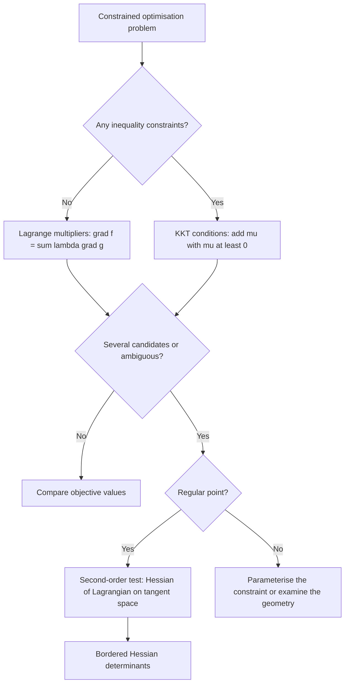

# Lagrange Multipliers

> [Mathematics](../../README.md) › [Optimization](../README.md) · Level: Advanced · Prerequisites: [Multivariable Calculus](../../07-calculus/12-multivariable-calculus/README.md), [Differentiation Rules](../../07-calculus/04-differentiation-rules/README.md), [Systems of Linear Equations](../../08-linear-algebra/03-systems-of-linear-equations/README.md), [Inner Product Spaces](../../08-linear-algebra/08-inner-product-spaces/README.md) · Estimated time: 8 h

## 1. Introduction

A firm maximises output subject to a budget. An engineer minimises the surface of a can subject to a required volume. A physicist finds the equilibrium of a system subject to conservation laws. A statistician maximises a likelihood subject to the constraint that probabilities sum to one. In each case the variables cannot be chosen freely: they must lie on a surface, or inside a region, defined by other equations. The problem is **constrained optimisation**, and the central tool for solving it is the **method of Lagrange multipliers**.

The method rests on one geometric observation. At a smooth constrained extremum, the level surface of the objective is tangent to the constraint surface. Since gradients are normal to level surfaces, tangency means that the two normals are parallel:

$$\nabla f(x^{*})=\lambda\,\nabla g(x^{*}).$$

The scalar $\lambda$ is the **Lagrange multiplier**. The observation converts a constrained problem into an unconstrained one for the **Lagrangian** $\mathcal{L}=f-\lambda g$, whose stationary points are the candidates. The conversion is local and requires a regularity hypothesis — the constraint gradient must not vanish — and this hypothesis is exactly where the method can fail.

The multiplier is more than a bookkeeping device. If the constraint is written $g(x)=b$, then $\lambda$ is the derivative of the optimal value with respect to $b$: the **shadow price** of relaxing the constraint. A budget multiplier is the marginal utility of money; a production multiplier is the marginal cost of output; a design multiplier is the sensitivity of the optimum to a required performance. This interpretation, proved in §7.4, is the reason Lagrange multipliers are ubiquitous in economics and engineering.

The chapter develops the theory in four layers:

1. **Equality constraints.** The tangent-space argument, justified by the implicit function theorem, gives $\nabla f=\lambda\nabla g$; the Lagrangian organises the computation.
2. **The meaning of $\lambda$.** The shadow-price theorem is derived by differentiating the optimal value.
3. **Inequality constraints.** The **Karush–Kuhn–Tucker (KKT) conditions** add non-negative multipliers and complementary slackness; they are the complete first-order theory.
4. **Second-order conditions.** The Hessian of the Lagrangian restricted to the tangent space decides whether a stationary point is a maximum, a minimum or a saddle; the bordered Hessian is the practical determinant test.

The chapter closes with degenerate cases, where the regularity hypothesis fails, and with worked examples from economics and engineering.

## 2. Prerequisites

**Multivariable calculus** ([Multivariable Calculus](../../07-calculus/12-multivariable-calculus/README.md)). You must be able to compute partial derivatives, gradients, directional derivatives, Hessians and the chain rule along a curve, $\dfrac{d}{dt}f(c(t))=\nabla f(c(t))\cdot c'(t)$. The tangent-space argument is nothing but the chain rule applied to a curve that stays on the constraint.

**Linear algebra** ([Systems of Linear Equations](../../08-linear-algebra/03-systems-of-linear-equations/README.md), [Inner Product Spaces](../../08-linear-algebra/08-inner-product-spaces/README.md)). You need the rank of a matrix, the null space, linear independence, the orthogonal complement, and the determinant of a small matrix. The regularity condition "the constraint gradients are linearly independent" is a rank condition, and the bordered Hessian is a determinant.

**Differentiation rules** ([Differentiation Rules](../../07-calculus/04-differentiation-rules/README.md)). The product and quotient rules, the chain rule in several variables, and the differentiation of implicit functions.

No measure theory, no functional analysis and no numerical methods are assumed. The implicit function theorem is stated precisely in §7.2 and used only in the form "a regular level set is locally a graph"; its proof belongs to real analysis and is not repeated here.

## 3. Learning Objectives

After this tutorial you will be able to:

1. Formulate a constrained optimisation problem with equality and inequality constraints, and identify the feasible set, the active constraints and the regularity condition.
2. Explain, geometrically and with the implicit function theorem, why $\nabla f$ must be parallel to $\nabla g$ at a regular constrained extremum.
3. Write the Lagrangian, derive the first-order conditions, and solve them together with the constraints.
4. Interpret the multiplier as the derivative of the optimal value with respect to the constraint level, and derive that interpretation.
5. Handle several equality constraints, including the linear-independence condition on their gradients.
6. State the KKT conditions completely, verify them on examples, and use complementary slackness to decide which constraints are active.
7. Apply second-order conditions, including the bordered Hessian test, to classify stationary points.
8. Recognise degenerate cases where the Lagrange conditions fail or are inconclusive, and construct counterexamples.
9. Solve economics and engineering problems: utility maximisation, cost minimisation, box and cylinder design.
10. Explain when KKT conditions are sufficient (convex problems) and when they are only necessary.

## 4. Intuition

**Walking along a contour.** Imagine a hiker on a hillside, required to stay on a fixed path. The height is $f$, the path is the constraint $g=0$. At a highest or lowest point of the path, the hiker is not moving uphill or downhill *along the path*: the path is tangent to the level curve of the height. The gradient of $f$ points straight uphill, perpendicular to the level curve; the tangent to the path is perpendicular to the gradient of $g$. Tangency of the path and the level curve therefore says that both gradients are perpendicular to the same tangent line, hence parallel. That is the whole geometric content of the Lagrange condition.

**Why the constraint gradient must not vanish.** If $\nabla g=0$, the constraint has a singular point — a cusp, a corner, or a degenerate level set — and the tangent line may not be well defined. The gradient of $f$ then has nothing to be parallel to, and the multiplier may fail to exist even at a genuine extremum. This is not a technicality: the cusp $y^{2}=x^{3}$ is a standard counterexample (§7.9).

**The multiplier as a price.** Suppose the constraint is a budget $g(x)=b$. The multiplier $\lambda$ answers the question: how much would the optimal value rise if the budget were increased by one unit? If the budget is not binding, the answer is zero. If it is binding, the answer is positive for a maximisation and negative for a cost minimisation. The Lagrangian combines the objective and the constraint into a single function whose stationary point balances the marginal gain of the objective against the marginal cost of the constraint, with $\lambda$ as the exchange rate.

**Inequalities are one-sided prices.** When the constraint is an inequality $h(x)\le b$, the price is one-sided: relaxing the constraint can only help (or only hurt), so the multiplier has a sign. If the constraint is slack, the price is zero. This is complementary slackness: either the constraint is binding with a price, or it is slack with no price. The KKT conditions are the exact statement of this dichotomy.

## 5. Formal Definition

Throughout, $f,g_i,h_j:\mathbb{R}^{n}\to\mathbb{R}$ are at least $C^{1}$ (twice differentiable where second-order conditions are used), and $x=(x_1,\dots,x_n)$.

> **Definition 5.1 (constrained optimisation problem).** A **constrained minimisation problem** is
> $$\min_{x\in\mathbb{R}^{n}} f(x)\quad\text{s.t.}\quad g_i(x)=0\ \ (i=1,\dots,m),\qquad h_j(x)\le0\ \ (j=1,\dots,p).$$
> A **constrained maximisation problem** is the same with $\max$ in place of $\min$. The functions $g_i$ define **equality constraints** and the functions $h_j$ define **inequality constraints**. The **feasible set** is
> $$S=\{x\in\mathbb{R}^{n}: g_i(x)=0\ \forall i,\ h_j(x)\le0\ \forall j\}.$$

> **Definition 5.2 (local and global extrema).** A point $x^{*}\in S$ is a **local minimiser** if there is $\varepsilon>0$ such that $f(x)\ge f(x^{*})$ for every $x\in S$ with $\|x-x^{*}\|<\varepsilon$. It is a **global minimiser** if the inequality holds for every $x\in S$. The **optimal value** is $f(x^{*})$. Maxima are defined by reversing the inequalities.

> **Definition 5.3 (active constraint).** An inequality constraint $h_j$ is **active** at $x^{*}$ if $h_j(x^{*})=0$ and **slack** if $h_j(x^{*})<0$. Equality constraints are active by definition.

> **Definition 5.4 (Lagrangian).** For the minimisation problem of Definition 5.1, the **Lagrangian** is
> $$\mathcal{L}(x,\lambda,\mu)=f(x)+\sum_{i=1}^{m}\lambda_i g_i(x)+\sum_{j=1}^{p}\mu_j h_j(x).$$
> The numbers $\lambda_i$ and $\mu_j$ are the **Lagrange multipliers** (or **dual variables**).

The sign convention in Definition 5.4 is the standard one for minimisation: equality multipliers are free, inequality multipliers are non-negative. For a maximisation problem the equivalent convention is
$$\mathcal{L}(x,\lambda,\mu)=f(x)-\sum_i\lambda_i g_i(x)-\sum_j\mu_j h_j(x),$$
with $\mu_j\ge0$; the two conventions differ by the sign of every multiplier. For **equality** constraints this chapter uses the unified form $\mathcal{L}=f-\sum_i\lambda_i(g_i-b_i)$, for which $\lambda_i=\partial V/\partial b_i$ whether the problem is a maximum or a minimum. For **inequality** constraints it uses the standard minimisation KKT form of §7.6, or the maximisation form when the problem is a maximisation; the convention is stated explicitly in every problem.

> **Definition 5.5 (KKT point).** A feasible point $x^{*}$ is a **Karush–Kuhn–Tucker point** if there exist $\lambda\in\mathbb{R}^{m}$ and $\mu\in\mathbb{R}^{p}$ such that
> $$\nabla f(x^{*})+\sum_i\lambda_i\nabla g_i(x^{*})+\sum_j\mu_j\nabla h_j(x^{*})=0,$$
> $$g_i(x^{*})=0,\qquad h_j(x^{*})\le0,\qquad \mu_j\ge0,\qquad \mu_j h_j(x^{*})=0.$$

> **Definition 5.6 (linear independence constraint qualification, LICQ).** A feasible point $x^{*}$ is **regular** (or satisfies **LICQ**) if the gradients of all equality constraints and of all active inequality constraints at $x^{*}$ are linearly independent.

> **Definition 5.7 (value function and shadow price).** For the family of problems
> $$\max\ f(x)\quad\text{s.t.}\quad g_i(x)=b_i,\quad h_j(x)\le b_j,$$
> the **value function** is $V(b)=$ the optimal value as a function of the right-hand side $b=(b_1,\dots,b_{m+p})$. The **shadow price** of constraint $k$ is $\partial V/\partial b_k$, when it exists.

> **Definition 5.8 (bordered Hessian).** For one equality constraint $g(x)=b$ and the Lagrangian $\mathcal{L}=f-\lambda(g-b)$, the **bordered Hessian** is the $(n+1)\times(n+1)$ matrix
> $$\overline{H}=\begin{pmatrix}0&\nabla g(x^{*})^{T}\\ \nabla g(x^{*})&\nabla_{xx}^{2}\mathcal{L}(x^{*})\end{pmatrix}.$$

> **Definition 5.9 (convex problem).** The minimisation problem of Definition 5.1 is **convex** if $f$ and every $h_j$ are convex, every $g_i$ is affine, and the feasible set is non-empty.

## 6. Mathematical Notation

| Symbol | Read as | Meaning |
|---|---|---|
| $n$ | en | number of decision variables |
| $m$ | em | number of equality constraints |
| $p$ | pee | number of inequality constraints |
| $f$ | eff | objective function |
| $g_i$ | gee sub i | equality constraint, $g_i(x)=0$ |
| $h_j$ | aitch sub j | inequality constraint, $h_j(x)\le0$ |
| $S$ | ess | feasible set |
| $x^{*}$ | x-star | candidate extremum |
| $\nabla f$ | gradient of $f$ | vector of partial derivatives |
| $\nabla^{2}f$ | Hessian of $f$ | matrix of second partial derivatives |
| $\mathcal{L}$ | Lagrangian | $f+\sum\lambda_ig_i+\sum\mu_jh_j$ |
| $\lambda_i$ | lambda sub i | multiplier of equality constraint $i$ |
| $\mu_j$ | mu sub j | multiplier of inequality constraint $j$ |
| $\mu_j h_j(x^{*})=0$ | complementary slackness | at most one of $\mu_j,h_j(x^{*})$ is non-zero |
| $Dg$ | derivative of $g$ | the $m\times n$ Jacobian matrix |
| $\ker Dg$ | kernel of $Dg$ | tangent directions to the constraint set |
| $T_{x^{*}}S$ | tangent space | $\ker Dg(x^{*})$ for a regular level set |
| $H_{\mathcal L}$ | Hessian of the Lagrangian | $\nabla^{2}f-\lambda\nabla^{2}g$ in the max convention |
| $\overline{H}$ | bordered Hessian | Hessian with a border of constraint gradients |
| $V(b)$ | value function | optimal value as a function of the right-hand side |
| $\partial V/\partial b_k$ | shadow price | marginal value of constraint $k$ |
| $\mathbb{R}^{n}$ | R-n | $n$-dimensional Euclidean space |
| $\lVert v\rVert$ | norm of $v$ | Euclidean length |

Two conventions are used repeatedly. The **gradient** is a column vector, so $\nabla f(x)^{T}v$ is the directional derivative of $f$ at $x$ in the direction $v$. The **Hessian** is the symmetric matrix of second partial derivatives, and $\nabla^{2}f(x)$ acts on a direction $v$ by the quadratic form $v^{T}\nabla^{2}f(x)v$. The **Lagrangian Hessian** is taken with respect to $x$ only, holding $\lambda$ and $\mu$ fixed.

## 7. Core Concepts

### 7.1 The constrained problem and its geometry

Consider first one equality constraint:

$$\min\ f(x)\quad\text{s.t.}\quad g(x)=0.$$

The feasible set $S=\{x:g(x)=0\}$ is, at a regular point, a smooth surface of dimension $n-1$. In $\mathbb{R}^{2}$ it is a curve; in $\mathbb{R}^{3}$ it is a surface. The level sets of $f$ are also surfaces, and the optimisation question is: how far can a level set of $f$ be pushed before it ceases to meet $S$? At the last contact, the two surfaces are tangent.

Tangency of two surfaces means that their normal vectors are parallel. The normal to $\{f=\text{const}\}$ is $\nabla f$; the normal to $\{g=0\}$ is $\nabla g$. Hence at a regular constrained extremum,

$$\nabla f(x^{*})=\lambda\nabla g(x^{*})$$

for some scalar $\lambda$. This is the **Lagrange condition**. It is a *necessary* condition: every regular local extremum satisfies it. It is not sufficient: a point satisfying it can be a maximum, a minimum or neither (§7.9).

In $\mathbb{R}^{2}$ the condition can be read from slopes. The constraint curve has slope $-g_x/g_y$; the level curve has slope $-f_x/f_y$. Tangency says these slopes are equal, which rearranges to $f_xg_y-f_yg_x=0$, the two-dimensional form of $\nabla f=\lambda\nabla g$.

**Example 7.1 (a circle).** Maximise $f(x,y)=xy$ subject to $x^{2}+y^{2}=1$. The constraint is the unit circle, and the level curves of $f$ are the hyperbolas $xy=c$. At the highest hyperbola that still touches the circle, the two curves are tangent. The condition $\nabla f=\lambda\nabla g$ reads

$$(y,x)=\lambda(2x,2y).$$

If $x,y\neq0$, dividing the first equation by the second gives $y/x=x/y$, so $x^{2}=y^{2}$. On the circle, $x=y=\pm1/\sqrt2$ or $x=-y=\pm1/\sqrt2$. The values are $f=1/2$ (maximum) and $f=-1/2$ (minimum). The multipliers are $\lambda=1/2$ and $\lambda=-1/2$ respectively. This example is worked in full in §9.1.

### 7.2 Why the gradient is parallel: the implicit function theorem

The geometric argument needs a justification: why is every tangent direction of the constraint set a direction in which the derivative of $f$ must vanish? The answer is the chain rule plus the implicit function theorem.

> **Theorem 7.2 (implicit function theorem, regular level-set form).** Let $g:\mathbb{R}^{n}\to\mathbb{R}$ be $C^{1}$ and suppose $\nabla g(x^{*})\neq0$. Then, after relabelling the coordinates so that $\partial g/\partial x_n(x^{*})\neq0$, there are a neighbourhood $U$ of $x^{*}_{1:n-1}$ in $\mathbb{R}^{n-1}$ and a $C^{1}$ function $\varphi:U\to\mathbb{R}$ such that, near $x^{*}$,
> $$\{x:g(x)=0\}=\{(x_1,\dots,x_{n-1},\varphi(x_1,\dots,x_{n-1})):(x_1,\dots,x_{n-1})\in U\}.$$
> In particular, the level set is locally an $(n-1)$-dimensional $C^{1}$ surface, and its tangent space at $x^{*}$ is $\ker\nabla g(x^{*})^{T}=\{v:\nabla g(x^{*})^{T}v=0\}$.

The theorem is proved in real analysis; its content is that a regular equation can be solved for one variable as a differentiable function of the others. The rank condition $\nabla g(x^{*})\neq0$ is exactly what fails at a cusp.

> **Theorem 7.3 (Lagrange necessary condition, one equality constraint).** Let $f,g:\mathbb{R}^{n}\to\mathbb{R}$ be $C^{1}$. If $x^{*}$ is a local extremum of $f$ subject to $g(x)=0$ and $\nabla g(x^{*})\neq0$, then there is a scalar $\lambda$ such that
> $$\nabla f(x^{*})=\lambda\nabla g(x^{*}).$$

**Proof.** By Theorem 7.2 the constraint set is locally a graph, hence a $C^{1}$ surface with tangent space $T=\{v:\nabla g(x^{*})^{T}v=0\}$. Take any $v\in T$. Because the surface is a graph, there is a $C^{1}$ curve $c:(-\varepsilon,\varepsilon)\to\mathbb{R}^{n}$ with $c(0)=x^{*}$, $c'(0)=v$ and $g(c(t))=0$ for all $t$. One may take the straight line in the graph coordinates and lift it to the surface; the derivative at $0$ is $v$.

Define $\phi(t)=f(c(t))$. Since $x^{*}$ is a local extremum of $f$ on the constraint set, $t=0$ is a local extremum of $\phi$, so $\phi'(0)=0$. By the chain rule,

$$0=\phi'(0)=\nabla f(c(0))^{T}c'(0)=\nabla f(x^{*})^{T}v.$$

Hence $\nabla f(x^{*})^{T}v=0$ for every $v\in T$. Since $T=\nabla g(x^{*})^{\perp}$ is an $(n-1)$-dimensional subspace, its orthogonal complement is the one-dimensional line spanned by $\nabla g(x^{*})$. Therefore $\nabla f(x^{*})\in\operatorname{span}\{\nabla g(x^{*})\}$, that is, $\nabla f(x^{*})=\lambda\nabla g(x^{*})$ for some $\lambda\in\mathbb{R}$. $\blacksquare$

**What the proof uses.** The regularity $\nabla g(x^{*})\neq0$ is used twice: to make the level set a graph and to make $T$ exactly $(n-1)$-dimensional with a one-dimensional orthogonal complement. Without it, $T$ could be all of $\mathbb{R}^{n}$ (if $\nabla g=0$), and then the condition would force $\nabla f=0$, which need not hold at a constrained extremum.

**Several constraints.** For $g:\mathbb{R}^{n}\to\mathbb{R}^{m}$ with $m<n$, the same argument applies with the regular level-set theorem: if the Jacobian $Dg(x^{*})$ has rank $m$, then $S$ is locally an $(n-m)$-dimensional surface with tangent space $\ker Dg(x^{*})$. The orthogonal complement of this kernel is the row space of $Dg(x^{*})$, which is spanned by the gradients $\nabla g_1(x^{*}),\dots,\nabla g_m(x^{*})$. Hence

$$\nabla f(x^{*})=\sum_{i=1}^{m}\lambda_i\nabla g_i(x^{*}).$$

The rank condition is **LICQ** (Definition 5.6). It is the hypothesis that makes the multipliers exist and be unique; without it, the row space can be smaller than the span of the gradients, and the argument fails.

### 7.3 The Lagrangian and the first-order conditions

The Lagrange condition can be written as the stationarity of a single function. Define

$$\mathcal{L}(x,\lambda)=f(x)-\lambda\,(g(x)-b)$$

for the problem with constraint $g(x)=b$. Then

$$\frac{\partial\mathcal{L}}{\partial x}=\nabla f(x)-\lambda\nabla g(x),\qquad \frac{\partial\mathcal{L}}{\partial\lambda}=-(g(x)-b).$$

Setting both derivatives to zero gives $\nabla f=\lambda\nabla g$ and $g=b$. The constrained problem in $n$ variables has become an unconstrained problem in $n+1$ variables; the price is one extra unknown, the multiplier.

**The recipe for equality constraints.**

1. Write $\mathcal{L}=f-\sum_i\lambda_i(g_i-b_i)$.
2. Solve the system $\nabla_x\mathcal{L}=0$ together with $g_i(x)=b_i$.
3. Discard candidates that are not feasible.
4. Evaluate $f$ at the remaining candidates; the largest is the maximum and the smallest the minimum (for a compact feasible set, both exist).
5. If the feasible set is not compact, examine behaviour at infinity and at the boundary.
6. Use second-order conditions (§7.8) when several candidates have the same value or when the geometry is unclear.

**Why the recipe works.** Every regular local extremum is a stationary point of $\mathcal{L}$ in the $x$ variables and satisfies the constraint. Conversely, a stationary point of $\mathcal{L}$ satisfies the necessary condition; it still has to be classified. The recipe therefore produces a superset of the regular extrema, and the comparison of values (or the second-order test) removes the false candidates.

**Example 7.4 (a rectangle with fixed perimeter).** Maximise the area $f(x,y)=xy$ subject to $2x+2y=P$. The Lagrangian is

$$\mathcal{L}=xy-\lambda(2x+2y-P).$$

Stationarity gives $y=2\lambda$ and $x=2\lambda$, so $x=y$. The constraint gives $4x=P$, hence $x=y=P/4$ and the maximum area is $P^{2}/16$. The square is the optimal rectangle. The multiplier is $\lambda=P/8$; increasing the perimeter by one unit increases the area by $P/8$, which is half the side length.

### 7.4 The meaning of the multiplier

Write the constraint as $g(x)=b$ and let $V(b)$ be the optimal value. The multiplier measures how fast $V$ changes with $b$.

> **Theorem 7.5 (shadow-price theorem, equality constraint).** Suppose $f,g$ are $C^{1}$ and $x^{*}$ is a regular local extremum for $g(x)=b^{*}$, with multiplier $\lambda^{*}$. Suppose the system
> $$\nabla f(x)-\lambda\nabla g(x)=0,\qquad g(x)=b$$
> has a $C^{1}$ solution $(x(b),\lambda(b))$ near $b^{*}$ (this holds if the Jacobian of the system with respect to $(x,\lambda)$ is invertible at $(x^{*},\lambda^{*})$). Then
> $$V'(b^{*})=\lambda^{*}.$$

**Proof.** Differentiate the identity $g(x(b))=b$ with respect to $b$:

$$\nabla g(x(b))^{T}x'(b)=1.$$

Since $x(b)$ is optimal, $\nabla f(x(b))=\lambda(b)\nabla g(x(b))$. Differentiate $V(b)=f(x(b))$:

$$V'(b)=\nabla f(x(b))^{T}x'(b)=\lambda(b)\,\nabla g(x(b))^{T}x'(b)=\lambda(b).$$

At $b=b^{*}$ this is $\lambda^{*}$. $\blacksquare$

**What the theorem says.** The multiplier is the marginal value of the constraint. If $b$ is a budget, $\lambda$ is the marginal utility of money; if $b$ is a required output, $\lambda$ is the marginal cost of output; if $b$ is a surface area, $\lambda$ is the marginal volume per unit area. It is a *local* statement: it holds while the same solution branch and the same active constraints remain.

**Signs.** For an equality constraint the multiplier can have either sign. In a maximisation with a resource constraint $g(x)\le b$, the multiplier of the resource is non-negative: more resource cannot hurt. In a minimisation with a required output, the multiplier of the output is positive: more output costs more. The sign is determined by the direction of the inequality, not by the mathematics of the Lagrangian.

**For inequality constraints.** If the constraint is $h(x)\le b$ and it is active, the same calculation with $h$ in place of $g$ gives $\partial V/\partial b=\mu$, where $\mu$ is the multiplier in the max convention $\mathcal{L}=f-\mu(h-b)$, $\mu\ge0$. If the constraint is slack, a small increase in $b$ does not change the feasible set near $x^{*}$, so $\partial V/\partial b=0$. Complementary slackness, $\mu(h(x^{*})-b)=0$, is exactly the statement that the price is zero when the constraint is slack. For a minimisation, the multiplier $\mu$ in the standard form $\mathcal{L}=f+\mu(h-b)$ is non-negative and $\partial V/\partial b=-\mu$: relaxing a $\le$ constraint lowers the minimum.

**A worked check.** In Example 7.4, $V(P)=P^{2}/16$, so $V'(P)=P/8$, which equals the multiplier $\lambda=P/8$. Increasing the perimeter from $P=8$ to $P=8.1$ changes the maximum area from $4$ to $(8.1)^{2}/16=4.100625$, a change of $0.100625$, while $\lambda\Delta P=(1)(0.1)=0.1$; the difference is second order.

### 7.5 Multiple equality constraints

For constraints $g_i(x)=b_i$, $i=1,\dots,m$, the Lagrangian is

$$\mathcal{L}=f-\sum_{i=1}^{m}\lambda_i(g_i(x)-b_i),$$

and the first-order conditions are

$$\nabla f(x)=\sum_{i=1}^{m}\lambda_i\nabla g_i(x),\qquad g_i(x)=b_i\ \forall i.$$

There are $n+m$ equations in the $n+m$ unknowns $(x,\lambda)$, so the system is square. When the constraint gradients are independent at a solution, the Jacobian of the system is nonsingular and the implicit function theorem makes the solution locally unique and differentiable. If the gradients are dependent, the constraints are locally redundant (one differential is a combination of the others) or the point is singular, and the multipliers may fail to exist or may be non-unique.

**Geometric reading.** The tangent space of the constraint set is the intersection of the tangent spaces of the individual constraints, $\ker Dg(x^{*})$. The gradient of $f$ must be orthogonal to this intersection, hence must lie in the span of the constraint gradients. With two constraints in $\mathbb{R}^{3}$ the feasible set is a curve, and $\nabla f$ lies in the plane spanned by the two constraint normals.

**A practical point.** With several constraints, solve the stationarity equations for $x$ in terms of the multipliers, then impose the constraints. The multipliers are often easier to find first by taking ratios of the stationarity equations, as in §9.5.

### 7.6 Inequality constraints and the KKT conditions

Now allow inequalities. The first-order conditions acquire three new features: multipliers are signed, inactive constraints have zero multipliers, and a constraint qualification is needed for necessity. The complete statement for minimisation is the following.

> **Theorem 7.6 (Karush–Kuhn–Tucker necessary conditions).** Consider
> $$\min\ f(x)\quad\text{s.t.}\quad g_i(x)=0\ (i=1,\dots,m),\quad h_j(x)\le0\ (j=1,\dots,p),$$
> with $f,g_i,h_j$ continuously differentiable. Let $x^{*}$ be a local minimiser at which LICQ holds: the gradients $\nabla g_i(x^{*})$ and $\nabla h_j(x^{*})$ for active $j$ are linearly independent. Then there exist multipliers $\lambda\in\mathbb{R}^{m}$ and $\mu\in\mathbb{R}^{p}$ such that
> $$\text{(stationarity)}\quad \nabla f(x^{*})+\sum_{i=1}^{m}\lambda_i\nabla g_i(x^{*})+\sum_{j=1}^{p}\mu_j\nabla h_j(x^{*})=0,$$
> $$\text{(primal feasibility)}\quad g_i(x^{*})=0,\qquad h_j(x^{*})\le0,$$
> $$\text{(dual feasibility)}\quad \mu_j\ge0,$$
> $$\text{(complementary slackness)}\quad \mu_j h_j(x^{*})=0\quad\text{for every }j.$$

**Remarks on the statement.**

* The equality multipliers $\lambda_i$ are free; the inequality multipliers $\mu_j$ are non-negative for a minimisation with $h_j\le0$. For a maximisation with $h_j\le0$, replace $f$ by $-f$: the stationarity equation becomes $\nabla f=\sum\lambda_i\nabla g_i+\sum\mu_j\nabla h_j$ with $\mu_j\ge0$.
* Complementary slackness says: if $h_j(x^{*})<0$ (slack), then $\mu_j=0$; if $\mu_j>0$, then $h_j(x^{*})=0$ (active).
* The theorem is **necessary**, not sufficient. A KKT point can be a saddle or even a non-extremum when the problem is not convex (§7.9).
* The constraint qualification is essential. Without it, a local minimiser need not be a KKT point; the cusp in §7.9 is the standard counterexample.
* Common constraint qualifications: **LICQ** (the one stated), **MFCQ** (Mangasarian–Fromovitz: the equality gradients are independent and there is a direction satisfying the active inequality gradients strictly), and **Slater's condition** for convex problems (there is a strictly feasible point).

> **Theorem 7.7 (KKT sufficiency for convex problems).** If the minimisation problem is convex (Definition 5.9) and $x^{*}$ is a KKT point, then $x^{*}$ is a global minimiser. If Slater's condition holds, every global minimiser is a KKT point, so the KKT conditions are necessary and sufficient.

**Proof of sufficiency.** Let $x$ be any feasible point. Convexity of $f$ gives

$$f(x)\ge f(x^{*})+\nabla f(x^{*})^{T}(x-x^{*}).$$

Convexity of each $h_j$ gives $h_j(x)\ge h_j(x^{*})+\nabla h_j(x^{*})^{T}(x-x^{*})$, and $h_j(x)\le0$. For active constraints, $h_j(x^{*})=0$, so $\nabla h_j(x^{*})^{T}(x-x^{*})\le0$; for inactive ones, $\mu_j=0$. The equality constraints are affine, so $g_i(x)-g_i(x^{*})=\nabla g_i(x^{*})^{T}(x-x^{*})=0$. Using stationarity,

$$\nabla f(x^{*})^{T}(x-x^{*})=-\sum_i\lambda_i\nabla g_i(x^{*})^{T}(x-x^{*})-\sum_j\mu_j\nabla h_j(x^{*})^{T}(x-x^{*})\ge0,$$

because the equality terms vanish and each active inequality term is $\ge0$ (a non-negative $\mu_j$ times a non-positive inner product) while inactive terms have $\mu_j=0$. Hence $f(x)\ge f(x^{*})$, so $x^{*}$ is global. $\blacksquare$

**Why convexity matters.** The proof uses the first-order inequality $f(x)\ge f(x^{*})+\nabla f(x^{*})^{T}(x-x^{*})$, which is the defining property of a convex differentiable function. For a non-convex function, a KKT point can be a local maximum, a saddle, or a local minimum that is not global.

### 7.7 Complementary slackness and the active set

Complementary slackness is the algebraic form of the one-sided price idea. At a KKT point, for each inequality constraint exactly one of the following holds:

* the constraint is **slack** ($h_j(x^{*})<0$) and its multiplier is **zero** ($\mu_j=0$);
* the constraint is **active** ($h_j(x^{*})=0$) and its multiplier is **non-negative** ($\mu_j\ge0$), possibly zero.

The case "active with zero multiplier" is degenerate: the constraint touches the optimum but does not affect the first-order value. It occurs when the optimum is determined by other constraints and the active one is redundant at that point, or when the geometry has a kink.

**Algorithmic use.** Complementary slackness turns an enumeration over $2^{p}$ active sets into a finite check: for each guess of the active set, solve the equality-constrained KKT system and check the signs and the inactive constraints. In practice one guesses the active set from the geometry, solves, and verifies.

**Economic reading.** If a capacity constraint is not binding, its shadow price is zero and extra capacity is worthless. If it is binding with a positive price, extra capacity is valuable at the rate $\mu$. This is the same statement as in linear programming (§7.9 of the linear-programming topic), now with nonlinear constraints.

### 7.8 Second-order conditions and the bordered Hessian

The first-order conditions locate candidates; the second-order conditions classify them. Along a feasible curve $c(t)$ with $c(0)=x^{*}$ and $g(c(t))=0$, the function $\phi(t)=f(c(t))$ has $\phi'(0)=0$ at a stationary point. For a local minimum we need $\phi''(0)\ge0$, and for a local maximum $\phi''(0)\le0$.

The Hessian of the Lagrangian is unchanged if the Lagrangian is written with the opposite multiplier sign, because the two Lagrangians differ by a constant; it is the stationarity equation $\nabla f=\lambda\nabla g$ that fixes the sign of $\lambda$. The determinant test below refers to this unified convention, and its words "maximum" and "minimum" refer to the geometry, not to the sign of $\lambda$.

**The second derivative along a curve.** Differentiate $g(c(t))=0$ twice:

$$\nabla g(c(t))^{T}c'(t)=0,\qquad c'(t)^{T}\nabla^{2}g(c(t))c'(t)+\nabla g(c(t))^{T}c''(t)=0.$$

Differentiate $f(c(t))$ twice and use $\nabla f=\lambda\nabla g$:

$$\phi''(0)=c'(0)^{T}\nabla^{2}f(x^{*})c'(0)+\nabla f(x^{*})^{T}c''(0).$$

Substituting $\nabla f=\lambda\nabla g$ and the second derivative of the constraint gives

$$\phi''(0)=c'(0)^{T}\bigl(\nabla^{2}f(x^{*})-\lambda\nabla^{2}g(x^{*})\bigr)c'(0)=v^{T}H_{\mathcal L}v,$$

where $v=c'(0)$ is any tangent vector and $H_{\mathcal L}=\nabla^{2}f-\lambda\nabla^{2}g$ is the Hessian of the Lagrangian $\mathcal{L}=f-\lambda(g-b)$.

> **Theorem 7.8 (second-order conditions).** Let $x^{*}$ be a regular stationary point of $f$ subject to $g(x)=b$, with multiplier $\lambda$ and $H_{\mathcal L}=\nabla^{2}f(x^{*})-\lambda\nabla^{2}g(x^{*})$.
> * **(Necessary)** If $x^{*}$ is a local maximum, then $v^{T}H_{\mathcal L}v\le0$ for every $v$ with $\nabla g(x^{*})^{T}v=0$. If it is a local minimum, $v^{T}H_{\mathcal L}v\ge0$ for every such $v$.
> * **(Sufficient)** If $v^{T}H_{\mathcal L}v<0$ for every $v\neq0$ with $\nabla g(x^{*})^{T}v=0$, then $x^{*}$ is a strict local maximum. If $v^{T}H_{\mathcal L}v>0$ for every such $v$, it is a strict local minimum.

The quadratic form is restricted to the **tangent space**; directions that violate the constraint are irrelevant. This is the difference between constrained and unconstrained second-order tests.

**The bordered Hessian test.** The definiteness of $H_{\mathcal L}$ on the tangent space can be read from determinants. With the border first,

$$\overline{H}=\begin{pmatrix}0&\nabla g^{T}\\ \nabla g&H_{\mathcal L}\end{pmatrix},$$

let $D_k$ be the leading principal minor of order $k$, for $k=2,\dots,n+1$. Then, for the convention $\mathcal{L}=f-\lambda(g-b)$ and $\nabla f=\lambda\nabla g$:

* **local maximum:** $D_2<0$, $D_3>0$, $D_4<0$, … (signs $(-1)^{k-1}$);
* **local minimum:** $D_2<0$, $D_3<0$, $D_4<0$, … (all negative).

For $n=2$ the test reduces to the single determinant: $\det\overline{H}>0$ means a local maximum and $\det\overline{H}<0$ a local minimum, provided $\nabla g\neq0$ and the first component of $\nabla g$ is non-zero (otherwise relabel the variables). For $n=3$ the signs of both the $3\times3$ and the $4\times4$ leading minors are needed. If a leading minor is zero, the test is inconclusive; relabel the variables so that the first component of $\nabla g$ is non-zero, or use the quadratic form on a basis of the tangent space instead.

**A worked determinant.** For $f(x,y)=x^{2}y$ subject to $x+y=3$, the stationary points are $(2,1)$ with $\lambda=4$ and $(0,3)$ with $\lambda=0$. At $(2,1)$,

$$H_{\mathcal L}=\begin{pmatrix}2y&2x\\2x&0\end{pmatrix}=\begin{pmatrix}2&4\\4&0\end{pmatrix},\qquad \overline{H}=\begin{pmatrix}0&1&1\\1&2&4\\1&4&0\end{pmatrix},$$

and $\det\overline{H}=6>0$, so $(2,1)$ is a local maximum (value $4$). At $(0,3)$,

$$H_{\mathcal L}=\begin{pmatrix}6&0\\0&0\end{pmatrix},\qquad \overline{H}=\begin{pmatrix}0&1&1\\1&6&0\\1&0&0\end{pmatrix},\qquad \det\overline{H}=-6<0,$$

so $(0,3)$ is a local minimum (value $0$). The full example is in §9.7.

**Inequality constraints.** For KKT points, the second-order condition is imposed on the **critical cone**: directions $v$ with $\nabla g_i^{T}v=0$ for all equality constraints, $\nabla h_j^{T}v=0$ for active constraints with $\mu_j>0$, and $\nabla h_j^{T}v\le0$ for active constraints with $\mu_j=0$. The Hessian of the Lagrangian must be positive semidefinite on this cone for a minimum. The bordered Hessian test above is the equality-constraint special case.

### 7.9 Degenerate cases and constraint qualification failure

The Lagrange and KKT conditions are necessary only under a constraint qualification. When the qualification fails, three things can happen: the multiplier may not exist, it may be non-unique, or the first-order condition may hold at a point that is not an extremum.

**Failure of regularity: a cusp.** Consider

$$\max\ x\quad\text{s.t.}\quad y^{2}=x^{3}.$$

The constraint set is the semicubical parabola $x=t^{2}$, $y=t^{3}$, which has a cusp at the origin. The point $(0,0)$ is feasible, and along the curve $x=t^{2}\ge0$, so $(0,0)$ is a local (indeed global) *minimum* of $x$, not a maximum. The gradient of the constraint is

$$\nabla g(x,y)=(-3x^{2},\,2y),$$

which vanishes at $(0,0)$. The Lagrange condition would require $\nabla f=(1,0)$ to be a multiple of $(0,0)$, which is impossible. Hence there is no multiplier at a constrained extremum, exactly as the theorem's hypothesis predicts.

**Failure of LICQ with dependent constraints.** Consider the two constraints
$$g_1(x,y)=x+y-1=0,\qquad g_2(x,y)=2x+2y-2=0.$$
They describe the same line, so the gradients $(1,1)$ and $(2,2)$ are dependent and LICQ fails everywhere on the feasible set. The Lagrange system $\nabla f=\lambda_1(1,1)+\lambda_2(2,2)$ determines only the combination $\lambda_1+2\lambda_2$; the individual multipliers are not unique. The feasible set and the optimum may still be perfectly well defined, but the multipliers are not.

**A singular constraint set.** The constraint $x^{2}+y^{2}=0$ has the single feasible point $(0,0)$, where $\nabla g=(0,0)$. Every continuous function on this set has a maximum and a minimum at the only feasible point, and the multiplier condition is vacuous.

**A stationary point that is not an extremum.** The Lagrange condition is not sufficient. In $\mathbb{R}^{3}$, maximise $f(x,y,z)=x^{2}-y^{2}$ subject to $g(x,y,z)=z=0$. The feasible set is the plane $z=0$, and the origin is a saddle of $f$ (positive along $x$, negative along $y$). At the origin $\nabla f=(0,0,0)=\lambda(0,0,1)$ holds with $\lambda=0$, so the Lagrange condition holds, but the point is neither a maximum nor a minimum. The second-order test detects this: $H_{\mathcal L}=\operatorname{diag}(2,-2,0)$ is indefinite on the tangent plane $z=0$.

**Non-smooth constraints.** If the constraint set has a corner, for example $|x|+|y|=1$, the constraint is not differentiable at the corners and the Lagrange condition does not apply there. The extrema can still be found by checking the smooth pieces and the corners separately; subgradient methods generalise the multiplier theory.

**What to do in practice.** Check regularity before trusting the multipliers. If it fails, examine the geometry directly: parameterise the constraint, look for cusps and corners, and test the candidate points by comparing values. The cusp example is not a pathology to be ignored; it is the reason the hypothesis is stated.

## 8. Formulas and Properties

### 8.1 Equality-constrained first-order conditions

> **Property 8.1 (Lagrange).** If $x^{*}$ is a local extremum of $f$ subject to $g_i(x)=b_i$ and the gradients $\nabla g_i(x^{*})$ are linearly independent, then there exist $\lambda_1,\dots,\lambda_m$ with
> $$\nabla f(x^{*})=\sum_{i=1}^{m}\lambda_i\nabla g_i(x^{*}),\qquad g_i(x^{*})=b_i\ \forall i.$$

*Why.* The tangent space of the constraint set is the intersection of the kernels of the $\nabla g_i^{T}$; its orthogonal complement is the span of the gradients. The derivative of $f$ vanishes on the tangent space, so $\nabla f$ lies in that span.

> **Property 8.2 (Lagrangian form).** The conditions of Property 8.1 are exactly the stationarity conditions of $\mathcal{L}=f-\sum_i\lambda_i(g_i-b_i)$ in the variables $(x,\lambda)$.

*Why.* $\partial\mathcal{L}/\partial x=\nabla f-\sum\lambda_i\nabla g_i$ and $\partial\mathcal{L}/\partial\lambda_i=-(g_i-b_i)$; setting both to zero gives the two sets of equations.

### 8.2 Inequality-constrained first-order conditions

> **Property 8.3 (KKT).** Under LICQ, a local minimiser of $f$ subject to $g_i=0$ and $h_j\le0$ satisfies
> $$\nabla f+\sum_i\lambda_i\nabla g_i+\sum_j\mu_j\nabla h_j=0,\qquad h_j\le0,\quad \mu_j\ge0,\quad \mu_jh_j=0.$$

*Why.* The active constraints define a tangent cone; the negative gradient of $f$ must lie in its polar cone, which is generated by the active constraint gradients with non-negative coefficients. Complementary slackness assigns a zero coefficient to every inactive constraint.

> **Property 8.4 (convex sufficiency).** If $f$ and the $h_j$ are convex, the $g_i$ are affine, and $x^{*}$ is a KKT point, then $x^{*}$ is a global minimiser.

*Why.* The first-order inequality for convex functions turns stationarity into $f(x)\ge f(x^{*})$ for every feasible $x$; the proof is in §7.6.

### 8.3 The multiplier as a price

> **Property 8.5 (shadow price).** For a family of problems with an **equality** constraint $g_k(x)=b_k$, if the optimal solution is differentiable in $b_k$, then
> $$V'(b_k)=\lambda_k,$$
> where $\lambda_k$ is the multiplier in the convention $\mathcal{L}=f-\lambda_k(g_k-b_k)$.

*Why.* Differentiate $V(b)=f(x(b))$ and use $\nabla f=\lambda\nabla g$ together with $\nabla g^{T}x'(b)=1$.

> **Property 8.6 (sign rule).** For a maximisation with $h\le b$, the multiplier is $\ge0$ and equals $V'(b)$. For a minimisation with $h\le b$, the multiplier in the standard form $\mathcal{L}=f+\mu(h-b)$ is $\ge0$ and $V'(b)=-\mu$.

*Why.* Relaxing an upper bound cannot decrease a maximum and cannot increase a minimum; the signs follow from the direction of the inequality.

### 8.4 Second-order conditions

> **Property 8.7 (second-order test).** Let $x^{*}$ be a regular stationary point with multiplier $\lambda$ and $H_{\mathcal L}=\nabla^{2}f-\lambda\nabla^{2}g$. Then $x^{*}$ is a local maximum if $v^{T}H_{\mathcal L}v<0$ for all $v\neq0$ with $\nabla g^{T}v=0$, and a local minimum if $v^{T}H_{\mathcal L}v>0$ for all such $v$.

> **Property 8.8 (bordered Hessian).** With $\overline{H}$ as in Definition 5.8 and leading principal minors $D_k$ of orders $2,\dots,n+1$, the sufficient sign pattern for a local maximum is $D_2<0,D_3>0,D_4<0,\dots$, and for a local minimum it is $D_2<0,D_3<0,\dots,D_{n+1}<0$. If a minor is zero, the test is inconclusive.

*Why.* The determinant test is the matrix form of definiteness on the tangent space. For $n=2$, expanding the bordered determinant shows that its sign is opposite to the sign of $v^{T}H_{\mathcal L}v$ for any non-zero tangent vector $v$; the higher leading minors give the analogous signs in higher dimensions.

### 8.5 Algebra of multipliers

> **Property 8.9 (reparametrisation).** If the constraint $g=0$ is replaced by $\tilde g=\varphi\circ g=0$ with $\varphi(0)=0$ and $\varphi'(0)\neq0$, the multiplier changes to $\tilde\lambda=\lambda/\varphi'(0)$, while the optimal point is unchanged.

*Why.* $\nabla\tilde g=\varphi'(0)\nabla g$, so $\nabla f=\lambda\nabla g=(\lambda/\varphi'(0))\nabla\tilde g$.

> **Property 8.10 (homogeneous objective).** If $f$ is positively homogeneous of degree one and the constraint is $p\cdot x=b$, then at an interior optimum
> $$\lambda=\frac{f(x^{*})}{b}.$$

*Why.* Euler's theorem gives $\sum_ix_i\partial f/\partial x_i=f$. Stationarity gives $\partial f/\partial x_i=\lambda p_i$, so $\sum_ix_i\lambda p_i=\lambda b=f(x^{*})$.

> **Property 8.11 (envelope).** For a family $\max\{f(x):g(x)=b\}$ with value $V(b)$,
> $$V'(b)=\left.\frac{\partial\mathcal{L}}{\partial b}\right|_{x=x^{*},\lambda=\lambda^{*}}=\lambda^{*}.$$

*Why.* The envelope theorem differentiates through the optimum: the derivatives with respect to $x$ vanish at the optimum, so only the explicit dependence on $b$ remains.

## 9. Step-by-Step Examples

The examples are ordered from a one-line computation to a degenerate counterexample. Each states the Lagrangian, solves the first-order conditions, checks the constraints, and verifies the multiplier interpretation where it applies.

### 9.1 Example 1: a product on a circle

Maximise and minimise $f(x,y)=xy$ subject to $x^{2}+y^{2}=1$.

**Lagrangian.** $\mathcal{L}=xy-\lambda(x^{2}+y^{2}-1)$.

**First-order conditions.**

$$y=2\lambda x,\qquad x=2\lambda y,\qquad x^{2}+y^{2}=1.$$

If $x=0$ then the first equation gives $y=0$, which violates the constraint; hence $x,y\neq0$. Multiplying the first equation by $y$ and the second by $x$ gives $xy=2\lambda x^{2}$ and $xy=2\lambda y^{2}$, so $x^{2}=y^{2}$. Thus $y=x$ or $y=-x$.

**Candidates.** On the circle:

* $y=x$: $2x^{2}=1$, so $x=y=\pm1/\sqrt2$, with $f=1/2$;
* $y=-x$: $2x^{2}=1$, so $x=-y=\pm1/\sqrt2$, with $f=-1/2$.

The multipliers are $\lambda=1/2$ in the first case (from $y=2\lambda x$) and $\lambda=-1/2$ in the second.

**Classification.** The maximum is $1/2$ at $(1/\sqrt2,1/\sqrt2)$ and $(-1/\sqrt2,-1/\sqrt2)$; the minimum is $-1/2$ at $(1/\sqrt2,-1/\sqrt2)$ and $(-1/\sqrt2,1/\sqrt2)$. The constraint is compact, so the extrema exist and are among the candidates.

**Check.** Each point satisfies $x^{2}+y^{2}=1/2+1/2=1$, and $xy=\pm1/2$. The second-order test: $H_{\mathcal L}=\begin{pmatrix}-2\lambda&1\\1&-2\lambda\end{pmatrix}$; it is negative definite on the tangent space of the circle when $\lambda=1/2$ and positive definite on it when $\lambda=-1/2$.

### 9.2 Example 2: the closest point on a line

Find the point of the line $3x+4y=10$ closest to the origin, and interpret the multiplier.

**Lagrangian.** Minimise $f=x^{2}+y^{2}$ subject to $3x+4y=10$:

$$\mathcal{L}=x^{2}+y^{2}-\lambda(3x+4y-10).$$

**First-order conditions.**

$$2x=3\lambda,\qquad 2y=4\lambda,\qquad 3x+4y=10.$$

Hence $x=3\lambda/2$ and $y=2\lambda$. Substituting,

$$3\left(\frac{3\lambda}{2}\right)+4(2\lambda)=\frac{9\lambda}{2}+8\lambda=\frac{25\lambda}{2}=10,$$

so $\lambda=20/25=4/5$. Then $x=6/5$ and $y=8/5$.

**Distance.** $f=(6/5)^{2}+(8/5)^{2}=(36+64)/25=100/25=4$, so the distance is $2$.

**Shadow price.** The distance from the origin to $3x+4y=b$ is $|b|/5$, so the squared distance is $V(b)=b^{2}/25$ and $V'(b)=2b/25$. At $b=10$, $V'=20/25=4/5=\lambda$. Increasing the right-hand side by $0.1$ changes the squared distance by about $0.08$, and indeed $V(10.1)-V(10)=(102.01-100)/25=0.0804$.

**Check.** $3(6/5)+4(8/5)=18/5+32/5=50/5=10$; the point is on the line, and the distance is $2$.

### 9.3 Example 3: Cobb–Douglas utility maximisation

Maximise $U(x,y)=x^{1/3}y^{2/3}$ subject to $2x+3y=60$, $x,y>0$.

**Lagrangian.** $\mathcal{L}=x^{1/3}y^{2/3}-\lambda(2x+3y-60)$.

**First-order conditions.**

$$\frac13x^{-2/3}y^{2/3}=2\lambda,\qquad \frac23x^{1/3}y^{-1/3}=3\lambda.$$

Dividing the first by the second gives

$$\frac{1}{2}\cdot\frac{y}{x}=\frac{2}{3},$$

so $y=4x/3$. The budget gives

$$2x+3\left(\frac{4x}{3}\right)=2x+4x=6x=60,$$

hence $x=10$ and $y=40/3$.

**Value and multiplier.** The utility is

$$U=10^{1/3}\left(\frac{40}{3}\right)^{2/3}=10\left(\frac43\right)^{2/3}\approx12.114.$$

The multiplier is

$$\lambda=\frac{1}{3}\left(\frac{y}{x}\right)^{2/3}\frac{1}{2}=\frac{1}{6}\left(\frac43\right)^{2/3}\approx0.2019.$$

Because $U$ is homogeneous of degree one, Property 8.10 gives $\lambda=U/60\approx0.2019$, in agreement.

**Shadow price check.** If the budget rises to $61$, the new optimum is $x=61/6$, $y=2(61)/9$, and the utility is $61/60$ times the old utility (homogeneity), an increase of about $0.2019$. This matches $\lambda$.

**Second-order.** The function $x^{1/3}y^{2/3}$ is concave on the positive quadrant (its Hessian is negative semidefinite there), and the constraint is affine, so the stationary point is the global maximum.

**Check.** $2(10)+3(40/3)=20+40=60$; the utility is positive and the budget is exhausted.

### 9.4 Example 4: cost minimisation and marginal cost

Minimise $C=10L+40K$ subject to $\sqrt{LK}=20$, $L,K>0$.

**Lagrangian.** $\mathcal{L}=10L+40K-\lambda(\sqrt{LK}-20)$.

**First-order conditions.**

$$10=\lambda\cdot\frac12L^{-1/2}K^{1/2},\qquad 40=\lambda\cdot\frac12L^{1/2}K^{-1/2}.$$

Dividing the first by the second gives $10/40=K/L$, so $K=L/4$. The constraint gives

$$\sqrt{L\cdot\frac{L}{4}}=\frac{L}{2}=20,$$

hence $L=40$ and $K=10$.

**Cost and multiplier.** $C=10(40)+40(10)=400+400=800$. The multiplier follows from the first equation:

$$10=\lambda\cdot\frac12\sqrt{\frac{K}{L}}=\lambda\cdot\frac12\cdot\frac12=\frac{\lambda}{4},$$

so $\lambda=40$.

**Marginal cost.** With $Q=\sqrt{LK}$, the cost function is $C(Q)=2\sqrt{wr}\,Q=2\sqrt{10\cdot40}\,Q=40Q$. Hence $C'(Q)=40=\lambda$, confirming that the multiplier is the marginal cost of output.

**Second-order.** For fixed $Q$, the isoquant $\sqrt{LK}=Q$ is convex toward the origin, and the cost is linear; the tangency point is the global minimum. Equivalently, the production function is concave and the problem is convex after eliminating one variable.

**Check.** $\sqrt{40\cdot10}=\sqrt{400}=20$, and $C=800$. If output rises to $20.1$, the cost is $40(20.1)=804$, an increase of $4$, which is $\lambda\Delta Q=40(0.1)=4$.

### 9.5 Example 5: two constraints

Maximise $f=x+y+z$ subject to $x^{2}+y^{2}+z^{2}=3$ and $x=y$.

**Lagrangian.** $\mathcal{L}=x+y+z-\lambda(x^{2}+y^{2}+z^{2}-3)-\mu(x-y)$.

**First-order conditions.**

$$1=2\lambda x+\mu,\qquad 1=2\lambda y-\mu,\qquad 1=2\lambda z,\qquad x=y.$$

Adding the first two equations and using $x=y$ gives $2=4\lambda x$, so $\lambda x=1/2$. The third equation gives $z=1/(2\lambda)$, hence $z=x$ (because $x=1/(2\lambda)$ as well). The sphere constraint then gives $2x^{2}+x^{2}=3$, so $x=\pm1$.

**Candidates.** $(1,1,1)$ with $f=3$, and $(-1,-1,-1)$ with $f=-3$. For $(1,1,1)$, $\lambda=1/2$ and the first equation gives $1=1+\mu$, so $\mu=0$. For $(-1,-1,-1)$, $\lambda=-1/2$ and again $\mu=0$.

**Classification.** The feasible set is the intersection of the sphere with the plane $x=y$, a circle, hence compact. The maximum is $3$ at $(1,1,1)$ and the minimum is $-3$ at $(-1,-1,-1)$.

**Check of LICQ.** The constraint gradients are $(2,2,2)$ and $(1,-1,0)$, which are independent at both candidates, so the necessary conditions apply.

**Second-order.** $H_{\mathcal L}=-2\lambda I$; on the tangent space of the circle it is negative definite for $\lambda=1/2$ and positive definite for $\lambda=-1/2$, confirming the classification.

### 9.6 Example 6: an inequality constraint (KKT)

Minimise $f(x,y)=(x-3)^{2}+(y-2)^{2}$ subject to $x+y\le4$.

**Lagrangian.** $\mathcal{L}=(x-3)^{2}+(y-2)^{2}+\mu(x+y-4)$, with $\mu\ge0$.

**First-order conditions.**

$$2(x-3)+\mu=0,\qquad 2(y-2)+\mu=0,\qquad \mu(x+y-4)=0,\qquad \mu\ge0.$$

If $\mu=0$, then $x=3$ and $y=2$, but $x+y=5>4$, so the constraint is violated. Hence $\mu>0$ and $x+y=4$. The first two equations give $x=3-\mu/2$ and $y=2-\mu/2$, so

$$3-\frac{\mu}{2}+2-\frac{\mu}{2}=4\ \Longrightarrow\ 5-\mu=4\ \Longrightarrow\ \mu=1.$$

Then $x=2.5$, $y=1.5$ and $f=0.25+0.25=0.5$.

**Shadow price.** For the family $x+y\le4+b$, the optimum is the projection of $(3,2)$ onto the line, and

$$V(b)=\tfrac12(1-b)^{2}\quad (b<1),\qquad V(b)=0\quad (b\ge1).$$

At $b=0$, $V'(0)=-1=-\mu$, consistent with the sign rule for a minimisation with a $\le$ constraint. Increasing the allowed sum by $0.1$ lowers the minimum cost by about $0.1$.

**Check.** $2.5+1.5=4$, so the constraint is active; $\mu=1\ge0$; the unconstrained minimum $0$ at $(3,2)$ is infeasible; and the feasible point $(4,0)$ has value $1+4=5$, which is larger than $0.5$.

### 9.7 Example 7: second-order classification with the bordered Hessian

Extremise $f(x,y)=x^{2}y$ subject to $x+y=3$.

**Lagrangian.** $\mathcal{L}=x^{2}y-\lambda(x+y-3)$.

**First-order conditions.**

$$2xy=\lambda,\qquad x^{2}=\lambda,\qquad x+y=3.$$

Equating the first two gives $2xy=x^{2}$, so $x=0$ or $x=2y$.

* If $x=0$, then $y=3$ and $\lambda=0$. The point is $(0,3)$ with $f=0$.
* If $x=2y$, then $2y+y=3$, so $y=1$, $x=2$, and $\lambda=x^{2}=4$. The point is $(2,1)$ with $f=4$.

**Bordered Hessian at $(2,1)$.** $H_{\mathcal L}=\begin{pmatrix}2y&2x\\2x&0\end{pmatrix}=\begin{pmatrix}2&4\\4&0\end{pmatrix}$, and

$$\overline{H}=\begin{pmatrix}0&1&1\\1&2&4\\1&4&0\end{pmatrix},\qquad \det\overline{H}=0-1(0-4)+1(4-2)=6>0.$$

For $n=2$ a positive determinant means a local maximum, so $(2,1)$ is a local maximum with value $4$.

**Bordered Hessian at $(0,3)$.** $H_{\mathcal L}=\begin{pmatrix}6&0\\0&0\end{pmatrix}$ and

$$\overline{H}=\begin{pmatrix}0&1&1\\1&6&0\\1&0&0\end{pmatrix},\qquad \det\overline{H}=0-1(0-0)+1(0-6)=-6<0.$$

A negative determinant means a local minimum, so $(0,3)$ is a local minimum with value $0$.

**Global check.** On the line $y=3-x$, $f=x^{2}(3-x)=3x^{2}-x^{3}$. Its derivative is $6x-3x^{2}=3x(2-x)$, with stationary points $x=0$ and $x=2$. The second derivative is $6-6x$, positive at $x=0$ and negative at $x=2$, confirming the classification. As $x\to-\infty$, $f\to+\infty$, so the problem has no global maximum; $(2,1)$ is only a local maximum.

### 9.8 Example 8: an engineering design problem (box)

Maximise the volume $V=xyz$ of a closed rectangular box with surface area $2(xy+yz+zx)=24$.

**Lagrangian.** $\mathcal{L}=xyz-\lambda(2xy+2yz+2zx-24)$.

**First-order conditions.**

$$yz=2\lambda(y+z),\qquad xz=2\lambda(x+z),\qquad xy=2\lambda(x+y).$$

Multiplying the first by $x$, the second by $y$ and the third by $z$ gives

$$xyz=2\lambda(xy+xz)=2\lambda(xy+yz)=2\lambda(xz+yz).$$

Hence $xz=yz$ and $xy=xz$, so $x=y=z$ (all positive). The constraint gives $6x^{2}=24$, so $x=y=z=2$ and $V=8$.

**Multiplier.** From $yz=2\lambda(y+z)$: $4=2\lambda(4)=8\lambda$, so $\lambda=1/2$.

**Shadow price.** The maximal volume as a function of the surface area is $V(S)=(S/6)^{3/2}$, so

$$V'(S)=\frac32\left(\frac{S}{6}\right)^{1/2}\frac16=\frac14\sqrt{\frac{S}{6}}.$$

At $S=24$ this is $\frac14\sqrt4=\frac12=\lambda$. One more unit of surface area buys about half a unit of volume.

**Global check.** For positive $x,y,z$, the inequality $xy+yz+zx\ge3(xyz)^{2/3}$ (AM–GM) gives $xyz\le(S/6)^{3/2}$, with equality exactly when $xy=yz=zx$, that is $x=y=z$. Hence the cube is the global maximum, not merely a stationary point.

### 9.9 Example 9: a cylindrical can

Minimise the surface area $C=2\pi r^{2}+2\pi rh$ of a closed cylinder of volume $V=\pi r^{2}h$, with $V>0$ fixed.

**Lagrangian.** $\mathcal{L}=2\pi r^{2}+2\pi rh-\lambda(\pi r^{2}h-V)$.

**First-order conditions.**

$$4\pi r+2\pi h=\lambda\,2\pi rh,\qquad 2\pi r=\lambda\,\pi r^{2}.$$

The second gives $\lambda=2/r$. Substituting into the first:

$$4\pi r+2\pi h=\frac{2}{r}(2\pi rh)=4\pi h,$$

so $4\pi r=2\pi h$, that is $h=2r$. The volume constraint gives

$$V=\pi r^{2}(2r)=2\pi r^{3},\qquad r=\left(\frac{V}{2\pi}\right)^{1/3},\qquad h=2\left(\frac{V}{2\pi}\right)^{1/3}.$$

For $V=1000$: $r\approx5.419$, $h\approx10.839$, and $C=6\pi r^{2}\approx553.58$.

**Multiplier.** $\lambda=2/r\approx0.369$. The cost as a function of volume is $C(V)=6\pi(V/(2\pi))^{2/3}$, and

$$C'(V)=\frac{2}{r}=\lambda.$$

**Second-order.** $C(r)=2\pi r^{2}+2V/r$, so $C''(r)=4\pi+4V/r^{3}>0$; the stationary point is the global minimum.

**Check.** $V=\pi(5.419)^{2}(10.839)\approx1000$, and $h=2r$; the surface is $2\pi r^{2}+2\pi rh=2\pi r^{2}+4\pi r^{2}=6\pi r^{2}\approx553.58$.

### 9.10 Example 10: failure of the Lagrange condition at a cusp

Maximise $f(x,y)=-x$ subject to $g(x,y)=y^{2}-x^{3}=0$.

The feasible set is the semicubical parabola $x=t^{2}$, $y=t^{3}$. Along it, $f=-t^{2}\le0$, with equality only at $t=0$. Hence $(0,0)$ is a global maximum of $f$ on the constraint.

**Lagrange condition.** $\nabla f=(-1,0)$ and $\nabla g=(-3x^{2},2y)$. At $(0,0)$, $\nabla g=(0,0)$, so the equation

$$(-1,0)=\lambda(0,0)$$

has no solution. The Lagrange condition fails at a genuine constrained maximum.

**Why.** The constraint set has a cusp at the origin; it is not locally a graph of a $C^{1}$ function with a well-defined tangent line. The implicit function theorem does not apply, and the tangent-space argument collapses. This is precisely why the hypothesis $\nabla g(x^{*})\neq0$ appears in Theorem 7.3.

**What to do instead.** Parameterise the constraint, as above, and optimise the one-variable function. Alternatively, use a generalised multiplier theory (subgradients or nonsmooth KKT), which replaces the gradient by a subdifferential. For this example, the direct parameterisation settles the problem immediately.

**A related failure of sufficiency.** On the plane $z=0$, the function $x^{2}-y^{2}$ has a stationary point at the origin with $\nabla f=(0,0,0)$, so the Lagrange condition holds with $\lambda=0$, but the origin is a saddle, not an extremum. The first-order condition is necessary (under regularity), never sufficient by itself.

## 10. Visual Explanations

The choice of method depends on the type of constraint and on whether second-order information is needed.

The geometry of the equality-constrained problem is a tangency:

| Object | Dimension | Normal vector | Condition at the optimum |
|---|---|---|---|
| level surface $f=c$ | $n-1$ | $\nabla f$ | tangent to the constraint surface |
| constraint $g=b$ | $n-1$ | $\nabla g$ | tangent to the level surface |
| tangent space $T$ | $n-1$ | — | $\nabla g^{T}v=0$ for $v\in T$ |
| multiplier line | $1$ | $\nabla g$ | $\nabla f=\lambda\nabla g$ |

The KKT conditions add a sign and a switch:

| Situation | Multiplier | Constraint | Interpretation |
|---|---|---|---|
| inequality slack | $\mu=0$ | $h(x)<b$ | extra capacity worthless |
| inequality active | $\mu\ge0$ (typically $\mu>0$) | $h(x)=b$ | extra capacity worth $\mu$ per unit |
| equality | $\lambda$ free | $g(x)=b$ | marginal value, either sign |
| minimisation, $h\le b$ | $\mu\ge0$ in $\mathcal{L}=f+\mu(h-b)$ | active | $V'(b)=-\mu$ |

## 11. Common Mistakes

1. **Setting $\nabla f=0$ and forgetting the constraint.** The unconstrained stationary points are usually infeasible. The correct condition is $\nabla f=\lambda\nabla g$, not $\nabla f=0$.
2. **Ignoring the constraint qualification.** At a cusp or a point with dependent constraint gradients, the multiplier may not exist. Always check $\nabla g\neq0$, or LICQ for several constraints, before trusting the equations.
3. **Using the wrong sign for an inequality multiplier.** For a minimisation with $h\le0$ in the form $\mathcal{L}=f+\mu h$, $\mu\ge0$. For a maximisation, the sign of the multiplier in the Lagrangian flips. Write the convention down before solving.
4. **Assuming the first-order conditions are sufficient.** A KKT point can be a saddle or a local extremum that is not global. Use the second-order test or convexity.
5. **Forgetting complementary slackness.** If a constraint is inactive, its multiplier must be zero; if the multiplier is positive, the constraint must be active. Omitting these conditions produces spurious solutions.
6. **Applying the bordered Hessian with a mixed sign convention.** The Hessian of the Lagrangian must use the same $\lambda$ as the stationarity equation that produced it. If the stationarity equation is $\nabla f=\lambda\nabla g$, the Hessian is $\nabla^{2}f-\lambda\nabla^{2}g$; mixing this Hessian with a multiplier computed from $\nabla f+\lambda\nabla g=0$ reverses the test.
7. **Testing the Hessian of $f$ instead of the Lagrangian.** On the constraint, the curvature of $f$ is not the curvature of the Lagrangian; the constraint contributes $-\lambda\nabla^{2}g$.
8. **Testing all directions instead of tangent directions.** The Hessian need only be definite on the tangent space. A direction that leaves the constraint is irrelevant and can give a misleading sign.
9. **Dividing by a quantity that may be zero.** When solving the first-order equations, separate the cases $x=0$, $y=0$, $\lambda=0$ before dividing. The cusp and boundary cases are often hidden there.
10. **Forgetting the boundary of an inequality region.** The KKT conditions handle the boundary through active constraints and multipliers; simply solving the unconstrained problem or the equality case misses it.
11. **Treating the multiplier as the optimal value.** $\lambda$ is a derivative, not a value. It has units of objective per unit of constraint.
12. **Extrapolating the shadow price.** The interpretation $V'(b)=\lambda$ is local. When the active set changes, the formula changes; the value function can have kinks.

## 12. Applications

**Economics.** Utility maximisation subject to a budget gives demand functions and the marginal utility of income; cost minimisation subject to an output target gives conditional factor demands and marginal cost. The multipliers are prices: the budget multiplier is the marginal utility of money, the output multiplier is marginal cost. General equilibrium, optimal taxation and mechanism design all use constrained optimisation with multipliers, often in the form of the Kuhn–Tucker theorem.

**Engineering design.** Minimising weight subject to strength, minimising surface subject to volume, and maximising efficiency subject to thermodynamic constraints are constrained optimisation problems. The multiplier of a performance constraint is the marginal cost of performance, which tells a designer where an extra gram or an extra millimetre buys the most.

**Physics and chemistry.** The method of Lagrange multipliers handles holonomic constraints in Lagrangian mechanics, where the multipliers are the constraint forces; it gives the equilibrium conditions in statistical mechanics (maximising entropy subject to energy and particle number), where the multipliers correspond to temperature and chemical potential; and it gives the conditions for chemical equilibrium (minimising Gibbs free energy subject to element balances), where the multipliers are the chemical potentials of the elements.

**Machine learning and statistics.** Maximum likelihood with the constraint that probabilities sum to one gives the softmax form through a multiplier. Support-vector machines solve a constrained quadratic program whose KKT multipliers identify support vectors. Regularised regression can be written as a constrained problem whose multiplier is the regularisation strength.

**Operations research.** Nonlinear programming with resource constraints, portfolio optimisation with risk and return constraints, and optimal control with state and control constraints all use the KKT conditions. Numerical solvers return the multipliers alongside the solution because they certify optimality and provide sensitivity information.

**Everyday optimisation.** The best rectangle for a given perimeter is a square; the cheapest can for a given volume has height equal to diameter; the closest point on a line is the perpendicular foot. Each is a Lagrange problem with a one-line solution and a clear geometric meaning.

## 13. Exercises

The problem set is in [exercises.md](exercises.md). It contains 36 problems: direct multiplier computations and geometric problems in the beginner band; economics, engineering and KKT problems in the intermediate band; proofs of necessity, sufficiency and the shadow-price theorem in the advanced band; and challenge problems on constraint qualification failure, uniqueness of multipliers, and global classification on a quartic constraint.

## 14. Solutions

Complete worked solutions, with the strategy, every algebraic step, the feasibility check and the second-order classification where relevant, are in [solutions.md](solutions.md). Each solution also states which theorem justifies the conclusion.

## 15. Summary

* A **constrained extremum** of $f$ on a regular level set satisfies $\nabla f=\lambda\nabla g$: the objective gradient is parallel to the constraint gradient.
* The justification is the **implicit function theorem**: a regular level set is locally a graph, and the derivative of $f$ along every feasible curve must vanish.
* The **Lagrangian** $\mathcal{L}=f-\sum\lambda_i(g_i-b_i)$ turns the constrained problem into a stationary-point problem in $n+m$ variables.
* The **multiplier is the shadow price**: for an equality constraint, $\lambda_i=\partial V/\partial b_i$; it measures the marginal value of relaxing constraint $i$. For an inequality constraint the sign rule of §7.6 applies.
* With **several constraints**, $\nabla f$ lies in the span of the constraint gradients, provided those gradients are linearly independent (LICQ).
* **KKT conditions** for inequality constraints add $\mu_j\ge0$, primal and dual feasibility, and complementary slackness $\mu_jh_j=0$.
* **Complementary slackness** says that a slack constraint has zero price and a positive price implies a binding constraint.
* **Second-order conditions** test the Hessian of the Lagrangian on the tangent space; the **bordered Hessian** turns this into a determinant sign pattern.
* The **constraint qualification is essential**: at a cusp the multiplier need not exist, and with dependent constraint gradients it need not be unique.
* For **convex problems** satisfying Slater's condition, the KKT conditions are necessary and sufficient; for non-convex problems they are only necessary, and a KKT point can be a saddle.

## 16. Further Learning

**Next in this discipline.** [Linear Programming](../01-linear-programming/README.md) develops the same duality ideas in the linear case, where the shadow prices are the simplex multipliers and complementary slackness is exact. The planned convex-optimization topic generalises the KKT theory to convex cones and proves strong duality under Slater's condition; the planned gradient-methods topic turns the first-order conditions into algorithms.

**Within the repository.** [Multivariable Calculus](../../07-calculus/12-multivariable-calculus/README.md) supplies gradients, Hessians and the chain rule; [Systems of Linear Equations](../../08-linear-algebra/03-systems-of-linear-equations/README.md) and [Inner Product Spaces](../../08-linear-algebra/08-inner-product-spaces/README.md) supply the rank and orthogonality language; [Differentiation](../../14-real-analysis/04-differentiation/README.md) contains the proof of the implicit function theorem; [Numerical Analysis](../../19-numerical-analysis/README.md) treats the numerical solution of KKT systems; [Mathematical Modeling](../../22-mathematical-modeling/README.md) and [Applied Mathematics](../../23-applied-mathematics/README.md) show how the models arise.

**Standard texts.** Boyd and Vandenberghe, *Convex Optimization*, is the standard modern reference for KKT and duality; Bertsekas, *Nonlinear Programming*, is the comprehensive treatment; Luenberger, *Optimization by Vector Space Methods*, gives the functional-analytic view; Nocedal and Wright, *Numerical Optimization*, covers the algorithms and their convergence. For the economics, Simon and Blume, *Mathematics for Economists*, and Chiang, *Fundamental Methods of Mathematical Economics*, develop the bordered Hessian and the envelope theorem in detail; Mas-Colell, Whinston and Green, *Microeconomic Theory*, uses multipliers throughout.