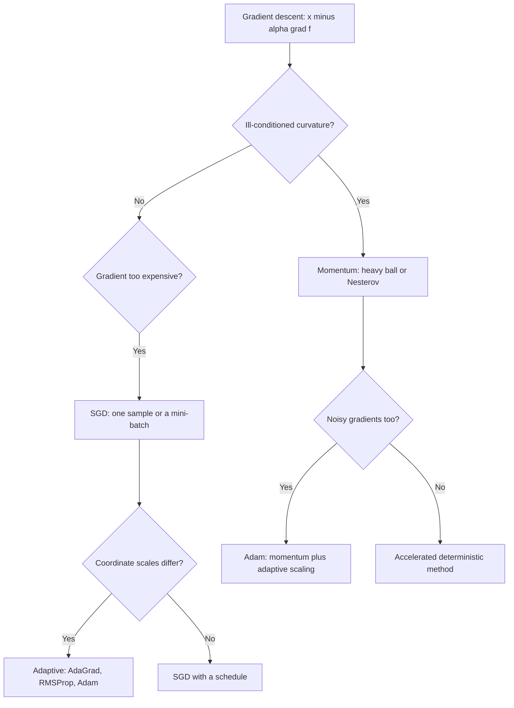

# Gradient Methods

> [Mathematics](../../README.md) › [Optimization](../README.md) · Level: Advanced · Prerequisites: [Convex Optimization](../02-convex-optimization/README.md), [Multivariable Calculus](../../07-calculus/12-multivariable-calculus/README.md), [Eigenvalues and Eigenvectors](../../08-linear-algebra/07-eigenvalues-and-eigenvectors/README.md), [Expectation and Variance](../../10-probability/05-expectation-and-variance/README.md), [Law of Large Numbers and the Central Limit Theorem](../../10-probability/06-law-of-large-numbers-and-central-limit-theorem/README.md) · Estimated time: 540 min

## 1. Introduction

Gradient descent is the most used algorithm in applied mathematics. Its rule is one line,
$x_{k+1} = x_k - \alpha\nabla f(x_k)$, and its justification is one theorem: if $\nabla f$ is Lipschitz with
constant $L$ and $0<\alpha\le1/L$, then $f(x_k)$ decreases, and for convex $f$ it approaches the optimal value at
rate $O(1/k)$ (Theorem 7.4.1). Everything else in this chapter is a variation on that line and on the hypotheses
that make the theorem true.

Three questions organise the material.

* **Why does the rule work?** Because the first-order Taylor expansion $f(x+v)\approx f(x)+\nabla f(x)^{\mathsf T}v$
  is minimised over a trust region by $v = -\alpha\nabla f(x)$; the step size is exactly the trust radius, and the
  smoothness constant is exactly the price of trusting the linear model (Section 7.1).
* **What limits the rate?** Two numbers. The smoothness $L$ bounds the step; the ratio $\kappa = L/\mu$ of
  smoothness to strong convexity determines the rate. Gradient descent needs $O(\kappa\log(1/\varepsilon))$
  iterations on a quadratic; acceleration reduces that to $O(\sqrt\kappa\log(1/\varepsilon))$ (Sections 7.3, 7.6).
* **What if the gradient is a random estimate?** Then the method is stochastic gradient descent. Unbiased noise
  costs a factor: the rate degrades from $O(1/k)$ to $O(1/\sqrt K)$, and a fixed step size leaves a permanent
  noise floor proportional to the step times the variance (Section 7.7). Mini-batching reduces the variance at a
  linear cost in computation (Section 7.8).

The chapter also treats the methods used in practice. Adaptive step sizes — AdaGrad, RMSProp, Adam — replace the
single $\alpha$ by a coordinatewise one divided by a running root-mean-square of past gradients (Section 7.9).
They are indispensable in deep learning and badly understood in theory: Adam is not guaranteed to converge on
convex problems, and the chapter explains exactly what fails. Section 7.10 collects the diagnostics that reveal a
bad step size from a training log, and Section 7.12 lists applications.

Every rate quoted here is a theorem with explicit constants and hypotheses, and each is checked on a concrete
function. Where a rate is *stated* rather than proved — the accelerated rate, the AdaGrad regret bound — the
chapter says so.

## 2. Prerequisites

**Convexity and its characterisations.** The definition, the first-order inequality
$f(y)\ge f(x)+\nabla f(x)^{\mathsf T}(y-x)$, the second-order criterion $\nabla^2f\succeq0$, strong convexity and
the descent lemma are used constantly. The first five sections of
[Convex Optimization](../02-convex-optimization/README.md) supply all of them, including the proofs.

**Multivariable calculus.** Gradients, Hessians, the second-order Taylor expansion with remainder, and the
fundamental theorem of calculus along a segment. See
[Multivariable Calculus](../../07-calculus/12-multivariable-calculus/README.md).

**Linear algebra.** Symmetric matrices, eigenvalues, the spectral theorem, positive semidefiniteness, and the
operator norm $\lVert A\rVert = \lambda_{\max}(A)$ for symmetric $A$. The analysis of the quadratic model is a
diagonalisation. See [Eigenvalues and Eigenvectors](../../08-linear-algebra/07-eigenvalues-and-eigenvectors/README.md).

**Probability.** Expectation, variance, conditional expectation, independence, and the law of large numbers. SGD
is a stochastic process, and the proof of its rate is a supermartingale argument in disguise. See
[Expectation and Variance](../../10-probability/05-expectation-and-variance/README.md) and
[Law of Large Numbers and the Central Limit Theorem](../../10-probability/06-law-of-large-numbers-and-central-limit-theorem/README.md).

**Elementary inequalities.** $1+x\le e^x$, $\log(1-x)\le-x$, and the arithmetic–geometric mean inequality. The
conversion of contraction factors into iteration counts uses logarithms throughout.

## 3. Learning Objectives

By the end of this tutorial you will be able to

1. derive gradient descent from the first-order Taylor expansion with a trust-region argument;
2. state and prove the descent lemma, and use it to identify the admissible step sizes $\alpha\le1/L$;
3. analyse gradient descent on a quadratic exactly, in terms of the eigenvalues, the step size and the condition
   number $\kappa=L/\mu$;
4. prove the $O(1/k)$ rate for convex $L$-smooth functions and the $(1-\mu/L)^k$ rate under $\mu$-strong convexity;
5. compute the optimal step $2/(L+\mu)$ for a quadratic and the resulting contraction $(\kappa-1)/(\kappa+1)$;
6. write the heavy-ball and Nesterov recursions, state their rates, and explain why acceleration helps;
7. set up SGD, decompose its error into bias and variance, prove the $O(1/\sqrt K)$ bound under a bounded second
   moment, and explain the noise floor of a constant step;
8. choose a mini-batch size from a cost model and explain the variance reduction $\sigma^2/B$;
9. write the AdaGrad, RMSProp and Adam update rules, derive the Adam bias correction, and criticise the methods'
   convergence properties;
10. diagnose a bad learning rate from a loss curve, run a sweep, detect divergence, and predict iteration counts
    from an estimated condition number.

## 4. Intuition

**Walking downhill in fog.** You stand on a hillside in fog and can see only the slope under your feet. The
gradient tells you the steepest direction uphill, so you step the other way. The only decision is how long the
step is. Too short and you crawl; too long and you overshoot the valley and climb the opposite slope. The
smoothness constant $L$ measures how quickly the slope can change, and it sets the longest safe step: a step of
$1/L$ is the largest for which the linear model you trusted remains an upper bound on the true function.

**The bowl and its eccentricity.** In a circular bowl every direction is equally stiff, and one step of the right
length lands at the bottom. In an elongated bowl the stiff direction needs a short step and the flat direction
wants a long one; a single step size must satisfy the stiff direction, so progress along the flat direction is
glacial. The ratio of the curvatures is the condition number $\kappa$, and the number of steps needed grows
linearly in $\kappa$. This is the single most important practical fact in the subject: **ill-conditioning, not
the dimension, is what makes gradient descent slow.**

**Momentum as a heavy ball.** Give the iterate mass. A heavy ball rolling in the elongated bowl accumulates speed
along the flat direction — where the gradient is consistently small but always the same sign — and is damped in
the stiff direction, where the gradient keeps changing sign. That is the heavy-ball method, and on a quadratic it
improves the dependence on $\kappa$ from $\kappa$ to $\sqrt\kappa$. Nesterov's method adds a carefully chosen
extrapolation point instead of a velocity, and achieves $O(1/k^2)$ on smooth convex functions, which is optimal
for first-order methods.

**Noise as a permanent wind.** In machine learning the gradient is estimated from a random batch, so each step is
the true gradient plus noise. Noise of zero mean is harmless in the long run but not free: with a constant step,
the iterate keeps being kicked away from the optimum by an amount proportional to the step times the noise
scale, so the error stalls at a floor instead of reaching zero. Shrinking the step removes the floor at the price
of slower progress, and the balance gives the $O(1/\sqrt K)$ rate. Reducing the noise by averaging $B$ samples
lowers the floor by a factor of $B$, which is why mini-batches are used.

**Adaptive methods as per-coordinate normalisation.** If one coordinate's gradient is consistently a hundred times
larger than another's, a single step size is either too small for the second or too large for the first. Dividing
each coordinate's step by a running average of that coordinate's gradient magnitude equalises the scales. That is
the whole idea of AdaGrad, RMSProp and Adam; the differences among them are in how the average is formed and how
momentum is combined with it.

## 5. Formal Definition

Throughout, $f:\mathbb{R}^n\to\mathbb{R}$ is differentiable, $\nabla f$ is Lipschitz with constant $L$, and
$\mu\ge0$ is a strong-convexity modulus.

**Definition 5.1 (gradient descent).** Given $x_0\in\mathbb{R}^n$ and a step size $\alpha>0$, the *gradient
descent* (GD) iteration is
$$
x_{k+1} = x_k - \alpha\nabla f(x_k), \qquad k = 0,1,2,\dots
$$

**Definition 5.2 (smoothness and strong convexity).** $f$ is *$L$-smooth* on $\mathbb{R}^n$ if
$\lVert\nabla f(x)-\nabla f(y)\rVert\le L\lVert x-y\rVert$ for all $x,y$; equivalently, if $f$ is twice
differentiable, $\nabla^2f(x)\preceq LI$. It is *$\mu$-strongly convex* if
$f(y)\ge f(x)+\nabla f(x)^{\mathsf T}(y-x)+\tfrac{\mu}{2}\lVert y-x\rVert^2$ for all $x,y$; equivalently
$\nabla^2f(x)\succeq\mu I$.

**Definition 5.3 (condition number).** When $0<\mu\le L$, the *condition number* of $f$ is $\kappa=L/\mu\ge1$. For
a quadratic $f(x)=\tfrac12x^{\mathsf T}Qx-b^{\mathsf T}x$ it equals the ratio of the extreme eigenvalues of $Q$.

**Definition 5.4 (quadratic model).** The *quadratic model* of $f$ at $x$ with curvature bound $L$ is
$f(x)+\nabla f(x)^{\mathsf T}v+\tfrac{L}{2}\lVert v\rVert^2$, whose minimiser is $v=-\nabla f(x)/L$: the GD step
with $\alpha=1/L$.

**Definition 5.5 (heavy ball and Nesterov).** *Heavy ball* (Polyak): with $\alpha>0$ and $\beta\in[0,1)$,
$$
x_{k+1} = x_k-\alpha\nabla f(x_k)+\beta(x_k-x_{k-1}).
$$
*Nesterov's accelerated gradient*: with $\alpha=1/L$ and $\beta_k = k/(k+3)$,
$$
y_k = x_k+\beta_k(x_k-x_{k-1}),\qquad x_{k+1}=y_k-\alpha\nabla f(y_k).
$$

**Definition 5.6 (stochastic gradient).** A *gradient oracle* returns $g(x,\xi)$ with
$\mathbb{E}_\xi[g(x,\xi)] = \nabla f(x)$. The *stochastic gradient descent* (SGD) iteration is
$x_{k+1}=x_k-\alpha_kg(x_k,\xi_k)$ with independent $\xi_k$. Its *bias* at $x$ is
$\lVert\mathbb{E}[g(x,\xi)]-\nabla f(x)\rVert$ and its *variance* is
$\mathbb{E}\lVert g(x,\xi)-\nabla f(x)\rVert^2$.

**Definition 5.7 (mini-batch).** With $B$ independent samples $\xi_{k,1},\dots,\xi_{k,B}$ and
$g_B = \tfrac1B\sum_{j=1}^Bg(x_k,\xi_{k,j})$, the mini-batch iteration uses $g_B$ in place of $g$. If the samples
are i.i.d. and unbiased, $\mathbb{E}[g_B]=\nabla f(x_k)$ and
$\mathbb{E}\lVert g_B-\nabla f(x_k)\rVert^2 = \sigma^2/B$.

**Definition 5.8 (adaptive methods).** With elementwise operations, a learning rate $\alpha>0$ and
$\varepsilon>0$:

*AdaGrad:* $G_k=G_{k-1}+g_k\odot g_k$, $\displaystyle x_{k+1}=x_k-\alpha\,\frac{g_k}{\sqrt{G_k}+\varepsilon}$.

*RMSProp:* $v_k=\rho v_{k-1}+(1-\rho)g_k\odot g_k$, $\displaystyle x_{k+1}=x_k-\alpha\,\frac{g_k}{\sqrt{v_k}+\varepsilon}$.

*Adam:* $m_k=\beta_1m_{k-1}+(1-\beta_1)g_k$, $v_k=\beta_2v_{k-1}+(1-\beta_2)g_k\odot g_k$,
$$
\hat m_k=\frac{m_k}{1-\beta_1^k},\qquad \hat v_k=\frac{v_k}{1-\beta_2^k},\qquad
x_{k+1}=x_k-\alpha\,\frac{\hat m_k}{\sqrt{\hat v_k}+\varepsilon}.
$$

**Definition 5.9 (regret).** For a sequence of iterates $x_1,\dots,x_K$ and a comparator $x^\star$, the *regret*
is $R_K=\sum_{k=1}^K\bigl(f(x_k)-f(x^\star)\bigr)$. An algorithm is *no-regret* on a class if
$R_K/K\to0$ uniformly.

## 6. Mathematical Notation

| Symbol | Read as | Meaning |
|---|---|---|
| $f$, $\nabla f$, $\nabla^2f$ | objective, gradient, Hessian | the data of the problem |
| $x_k$ | the $k$-th iterate | after $k$ steps |
| $x^\star$, $f^\star$ | minimiser, optimal value | $f(x^\star)=\min f$ |
| $\alpha$, $\alpha_k$ | step size, learning rate | constant or schedule |
| $L$ | smoothness constant | Lipschitz constant of $\nabla f$ |
| $\mu$ | strong-convexity modulus | curvature lower bound |
| $\kappa$ | condition number | $\kappa=L/\mu$ |
| $g_k$ | gradient estimate | $\nabla f(x_k)$ or a stochastic version |
| $\xi$ | random sample | the source of noise in $g$ |
| $\sigma^2$ | gradient variance | $\mathbb{E}\lVert g-\nabla f\rVert^2$ |
| $B$ | batch size | number of samples per gradient |
| $R$ | distance to optimum | $\lVert x_0-x^\star\rVert$ |
| $\beta$, $\beta_k$ | momentum coefficient | heavy-ball or Nesterov weight |
| $\rho$ | decay rate | RMSProp averaging factor |
| $\beta_1,\beta_2$ | Adam moments | momentum and variance decays |
| $m_k$, $v_k$ | first, second moment estimates | running averages of $g$ and $g^2$ |
| $\hat m_k$, $\hat v_k$ | bias-corrected moments | divided by $1-\beta_i^k$ |
| $\varepsilon$ | epsilon | numerical stabiliser in denominators |
| $G_k$ | accumulated squared gradients | AdaGrad state |
| $\odot$ | elementwise product | Hadamard product |
| $\mathbb{E}$ | expectation | over the sampling randomness |
| $R_K$ | regret | cumulative excess loss |

## 7. Core Concepts

### 7.1 Deriving Gradient Descent from the Taylor Expansion

The first-order Taylor expansion says that near $x$,
$$
f(x+v) \approx f(x)+\nabla f(x)^{\mathsf T}v .
$$
The linear model is unbounded below: taking $v=-t\nabla f(x)$ makes $f(x)+t\lVert\nabla f(x)\rVert^2$ decrease
without limit as $t$ grows. The expansion is only valid for small $v$, so the step must be constrained. The
simplest constraint is a trust region $\lVert v\rVert\le r$, and the minimiser of the linear model over that ball is
$v=-r\,\nabla f(x)/\lVert\nabla f(x)\rVert$: a step of length $r$ straight downhill.

The quadratic model makes the trade-off explicit. Since $\nabla f$ is $L$-Lipschitz, the function is bounded above
by its second-order expansion with curvature $L$ (this is Lemma 7.2.1 below):
$$
f(x+v)\le f(x)+\nabla f(x)^{\mathsf T}v+\frac{L}{2}\lVert v\rVert^2 .
$$
The right side is a convex quadratic in $v$, minimised by $v=-\nabla f(x)/L$. Hence the natural step is
$$
x_{k+1} = x_k-\frac{1}{L}\nabla f(x_k),
$$
and replacing $1/L$ by a tunable $\alpha$ gives Definition 5.1. The step size is therefore not a free parameter
but an estimate of $1/L$: it is the length at which the linear model stops being trustworthy.

*Worked derivation.* For $f(x)=\tfrac12x^{\mathsf T}Qx$ the quadratic model is exact along each eigendirection, with
curvature $\lambda_i$. The step $1/L$ moves a fraction $\lambda_i/L\le1$ of the way to the minimum along direction
$i$; the stiffest direction is solved in one step and the flattest barely moves. Section 7.3 makes this precise.

### 7.2 The Descent Lemma and Admissible Step Sizes

**Lemma 7.2.1 (descent lemma).** If $\nabla f$ is $L$-Lipschitz then for all $x,v$,
$$
f(x+v)\le f(x)+\nabla f(x)^{\mathsf T}v+\frac{L}{2}\lVert v\rVert^2 .
$$

*Proof.* Let $\varphi(t)=f(x+tv)$ for $t\in[0,1]$. The fundamental theorem of calculus and Cauchy–Schwarz give
$$
\varphi(1)-\varphi(0)-\nabla f(x)^{\mathsf T}v=\int_0^1\bigl[\nabla f(x+tv)-\nabla f(x)\bigr]^{\mathsf T}v\,dt
\le\int_0^1Lt\lVert v\rVert^2dt=\frac{L}{2}\lVert v\rVert^2 . \ \blacksquare
$$

**Theorem 7.2.2 (sufficient decrease).** If $\alpha\le1/L$ then the GD step satisfies
$$
f(x_{k+1})\le f(x_k)-\frac{\alpha}{2}\lVert\nabla f(x_k)\rVert^2 .
$$

*Proof.* Insert $v=-\alpha\nabla f(x_k)$ in the descent lemma:
$$
f(x_{k+1})\le f(x_k)-\alpha\lVert g_k\rVert^2+\frac{L\alpha^2}{2}\lVert g_k\rVert^2
= f(x_k)-\alpha\Bigl(1-\frac{L\alpha}{2}\Bigr)\lVert g_k\rVert^2\le f(x_k)-\frac{\alpha}{2}\lVert g_k\rVert^2,
$$
because $L\alpha\le1$ implies $1-L\alpha/2\ge\tfrac12$. $\blacksquare$

Three consequences. First, $f(x_k)$ is nonincreasing. Second, a stationary point can only be reached by making
$\lVert\nabla f(x_k)\rVert\to0$; the total squared gradient is summable, since
$\sum_k\lVert g_k\rVert^2\le\frac{2}{\alpha}\bigl(f(x_0)-\inf f\bigr)$. Third, the constant $1/L$ is sharp in
general: for $f(x)=\tfrac12\lambda x^2$ the iteration is $x_{k+1}=(1-\alpha\lambda)x_k$, which converges exactly
when $\lvert1-\alpha\lambda\rvert<1$, that is $0<\alpha<2/\lambda$. The value $\alpha=1/\lambda$ gives one-step
convergence; $\alpha=2/\lambda$ gives $x_{k+1}=-x_k$ and perpetual oscillation.

**Example 7.2.3 (the descent lemma is tight for a quadratic).** For $f(x)=\tfrac12\lambda x^2$,
$$
f(y)-f(x)-f'(x)(y-x)=\tfrac12\lambda y^2-\tfrac12\lambda x^2-\lambda x(y-x)=\tfrac12\lambda(y-x)^2,
$$
which is exactly the right side of Lemma 7.2.1 with $L=\lambda$. Hence no smaller constant can replace $L$ in the
descent lemma for this $f$, and the sufficient-decrease bound of Theorem 7.2.2 cannot be improved in general.

### 7.3 The Quadratic Model: Step Size and Condition Number

Take $f(x)=\tfrac12x^{\mathsf T}Qx-b^{\mathsf T}x$ with $Q\succ0$, eigenvalues
$\mu=\lambda_1\le\dots\le\lambda_n=L$, and minimiser $x^\star=Q^{-1}b$. In the eigenbasis the iteration decouples
into $n$ scalar recursions
$$
e_{k+1}^{(i)}=(1-\alpha\lambda_i)\,e_k^{(i)},\qquad e_k=x_k-x^\star,
$$
so $e_k^{(i)}=(1-\alpha\lambda_i)^k e_0^{(i)}$ and
$$
\lVert e_k\rVert\le\max_i\lvert1-\alpha\lambda_i\rvert^k\,\lVert e_0\rVert .
$$
The whole analysis of GD on quadratics is contained in that display.

**Theorem 7.3.1 (optimal step for a quadratic).** With $\alpha=2/(L+\mu)$,
$$
\lVert x_k-x^\star\rVert\le\Bigl(\frac{\kappa-1}{\kappa+1}\Bigr)^k\lVert x_0-x^\star\rVert,
\qquad\text{hence}\qquad
f(x_k)-f^\star\le\Bigl(\frac{\kappa-1}{\kappa+1}\Bigr)^{2k}\bigl(f(x_0)-f^\star\bigr).
$$

*Proof.* For $\lambda\in[\mu,L]$ the function $\alpha\mapsto\lvert1-\alpha\lambda\rvert$ is minimised over the
allowed set at $\alpha=1/\lambda$ with value $0$. The choice $\alpha=2/(L+\mu)$ is the one that equalises the two
extremes:
$$
1-\frac{2\mu}{L+\mu}=\frac{L-\mu}{L+\mu},\qquad
1-\frac{2L}{L+\mu}=-\frac{L-\mu}{L+\mu},
$$
so $\lvert1-\alpha\lambda\rvert\le\frac{L-\mu}{L+\mu}$ for every $\lambda\in[\mu,L]$, because the map is convex in
$\lambda$ and hence maximised at an endpoint. Write $r_i=1-\alpha\lambda_i$ and $c=\frac{\kappa-1}{\kappa+1}$, so
$\lvert r_i\rvert\le c$. In the eigenbasis,
$$
f(x_k)-f^\star=\frac12\sum_i\lambda_i\bigl(r_i^k e_0^{(i)}\bigr)^2\le c^{2k}\cdot\frac12\sum_i\lambda_i\bigl(e_0^{(i)}\bigr)^2=c^{2k}\bigl(f(x_0)-f^\star\bigr). \ \blacksquare
$$

**Remark 7.3.2 (iteration counts).** To reduce the error by a factor $1/\varepsilon$,
$k\ge\log(1/\varepsilon)/\log\bigl((\kappa+1)/(\kappa-1)\bigr)\approx\tfrac{\kappa}{2}\log(1/\varepsilon)$ steps
are needed, because $\log\bigl((\kappa+1)/(\kappa-1)\bigr)\approx2/\kappa$ for large $\kappa$. With the safe step
$1/L$ and the bound $(1-\mu/L)^k$, the count is $\kappa\log(1/\varepsilon)$: the same order. **The iteration count
is linear in the condition number.**

**Example 7.3.3.** Let $Q=\operatorname{diag}(100,1)$, so $\kappa=100$ and $\mu=1$, $L=100$, and take
$x_0=(1,1)$, $x^\star=0$. With $\alpha=2/101$ the predicted contraction per step is $99/101=0.9802$. Starting
error $f(x_0)=50.5$; after $k$ steps the bound is $50.5\cdot0.9802^{2k}$. At $k=500$ this is
$50.5\cdot2.06\times10^{-9}=1.04\times10^{-7}$, and direct computation gives $f(x_{500})=1.04\times10^{-7}$: the
bound is attained, because for this $Q$ both extreme eigenvalues give $\lvert1-\alpha\lambda\rvert=0.9802$
exactly. Since $c^{2k}\approx e^{-4k/\kappa}$, reducing $f$ by a factor $10^6$ needs
$k\approx\tfrac{\kappa}{4}\ln(10^6)\approx345$ steps.

**Example 7.3.4 (the step $1/L$ is conservative).** With the same $Q$ and $\alpha=1/L=0.01$, the stiff direction
decays by the factor $0$ in one step, while the flat direction decays by $1-0.01=0.99$ per step. The error norm is
then dominated by the flat direction, and six digits of the norm need
$k=\ln(10^{-6})/\ln(0.99)\approx1374$ steps, twice the $690$ needed with the optimal step (and far more than
acceleration requires, Section 7.6).

### 7.4 Convergence for Smooth Convex Functions

**Theorem 7.4.1 ($O(1/k)$ rate).** Let $f$ be convex and $L$-smooth, let $x^\star$ minimise $f$, and let
$x_{k+1}=x_k-\alpha\nabla f(x_k)$ with $0<\alpha\le1/L$. Then for every $k\ge1$,
$$
f(x_k)-f(x^\star)\le\frac{\lVert x_0-x^\star\rVert^2}{2\alpha k},
\qquad\text{in particular with }\alpha=\frac1L:\quad f(x_k)-f(x^\star)\le\frac{L\lVert x_0-x^\star\rVert^2}{2k}.
$$

*Proof.* Write $g_k=\nabla f(x_k)$, $\delta_k=f(x_k)-f(x^\star)$ and $r_k=\lVert x_k-x^\star\rVert$. Theorem 7.2.2
gives the *gain inequality* $\tfrac{\alpha}{2}\lVert g_k\rVert^2\le\delta_k-\delta_{k+1}$. Expanding the squared
distance and using convexity, $g_k^{\mathsf T}(x_k-x^\star)\ge\delta_k$, so
$$
r_{k+1}^2=r_k^2-2\alpha g_k^{\mathsf T}(x_k-x^\star)+\alpha^2\lVert g_k\rVert^2
\le r_k^2-2\alpha\delta_k+\alpha^2\lVert g_k\rVert^2 .
$$
Hence, using the gain inequality,
$$
\delta_k\le\frac{r_k^2-r_{k+1}^2}{2\alpha}+\frac{\alpha}{2}\lVert g_k\rVert^2
\le\frac{r_k^2-r_{k+1}^2}{2\alpha}+\delta_k-\delta_{k+1},
$$
that is $\delta_{k+1}\le(r_k^2-r_{k+1}^2)/(2\alpha)$. Summing from $0$ to $K-1$ telescopes:
$\sum_{k=0}^{K-1}\delta_{k+1}\le r_0^2/(2\alpha)$. Since $\delta_k$ is nonincreasing by the gain inequality,
$K\delta_K\le\sum_{k=0}^{K-1}\delta_{k+1}$, and the bound follows. $\blacksquare$

**Remark 7.4.2 (the rate is optimal for this class).** On the class of convex $L$-smooth functions, no
first-order method can guarantee better than $\Omega(1/k)$: there are functions in the class on which every
method that queries one gradient per step has $f(x_k)-f^\star\ge cL\lVert x_0-x^\star\rVert^2/k$ for a universal
$c>0$. Acceleration improves the *convex* case only in the constant, not the exponent; what it improves is the
dependence on the condition number, which is why Section 7.6 matters.

**Remark 7.4.3 (monotonicity and the last iterate).** Theorem 7.4.1 bounds the last iterate, because
$f(x_k)$ decreases. For SGD the analogous statement concerns the best or averaged iterate, since the iterates are
not monotone (Section 7.7).

**Example 7.4.4.** Take $f(x)=\tfrac12x^{\mathsf T}Qx$ with $Q=\operatorname{diag}(100,1)$, $x_0=(1,1)$ and
$\alpha=0.01$. The bound is $100/k$: at $k=10$ it allows $10$, at $k=1000$ it allows $0.1$. Computation gives
$f(x_{10})=0.409$, $f(x_{100})=0.0670$, $f(x_{1000})=9.3\times10^{-10}$. The bound is valid and very loose: the
function value decays geometrically along each eigendirection, but with two different rates, and the theorem only
knows the worst case.

### 7.5 Convergence Under Strong Convexity

Strong convexity converts the sublinear rate into a geometric one, because the gradient cannot become small while
the function value is far from optimal.

**Lemma 7.5.1 (gradient grows with the gap).** If $f$ is $\mu$-strongly convex and differentiable then
$$
\lVert\nabla f(x)\rVert^2\ge2\mu\bigl(f(x)-f^\star\bigr).
$$

*Proof.* Strong convexity gives $f(y)\ge f(x)+\nabla f(x)^{\mathsf T}(y-x)+\tfrac{\mu}{2}\lVert y-x\rVert^2$ for
all $y$. The right side is a convex quadratic in $y$, minimised at $y=x-\nabla f(x)/\mu$, where its value is
$f(x)-\lVert\nabla f(x)\rVert^2/(2\mu)$. Hence $f^\star\ge f(x)-\lVert\nabla f(x)\rVert^2/(2\mu)$. $\blacksquare$

**Theorem 7.5.2 (linear rate, step $1/L$).** Let $f$ be $\mu$-strongly convex and $L$-smooth, and let
$x_{k+1}=x_k-\alpha\nabla f(x_k)$ with $\alpha=1/L$. Then
$$
f(x_k)-f^\star\le\Bigl(1-\frac{\mu}{L}\Bigr)^k\bigl(f(x_0)-f^\star\bigr)=\Bigl(1-\frac1\kappa\Bigr)^k\bigl(f(x_0)-f^\star\bigr).
$$

*Proof.* Theorem 7.2.2 with $\alpha=1/L$ gives $f(x_{k+1})\le f(x_k)-\tfrac{1}{2L}\lVert g_k\rVert^2$, and
Lemma 7.5.1 gives $\lVert g_k\rVert^2\ge2\mu\delta_k$. Hence
$\delta_{k+1}\le\delta_k-\tfrac{\mu}{L}\delta_k=(1-1/\kappa)\delta_k$, and induction gives the claim. $\blacksquare$

**Remark 7.5.3 (iteration count and the optimal step).** Theorem 7.5.2 needs
$k\ge\kappa\ln(1/\varepsilon)$ steps to reduce the gap by $\varepsilon$, since
$\log(1-\mu/L)\approx-\mu/L$. For quadratics the optimal step $2/(L+\mu)$ improves the factor to
$(\kappa-1)/(\kappa+1)\approx1-2/\kappa$ (Theorem 7.3.1), giving $\tfrac{\kappa}{2}\ln(1/\varepsilon)$ — a factor
of two, not a change of order. Breaking the linear dependence on $\kappa$ requires acceleration.

**Example 7.5.4.** For $f(x)=\tfrac12\cdot10x^2$ we have $\mu=L=10$, $\kappa=1$, and Theorem 7.5.2 predicts
convergence in one step with any $\alpha\le0.1$; indeed $\alpha=0.1$ gives $x_1=0$. For
$f(x)=\tfrac12x^{\mathsf T}\operatorname{diag}(100,1)x$ the theorem gives the factor $1-0.01=0.99$ per step,
consistent with the exact factor $0.9801$ for the flat direction and $0$ for the stiff one — the theorem sees only
the worst direction.

### 7.6 Momentum and Nesterov Acceleration

**Heavy ball.** The recursion is $x_{k+1}=x_k-\alpha\nabla f(x_k)+\beta(x_k-x_{k-1})$: the new iterate keeps a
fraction $\beta$ of the previous displacement. On a quadratic with curvature $\lambda$ the error obeys
$e_{k+1}=(1-\alpha\lambda+\beta)e_k-\beta e_{k-1}$, whose characteristic polynomial is
$r^2-(1-\alpha\lambda+\beta)r+\beta$. Both roots lie inside the unit disc exactly when
$$
\beta<1\qquad\text{and}\qquad \alpha<\frac{2(1+\beta)}{\lambda},
$$
so $\beta$ relaxes the step-size restriction by the factor $1+\beta$. When the discriminant
$(1-\alpha\lambda+\beta)^2-4\beta$ is negative the roots are complex conjugates of modulus $\sqrt\beta$, so the
error decays like $\beta^{k/2}$ and oscillates. Choosing
$$
\alpha=\frac{4}{(\sqrt L+\sqrt\mu)^2},\qquad \beta=\Bigl(\frac{\sqrt\kappa-1}{\sqrt\kappa+1}\Bigr)^2
$$
puts every eigenvalue at the same modulus and gives the rate
$$
\lVert x_k-x^\star\rVert\le\Bigl(\frac{\sqrt\kappa-1}{\sqrt\kappa+1}\Bigr)^{k}\lVert x_0-x^\star\rVert
$$
for quadratics. The dependence on $\kappa$ is now through $\sqrt\kappa$: for $\kappa=10^4$ the factor is
$0.9802$ instead of $0.9998$, and the iteration count drops from about $10^4\ln(1/\varepsilon)$ to
$100\ln(1/\varepsilon)$.

**Nesterov acceleration.** Nesterov's method replaces the velocity by an extrapolation point:
$$
y_k=x_k+\beta_k(x_k-x_{k-1}),\qquad x_{k+1}=y_k-\frac1L\nabla f(y_k),\qquad \beta_k=\frac{k}{k+3}.
$$
The weight grows towards $1$, so the method behaves like heavy ball with an increasing momentum.

**Theorem 7.6.1 (accelerated rate for convex $f$).** If $f$ is convex and $L$-smooth, then Nesterov's method
satisfies
$$
f(x_k)-f(x^\star)\le\frac{2L\lVert x_0-x^\star\rVert^2}{(k+1)^2}.
$$

The proof is an *estimate sequence* argument: one constructs a sequence of quadratic lower bounds whose minima
converge at the stated rate and shows that the iterates track those minima. It is longer than the proof of
Theorem 7.4.1 and is omitted here; the statement and constant are standard.

**Theorem 7.6.2 (accelerated rate for strongly convex $f$, stated).** If $f$ is $\mu$-strongly convex and
$L$-smooth, a suitable restart or constant-momentum version of Nesterov's method satisfies
$$
f(x_k)-f^\star\le C\Bigl(1-\frac{1}{\sqrt\kappa}\Bigr)^{k}\bigl(f(x_0)-f^\star\bigr)
$$
for an absolute constant $C$. The dependence $\sqrt\kappa$ is optimal for first-order methods, so no algorithm
using only gradients can do better than a constant times this rate.

**Example 7.6.3 (acceleration on a concrete quadratic).** With $Q=\operatorname{diag}(100,1)$, $x_0=(1,1)$,
$L=100$: gradient descent with $\alpha=1/L$ has $f(x_{100})=0.0670$; Nesterov's method with $\alpha=1/L$ has
$f(x_{10})=0.323$, $f(x_{100})=1.9\times10^{-8}$, $f(x_{1000})=3.8\times10^{-11}$. The theorem's bound
$2LR^2/(k+1)^2=400/(k+1)^2$ gives $3.31$ at $k=10$ and $3.9\times10^{-2}$ at $k=100$, both satisfied. Note that
the accelerated method is not monotone: the function value can increase for a step or two, and the bound is on
each iterate, not on a running minimum.

**Example 7.6.4 (heavy ball on the same problem).** With $\alpha=4/(\sqrt{100}+1)^2=4/121=0.03306$ and
$\beta=(9/11)^2=0.6694$, the rate is $9/11=0.8182$ per step in the error norm. After $500$ steps the theorem
guarantees $\lVert x_{500}\rVert\le0.8182^{500}\lVert x_0\rVert=3.8\times10^{-44}$; computation gives
$\lVert x_{500}\rVert=2.4\times10^{-41}$, larger by a factor $6\times10^{2}$ because the repeated root contributes a
polynomial factor $(c_1+c_2k)r^k$. Since $f$ is quadratic in the error,
$f(x_{500})\approx\tfrac12\cdot100\cdot(2.4\times10^{-41})^2=2.9\times10^{-80}$, which matches direct computation.
The lesson: for a quadratic the *function value* decays like the square of the norm rate, and a stated norm rate
must be squared before it is compared with function values.

### 7.7 Stochastic Gradient Descent

In machine learning the objective is an average over data,
$$
f(x)=\frac1N\sum_{i=1}^Nf_i(x)\quad\text{or}\quad f(x)=\mathbb{E}_{\xi}\bigl[F(x,\xi)\bigr],
$$
and computing $\nabla f$ costs $N$ gradient evaluations. SGD uses one sample, or a small batch, per step. The
gradient estimate is random, so the analysis becomes an analysis of expectations, and a new phenomenon appears:
the *noise floor*.

**Lemma 7.7.1 (bias–variance decomposition).** For any estimator $g$ of $\nabla f(x)$,
$$
\mathbb{E}\lVert g-\nabla f(x)\rVert^2=\bigl\lVert\mathbb{E}g-\nabla f(x)\bigr\rVert^2+\mathbb{E}\lVert g-\mathbb{E}g\rVert^2 .
$$
The first term is the squared *bias*, the second the *variance*; for an unbiased estimator the first vanishes.

*Proof.* Expanding,
$\mathbb{E}\lVert g-\nabla f\rVert^2=\mathbb{E}\lVert g\rVert^2-2\langle\mathbb{E}g,\nabla f\rangle+\lVert\nabla f\rVert^2$
and
$\mathbb{E}\lVert g-\mathbb{E}g\rVert^2=\mathbb{E}\lVert g\rVert^2-\lVert\mathbb{E}g\rVert^2$. Subtract the second
from the first: the difference is
$\lVert\mathbb{E}g\rVert^2-2\langle\mathbb{E}g,\nabla f\rangle+\lVert\nabla f\rVert^2=\lVert\mathbb{E}g-\nabla f\rVert^2$. $\blacksquare$

**Theorem 7.7.2 (SGD with bounded second moment).** Let $f$ be convex, let $x^\star$ minimise $f$, let
$\mathbb{E}[g_k\mid x_k]=\nabla f(x_k)$ and $\mathbb{E}\bigl[\lVert g_k\rVert^2\mid x_k\bigr]\le G^2$. Then with a
constant step $\alpha>0$,
$$
\min_{0\le k<K}\mathbb{E}\bigl[f(x_k)-f^\star\bigr]\le\frac{R^2}{2\alpha K}+\frac{\alpha G^2}{2},
\qquad R=\lVert x_0-x^\star\rVert,
$$
and the choice $\alpha=R/(G\sqrt K)$ gives the bound $RG/\sqrt K$.

*Proof.* Expand the squared distance and take expectations, using $\mathbb{E}[g_k\mid x_k]=\nabla f(x_k)$:
$$
\mathbb{E}\lVert x_{k+1}-x^\star\rVert^2=\mathbb{E}\lVert x_k-x^\star\rVert^2-2\alpha\mathbb{E}\langle\nabla f(x_k),x_k-x^\star\rangle+\alpha^2\mathbb{E}\lVert g_k\rVert^2 .
$$
Convexity gives $\langle\nabla f(x_k),x_k-x^\star\rangle\ge f(x_k)-f^\star$, so
$$
2\alpha\mathbb{E}\bigl[f(x_k)-f^\star\bigr]\le\mathbb{E}\lVert x_k-x^\star\rVert^2-\mathbb{E}\lVert x_{k+1}-x^\star\rVert^2+\alpha^2G^2 .
$$
Summing over $k<K$ telescopes, and the minimum is at most the average. $\blacksquare$

Theorem 7.7.2 needs only convexity and a bounded second moment — no smoothness — and it is the stochastic
counterpart of the subgradient bound. The price of noise is visible in the exponent: $1/\sqrt K$ instead of
$1/K$. With the optimal step, the bound is $RG/\sqrt K$, and $G$ is the scale of the gradient, which for a sum of
$N$ losses is typically much larger than the curvature.

The smooth case is sharper and shows the mechanism.

**Theorem 7.7.3 (smooth convex SGD with variance $\sigma^2$).** Let $f$ be convex and $L$-smooth, let
$\mathbb{E}[g_k\mid x_k]=\nabla f(x_k)$, $\mathbb{E}\bigl[\lVert g_k-\nabla f(x_k)\rVert^2\mid x_k\bigr]\le\sigma^2$,
and let $0<\alpha\le1/L$. Then
$$
\min_{0\le k<K}\mathbb{E}\bigl[f(x_k)-f^\star\bigr]\le\frac{R^2}{2\alpha K}+\frac{\alpha\sigma^2(1+L\alpha)}{2}\le\frac{R^2}{2\alpha K}+\alpha\sigma^2 .
$$

*Proof.* The descent lemma applied to $x_{k+1}=x_k-\alpha g_k$, with
$\mathbb{E}\lVert g_k\rVert^2=\lVert\nabla f(x_k)\rVert^2+\mathbb{E}\lVert g_k-\nabla f(x_k)\rVert^2$, gives
$$
\mathbb{E}\bigl[f(x_{k+1})\mid x_k\bigr]\le f(x_k)-\alpha\lVert\nabla f(x_k)\rVert^2+\frac{L\alpha^2}{2}\bigl(\lVert\nabla f(x_k)\rVert^2+\sigma^2\bigr)\le f(x_k)-\frac{\alpha}{2}\lVert\nabla f(x_k)\rVert^2+\frac{L\alpha^2\sigma^2}{2}.
$$
Taking expectations and rearranging,
$\mathbb{E}\lVert\nabla f(x_k)\rVert^2\le\frac{2}{\alpha}\bigl(\delta_k-\delta_{k+1}\bigr)+L\alpha\sigma^2$ with
$\delta_k=\mathbb{E}[f(x_k)-f^\star]$. The distance expansion now reads
$$
2\alpha\delta_k\le r_k^2-r_{k+1}^2+\alpha^2\mathbb{E}\lVert\nabla f(x_k)\rVert^2+\alpha^2\sigma^2
\le r_k^2-r_{k+1}^2+2\alpha(\delta_k-\delta_{k+1})+\alpha^2\sigma^2(1+L\alpha),
$$
so $2\alpha\delta_{k+1}\le r_k^2-r_{k+1}^2+\alpha^2\sigma^2(1+L\alpha)$. Summing over $k<K$ and bounding by the
average gives the claim. $\blacksquare$

**Corollary 7.7.4 (the noise floor).** With a fixed step, the bound tends, as $K\to\infty$, to
$\alpha\sigma^2(1+L\alpha)/2$, which for $\alpha=1/L$ is $\sigma^2/L$. SGD with a constant step does **not**
converge to the optimum; it converges to a neighbourhood of size proportional to $\alpha\sigma^2$. To drive the
error to zero one must let $\alpha_k\to0$; the schedules $\alpha_k=\alpha_0/\sqrt k$ and $\alpha_k=\alpha_0/k$
both work, with rates $O(1/\sqrt K)$ and $O(1/K)$ under the corresponding hypotheses, and the second needs
strong convexity or a bound on the gradient noise that decays near the optimum.

**Example 7.7.5 (least squares with two data points).** Let
$f(x)=\tfrac12\mathbb{E}\bigl[(ax-b)^2\bigr]$ with the data $(a,b)\in\{(1,0),(2,3)\}$ equally weighted. Then
$f(x)=\tfrac12\cdot\tfrac12\bigl[x^2+(2x-3)^2\bigr]$, with minimiser
$x^\star=\dfrac{\mathbb{E}[ab]}{\mathbb{E}[a^2]}=\dfrac{3}{2.5}=1.2$ and $f^\star=f(1.2)=\tfrac14(1.44+0.36)=0.45$.
The single-sample gradient is $a(ax-b)$, which at $x^\star$ takes the values $+1.2$ and $-1.2$ with equal
probability, so it is unbiased there and $\sigma^2=1.44$. The Hessian is $\tfrac14(2+8)=2.5$, so $L=2.5$ and
$\alpha=0.1$ is admissible. Theorem 7.7.3 predicts a floor of
$\alpha\sigma^2(1+L\alpha)/2=0.1\cdot1.44\cdot1.25/2=0.09$; simulation gives an average excess of about $0.044$,
and halving $\alpha$ halves both the predicted floor and the observed one ($0.020$ at $\alpha=0.05$, $0.0093$ at
$\alpha=0.025$). The bound is valid and loose by a factor of two.

**Bias is different from variance.** If $\mathbb{E}[g_k]=\nabla f(x_k)+b$ with a constant bias $b$, the
recursion has the fixed point $\nabla f(x)=-b$, not $\nabla f(x)=0$: the method converges to the minimiser of
$f(x)+b^{\mathsf T}x$. For $f(x)=\tfrac12x^2$ and bias $b$, the iterates converge to $-b$ and the suboptimality is
$b^2/2$. Variance can be reduced by averaging and eventually vanishes; a bias does not average out, which is why
biased estimators (stale gradients, truncated backpropagation, quantised gradients) must be analysed separately.

### 7.8 Mini-Batching

**Lemma 7.8.1.** If $g_1,\dots,g_B$ are independent unbiased estimates of $\nabla f(x)$ with covariance $\Sigma$,
then $g_B=\tfrac1B\sum_jg_j$ is unbiased and $\operatorname{Cov}(g_B)=\Sigma/B$; in particular the squared error is
$\sigma^2/B$ when the per-sample variance is $\sigma^2$.

*Proof.* Linearity of expectation gives unbiasedness; independence gives
$\operatorname{Cov}(g_B)=\tfrac{1}{B^2}\sum_j\operatorname{Cov}(g_j)=\Sigma/B$. $\blacksquare$

The statistical gain is a factor $B$ in variance, or $\sqrt B$ in standard deviation. The computational cost per
iteration grows linearly in $B$, so the cost per unit of variance reduction is constant: batching alone does not
change the *statistical* efficiency of sampling. What it changes is the *hardware* efficiency: with a fixed
overhead $c$ per iteration and cost $m$ per sample, the time per iteration is $c+mB$, and the time to reach a
variance target $\sigma^2/B$ is proportional to $(c+mB)$ per iteration times the number of iterations, which
decreases with $B$. The optimum balances the two.

**Example 7.8.2 (choosing a batch size).** Suppose one iteration costs $c=2$ ms of overhead plus $m=0.02$ ms per
sample, and suppose the number of iterations needed is proportional to the variance, $K(B)=K_1/B$ with
$K_1=10^5$. Total time $T(B)=K_1(c+mB)/B=K_1(c/B+m)$. This decreases in $B$ and tends to
$K_1m=2000$ ms; at $B=100$ it is $10^5(0.02+0.02)=4000$ ms, at $B=1000$ it is $10^5(0.002+0.02)=2200$ ms, and at
$B=10^4$ it is $10^5(0.0002+0.02)=2020$ ms. The returns are already negligible beyond $B\approx1000$; the model
says to batch until the overhead is small compared with the arithmetic, and no further. With a finite memory
budget the constraint is $B\le B_{\max}$, and the optimum is $\min(B_{\max},c/m)$ in this simple model.

Two cautions. Very large batches reduce the number of parameter updates for a fixed number of samples, which can
hurt generalisation in practice; and the linear variance reduction assumes i.i.d. samples, which fails when the
batch is drawn without replacement from a small dataset.

### 7.9 Adaptive Methods

The methods of Definition 5.8 replace the scalar $\alpha$ by a coordinatewise step divided by the root of a
running average of squared gradients. The motivation is scale: if coordinate $i$ has gradients a hundred times
larger than coordinate $j$, a single step is too large for $i$ and too small for $j$.

**AdaGrad.** $G_k=G_{k-1}+g_k\odot g_k$ and $x_{k+1}=x_k-\alpha g_k/(\sqrt{G_k}+\varepsilon)$. Since $G_k$ is
nondecreasing, the effective step $\alpha/\sqrt{G_{k,i}}$ never increases: coordinates with large accumulated
gradient are frozen, coordinates with rare gradient keep moving. The method has a regret bound of the form
$R_K\le C\sqrt K$ with $C$ depending on the diameter of the feasible set and on $\max_k\lVert g_k\rVert_\infty$
and growing like $\sqrt d$ in the dimension, so the average regret tends to zero at rate $O(1/\sqrt K)$; the bound
is stated, not proved, here. The fatal weakness is the monotone decay: after many steps the effective step is so
small that learning stops, which is why AdaGrad is used for sparse problems and short runs.

**RMSProp.** $v_k=\rho v_{k-1}+(1-\rho)g_k\odot g_k$ with $\rho\in[0,1)$ replaces the sum by an exponential
average, so the effective step can recover when gradients shrink. It has no comparable convergence guarantee; it
is a practical fix.

**Adam.** With two exponential averages, $m_k$ of the gradient and $v_k$ of the square, the naive estimates are
biased towards zero at the start: if $m_0=0$ and the gradient were constantly $g$, then
$m_k=(1-\beta_1^k)g$, which is $0.1g$ at $k=1$ with $\beta_1=0.9$. Dividing by $1-\beta_1^k$ corrects exactly this,
and similarly for $v$: the *bias correction* is the statement $\hat m_k=g$ and $\hat v_k=g^2$ under a constant
gradient. The update is then a step of approximately $\alpha$ in the direction of the normalised momentum, and in
one dimension with a constant gradient it is exactly $\alpha\operatorname{sign}(g)$.

**Example 7.9.1 (three methods on one gradient sequence).** Take $\alpha=0.1$, $\rho=0.9$, $\beta_1=0.9$,
$\beta_2=0.999$, $\varepsilon=10^{-8}$ and the gradient sequence $g_1=2$, $g_2=0.1$, $g_3=0.1$.

*AdaGrad.* $G_1=4$, step $=0.1\cdot2/2=0.1$; $G_2=4.01$, step $=0.1\cdot0.1/2.0025=0.004994$; $G_3=4.02$,
step $=0.004988$. The step collapses after one coordinate's large gradient.

*RMSProp.* $v_1=0.1\cdot4=0.4$, step $=0.1\cdot2/\sqrt{0.4}=0.316$; $v_2=0.9\cdot0.4+0.1\cdot0.01=0.361$, step
$=0.1\cdot0.1/\sqrt{0.361}=0.0166$.

*Adam.* $m_1=0.2$, $v_1=0.001\cdot4=0.004$, so $\hat m_1=0.2/0.1=2$ and $\hat v_1=0.004/0.001=4$, giving
step $=0.1\cdot2/2=0.1$. Then $m_2=0.9\cdot0.2+0.1\cdot0.1=0.19$, $\hat m_2=0.19/0.19=1$,
$v_2=0.999\cdot0.004+0.001\cdot0.01=0.004006$, $\hat v_2=0.004006/0.001999=2.004$, giving
step $=0.1/\sqrt{2.004}=0.0706$. The step does not collapse, and the momentum keeps it pointing the old way.

**A critical discussion.** Adaptive methods dominate deep-learning practice, and their theory is much weaker than
that of plain GD.

1. *Adam can diverge.* On a convex problem, Adam's effective step $\alpha/\sqrt{\hat v_k}$ can *increase* when
   gradients become small but noisy, because the exponential average of $g^2$ falls faster than the momentum of
   $g$. Reddi, Kale and Kumar (2018) give a simple convex counterexample in which Adam diverges while
   $\hat v_k$ oscillates, and propose AMSGrad, which uses the running maximum of $v_k$ in the denominator and
   restores a convergence guarantee.
2. *Weight decay is not $\ell_2$ regularisation.* Adding $\lambda x$ to the gradient and letting Adam rescale it
   gives an effective penalty that depends on the gradient magnitudes. AdamW applies the decay directly to the
   parameter, $x_{k+1}=(1-\alpha\lambda)x_k-\alpha\hat m_k/(\sqrt{\hat v_k}+\varepsilon)$, which is what "weight
   decay" means.
3. *The $\varepsilon$ matters.* It sets the behaviour when $\sqrt{\hat v}\ll\varepsilon$; placing it inside the
   square root, or outside, changes the method. In well-conditioned, large-gradient regimes it is irrelevant; in
   the tail it decides whether the step is bounded.
4. *The method is not rotation invariant.* The diagonal preconditioner equalises coordinate scales but not
   eigenvalue scales of the Hessian: rotating the parameterisation changes the iterates. AdaGrad and Adam are
   invariant to diagonal rescaling of the gradient, not to general linear changes of variable.
5. *Memory.* Adam stores two extra numbers per parameter, tripling the optimiser state relative to plain SGD with
   momentum; for large models this is a real cost.
6. *Generalisation.* In several image-classification benchmarks SGD with momentum generalises better than Adam at
   equal training loss, and the gap shrinks with tuned schedules and decoupled decay. The evidence is
   setting-dependent, so the honest statement is that adaptive methods trade some implicit regularisation for
   convenience.

### 7.10 Practical Diagnostics

A training run is an experiment, and most failures are visible in the first few hundred steps.

**Learning-rate sweep.** Train short runs on a logarithmic grid, say $\{10^{-5},3\cdot10^{-5},10^{-4},\dots,1\}$,
plotting loss against step for each. The best curve decreases fastest without spikes; the plateau of the
worst-performing rate is informative too. A single run with a linearly increasing rate (a "learning-rate finder")
gives the same information in one pass: the loss decreases until the rate passes the stability threshold and
then rises sharply, and a good constant is an order of magnitude below the minimum.

**Divergence.** The signature is a loss that increases from the first steps, or explodes to `NaN`. For a
quadratic the threshold is exact: the iteration $x_{k+1}=(1-\alpha\lambda)x_k$ diverges as soon as
$\alpha>2/\lambda_{\max}$, so an estimate of the largest Hessian eigenvalue gives an exact bound. For neural
networks, $\alpha$ above the threshold produces a sawtooth loss, then overflow; remedies are to divide the rate by
$10$, to clip the gradient norm, and to warm up over a few hundred steps.

**Too small a rate.** The loss decreases smoothly but slowly, and the curve is nearly straight on a log-log plot
with slope close to $-1$ (consistent with $O(1/k)$). Doubling the rate halves the time; if doubling produces
spikes, the original rate was already near the stability limit.

**Oscillation.** A loss that alternates up and down with constant amplitude indicates $\alpha$ close to
$2/L$; the fix is to halve it, or to add momentum, which relaxes the bound to $\alpha<2(1+\beta)/L$.

**Estimate $L$ and $\mu$.** On a quadratic they are the extreme Hessian eigenvalues; on a general problem they can
be estimated by power iteration on Hessian-vector products (each costing one gradient difference), which also
gives $\kappa$ and hence the predicted iteration count $\tfrac{\kappa}{2}\ln(1/\varepsilon)$. This number is
usually the most useful single diagnostic: if it exceeds the compute budget, no tuning of $\alpha$ will help and
one needs acceleration, preconditioning, or a better-conditioned parameterisation.

**Sanity checks.** Verify the gradient by finite differences on a random direction: the relative error should be
about $10^{-6}$ in double precision. Run the optimiser on a tiny problem with a known closed-form solution (a
least-squares fit, a quadratic) and check that it reaches the answer. Check that the model can drive the training
loss to zero on a handful of examples; if it cannot, the bug is in the model or the data, not in the optimiser.

**Schedules.** Constant steps are for analysis. In practice one uses step decay (multiplying $\alpha_k$ by
$\gamma<1$ every $T$ steps), inverse-time decay ($\alpha_k=\alpha_0/(1+k/T)$), or cosine annealing
($\alpha_k=\tfrac{\alpha_0}{2}\bigl(1+\cos(\pi k/K)\bigr)$), often with a linear warmup. A schedule changes the
constant and the noise floor, not the exponent: it drives $\alpha_k\to0$ so that Corollary 7.7.4's floor
disappears.

### 7.11 Beyond Gradient Descent

*Newton's method* uses $x_{k+1}=x_k-[\nabla^2f(x_k)]^{-1}\nabla f(x_k)$; it converges quadratically near a
strict local minimum but costs $O(n^3)$ per step and needs the Hessian. *Quasi-Newton* methods (BFGS, L-BFGS)
build an approximation to the inverse Hessian from gradient differences at cost $O(n^2)$ per step and are the
default for medium-scale smooth problems. *Conjugate gradient* needs only matrix-vector products and is the
standard for large sparse quadratics. *Accelerated proximal* methods (FISTA) combine Nesterov's momentum with the
proximal step of composite problems. *Coordinate descent* updates one coordinate at a time and is competitive when
each coordinate update is cheap. All of them are refinements of the two ideas of this chapter: use curvature
information to fix the conditioning, and use momentum to escape the $\kappa$ barrier.

## 8. Formulas and Properties

| Method | Hypotheses | Step | Guarantee | Status |
|---|---|---|---|---|
| GD | convex, $L$-smooth | $\alpha\le1/L$ | $f(x_k)-f^\star\le\lVert x_0-x^\star\rVert^2/(2\alpha k)$ | proved, 7.4.1 |
| GD | $\mu$-strongly convex, $L$-smooth | $\alpha=1/L$ | $\bigl(1-1/\kappa\bigr)^k\bigl(f(x_0)-f^\star\bigr)$ | proved, 7.5.2 |
| GD | quadratic, eigenvalues in $[\mu,L]$ | $\alpha=2/(L+\mu)$ | norm $\bigl(\frac{\kappa-1}{\kappa+1}\bigr)^k$, value squared | proved, 7.3.1 |
| Heavy ball | quadratic, eigenvalues in $[\mu,L]$ | $\alpha=\frac{4}{(\sqrt L+\sqrt\mu)^2}$, $\beta=\bigl(\frac{\sqrt\kappa-1}{\sqrt\kappa+1}\bigr)^2$ | norm $\bigl(\frac{\sqrt\kappa-1}{\sqrt\kappa+1}\bigr)^k$ | proved by roots, 7.6 |
| Nesterov | convex, $L$-smooth | $\alpha=1/L$, $\beta_k=k/(k+3)$ | $2L\lVert x_0-x^\star\rVert^2/(k+1)^2$ | stated, 7.6.1 |
| Nesterov | $\mu$-strongly convex, $L$-smooth | constant momentum | $C\bigl(1-1/\sqrt\kappa\bigr)^k\bigl(f(x_0)-f^\star\bigr)$ | stated, 7.6.2 |
| SGD | convex, $\mathbb{E}\lVert g\rVert^2\le G^2$ | $\alpha$ constant | $\min_k\mathbb{E}[f(x_k)-f^\star]\le R^2/(2\alpha K)+\alpha G^2/2$ | proved, 7.7.2 |
| SGD | convex, $L$-smooth, variance $\sigma^2$ | $\alpha\le1/L$ | $R^2/(2\alpha K)+\alpha\sigma^2(1+L\alpha)/2$ | proved, 7.7.3 |
| Mini-batch | i.i.d. unbiased samples | batch $B$ | variance $\sigma^2/B$ | proved, 7.8.1 |
| AdaGrad | convex, bounded $\lVert g\rVert_\infty$ | $\alpha$ constant | regret $R_K=O(\sqrt K)$, constant $\propto\sqrt d$ | stated, 7.9 |
| Adam | none | any | no general convergence guarantee | counterexample, 7.9 |

## 9. Step-by-Step Examples

### Example 9.1 (easy): Three Steps by Hand

Let $f(x)=x^2-4x+7$ and run GD from $x_0=0$ with $\alpha=0.1$.

*The recursion.* $f'(x)=2x-4$, so $x_{k+1}=x_k-0.1(2x_k-4)=0.8x_k+0.4$. The fixed point solves $x=0.8x+0.4$,
giving $x=2$, the minimiser. Subtracting, $x_{k+1}-2=0.8(x_k-2)$, hence $x_k=2-2(0.8)^k$.

*The first three iterates.* $x_1=0.4$, $x_2=0.72$, $x_3=0.976$; the function values are
$f(0.4)=5.56$, $f(0.72)=4.6384$, $f(0.976)=4.048576$, decreasing towards $f(2)=3$.

*The bound.* $L=2$, $R=\lvert x_0-x^\star\rvert=2$, so $f(x_k)-f^\star\le R^2/(2\alpha k)=20/k$: at $k=3$ the bound
is $6.67$ and the true gap is $1.049$. Valid and loose, as expected from a worst-case bound. ✓

### Example 9.2 (easy–medium): The Four Regimes of the Step Size

Let $f(x)=\tfrac12\cdot4x^2$, so $L=4$ and $x_{k+1}=(1-4\alpha)x_k$.

| $\alpha$ | factor $1-4\alpha$ | behaviour |
|---|---|---|
| $0.05$ | $0.8$ | monotone decay, rate $0.8$ |
| $0.25=1/L$ | $0$ | one-step convergence |
| $0.4$ | $-0.6$ | alternating decay, rate $0.6$ |
| $0.5=2/L$ | $-1$ | oscillation, no convergence |
| $0.6$ | $-1.4$ | divergence |

The admissible range for convergence is $0<\alpha<2/L$, exactly as the scalar analysis predicts; the sufficient
condition of Theorem 7.2.2, $\alpha\le1/L$, is half of it. The gap between $1/L$ and $2/L$ is real: on a
quadratic the larger range converges, but the safe range is what the general proof guarantees, and on nonquadratic
functions the larger range can fail.

### Example 9.3 (medium): Iteration Counts and the Condition Number

For $f(x)=\tfrac12x^{\mathsf T}Qx$ with eigenvalues in $[\mu,L]$ and the optimal step $2/(L+\mu)$, reducing the
error norm by $10^{-3}$ requires about $k=\ln(10^{-3})/\ln\bigl((\kappa+1)/(\kappa-1)\bigr)$ steps. For
$\kappa=10$: the factor is $9/11=0.818$, so $k\approx69$. For $\kappa=100$: factor $0.9802$, $k\approx690$. For
$\kappa=1000$: factor $0.998$, $k\approx6900$. Each decade of $\kappa$ costs a decade of iterations.

Measured on $Q=\operatorname{diag}(100,1)$ with $x_0=(1,1)$ and target $f\le10^{-6}f(x_0)$: $k=346$, against the
predicted $690$ for the norm; the gain comes from the stiff eigendirection being solved almost immediately, so
the effective initial error is much smaller than $\lVert x_0\rVert$. ✓

### Example 9.4 (medium): Four Methods on the Same Quadratic

$Q=\operatorname{diag}(100,1)$, $x_0=(1,1)$, target $f\le10^{-6}f(x_0)$, measured iteration counts:

| Method | Setting | Iterations |
|---|---|---|
| GD | $\alpha=1/L=0.01$ | $458$ |
| GD | $\alpha=2/(L+\mu)=0.0198$ | $346$ |
| Heavy ball | $\alpha=4/121$, $\beta=(9/11)^2$ | $58$ |
| Nesterov | $\alpha=1/L$ | $37$ |

The ordering is exactly what the rates predict: the $\kappa$ dependence of GD is replaced by $\sqrt\kappa$ for
heavy ball, and Nesterov adds the $1/k^2$ decay. The absolute numbers are smaller than the asymptotic predictions
because the starting point has most of its mass in the stiff direction, which every method solves quickly.

### Example 9.5 (medium–hard): The Noise Floor of SGD

Let $f(x)=\tfrac12\mathbb{E}\bigl[(ax-b)^2\bigr]$ with data $(a,b)\in\{(1,2),(2,2)\}$ equally weighted. Then
$$
f(x)=\tfrac14\bigl[(x-2)^2+(2x-2)^2\bigr],\qquad x^\star=\frac{\mathbb{E}[ab]}{\mathbb{E}[a^2]}=\frac{3}{2.5}=1.2,\qquad f^\star=0.2 .
$$
The Hessian is $\tfrac14(2+8)=2.5=L$. At $x^\star$ the single-sample gradient $a(ax-b)$ equals $-0.8$ for the
first datum and $+0.8$ for the second, so the estimator is unbiased there with $\sigma^2=0.64$.

Theorem 7.7.3 with $\alpha=0.1$ predicts the floor $\alpha\sigma^2(1+L\alpha)/2=0.1\cdot0.64\cdot1.25/2=0.04$;
simulation gives an average excess of $0.019$ over $2500$ steps. With $\alpha=0.05$ the predicted floor is
$0.018$ and the observed excess is $0.0086$: halving the step halves the floor, and the bound is loose by a factor
of about two in both cases. The floor is not a bug; it is the term $\alpha\sigma^2$ of the theorem, and the only
way to remove it is to let $\alpha_k\to0$.

### Example 9.6 (hard): Why Adaptive Scaling Helps

Take $f(x)=\tfrac12(100x_1^2+x_2^2)$, $x_0=(1,1)$, so $L=100$ and $\kappa=100$. GD with $\alpha=1/L$ gives
$f(x_{100})=6.70\times10^{-2}$ and $f(x_{200})=8.98\times10^{-3}$ (Example 9.3). AdaGrad with $\alpha=0.5$ and
$\varepsilon=10^{-12}$ gives $f(x_{10})=4.87\times10^{-4}$ and $f(x_{50})=1.8\times10^{-23}$: it is faster by a
factor of about $10^{20}$ at $k=50$.

The reason is visible in the update. At the first step $G_1=g_1\odot g_1$, so the displacement is
$\alpha\,g_1/\lvert g_1\rvert=\alpha\operatorname{sign}(g_1)$ in each coordinate: the step has length $\alpha$ in
*both* coordinates, regardless of the curvature. Since $g_i=\lambda_ix_i$, dividing by $\lvert g_i\rvert$ cancels
the curvature exactly, and every coordinate moves at the same speed — a diagonal Newton-like scaling in which the
stiff coordinate is no longer penalised. The denominator keeps growing, so the steps shrink and the method
contracts geometrically. On a deterministic quadratic AdaGrad therefore behaves like a preconditioned GD with the
right diagonal preconditioner, which is exactly what plain GD lacks.

The example also shows the danger: with $\alpha=1$ and $x_0=(1,1)$ the first step is exactly $-1$ in each
coordinate, so the method lands exactly on the minimiser and appears to converge in one step. That is an artefact
of the initial point, not a general property.

### Example 9.7 (hard): Reading a Training Log

Three runs of the same model are summarised by their loss at steps $1,10,100,1000$:

| Run | $L_1$ | $L_{10}$ | $L_{100}$ | $L_{1000}$ | Diagnosis |
|---|---|---|---|---|---|
| A | $2.31$ | $1.02$ | $0.31$ | $0.28$ | rate too small after step 100; the curve flattens while still high |
| B | $2.30$ | $0.61$ | `nan` | `nan` | divergence: the rate exceeds $2/L$; halve it or clip |
| C | $2.31$ | $1.98$ | $1.99$ | $1.97$ | oscillation with constant amplitude: rate near $2/L$ |

*Reading.* Run B is unambiguous: an overflow after a decrease means the step was near the stability limit and
one unlucky curvature triggered the blow-up. Run C's flat oscillation is the signature of a factor close to $-1$
in the stiffest direction, so the fix is to halve the rate, not to increase it. Run A decreased by a factor of
seven in the first hundred steps and then stalled at $0.28$; the stall is either the noise floor $\alpha\sigma^2$
of Corollary 7.7.4 or a genuine local difficulty. The discriminating test is to halve $\alpha$: if the loss settles
lower, it was the floor; if it settles at the same value, it is the model.

*Quantitative check for B.* With an estimated $L=8$ from a Hessian-vector power iteration, the threshold is
$2/L=0.25$. A run with $\alpha=0.3$ is above it and must diverge, which is exactly what the log shows; the
recommended rate is $0.1$, an order of magnitude below the threshold.

## 10. Visual Explanations

The family tree of the methods of this chapter, with the defect that each variant repairs:

A table of the failures the diagnostics of Section 7.10 detect:

| Observation | Likely cause | First remedy |
|---|---|---|
| loss rises immediately or becomes `NaN` | $\alpha>2/L$ | divide $\alpha$ by $10$, clip gradients |
| constant-amplitude oscillation | $\alpha$ close to $2/L$ | halve $\alpha$, or add momentum |
| smooth but very slow decrease | $\alpha$ far below $1/L$, or $\kappa$ large | raise $\alpha$; accelerate or precondition |
| loss stalls at a positive value | noise floor $\alpha\sigma^2$ | decay $\alpha_k$, or increase the batch |
| loss decreases then jumps at random steps | a few samples with huge gradients | gradient clipping, smaller $\alpha$ |
| training loss falls, validation rises | overfitting | regularisation, not an optimiser change |

## 11. Common Mistakes

**1. Choosing the step size without estimating $L$.** The safe range is $\alpha\le1/L$ and the stability threshold
is $2/L$; guessing without an estimate wastes the tuning budget. A power iteration on Hessian-vector products
gives $L$ in a few dozen gradient evaluations.

**2. Believing $\alpha\le1/L$ is necessary.** It is sufficient. On a quadratic the true range is $0<\alpha<2/L$,
and the optimal step is $2/(L+\mu)$, which exceeds $1/L$ whenever $\mu<L$. The general proof needs $1/L$; practice
can be more aggressive.

**3. Comparing a norm rate with a function value.** For a quadratic, $f-f^\star$ is quadratic in the error, so a
rate $c^k$ for the norm is a rate $c^{2k}$ for the function. Example 7.6.4 shows how a factor of $10^{36}$ can
appear from this slip.

**4. Thinking momentum always helps.** With a step above $2(1+\beta)/L$ the heavy ball diverges even though the
plain method with the same step would converge; momentum relaxes the bound by $1+\beta$ but also amplifies an
existing instability.

**5. Expecting constant-step SGD to converge to the minimiser.** It does not: the floor is
$\alpha\sigma^2(1+L\alpha)/2$. Only $\alpha_k\to0$ removes it, at the cost of a slower exponent.

**6. Using the last iterate of SGD in the analysis.** The iterates are not monotone. The correct statement is
about the best iterate, or about a Polyak–Ruppert average $\bar x_K=\frac1K\sum_{k<K}x_k$; for the average the
same $O(1/\sqrt K)$ bound holds without the "min".

**7. Believing that a larger batch improves the statistics per sample.** Mini-batching divides the variance of the
*gradient estimate* by $B$; the variance per sample is unchanged. The gain is per iteration, not per unit of
computation.

**8. Believing Adam converges because it works.** It does not converge in general; the effective step can grow
when gradients are small and noisy. AMSGrad and a decaying $\alpha$ repair the counterexamples, and neither is
the default in most libraries.

**9. Confusing a change of units with a change of conditioning.** Multiplying coordinate $i$ by a constant
rescales GD's progress, and an adaptive method removes this effect; but no diagonal scaling changes the eigenvalue
ratio of the Hessian, so the intrinsic $\kappa$ remains.

**10. Forgetting that $L$ is local.** In a neural network $L$ changes during training and differs between layers;
a step that is stable at initialisation can become unstable later, which is why warmup and schedules exist.

**11. Reading a plateau as a bug.** If the loss flattens at a positive value while the gradient norm is small and
the step is constant, the cause is the noise floor, not an implementation error. Halving $\alpha$ distinguishes
the two cases.

**12. Trusting training loss as evidence about generalisation.** The optimiser minimises the training objective;
whether that helps on new data is a statistical question, and the two can move in opposite directions.

## 12. Applications

**Training neural networks.** Every deep-learning training loop is SGD, mini-batch SGD, or an adaptive variant,
applied to a nonconvex objective. The theory of this chapter does not apply directly, but the diagnostics do: the
condition number of the loss landscape, the noise floor, and the $2/L$ threshold govern practice. Techniques such
as batch normalisation and residual connections are, among other things, preconditioners that reduce the effective
$\kappa$.

**Generalised linear models.** Logistic and Poisson regression minimise a convex negative log-likelihood; Newton's
method converges in a handful of iterations, and gradient descent is used when the number of parameters is large
or the data arrive in a stream. The Hessian is $X^{\mathsf T}WX$ with $W$ the diagonal of variances, so the
condition number is that of the weighted design matrix.

**Large-scale least squares.** For $f(x)=\tfrac12\lVert Ax-b\rVert^2$ with $A$ tall, $L=\lambda_{\max}(A^{\mathsf T}A)$
and $\mu=\lambda_{\min}(A^{\mathsf T}A)$; the condition number is the square of that of $A$, which is why normal
equations square the difficulty and why LSQR and conjugate gradient are preferred.

**Reinforcement learning.** Policy-gradient methods estimate $\nabla_\theta J(\theta)$ by sampling trajectories;
the estimator is unbiased but has enormous variance. Variance reduction (baselines, advantage estimates) plays the
role of mini-batching, and the same noise-floor analysis explains why the policy stops improving with a constant
step.

**Distributed and federated learning.** Multiple workers compute gradients on different shards; the aggregated
gradient is still unbiased, but the variance across workers adds to the batch variance, and communication cost
becomes the analogue of the per-iteration overhead in Example 7.8.2.

**Matrix factorisation and recommender systems.** Alternating least squares and SGD on the factored objective are
the standard methods; the objective is nonconvex, so the guarantees are local, but the per-coordinate
subproblems are convex quadratics and the conditioning of the factor matrices drives the convergence.

## 13. Exercises

The problem set is in [exercises.md](exercises.md): 36 problems in four levels, from computing three steps by hand
and one AdaGrad update to full proofs of the $O(1/k)$ and linear rates, the heavy-ball stability analysis, the SGD
bound, and the analysis of adaptive methods. Attempt them before opening the solutions.

## 14. Solutions

Every exercise is solved in full in [solutions.md](solutions.md), with the strategy stated first, every algebraic
step shown, and a numerical verification wherever one is possible.

## 15. Summary

* Gradient descent is the minimiser of the linear model over a trust region of radius $\alpha$; the safe radius is
  $1/L$, and the curvature bound $L$ is what makes the linear model an upper bound.
* On a quadratic the error decays as $\lvert1-\alpha\lambda\rvert^k$ in each eigendirection; the condition number
  $\kappa=L/\mu$ sets the iteration count, which is linear in $\kappa$ for GD and in $\sqrt\kappa$ for accelerated
  methods.
* Convex $L$-smooth $f$ with $\alpha\le1/L$ satisfies $f(x_k)-f^\star\le\lVert x_0-x^\star\rVert^2/(2\alpha k)$;
  $\mu$-strong convexity improves this to $(1-1/\kappa)^k$.
* Heavy ball attains $(\sqrt\kappa-1)/(\sqrt\kappa+1)$ per step on quadratics and Nesterov attains
  $2L\lVert x_0-x^\star\rVert^2/(k+1)^2$ for convex $f$; both rates are optimal in their classes.
* SGD with an unbiased gradient and bounded second moment converges at $O(1/\sqrt K)$; with a fixed step it
  stalls at a noise floor proportional to $\alpha\sigma^2$, and mini-batching reduces $\sigma^2$ to $\sigma^2/B$.
* Bias does not average out; variance does.
* AdaGrad, RMSProp and Adam divide the step by a running root-mean-square of past gradients; they are effective
  in practice and lack general convergence guarantees, with Adam admitting explicit convex counterexamples.
* Learning-rate sweeps, divergence detection, and an estimate of $L$ and $\kappa$ answer almost every practical
  question about a training run.

## 16. Further Learning

**Textbooks and surveys.** Nesterov, *Lectures on Convex Optimization* (Springer, 2018) is the reference for the
rates, the estimate-sequence proofs and the lower bounds. Boyd and Vandenberghe, *Convex Optimization* (Cambridge,
2004), chapter 9, develops descent methods and the condition-number analysis. Bottou, Curtis and Nocedal,
"Optimization methods for large-scale machine learning" (*SIAM Review*, 2018) is the standard survey of SGD,
mini-batching and adaptive methods. Goodfellow, Bengio and Courville, *Deep Learning* (MIT Press, 2016), chapter 8,
covers the practical side. Polyak, *Introduction to Optimization* (1987) is the original source for heavy ball.

**Papers.** Kingma and Ba, "Adam: a method for stochastic optimization" (ICLR 2015), for the algorithm and its
bias correction; Reddi, Kale and Kumar, "On the convergence of Adam and beyond" (ICLR 2018), for the counterexample
and AMSGrad; Loshchilov and Hutter, "Decoupled weight decay regularization" (ICLR 2019), for AdamW; Duchi, Hazan
and Singer, "Adaptive subgradient methods for online learning and stochastic optimization" (*JMLR*, 2011), for
AdaGrad and its regret bound.

**Next topics.** [Convex Optimization](../02-convex-optimization/README.md) supplies the theory of smoothness,
strong convexity and duality used throughout. [Numerical Analysis](../../19-numerical-analysis/01-floating-point-arithmetic/README.md)
explains why large steps overflow and why `NaN` appears. For the optimisation of models, see
[Linear Regression](../../11-statistics/04-linear-regression/README.md), whose normal equations are solved by the
methods of Section 7.11.

