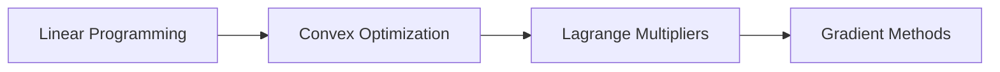

<!-- Generated by tools/build_indexes.py from tools/curriculum.json. Do not edit by hand. -->

# Optimization

*Finding the best answer*

[Mathematics](../README.md) › Optimization

Linear programming, convexity, Lagrange multipliers and gradient methods: the mathematics behind scheduling, engineering design and machine learning.

## At a glance

| | |
|---|---|
| Topics | 4 (0 complete, 0 draft, 4 planned) |
| Estimated study time | ~37 hours |
| Prerequisites | [08-linear-algebra](../08-linear-algebra/README.md), [07-calculus](../07-calculus/README.md) |

## Study order

The numbers are the recommended order. Study a topic only after the ones before it —
the dependency chain below is the shortest safe route through the discipline.

## Topic inventory

| # | Topic | Level | Est. time | Status | Materials |
|---|---|---|---|---|---|
| 1 | Linear Programming | Intermediate | 9 h | Planned | — |
| 2 | Convex Optimization | Advanced | 11 h | Planned | — |
| 3 | Lagrange Multipliers | Advanced | 8 h | Planned | — |
| 4 | Gradient Methods | Advanced | 9 h | Planned | — |

### What each topic covers

- **Linear Programming** — Feasible regions, the simplex method, duality and sensitivity.
- **Convex Optimization** — Convex sets and functions, duality, KKT conditions and optimality certificates.
- **Lagrange Multipliers** — Equality and inequality constraints, the geometry behind the multiplier.
- **Gradient Methods** — Gradient descent, convergence rates, stochastic and accelerated variants.

## Related disciplines

- [19-numerical-analysis](../19-numerical-analysis/README.md)
- [22-mathematical-modeling](../22-mathematical-modeling/README.md)
- [23-applied-mathematics](../23-applied-mathematics/README.md)

## Status key

- **Complete** — tutorial, exercises and full solutions exist and the tutorial meets the
  [authoring standard](../CONTRIBUTING.md).
- **Draft** — some material exists but the topic is not finished.
- **Planned** — identified in the curriculum, not written yet.

Overall progress and the full topic inventory live in [ROADMAP.md](../ROADMAP.md).
