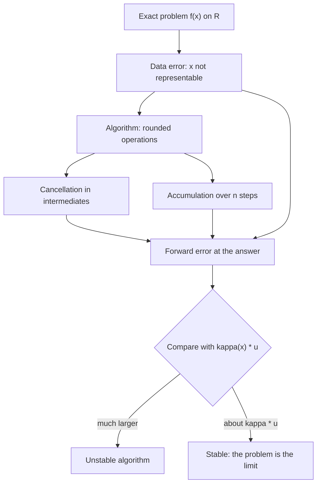
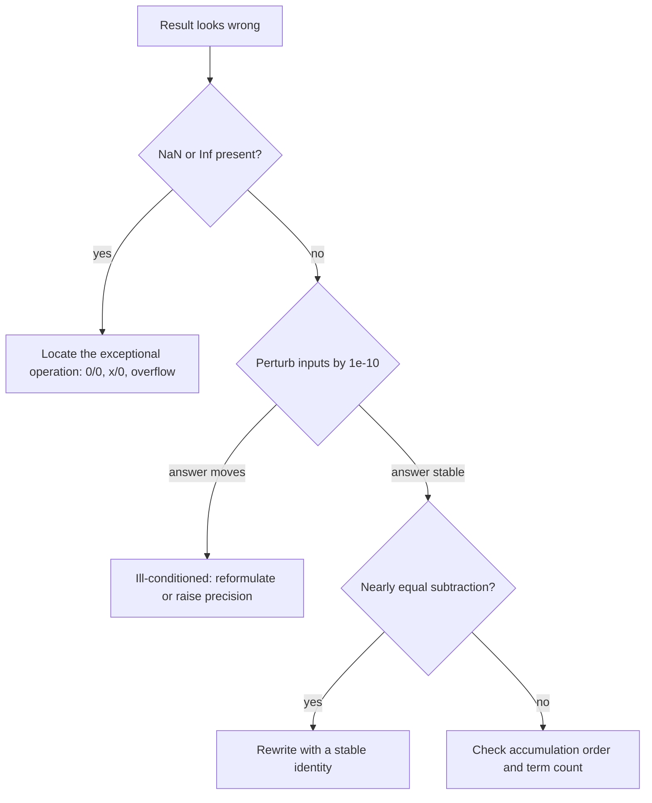

# Floating-Point Arithmetic

> [Mathematics](../../README.md) › [Numerical Analysis](../README.md) · Level: Intermediate · Prerequisites: [The Real Numbers and Completeness](../../14-real-analysis/01-real-numbers-and-completeness/README.md), [Limits](../../07-calculus/01-limits/README.md), [Inequalities](../../03-algebra/03-inequalities/README.md), [Quadratic Equations](../../03-algebra/08-quadratic-equations/README.md) · Estimated time: 420 min

## 1. Introduction

A computer cannot hold $\pi$. It cannot hold $1/3$, and — this is the part that surprises everyone —
it cannot hold $0.1$ either. Every number a machine remembers is one of finitely many bit patterns, and
every operation returns one of those patterns. Numerical analysis is the discipline of getting
trustworthy answers out of an arithmetic that is wrong every single time it is used.

The size of the wrongness is easy to underestimate. In double precision the stored value of $0.1$ is
$0.1000000000000000055511151231257827\ldots$, so $(0.1+0.2)-0.3$ evaluates to $5.551115123125783\times10^{-17}$
rather than $0$. Usually this is harmless. Sometimes it is fatal, and the difference between the two
cases is not the size of the error but the *conditioning* of the problem. That word, and its partner
*stability*, are the two central ideas of this chapter.

The chapter has four movements. First, what the machine can represent: the set of machine numbers,
normalisation, the IEEE 754 layouts, the bias, the hidden bit, and the gap between neighbours. Second,
what rounding does: round-to-nearest, the unit roundoff $u$, and the model
$\operatorname{fl}(x\circ y)=(x\circ y)(1+\delta)$ with $\lvert\delta\rvert\le u$, from which every
error bound below is derived. Third, where the digits are lost: cancellation, the quadratic formula,
$1-\cos x$, the $e^{-10}$ series, the one-pass variance, and long sums — each worked with numbers that
were actually computed. Fourth, how to keep them: stable reformulations, Kahan summation, the
distinction between an ill-conditioned problem and an unstable algorithm, and the exceptional values
`Inf` and `NaN`.

The closing section proves that no finite format represents the reals, so exact arithmetic in a fixed
precision is impossible in principle. Knowing when that matters, and when it does not, is the practical
skill this chapter teaches.

## 2. Prerequisites

**Inequalities and absolute value.** The triangle inequality and its reverse form, and the habit of
bounding a quantity by something larger that is still small. See
[Inequalities](../../03-algebra/03-inequalities/README.md).

**Limits and quantifiers.** Every error bound here has the form "for every input in the normal range,
the relative error is at most $u$"; reading the quantifiers in the right order matters. See
[Limits](../../07-calculus/01-limits/README.md).

**Completeness and countability.** Theorem 8.11 rests on $\mathbb{R}$ being uncountable while a format
is finite. See [The Real Numbers and Completeness](../../14-real-analysis/01-real-numbers-and-completeness/README.md).

**The quadratic formula, Taylor expansion and induction.** The quadratic formula is the subject of
Example 9.5 ([Quadratic Equations](../../03-algebra/08-quadratic-equations/README.md)); the expansion
$\cos x = 1-x^2/2+O(x^4)$ and the linearisation $f(x+h)=f(x)+f'(x)h+O(h^2)$ are used throughout
([Derivatives](../../07-calculus/03-derivatives/README.md)); the summation bound is proved by induction
([Mathematical Induction](../../09-discrete-mathematics/01-mathematical-induction/README.md)).

**Logarithms.** $p$ binary digits carry $p\log_{10}2$ decimal digits, and gaining one decimal digit
costs $\log_2 10\approx3.32$ bits. See
[Exponential and Logarithmic Functions](../../03-algebra/12-exponential-and-logarithmic-functions/README.md).

## 3. Learning Objectives

By the end of this tutorial you will be able to

1. state the definition of $F(\beta,p,L,U)$, decide whether a real belongs to it, and normalise a
   representable number;
2. describe the IEEE 754 binary32 and binary64 layouts field by field, decode a hexadecimal pattern,
   and encode a number into one;
3. compute the gap between adjacent machine numbers from $\beta^{e-p+1}$ and use it to explain the
   limits of representation;
4. distinguish machine epsilon $\varepsilon_{\mathrm{mach}}=\beta^{1-p}$ from the unit roundoff
   $u=\tfrac12\beta^{1-p}$ and apply the model of machine arithmetic;
5. compute absolute and relative error and convert between relative error and correct significant digits;
6. recognise catastrophic cancellation, estimate the digits lost by Theorem 8.4, and rewrite the
   expression stably;
7. derive the stable quadratic formula and use $1-\cos x = 2\sin^2(x/2)$, rationalisation, and the
   two-pass variance;
8. prove the bound $\gamma_{n-1}\sum\lvert x_i\rvert$ for naive summation and explain pairwise and
   Kahan summation;
9. define the relative condition number, compute it for a differentiable function, and give examples of
   ill-conditioned problems;
10. distinguish forward from backward stability;
11. predict the IEEE results of overflow, gradual underflow, signed zero, `Inf` and `NaN`;
12. prove that no finite format is exact and name the situations that require exact arithmetic.

## 4. Intuition

**Scientific notation with a fixed budget.** A floating-point number is what a calculator shows: a
sign, a fixed number of significant digits, and an exponent. The exponent reaches far; the fixed digit
budget means only about 16 decimal digits are available at any magnitude, and the *spacing* of the
representable numbers grows with the magnitude. Near $1$ the double-precision spacing is
$2.2\times10^{-16}$; near $10^{16}$ it is $2$. Two reals differing by $1$ at magnitude $10^{16}$ are the
same machine number.

**A ruler with unevenly spaced marks.** Imagine a ruler whose marks are dense near zero and sparse far
out, each mark about $2^{-53}$ of its own value from the next. Measuring gives the nearest mark, so the
error is proportional to the length, not to the ruler. That is why floating point is judged by
*relative* error: an absolute error of $10^{-3}$ is excellent for the mass of the Sun and catastrophic
for the charge of an electron.

**Cancellation is amplification, not rounding.** Two measurements of $1000.000$, each carrying an error
of $0.001$, have a difference of $0.000$ with an error of $0.002$. The absolute error did not grow; the
relative error grew by $2000/0.001=2\times10^{6}$. Nothing in the subtraction was inexact — the
information was destroyed before it. Most of the craft of numerical analysis is arranging computations
so that they never subtract nearly equal quantities.

**Two different questions.** "How sensitive is the answer to a small change in the data?" is a property
of the *problem*: its condition number. "How much extra error does my method add?" is a property of the
*algorithm*: its stability. A stable algorithm on an ill-conditioned problem gives the right answer to
the wrong question, accurately; an unstable algorithm on a well-conditioned problem manufactures error
out of nothing.

## 5. Formal Definition

**Definition 5.1 (floating-point number system).** Let $\beta\ge2$ be an integer base, $p\ge1$ the
precision, and $L\le U$ integers. The *normalised floating-point numbers* are
$$
F(\beta,p,L,U) = \{0\}\cup\left\{\pm m\beta^{e-p+1} : m\in\mathbb{Z},\ \beta^{p-1}\le m\le\beta^{p}-1,\ L\le e\le U\right\}.
$$
The integer $m$ is the *significand*, $e$ the *exponent*, and $\beta^{p-1}\le m$ is *normalisation*: it
forces $m$ to have exactly $p$ base-$\beta$ digits, the first nonzero. Hence every nonzero $x\in F$ has
the unique form $x=\pm(d_0.d_1\cdots d_{p-1})_\beta\times\beta^{e}$ with $d_0\ne0$ and $L\le e\le U$.

**Definition 5.2 (rounding).** A *rounding* is a map $\operatorname{fl}:\mathbb{R}\to F$ fixing $F$.
*Round to nearest, ties to even* takes the closest element of $F$ and, on a tie, the one whose last
significand digit is even. *Directed rounding* takes the neighbour in the indicated direction.

**Definition 5.3 (machine epsilon and unit roundoff).** The *machine epsilon* is the gap at $1$,
$$
\varepsilon_{\mathrm{mach}} = \beta^{1-p},
$$
and the *unit roundoff* is half of it, $u=\tfrac12\beta^{1-p}$, the largest relative error that
round-to-nearest can produce in the normal range. For binary arithmetic $\varepsilon_{\mathrm{mach}}=2^{1-p}$
and $u=2^{-p}$. The literature uses the two names inconsistently; here *machine epsilon* always means
the gap at $1$ and $u$ the rounding unit.

**Definition 5.4 (absolute and relative error).** For a computed $\hat x$ approximating $x\ne0$, the
*absolute error* is $\lvert\hat x-x\rvert$ and the *relative error* is $\lvert\hat x-x\rvert/\lvert x\rvert$.
Unless stated otherwise, "error" below means relative error.

**Definition 5.5 (significant digits).** Let $10^{m}\le\lvert x\rvert<10^{m+1}$. Then $\hat x$
approximates $x$ *to $k$ significant decimal digits* if $\lvert\hat x-x\rvert\le\tfrac12\cdot10^{m-k+1}$,
equivalently if the relative error is at most $5\cdot10^{-k}$. The unit roundoff therefore guarantees
about $-\log_{10}u\approx p\log_{10}\beta$ correct digits.

**Definition 5.6 (condition number).** For a problem $f:X\to Y$ between normed spaces and $x\in X$ with
$f(x)\ne0$,
$$
\kappa_{\mathrm{rel}}(x)=\limsup_{h\to0}\frac{\lVert f(x+h)-f(x)\rVert/\lVert f(x)\rVert}{\lVert h\rVert/\lVert x\rVert},
$$
and $\kappa_{\mathrm{abs}}(x)$ is the same without the two denominators. Small $\kappa$ is *well
conditioned*, large $\kappa$ *ill conditioned*.

**Definition 5.7 (stability).** An algorithm computing $\hat f(x)$ is *forward stable* at $x$ if
$\lVert\hat f(x)-f(x)\rVert/\lVert f(x)\rVert$ is small, of order $u$ times a modest factor. It is
*backward stable* if there is a perturbation $\Delta x$ with $\lVert\Delta x\rVert/\lVert x\rVert=O(u)$
and $\hat f(x)=f(x+\Delta x)$ exactly: the computed answer is the exact answer to slightly wrong data.

**Definition 5.8 (IEEE 754 formats).** IEEE 754 fixes $\beta=2$ and adds to Definition 5.1 a bit layout,
subnormal numbers filling the gap below the smallest normal, and the values $\pm\infty$ and `NaN`.
Binary32 has $(p,L,U)=(24,-126,127)$ with subnormals down to $2^{-149}$; binary64 has
$(p,L,U)=(53,-1022,1023)$ with subnormals down to $2^{-1074}$.

## 6. Mathematical Notation

| Symbol | Read as | Meaning |
|---|---|---|
| $\beta, p$ | base, precision | radix, and number of significant base-$\beta$ digits |
| $m, e$ | significand, exponent | $\beta^{p-1}\le m\le\beta^{p}-1$, and $x\in[\beta^e,\beta^{e+1})$ |
| $L, U$ | exponent bounds | smallest and largest normal exponent |
| $F(\beta,p,L,U)$ | the format | the finite set of representable numbers |
| $\operatorname{fl}(x)$ | fl of $x$ | the machine number nearest to $x$ |
| $\varepsilon_{\mathrm{mach}}$ | machine epsilon | gap at $1$, equal to $\beta^{1-p}$ |
| $u$ | unit roundoff | $\tfrac12\beta^{1-p}$, the relative rounding bound |
| $\operatorname{ulp}(x)$ | ulp of $x$ | gap between adjacent machine numbers near $x$ |
| $\delta$ | delta | a relative rounding error, $\lvert\delta\rvert\le u$ |
| $\gamma_n$ | gamma of $n$ | $nu/(1-nu)$, the accumulated-sum factor |
| $\kappa(x)$ | condition number | relative sensitivity of the answer to the data |
| $\oplus,\otimes$ | machine ops | $\operatorname{fl}(x+y)$, $\operatorname{fl}(xy)$ |
## 7. Core Concepts

### 7.1 Machine numbers, normalisation, and the gap

Take the toy system $F(2,3,-1,2)$: three significant bits and exponents from $-1$ to $2$. Normalisation
forces a leading $1$, so $m\in\{4,5,6,7\}$ and the positive elements are

| exponent $e$ | binade | numbers |
|---|---|---|
| $-1$ | $[0.5,1)$ | $0.5,\ 0.625,\ 0.75,\ 0.875$ |
| $0$ | $[1,2)$ | $1,\ 1.25,\ 1.5,\ 1.75$ |
| $1$ | $[2,4)$ | $2,\ 2.5,\ 3,\ 3.5$ |
| $2$ | $[4,8)$ | $4,\ 5,\ 6,\ 7$ |

With negatives and zero this is $2\cdot1\cdot4\cdot4+1=33$ numbers, as Theorem 8.3(c) predicts. Two
features generalise. First, the *spacing depends on the exponent*: it is $0.25$ on $[1,2)$ and $0.5$ on
$[2,4)$, so a constant number of significant bits is maintained, not a constant spacing. Second,
*arithmetic leaves the set*: $1+0.25=1.25$ is exact, but $1.125$ is exactly halfway between $1$ and
$1.25$, and ties-to-even chooses $1.00\times2^0=1$. Moreover $0.25$ has exponent $-2<L$, so $0.25\notin F$:
it underflows to $0$ and $1\oplus0.25=1$. Both phenomena belong to the format, not to the operation.

**The gap formula.** If $x\in[\beta^{e},\beta^{e+1})$ then adjacent machine numbers differ by
$\beta^{e-p+1}$. In binary64 the gap is $2^{-52}\approx2.22\times10^{-16}$ on $[1,2)$,
$2^{-32}\approx2.33\times10^{-10}$ on $[2^{20},2^{21})$, and $2^{-42}\approx2.27\times10^{-13}$ on
$[1024,2048)$. The count in $[1,2)$ is $2^{52}\approx4.5\times10^{15}$, which is why double precision is
summarised as "about 16 digits".

Because normalisation hides the leading bit, binary64 stores $1$ sign bit, $11$ exponent bits and $52$
fraction bits, and the hidden bit makes $p=53$. That is why the precision is $53$ and why
$\varepsilon_{\mathrm{mach}}=2^{-52}$, not $2^{-51}$.

### 7.2 The IEEE 754 layouts

IEEE 754-1985 fixed these formats; the 2008 and 2019 revisions added decimal and half-precision formats
and clarified the exceptional-value semantics, leaving binary32 and binary64 unchanged.

| Property | binary32 (single) | binary64 (double) |
|---|---|---|
| bits (sign / exponent / fraction) | $1/8/23$ | $1/11/52$ |
| precision $p$, bias | $24$, $127$ | $53$, $1023$ |
| normal exponent range | $-126\le e\le127$ | $-1022\le e\le1023$ |
| $\varepsilon_{\mathrm{mach}}$, $u$ | $2^{-23}$, $2^{-24}$ | $2^{-52}$, $2^{-53}$ |
| largest finite | $3.40\times10^{38}$ | $1.80\times10^{308}$ |
| smallest normal / subnormal | $1.18\times10^{-38}$ / $1.40\times10^{-45}$ | $2.23\times10^{-308}$ / $4.94\times10^{-324}$ |
| decimal digits $p\log_{10}2$ | $7.22$ | $15.95$ |

**Decoding.** With sign bit $s$, biased exponent field $E$ and fraction field $F$ read as an integer:

| condition | value |
|---|---|
| $E=0$, $F=0$ | $\pm0$ (signed zero) |
| $E=0$, $F\ne0$ | $\pm(F/2^{p-1})2^{L}$ — subnormal |
| $1\le E\le2^{k}-2$ | $\pm(1+F/2^{p-1})2^{E-\text{bias}}$ — normal |
| $E=2^{k}-1$, $F=0$ | $\pm\infty$ |
| $E=2^{k}-1$, $F\ne0$ | `NaN` |

The bias stores the exponent as an unsigned integer: $-126$ is stored as $1$ and $127$ as $254$ in
binary32. The fields $0$ and $255$ are reserved, which is why the normal range stops at $127$.

### 7.3 Rounding modes and the unit roundoff

IEEE 754 requires five rounding attributes: *to nearest, ties to even* (the default), *to nearest, ties
away from zero*, and the three directed modes *towards $0$*, *towards $+\infty$* and *towards $-\infty$*.
Ties-to-even is the default because it avoids the bias of always rounding a tie upwards: over many
operations the ties split evenly. Round-to-nearest minimises the absolute error of each operation; its
worst case is a tie, where the error is half a gap. Since the gap at $x$ is $\beta^{e-p+1}$ and
$\lvert x\rvert\ge\beta^{e}$,
$$
\frac{\lvert\operatorname{fl}(x)-x\rvert}{\lvert x\rvert}\le\frac{\beta^{e-p+1}/2}{\beta^{e}}=\tfrac12\beta^{1-p}=u ,
$$
while directed rounding gives $2u$. The bound is *sharp*: in binary32, $1+2^{-24}$ is halfway between
$1$ and $1+2^{-23}$ and ties-to-even leaves it at $1$, a relative error of exactly
$2^{-24}/(1+2^{-24})\approx u$. So every machine operation costs at most one unit in the last place, and
$n$ operations cost at most $n$ such units — with $n=10^{6}$ that is $1.1\times10^{-10}$ in double
precision, which is where the bounds of Section 8 come from.

### 7.4 Absolute and relative error, and significant digits

The distinction is not pedantic. For $\hat x=1.234$ and $x=1.234567$ the absolute error is
$5.67\times10^{-4}$; since $10^{0}\le x<10^{1}$, Definition 5.5 gives about $4$ correct significant
digits, and the relative error is $4.59\times10^{-4}$. For $\hat y=1234567$ and $y=1234567.567$ the
absolute error is a thousand times larger ($5.67\times10^{-1}$) but the relative error is
$4.59\times10^{-7}$: seven digits are correct. The absolute error grew while the accuracy improved, which
is why floating-point analysis is done in relative terms — the format guarantees relative accuracy and
the gap grows with magnitude by design.

The conversion is worth memorising: if the relative error is $\rho$, the number of correct decimal
digits is about $-\log_{10}\rho$. Double precision gives $15.95$ digits and is trusted to $15$, never
$17$; single precision gives $7.22$, hence "about 7 digits". A *forward* error compares the computed
answer with the true answer; a *backward* error measures the distance from the given data to data for
which the computed answer is exact. Section 7.8 relates the two.

### 7.5 Catastrophic cancellation

Subtracting nearly equal numbers destroys relative accuracy while preserving absolute accuracy.

**Theorem 8.4 in words.** If $\hat x=x(1+\delta_1)$ and $\hat y=y(1+\delta_2)$ with $\lvert\delta_i\rvert\le u$
then
$$
\frac{\lvert(\hat x-\hat y)-(x-y)\rvert}{\lvert x-y\rvert}\le u\,\frac{\lvert x\rvert+\lvert y\rvert}{\lvert x-y\rvert}+O(u^2).
$$
The factor $(\lvert x\rvert+\lvert y\rvert)/\lvert x-y\rvert$ is the amplification: if $x$ and $y$ agree
to $k$ digits it is about $10^{k}$, so $k$ digits of the result are noise. The subtraction itself is
exact (Sterbenz's lemma); the damage was done earlier. Four computed examples:

- *Quadratic formula.* For $x^2+10^{8}x+1=0$ the textbook formula computes the small root as
  $(-b+\sqrt{b^2-4ac})/(2a)$, subtracting two numbers of size $10^{8}$ to obtain one of size $10^{-8}$.
  The result is $-7.450580596923828\times10^{-9}$ instead of $-1.0000000000000001\times10^{-8}$, a
  relative error of $25.5\%$; the large root is accurate.
- *$1-\cos x$.* At $x=10^{-8}$ the true value is $5\times10^{-17}$, but $\operatorname{fl}(\cos 10^{-8})=1.0$
  exactly, so the computed difference is $0$: a relative error of $100\%$.
- *The $e^{-10}$ series.* The terms of $e^{-10}=\sum(-10)^k/k!$ reach $1413$ in magnitude before decaying,
  so about $7.5$ digits are lost. In double precision $30$ terms give $0.00097034$ (a relative error of
  $20$); in single precision $40$ terms give $-6.26\times10^{-5}$, the wrong sign.
- *One-pass variance.* For $10^{8}+1,10^{8}+2,10^{8}+3,10^{8}+4$ the exact variance is $1.25$, but
  $\overline{x^2}-\bar x^2$ returns $2.0$ in double precision (an error of $60\%$) and $0.0$ in single.

### 7.6 Stable reformulations

A stable formula has relative error $O(u)$ times the condition number. The technique is always the same:
use an identity that is exact in real arithmetic to remove the subtraction of nearly equal quantities.

**Quadratic formula.** For $ax^2+bx+c=0$ with $a\ne0$ and $D=b^2-4ac\ge0$ put
$$
q=-\tfrac12\left(b+\operatorname{sign}(b)\sqrt{D}\right),\qquad x_1=\frac{q}{a},\qquad x_2=\frac{c}{q}.
$$
Vieta's identities $x_1x_2=c/a$ and $x_1+x_2=-b/a$ give both roots; $q$ adds two terms of the same sign,
and $c/q$ avoids the cancelling difference. For the example above this returns $-10^{-8}$ with relative
error $7.9\times10^{-17}$.

**$1-\cos x$.** Use $1-\cos x=2\sin^2(x/2)$; at $x=10^{-8}$ it returns
$5.0000000000000005\times10^{-17}$, accurate to one unit roundoff. Libraries provide `expm1` and `log1p`
for the same reason: $\exp x-1$ and $\log(1+x)$ cancel for small $x$.

**Differences of roots.** $\sqrt{x+1}-\sqrt{x}=1/(\sqrt{x+1}+\sqrt{x})$; at $x=10^{8}$ the naive form
loses four digits.

**Variance.** Use the two-pass formula $\frac1n\sum(x_i-\bar x)^2$, or Welford's recurrence
$M_k=M_{k-1}+(x_k-M_{k-1})/k$, $S_k=S_{k-1}+(x_k-M_{k-1})(x_k-M_k)$, which never forms $\sum x_i^2$.
The two-pass formula returns $1.25$ for the data above.

**Horner's scheme.** $p(x)=a_0+x(a_1+x(a_2+\cdots))$ needs $n$ multiplications instead of $2n-1$ and is
backward stable: the computed value is the exact value of a polynomial with coefficients perturbed by
relative amounts of order $u$.

### 7.7 Summation order and Kahan summation

Adding left to right is naive. Its error follows $\sum\lvert x_i\rvert$, not $\lvert\sum x_i\rvert$.

**Theorem 8.5.** If $nu<1$ and $s_n$ is the left-to-right computed sum, then
$$
\lvert s_n-(x_1+\cdots+x_n)\rvert\le\gamma_{n-1}\sum_{i=1}^{n}\lvert x_i\rvert,\qquad \gamma_k=\frac{ku}{1-ku}.
$$
For $n=10^{6}$ in double precision $\gamma_{n-1}\approx1.11\times10^{-10}$, a factor $10^{6}$ worse than
the single-operation bound. The estimate is realistic: summing $10^6$ copies of $0.1$ in single
precision left to right gives $100958.34$ instead of $100000$, a relative error of $9.6\times10^{-3}$.

**Pairwise (tree) summation.** Add in a binary tree, so each element passes through only
$\lceil\log_2 n\rceil$ additions:
$$
\lvert s-\textstyle\sum x_i\rvert\le\gamma_{\lceil\log_2 n\rceil}\sum\lvert x_i\rvert .
$$
For $n=10^{6}$ the factor drops from $10^{6}$ to $20$; the same experiment in single precision gives
$100000.0078125$, a relative error of $7.8\times10^{-8}$. This is what `numpy.sum` does.

**Kahan compensated summation.** Carry a correction for the low bits that each addition loses:

```
s = 0.0
c = 0.0
for x in data:
    y = x - c          # add back the previous error
    t = s + y          # rounded sum
    c = (t - s) - y    # recover what was lost
    s = t
return s
```

Whenever $\lvert s\rvert\ge\lvert y\rvert$ the correction $c$ is *exactly* the error of the addition
$s+y$ (Kahan's lemma, Theorem 8.7), so the error does not accumulate with $n$:
$$
\lvert s-\textstyle\sum x_i\rvert\le\left(2u+O(nu^2)\right)\sum\lvert x_i\rvert .
$$
On the $10^6$-term experiment Kahan returns exactly $100000.0$ in single precision. It fails when a large
term arrives after many small ones (the compensation then exceeds $s$ in magnitude); Neumaier's variant
chooses $(s-t)+x$ or $(x-t)+s$ according to the magnitudes and returns $s+c$ at the end.

**Fused multiply-add.** With `fma(a,b,c)` equal to the exact $ab+c$ rounded once, a dot product costs
$u$ per term instead of $2u$, and TwoProduct represents $ab$ exactly as a sum of two doubles.

### 7.8 Conditioning versus stability

**The condition number belongs to the problem.** For differentiable $f$,
$f(x+h)-f(x)=f'(x)h+O(h^2)$, so
$$
\kappa_{\mathrm{rel}}(x)=\left\lvert\frac{x f'(x)}{f(x)}\right\rvert,\qquad\kappa_{\mathrm{abs}}(x)=\lvert f'(x)\rvert .
$$
For $f(x)=1/(x-1)$ at $x=1.001$ this is $\approx1001$: an input error of $10^{-16}$ becomes $10^{-13}$. For
$f(x)=\cos x$ at $x=1.5707963$ it is $x\sin x/\cos x\approx5.86\times10^{7}$ because $\cos x=2.679\times10^{-8}$;
the answer is a small difference of large quantities and no algorithm can rescue it from a perturbed
argument. By contrast $f(x)=x-\cos x$ at $x=0.739$ has $\kappa\approx2.4$, which is why Newton's method
converges so cleanly there (see [Root Finding](../02-root-finding/README.md)).

**Stability belongs to the algorithm.** A backward stable algorithm returns $f(x+\Delta x)$ with
$\lVert\Delta x\rVert/\lVert x\rVert=O(u)$, so the rule of thumb
$$
\text{relative forward error}\lesssim\kappa(x)\cdot u
$$
separates the two factors. If $\kappa\approx1$ and the error is $10^{-8}$ in double precision, the
algorithm is unstable; if $\kappa\approx10^{12}$ and the error is $10^{-4}$, the algorithm may be perfect
and the problem beyond double precision. The naive quadratic formula for the small root, naive summation
with cancellation, and the one-pass variance are not backward stable: their answers are not the exact
answers to any nearby problem. Each has the stable variant of Section 7.6.

When an answer looks wrong, perturb an input by $10^{-10}$ relative and recompute: if the answer moves by
more than $10^{-8}$, the problem is the culprit; only if it is stable under perturbation is it worth
inspecting the algorithm.

### 7.9 Overflow, underflow, subnormals, and the exceptional values

**Overflow.** A result above the largest finite number becomes $\pm\infty$ and signals overflow; every
later operation then returns $\infty$ or `NaN`, contaminating the whole computation. Overflow is never
gradual.

**Gradual underflow.** Below $2^{-1022}$ IEEE 754 switches to subnormals: exponent field $0$, no hidden
bit, so fewer significant bits and a gradual loss of precision.

| value | representation | significant bits |
|---|---|---|
| $2^{-1022}$ | smallest normal | $53$ |
| $2^{-1023}$ | subnormal | $52$ |
| $2^{-1050}$ | subnormal | $25$ |
| $2^{-1074}$ | smallest subnormal | $1$ |

The least positive double is $2^{-1074}\approx4.94\times10^{-324}$, and below it there is only zero. A
result of $10^{-400}$ becomes $0$ with relative error $100\%$, though the absolute error is tiny. This is
the one regime where Theorem 8.1 fails and only the absolute bound $\tfrac12\cdot2^{L-p+1}$ survives.

**Signed zero.** $+0$ and $-0$ compare equal but $1/(+0)=+\infty$, $1/(-0)=-\infty$, and $\log(-0)=-\infty$.
**Infinity** behaves as expected: $\infty+x=\infty$, $1/\infty=+0$, while $\infty-\infty$, $0\cdot\infty$
and $\infty/\infty$ are `NaN`.

**NaN** is the result of $0/0$, $\sqrt{-1}$, $\infty-\infty$, or any operation with a `NaN` operand. Its
defining property is that every comparison with it is false, including `NaN == NaN`; hence the test
`x != x`. A sort routine assuming trichotomy misbehaves if a `NaN` is present. The standard preserves but
does not specify the payload bits, which allows diagnostic information to be encoded in them.

| expression | result | note |
|---|---|---|
| $1/0$ | $+\infty$ | division by zero is not an error |
| $-1/0$ | $-\infty$ | the sign of the zero selects the infinity |
| $0/0$ | `NaN` | indeterminate |
| $\sqrt{-1}$ | `NaN` | no real square root |
| $\infty-\infty$ | `NaN` | indeterminate |

Exceptional *values* propagate without stopping the computation, so one check at the end suffices — and a
silently produced `NaN` can travel a long way before anyone notices.

### 7.10 Why exact arithmetic is impossible, and when it matters

**Theorem 8.11.** $F(\beta,p,L,U)$ is finite, with $\lvert F\rvert=2(\beta-1)\beta^{p-1}(U-L+1)+1$, so
$F\ne\mathbb{R}$ because $\mathbb{R}$ is uncountable. Quantitatively, at the top of each binade the
relative gap between neighbours is $\beta^{-p}/(1-\beta^{-p})\ge\beta^{-p}$, so no rounding rule makes
the relative gap uniformly smaller than $\beta^{-p}$.

This is the sharp statement: not that we have not found the right formula for $\pi$, but that *any*
finite-precision system has holes of relative size at least $\beta^{-p}$, densely filled by the reals.
Even $1/3$ has no terminating binary expansion, so no binary format contains it.

**What this does not mean.** Computation is not unreliable: most problems are well conditioned, most
algorithms are stable, and $u=10^{-16}$ is small enough that $10^{16}$ independent roundings are needed
before the accumulated error reaches the size of the answer. The response to Theorem 8.11 is discipline,
not despair: know the conditioning, use stable algorithms, check against an independent estimate.

**When exact arithmetic matters.** Ill-conditioned problems (Wilkinson's polynomial $\prod_{k=1}^{20}(x-k)$,
whose roots move by order $1$ under perturbations of order $10^{-16}$; linear systems with $\kappa=10^{20}$)
need higher precision or a reformulation. Exact predicates in computational geometry must be decided
exactly, since a wrong sign changes the topology of a mesh. Number theory, cryptography and computer
algebra need exact integer arithmetic. Reproducibility across machines needs a fixed order of operations
and rounding mode, which the standard permits but compilers do not guarantee.

**Remedies, in increasing cost.** A better-conditioned formulation (free); double instead of single
(15 digits instead of 7); compensated sums and dot products (a factor of two or three); double-double or
arbitrary precision (`mpmath`, `MPFR`); exact rational or integer arithmetic; interval arithmetic when a
guaranteed enclosure is required.
## 8. Formulas and Properties

Throughout, $u=\tfrac12\beta^{1-p}$, and every relative-error statement assumes operands and results in
the normal range (not subnormal, no overflow).

**Theorem 8.1 (rounding error).** For every real $x$ with $\beta^{L}\le\lvert x\rvert\le(2-\beta^{1-p})\beta^{U}$
and round-to-nearest, $\operatorname{fl}(x)=x(1+\delta)$ with $\lvert\delta\rvert\le u$.

*Proof.* For $x\in[\beta^{e},\beta^{e+1})$ the machine numbers form an arithmetic progression with gap
$h=\beta^{e-p+1}$ (Theorem 8.3(a)), so the nearest is within $h/2$:
$$
\frac{\lvert\operatorname{fl}(x)-x\rvert}{\lvert x\rvert}\le\frac{h/2}{\beta^{e}}=\tfrac12\beta^{1-p}=u. \qquad\blacksquare
$$

**Theorem 8.2 (model of machine arithmetic).** If $x,y\in F$ and the exact $x\circ y$ lies in the normal
range, then $\operatorname{fl}(x\circ y)=(x\circ y)(1+\delta)$ with $\lvert\delta\rvert\le u$, for
$\circ\in\{+,-,\times,\div\}$ (with $y\ne0$ for division).

*Proof.* IEEE 754 requires correctly rounded operations, so the delivered result is $\operatorname{fl}$
of the exact result; apply Theorem 8.1. $\blacksquare$

Every bound below is obtained by replacing each operation with its exact value times $(1+\delta_i)$ and
multiplying out.

**Theorem 8.3 (gap and count).** (a) If $x\in[\beta^{e},\beta^{e+1})$ then $\operatorname{ulp}(x)=\beta^{e-p+1}$.
(b) $[\beta^{e},\beta^{e+1})$ contains $(\beta-1)\beta^{p-1}$ elements of $F$; in particular $[1,2)$
contains $2^{52}$ doubles. (c) $\lvert F\rvert=2(\beta-1)\beta^{p-1}(U-L+1)+1$.

*Proof.* (a) The elements are $m\beta^{e-p+1}$ with $\beta^{p-1}\le m\le\beta^{p}-1$, consecutive in
$m$. (b) There are $\beta^{p}-1-\beta^{p-1}+1=(\beta-1)\beta^{p-1}$ such integers. (c) There are
$U-L+1$ binades and two signs, plus zero. For $F(2,3,-1,2)$: $2\cdot1\cdot4\cdot4+1=33$. $\blacksquare$

**Theorem 8.4 (cancellation).** Let $\hat x=x(1+\delta_1)$, $\hat y=y(1+\delta_2)$ with
$\lvert\delta_i\rvert\le u$ and $x\ne y$. Then
$$
\frac{\lvert\operatorname{fl}(\hat x-\hat y)-(x-y)\rvert}{\lvert x-y\rvert}\le u\,\frac{\lvert x\rvert+\lvert y\rvert}{\lvert x-y\rvert}+u+O(u^2).
$$

*Proof.* $\hat x-\hat y=(x-y)+(x\delta_1-y\delta_2)$, so
$\lvert(\hat x-\hat y)-(x-y)\rvert\le u(\lvert x\rvert+\lvert y\rvert)$; dividing by $\lvert x-y\rvert$
and adding the final rounding factor $(1+\delta_3)$ gives the result. $\blacksquare$

**Theorem 8.5 (naive summation).** Let $T_k=\sum_{i\le k}\lvert x_i\rvert$ and let $s_n$ be the sum
computed left to right. If $nu<1$ then
$$
\lvert s_n-\textstyle\sum_{i=1}^{n}x_i\rvert\le\gamma_{n-1}T_n,\qquad\gamma_k=\frac{ku}{1-ku}.
$$

*Proof.* Write $\hat s_k=(\hat s_{k-1}+x_k)(1+\delta_k)$ and claim $\lvert\hat s_k-S_k\rvert\le\gamma_{k-1}T_k$
by induction, the case $k=1$ being exact ($\gamma_0=0$). For the step,
$$
\lvert\hat s_k-S_k\rvert\le\lvert\hat s_{k-1}-S_{k-1}\rvert+u\lvert\hat s_{k-1}+x_k\rvert
\le\gamma_{k-2}T_{k-1}+u(1+\gamma_{k-2})T_{k-1}+u\lvert x_k\rvert,
$$
using $\lvert\hat s_{k-1}\rvert\le(1+\gamma_{k-2})T_{k-1}$. Since
$$
\gamma_{k-2}+u(1+\gamma_{k-2})=\frac{(k-1)u}{1-(k-2)u}\le\frac{(k-1)u}{1-(k-1)u}=\gamma_{k-1}
$$
and $u\le\gamma_{k-1}$, the bound becomes $\gamma_{k-1}T_{k-1}+\gamma_{k-1}\lvert x_k\rvert=\gamma_{k-1}T_k$.
$\blacksquare$

**Theorem 8.6 (pairwise summation).** If the sum of $n$ floats is evaluated in a binary tree then
$\lvert s-\sum x_i\rvert\le\gamma_{\lceil\log_2 n\rceil}T_n$.

*Proof.* Induct on the depth $d$ of a subtree with at most $2^d$ leaves, claiming
$\lvert\hat s-S\rvert\le\gamma_d\Sigma$ where $\Sigma$ is the sum of absolute values in it. Two subtrees
of depth $d-1$ are combined by one rounded addition, so
$$
\lvert\hat s-S\rvert\le\gamma_{d-1}(\Sigma_1+\Sigma_2)+u(1+\gamma_{d-1})(\Sigma_1+\Sigma_2)\le\gamma_d(\Sigma_1+\Sigma_2),
$$
again by the identity used in Theorem 8.5. $\blacksquare$

**Theorem 8.7 (Kahan's compensation lemma).** Let $s,y\in F$ with $\lvert s\rvert\ge\lvert y\rvert$ and no
underflow, $t=\operatorname{fl}(s+y)$ and $e=\operatorname{fl}((t-s)-y)$. Then $s+y=t+e$ exactly.

*Proof (Dekker's Fast2Sum).* If $s+y$ is representable, $t=s+y$ and $e=0$. Otherwise $\lvert s+y\rvert\ge\lvert s\rvert/2$,
since a sum with $\lvert s+y\rvert<\lvert s\rvert/2$ and $\lvert y\rvert\le\lvert s\rvert$ would be exact
by Sterbenz (Theorem 8.12). Hence $t$ and $s$ lie within a factor of two, $t-s$ is exact by Sterbenz, and
$(t-s)-y=t-(s+y)$ is minus the rounding error: a multiple of $\operatorname{ulp}(t)/2$ of magnitude at
most $\operatorname{ulp}(t)/2$, hence representable. $\blacksquare$

So in the Kahan loop, with $\lvert s\rvert\ge\lvert y\rvert$ at every step, the pair $(s,c)$ carries the
exact running total. The passage from the lemma to the bound $2u\sum\lvert x_i\rvert+O(nu^2)$ is in
Higham, *Accuracy and Stability of Numerical Algorithms*, §4.3.

**Theorem 8.8 (condition number of evaluation).** For $f$ differentiable at $x\ne0$ with $f(x)\ne0$,
$$
\kappa_{\mathrm{rel}}(x)=\left\lvert\frac{x f'(x)}{f(x)}\right\rvert,\qquad\kappa_{\mathrm{abs}}(x)=\lvert f'(x)\rvert .
$$

*Proof.* Since $f(x+h)=f(x)+f'(x)h+o(h)$,
$$
\frac{\lvert f(x+h)-f(x)\rvert/\lvert f(x)\rvert}{\lvert h\rvert/\lvert x\rvert}
=\frac{\lvert f'(x)h+o(h)\rvert}{\lvert f(x)\rvert}\cdot\frac{\lvert x\rvert}{\lvert h\rvert}\longrightarrow\left\lvert\frac{x f'(x)}{f(x)}\right\rvert . \qquad\blacksquare
$$

**Theorem 8.9 (stable quadratic formula).** Let $a\ne0$, $b\ne0$, $D=b^2-4ac\ge0$ and
$q=-\tfrac12(b+\operatorname{sign}(b)\sqrt D)$. Then $q/a$ and $c/q$ are the two roots, computed without
cancellation.

*Proof.* The roots are $(-b\pm\sqrt D)/(2a)$. Since $q/a=(-b-\operatorname{sign}(b)\sqrt D)/(2a)$ is one of
them and its numerator adds two terms of the same sign, no cancellation occurs there. Vieta gives
$r_1r_2=c/a$, hence the other root is $c/q$; and $\lvert q\rvert\ge\tfrac12\lvert b\rvert$, so that
division is well conditioned. $\blacksquare$

**Theorem 8.10 ($1-\cos x$).** For $0<\lvert x\rvert\le\pi/4$,
$\lvert\operatorname{fl}(1-\operatorname{fl}(\cos x))-(1-\cos x)\rvert\le2u$, so the relative error is at
most $2u/(1-\cos x)\approx4u/x^2$.

*Proof.* $\lvert\cos x\rvert\le1$ gives an absolute error of at most $u$ in the cosine and at most $u$ in
the subtraction; and $1-\cos x=2\sin^2(x/2)\ge x^2/2$ on the stated range. $\blacksquare$

**Theorem 8.11 (no format is exact).** $F(\beta,p,L,U)$ is finite, so $F\ne\mathbb{R}$; and at the top of
each binade the relative gap is $\beta^{-p}/(1-\beta^{-p})\ge\beta^{-p}$.

*Proof.* Finiteness and the count are Theorem 8.3(c), and $\mathbb{R}$ is uncountable. For
$x=\beta^{e+1}(1-\beta^{-p})$, the successor is $\beta^{e+1}$ and
$$
\frac{\beta^{e+1}-x}{x}=\frac{\beta^{-p}}{1-\beta^{-p}}\ge\beta^{-p}. \qquad\blacksquare
$$

**Theorem 8.12 (Sterbenz's lemma).** If $x,y\in F$ and $y/2\le x\le2y$ (or with the roles exchanged),
then $x-y\in F$: the subtraction is exact.

*Proof.* With $0<y\le x\le2y$, both lie in one binade $[2^k,2^{k+1})$ or in two adjacent ones and are
multiples of the gap $2^{k-p+1}$. Hence $x-y=j\,2^{k-p+1}$ with $0\le j\le2^{p}$; if $j=2^{p}$ then
$x-y=2^{k+1}\in F$, and otherwise $j<2^{p}$ fits in $p$ bits. $\blacksquare$
## 9. Step-by-Step Examples

### Example 9.1 (easy): the binary expansion of $0.1$

*Step 1: multiply by $2$ repeatedly.* Starting from $0.1$:

| step | value | integer part |
|---|---|---|
| 1 | $0.2$ | $0$ |
| 2 | $0.4$ | $0$ |
| 3 | $0.8$ | $0$ |
| 4 | $1.6$ | $1$ |
| 5 | $1.2$ | $1$ |
| 6 | $0.4$ | $0$ |

At step 6 the fractional part $0.4$ repeats step 2, so the bits repeat with period $4$:
$0.1=0.0\overline{0011}_2$. The expansion never terminates, so $0.1\notin F$ in any binary format — the
terminating decimal expansion hides this.

*Step 2: round to 53 bits.* Normalising, $0.1=1.100110011\cdots_2\times2^{-4}$; keeping 52 fraction bits
and rounding the tail up gives
$$
\operatorname{fl}(0.1)=0.1000000000000000055511151231257827021181583404541015625=0.1\left(1+5.551115123125783\times10^{-17}\right),
$$
a relative error of $5.55\times10^{-17}\approx u/2$, within Theorem 8.1.

*Step 3: the consequence.* The stored $0.2$ is twice the stored $0.1$, and the stored $0.3$ is
$0.29999999999999998889776975374843$; the sum of the first two is exactly
$0.30000000000000004440892098500626$. Hence `0.1 + 0.2 == 0.3` is `False`, the difference being one unit
in the last place.

### Example 9.2 (easy): decoding and encoding binary32

*Part (a): decode `0x42F6E979`.* The bits are `0 10000101 11101101110100101111001`, so $s=0$, $E=133$ and
$F=16181625$. Then $e=133-127=6$ and
$$
x=\left(1+\frac{16181625}{8388608}\right)2^{6}=1.928125\ldots\times64=123.45600128173828125,
$$
the nearest single to $123.456$, with absolute error $1.28\times10^{-6}$ and relative error
$1.04\times10^{-8}\le u$.

*Part (b): encode $3.5$.* $3.5=1.75\times2^{1}$, so $e=1$, the fraction field is $0.75=0.11_2$, and the
biased exponent is $128=10000000_2$. The pattern is `0 10000000 11000000000000000000000`, i.e.
`0x40600000`; decoding returns $3.5$ exactly, as it must.

*Part (c): special patterns.* `0x7F800000`$=+\infty$, `0xFF800000`$=-\infty$, `0x7FC00000` is a quiet
`NaN`, and `0x00000001` is the smallest positive subnormal $2^{-149}=1.401298464324817\times10^{-45}$.

### Example 9.3 (easy–medium): epsilons and gaps

*Part (a).* Binary64: $\varepsilon_{\mathrm{mach}}=2^{-52}=2.220446049250313\times10^{-16}$ and
$u=2^{-53}=1.1102230246251565\times10^{-16}$. Binary32: $\varepsilon_{\mathrm{mach}}=2^{-23}=1.1920928955078125\times10^{-7}$
and $u=2^{-24}=5.960464477539063\times10^{-8}$.

*Part (b).* By Theorem 8.3(a) the gap on $[2^{20},2^{21})$ is $2^{-32}=2.3283064365386963\times10^{-10}$,
and on $[1024,2048)=[2^{10},2^{11})$ it is $2^{-42}=2.2737367544323206\times10^{-13}$.

*Part (c).* $[1,2)$ contains $2^{52}=4503599627370496$ doubles and $2^{23}=8388608$ singles; the decimal
digit counts are $53\log_{10}2=15.95$ and $24\log_{10}2=7.22$.

*Part (d).* Since $2^{53}=9.007\times10^{15}\le10^{16}<2^{54}$, the gap at $10^{16}$ is $2^{53-52}=2$.
Hence `(1e16 + 1) - 1e16` is `0.0`: reals differing by $1$ at that magnitude share a double.

### Example 9.4 (medium): ten additions in single precision

Adding ten copies of $0.1$ in binary32, the addend is $\operatorname{fl}_{32}(0.1)=0.100000001490116119384765625$,
in excess of $0.1$ by $1.49\times10^{-9}$. Left to right, with each sum rounded to 24 bits:

| $k$ | computed $s_k$ | exact $0.1k$ | error |
|---|---|---|---|
| 1 | $0.100000001490116$ | $0.1$ | $1.49\times10^{-9}$ |
| 3 | $0.300000011920929$ | $0.3$ | $1.19\times10^{-8}$ |
| 5 | $0.500000000000000$ | $0.5$ | $0$ |
| 7 | $0.700000047683716$ | $0.7$ | $4.77\times10^{-8}$ |
| 9 | $0.900000095367432$ | $0.9$ | $9.54\times10^{-8}$ |
| 10 | $1.000000119209290$ | $1$ | $1.19\times10^{-7}$ |

The final value is $1.00000011920928955078125$, a relative error of $1.19\times10^{-7}=2\varepsilon_{\mathrm{mach}}$.
The bound of Theorem 8.5 is $\gamma_9=9u/(1-9u)=5.4\times10^{-7}$ in relative terms, so this is within a
factor of five of the worst case. In double precision the same ten additions give exactly $1.0$: two
roundings cancel. Cancellation of errors is luck, not accuracy; only the bound is reliable.

### Example 9.5 (medium): the quadratic formula

*Step 1: exact roots.* For $x^2+10^{8}x+1=0$,
$$
x=\frac{-10^{8}\pm\sqrt{10^{16}-4}}{2},\qquad
x_1=-1.0000000000000001000\ldots\times10^{-8},\qquad x_2=-9.9999999999999989999\ldots\times10^{7}.
$$

*Step 2: textbook formula in float64.* The discriminant $10^{16}-4$ is exactly representable and its
square root rounds to $99999999.99999999$, so $-b+\sqrt D=-1.99999998\ldots\times10^{-8}$: sixteen digits
cancel and about one correct digit survives. The computed small root is
$$
x_1^{\text{naive}}=-7.450580596923828\times10^{-9},
$$
a relative error of $0.2549$. The large root $-1.000000000000000\times10^{8}$ is accurate to $10^{-16}$,
because there the two terms add.

*Step 3: stable formula.* Since $b>0$, $q=-\tfrac12(10^{8}+\sqrt D)=-10^{8}$ to machine precision, and
$$
x_1=\frac{c}{q}=\frac{1}{-10^{8}}=-1\times10^{-8},\qquad x_2=\frac{q}{a}=-10^{8},
$$
with relative errors $7.9\times10^{-17}$ and $1.0\times10^{-16}$: both roots correct to one unit roundoff,
at the price of one division.

*Step 4: the lesson.* The textbook formula is not wrong; it is unstable for one root. Vieta's product
identity turns it into an algorithm stable for both.

### Example 9.6 (medium): $1-\cos x$ for a sequence of $x$

| $x$ | naive $1-\cos x$ | stable $2\sin^2(x/2)$ | absolute error | relative error |
|---|---|---|---|---|
| $10^{-4}$ | $5.000000000000000\times10^{-9}$ | $5.000000000000000\times10^{-9}$ | $2.6\times10^{-17}$ | $5.2\times10^{-9}$ |
| $10^{-5}$ | $5.000000000000000\times10^{-11}$ | $5.000000000000000\times10^{-11}$ | $4.1\times10^{-18}$ | $8.3\times10^{-8}$ |
| $10^{-6}$ | $5.000444502911705\times10^{-13}$ | $5.000000000000000\times10^{-13}$ | $4.4\times10^{-17}$ | $8.9\times10^{-5}$ |
| $10^{-7}$ | $4.996003610813204\times10^{-15}$ | $5.000000000000000\times10^{-15}$ | $4.0\times10^{-18}$ | $8.0\times10^{-4}$ |
| $10^{-8}$ | $0$ | $5.000000000000000\times10^{-17}$ | $5.0\times10^{-17}$ | $1$ |

Every naive error is at most $2u$ in *absolute* value, as Theorem 8.10 predicts; in relative terms the
error is about $4u/x^2$, which is $4.4\times10^{-8}$ at $x=10^{-4}$ and $4.4$ at $x=10^{-8}$. At
$x=10^{-4}$ the naive formula is still good to eight digits: cancellation is catastrophic only when the
result is small compared with the operands, and the threshold is set by $u/x^2$, not by "$x$ is small".

### Example 9.7 (medium–hard): summing $10^6$ terms

Sum $10^6$ copies of $0.1$ by four methods and compare with $10^{5}$:

| method | result | absolute error | relative error |
|---|---|---|---|
| float32, left to right | $100958.34375$ | $9.58\times10^{2}$ | $9.58\times10^{-3}$ |
| float32, pairwise (`numpy.sum`) | $100000.0078125$ | $7.81\times10^{-3}$ | $7.81\times10^{-8}$ |
| float32, Kahan | $100000.0$ | $0$ | $0$ |
| float64, left to right | $100000.00000133288$ | $1.33\times10^{-6}$ | $1.33\times10^{-11}$ |

*Step 1: check the bounds.* For float32, $u=5.96\times10^{-8}$ and $n=10^{6}$, so
$\gamma_{n-1}=0.0634$ and the naive bound is $6.34\times10^{3}$, comfortably above the observed $958$. For
pairwise summation the factor is $\gamma_{20}=1.19\times10^{-6}$, giving $0.119$ — above the observed
$7.8\times10^{-3}$. For Kahan, $2u\sum\lvert x_i\rvert=0.0119$, above the observed $0$. In float64 the
bound is $\gamma_{n-1}T_n=1.11\times10^{-10}\cdot10^{5}=1.11\times10^{-5}$, above the observed
$1.33\times10^{-6}$.

*Step 2: count the lost units.* At magnitude $10^{5}$ a float32 ulp is $2^{-9}=0.001953125$. The naive
error is about $4.9\times10^{5}$ ulps, the pairwise error $4$ ulps, and Kahan's $0$: its result is the
correctly rounded sum. Pairwise summation is not "a bit better", it is five orders of magnitude better.

*Step 3: the data error is separate.* In float32 the stored addends already exceed $0.1$ by
$1.49\times10^{-9}$ each, so the exact sum of the stored values is $100000.00149$. No summation algorithm
can repair that; it must be analysed separately, and it is invisible in the naive result because the
accumulation error ($958$) is six orders of magnitude larger.
## 10. Visual Explanations

**Where the error enters.** Only the first node is unavoidable; the last two are design decisions.



**Error factors for $n=10^{6}$ terms.** Each entry multiplies $\sum\lvert x_i\rvert$:

| method | binary32 | binary64 |
|---|---|---|
| naive, left to right | $\gamma_{n-1}\approx6.3\times10^{-2}$ | $\gamma_{n-1}\approx1.1\times10^{-10}$ |
| pairwise | $\gamma_{20}\approx1.2\times10^{-6}$ | $\gamma_{20}\approx2.2\times10^{-15}$ |
| Kahan | $2u\approx1.2\times10^{-7}$ | $2u\approx2.2\times10^{-16}$ |

**Diagnosing a suspicious result.**



## 11. Common Mistakes

1. **Confusing machine epsilon with the smallest positive number.** $\varepsilon_{\mathrm{mach}}=2^{-52}$
   is the gap at $1$; the smallest positive double is $2^{-1074}$. Using `DBL_EPSILON` as an absolute
   threshold for "zero" is neither the smallest number nor the relevant one.

2. **Confusing machine epsilon with the unit roundoff.** The relative error bound is
   $u=\varepsilon_{\mathrm{mach}}/2=2^{-53}$. Using $\varepsilon_{\mathrm{mach}}$ doubles every bound;
   using $u$ where a gap is wanted halves it.

3. **Assuming that a small residual means a small error.** `|f(x)| < 1e-10` says nothing about
   `|x - r|` without a bound on `f'`: for $f(x)=(x-1)^{10}$ a residual of $10^{-10}$ corresponds to
   $x=1.1$. See [Root Finding](../02-root-finding/README.md).

4. **Testing for NaN with equality.** `x == NaN` is always false and `x != NaN` always true; use
   `x != x`, which is true exactly for `NaN`.

5. **Trusting `float` to accumulate many terms.** The naive float32 sum of $10^6$ terms had relative
   error $10^{-2}$; float64 gave $10^{-11}$. The accumulator sets the error, not the data.

6. **Thinking cancellation is caused by the subtraction.** Sterbenz's lemma shows that subtracting two
   nearby floats is exact. More precision in the subtraction changes nothing; the operands must be
   computed better or the formula changed.

## 12. Applications

**Numerical linear algebra.** Dense solvers accumulate inner products whose error is $\lesssim\kappa u$,
which is the origin of the rule "double precision suffices below $\kappa\approx10^{12}$". Iterative
refinement, mixed precision and compensated BLAS exist to push that limit.

**Root finding and optimisation.** Near a root, $f$ and $f'$ become small and the attainable accuracy is
limited by the conditioning of the evaluation, so iterations stop at a step of order $\sqrt u$ rather
than $u$.

**Computer graphics.** Depth buffers and intersection tests run in single precision; z-fighting is the
visible symptom of the gap growing with distance. Robust mesh booleans use exact predicates.

**Signal processing and physics.** Filters and force sums add $10^5$--$10^9$ terms, so the error follows
the sum of absolute values; this is why MD codes use tree codes and compensated reductions, and why audio
code uses double accumulators.

**Finance and statistics.** Binary floating point cannot represent $0.01$, so ledgers use integer cents or
exact decimal arithmetic; and the one-pass variance of Section 7.5 is why Welford's algorithm is standard.

## 13. Exercises

The problem set is in [exercises.md](exercises.md): 36 problems in four bands, from base conversion and
bit decoding to a proof of Sterbenz's lemma and the construction of a data set where Kahan summation
fails. Complete solutions are in [solutions.md](solutions.md).

## 14. Solutions

Full worked solutions, with every arithmetic step and every proof, are in [solutions.md](solutions.md).
Where a problem admits a second approach, the solution remarks on it, and the pitfalls of Section 11 are
flagged where they are most likely.

## 15. Summary

* $F(\beta,p,L,U)$ is finite; on the binade $[\beta^e,\beta^{e+1})$ the gap is $\beta^{e-p+1}$, which is
  $2^{-52}$ on $[1,2)$ in double precision.
* Binary32 and binary64 store $1/8/23$ and $1/11/52$ bits with biases $127$ and $1023$ and a hidden
  leading bit, so $p=24$ and $p=53$.
* Round-to-nearest has relative error at most $u=\tfrac12\beta^{1-p}$, and every correctly rounded
  operation satisfies $\operatorname{fl}(x\circ y)=(x\circ y)(1+\delta)$, $\lvert\delta\rvert\le u$.
* Relative error and correct digits are related by digits $\approx-\log_{10}\rho$: 7 for single, 16 for
  double.
* Cancellation amplifies existing errors by $(\lvert x\rvert+\lvert y\rvert)/\lvert x-y\rvert$; the cure
  is algebra — $c/q$ for the quadratic, $2\sin^2(x/2)$ for $1-\cos x$, two passes for the variance.
* Summation error follows $\sum\lvert x_i\rvert$: naive gives $\gamma_{n-1}$, pairwise
  $\gamma_{\lceil\log_2 n\rceil}$, Kahan about $2u$.
* Conditioning belongs to the problem, stability to the algorithm, and forward error $\lesssim\kappa u$.
* Overflow gives $\pm\infty$, gradual underflow gives subnormals down to $2^{-1074}$, invalid operations
  give `NaN`, which compares false with everything including itself.
* No finite format contains $\mathbb{R}$; exact work needs exact representations or arbitrarily many bits.

## 16. Further Learning

**Next in this discipline.** [Root Finding](../02-root-finding/README.md) applies this error analysis to
iteration: the attainable accuracy of Newton's method is limited by the conditioning of $f$ and by $u$,
and its stopping criteria come from the bounds proved here. The discipline index is
[Numerical Analysis](../README.md).

**Companions.** [Derivatives](../../07-calculus/03-derivatives/README.md) supplies the linearisation
behind condition numbers; [The Real Numbers and Completeness](../../14-real-analysis/01-real-numbers-and-completeness/README.md)
supplies the countability behind Theorem 8.11; [Inequalities](../../03-algebra/03-inequalities/README.md)
supplies the estimates used in every proof.

**Standard references.**

* N. J. Higham, *Accuracy and Stability of Numerical Algorithms*, 2nd ed. — rounding error, summation
  (Chapter 4) and condition numbers (Chapter 3).
* D. Goldberg, "What Every Computer Scientist Should Know About Floating-Point Arithmetic", *ACM
  Computing Surveys* 23 (1991) — the classic survey, with the quadratic example.
* IEEE 754-2019, *IEEE Standard for Floating-Point Arithmetic* — the normative definition of formats,
  rounding attributes and exceptional values.
* J.-M. Muller et al., *Handbook of Floating-Point Arithmetic*, 2nd ed. — hardware algorithms and
  correctly rounded elementary functions.


