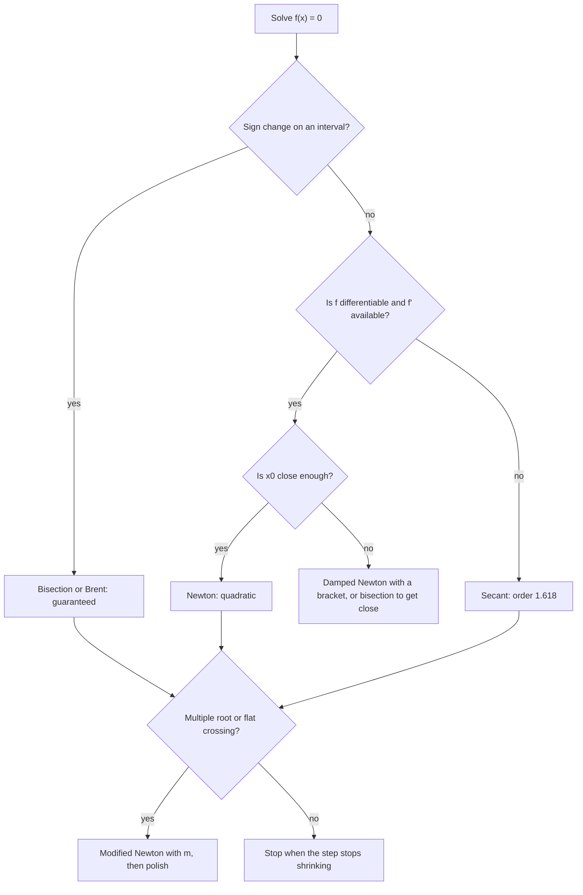

# Root Finding

> [Mathematics](../../README.md) › [Numerical Analysis](../README.md) · Level: Intermediate · Prerequisites: [Continuity and Limits](../../14-real-analysis/03-continuity-and-limits/README.md), [Derivatives](../../07-calculus/03-derivatives/README.md), [Sequences and Series](../../14-real-analysis/02-sequences-and-series/README.md), [Floating-Point Arithmetic](../01-floating-point-arithmetic/README.md) · Estimated time: 480 min

## 1. Introduction

Every solved equation is a root. Setting a model equal to a target, finding where two curves cross,
locating an equilibrium, or inverting a function all reduce to solving $f(x)=0$, and for almost no
function that arises in practice can this be done by a formula. A quadratic yields to the formula of
[Quadratic Equations](../../03-algebra/08-quadratic-equations/README.md); a cubic and a quartic have
formulas that are useless in practice; a quintic has none; and $\cos x = x$ has no closed form at all.
Yet the equation $\cos x = x$ has a perfectly good answer, and a computer finds it in under twenty
lines.

The subject has two independent questions, and confusing them is the main source of error.

1. **Does the method converge, and from where?** Bisection converges from any bracketing interval, but
   slowly. Newton's method converges extremely fast once it is close, but can diverge, cycle, or hit a
   zero derivative from a poor start. Fixed-point iteration converges exactly when the iteration map is
   a contraction.
2. **How fast, and how accurately can the answer be found?** Rate matters: bisection gains one binary
   digit per step, Newton doubles the number of correct digits, and the secant method multiplies the
   number of correct digits by $1.618$ per step. Accuracy is bounded not only by the method but by the
   arithmetic: once the iterate is within about $\sqrt{u}\approx10^{-8}$ of the root, the computed
   Newton step is dominated by rounding (Section 7.7).

This chapter treats six algorithms — bisection, fixed-point iteration, Newton, the secant method,
regula falsi in passing, and Newton with deflation for multiple roots — and proves the convergence
theorems rather than quoting them. Every iteration table in the examples and solutions was computed,
not estimated, and the tables show enough digits to make the order of convergence visible.

The proofs rest on three tools from analysis: the intermediate value theorem (for bracketing), the
contraction mapping principle (for fixed-point iteration and for the local convergence of everything
else), and Taylor's theorem with remainder (for the order of Newton's method). Nothing else is needed.

## 2. Prerequisites

**The intermediate value theorem.** Bisection is a machine for applying it: if $f$ is continuous on
$[a,b]$ and $f(a)f(b)<0$, there is $r\in(a,b)$ with $f(r)=0$. See
[Continuity and Limits](../../14-real-analysis/03-continuity-and-limits/README.md).

**Derivatives and Taylor's theorem.** Newton's method is the tangent line, and its quadratic
convergence comes from $f(r)=f(x_n)+f'(x_n)(r-x_n)+\tfrac12f''(\xi)(r-x_n)^{2}$. See
[Derivatives](../../07-calculus/03-derivatives/README.md).

**Convergence of sequences.** The error estimates are statements about $\lvert x_n-r\rvert$; the
geometric decay $L^{n}$ and the comparison of orders are properties of sequences. See
[Sequences and Series](../../14-real-analysis/02-sequences-and-series/README.md).

**Floating-point arithmetic.** The attainable accuracy, the failure of $\lvert f(x_n)\rvert$ as a
stopping criterion, and the difference between the root of $f$ and the root of the computed $f$ all
come from the previous topic, [Floating-Point Arithmetic](../01-floating-point-arithmetic/README.md).

**Inequalities and induction.** The bisection bound is proved by induction on the interval length, and
the error estimates use the triangle inequality repeatedly. See
[Inequalities](../../03-algebra/03-inequalities/README.md).

## 3. Learning Objectives

By the end of this tutorial you will be able to

1. state the bisection algorithm, prove its invariant, and derive the bound
   $\lvert x_n-r\rvert\le(b-a)/2^{n+1}$;
2. compute in advance how many bisection steps are needed for a prescribed tolerance;
3. recognise a fixed-point reformulation $x=g(x)$ and decide whether $g$ is a contraction on an interval;
4. prove the contraction mapping theorem, including existence, uniqueness and the geometric error
   estimate, and use both the a priori and the a posteriori bounds;
5. derive Newton's method geometrically, write its iteration map, and prove quadratic convergence under
   standard hypotheses;
6. diagnose the failure modes of Newton's method — zero derivative, cycling, divergence, overshoot, and
   multiple roots — and construct examples of each;
7. derive the secant method, state its error relation, and prove that its order is
   $\varphi=(1+\sqrt5)/2$;
8. define linear, superlinear and quadratic convergence and compute the rate or the order from a table
   of iterates;
9. choose and justify stopping criteria, and explain why a small residual $\lvert f(x_n)\rvert$ does not
   imply a small error;
10. deflate a polynomial after finding one root, and use the modified Newton iteration for a root of
    known multiplicity;
11. compare bisection, fixed-point iteration, Newton and secant on reliability, speed, derivative
    requirements and cost;
12. explain how rounding limits the attainable accuracy of any iteration.

## 4. Intuition

**Two ways to guess a root.** One is to *bracket* it: find an interval where the function changes sign
and shrink the interval until the sign change is confined to a tiny neighbourhood. This is bisection,
and it needs nothing but continuity. The other is to *model* the function: approximate it near a guess
by a straight line and jump to where that line crosses zero. This is Newton's method (tangent) and the
secant method (chord), and it needs smoothness but converges much faster.

**Halving versus digit doubling.** Bisection buys one binary digit of the answer per evaluation and
never fails on a bracket. Newton, near a simple root, buys a doubling of the number of correct digits:
an error of $10^{-3}$ becomes $10^{-6}$, then $10^{-12}$, then $10^{-24}$ — which in double precision
means the job is finished after three steps from a mediocre start. The example in Section 9.3 shows
exactly this: $2.45\times10^{-3}$, $2.12\times10^{-6}$, $1.595\times10^{-12}$.

**The price of speed.** Newton's guarantee is *local*: it requires a starting point close enough that
the tangent line's root remains in the interval where the hypotheses hold. Away from that neighbourhood
anything can happen, and Section 7.4 collects the possibilities: a zero derivative (the tangent is
horizontal and never meets the axis), a cycle of period two ($x^{3}-2x+2$ from $0$), divergence to
infinity ($\arctan x$ from $1.4$), and slow linear convergence at a multiple root ($x^{3}-3x+2$ from
$0$).

**Rate is the observable.** Given a table of iterates, the *order* $p$ is read off from the ratios
$\lvert e_{n+1}\rvert/\lvert e_n\rvert^{p}$: for Newton, $\lvert e_{n+1}\rvert\approx C\lvert e_n\rvert^{2}$
gives $e_{n+1}/e_n^{2}\approx C$; for bisection $e_{n+1}\approx\tfrac12e_n$; for the secant method
$e_{n+1}\approx C e_n e_{n-1}$, which is what makes its order $\varphi$ rather than $2$. Section 7.6
turns these observations into definitions, and the examples verify them numerically.

## 5. Formal Definition

**Definition 5.1 (root).** A *root* (or *zero*) of $f$ is a point $r$ with $f(r)=0$. A root is *simple*
if $f$ is differentiable at $r$ with $f'(r)\ne0$, and of *multiplicity $m$* if $f(x)=(x-r)^{m}h(x)$ with
$h$ continuous and $h(r)\ne0$.

**Definition 5.2 (bracketing interval).** An interval $[a,b]$ *brackets* a root if $f$ is continuous on
$[a,b]$ and $f(a)f(b)<0$. By the intermediate value theorem it contains at least one root, and exactly
one if $f$ is strictly monotone there.

**Definition 5.3 (iterative method).** An *iterative method* for $f$ is a map $\Phi$ such that
$x_{n+1}=\Phi(x_n)$; the method *converges* from $x_0$ if the sequence converges to a root $r$, and it
converges *locally* if convergence is guaranteed for all $x_0$ in some neighbourhood of $r$, *globally*
on a set $S$ if for all $x_0\in S$. The *error* is $e_n=x_n-r$.

**Definition 5.4 (order of convergence).** Let $e_n\to0$. The method converges with *order* $p\ge1$ and
*asymptotic constant* $C$ if
$$
\lim_{n\to\infty}\frac{\lvert e_{n+1}\rvert}{\lvert e_n\rvert^{p}}=C,\qquad 0<C<\infty .
$$
For $p=1$ the method is *linear* with *rate* $C$ (and convergence requires $C<1$); for $1<p<2$ it is
*superlinear*; for $p=2$ it is *quadratic*. When the limit does not exist but
$\lvert e_{n+1}\rvert\le C\lvert e_n\rvert^{p}$ eventually holds, the method is said to converge *of
order at least* $p$.

**Definition 5.5 (contraction).** Let $(X,d)$ be a metric space. A map $g:X\to X$ is a *contraction* with
constant $L$ if $d(g(x),g(y))\le L\,d(x,y)$ for all $x,y\in X$ with $0\le L<1$. On an interval of
$\mathbb{R}$ this reads $\lvert g(x)-g(y)\rvert\le L\lvert x-y\rvert$.

**Definition 5.6 (fixed-point iteration).** Given $g$, the *fixed-point iteration* is
$x_{n+1}=g(x_n)$; its limit, if any, is a *fixed point* of $g$, i.e. a solution of $x=g(x)$.

**Definition 5.7 (stopping criterion).** A rule for terminating the iteration. The common ones are
$\lvert x_n-x_{n-1}\rvert\le\delta_{\mathrm{abs}}$, $\lvert x_n-x_{n-1}\rvert\le\delta_{\mathrm{rel}}\lvert x_n\rvert$,
$\lvert f(x_n)\rvert\le\varepsilon$, and a bound on the number of iterations.

**Definition 5.8 (deflation).** If $p$ is a polynomial with a known root $r_1$, the *deflated*
polynomial is $q(x)=p(x)/(x-r_1)$, whose roots are the remaining roots of $p$; computed by synthetic
division, which produces the coefficients of $q$ and a remainder that measures the error in $r_1$.

## 6. Mathematical Notation

| Symbol | Read as | Meaning |
|---|---|---|
| $f$, $r$ | f, r | the function and a root, $f(r)=0$ |
| $[a,b]$ | bracket | interval with $f(a)f(b)<0$ |
| $x_n$ | iterate | the $n$-th approximation to $r$ |
| $e_n$ | error | $x_n-r$ |
| $\Phi$ | Phi | the iteration map, $x_{n+1}=\Phi(x_n)$ |
| $g$ | g | the map of a fixed-point problem, $x=g(x)$ |
| $L$ | contraction constant | $\lvert g(x)-g(y)\rvert\le L\lvert x-y\rvert$, $L<1$ |
| $p$, $C$ | order, constant | $\lvert e_{n+1}\rvert/\lvert e_n\rvert^{p}\to C$ |
| $\varphi$ | phi | $(1+\sqrt5)/2=1.618\ldots$, the secant order |
| $M$, $m_1$ | bounds | $M=\sup\lvert f''\rvert$, $m_1=\inf\lvert f'\rvert$ on the interval |
| $\delta,\varepsilon$ | tolerances | step-size and residual thresholds |
| $\kappa$ | condition number | sensitivity of the root to perturbations of $f$ |

## 7. Core Concepts

### 7.1 Bisection

**Algorithm.** Given a bracket $[a_0,b_0]$ with $f(a_0)f(b_0)<0$, repeat for $n=0,1,2,\dots$:
compute $m_n=(a_n+b_n)/2$; if $f(m_n)=0$ stop; otherwise replace $[a_n,b_n]$ by the half-interval
$[a_n,m_n]$ or $[m_n,b_n]$ on which the sign change persists.

**Invariant and error bound.** By induction, $f(a_n)f(b_n)<0$ and $b_n-a_n=(b_0-a_0)/2^{n}$. The
intermediate value theorem gives a root $r\in[a_n,b_n]$, and $m_n$ is the midpoint, so
$$
\lvert x_n-r\rvert\le\frac{b_n-a_n}{2}=\frac{b_0-a_0}{2^{n+1}} .
$$
This is a *guaranteed* bound: it holds for every continuous $f$, with no derivative, no initial guess
beyond the bracket, and no assumption about the shape of $f$.

**Number of steps.** For a tolerance $\varepsilon$ on the error,
$$
\frac{b_0-a_0}{2^{n+1}}\le\varepsilon\quad\Longleftrightarrow\quad n\ge\log_2\frac{b_0-a_0}{\varepsilon}-1 .
$$
On $[2,3]$ with $\varepsilon=10^{-6}$ this gives $n\ge\log_2(10^{6})-1=18.93$, so $n=19$ steps suffice;
taking $n=20$ leaves a margin.

**Worked table.** For $f(x)=x^{3}-2x-5$ on $[2,3]$ (the example Newton himself used), $f(2)=-1$ and
$f(3)=16$, so the bracket is valid:

| $n$ | $a_n$ | $b_n$ | $m_n$ | $f(m_n)$ | width |
|---|---|---|---|---|---|
| 0 | $2$ | $3$ | $2.5$ | $+5.625$ | $1$ |
| 1 | $2$ | $2.5$ | $2.25$ | $+1.890625$ | $0.5$ |
| 2 | $2$ | $2.25$ | $2.125$ | $+0.3457031$ | $0.25$ |
| 3 | $2$ | $2.125$ | $2.0625$ | $-0.3513184$ | $0.125$ |
| 4 | $2.0625$ | $2.125$ | $2.09375$ | $-0.0089417$ | $0.0625$ |
| 5 | $2.09375$ | $2.125$ | $2.109375$ | $+0.1668358$ | $0.03125$ |

The root is $r=2.0945514815\ldots$; after ten steps the bound is $2^{-11}=4.88\times10^{-4}$ and the
actual error is $1.75\times10^{-4}$, comfortably inside it.

**Strengths and weaknesses.** Bisection is unconditionally reliable on a bracket, needs only a sign
evaluation, and its accuracy is predictable in advance. It is also slow — three or four steps per
decimal digit — uses no information about the magnitude of $f$, and cannot find a root of even
multiplicity (where $f$ does not change sign). It is the method to fall back on, and the method used to
*start* the faster ones.

### 7.2 Fixed-point iteration and the contraction condition

Write $f(x)=0$ as $x=g(x)$; there are usually many ways (for $x^{2}-2=0$, take $g=x^{2}+x-2$,
$g=2/x$, or $g=(x+2/x)/2$), and the choice decides whether the iteration converges.

**Theorem 7.1 (contraction mapping, one-dimensional form).** Let $g:[a,b]\to[a,b]$ be continuous with
$\lvert g(x)-g(y)\rvert\le L\lvert x-y\rvert$ for all $x,y\in[a,b]$ and some $0\le L<1$. Then:

(a) $g$ has exactly one fixed point $r\in[a,b]$;

(b) for every $x_0\in[a,b]$ the iterates $x_{n+1}=g(x_n)$ converge to $r$;

(c) $\lvert x_n-r\rvert\le L^{n}\lvert x_0-r\rvert$;

(d) (a priori) $\lvert x_n-r\rvert\le\dfrac{L^{n}}{1-L}\lvert x_1-x_0\rvert$;

(e) (a posteriori) $\lvert x_n-r\rvert\le\dfrac{L}{1-L}\lvert x_n-x_{n-1}\rvert$.

*Proof.* (a) Let $h(x)=g(x)-x$. Then $h(a)=g(a)-a\ge0$ because $g(a)\in[a,b]$, and $h(b)=g(b)-b\le0$;
$h$ is continuous, so it has a zero in $[a,b]$ — a fixed point. If $r\ne s$ were both fixed points, then
$\lvert r-s\rvert=\lvert g(r)-g(s)\rvert\le L\lvert r-s\rvert<\lvert r-s\rvert$, a contradiction.

(b), (c) Since $g$ maps $[a,b]$ into itself, all iterates stay in $[a,b]$, and
$$
\lvert x_{n+1}-r\rvert=\lvert g(x_n)-g(r)\rvert\le L\lvert x_n-r\rvert\le\cdots\le L^{n+1}\lvert x_0-r\rvert .
$$
As $L<1$, $L^{n}\to0$, so $x_n\to r$.

(d) From the triangle inequality and (c),
$\lvert x_0-r\rvert\le\lvert x_0-x_1\rvert+\lvert x_1-r\rvert\le\lvert x_0-x_1\rvert+L\lvert x_0-r\rvert$,
hence $\lvert x_0-r\rvert\le\lvert x_1-x_0\rvert/(1-L)$; combine with (c).

(e) $\lvert x_n-r\rvert\le L\lvert x_{n-1}-r\rvert\le L\lvert x_{n-1}-x_n\rvert+L\lvert x_n-r\rvert$,
so $(1-L)\lvert x_n-r\rvert\le L\lvert x_{n-1}-x_n\rvert$. $\blacksquare$

**How to verify the hypotheses in practice.** Two separate things must be checked. The contraction
inequality, if $g$ is differentiable on $[a,b]$ and $\lvert g'(x)\rvert\le L<1$ there, follows from the
mean value theorem. The invariance $g([a,b])\subseteq[a,b]$ does not follow from the contraction
inequality alone and must be verified directly — usually by computing the range of $g$ on $[a,b]$, as
with $\cos$ on $[0,1]$, whose range is $[\cos1,1]\subset[0,1]$. The *local* version is often enough: if
$\lvert g'(r)\rvert<1$ then some neighbourhood of $r$ is invariant and $g$ contracts there; if
$\lvert g'(r)\rvert>1$ the fixed point is repelling and the iteration diverges from any nearby start.

**Example: $\cos x=x$.** Take $g(x)=\cos x$ on $[0,1]$. Then $g([0,1])=[\cos1,1]\subset[0,1]$ and
$\lvert g'(x)\rvert=\sin x\le\sin1=0.8414709848\ldots=L<1$, so all hypotheses hold. From $x_0=0.5$:

| $n$ | $x_n$ | $\lvert x_n-r\rvert$ |
|---|---|---|
| 1 | $0.877582561890$ | $1.385\times10^{-1}$ |
| 2 | $0.639012494165$ | $1.001\times10^{-1}$ |
| 3 | $0.802685100682$ | $6.360\times10^{-2}$ |
| 4 | $0.694778026788$ | $4.431\times10^{-2}$ |
| 5 | $0.768195831282$ | $2.911\times10^{-2}$ |
| 6 | $0.719165445942$ | $1.992\times10^{-2}$ |

The error ratios are $0.72$, $0.64$, $0.70$, $0.66$, $0.68$, $0.67$, $0.68$, $0.67$, $0.68$ — converging
to $L=\sin r=0.6736\ldots$, and the convergence is linear with rate $L$, as Theorem 7.1 predicts. The
a priori bound with $L=0.8415$ is pessimistic by a factor of about $(0.84/0.67)^{n}$, which is typical:
the theorem uses a global constant, the iteration obeys the local one.

**Divergence.** For $g(x)=2x-1$, the fixed point is $x=1$ and $g'=2>1$; from $x_0=0$ the iterates are
$-1,-3,-7,-15,\dots$, and $\lvert x_n-1\rvert=2^{n+1}-2$ grows without bound. The same equation written
as $x=(x+1)/2$ has $g'=\tfrac12$ and converges in a few steps. **The reformulation is the algorithm.**

### 7.3 Newton's method

**Geometric derivation.** At the current guess $x_n$, replace $f$ by its tangent line
$$
y=f(x_n)+f'(x_n)(x-x_n)
$$
and take the zero of the tangent as the next guess:
$$
0=f(x_n)+f'(x_n)(x_{n+1}-x_n)\quad\Longrightarrow\quad x_{n+1}=x_n-\frac{f(x_n)}{f'(x_n)} .
$$
The iteration map is $\Phi(x)=x-f(x)/f'(x)$, defined where $f'(x)\ne0$. At a simple root,
$\Phi(r)=r$ and $\Phi'(r)=0$: the derivative of the map vanishes at the fixed point, which is exactly
what produces quadratic convergence (the first-order term of the error expansion disappears).

**Theorem 7.2 (quadratic convergence).** Let $f\in C^{2}[I]$ for an open interval $I$, let $r\in I$ with
$f(r)=0$ and $f'(r)\ne0$. Then there is $\delta>0$ such that for every $x_0\in(r-\delta,r+\delta)$ the
Newton iterates are defined, remain in $I$, converge to $r$, and satisfy
$$
\lvert x_{n+1}-r\rvert\le C\lvert x_n-r\rvert^{2},\qquad C=\frac{M}{2m_1},
$$
where $M=\sup_{I}\lvert f''\rvert$ and $m_1=\inf_I\lvert f'\rvert>0$.

*Proof.* Since $f'(r)\ne0$ and $f'$ is continuous, choose $\delta_0>0$ with $\lvert f'(x)\rvert\ge m_1>0$ on
$I_0=(r-\delta_0,r+\delta_0)\subseteq I$. Taylor's theorem with the Lagrange remainder gives, for
$x_n\in I_0$, a point $\xi_n$ between $x_n$ and $r$ with
$$
0=f(r)=f(x_n)+f'(x_n)(r-x_n)+\tfrac12f''(\xi_n)(r-x_n)^{2}.
$$
Rearranging,
$$
f'(x_n)(x_n-r)-f(x_n)=\tfrac12f''(\xi_n)(x_n-r)^{2}.
$$
Divide by $f'(x_n)$ (nonzero) and use the definition of $x_{n+1}$:
$$
x_{n+1}-r=x_n-r-\frac{f(x_n)}{f'(x_n)}=\frac{f'(x_n)(x_n-r)-f(x_n)}{f'(x_n)}=\frac{f''(\xi_n)}{2f'(x_n)}(x_n-r)^{2}.
$$
Taking absolute values gives $\lvert x_{n+1}-r\rvert\le C\lvert x_n-r\rvert^{2}$ with $C=M/(2m_1)$.

It remains to keep the iterates in $I_0$. Choose $\delta\le\delta_0$ with $C\delta<1$; then
$\lvert x_1-r\rvert\le C\delta^{2}<\delta$, and by induction $\lvert x_n-r\rvert\le\delta(C\delta)^{n-1}\to0$.
$\blacksquare$

**Example: $\sqrt2$.** For $f(x)=x^{2}-2$, the iteration is $x_{n+1}=x_n-(x_n^{2}-2)/(2x_n)=\tfrac12(x_n+2/x_n)$.
From $x_0=1.5$:

| $n$ | $x_n$ | $\lvert x_n-\sqrt2\rvert$ |
|---|---|---|
| 0 | $1.5$ | $8.579\times10^{-2}$ |
| 1 | $1.4166666666666667$ | $2.453\times10^{-3}$ |
| 2 | $1.4142156862745099$ | $2.124\times10^{-6}$ |
| 3 | $1.4142135623746899$ | $1.595\times10^{-12}$ |
| 4 | $1.4142135623730951$ | $0$ (to double precision) |

The errors are $8.6\times10^{-2}$, $2.5\times10^{-3}$, $2.1\times10^{-6}$, $1.6\times10^{-12}$: the number
of correct digits doubles at each step ($1\to3\to6\to12$), and the ratios
$e_{n+1}/e_n^{2}$ are $0.333$, $0.353$, $0.354$ — converging to $f''/(2f')=1/(2\sqrt2)=0.3536$, exactly
the constant of Theorem 7.2.

### 7.4 The failure modes of Newton's method

Theorem 7.2 is local: it says nothing about what happens outside the neighbourhood it constructs. Five
failures account for nearly all practical trouble.

**1. Zero or near-zero derivative.** The formula divides by $f'(x_n)$; at a critical point the tangent is
horizontal and never meets the axis. For $f(x)=x^{2}-1$ started at $x_0=0$, the first step divides by
$f'(0)=0$; started at $x_0=10^{-8}$ the first step jumps to about $-10^{8}$, from where convergence takes
many steps. Newton's method must be guarded by a check on $\lvert f'(x_n)\rvert$.

**2. Cycling.** For $f(x)=x^{3}-2x+2$ and $x_0=0$:
$$
x_0=0\ \longrightarrow\ x_1=1\ \longrightarrow\ x_2=0\ \longrightarrow\ x_3=1\ \longrightarrow\ \cdots
$$
Indeed $f(0)=2$, $f'(0)=-2$ give $x_1=0-2/(-2)=1$, and $f(1)=1$, $f'(1)=1$ give $x_2=1-1/1=0$. The
function has a single real root, at $r\approx-1.7693$, which this two-cycle never approaches. A cycle is
not an artefact of poor precision; it is a property of the map $\Phi(x)=x-(x^{3}-2x+2)/(3x^{2}-2)$.

**3. Divergence.** For $f(x)=\arctan x$ the root is $0$ and
$\Phi(x)=x-(1+x^{2})\arctan x$; the derivative at $0$ is $1-1=0$, so $\Phi'(0)=0$ and the root is
superattracting, but the basin of attraction is only $\lvert x_0\rvert<1.3917\ldots$ From $x_0=1.4$:

| $n$ | $x_n$ |
|---|---|
| 1 | $-1.4136186488$ |
| 2 | $1.4501293146$ |
| 3 | $-1.5506259756$ |
| 4 | $1.8470540842$ |

The iterates oscillate with growing amplitude because $\lvert\Phi'(x)\rvert>1$ for $\lvert x\rvert$ just
above $1.39$: the fixed point is repelling there.

**4. Overshoot and slow approach.** A step can leave the interval where $f$ resembles its tangent. A
common guard is to accept a Newton step only if it decreases $\lvert f\rvert$ (a *damped* or *line-search*
Newton method), halving the step until it does.

**5. Multiple roots.** A double root is worse than useless for Newton: from $x_0=0$ on
$f(x)=x^{3}-3x+2=(x-1)^{2}(x+2)$ the iterates are $0.6667$, $0.8444$, $0.9244$, $0.9627$, $0.9815$,
$0.9908$, with errors $0.333$, $0.156$, $0.0756$, $0.0373$, $0.0185$, $0.0092$ halving at each step: linear
convergence with rate $\tfrac12$, not quadratic. Section 7.8 explains why and how to repair it.

### 7.5 The secant method

**Derivation.** Newton needs $f'$. Replace it by the difference quotient through the last two iterates:
$$
f'(x_n)\approx\frac{f(x_n)-f(x_{n-1})}{x_n-x_{n-1}} .
$$
Then
$$
x_{n+1}=x_n-f(x_n)\,\frac{x_n-x_{n-1}}{f(x_n)-f(x_{n-1})},
$$
which is the zero of the secant line through $(x_{n-1},f(x_{n-1}))$ and $(x_n,f(x_n))$ — the
*false position* line, but with both points updated at every step. Two starting values are needed, and
only one new function value per step (the old one is reused), so each step costs half as much as Newton's.

**Error relation.** Let $e_n=x_n-r$ and assume $f'(r)\ne0$. Using the divided-difference form of the
interpolation error, one obtains
$$
e_{n+1}=\frac{f''(\xi_n)}{2f'(\eta_n)}\,e_n\,e_{n-1}
$$
for points $\xi_n,\eta_n$ in the interval spanned by $x_{n-1},x_n,r$. The product $e_ne_{n-1}$ — not a
power — is the signature of the method.

**Theorem 7.3 (order of the secant method).** Let $f\in C^{2}$ near a simple root $r$, and suppose the
iterates converge with $e_n\ne0$ and $\lvert e_{n+1}\rvert\approx C\lvert e_n\rvert\lvert e_{n-1}\rvert$.
Then the order is $p=\varphi=(1+\sqrt5)/2=1.618\ldots$, i.e. $\lvert e_{n+1}\rvert\approx
C^{p-1}\lvert e_n\rvert^{p}$ asymptotically.

*Proof.* Suppose $\lvert e_{n+1}\rvert=A\lvert e_n\rvert^{p}$ and $\lvert e_n\rvert=A\lvert e_{n-1}\rvert^{p}$.
Substituting into $\lvert e_{n+1}\rvert=C\lvert e_n\rvert\lvert e_{n-1}\rvert$ gives
$$
A\lvert e_n\rvert^{p}=C\lvert e_n\rvert\lvert e_{n-1}\rvert=C\lvert e_n\rvert\left(\frac{\lvert e_n\rvert}{A}\right)^{1/p}
=C A^{-1/p}\lvert e_n\rvert^{1+1/p},
$$
so the exponents must agree: $p=1+1/p$, that is $p^{2}-p-1=0$, whose positive root is
$\varphi=(1+\sqrt5)/2$. Consistency of the constants gives $A=CA^{-1/p}$, i.e. $A^{1+1/p}=A^{p}=C$, so
$A=C^{1/p}$ and therefore $\lvert e_{n+1}\rvert=C^{1-1/p}\lvert e_n\rvert^{p}$. $\blacksquare$

**Worked table.** For $f(x)=x^{3}-2x-5$ with $x_0=2$, $x_1=3$ (so $f=(-1,16)$):

| $n$ | $x_n$ | $f(x_n)$ | $\lvert x_n-r\rvert$ |
|---|---|---|---|
| 0 | $2$ | $-1$ | $9.455\times10^{-2}$ |
| 1 | $3$ | $16$ | $9.055\times10^{-1}$ |
| 2 | $2.0588235294$ | $-0.390800$ | $3.573\times10^{-2}$ |
| 3 | $2.0812636598$ | $-0.147204$ | $1.329\times10^{-2}$ |
| 4 | $2.0948241461$ | $+0.003045$ | $2.727\times10^{-4}$ |
| 5 | $2.0945494310$ | $-2.289\times10^{-5}$ | $2.051\times10^{-6}$ |
| 6 | $2.0945514812$ | $-3.513\times10^{-9}$ | $3.147\times10^{-10}$ |
| 7 | $2.0945514815$ | $+3.553\times10^{-15}$ | $4.4\times10^{-16}$ |

*Verification of the order.* The ratios $e_{n+1}/(e_ne_{n-1})$ are
$$
\frac{2.051\times10^{-6}}{2.727\times10^{-4}\cdot1.329\times10^{-2}}=0.566,\qquad
\frac{3.147\times10^{-10}}{2.051\times10^{-6}\cdot2.727\times10^{-4}}=0.563,\qquad
\frac{4.4\times10^{-16}}{3.147\times10^{-10}\cdot2.051\times10^{-6}}=0.68,
$$
essentially constant at $C\approx0.56$, confirming the relation $e_{n+1}\approx Ce_ne_{n-1}$. The
exponents follow: errors $3.6\times10^{-2}$, $1.3\times10^{-2}$, $2.7\times10^{-4}$, $2.1\times10^{-6}$,
$3.1\times10^{-10}$ — roughly $5$ digits gained every two steps, i.e. $2.5$ per step, against $1.618$ per
step asymptotically.

### 7.6 Order of convergence, and how to measure it

Definition 5.4 gives the order $p$ and the constant $C$. Three cases cover everything in this chapter.

- **Linear** ($p=1$): $\lvert e_{n+1}\rvert\approx C\lvert e_n\rvert$ with $C<1$. Each step adds
  $-\log_{10}C$ decimal digits. Bisection has $C=\tfrac12$, giving $0.301$ digits per step; fixed-point
  iteration has $C=\lvert g'(r)\rvert$; Newton at a root of multiplicity $m$ has $C=1-1/m$.
- **Superlinear** ($1<p<2$): the secant method with $p=\varphi$.
- **Quadratic** ($p=2$): Newton at a simple root, with $C=\lvert f''(r)\rvert/(2\lvert f'(r)\rvert)$, and
  Steffensen's method (Newton with the difference quotient $f'(x)\approx(f(x+f(x))-f(x))/f(x)$).

The orders, collected: bisection $p=1$ with rate $\tfrac12$; fixed-point iteration $p=1$ with rate
$\lvert g'(r)\rvert$; Newton $p=2$; the secant method $p=\varphi\approx1.618$; Newton at a root of
multiplicity $m$, $p=1$ with rate $1-1/m$ (or $p=2$ with the modified iteration).

**Measuring from a table.** If the errors are $e_n$, compute $\rho_n=\lvert e_{n+1}\rvert/\lvert e_n\rvert$
for linear convergence: a constant $\rho<1$ means order $1$ with rate $\rho$; a ratio tending to $0$ means
superlinear. For quadratic convergence, compute $\lvert e_{n+1}\rvert/\lvert e_n\rvert^{2}$ and look for a
constant. A table in which the number of correct digits doubles at every step is the fingerprint of order
$2$; digits growing by a constant amount per step is the fingerprint of order $1$.

**Why the order is the right measure.** From an error of $10^{-3}$, bisection needs
$\log_2(10^{13})\approx43$ steps to reach $10^{-16}$, while quadratic convergence squares the error each
time — $10^{-3},10^{-6},10^{-12},10^{-24}$ — so Newton needs three. Neither count includes the cost of
$f'$; the comparison in Section 7.9 does.

### 7.7 Stopping criteria, and why a small residual is not enough

**Three tests, three meanings.**

1. *Step size*: stop when $\lvert x_n-x_{n-1}\rvert\le\delta_{\mathrm{abs}}$ (or relative,
   $\lvert x_n-x_{n-1}\rvert\le\delta_{\mathrm{rel}}\lvert x_n\rvert$). This measures the *change* in the
   answer, not its error. For a contraction with constant $L$ the error obeys
   $\lvert x_n-r\rvert\le\frac{L}{1-L}\lvert x_n-x_{n-1}\rvert$, so a step of $\delta$ certifies an error
   of at most $L\delta/(1-L)$ — a factor of $10$ for $L=0.9$, a factor of $2$ for $L=0.5$. For Newton,
   near a simple root, the previous error is of the same order as the step, so the step is a good proxy.
2. *Residual*: stop when $\lvert f(x_n)\rvert\le\varepsilon$. This measures the *value*, not the location.
   Near a simple root $\lvert f(x)\rvert\approx\lvert f'(r)\rvert\lvert x-r\rvert$, so the test is
   equivalent to an error test only if a lower bound on $\lvert f'\rvert$ is known. For a flat function
   it is useless: for $f(x)=(x-1)^{10}$ the residual at $x=1.1$ is $10^{-10}$, while the error is $0.1$.
   Conversely, for a steep function the residual may be large while the error is tiny:
   $f(x)=10^{10}(x-1)$ has $\lvert f(x)\rvert=10^{-6}$ at an error of $10^{-16}$.
3. *Budget*: stop after $N_{\max}$ iterations. Always include it; every iteration can fail to converge.

**What rounding allows.** Suppose $f$ is evaluated with relative accuracy $u$. Near a simple root,
$\lvert f(x)\rvert\approx\lvert f'(r)\rvert\lvert x-r\rvert$, and an absolute evaluation error of about
$u\lvert f(x)\rvert$ perturbs the Newton step by about $u\lvert x-r\rvert$: the iteration can locate the
root to a few units in the last place, no more. Near a double root the residual is quadratic, so an
absolute error $u$ in $f$ translates to an error of order $\sqrt u\approx10^{-8}$ in $x$ — eight digits,
not sixteen. This is why a good implementation stops as soon as the step stops shrinking, and why
"iterate until $\lvert f\rvert<10^{-300}$" is a symptom of misunderstanding.

### 7.8 Deflation and multiple roots

**Why a multiple root is slow.** Let $f(x)=(x-r)^{m}h(x)$ with $h(r)\ne0$ and $m\ge2$. Then
$f'(x)=m(x-r)^{m-1}h(x)+(x-r)^{m}h'(x)$, so
$$
\frac{f(x)}{f'(x)}=\frac{(x-r)h(x)}{mh(x)+(x-r)h'(x)}=\frac{x-r}{m}\left(1+O(x-r)\right),
$$
and therefore
$$
\Phi(x)-r=(x-r)-\frac{f(x)}{f'(x)}=\left(1-\frac1m\right)(x-r)+O((x-r)^{2}).
$$
The Newton map has derivative $1-1/m$ at $r$: linear convergence with rate $1-\tfrac12=\tfrac12$ for a
double root, $\tfrac23$ for a triple root. The table in Section 7.4 ($0.333,0.156,0.0756,\dots$) shows
exactly the factor $\tfrac12$.

**Repair 1: the modified Newton iteration.** If $m$ is known, use
$$
x_{n+1}=x_n-m\,\frac{f(x_n)}{f'(x_n)},
$$
which multiplies the step by $m$ and restores quadratic convergence: the derivative of the modified map at
$r$ is $1-m\cdot\tfrac1m=0$. If $m$ is unknown, estimate it from $m\approx f'(x)/\big(f'(x)-(\text{second
derivative term})\big)$, or simply from the observed ratio $e_{n+1}/e_n\to1-1/m$ once the iterates settle.

**Repair 2: deflation.** Find one root $r_1$ of a polynomial $p$ (by any method), then divide:
$p(x)=(x-r_1)q(x)$, and find the roots of $q$. Synthetic division does the division in $n$ operations:
for $p(x)=a_nx^{n}+\cdots+a_0$ the coefficients of $q$ are $b_{n-1}=a_n$, $b_{k-1}=a_k+r_1b_k$, and the
remainder is $a_0+r_1b_0$, which measures the residual $p(r_1)$.

**The danger of deflation.** The computed coefficients of $q$ inherit the error in $r_1$, so the roots of
$q$ are those of a perturbed polynomial. If $r_1$ is accurate to $u$ and the remaining roots are well
separated, the perturbation is $O(u)$ and deflation is safe. If $r_1$ is a multiple root, or if the
remaining roots are clustered, the perturbation can be amplified: dividing by an inaccurate factor is an
ill-conditioned operation. *Forward deflation* (dividing repeatedly by approximate roots) accumulates
error; *backward deflation* (dividing by an accurate factor, then polishing all roots with Newton on the
original $p$) is the recommended practice. Each computed root should be refined against the original
polynomial, never against the deflated one.

**Worked example.** $p(x)=x^{3}-6x^{2}+11x-6=(x-1)(x-2)(x-3)$. Newton from $x_0=3.2$:

| $n$ | $x_n$ | $\lvert x_n-3\rvert$ |
|---|---|---|
| 1 | $3.0409638554$ | $4.096\times10^{-2}$ |
| 2 | $3.0022976499$ | $2.298\times10^{-3}$ |
| 3 | $3.0000078766$ | $7.877\times10^{-6}$ |
| 4 | $3.0000000001$ | $9.306\times10^{-11}$ |
| 5 | $3.0$ | $0$ |

Deflating by $(x-3)$ gives $q(x)=x^{2}-3x+2$, whose roots are $1$ and $2$ — exactly, since synthetic
division here has no rounding. In floating point the coefficients would be $1$, $-3$, $2$ up to an error of
order $u$, and the roots would move by $O(u)$ because they are simple and separated.

### 7.9 Comparing the methods

| method | convergence | order | per-step cost | robustness |
|---|---|---|---|---|
| bisection | global on a bracket | $1$, rate $\tfrac12$ | $1$ evaluation | unconditional |
| fixed-point | local, needs $\lvert g'(r)\rvert<1$ | $1$, rate $\lvert g'(r)\rvert$ | $1$ evaluation | depends on the reformulation |
| Newton | local ($\delta$ unknown) | $2$ at a simple root | $f$ and $f'$ | fails at $f'=0$, cycles, diverges |
| secant | local | $1.618$ | $1$ evaluation | no derivative; fails if $f_n=f_{n-1}$ |
| regula falsi | global on a bracket | $1$, often very slow | $1$ evaluation | always converges |
| Newton, multiplicity $m$ | local | $2$ (modified) or $1$ | $f$ and $f'$ | needs $m$ |

**Practical strategy.** Bisection to get within a factor of a few of the root, then Newton or secant to
polish, with a fallback to bisection whenever a step leaves the bracket or fails to reduce $\lvert f\rvert$.
This hybrid — Brent's method is the standard implementation — is what libraries provide: it is as reliable
as bisection and, in practice, as fast as the secant method. Never rely on a bare Newton loop for a
function you have not examined.
## 8. Formulas and Properties

The results below are the working kit; those proved in Section 7 are restated with their hypotheses so
that they can be quoted.

**Proposition 8.1 (bisection error).** Let $f$ be continuous on $[a_0,b_0]$ with $f(a_0)f(b_0)<0$, and let
$x_n$ be the $n$-th midpoint. Then $\lvert x_n-r\rvert\le(b_0-a_0)/2^{n+1}$ for some root $r$ of $f$ in
the bracket.

*Proof.* The surviving interval satisfies $b_n-a_n=(b_0-a_0)/2^{n}$ and still changes sign, so it contains
a root $r$; $x_n$ is its midpoint. $\blacksquare$

**Proposition 8.2 (steps for a tolerance).** With $\varepsilon>0$, the error is at most $\varepsilon$ after
$n\ge\log_2\!\big((b_0-a_0)/\varepsilon\big)-1$ steps, and the interval width is at most $2\varepsilon$
after $n\ge\log_2\!\big((b_0-a_0)/\varepsilon\big)$ steps.

**Proposition 8.3 (contraction iteration).** If $g:[a,b]\to[a,b]$ is continuous, $\lvert g(x)-g(y)\rvert\le
L\lvert x-y\rvert$ with $0\le L<1$, and $x_{n+1}=g(x_n)$, then $x_n\to r$ (the unique fixed point) and
$$
\lvert x_n-r\rvert\le L^{n}\lvert x_0-r\rvert,\qquad
\lvert x_n-r\rvert\le\frac{L^{n}}{1-L}\lvert x_1-x_0\rvert,\qquad
\lvert x_n-r\rvert\le\frac{L}{1-L}\lvert x_n-x_{n-1}\rvert .
$$
*Proof.* Section 7.2. The three estimates are respectively the geometric decay, the a priori bound obtained
from $\lvert x_0-r\rvert\le\lvert x_0-x_1\rvert+L\lvert x_0-r\rvert$, and the a posteriori bound obtained
from $\lvert x_n-r\rvert\le L\lvert x_{n-1}-x_n\rvert+L\lvert x_n-r\rvert$. $\blacksquare$

**Proposition 8.4 (Newton, quadratic).** If $f\in C^{2}$ near a simple root $r$, then for $x_0$ close
enough to $r$,
$$
x_{n+1}-r=\frac{f''(\xi_n)}{2f'(x_n)}(x_n-r)^{2},\qquad
\lvert x_{n+1}-r\rvert\le\frac{M}{2m_1}\lvert x_n-r\rvert^{2},
$$
with $\xi_n$ between $x_n$ and $r$, $M=\sup\lvert f''\rvert$, $m_1=\inf\lvert f'\rvert>0$.

*Proof.* Section 7.3: Taylor's theorem at $x_n$ evaluated at $r$. $\blacksquare$

*Consequence.* The asymptotic constant is $C=\lvert f''(r)\rvert/(2\lvert f'(r)\rvert)$, and the number of
correct digits doubles per step once $\lvert e_n\rvert<1/C$.

**Proposition 8.5 (multiple roots).** If $f(x)=(x-r)^{m}h(x)$ with $h(r)\ne0$ and $m\ge2$, Newton's method
converges linearly with rate $1-1/m$, and the modified iteration $x_{n+1}=x_n-mf(x_n)/f'(x_n)$ converges
quadratically.

*Proof.* Section 7.8: $\Phi(x)-r=(1-1/m)(x-r)+O((x-r)^{2})$; the modified map has derivative $0$ at $r$.
$\blacksquare$

**Proposition 8.6 (secant).** For $f\in C^{2}$ near a simple root,
$$
e_{n+1}=\frac{f''(\xi_n)}{2f'(\eta_n)}e_ne_{n-1},
$$
and if the iterates converge then the order is $\varphi=(1+\sqrt5)/2$ with asymptotic constant
$C^{1-1/\varphi}$.

*Proof.* Section 7.5: the divided-difference error formula, then the exponent balance
$p=1+1/p$. $\blacksquare$

**Proposition 8.7 (step-size and error).** For a contraction with constant $L$, a step of size $\delta$ at
$x_n$ certifies $\lvert x_n-r\rvert\le L\delta/(1-L)$; near a simple root with Newton or secant,
$\lvert x_n-r\rvert\approx\lvert x_{n+1}-x_n\rvert$ once the iteration is in its asymptotic regime.

*Justification.* The first is Proposition 8.3. For the second, Newton gives
$e_{n+1}\approx C e_n^{2}$, so $\lvert x_{n+1}-x_n\rvert=\lvert e_{n+1}-e_n\rvert\approx\lvert e_n\rvert$
when $\lvert e_n\rvert\ll1$. The secant method gives
$\lvert x_{n+1}-x_n\rvert\approx\lvert e_n\rvert(1-C\lvert e_{n-1}\rvert)\approx\lvert e_n\rvert$.
$\blacksquare$

**Proposition 8.8 (conditioning of a root).** Let $r$ be a simple root of $f$ and let $f$ be perturbed to
$f+\delta f$, with $r+\Delta r$ the corresponding root. Then, to first order,
$$
\Delta r\approx-\frac{\delta f(r)}{f'(r)},\qquad\text{so}\qquad
\frac{\lvert\Delta r\rvert}{\lvert r\rvert}\lesssim\frac{\lvert\delta f(r)\rvert}{\lvert r f'(r)\rvert}.
$$
For a polynomial $p(x)=\sum a_kx^{k}$, a perturbation of the coefficient $a_k$ changes the root by
$\partial r/\partial a_k=-r^{k}/p'(r)$.

*Proof.* $0=f(r+\Delta r)+\delta f(r+\Delta r)=f(r)+f'(r)\Delta r+\delta f(r)+o(\lvert\Delta r\rvert)$,
and $f(r)=0$. For the polynomial case, differentiate $p(r)=0$ with respect to $a_k$:
$r^{k}+p'(r)\,\partial r/\partial a_k=0$. $\blacksquare$

*Interpretation.* A root is ill conditioned exactly when $f'(r)$ is small — a flat crossing. This is the
root-finding counterpart of the condition number of Section 7.8 of the previous topic, and it explains
Wilkinson's example: for $\prod_{k=1}^{20}(x-k)$, $\lvert p'(k)\rvert=k!(20-k)!$ is enormous in the
middle of the range, so the middle roots are *well* conditioned, while the roots near the ends have
small derivatives and move a great deal under coefficient perturbations.

## 9. Step-by-Step Examples

### Example 9.1 (easy): bisection for $x=\cos x$

*Step 1: bracket.* $f(x)=x-\cos x$ satisfies $f(0)=-1<0$ and $f(1)=0.4597>0$, so $[0,1]$ brackets the
root. $f$ is increasing ($f'=1+\sin x>0$), so the root is unique.

*Step 2: four steps.*

| $n$ | $a_n$ | $b_n$ | $x_n$ | $f(x_n)$ | width |
|---|---|---|---|---|---|
| 0 | $0$ | $1$ | $0.5$ | $-0.377583$ | $1$ |
| 1 | $0.5$ | $1$ | $0.75$ | $+0.018311$ | $0.5$ |
| 2 | $0.5$ | $0.75$ | $0.625$ | $-0.185963$ | $0.25$ |
| 3 | $0.625$ | $0.75$ | $0.6875$ | $-0.085335$ | $0.125$ |

After four midpoints the bound of Proposition 8.1 is $\lvert x_3-r\rvert\le2^{-4}=0.0625$; the actual error
is $\lvert0.6875-0.739085\rvert=0.0516$ ✓. Note that the error is bounded by *half* the width of the
current bracket, because $x_n$ is the centre of the interval one step earlier.

*Step 3: steps for six digits.* With $b_0-a_0=1$ and $\varepsilon=10^{-6}$,
$n\ge\log_2(10^{6})-1=18.93$, so $n=19$ suffices; $20$ steps leave a margin.

### Example 9.2 (easy–medium): fixed point $x=1+1/x$ and the golden ratio

*Step 1: the fixed point.* $x=1+1/x$ is equivalent to $x^{2}-x-1=0$, whose positive root is
$\varphi=(1+\sqrt5)/2=1.6180339887$.

*Step 2: contraction check.* $g(x)=1+1/x$ has $g'(x)=-1/x^{2}$, so on $[1.5,2]$,
$\lvert g'\rvert\le1/2.25=0.4444=L<1$, and $g([1.5,2])=[1.5,1.6667]\subset[1.5,2]$. Theorem 7.1 applies.

*Step 3: iterates from $x_0=1.5$.*

| $n$ | $x_n$ | $\lvert x_n-\varphi\rvert$ | ratio |
|---|---|---|---|
| 1 | $1.6666666667$ | $4.863\times10^{-2}$ | — |
| 2 | $1.6000000000$ | $1.803\times10^{-2}$ | $0.371$ |
| 3 | $1.6250000000$ | $6.966\times10^{-3}$ | $0.386$ |
| 4 | $1.6153846154$ | $2.649\times10^{-3}$ | $0.380$ |
| 5 | $1.6190476190$ | $1.014\times10^{-3}$ | $0.383$ |
| 6 | $1.6176470588$ | $3.869\times10^{-4}$ | $0.382$ |

The ratios converge to $\lvert g'(\varphi)\rvert=1/\varphi^{2}=0.381966$: linear convergence with that
rate, exactly as Theorem 7.1 predicts (there $L=0.4444$ is a global bound, and the local rate is smaller).

### Example 9.3 (medium): Newton for $x=\cos x$

$f(x)=x-\cos x$, $f'(x)=1+\sin x$, so $x_{n+1}=x_n-(x_n-\cos x_n)/(1+\sin x_n)$. From $x_0=0.5$:

| $n$ | $x_n$ | $\lvert x_n-r\rvert$ | $e_{n+1}/e_n^{2}$ |
|---|---|---|---|
| 0 | $0.5$ | $2.391\times10^{-1}$ | — |
| 1 | $0.7552224171$ | $1.614\times10^{-2}$ | $0.2823$ |
| 2 | $0.7391416661$ | $5.653\times10^{-5}$ | $0.2170$ |
| 3 | $0.7390851339$ | $7.056\times10^{-10}$ | $0.2208$ |
| 4 | $0.7390851332$ | $4.4\times10^{-16}$ | — |

with $r=0.7390851332151607$. The ratios settle near $2.2\times10^{-1}$, and indeed the predicted constant
is $\lvert f''(r)\rvert/(2\lvert f'(r)\rvert)=\cos r/(2(1+\sin r))$, with $\cos r=r=0.739085$ and
$1+\sin r=1.6736$, giving $0.2208$ ✓. Three steps take the error from $10^{-1}$ to $10^{-9}$.

### Example 9.4 (medium): Newton for $x^{3}-2x-5=0$

With $f'=3x^{2}-2$, start at $x_0=2.5$:

| $n$ | $x_n$ | $f(x_n)$ | $\lvert x_n-r\rvert$ |
|---|---|---|---|
| 0 | $2.5$ | $+5.625$ | $4.054\times10^{-1}$ |
| 1 | $2.1641791045$ | $+0.685560$ | $6.963\times10^{-2}$ |
| 2 | $2.0971353558$ | $+0.011434$ | $2.584\times10^{-3}$ |
| 3 | $2.0945552324$ | $+8.06\times10^{-6}$ | $3.751\times10^{-6}$ |
| 4 | $2.0945514816$ | $+1.8\times10^{-12}$ | $7.9\times10^{-12}$ |
| 5 | $2.0945514815$ | $0$ | $0$ |

The errors $6.96\times10^{-2}$, $2.58\times10^{-3}$, $3.75\times10^{-6}$, $7.9\times10^{-12}$ show the
characteristic jump from $10^{-2}$ to $10^{-4}$ to $10^{-8}$ to $10^{-16}$: after the first step the
number of digits roughly doubles each time. The secant method on the same function reached the same
accuracy in seven steps (Section 7.5), each costing one evaluation instead of two.

### Example 9.5 (medium–hard): secant for $x^{2}-2=0$

From $x_0=1$, $x_1=2$:
$$
x_{n+1}=x_n-(x_n^{2}-2)\frac{x_n-x_{n-1}}{x_n^{2}-x_{n-1}^{2}}=x_n-\frac{x_n^{2}-2}{x_n+x_{n-1}} .
$$

| $n$ | $x_n$ | $\lvert x_n-\sqrt2\rvert$ |
|---|---|---|
| 0 | $1$ | $4.142\times10^{-1}$ |
| 1 | $2$ | $5.858\times10^{-1}$ |
| 2 | $1.3333333333$ | $8.094\times10^{-2}$ |
| 3 | $1.4000000000$ | $1.421\times10^{-2}$ |
| 4 | $1.4146341463$ | $4.206\times10^{-4}$ |
| 5 | $1.4142114385$ | $2.124\times10^{-6}$ |
| 6 | $1.4142135621$ | $3.157\times10^{-10}$ |

*Order check.* The products $e_ne_{n-1}$ divided into $e_{n+1}$ give
$4.206\times10^{-4}/(8.094\times10^{-2}\cdot1.421\times10^{-2})=0.366$ and
$2.124\times10^{-6}/(1.421\times10^{-2}\cdot4.206\times10^{-4})=0.355$; the constant is
$C=f''/(2f')=2/(2\cdot2\sqrt2)=1/(2\sqrt2)=0.354$ ✓.

### Example 9.6 (hard): a double root, plain and modified Newton

$f(x)=x^{3}-3x+2=(x-1)^{2}(x+2)$, so $r=1$ is a double root. With $f'=3x^{2}-3$:

| $n$ | Newton from $0$ | $\lvert x_n-1\rvert$ | modified ($m=2$) from $0$ | $\lvert x_n-1\rvert$ |
|---|---|---|---|---|
| 1 | $0.6666666667$ | $3.333\times10^{-1}$ | $1.3333333333$ | $3.333\times10^{-1}$ |
| 2 | $0.8444444444$ | $1.556\times10^{-1}$ | $1.0158730159$ | $1.587\times10^{-2}$ |
| 3 | $0.9244087461$ | $7.559\times10^{-2}$ | $1.0000416615$ | $4.166\times10^{-5}$ |
| 4 | $0.9626992469$ | $3.730\times10^{-2}$ | $1.0000000003$ | $2.888\times10^{-10}$ |

The plain iteration halves the error at each step — linear convergence with rate $1-\tfrac12=\tfrac12$,
as Proposition 8.5 says. The modified iteration squares it (errors $0.33$, $0.016$, $4.2\times10^{-5}$,
$2.9\times10^{-10}$) and then stops, because a double root cannot be located more accurately than
$\sqrt u\approx10^{-8}$ in relative terms from a residual that is quadratic in the error (Section 7.7).

### Example 9.7 (hard): deflation with an inexact root

*Step 1: find one root approximately.* For $p(x)=x^{3}-6x^{2}+11x-6$ we have $p(2.5)=-0.375$ and
$p(4)=6$, so $[2.5,4]$ brackets the root $3$. Eight bisection steps give
$r_1=3.0009765625$, with error $9.77\times10^{-4}$ and residual $p(r_1)=1.956\times10^{-3}$.

*Step 2: deflate.* Synthetic division of $p$ by $(x-r_1)$:

| $k$ | $a_k$ | $b_k$ |
|---|---|---|
| 3 | $1$ | $1$ |
| 2 | $-6$ | $-6+r_1=-2.99902344$ |
| 1 | $11$ | $11+r_1b_2=2.00000095$ |
| 0 | $-6$ | $-6+r_1b_1=0.00195599$ |

so $q(x)=x^{2}-2.99902344x+2.00000095$, with remainder $0.00195599=p(r_1)$ ✓.

*Step 3: the remaining roots.* Solving $q$: $x=(2.99902344\pm\sqrt{8.99414-8.00000})/2$, giving
$1.00097943$ and $1.99804401$. The true roots are $1$ and $2$, so each has moved by about $10^{-3}$ — the
order of the error in $r_1$, as the perturbation analysis of Proposition 8.8 predicts
($\partial r/\partial r_1$ is $O(1)$ here since the roots are simple and separated).

*Step 4: polish.* Two Newton steps on the *original* $p$ from $1.00097943$ give
$0.9999999999999994$, restoring full accuracy. This is the standard remedy: never trust the deflated
roots, refine each against the original polynomial.

### Example 9.8 (hard): when a small residual lies

For $f(x)=x^{2}-2$ and $g(x)=(x-1)^{10}$, compare the residual with the distance to the root:

| function | $x$ | $\lvert f(x)\rvert$ | $\lvert x-r\rvert$ |
|---|---|---|---|
| $x^{2}-2$ | $1.4142$ | $3.84\times10^{-5}$ | $1.36\times10^{-5}$ |
| $x^{2}-2$ | $1.414213$ | $1.59\times10^{-6}$ | $5.62\times10^{-7}$ |
| $(x-1)^{10}$ | $1.01$ | $1.00\times10^{-20}$ | $1.00\times10^{-2}$ |

For $x^{2}-2$ the ratio $\lvert f\rvert/\lvert x-r\rvert$ is constant at $2.828=2\sqrt2=\lvert f'(r)\rvert$,
so a residual tolerance of $\varepsilon$ certifies an error of $\varepsilon/2.828$ — a sound criterion.
For $(x-1)^{10}$ the residual is $10^{-20}$ at an error of $10^{-2}$ (and $10^{-10}$ at $10^{-1}$): the
criterion would accept an answer wrong in the first digit. The difference is the size of $\lvert f'\rvert$
near the root: $2.83$ versus $10(x-1)^{9}=10^{-8}$ at $x=1.01$.

## 10. Visual Explanations

**Choosing a method.** The first question is always whether a bracket is available.

## 11. Common Mistakes

1. **Using Newton without a bracket or a guard.** A bare Newton loop can leave the interval, hit a zero
   derivative, or cycle (Section 7.4). Always cap the iterations, check $\lvert f'(x_n)\rvert$, and fall
   back to bisection.

2. **Stopping on a small residual without a bound on $\lvert f'\rvert$.** For $f(x)=(x-1)^{10}$ a residual
   of $10^{-10}$ means an error of $0.1$ (Example 9.8). Use the bracket, or divide the residual by a lower
   bound for $\lvert f'\rvert$.

3. **Blaming the method for a multiple root.** Newton is not broken at a double root; it is linear, with
   rate $\tfrac12$. The cure is the modified iteration or deflation, and the attainable accuracy is only
   about $\sqrt u$.

4. **Polishing a deflated polynomial.** The deflated coefficients carry the error of the root used to
   divide; the remaining roots inherit it (Example 9.7). Always polish against the original function.

## 12. Applications

**Kepler's equation.** $M=E-e\sin E$ must be solved for $E$ given $M$ and $e$; $f(E)=E-e\sin E-M$ has
$f'=1-e\cos E\ge1-e>0$, so Newton converges monotonically from $E_0=M$ for $e<1$. This is the classical
example of a root problem with a guaranteed bracket $[M-e,M+e]$ and a benign derivative.

**Optimisation.** A stationary point satisfies $f'(x)=0$; Newton's method for a minimum applies the
root-finding iteration to $f'$ with $f''$ in the denominator, which is the one-dimensional case of Section
7 of [Optimization](../../18-optimization/README.md).

## 13. Exercises

The problem set is in [exercises.md](exercises.md): 36 problems in four bands, from bisection tables and
contraction checks to proofs of the convergence theorems and the construction of a Newton cycle. Complete
solutions are in [solutions.md](solutions.md).

## 14. Solutions

Full worked solutions, with iteration tables and every proof, are in [solutions.md](solutions.md). Where a
problem admits a second method, the solution shows it and compares the orders.

## 15. Summary

* Bisection needs only continuity and a bracket; its error obeys $\lvert x_n-r\rvert\le(b_0-a_0)/2^{n+1}$,
  and the step count for a tolerance is known in advance.
* Fixed-point iteration converges exactly when the map is a contraction; the contraction mapping theorem
  gives existence, uniqueness, geometric decay, and the a priori and a posteriori error bounds.
* The reformulation $f(x)=0\iff x=g(x)$ decides everything: $\lvert g'(r)\rvert<1$ converges,
  $\lvert g'(r)\rvert>1$ diverges.
* Newton's method is the tangent line; near a simple root it is quadratic with constant
  $\lvert f''(r)\rvert/(2\lvert f'(r)\rvert)$.
* Newton's guarantees are local: zero derivatives, cycles ($x^{3}-2x+2$), divergence ($\arctan$ from
  $1.4$) and multiple roots all occur, and every implementation needs guards.
* The secant method replaces $f'$ by a difference quotient, costs one evaluation per step, and converges
  with order $\varphi=1.618\ldots$.
* Order is measurable from a table: constant ratios mean linear convergence, constant
  $\lvert e_{n+1}\rvert/\lvert e_n\rvert^{2}$ means quadratic, constant $\lvert e_{n+1}\rvert/(\lvert e_n\rvert\lvert e_{n-1}\rvert)$
  means secant.

## 16. Further Learning

**Next in this discipline.** [Interpolation and Approximation](../README.md) continues the theme of
building a simple model of a function — but from several points rather than one tangent — and the
discipline index is [Numerical Analysis](../README.md).

**Companions.** [Continuity and Limits](../../14-real-analysis/03-continuity-and-limits/README.md) supplies
the intermediate value theorem and the compactness arguments behind the contraction theorem;
[Derivatives](../../07-calculus/03-derivatives/README.md) supplies Taylor's theorem;
[Floating-Point Arithmetic](../01-floating-point-arithmetic/README.md) explains the attainable accuracy of
Section 7.7.

**Standard references.**

* R. L. Burden and J. D. Faires, *Numerical Analysis*, Chapter 2 — bisection, fixed point, Newton and
  secant, with error analyses.
* W. H. Press et al., *Numerical Recipes*, Chapter 9 — bracketing, Brent's method and the practical
  guards.

