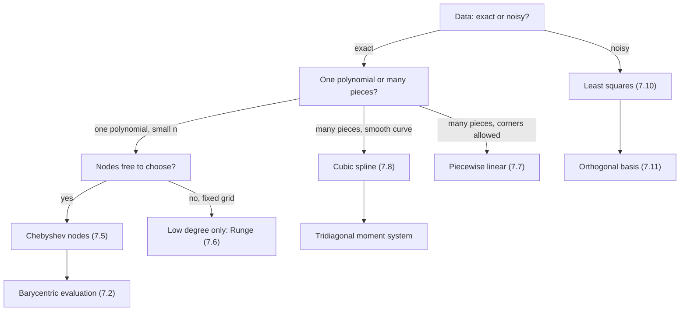

# Interpolation and Approximation

> [Mathematics](../../README.md) › [Numerical Analysis](../README.md) · Level: Advanced · Prerequisites: [Polynomials](../../03-algebra/06-polynomials/README.md), [Factoring](../../03-algebra/07-factoring/README.md), [Derivatives](../../07-calculus/03-derivatives/README.md), [Integrals](../../07-calculus/06-integrals/README.md), [Matrices](../../08-linear-algebra/02-matrices/README.md), [Inner Product Spaces](../../08-linear-algebra/08-inner-product-spaces/README.md), [Floating-Point Arithmetic](../01-floating-point-arithmetic/README.md) · Estimated time: 540 min

## 1. Introduction

A table of numbers is a promise the world rarely keeps. An experiment gives the drag of an aerofoil at
five angles of attack, a thermometer gives the temperature at seven in the morning, a computation gives
a special function at a thousand grid points. Between the measured points there is nothing — no data —
and yet engineers, forecasters and numerical solvers all need values *at* the intermediate points.
**Interpolation** is the disciplined way to invent those missing values: construct a function that
passes exactly through the data and use it as a stand-in for the truth. If the data are noisy, passing
exactly through them is a mistake, because a curve that chases every wobble invents structure that is
not there; then one asks instead for a simple function that passes *close* to the data, which is
**approximation**, specifically least squares approximation.

The chapter moves in five stages.

1. **One polynomial.** Through $n+1$ distinct points there passes exactly one polynomial of degree at
   most $n$. Lagrange's and Newton's forms write it down, and the error formula
   $f(x)-p_n(x)=\frac{f^{(n+1)}(\xi)}{(n+1)!}\omega(x)$ says how wrong it is.
2. **Where to put the nodes.** The error contains the node polynomial $\omega$, which we control.
   Choosing nodes that minimise $\max\lvert\omega\rvert$ gives the Chebyshev nodes; choosing them
   equally spaced gives Runge's phenomenon, where adding nodes makes the answer worse.
3. **Interpolation without one high-degree polynomial.** Piecewise linear interpolation, cubic splines
   and Hermite interpolation trade a single polynomial for many low-degree pieces glued smoothly.
4. **Approximation.** Least squares, orthogonal polynomials and the best $L^2$ approximation are the
   projection of a function onto a finite-dimensional space; the same projection on a trigonometric
   basis is the discrete Fourier transform.
5. **Trust.** The Lebesgue constant measures how much interpolation amplifies data errors. It grows
   exponentially for equispaced nodes and logarithmically for Chebyshev nodes.

The lesson that unifies the chapter: **high-degree polynomial interpolation at equispaced nodes is a
bad algorithm, not because polynomials are bad but because equispaced nodes are.** Splines, Chebyshev
methods and spectral methods are all ways of choosing the pieces or the nodes to keep the conditioning
under control.

## 2. Prerequisites

**Polynomials and the factor theorem.** A nonzero polynomial of degree $n$ has at most $n$ roots, and
$(x-r)$ divides $p$ exactly when $p(r)=0$. Uniqueness of the interpolant is a one-line consequence, and
the error formula is proved by counting roots. See [Polynomials](../../03-algebra/06-polynomials/README.md)
and [Factoring](../../03-algebra/07-factoring/README.md).

**Rolle's theorem.** The error formula is proved by applying Rolle's theorem $n+1$ times to an
auxiliary function. See [Derivatives](../../07-calculus/03-derivatives/README.md) and
[Applications of Derivatives](../../07-calculus/05-applications-of-derivatives/README.md).

**Integration.** The weighted mean value theorem for integrals is used in the companion topic on
quadrature, and the $L^2$ theory of Section 7.11 is built on integrals. See
[Integrals](../../07-calculus/06-integrals/README.md) and
[Riemann Integration](../../14-real-analysis/05-riemann-integration/README.md).

**Matrices, determinants and linear systems.** The Vandermonde system, the normal equations and the
tridiagonal spline system are linear systems. See [Matrices](../../08-linear-algebra/02-matrices/README.md),
[Systems of Linear Equations](../../08-linear-algebra/03-systems-of-linear-equations/README.md) and
[Determinants](../../08-linear-algebra/06-determinants/README.md).

**Inner products and projection.** Least squares is orthogonal projection onto a subspace, and the
Legendre expansion is a Fourier expansion in disguise. See
[Inner Product Spaces](../../08-linear-algebra/08-inner-product-spaces/README.md).

**Complex numbers.** The discrete Fourier transform uses $e^{i\theta}=\cos\theta+i\sin\theta$. See
[Complex Numbers](../../03-algebra/13-complex-numbers/README.md) and
[Trigonometric Identities](../../05-trigonometry/03-trigonometric-identities/README.md).

**Floating-point error and conditioning.** Section 7.13 uses the language of condition numbers from
[Floating-Point Arithmetic](../01-floating-point-arithmetic/README.md), and the convergence arguments
use limits and series from [Sequences and Series](../../07-calculus/11-sequences-and-series-in-calculus/README.md).

## 3. Learning Objectives

By the end of this tutorial you will be able to

1. state the interpolation problem precisely and prove that its solution is unique;
2. write the interpolant in Lagrange and in Newton form and convert between them;
3. derive the interpolation error formula and use it to bound the error on an interval;
4. compute Chebyshev nodes, prove the minimax property, and explain why they reduce the error;
5. explain and reproduce Runge's phenomenon, and state which change of nodes or method removes it;
6. construct a natural cubic spline, solve the moment system by hand for small data, and interpret the
   natural boundary conditions;
7. construct a cubic Hermite interpolant and state its error term;
8. derive and solve the normal equations of linear least squares;
9. expand a function in Legendre polynomials and identify the truncation as the best $L^2$
   approximation;
10. compute a discrete Fourier transform, interpret its coefficients and explain aliasing;
11. define the Lebesgue constant and compare equispaced with Chebyshev nodes numerically.

## 4. Intuition

**The drafting spline.** Before computers, a draughtsman drew a smooth curve through marked points by
bending a thin strip of wood — a *spline* — so that it passed through the marks. The strip settles into
the shape that minimises its bending energy, proportional (for small deflections) to the integral of
the squared second derivative. The mathematical idealisation is the cubic spline: cubics joined so that
position, slope and curvature are continuous. The name survived the wood.

**The single polynomial.** A polynomial of degree $n$ has $n+1$ coefficients, so $n+1$ points determine
it exactly. That is why it can hit every datum, and also why it can swing wildly between data if they
are badly placed. A polynomial is global: moving one datum changes the curve everywhere. A spline is
local: changing one datum alters only the neighbouring pieces.

**Nodes as a design choice.** The interpolation error is a product of a derivative factor that we
cannot control and a node factor that we can. Placing nodes where $\lvert\omega\rvert$ is small is like
placing survey stakes where the terrain is steep. Chebyshev nodes cluster near the ends of the
interval precisely because that is where a polynomial's error would otherwise be largest.

**Exact fit versus best fit.** A watchmaker asked for the time to the nearest second does not build a
clock that is exact at 9:00, 10:00 and 11:00 and wrong in between. Least squares is the quantitative
version of that instinct: minimise the total squared discrepancy instead of insisting on zero
discrepancy at the data.

## 5. Formal Definition

**Definition 5.1 (Interpolation problem).** Let $x_0,\dots,x_n$ be distinct real numbers (*nodes*) and
$y_0,\dots,y_n$ real numbers (*values*). An *interpolant* of the data $\{(x_i,y_i)\}$ is a function $p$
with $p(x_i)=y_i$ for every $i$. The *polynomial interpolation problem* asks for an interpolant in
$\Pi_n$, the space of polynomials of degree at most $n$.

**Definition 5.2 (Node polynomial).** The *node polynomial* of $x_0,\dots,x_n$ is
$\omega(x):=\prod_{i=0}^{n}(x-x_i)$, a monic polynomial of degree $n+1$ whose zeros are the nodes.

**Definition 5.3 (Lagrange basis).** For distinct nodes the *Lagrange basis polynomials* are
$\ell_i(x):=\prod_{j\ne i}\frac{x-x_j}{x_i-x_j}$. Each has degree $n$ and satisfies
$\ell_i(x_j)=\delta_{ij}$.

**Definition 5.4 (Divided differences).** For a function $f$,
$f[x_i]:=f(x_i)$ and, for $k\ge1$,
$f[x_i,\dots,x_{i+k}]:=\dfrac{f[x_{i+1},\dots,x_{i+k}]-f[x_i,\dots,x_{i+k-1}]}{x_{i+k}-x_i}$.

**Definition 5.5 (Cubic spline).** Let $a=x_0<x_1<\dots<x_n=b$. A *cubic spline* with these knots is a
function that is a cubic polynomial on each $[x_{i-1},x_i]$ and belongs to $C^2[a,b]$. It interpolates
the data if $S(x_i)=y_i$. It is a *natural* cubic spline if $S''(x_0)=S''(x_n)=0$.

**Definition 5.6 (Linear least squares).** Given points $(t_j,b_j)$, $j=1,\dots,m$, and functions
$\varphi_1,\dots,\varphi_k$, the *linear least squares problem* asks for coefficients minimising
$\Phi(c)=\sum_{j=1}^{m}\bigl(b_j-\sum_{i=1}^{k}c_i\varphi_i(t_j)\bigr)^2=\lVert Ac-b\rVert_2^2$, where
$A_{ji}=\varphi_i(t_j)$.

**Definition 5.7 (Lebesgue constant).** The interpolation operator $L_n:C[a,b]\to\Pi_n$ maps $f$ to its
interpolant at fixed nodes. Its operator norm in the maximum norm is the *Lebesgue constant*
$\Lambda_n:=\sup_{f\ne0}\lVert L_nf\rVert_\infty/\lVert f\rVert_\infty$.

**Definition 5.8 (Discrete Fourier transform).** For $N\ge1$ and $y_0,\dots,y_{N-1}\in\mathbb{C}$,
$c_k:=\frac1N\sum_{j=0}^{N-1}y_j e^{-2\pi ijk/N}$, $k=0,\dots,N-1$.

## 6. Mathematical Notation

| Symbol | Read as | Meaning |
|---|---|---|
| $x_0,\dots,x_n$ | the nodes | abscissae at which data are given |
| $y_i$, $f(x_i)$ | data values | ordinates the interpolant must reproduce |
| $p_n$ | $p$ sub $n$ | the interpolating polynomial of degree at most $n$ |
| $\Pi_n$ | pi sub $n$ | the vector space of polynomials of degree at most $n$ |
| $\omega(x)$ | omega of $x$ | $\prod_{i=0}^{n}(x-x_i)$, the node polynomial |
| $\ell_i(x)$ | ell sub $i$ | the $i$-th Lagrange basis polynomial |
| $f[x_0,\dots,x_k]$ | divided difference | the $k$-th divided difference of $f$ |
| $T_n$ | Chebyshev polynomial | $T_n(\cos\theta)=\cos n\theta$ |
| $S(x)$ | the spline | a piecewise cubic with $C^2$ continuity |
| $M_i$ | moment | $M_i=S''(x_i)$ at the knot $x_i$ |
| $h_i$ | step | $h_i=x_{i+1}-x_i$ |
| $\Lambda_n$ | Lebesgue constant | norm of the interpolation operator |
| $\lVert f\rVert_\infty$, $\lVert f\rVert_2$ | sup norm, $L^2$ norm | $\max\lvert f\rvert$; $\bigl(\int\lvert f\rvert^2w\bigr)^{1/2}$ |
| $\langle f,g\rangle$ | inner product | $\int_a^b fg\,w\,dx$ |
| $P_n$ | Legendre polynomial | the degree-$n$ orthogonal polynomial on $[-1,1]$ |
| $c_k$ | Fourier coefficient | $\langle f,P_k\rangle/\langle P_k,P_k\rangle$, or a DFT coefficient |
| $e^{i\theta}$ | cis theta | $\cos\theta+i\sin\theta$ |

## 7. Core Concepts

### 7.1 Existence and uniqueness

**Theorem 7.1.** Let $x_0,\dots,x_n$ be distinct and $y_0,\dots,y_n$ arbitrary. Then there is exactly one
$p\in\Pi_n$ with $p(x_i)=y_i$ for all $i$.

*Proof.* If $p,q$ both interpolate, $r=p-q\in\Pi_n$ has the $n+1$ distinct zeros $x_i$; a nonzero
polynomial of degree at most $n$ has at most $n$ roots, so $r\equiv0$ and $p=q$. For existence, write
$p=\sum_{k=0}^{n}a_kx^k$. The conditions $p(x_i)=y_i$ form the Vandermonde system $Va=y$ with
$V_{ik}=x_i^{k}$. Subtracting row $0$ from every other row and factoring $x_i-x_0$ from row $i$ reduces
$\det V$ to the same determinant on $x_1,\dots,x_n$; induction gives
$\det V=\prod_{0\le i<j\le n}(x_j-x_i)\neq0$. Hence $V$ is invertible and $a=V^{-1}y$ is the unique
solution. $\blacksquare$

The theorem says nothing about the *size* of the coefficients: they can be enormous even when the data
are moderate, which is the theme of Sections 7.6 and 7.13.

### 7.2 The Lagrange form

With the basis of Definition 5.3, $\ell_i(x_j)=\delta_{ij}$ gives immediately

$$p_n(x)=\sum_{i=0}^{n}y_i\,\ell_i(x),\qquad
\ell_i(x)=\prod_{j\ne i}\frac{x-x_j}{x_i-x_j}.$$

For two nodes this is the line through them; for three nodes it is the quadratic written out in 9.1.
Because the constant $1$ and the polynomial $x$ are reproduced exactly (they are their own
interpolants), we have the **partition of unity** and the **first-moment identity**

$$\sum_{i=0}^{n}\ell_i(x)=1,\qquad \sum_{i=0}^{n}x_i\ell_i(x)=x .$$

These are the standard sanity checks on a hand computation: the weights must sum to $1$ and the
weighted abscissae must sum to $x$.

**Barycentric form.** Put $w_i=1/\prod_{j\ne i}(x_i-x_j)$. Since $\omega(x)=(x-x_i)\prod_{j\ne i}(x-x_j)$
for $x$ not a node, $\ell_i(x)=\omega(x)w_i/(x-x_i)$. Dividing the Lagrange formula by the partition of
unity in the same form cancels $\omega$:

$$p_n(x)=\frac{\sum_i \dfrac{w_i}{x-x_i}\,y_i}{\sum_i \dfrac{w_i}{x-x_i}} .$$

The weights depend only on the nodes, so they are computed once in $O(n^2)$ operations and each
evaluation costs $O(n)$; the formula is also numerically stable, and production codes use it. At a node
the formula is interpreted by a limit, which returns $y_k$. The plain Lagrange form costs $O(n^2)$ per
evaluation and must be rebuilt entirely when a node is added.

### 7.3 The Newton form and divided differences

**Proposition 7.2 (Explicit formula).** For distinct nodes,
$f[x_0,\dots,x_k]=\sum_{i=0}^{k}f(x_i)\big/\prod_{j\ne i}(x_i-x_j)$. Hence divided differences are
unchanged by permuting the nodes.

*Proof.* Induction on $k$. The case $k=0$ is $f[x_0]=f(x_0)$. For the step, substitute the induction
hypothesis into $f[x_0,\dots,x_k]=\bigl(f[x_1,\dots,x_k]-f[x_0,\dots,x_{k-1}]\bigr)/(x_k-x_0)$. For
$1\le i\le k-1$ the $i$-th terms combine as

$$\frac{f(x_i)}{x_k-x_0}\left[\frac{1}{(x_i-x_k)D_i}-\frac{1}{(x_i-x_0)D_i}\right]
=\frac{f(x_i)}{(x_i-x_0)(x_i-x_k)D_i},\qquad D_i=\prod_{j=1,j\ne i}^{k-1}(x_i-x_j),$$

because the bracket equals $(x_k-x_0)/\bigl((x_i-x_k)(x_i-x_0)\bigr)$. The terms $i=k$ of the first sum
and $i=0$ of the second become the corresponding terms of the stated sum. The result is symmetric.
$\blacksquare$

**Theorem 7.3 (Newton form).** Let $p_n\in\Pi_n$ interpolate $f$ at $x_0,\dots,x_n$. Then

$$p_n(x)=f[x_0]+f[x_0,x_1]\,(x-x_0)+\dots+f[x_0,\dots,x_n]\prod_{j=0}^{n-1}(x-x_j).$$

*Proof.* Let $q_k$ denote the polynomial defined by the recursion
$q_k=q_{k-1}+f[x_0,\dots,x_k]\prod_{j<k}(x-x_j)$, with $q_0=f[x_0]$. By induction $q_{k-1}$ agrees with
$f$ at $x_0,\dots,x_{k-1}$, and the added term vanishes there, so $q_k$ does too. The coefficient of
$x^k$ in $q_k$ is $f[x_0,\dots,x_k]$; by the Lagrange formula and Proposition 7.2 the coefficient of
$x^k$ in the interpolant $p_k$ of the first $k+1$ nodes is
$\sum_i f(x_i)/\prod_{j\ne i}(x_i-x_j)=f[x_0,\dots,x_k]$. Hence $q_k-p_k$ has degree at most $k-1$ and
the $k$ zeros $x_0,\dots,x_{k-1}$, so it is zero, and $q_k(x_k)=p_k(x_k)=f(x_k)$. Taking $k=n$ gives
the stated formula. $\blacksquare$

The divided-difference table for $n=3$ is

| $x_i$ | $f[\cdot]$ | first | second | third |
|---|---|---|---|---|
| $x_0$ | $f[x_0]$ | | | |
| $x_1$ | $f[x_1]$ | $f[x_0,x_1]$ | | |
| $x_2$ | $f[x_2]$ | $f[x_1,x_2]$ | $f[x_0,x_1,x_2]$ | |
| $x_3$ | $f[x_3]$ | $f[x_2,x_3]$ | $f[x_1,x_2,x_3]$ | $f[x_0,x_1,x_2,x_3]$ |

Each entry is the difference of the entry below-right and the entry below-left, divided by the
difference of the two end nodes of its span; the Newton coefficients are the top row. Building the
table costs $O(n^2)$, adding a node costs $O(n)$, and nested evaluation (Horner's scheme) costs $O(n)$:
$p_n(x)=c_0+(x-x_0)\bigl(c_1+(x-x_1)(\cdots+(x-x_{n-1})c_n)\bigr)$.

### 7.4 The interpolation error formula

**Theorem 7.4.** Let $f\in C^{n+1}[a,b]$ and let $x_0,\dots,x_n\in[a,b]$ be distinct. If $p_n\in\Pi_n$
interpolates $f$ at the nodes, then for every $x\in[a,b]$ there is $\xi$ in the hull of
$x,x_0,\dots,x_n$ with

$$f(x)-p_n(x)=\frac{f^{(n+1)}(\xi)}{(n+1)!}\,\omega(x).$$

*Proof.* For $x$ a node both sides vanish. Otherwise fix $x$ and define
$g(t)=f(t)-p_n(t)-\bigl(f(x)-p_n(x)\bigr)\omega(t)/\omega(x)$. Then $g$ vanishes at $x$ and at every
node, that is at $n+2$ distinct points. Rolle's theorem applied successively shows that $g^{(n+1)}$ has
a zero $\xi$ in the hull. Since $p_n^{(n+1)}\equiv0$ and $\omega^{(n+1)}\equiv(n+1)!$,
$0=f^{(n+1)}(\xi)-\bigl(f(x)-p_n(x)\bigr)(n+1)!/\omega(x)$, which is the claim. $\blacksquare$

**Corollary 7.5.** If $\lVert f^{(n+1)}\rVert_\infty\le M_{n+1}$ on $[a,b]$, then
$\lvert f(x)-p_n(x)\rvert\le \frac{M_{n+1}}{(n+1)!}\lvert\omega(x)\rvert$, and in particular
$\lVert f-p_n\rVert_\infty\le\frac{M_{n+1}}{(n+1)!}\max\lvert\omega\rvert$. Interpolation reproduces
every polynomial of degree at most $n$ exactly.

Two points are routinely got wrong. First, $\xi$ lies in the hull of $x$ and **all** the nodes, not
merely between the two nodes adjacent to $x$: in Example 9.2 the error at $x=0.5$ is governed by a
derivative at a point of $(0,3)$. Second, the formula is an equality for the true $\xi$, so bounds from
it are rigorous, but they can be pessimistic because $\max\lvert f^{(n+1)}\rvert$ and $\max\lvert\omega\rvert$
may occur at different points.

### 7.5 Chebyshev nodes and the minimax property

The derivative factor in Corollary 7.5 is fixed by $f$; the node factor is ours to choose. The question
is: among all monic $\omega$ of degree $n+1$, equivalently among all choices of $n+1$ distinct nodes in
$[a,b]$, which minimises $\max\lvert\omega\rvert$ on $[a,b]$? On $[-1,1]$ the answer is given by the
Chebyshev polynomials $T_n(x):=\cos(n\arccos x)$, equivalently $T_n(\cos\theta)=\cos n\theta$, with
recurrence $T_0=1$, $T_1=x$, $T_{n+1}=2xT_n-T_{n-1}$. Thus

$$T_0=1,\quad T_1=x,\quad T_2=2x^2-1,\quad T_3=4x^3-3x,\quad T_4=8x^4-8x^2+1 .$$

Each $T_n$ has degree $n$ and leading coefficient $2^{n-1}$ for $n\ge1$, and $\lvert T_n\rvert\le1$ on
$[-1,1]$, with equality and alternating signs at the $n+1$ points $t_k=\cos(k\pi/n)$.

**Theorem 7.6 (Chebyshev minimax).** Among monic polynomials $q$ of degree $m\ge1$,
$\min_q\max_{[-1,1]}\lvert q\rvert=2^{1-m}$, attained only by $q^\ast=2^{1-m}T_m$.

*Proof.* $2^{1-m}T_m$ is monic of degree $m$ with maximum $2^{1-m}$, so the minimum is at most that.
Suppose a monic $q$ had $\max\lvert q\rvert<2^{1-m}$. At $t_k=\cos(k\pi/m)$ we have
$2^{1-m}T_m(t_k)=2^{1-m}(-1)^k$, so $q-2^{1-m}T_m$ alternates in sign at the $m+1$ points $t_k$ and has
at least one zero in each of the $m$ intervals between them. But it is a polynomial of degree at most
$m-1$ unless it is zero, so it is zero; then $\lvert q\rvert=2^{1-m}$ at the $t_k$, contradicting the
strict inequality. $\blacksquare$

**Corollary 7.7.** For $n+1$ nodes in $[-1,1]$ the choice minimising $\max\lvert\omega\rvert$ is the set
of zeros of $T_{n+1}$, namely $x_k=\cos\frac{(2k+1)\pi}{2(n+1)}$, $k=0,\dots,n$; for it
$\omega=2^{-n}T_{n+1}$ and $\max\lvert\omega\rvert=2^{-n}$.

*Proof.* The zeros of $T_{n+1}$ solve $\cos((n+1)\theta)=0$, that is $\theta=(2k+1)\pi/(2(n+1))$. The
monic polynomial $2^{-n}T_{n+1}$ has exactly these zeros, so it is $\omega$; its maximum is $2^{-n}$,
minimal by Theorem 7.6. $\blacksquare$

The nodes cluster near the endpoints — for $n=3$ they are $\pm0.923880,\pm0.382683$ — because that is
where $\lvert\omega\rvert$ would otherwise grow fastest. On $[-1,1]$ the error bound becomes
$\lvert f-p_n\rvert\le \lVert f^{(n+1)}\rVert_\infty/\bigl((n+1)!\,2^n\bigr)$; on $[a,b]$, after the
affine map, the nodes are $x_k=\frac{a+b}{2}+\frac{b-a}{2}\cos\frac{(2k+1)\pi}{2(n+1)}$ and

$$\lVert f-p_n\rVert_\infty\le\frac{(b-a)^{n+1}}{2^{2n+1}(n+1)!}\,\lVert f^{(n+1)}\rVert_\infty .$$

**Concrete comparison.** For $n=3$ the Chebyshev node polynomial is $x^4-x^2+\tfrac18$ with maximum
$\tfrac18$; the four equispaced nodes $-1,-\tfrac13,\tfrac13,1$ give $\omega=(x^2-1)(x^2-\tfrac19)$ with
maximum $\tfrac{16}{81}\approx0.1975$, about $1.58$ times larger. The ratio grows exponentially with $n$.

### 7.6 Runge's phenomenon

Interpolate $f(x)=1/(1+25x^2)$ on $[-1,1]$ at $n+1$ equally spaced nodes. The function is analytic on
the whole real line, yet the interpolants do not converge:

| $n$ | equispaced, max error | Chebyshev, max error | equispaced error at $x=0.95$ |
|---|---|---|---|
| $4$ | $4.38\times10^{-1}$ | $4.02\times10^{-1}$ | $2.02\times10^{-1}$ |
| $6$ | $6.17\times10^{-1}$ | $2.64\times10^{-1}$ | $4.45\times10^{-1}$ |
| $8$ | $1.05\times10^{0}$ | $1.71\times10^{-1}$ | $9.34\times10^{-1}$ |
| $10$ | $1.92\times10^{0}$ | $1.09\times10^{-1}$ | $1.88\times10^{0}$ |
| $12$ | $3.66\times10^{0}$ | $6.92\times10^{-2}$ | $3.66\times10^{0}$ |
| $16$ | $1.44\times10^{1}$ | $3.26\times10^{-2}$ | $1.27\times10^{1}$ |

(The errors are computed on a grid of $20001$ points.) The failure is concentrated near the endpoints.
Since $f=\sum_k(-25x^2)^k$ near $0$, the derivatives satisfy $f^{(2k)}(0)=(-1)^k(2k)!\,25^k$, so the
factor $\lVert f^{(n+1)}\rVert_\infty/(n+1)!$ grows like $5^{\,n+1}$. The equispaced node polynomial
cannot compensate: its maximum decays only slowly,

| $n$ | $4$ | $8$ | $12$ | $16$ |
|---|---|---|---|---|
| $\max\lvert\omega\rvert$, equispaced | $0.1135$ | $0.0188$ | $0.00401$ | $0.000943$ |
| $\max\lvert\omega\rvert$, Chebyshev | $0.0625$ | $0.00391$ | $0.000244$ | $1.53\times10^{-5}$ |

so the product of the two factors grows like $(5/2)^n$ and the interpolant diverges at the ends. For
Chebyshev nodes the same derivative factor is present, but $\lvert\omega\rvert$ is exponentially smaller
there, and the interpolant converges.

Three ways to see the same phenomenon: through the node polynomial (above); through the coefficients,
which become enormous with alternating signs; and through conditioning, since the Lebesgue constant of
equispaced nodes grows exponentially (Section 7.13). **Three cures.** Change the nodes (Chebyshev); change
the pieces (piecewise linear or cubic splines); or change the method (least squares, which deliberately
does not interpolate). For analytic $f$ there is a sharp positive result, quoted without proof (see
Trefethen's *Approximation Theory and Approximation Practice*, Theorem 8.2): if $f$ is analytic and
bounded in the Bernstein ellipse with foci $\pm1$ and parameter $\rho>1$, the Chebyshev interpolant
satisfies $\lVert f-p_n\rVert_\infty\le C\rho^{-n}$. For Runge's function the poles at $\pm i/5$ give
$\rho=(1+\sqrt{26})/5\approx1.2198$, consistent with the table (the error falls by about $0.81$ per
step). No such result holds for equispaced nodes outside the "Runge region".

### 7.7 Piecewise linear interpolation

For knots $a=x_0<\dots<x_n=b$ and values $y_i$, the *piecewise linear interpolant* is
$S_1(x)=y_i+\frac{y_{i+1}-y_i}{h_i}(x-x_i)$ on $[x_i,x_{i+1}]$, with $h_i=x_{i+1}-x_i$. It is continuous
but not differentiable at the knots.

**Theorem 7.8.** If $f\in C^2[a,b]$ and $h=\max_i h_i$, then
$\lVert f-S_1\rVert_\infty\le \frac{h^2}{8}\lVert f''\rVert_\infty$.

*Proof.* On each subinterval both $f$ and $S_1$ interpolate at the endpoints, so Theorem 7.4 with $n=1$
gives $f(x)-S_1(x)=\tfrac12f''(\xi)(x-x_i)(x-x_{i+1})$. The product is negative inside and its modulus
is maximal at the midpoint, where it is $h_i^2/4$; hence
$\lvert f-S_1\rvert\le\frac12\lVert f''\rVert_\infty h_i^2/4=h_i^2\lVert f''\rVert_\infty/8$.
$\blacksquare$

The bound is sharp: for $f=x^2$ on $[0,h]$ the error at the midpoint is $h^2/4=h^2\lVert f''\rVert_\infty/8$.
The order is $O(h^2)$, so halving the mesh quarters the error — a convergence statement unavailable for
equispaced high-degree interpolation. The price is a corner at every knot.

### 7.8 Cubic splines

A cubic spline is a piecewise cubic in $C^2[a,b]$. On $n$ subintervals there are $4n$ coefficients.
Interpolation at the two endpoints of each piece imposes $2n$ conditions (which include continuity of
$S$), and continuity of $S'$ and $S''$ at the $n-1$ interior knots imposes $2(n-1)$ more, leaving two
free parameters. The *natural* conditions $S''(x_0)=S''(x_n)=0$ fix them; *clamped* conditions prescribe
$S'(x_0),S'(x_n)$, and *not-a-knot* conditions make $S'''$ continuous at $x_1$ and $x_{n-1}$.

**Construction.** Let $M_i=S''(x_i)$. On $[x_i,x_{i+1}]$, $S''$ is the linear interpolant of $M_i,M_{i+1}$;
integrating twice and imposing the endpoint values gives

$$S(x)=M_i\frac{(x_{i+1}-x)^3}{6h_i}+M_{i+1}\frac{(x-x_i)^3}{6h_i}
+\Bigl(y_i-\frac{M_ih_i^2}{6}\Bigr)\frac{x_{i+1}-x}{h_i}
+\Bigl(y_{i+1}-\frac{M_{i+1}h_i^2}{6}\Bigr)\frac{x-x_i}{h_i}.$$

Continuity of $S'$ at $x_i$ ($1\le i\le n-1$) gives the tridiagonal *moment system*

$$\frac{h_{i-1}}{6}M_{i-1}+\frac{h_{i-1}+h_i}{3}M_i+\frac{h_i}{6}M_{i+1}
=\frac{y_{i+1}-y_i}{h_i}-\frac{y_i-y_{i-1}}{h_{i-1}},\qquad M_0=M_n=0 .$$

**Theorem 7.9.** For any data and knots the natural cubic spline exists and is unique.

*Proof.* The system has $n-1$ unknowns. In row $i$ the diagonal entry is $(h_{i-1}+h_i)/3$ and the sum
of the absolute off-diagonal entries is $(h_{i-1}+h_i)/6$, strictly smaller; the matrix is strictly
diagonally dominant, hence nonsingular (a nonzero vector cannot be annihilated: look at its largest
component). The moments are unique, and each cubic piece is then determined by its endpoint values and
endpoint second derivatives. $\blacksquare$

**Theorem 7.10 (Minimum curvature).** Among all $C^2$ functions interpolating the data, the natural
spline minimises $\int_a^b(S'')^2dx$.

*Proof.* Let $e=g-S$. On each subinterval, integrating by parts twice and using that $S'''$ is constant,

$$\int_{x_i}^{x_{i+1}}e''S''=\bigl[e'S''\bigr]_{x_i}^{x_{i+1}}-S'''\bigl[e\bigr]_{x_i}^{x_{i+1}}
=\bigl[e'S''\bigr]_{x_i}^{x_{i+1}},$$

because $e$ vanishes at the knots. Summing, the interior terms cancel since $S''$ is continuous, and the
endpoint terms vanish by the natural conditions. Hence $\int e''S''=0$ and
$\int(g'')^2=\int(S'')^2+\int(e'')^2\ge\int(S'')^2$, with equality only if $e$ is linear, hence zero.
$\blacksquare$

This is why the conditions $S''(a)=S''(b)=0$ are called natural: they are the boundary conditions of a
physical spline that is free at its ends and therefore has zero bending moment there. For
$f\in C^4$ and quasi-uniform knots the error is $O(h^4)$, with
$\lVert f-S\rVert_\infty\le\frac{5}{384}h^4\lVert f^{(4)}\rVert_\infty$. Example 9.5 constructs a spline
in full.

### 7.9 Hermite interpolation

Hermite interpolation matches values **and** derivatives. Given distinct $x_0,\dots,x_n$ and numbers
$y_i,y_i'$, it asks for $H\in\Pi_{2n+1}$ with $H(x_i)=y_i$ and $H'(x_i)=y_i'$ for all $i$.

**Theorem 7.11 (Existence and uniqueness).** The Hermite problem has exactly one solution.

*Proof.* There are $2n+2$ linear conditions on the $2n+2$-dimensional space $\Pi_{2n+1}$. If $q$
satisfies the homogeneous conditions, every $x_i$ is a double root, so $\prod_i(x-x_i)^2$ divides $q$;
that product has degree $2n+2$ while $\deg q\le2n+1$, hence $q\equiv0$. $\blacksquare$

For two nodes $a<b$, with $h=b-a$ and $t=(x-a)/h$,

$$H(x)=y_0h_{00}(t)+h\,y_0'h_{10}(t)+y_1h_{01}(t)+h\,y_1'h_{11}(t),$$

$$h_{00}=(1+2t)(1-t)^2,\quad h_{10}=t(1-t)^2,\quad h_{01}=t^2(3-2t),\quad h_{11}=t^2(t-1);$$

each basis function satisfies the four cardinal conditions, so uniqueness gives the formula.

**Theorem 7.12 (Hermite error).** For $f\in C^{2n+2}[a,b]$ and $x\in[a,b]$ there is $\xi$ in the hull of
$x,x_0,\dots,x_n$ with

$$f(x)-H(x)=\frac{f^{(2n+2)}(\xi)}{(2n+2)!}\prod_{i=0}^{n}(x-x_i)^2 .$$

*Proof.* Choose $C$ so that $g(t)=f(t)-H(t)-C\prod_i(t-x_i)^2$ vanishes at $t=x$. Then $g$ has a double
zero at each node (value and derivative vanish) and a simple zero at $x$: $2n+3$ zeros counted with
multiplicity, so $g^{(2n+2)}$ has a zero $\xi$ by repeated Rolle. Since $H^{(2n+2)}\equiv0$ and the
derivative of $\prod(t-x_i)^2$ of order $2n+2$ is $(2n+2)!$, we get $C=f^{(2n+2)}(\xi)/(2n+2)!$.
$\blacksquare$

For $n=1$ the error bound is $\lVert f-H\rVert_\infty\le\frac{(b-a)^4}{384}\lVert f^{(4)}\rVert_\infty$,
because $\max(x-a)^2(b-x)^2=(b-a)^4/16$ at the midpoint. Hermite interpolation also underlies Simpson's
rule, whose error is derived by integrating a cubic Hermite interpolant in
[Numerical Integration](../04-numerical-integration/README.md).

### 7.10 Least squares approximation

When the data are measurements, one minimises the sum of squared residuals rather than forcing zeros:
minimise $\Phi(c)=\lVert Ac-b\rVert_2^2$ with $A_{ji}=\varphi_i(t_j)$, as in Definition 5.6.

**Theorem 7.13 (Normal equations).** The minimisers of $\Phi$ are exactly the solutions of
$A^{\mathsf T}Ac=A^{\mathsf T}b$. If the columns of $A$ are independent, the minimiser is unique.

*Proof.* Expanding, $\Phi(c)=c^{\mathsf T}A^{\mathsf T}Ac-2c^{\mathsf T}A^{\mathsf T}b+b^{\mathsf T}b$,
whose Hessian $2A^{\mathsf T}A$ is positive semidefinite; thus $\Phi$ is convex and stationary points are
global minima. The gradient is $2A^{\mathsf T}(Ac-b)$, which vanishes exactly when the normal equations
hold. Alternatively, at a minimum the residual $r=b-Ac$ must satisfy
$\langle r,Av\rangle=0$ for every $v$: otherwise $c+sv$ reduces $\Phi$ for small $s$. That is
$A^{\mathsf T}r=0$. If the columns are independent, $Av\neq0$ for $v\neq0$, so
$v^{\mathsf T}A^{\mathsf T}Av=\lVert Av\rVert^2>0$ and $A^{\mathsf T}A$ is positive definite, hence
invertible, and the minimum is strict. $\blacksquare$

Geometrically $Ac$ is the orthogonal projection of $b$ onto the column space of $A$, and the residual is
perpendicular to that space — "normal" in the sense of normal to a plane. For polynomial least squares
with $\varphi_i=t^{i-1}$, if the $m\ge k$ abscissae are distinct the columns are independent, since a
nonzero polynomial of degree at most $k-1$ cannot vanish at $k$ distinct points.

**A worked line fit.** For $(1,2),(2,3),(3,5),(4,8)$ the normal equations are
$\begin{pmatrix}4&10\\10&30\end{pmatrix}c=\begin{pmatrix}18\\55\end{pmatrix}$, giving
$\hat b=2t-\tfrac12$ with residual sum of squares $1$.

**Two warnings.** The normal equations square the condition number, $\kappa_2(A^{\mathsf T}A)=\kappa_2(A)^2$;
production codes use QR factorisation or an orthogonal basis instead of forming $A^{\mathsf T}A$. And a
higher-degree fit is not automatically better: it follows the noise.

### 7.11 Orthogonal polynomials and best $L^2$ approximation

With a weight $w>0$, define $\langle f,g\rangle=\int_a^b fg\,w\,dx$. A family with $\deg p_n=n$ is
*orthogonal* if $\langle p_i,p_j\rangle=0$ for $i\neq j$. Gram–Schmidt from $1,x,x^2,\dots$ produces one:
given $p_0,\dots,p_{n-1}$,

$$p_n(x)=x^n-\sum_{j=0}^{n-1}\frac{\langle x^n,p_j\rangle}{\langle p_j,p_j\rangle}p_j(x),$$

which has degree $n$ and is orthogonal to every lower-degree polynomial. Orthogonal polynomials satisfy
the three-term recurrence $p_{n+1}=(x-\alpha_n)p_n-\beta_np_{n-1}$ with
$\alpha_n=\langle xp_n,p_n\rangle/\langle p_n,p_n\rangle$ and
$\beta_n=\langle p_n,p_n\rangle/\langle p_{n-1},p_{n-1}\rangle$.

On $[-1,1]$ with $w\equiv1$ this gives the **Legendre polynomials**

$$P_0=1,\quad P_1=x,\quad P_2=\frac{3x^2-1}{2},\quad P_3=\frac{5x^3-3x}{2},\quad
P_4=\frac{35x^4-30x^2+3}{8},$$

with $(n+1)P_{n+1}=(2n+1)xP_n-nP_{n-1}$ and $\lVert P_n\rVert_2^2=2/(2n+1)$.

**Theorem 7.14 (Best $L^2$ approximation).** Let $p^\ast=\sum_{k=0}^{n}c_kP_k$ with
$c_k=\langle f,P_k\rangle/\langle P_k,P_k\rangle$. Then $\lVert f-p^\ast\rVert_2\le\lVert f-q\rVert_2$
for every $q\in\Pi_n$, with equality only for $q=p^\ast$, and

$$\lVert f-p^\ast\rVert_2^2=\lVert f\rVert_2^2-\sum_{k=0}^{n}c_k^2\lVert P_k\rVert_2^2 .$$

*Proof.* Writing $q=\sum_kd_kP_k$ and expanding with orthogonality,
$\lVert f-q\rVert_2^2=\lVert f\rVert_2^2+\sum_k\bigl[(d_k-c_k)^2-c_k^2\bigr]\lVert P_k\rVert_2^2$.
Only the squares $(d_k-c_k)^2$ depend on $q$, and they vanish simultaneously at $d_k=c_k$. $\blacksquare$

The coefficients do not change when $n$ is increased, which is what makes orthogonal expansions
practical and is false for monomial least squares. For $f=x^3$, oddness gives $c_0=c_2=0$ and
$c_1=\frac32\int_{-1}^1x^4dx=\frac35$, so the best linear approximation is $\frac35x$ with squared error
$\frac27-\frac{9}{25}\cdot\frac23=\frac{8}{175}$. For $f=\lvert x\rvert$,
$c_0=\frac12$ and $c_2=\frac52\cdot2\int_0^1x\frac{3x^2-1}{2}dx=\frac58$, so
$p^\ast=\frac12+\frac58P_2=\frac{15x^2+3}{16}$ with squared error $\frac1{96}$.

Least squares is not minimax approximation: minimising the mean square is different from minimising the
maximum error, and the latter is characterised by equioscillation and is harder to compute.

### 7.12 Trigonometric interpolation and the discrete Fourier transform

Let $N\ge1$, $x_j=2\pi j/N$ and $y_0,\dots,y_{N-1}\in\mathbb{C}$, and define $c_k$ by Definition 5.8.

**Lemma 7.15 (Discrete orthogonality).** $\sum_{j=0}^{N-1}e^{2\pi ij(k-l)/N}=N$ if $k\equiv l\pmod N$
and $0$ otherwise.

*Proof.* If $k\equiv l$ every term is $1$. Otherwise $\omega=e^{2\pi i(k-l)/N}\neq1$ and the sum is the
geometric series $(\omega^N-1)/(\omega-1)=0$. $\blacksquare$

**Theorem 7.16 (Trigonometric interpolation).** The polynomial $p(x)=\sum_{k=0}^{N-1}c_ke^{ikx}$
satisfies $p(x_j)=y_j$ for every $j$.

*Proof.* Substituting the definition of $c_k$,
$p(x_j)=\frac1N\sum_l y_l\sum_k e^{2\pi i(j-l)k/N}=\sum_l y_l\delta_{jl}=y_j$ by Lemma 7.15.
$\blacksquare$

The coefficient map is invertible, with inverse $y_j=\sum_kc_ke^{2\pi ijk/N}$, so the interpolant is
unique in the span of $e^{ikx}$, $k=0,\dots,N-1$. For real data $c_{N-k}=\overline{c_k}$, and for $N$ odd
the interpolant can be written $p=a_0+\sum_{k=1}^{m}(a_k\cos kx+b_k\sin kx)$ with $N=2m+1$.

**Aliasing.** On the grid $e^{iNx_j}=1$, so frequencies differing by a multiple of $N$ are
indistinguishable. Sampling $\cos(5x)$ at $N=4$ points gives $1,0,-1,0$, exactly the values of
$\cos x$; the sample cannot tell the two apart. This is the aliasing of digital audio, and it is a
property of sampling rather than of the transform.

**Cost.** Direct evaluation of the DFT costs $O(N^2)$; the fast Fourier transform computes it in
$O(N\log N)$ by splitting even and odd indices recursively, a factor of about $50\,000$ at $N=2^{20}$.
That is why trigonometric interpolation is used far more widely than polynomial interpolation on large
data sets.

### 7.13 Conditioning of the interpolation problem

**Theorem 7.17 (Lebesgue constant).** For fixed nodes,
$\sup_{f\ne0}\lVert L_nf\rVert_\infty/\lVert f\rVert_\infty=\max_{x}\sum_i\lvert\ell_i(x)\rvert=:\Lambda_n$.

*Proof.* For any $f$, $\lvert L_nf(x)\rvert\le\sum_i\lvert\ell_i(x)\rvert\lvert f(x_i)\rvert\le
\Lambda_n\lVert f\rVert_\infty$. Conversely, at a point $x^\ast$ where the maximum is attained, choose
continuous nodal data $y_i=\operatorname{sign}\ell_i(x^\ast)$; then $\lvert f\rvert\le1$ at the nodes and
$L_nf(x^\ast)=\sum_i\lvert\ell_i(x^\ast)\rvert=\Lambda_n$. $\blacksquare$

**Corollary 7.18.** For any $q\in\Pi_n$, $\lVert f-L_nf\rVert_\infty\le(1+\Lambda_n)\lVert f-q\rVert_\infty$,
and if the data are perturbed by $\delta_i$ then $\lvert\delta p(x)\rvert\le\Lambda_n\max_i\lvert\delta_i\rvert$.

*Proof.* Since $L_nq=q$, $f-L_nf=(f-q)-L_n(f-q)$; the second term has norm at most
$\Lambda_n\lVert f-q\rVert_\infty$. The data statement is the same estimate applied to the interpolant of
the perturbation. $\blacksquare$

So $\Lambda_n$ is exactly the condition number of interpolation in the maximum norm, and it measures how
much the node choice wastes the approximation power of $\Pi_n$. Numerically, for $n+1$ nodes:

| nodes | equispaced $\Lambda_n$ | Chebyshev $\Lambda_n$ |
|---|---|---|
| $5$ | $2.208$ | $1.989$ |
| $7$ | $4.549$ | $2.202$ |
| $9$ | $10.946$ | $2.362$ |
| $11$ | $29.900$ | $2.489$ |
| $13$ | $89.325$ | $2.596$ |
| $17$ | $934.534$ | $2.766$ |

Chebyshev nodes have $\Lambda_n\sim\frac2\pi\log n$; equispaced nodes grow exponentially, by a factor of
about $2$ to $3$ for every two added nodes. At $17$ nodes the ratio is $338$, which is the quantitative
form of Runge's phenomenon. (Chebyshev nodes are asymptotically optimal for $\Lambda_n$, not optimal at
every $n$: at three nodes the equispaced constant $\frac54$ beats $\frac53$.)

The interpolation problem is also ill-conditioned in the monomial basis, even at Chebyshev nodes:

| degree $n$ | $\kappa_2(V)$, equispaced | $\kappa_2(V)$, Chebyshev |
|---|---|---|
| $4$ | $23.5$ | $19.6$ |
| $8$ | $1.61\times10^{3}$ | $6.27\times10^{2}$ |
| $12$ | $1.23\times10^{5}$ | $2.06\times10^{4}$ |

The growth is exponential in both columns because the *monomial basis* is the problem, not the nodes.
The barycentric formula and the Chebyshev basis avoid it; a condition number depends on how the answer is
represented.

## 8. Formulas and Properties

| Result | Hypotheses | Statement | Why it holds |
|---|---|---|---|
| uniqueness | nodes distinct | one $p\in\Pi_n$ through $n+1$ points | difference has $n+1$ roots |
| Lagrange form | nodes distinct | $p=\sum_i y_i\ell_i$ | $\ell_i(x_j)=\delta_{ij}$ |
| Newton form | nodes distinct | $p=\sum_k f[x_0,\dots,x_k]\prod_{j<k}(x-x_j)$ | incremental interpolation |
| symmetry | nodes distinct | divided differences independent of order | explicit symmetric formula |
| error formula | $f\in C^{n+1}$ | $f-p=\dfrac{f^{(n+1)}(\xi)}{(n+1)!}\omega$ | Rolle applied $n+1$ times |
| error bound | $f\in C^{n+1}$ | $\lVert f-p\rVert_\infty\le\dfrac{\lVert f^{(n+1)}\rVert_\infty}{(n+1)!}\max\lvert\omega\rvert$ | absolute values |
| Chebyshev minimax | monic, degree $m$ | $\min\max\lvert q\rvert=2^{1-m}$ | alternating extrema of $T_m$ |
| Chebyshev nodes | $n+1$ nodes in $[-1,1]$ | $\max\lvert\omega\rvert=2^{-n}$ | $\omega=2^{-n}T_{n+1}$ |
| piecewise linear | $f\in C^2$ | $\lVert f-S_1\rVert_\infty\le h^2\lVert f''\rVert_\infty/8$ | one linear error per panel |
| natural spline | $f\in C^4$, quasi-uniform | $\lVert f-S\rVert_\infty\le\frac{5}{384}h^4\lVert f^{(4)}\rVert_\infty$ | cubic Hermite error per panel |
| spline existence | any data | unique natural cubic spline | diagonal dominance |
| minimum curvature | $C^2$ interpolants | natural spline minimises $\int(S'')^2$ | integration by parts |
| Hermite | $f\in C^{2n+2}$ | $f-H=\dfrac{f^{(2n+2)}(\xi)}{(2n+2)!}\prod(x-x_i)^2$ | double roots and Rolle |
| normal equations | any $A$ | $A^{\mathsf T}Ac=A^{\mathsf T}b$ | gradient, or residual orthogonality |
| LS uniqueness | columns independent | unique minimiser | $A^{\mathsf T}A$ positive definite |
| Legendre norms | $w\equiv1$ on $[-1,1]$ | $\lVert P_n\rVert_2^2=2/(2n+1)$ | Rodrigues formula or induction |
| best $L^2$ | orthogonal basis | $c_k=\langle f,P_k\rangle/\langle P_k,P_k\rangle$ | Pythagoras |
| Parseval | $f\in L^2$ | $\lVert f\rVert^2=\sum_kc_k^2\lVert P_k\rVert^2+\lVert f-p^\ast\rVert^2$ | orthogonality |
| DFT inversion | $N\ge1$ | $y_j=\sum_kc_ke^{2\pi ijk/N}$ | discrete orthogonality |
| Lebesgue bound | any nodes | $\lVert f-L_nf\rVert\le(1+\Lambda_n)\lVert f-q\rVert$ | $L_nq=q$, triangle inequality |

The error formula is an equality for some $\xi$, but the resulting bound is not sharp: the maxima of
$\lvert f^{(n+1)}\rvert$ and $\lvert\omega\rvert$ may occur at different points. In practice one
estimates the error by computing at two resolutions and comparing.

## 9. Step-by-Step Examples

### 9.1 Lagrange interpolation through three points

Find the polynomial of degree at most $2$ through $(0,1)$, $(1,3)$, $(2,2)$. The basis polynomials are

$$\ell_0=\frac{(x-1)(x-2)}{(0-1)(0-2)}=\frac{x^2-3x+2}{2},\quad
\ell_1=\frac{x(x-2)}{(1)(-1)}=-x^2+2x,\quad
\ell_2=\frac{x(x-1)}{(2)(1)}=\frac{x^2-x}{2}.$$

Hence

$$
p_2=1\cdot\ell_0+3\cdot\ell_1+2\cdot\ell_2
=\Bigl(\tfrac12-3+1\Bigr)x^2+\Bigl(-\tfrac32+6-1\Bigr)x+1
=-\tfrac32x^2+\tfrac72x+1 .
$$

Check: $p_2(0)=1$, $p_2(1)=-\tfrac32+\tfrac72+1=3$, $p_2(2)=-6+7+1=2$. At $x=4$ the three basis
functions take the values $3,-8,6$, which sum to $1$ as Proposition 7.2 requires.

### 9.2 Newton's form and the error term

Interpolate $2^x$ at $0,1,2,3$ and evaluate at $x=\tfrac12$. The divided-difference table is

| $x_i$ | $f[x_i]$ | first | second | third |
|---|---|---|---|---|
| $0$ | $1$ | | | |
| $1$ | $2$ | $1$ | | |
| $2$ | $4$ | $2$ | $1/2$ | |
| $3$ | $8$ | $4$ | $1$ | $1/6$ |

so $p_3(x)=1+x+\tfrac12x(x-1)+\tfrac16x(x-1)(x-2)$ and

$$p_3(\tfrac12)=1+\tfrac12-\tfrac18+\tfrac1{16}=\tfrac{23}{16}=1.4375,\qquad \sqrt2=1.4142136,$$

an error of $-0.0232864$. Here $f^{(4)}=(\ln2)^4 2^x$, so $\lVert f^{(4)}\rVert_\infty=0.23105\cdot8=1.8484$
on $[0,3]$, and $\omega(\tfrac12)=\tfrac12(-\tfrac12)(-\tfrac32)(-\tfrac52)=-\tfrac{15}{16}$. The exact
error therefore implies $f^{(4)}(\xi)=24(-0.0232864)/(-0.9375)=0.59613$, so
$2^\xi=0.59613/0.23105=2.5801$ and $\xi=1.3675\in(0,3)$, as the theorem promises. The bound is
$1.8484\cdot0.9375/24=0.07220$, about three times the actual error.

### 9.3 Bounding the error of a quadratic interpolant

Interpolate $\sin x$ at $0,\tfrac12,1$, so $\omega=x(x-\tfrac12)(x-1)$. Differentiating,
$\omega'=3x^2-3x+\tfrac12$, whose roots are $\tfrac12\pm\frac{1}{2\sqrt3}$. At $x=0.21132$,
$\omega=0.048113=1/(12\sqrt3)$, the maximum of $\lvert\omega\rvert$. Since $\lvert f'''\rvert=\lvert\cos x\rvert\le1$,

$$\lvert\sin x-p_2(x)\rvert\le\frac16\cdot\frac1{12\sqrt3}=0.008019 .$$

The interpolant is $p_2=-0.2347602x^2+1.0762312x$, and the errors are $-0.006981$, $0$ and $+0.006518$
at $x=0.25,0.5,0.75$. At $x=0.25$, where $\omega=0.046875$, the error formula gives
$f'''(\xi)=6(-0.006981)/0.046875=-0.8936$, so $\cos\xi=0.8936$ and $\xi=0.4655\in(0,1)$: the sign is
consistent because $\omega>0$ and the error is negative.

### 9.4 Chebyshev versus equispaced nodes

For $n=3$ the Chebyshev nodes are $\cos\frac{(2k+1)\pi}{8}$, that is $0.923880$, $0.382683$, $-0.382683$,
$-0.923880$. Their node polynomial is $\omega=2^{-3}T_4=x^4-x^2+\tfrac18$, whose extrema are
$+\tfrac18$ at $0,\pm1$ and $-\tfrac18$ at $\pm1/\sqrt2$; hence $\max\lvert\omega\rvert=\tfrac18$. With
four equispaced nodes $\max\lvert\omega\rvert=\tfrac{16}{81}=0.197531$.

For $f=e^x$ on $[-1,1]$, $\lVert f^{(4)}\rVert_\infty=e$, so the bounds are $e/(24\cdot8)=0.014158$ and
$e\cdot16/(24\cdot81)=0.022373$. Computing both interpolants on $400001$ points gives maximum errors
$0.006657$ and $0.009985$. Both bounds hold, and Chebyshev is better by about a third at this degree;
the gain grows exponentially with $n$.

### 9.5 A natural cubic spline from scratch

For $(0,0),(1,1),(2,0)$ there is one interior moment $M_1$, and with $h_0=h_1=1$ the moment equation is
$\tfrac16M_0+\tfrac23M_1+\tfrac16M_2=(0-1)-(1-0)=-2$, so with $M_0=M_2=0$ we get $M_1=-3$. On $[0,1]$,

$$S(x)=-\frac{x^3}{2}+\frac32x,$$

and on $[1,2]$, using the local formula with $M_1=-3$, $M_2=0$,
$S(x)=-\tfrac12(2-x)^3+\tfrac32(2-x)$. Verification: $S(0)=0$, $S(1)=1$, $S(2)=0$; $S'(1^-)=0=S'(1^+)$;
$S''(1^-)=-3=S''(1^+)$; $S''(0)=S''(2)=0$. The curvature energy is
$\int_0^2(S'')^2=3+3=6$, minimal by Theorem 7.10.

### 9.6 Runge's phenomenon at a single point

Interpolate $f=1/(1+25x^2)$ at $-1,-\tfrac12,0,\tfrac12,1$ and evaluate at $x=0.95$. The Lagrange weights
there are $-0.020663$, $0.111150$, $-0.254475$, $0.358150$, $0.805838$ (sum $1$), and the data are
$0.038462,0.137931,1,0.137931,0.038462$. Hence

$$p_4(0.95)=-0.000795+0.015332-0.254475+0.049400+0.030995=-0.159543 .$$

Since $f(0.95)=1/23.5625=0.042440$, the error is $0.201985$ and the interpolant has the wrong sign. The
last weight, $0.805838$, is forty times the first: the value is dominated by the datum at $x=1$ and by
the oscillation needed to reach the other nodes. With five Chebyshev nodes the error at $x=0.95$ is
$2.94\times10^{-3}$.

### 9.7 Cubic Hermite interpolation of $e^x$

With $f(0)=1$, $f'(0)=1$, $f(1)=e$, $f'(1)=e$ and $h=1$, the Hermite formula gives

$$
H=(1+2x)(1-x)^2+x(1-x)^2+e\,x^2(3-2x)+e\,x^2(x-1)
=1-3x^2+2x^3+x-2x^2+x^3+e(3x^2-2x^3+x^3-x^2),
$$

so $H=(3-e)x^3+(2e-5)x^2+x+1=0.281718x^3+0.436564x^2+x+1$. Checks: $H(0)=1$, $H(1)=e$,
$H'(0)=1$, $H'(1)=3(3-e)+2(2e-5)+1=e$. At $x=\tfrac12$, $H=1.644356$ against $e^{1/2}=1.648721$, an
error $0.004366$; the bound is $e/(24\cdot16)=0.007079$.

### 9.8 A quadratic least squares fit

Fit $b=c_1+c_2x+c_3x^2$ to $(-1,0),(0,1),(1,2),(2,5)$. The sums are $\sum1=4$, $\sum x=2$, $\sum x^2=6$,
$\sum x^3=8$, $\sum x^4=18$, $\sum b=8$, $\sum xb=12$, $\sum x^2b=22$, so

$$\begin{pmatrix}4&2&6\\2&6&8\\6&8&18\end{pmatrix}c=\begin{pmatrix}8\\12\\22\end{pmatrix}.$$

Eliminating: row 1 gives $c_1=2-\tfrac12c_2-\tfrac32c_3$; substitution gives
$5c_2+5c_3=8$ and $5c_2+9c_3=10$, hence $c_3=\tfrac12$, $c_2=\tfrac{11}{10}$,
$c_1=\tfrac{7}{10}$. The fit is $\hat b=0.7+1.1x+0.5x^2$, whose values $0.1,0.7,2.3,4.9$ leave residuals
$-0.1,0.3,-0.3,0.1$ with sum of squares $0.2$. The residual is orthogonal to all three columns: the checks
are $0$, $0.1-0.3+0.2=0$ and $-0.1-0.3+0.4=0$.

### 9.9 Best $L^2$ approximations with Legendre polynomials

(a) For $x^3$ on $[-1,1]$, oddness gives $c_0=c_2=0$ and
$c_1=\frac32\int_{-1}^1x^4dx=\frac35$, so $p^\ast=\frac35x$ and
$\lVert x^3-p^\ast\rVert_2^2=\frac27-\frac{9}{25}\cdot\frac23=\frac8{175}=0.045714$.

(b) For $\lvert x\rvert$, $c_0=\frac12$ and
$c_2=\frac52\cdot2\int_0^1x\frac{3x^2-1}{2}dx=\frac58$, so
$p^\ast=\frac12+\frac58P_2=\frac{15x^2+3}{16}$ and the squared error is $\frac1{96}=0.010417$. As a check,
the error is orthogonal to $P_0$: $\int_{-1}^1(\lvert x\rvert-p^\ast)dx=1-2\cdot\frac12=0$.

### 9.10 A discrete Fourier transform by hand

For $N=4$ and $y=(0,1,0,-1)$, $c_k=\frac14\bigl(e^{-\pi ik/2}-e^{-3\pi ik/2}\bigr)$ gives
$c_0=0$, $c_1=-\frac i2$, $c_2=0$, $c_3=\frac i2$. Thus $p(x)=-\frac i2e^{ix}+\frac i2e^{3ix}$. On the grid
$e^{3ix_j}=e^{-ix_j}$, so $p(x_j)=\frac i2(e^{-ix_j}-e^{ix_j})=\sin x_j$, reproducing $0,1,0,-1$. Direct
checks: $p(\pi/2)=-\frac i2(i)+\frac i2(-i)=1$ and $p(\pi)=-\frac i2(-1)+\frac i2(-1)=0$.

## 10. Visual Explanations

The choice of method is summarised below; it is a guide, not a theorem.

| Method | Smoothness | Error order | Cost to fit | Locality |
|---|---|---|---|---|
| global polynomial, equispaced | data smooth | may diverge | $O(n^2)$ | none |
| global polynomial, Chebyshev | analytic $f$ | geometric | $O(n^2)$ | none |
| piecewise linear | $C^0$ | $O(h^2)$ | $O(n)$ | local |
| cubic spline | $C^2$ | $O(h^4)$ | $O(n)$ tridiagonal | local |
| cubic Hermite | $C^1$ | $O(h^4)$ | $O(n)$ | local |
| least squares, degree $d$ | basis-dependent | model error plus noise | $O(nd^2)$ | global |

Two pictures to keep: the Chebyshev nodes are the projections onto the $x$-axis of equally spaced
points on the upper semicircle, $x_k=\cos\theta_k$, which is why they crowd near $\pm1$; and the cubic
spline is the shape of a thin elastic strip, with piecewise linear curvature and zero bending moment at
free ends.

## 11. Common Mistakes

1. **Using the wrong interval for $\xi$.** It lies in the hull of $x$ and *all* the nodes, not between
   the two nodes adjacent to $x$. A smaller interval gives an unjustified bound.
2. **Believing more nodes always help.** Runge's example is the counterexample: for equispaced nodes the
   interpolant can diverge for an analytic function.
3. **Confusing $\max\lvert\omega\rvert$ with the error.** Chebyshev nodes minimise the node factor, not
   the error for a particular $f$; the derivative factor also matters.
4. **Confusing interpolation with least squares.** Interpolation has zero residual at every datum; least
   squares does not pass through any datum in general. Interpolating noisy data manufactures oscillations.
5. **Using the monomial basis at high degree.** The Vandermonde matrix is exponentially ill-conditioned
   even at Chebyshev nodes; use a barycentric or Chebyshev representation.
6. **Forming $A^{\mathsf T}A$ when accuracy matters.** The normal equations square the condition number;
   QR is the numerically sound route.
7. **Index and sign errors in the divided-difference table.** Each entry uses the diagonal pair straddling
   it and the *end* nodes of its span. As a check, data from a polynomial of degree $d$ must give zero
   coefficients from row $d+2$ onwards.
8. **Assuming "the" cubic spline is unique.** It is unique only after two boundary conditions are chosen;
   natural, clamped and not-a-knot splines are different curves through the same data.
9. **Forgetting what Hermite interpolation requires.** It uses values *and* derivatives; repeating a node
   is a different construction.
10. **Misreading the DFT normalisation.** The factor $1/N$ may be placed in the forward transform, the
    inverse, or split as $1/\sqrt N$. Frequencies $k$ and $N-k$ coincide on the grid: that is aliasing,
    not an error.

## 12. Applications

**Graphics and fonts.** TrueType outlines are piecewise quadratic; PostScript and CAD systems use cubic
Bézier curves, which are cubic Hermite curves in another basis. Camera paths are splines chosen for $C^2$
continuity so that acceleration is continuous.

**Signal processing.** The DFT underlies digital audio, JPEG and mobile communications; aliasing is why
signals are low-pass filtered before sampling, and the sampling theorem says a band-limited signal is
determined by samples at twice its highest frequency.

**Special functions.** Libraries evaluate $\sin$, $\Gamma$, the error function and Bessel functions by
piecewise polynomial or rational approximations whose coefficients come from minimax or least squares
fits, with certified error bounds.

**Engineering and geoscience.** Terrain models, ship hulls, turbine blades and car bodies are spline
surfaces; kriging is least squares with a correlation model; yield curves in finance are spline
interpolants of bond prices.

**Differential equations.** Spectral methods expand the solution in Chebyshev or Fourier series; finite
element methods use piecewise polynomials with exactly the error theory of Sections 7.7 and 7.9.

**Machine learning.** Polynomial regression is least squares in a monomial basis; overfitting a
high-degree polynomial to noisy data is the statistical face of Runge's phenomenon.

**Quadrature.** Every interpolatory integration rule is the integral of an interpolant; the companion
topic [Numerical Integration](../04-numerical-integration/README.md) builds on Theorem 7.4 and on the
Hermite error of Theorem 7.12.

## 13. Exercises

The problem set is in [exercises.md](exercises.md): 36 problems graded from direct computation to proofs
and exploration, each with a reference to the relevant section. Attempt them before opening the
solutions.

## 14. Solutions

Complete worked solutions, with every algebraic step and numerical check, are in
[solutions.md](solutions.md), numbered to match.

## 15. Summary

* Through $n+1$ distinct nodes there is exactly one interpolating polynomial of degree at most $n$; the
  Vandermonde determinant $\prod_{i<j}(x_j-x_i)$ proves existence and uniqueness.
* Lagrange's form is a cardinal-basis combination; Newton's form builds the interpolant incrementally
  with divided differences and is cheaper to extend.
* The error is $f-p_n=\frac{f^{(n+1)}(\xi)}{(n+1)!}\omega(x)$ with $\xi$ in the hull of $x$ and the nodes.
* Chebyshev nodes minimise $\max\lvert\omega\rvert$, attaining $2^{-n}$ on $[-1,1]$; the minimax theorem
  is proved by the alternating extrema of $T_m$.
* Equispaced nodes have exponential Lebesgue constants and give Runge's phenomenon; Chebyshev nodes have
  logarithmic Lebesgue constants and converge geometrically for analytic functions.
* Piecewise linear interpolation is $O(h^2)$ and $C^0$; the natural cubic spline is $O(h^4)$, $C^2$,
  unique, and minimises $\int(S'')^2$.
* Hermite interpolation matches values and derivatives with error
  $\frac{f^{(2n+2)}(\xi)}{(2n+2)!}\prod(x-x_i)^2$.
* Least squares solves $A^{\mathsf T}Ac=A^{\mathsf T}b$; orthogonal bases diagonalise the problem and give
  the best $L^2$ approximation with coefficients independent of the truncation degree.
* Trigonometric interpolation on $N$ equally spaced points is the DFT; aliasing identifies frequencies
  differing by $N$, and the FFT costs $O(N\log N)$.
* The Lebesgue constant is the condition number of interpolation: it controls data errors and the gap to
  the best polynomial.

## 16. Further Learning

**Next.** [Numerical Integration](../04-numerical-integration/README.md) derives quadrature rules and
their error terms from the interpolation error formula and from Hermite interpolation.
[Floating-Point Arithmetic](../01-floating-point-arithmetic/README.md) explains why the barycentric form
is preferred in finite precision.

**Supporting material.** [Inner Product Spaces](../../08-linear-algebra/08-inner-product-spaces/README.md)
for projection, [Riemann Integration](../../14-real-analysis/05-riemann-integration/README.md) for the mean
value theorem for integrals, [Sequences and Series](../../07-calculus/11-sequences-and-series-in-calculus/README.md)
for the convergence arguments, and [Trigonometric Identities](../../05-trigonometry/03-trigonometric-identities/README.md)
for the addition formulas behind the DFT.

**References.** L. N. Trefethen, *Approximation Theory and Approximation Practice*; M. J. D. Powell,
*Approximation Theory and Methods*; C. de Boor, *A Practical Guide to Splines*; E. Süli and D. Mayers,
*An Introduction to Numerical Analysis*; P. J. Davis, *Interpolation and Approximation*; R. L. Burden and
J. D. Faires, *Numerical Analysis*.

