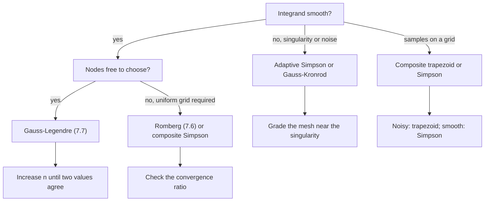

# Numerical Integration

> [Mathematics](../../README.md) › [Numerical Analysis](../README.md) · Level: Advanced · Prerequisites: [Integrals](../../07-calculus/06-integrals/README.md), [Fundamental Theorem of Calculus](../../07-calculus/07-fundamental-theorem-of-calculus/README.md), [Techniques of Integration](../../07-calculus/08-techniques-of-integration/README.md), [Derivatives](../../07-calculus/03-derivatives/README.md), [Riemann Integration](../../14-real-analysis/05-riemann-integration/README.md), [Inner Product Spaces](../../08-linear-algebra/08-inner-product-spaces/README.md), [Interpolation and Approximation](../03-interpolation-and-approximation/README.md) · Estimated time: 480 min

## 1. Introduction

Most integrals cannot be evaluated in closed form. Even for those that can, the antiderivative may be
unknown to the person who needs the number, or may be far more expensive to evaluate than the integrand
itself. An engineer who needs the drag on a wing, a statistician who needs a normal probability, a
physicist who needs the partition function of a model all face the same problem: the integral exists,
and its value must be computed to a stated accuracy from values of the integrand.

**Numerical integration** (also called *quadrature*, from the classical problem of squaring the circle)
replaces the integral by a finite weighted sum of function values:

$$\int_a^b f(x)\,dx\;\approx\;\sum_{i=0}^{n}w_i\,f(x_i).$$

Every method in this chapter is a choice of the nodes $x_i$ and the weights $w_i$, together with an
honest statement of the error.

The chapter is organised in five movements.

1. **Rules from interpolation.** Section 7.1 shows that integrating an interpolant produces a quadrature
   rule, and that the weights are the integrals of the Lagrange basis polynomials. The trapezoid rule
   (Section 7.2) and Simpson's rule (Section 7.3) are the first two cases; Section 7.4 adds the midpoint
   rule and the rest of the Newton–Cotes family.
2. **Composite rules.** A single high-order rule is fragile; many low-order panels are robust. Section
   7.5 sums panel errors and shows that the composite trapezoid rule converges as $O(h^2)$ and the
   composite Simpson rule as $O(h^4)$.
3. **Extrapolation.** Section 7.6 uses the Euler–Maclaurin expansion to cancel the leading error terms
   one after another, producing Romberg integration and, in the limit, machine-precision accuracy for
   analytic integrands.
4. **Optimal rules.** Section 7.7 derives the Gauss–Legendre nodes and weights for $n=1,2,3$ from
   orthogonality, and Section 7.8 proves the exactness theorem: an $n$-point Gauss rule integrates every
   polynomial of degree at most $2n-1$ exactly, and no $n$-point rule can do better.
5. **Adaptation and judgement.** Section 7.9 derives the adaptive Simpson algorithm and its error
   estimate; Sections 7.10 and 7.11 compare the methods and give practical guidance for choosing one and
   for estimating the error that remains.

The recurring theme is that **quadrature error is interpolation error integrated**. Every error term in
this chapter is obtained by integrating the error formula of
[Interpolation and Approximation](../03-interpolation-and-approximation/README.md), and every weight is
obtained by integrating a Lagrange basis polynomial.

## 2. Prerequisites

**The definite integral and its properties.** Linearity, additivity over adjacent intervals, and the
mean value theorem for integrals are used constantly. See
[Integrals](../../07-calculus/06-integrals/README.md) and
[Riemann Integration](../../14-real-analysis/05-riemann-integration/README.md).

**The fundamental theorem of calculus.** Exact values used to check the rules come from antiderivatives.
See [Fundamental Theorem of Calculus](../../07-calculus/07-fundamental-theorem-of-calculus/README.md).

**Techniques of integration.** Some worked examples and exercises use substitution and integration by
parts. See [Techniques of Integration](../../07-calculus/08-techniques-of-integration/README.md).

**Taylor expansion and the mean value theorem.** The midpoint rule is derived by Taylor expansion, and
the weighted mean value theorem converts integrated error formulas into pointwise ones. See
[Derivatives](../../07-calculus/03-derivatives/README.md) and
[Applications of Derivatives](../../07-calculus/05-applications-of-derivatives/README.md).

**Interpolation, its error formula and Hermite interpolation.** The whole chapter is an application of
Theorem 7.4 and Theorem 7.12 of
[Interpolation and Approximation](../03-interpolation-and-approximation/README.md): the interpolation
error formula gives the quadrature error, and Hermite interpolation is what makes Simpson's rule exact
for cubics.

**Orthogonal polynomials.** The Gauss rules of Section 7.7 use the Legendre polynomials and their
orthogonality, developed in
[Interpolation and Approximation](../03-interpolation-and-approximation/README.md) and in
[Inner Product Spaces](../../08-linear-algebra/08-inner-product-spaces/README.md).

**Floating-point arithmetic.** Roundoff limits how far Romberg integration and high-order rules can be
pushed; see [Floating-Point Arithmetic](../01-floating-point-arithmetic/README.md).

## 3. Learning Objectives

By the end of this tutorial you will be able to

1. derive a quadrature rule from an interpolant and compute its weights as integrals of Lagrange basis
   polynomials;
2. derive the trapezoid, midpoint and Simpson rules together with their complete error terms, including
   the correct sign and the hypotheses on $f$;
3. state and prove the order of the composite trapezoid and composite Simpson rules, and predict the
   error reduction when the mesh is halved;
4. construct a Romberg tableau from a sequence of trapezoid values and explain why it converges faster
   than the trapezoid rule;
5. derive the Gauss–Legendre nodes and weights for $n=1,2,3$, transform a rule to a general interval,
   and prove the exactness theorem including the upper bound $2n-1$;
6. implement adaptive Simpson quadrature, derive its local error estimate, and explain why tolerances are
   split between subintervals;
7. compare methods by order, cost and hypotheses, choose one for a given integrand, and estimate the
   remaining error honestly.

## 4. Intuition

**Slicing and weighting.** An integral is a limit of sums of rectangle areas. A quadrature rule is a
finite sum of rectangle areas in which the heights are sampled cleverly and the widths are allowed to be
negative. The trapezoid rule samples at the two ends and connects them with a straight line; Simpson's
rule samples at the two ends and the middle and connects them with a parabola. Each rule replaces the
integrand by a polynomial that it can integrate exactly.

**Why panel sums beat high order.** A degree-20 interpolating polynomial on a uniform grid oscillates,
and so does its integral. Two hundred trapezoid panels do not oscillate: each panel is a straight line,
and the errors, all of the same sign for a convex function, add up in a controlled way. Composite rules
trade algebraic elegance for robustness, and the trade is almost always worth it.

**Extrapolation as error cancellation.** The trapezoid error has a known shape: it is $c_2h^2+c_4h^4+\dots$
with coefficients that depend on $f$ but not on $h$. Compute at $h$ and $h/2$; the two errors differ by a
known factor; combine the two answers to cancel the $h^2$ term. Repeat for the $h^4$ term. This is
Richardson extrapolation, and Romberg integration is its systematic application to the trapezoid rule.

**Choosing sample points optimally.** If the integrand is smooth, equally spaced samples are wasteful:
the same number of well-placed points, clustered where the polynomial needs support, gives a rule that is
exact for polynomials of almost twice the degree. That is the content of Gaussian quadrature, and it is
the same Chebyshev idea that cured Runge's phenomenon, applied to integration.

## 5. Formal Definition

**Definition 5.1 (Quadrature rule).** A *quadrature rule* on $[a,b]$ is a finite sum

$$Q[f]:=\sum_{i=0}^{n}w_i\,f(x_i),$$

with *nodes* $x_i\in[a,b]$ and *weights* $w_i\in\mathbb{R}$. The rule is *interior* if all nodes lie in
$(a,b)$, and *closed* if $x_0=a$ and $x_n=b$. The *error* of the rule is $E[f]:=I[f]-Q[f]$ with
$I[f]=\int_a^bf(x)dx$.

**Definition 5.2 (Degree of exactness).** The rule $Q$ has *degree of exactness* $m$ (also called the
*degree of precision*) if $Q[p]=I[p]$ for every polynomial of degree at most $m$, and $Q[p]\neq I[p]$ for
at least one polynomial of degree $m+1$.

**Definition 5.3 (Interpolatory rule).** Given distinct nodes $x_0,\dots,x_n$, the *interpolatory
quadrature rule* associated with them has weights

$$w_i:=\int_a^b\ell_i(x)\,dx,$$

where $\ell_i$ are the Lagrange basis polynomials of the nodes. Equivalently, $Q[f]=\int_a^bp_n(x)dx$ for
the interpolant $p_n$ of $f$ at the nodes.

**Definition 5.4 (Newton–Cotes rules).** The interpolatory rules with equally spaced nodes are the
*Newton–Cotes* rules. They are *closed* when the endpoints are included ($x_i=a+ih$, $h=(b-a)/n$) and
*open* when they are not (nodes at $a+(i+1)h$ with $h=(b-a)/(n+2)$).

**Definition 5.5 (Composite rule).** Partition $[a,b]$ into $m$ panels of length $h=(b-a)/m$ and apply a
basic rule $Q$ to each panel; the result is the *composite rule*. For the trapezoid rule on a uniform
partition,

$$T_m[f]:=\frac h2\Bigl(f(a)+2\sum_{j=1}^{m-1}f(a+jh)+f(b)\Bigr),$$

and for Simpson's rule, with $m$ even,

$$S_m[f]:=\frac h3\Bigl(f(a)+4\!\!\sum_{\substack{j=1\\ j\ \mathrm{odd}}}^{m-1}\!\!f(a+jh)
+2\!\!\sum_{\substack{j=2\\ j\ \mathrm{even}}}^{m-2}\!\!f(a+jh)+f(b)\Bigr).$$

**Definition 5.6 (Gaussian quadrature).** An $n$-point rule on $[-1,1]$ whose nodes are the zeros of the
Legendre polynomial $P_n$ is a *Gauss–Legendre rule*. More generally a Gaussian rule is one whose degree
of exactness is $2n-1$, the maximum possible for $n$ nodes.

**Definition 5.7 (Adaptive rule).** An *adaptive* quadrature algorithm estimates the error on each
subinterval and subdivides only those subintervals whose estimated error exceeds a local tolerance, until
the sum of the local estimates is below a global tolerance.

## 6. Mathematical Notation

| Symbol | Read as | Meaning |
|---|---|---|
| $Q[f]$ | $Q$ of $f$ | the quadrature approximation to $I[f]$ |
| $I[f]$ | $I$ of $f$ | $\int_a^bf(x)dx$, the exact integral |
| $E[f]$ | error | $I[f]-Q[f]$, exact minus computed |
| $x_i$ | nodes | points at which $f$ is evaluated |
| $w_i$ | weights | coefficients of the rule |
| $h$ | step | panel length $(b-a)/m$ |
| $T_m$, $S_m$ | composite trapezoid, Simpson | rules with $m$ panels |
| $T(h)$ | trapezoid at step $h$ | the same quantity, indexed by the step |
| $R_{k,j}$ | Romberg entry | the $j$-th extrapolation at step $h_k$ |
| $P_n$ | Legendre polynomial | orthogonal polynomial of degree $n$ on $[-1,1]$ |
| $\xi,\eta$ | intermediate points | points supplied by the mean value theorem |
| $M_k$ | derivative bound | $\max_{[a,b]}\lvert f^{(k)}\rvert$ |
| $\lVert f\rVert_\infty$ | sup norm | $\max_{[a,b]}\lvert f\rvert$ |
| $\operatorname{fl}(\cdot)$ | floating-point value | the computed approximation of a real number |

## 7. Core Concepts

### 7.1 Interpolatory quadrature

The simplest way to build a rule is to interpolate and integrate. Given distinct nodes
$x_0,\dots,x_n\in[a,b]$, let $p_n$ be the interpolant of $f$. Since integration is linear and
$p_n=\sum_i f(x_i)\ell_i$, we get

$$\int_a^bp_n(x)\,dx=\sum_{i=0}^{n}\Bigl(\int_a^b\ell_i(x)\,dx\Bigr)f(x_i).$$

Thus the rule is interpolatory exactly when $w_i=\int_a^b\ell_i(x)dx$ (Definition 5.3). Three immediate
consequences follow.

* **Weights sum to the length.** Because $\sum_i\ell_i=1$, $\sum_iw_i=b-a$. This is the first check on
  any hand-computed rule.
* **Degree of exactness at least $n$.** If $f\in\Pi_n$ then $p_n=f$ by uniqueness, so $Q[f]=I[f]$.
* **The error is the integrated interpolation error.** With $E[f]=I[f]-Q[f]$,
  $E[f]=\int_a^b\bigl(f(x)-p_n(x)\bigr)dx$, and Theorem 7.4 of
  [Interpolation and Approximation](../03-interpolation-and-approximation/README.md) gives the shape of
  the integrand.

For equally spaced nodes the interpolatory rules are the Newton–Cotes rules. Writing $h=(b-a)/n$, the
closed rules for $n=1,2,3,4$ are

| $n$ | name | $Q[f]$ | degree |
|---|---|---|---|
| $1$ | trapezoid | $\frac h2\bigl(f_0+f_1\bigr)$ | $1$ |
| $2$ | Simpson | $\frac h3\bigl(f_0+4f_1+f_2\bigr)$ | $3$ |
| $3$ | Simpson's $3/8$ | $\frac{3h}{8}\bigl(f_0+3f_1+3f_2+f_3\bigr)$ | $3$ |
| $4$ | Boole | $\frac{2h}{45}\bigl(7f_0+32f_1+12f_2+32f_3+7f_4\bigr)$ | $5$ |

where $f_i=f(a+ih)$ and $h=(b-a)/n$ in each row. The degrees are higher than $n$ in the even cases
because a symmetry cancels the leading error term; Simpson's rule is exact for cubics, not merely for
quadratics.

### 7.2 The trapezoid rule and its error

With the two nodes $a,b$ and $h=b-a$, the Lagrange basis polynomials are
$\ell_0=(b-x)/h$ and $\ell_1=(x-a)/h$, whose integrals are both $h/2$. Hence

$$T[f]=\frac{b-a}{2}\bigl(f(a)+f(b)\bigr).$$

It is the area of the trapezoid under the chord, and it is exact for linear functions.

**Theorem 7.1 (Trapezoid error).** Let $f\in C^2[a,b]$. Then there is $\eta\in(a,b)$ with

$$E_T[f]=\int_a^bf\,dx-T[f]=-\frac{(b-a)^3}{12}\,f''(\eta).$$

*Proof.* By the interpolation error formula with $n=1$,
$f(x)-p_1(x)=\frac12f''(\xi(x))(x-a)(x-b)$. Write this as $f[a,b,x](x-a)(x-b)$, where the divided
difference $f[a,b,x]$ is continuous in $x$ because $f\in C^2$. The function $(x-a)(x-b)$ is continuous
and non-positive on $[a,b]$, so the weighted mean value theorem for integrals applies:

$$E_T[f]=\int_a^b f[a,b,x]\,(x-a)(x-b)\,dx=f[a,b,\eta]\int_a^b(x-a)(x-b)\,dx .$$

The integral is $\bigl[-\tfrac{(b-a)^3}{6}\bigr]$, and $f[a,b,\eta]=\tfrac12f''(\eta)$ by the mean value
theorem for divided differences. Hence $E_T=-\tfrac{(b-a)^3}{12}f''(\eta)$. $\blacksquare$

The sign is informative: for a convex function ($f''>0$) the chord lies above the graph, so the rule
overestimates and $E_T=I-T<0$. For a concave function it underestimates. The magnitude is proportional
to $(b-a)^3$: halving the interval reduces the local error by a factor $8$.

### 7.3 Simpson's rule and its error

With the three nodes $a$, $m=\tfrac{a+b}{2}$, $b$ and $h=\tfrac{b-a}{2}$, the Lagrange weights are

$$w_0=\int_a^b\frac{(x-m)(x-b)}{(a-m)(a-b)}dx=\frac h3,\qquad
w_1=\int_a^b\frac{(x-a)(x-b)}{(m-a)(m-b)}dx=\frac{4h}{3},\qquad
w_2=\int_a^b\frac{(x-a)(x-m)}{(b-a)(b-m)}dx=\frac h3 .$$

For $[0,2]$ these integrals are computed explicitly in Example 9.3. Since $b-a=2h$,

$$S[f]=\frac h3\bigl(f(a)+4f(m)+f(b)\bigr)=\frac{b-a}{6}\bigl(f(a)+4f(m)+f(b)\bigr).$$

**Degree of exactness 3.** Simpson's rule is exact for every cubic. One check: for $f(x)=x^3$ on
$[0,2]$, $I=4$ and $S=\tfrac13(0+4\cdot1+8)=4$. The rule is *not* exact for quartics: on $[0,1]$,
$f=x^4$ gives $I=\tfrac15=0.2$ and $S=\tfrac16(0+4\cdot\tfrac1{16}+1)=\tfrac{5}{24}=0.208333$, an error
of $-\tfrac1{120}$.

**Theorem 7.2 (Simpson error).** Let $f\in C^4[a,b]$ and $m=\tfrac{a+b}{2}$. Then there is
$\eta\in(a,b)$ with

$$E_S[f]=\int_a^bf\,dx-S[f]=-\frac{(b-a)^5}{2880}\,f^{(4)}(\eta)
=-\frac{h^5}{90}f^{(4)}(\eta),\qquad h=\frac{b-a}{2}.$$

*Proof.* Let $H$ be the cubic Hermite interpolant matching $f$ at $a,m,b$ and $f'$ at $m$. Simpson's rule
uses only $f(a),f(m),f(b)$, which are also the values of $H$ at those points, and Simpson is exact for
cubics; hence $S[f]=S[H]=\int_a^bH$. Therefore

$$E_S[f]=\int_a^b\bigl(f-H\bigr)dx
=\frac{1}{24}\int_a^bf^{(4)}(\xi(x))\,(x-a)(x-m)^2(x-b)\,dx .$$

The polynomial $(x-a)(x-m)^2(x-b)$ is continuous and non-positive on $[a,b]$, so the weighted mean value
theorem gives

$$E_S[f]=\frac{f^{(4)}(\eta)}{24}\int_a^b(x-a)(x-m)^2(x-b)\,dx .$$

Substituting $x=a+ht$ with $h=\tfrac{b-a}{2}$ turns the integral into
$h^5\int_0^2t(t-1)^2(t-2)dt=-\tfrac{4}{15}h^5$. Since $h=\tfrac{b-a}{2}$, this is
$-\tfrac{4}{15}\cdot\tfrac{(b-a)^5}{32}=-\tfrac{(b-a)^5}{120}$, and dividing by $24$ gives
$-\tfrac{(b-a)^5}{2880}$. The panel form follows from $(b-a)=2h$. $\blacksquare$

Because the error involves $f^{(4)}$, Simpson's rule is exact for all cubics (as observed) and is far
more accurate than the trapezoid rule on smooth integrands: the constant $1/2880$ is small and the power
of $(b-a)$ is high.

### 7.4 The midpoint rule and the Newton–Cotes family

**Midpoint rule.** With the single node $m=\tfrac{a+b}{2}$ and weight $b-a$,

$$M[f]=(b-a)f(m).$$

**Theorem 7.3 (Midpoint error).** For $f\in C^2[a,b]$ there is $\eta\in(a,b)$ with

$$E_M[f]=\int_a^bf\,dx-M[f]=\frac{(b-a)^3}{24}f''(\eta).$$

*Proof.* Taylor's theorem about $m$ gives
$f(x)=f(m)+f'(m)(x-m)+\tfrac12f''(\xi(x))(x-m)^2$. Integrating over $[a,b]$, the linear term integrates to
zero because $(x-m)$ is odd about the midpoint, so

$$E_M[f]=\frac12\int_a^bf''(\xi(x))(x-m)^2dx=\frac{f''(\eta)}{2}\int_a^b(x-m)^2dx
=\frac{f''(\eta)}{2}\cdot\frac{(b-a)^3}{12},$$

using the weighted mean value theorem with the non-negative weight $(x-m)^2$. $\blacksquare$

Midpoint and trapezoid have errors of the same order but opposite signs, and the midpoint constant is
half the trapezoid constant. For a convex function the midpoint rule underestimates ($E_M>0$).

**The rest of the family.** The $3/8$ rule and Boole's rule are also interpolatory, with the weights
listed in Section 7.1. Their error terms are

$$E_{3/8}[f]=-\frac{3h^5}{80}f^{(4)}(\eta),\qquad h=\frac{b-a}{3},$$

$$E_{\text{Boole}}[f]=-\frac{8h^7}{945}f^{(6)}(\eta),\qquad h=\frac{b-a}{4}.$$

These cannot be derived from the weighted mean value theorem in the naive way, because the node
polynomial changes sign inside the interval. The clean derivation uses the *Peano kernel*: for a rule of
degree of exactness $m$,

$$E[f]=\frac{1}{m!}\int_a^bK(t)\,f^{(m+1)}(t)\,dt,\qquad
K(t)=E\bigl[(x-t)_+^{m}\bigr],$$

and for these rules $K$ has one sign, so the mean value theorem applies to the $t$-integral. Checking the
constants directly confirms them: for $f=x^4$ on $[0,3]$ the $3/8$ rule gives $49.5$ against $48.6$, an
error of $-0.9=-\tfrac{3}{80}\cdot24$; for $f=x^6$ on $[0,4]$ Boole's rule gives $2346.667$ against
$2340.571$, an error of $-6.095=-\tfrac{8}{945}\cdot720$.

A warning about high order: for $n\ge8$ the closed Newton–Cotes weights are not all positive — the
nine-point rule ($n=8$) already has negative weights — so the rules lose the stability property
$\sum_i\lvert w_i\rvert=b-a$ and become useless in floating point. This is the quadrature analogue of
Runge's phenomenon, and it is one reason why composite low-order rules and Gauss rules dominate practice.

### 7.5 Composite rules and their errors

A single panel is accurate only if the interval is short. The composite rules apply a basic rule to each
panel of a uniform partition with $h=(b-a)/m$. For the trapezoid rule,

$$T_m[f]=\frac h2\Bigl(f(a)+2\sum_{j=1}^{m-1}f(a+jh)+f(b)\Bigr),$$

and for Simpson's rule, with $m$ even,

$$S_m[f]=\frac h3\Bigl(f(a)+4\!\!\sum_{\substack{j=1\\j\ \mathrm{odd}}}^{m-1}\!\!f(a+jh)
+2\!\!\sum_{\substack{j=2\\j\ \mathrm{even}}}^{m-2}\!\!f(a+jh)+f(b)\Bigr).$$

**Theorem 7.4 (Composite errors).** Let $f\in C^2[a,b]$ and $h=(b-a)/m$. Then there is
$\eta\in(a,b)$ with

$$E_{T_m}[f]=\int_a^bf\,dx-T_m[f]=-\frac{(b-a)h^2}{12}f''(\eta).$$

If in addition $f\in C^4[a,b]$ and $m$ is even, there is $\eta'\in(a,b)$ with

$$E_{S_m}[f]=\int_a^bf\,dx-S_m[f]=-\frac{(b-a)h^4}{180}f^{(4)}(\eta').$$

*Proof.* Summing the panel errors of Theorem 7.1,

$$E_{T_m}[f]=-\frac{h^3}{12}\sum_{j=1}^{m}f''(\eta_j),$$

where $\eta_j$ lies in the $j$-th panel. The average $\frac1m\sum_jf''(\eta_j)$ lies between the minimum
and maximum of $f''$ on $[a,b]$, so by the intermediate value theorem it equals $f''(\eta)$ for some
$\eta$. Hence $E_{T_m}=-\frac{mh^3}{12}f''(\eta)=-\frac{(b-a)h^2}{12}f''(\eta)$. The Simpson argument is
identical, summing $-\frac{h^5}{90}f^{(4)}(\eta_j)$ over $m/2$ panels with $mh=b-a$. $\blacksquare$

The orders are $O(h^2)$ and $O(h^4)$: halving $h$ reduces the trapezoid error by a factor $4$ and the
Simpson error by a factor $16$. The following table for $\int_0^1e^xdx=e-1$ shows the rates cleanly.

| $m$ | $h$ | $I-T_m$ | ratio | $I-S_m$ | ratio |
|---|---|---|---|---|---|
| $2$ | $0.5$ | $-3.5649\times10^{-2}$ | — | $-5.7932\times10^{-4}$ | — |
| $4$ | $0.25$ | $-8.9401\times10^{-3}$ | $3.99$ | $-3.7013\times10^{-5}$ | $15.65$ |
| $8$ | $0.125$ | $-2.2368\times10^{-3}$ | $4.00$ | $-2.3262\times10^{-6}$ | $15.91$ |
| $16$ | $0.0625$ | $-5.5930\times10^{-4}$ | $4.00$ | $-1.4559\times10^{-7}$ | $15.98$ |

The ratios approach $4$ and $16$ from below, as the theory predicts; the residual discrepancy is the
next term in the error expansion, which is what Romberg integration exploits.

### 7.6 Romberg integration

The composite trapezoid rule has an error expansion in powers of $h^2$ with coefficients that depend on
$f$ but not on $h$. That structure can be exploited to eliminate the leading terms one by one.

**Theorem 7.5 (Euler–Maclaurin).** If $f\in C^{2p+2}[a,b]$ and $T(h)$ is the trapezoid rule with step
$h=(b-a)/m$, then

$$T(h)=I+\frac{B_2}{2!}\bigl(f'(b)-f'(a)\bigr)h^2
+\frac{B_4}{4!}\bigl(f'''(b)-f'''(a)\bigr)h^4+\dots
+\frac{B_{2p}}{(2p)!}\bigl(f^{(2p-1)}(b)-f^{(2p-1)}(a)\bigr)h^{2p}+O(h^{2p+2}),$$

where $B_{2k}$ are the Bernoulli numbers, $B_2=\tfrac16$, $B_4=-\tfrac1{30}$, $B_6=\tfrac1{42}$.

The theorem is quoted rather than proved here; it follows from the Euler–Maclaurin summation formula,
which is proved by repeated integration by parts on each panel. For $\int_0^1e^xdx$ it gives
$T(h)=I+\tfrac{e-1}{12}h^2-\tfrac{e-1}{720}h^4+\dots$, and at $h=\tfrac12$ the two terms
$0.035797-0.000149=0.035648$ reproduce the observed $T-I=0.035649$.

**The Romberg tableau.** Let $h_k=(b-a)/2^k$ and $R_{k,0}=T(h_k)$ for $k=0,1,2,\dots$. Define

$$R_{k,j}:=R_{k,j-1}+\frac{R_{k,j-1}-R_{k-1,j-1}}{4^j-1},\qquad 1\le j\le k .$$

**Theorem 7.6.** If $f$ is sufficiently smooth, then $R_{k,j}=I+O(h_k^{2j+2})$.

*Proof.* Suppose $R_{k,j-1}=I+c\,h_k^{2j}+O(h_k^{2j+2})$ and, since $h_{k-1}=2h_k$,
$R_{k-1,j-1}=I+c\,4^jh_k^{2j}+O(h_k^{2j+2})$. Then

$$R_{k,j}=I+c h_k^{2j}+O(h_k^{2j+2})
+\frac{c h_k^{2j}-c4^jh_k^{2j}+O(h_k^{2j+2})}{4^j-1}
=I+O(h_k^{2j+2}),$$

because the coefficient of $h_k^{2j}$ is $c\bigl(1+\frac{1-4^j}{4^j-1}\bigr)=0$. The base case $j=0$ is
the Euler–Maclaurin expansion with leading term $h_k^2$. $\blacksquare$

Each column therefore converges two orders faster than the previous one: column $0$ is $O(h^2)$,
column $1$ is $O(h^4)$ (Simpson, in fact, since $R_{k,1}=S_{2^k}$), column $2$ is $O(h^6)$, and so on.

**Worked tableau for $\pi$.** Take $I=\int_0^1\frac{4}{1+x^2}dx=\pi$. The trapezoid values and the
extrapolations are

| $k$ | $h_k$ | $R_{k,0}$ | $R_{k,1}$ | $R_{k,2}$ | $R_{k,3}$ | $R_{k,4}$ |
|---|---|---|---|---|---|---|
| $0$ | $1$ | $3.000000000$ | | | | |
| $1$ | $1/2$ | $3.100000000$ | $3.133333333$ | | | |
| $2$ | $1/4$ | $3.131176471$ | $3.141568627$ | $3.142117647$ | | |
| $3$ | $1/8$ | $3.138988494$ | $3.141592502$ | $3.141594094$ | $3.141585784$ | |
| $4$ | $1/16$ | $3.140941612$ | $3.141592651$ | $3.141592661$ | $3.141592638$ | $3.141592665$ |

The exact value is $\pi=3.141592654$. The diagonal entry $R_{4,4}$ is wrong in the eighth decimal,
because at that point the $O(h^{10})$ term is below the roundoff level of the trapezoid values, which
is about $10^{-16}/h^2$. Romberg integration converges until the extrapolation amplifies roundoff faster
than it reduces truncation error; a good implementation stops when two successive diagonal entries agree
to within a tolerance related to $u/h$.

Romberg requires the integrand to be smooth. For a function with a singularity, the error expansion
contains fractional or logarithmic terms, the cancellation is incomplete, and the tableau can diverge.
That is why Romberg is used for analytic integrands and adaptive or Gauss rules elsewhere.

### 7.7 Gaussian quadrature: nodes and weights from orthogonality

An $n$-point rule has $2n$ free parameters (nodes and weights). Matching the $2n$ moments of degrees
$0,1,\dots,2n-1$ is therefore the most that can be asked, and the Gauss rules achieve it. The nodes turn
out to be the zeros of the Legendre polynomial $P_n$.

**Derivation for $n=1$.** The equations for degrees $0$ and $1$ are $w_1=2$ and $w_1x_1=0$, so $x_1=0$,
$w_1=2$: the midpoint rule on $[-1,1]$. Degree $2$ fails because $w_1x_1^2=0\neq\tfrac23$, so the degree
of exactness is $1=2n-1$.

**Derivation for $n=2$.** The four equations are

$$w_1+w_2=2,\qquad w_1x_1+w_2x_2=0,\qquad w_1x_1^2+w_2x_2^2=\frac23,\qquad w_1x_1^3+w_2x_2^3=0 .$$

The system is invariant under $x\mapsto-x$, so try the symmetric solution $x_2=-x_1$, $w_1=w_2$. The
first equation gives $w_1=w_2=1$, the third gives $2x_1^2=\tfrac23$, hence
$x_1=-x_2=\tfrac{1}{\sqrt3}=\pm0.577350$. The second and fourth equations hold automatically. These are
exactly the zeros of $P_2=\tfrac12(3x^2-1)$, and the rule is exact through degree $3$: for $x^4$ it gives
$\tfrac19+\tfrac19=\tfrac29$ against $\tfrac25$, so the degree of exactness is $3=2n-1$.

**Derivation for $n=3$.** Try the symmetric configuration with nodes $-a,0,a$ and weights $w,w_0,w$. The
even moments give

$$2w+w_0=2,\qquad 2wa^2=\frac23,\qquad 2wa^4=\frac25 .$$

Dividing the third by the second gives $a^2=\tfrac35$, so $a=\sqrt{0.6}=0.774597$; then
$2w\cdot\tfrac35=\tfrac23$ gives $w=\tfrac59=0.555556$, and $w_0=2-\tfrac{10}{9}=\tfrac89=0.888889$.
These are the zeros of $P_3=\tfrac12(5x^3-3x)$, and the rule is exact through degree $5$; for $x^6$ it
gives $2\cdot\tfrac59\cdot\tfrac{27}{125}=0.24$ against $\tfrac27=0.285714$, so the degree of exactness
is $5=2n-1$.

| $n$ | nodes | weights | degree |
|---|---|---|---|
| $1$ | $0$ | $2$ | $1$ |
| $2$ | $\pm0.5773502692$ | $1,\ 1$ | $3$ |
| $3$ | $0,\ \pm0.7745966692$ | $\tfrac89,\ \tfrac59,\ \tfrac59$ | $5$ |

**The general weight formula.** If $x_1,\dots,x_n$ are the zeros of $P_n$, then the interpolatory weights
are

$$w_i=\int_{-1}^{1}\ell_i(x)\,dx=\frac{2}{(1-x_i^2)\,[P_n'(x_i)]^2}.$$

For $n=3$ and $x_i=0$: $P_3'(0)=-\tfrac32$, so $w=2/(1\cdot\tfrac94)=\tfrac89$; at $x_i^2=\tfrac35$:
$P_3'(x_i)=\tfrac12(15\cdot\tfrac35-3)=3$, so $w=2/((1-\tfrac35)\cdot9)=\tfrac59$. The formula confirms
the moment derivation and is the practical way to compute weights up to high order.

**Transformation to a general interval.** The substitution $x=\frac{a+b}{2}+\frac{b-a}{2}t$ gives

$$\int_a^bf(x)\,dx\approx\frac{b-a}{2}\sum_{i=1}^{n}w_i\,f\Bigl(\frac{a+b}{2}+\frac{b-a}{2}t_i\Bigr),$$

where $t_i,w_i$ are the nodes and weights on $[-1,1]$. For $[0,1]$ and $n=2$ the nodes are
$0.211325$ and $0.788675$ with weights $\tfrac12,\tfrac12$; for $n=3$ they are $0.112702$, $0.5$,
$0.887298$ with weights $\tfrac{5}{18},\tfrac49,\tfrac{5}{18}$.

### 7.8 The exactness theorem and the Gauss error term

**Theorem 7.7 (Gauss exactness).** Let $x_1,\dots,x_n$ be the zeros of $P_n$ and let $w_i$ be chosen so
that the rule is exact for all polynomials of degree at most $n-1$. Then the rule is exact for all
polynomials of degree at most $2n-1$.

*Proof.* The weights exist and are unique because the $n\times n$ Vandermonde system for the moments of
degrees $0,\dots,n-1$ has distinct nodes and is nonsingular.

Let $p\in\Pi_{2n-1}$. Divide by $P_n$: $p=qP_n+r$ with $\deg q\le n-1$ and $\deg r\le n-1$. By
orthogonality of $P_n$ to every polynomial of lower degree,
$\int_{-1}^1p=\int_{-1}^1r+\int_{-1}^1qP_n=\int_{-1}^1r$. On the other hand, $P_n(x_i)=0$, so
$Q[p]=\sum_iw_ip(x_i)=\sum_iw_ir(x_i)=Q[r]$. Since $r\in\Pi_{n-1}$, $Q[r]=\int r$. Hence
$Q[p]=\int p$. $\blacksquare$

**Theorem 7.8 (No rule does better).** No $n$-point quadrature rule on $[-1,1]$ has degree of exactness
$2n$ or more.

*Proof.* Let $x_1,\dots,x_n$ be any nodes and let $p(x)=\prod_{i=1}^{n}(x-x_i)^2$. Then $p\ge0$, $p$ is not
identically zero, and $\deg p=2n$, so $\int_{-1}^1p>0$. But every quadrature rule with these nodes gives
$Q[p]=\sum_iw_ip(x_i)=0$. Hence the rule fails on a polynomial of degree $2n$. $\blacksquare$

**The error term.** For $f\in C^{2n}[-1,1]$ the Gauss rule satisfies

$$E_n[f]=\int_{-1}^{1}f\,dx-Q_n[f]=C_n\,f^{(2n)}(\xi),\qquad
C_n=\frac{2^{2n+1}(n!)^4}{(2n+1)\bigl[(2n)!\bigr]^3},$$

with $\xi\in(-1,1)$. The constant follows from the Peano kernel $K(t)=E_n[(x-t)_+^{2n-1}]$, which is
non-negative for the Gauss rule; the weighted mean value theorem then gives the stated form. The values
are

$$C_1=\frac13,\qquad C_2=\frac1{135},\qquad C_3=\frac1{15750}.$$

For a general interval, the substitution scales the error by $\bigl(\frac{b-a}{2}\bigr)^{2n+1}$:
$E=C_n\bigl(\frac{b-a}{2}\bigr)^{2n+1}f^{(2n)}(\xi)$, that is

$$n=2:\quad \frac{(b-a)^5}{4320}f^{(4)}(\xi),\qquad
n=3:\quad \frac{(b-a)^7}{2016000}f^{(6)}(\xi).$$

**Why Gauss is efficient.** An $n$-point Gauss rule has degree $2n-1$, while a composite Simpson rule
using $2m+1$ evaluations has degree $3$. To integrate a smooth function to high accuracy, Gauss needs far
fewer evaluations: for $n=3$, three evaluations give degree $5$, and the order is $6$. The price is that
the nodes are irrational and depend on $n$, so the rule is not nested: a $2n$-point rule does not reuse
the nodes of an $n$-point rule. This is why adaptive Gauss codes use embedded pairs (Gauss–Kronrod), in
which extra nodes are added to an existing Gauss rule to produce a second, higher-order estimate.

### 7.9 Adaptive quadrature

A composite rule with a fixed $m$ wastes work where $f$ is smooth and fails where $f$ is not. Adaptive
quadrature chooses the panel sizes from the integrand itself.

**The local error estimate.** On a panel $[a,b]$, let $S_1=S[a,b]$ be Simpson's rule and let
$S_2=S[a,m]+S[m,b]$ be the two-panel composite rule, with $m=\tfrac{a+b}{2}$. If $S_1=I+c(b-a)^5$ and
$S_2=I+2c\bigl(\tfrac{b-a}{2}\bigr)^5=I+\tfrac{c}{16}(b-a)^5$, then

$$S_2-S_1=-\frac{15}{16}c(b-a)^5,\qquad
I-S_2=-\frac{c}{16}(b-a)^5=\frac{S_2-S_1}{15}.$$

Hence the *Richardson estimate* of the error of $S_2$ is $(S_2-S_1)/15$, and the *corrected value*
$S_2+(S_2-S_1)/15$ is accurate to $O((b-a)^6)$ locally.

**The algorithm.** Compute $S_1$ and $S_2$ on $[a,b]$. If $\lvert S_2-S_1\rvert/15\le\varepsilon$, accept
$S_2+(S_2-S_1)/15$ and add $\lvert S_2-S_1\rvert/15$ to the error tally. Otherwise recurse on $[a,m]$ and
$[m,b]$ with tolerance $\varepsilon/2$ each, and add the two results. Splitting the tolerance is
essential: if each half were given the full $\varepsilon$, a total of $2^k$ panels could accumulate an
error $2^k\varepsilon$.

**Worked example.** For $\int_0^1\sqrt x\,dx=\tfrac23$ with tolerance $10^{-5}$, the algorithm accepts the
value $0.666666143$ after $29$ panels and the final error is $5.24\times10^{-7}$. The panels are strongly
graded towards $0$: near the origin they have lengths of order $10^{-3}$, because the infinite
derivative at the origin makes the local error estimate large there. The full interval $[0,1]$ is tested
first and rejected; the left halves are subdivided repeatedly while the right halves are accepted
quickly. This is the behaviour one wants, and it is why adaptive methods are the default for integrands
whose behaviour is not known in advance.

**A caution.** Adaptive quadrature samples the integrand, so it can be fooled by a narrow spike that
falls between the sample points: all tested panels look smooth and the spike is missed. Adaptive
algorithms estimate the error of the *sampled* integrand, not of the true one. Where such features are
possible, the integrand must be examined, or the integral split at known feature locations.

### 7.10 Comparison of the methods

| Method | Evaluations | Degree | Order | Error constant |
|---|---|---|---|---|
| midpoint, composite | $m$ | $1$ | $2$ | $+\frac{(b-a)h^2}{24}f''$ |
| trapezoid, composite | $m+1$ | $1$ | $2$ | $-\frac{(b-a)h^2}{12}f''$ |
| Simpson, composite | $2m+1$ | $3$ | $4$ | $-\frac{(b-a)h^4}{180}f^{(4)}$ |
| Simpson $3/8$, composite | $3m+1$ | $3$ | $4$ | $-\frac{3(b-a)h^4}{80}f^{(4)}$ |
| Boole, composite | $4m+1$ | $5$ | $6$ | $-\frac{8(b-a)h^6}{945}f^{(6)}$ |
| Gauss–Legendre $n=2$, composite | $2m$ | $3$ | $4$ | $+\frac{(b-a)h^4}{4320}f^{(4)}$ |
| Gauss–Legendre $n=3$, composite | $3m$ | $5$ | $6$ | $+\frac{(b-a)h^6}{2016000}f^{(6)}$ |
| Romberg, $k+1$ rows | $2^k+1$ | — | $2k+2$ | expansion in $h^2$ |
| adaptive Simpson | data-dependent | $3$ local | $4$ local | Richardson estimate |

The table shows the trade-off clearly. For the same number of evaluations, Gauss–2 (2 evaluations,
degree 3, order 4) matches Simpson (3 evaluations, degree 3, order 4) with one fewer evaluation per
panel. Gauss–3 (3 evaluations, degree 5, order 6) beats Boole (5 evaluations, degree 5, order 6) with
two fewer. Romberg achieves high order without irrational nodes, but only for smooth integrands and at
the cost of a triangular tableau rather than a single rule.

### 7.11 Practical guidance

**Choosing a method.**

* *Smooth integrand, no grid constraint, few evaluations available* (a costly function call): use
  Gauss–Legendre, increasing $n$ until two successive values agree.
* *Data given on a uniform grid*: use the trapezoid rule for noisy data and Simpson's rule for smooth
  data; the trapezoid rule is the natural choice for sampled signals and has a small, computable error.
* *Unknown smoothness or a mild singularity*: use adaptive Simpson or adaptive Gauss–Kronrod. Expect
  deep subdivision near the singular point.
* *Analytic integrand and high accuracy required*: Romberg is simple and, on a smooth function, very
  fast; it is the method of choice in many classical tables.
* *Periodic integrand over a full period*: the trapezoid rule is spectrally accurate (its error decays
  faster than any power of $h$), so equally spaced samples are optimal and Gauss is unnecessary.

**Estimating the error.** Never report a quadrature value without an error estimate. Three standard
routes are: (i) compute with $m$ and $2m$ panels and use Richardson, $I\approx Q_{2m}+(Q_{2m}-Q_m)/(2^p-1)$
with $p$ the order; (ii) use an embedded pair of rules of different order and take the difference;
(iii) use a rigorous bound when a derivative bound is available. The first two estimate the error of the
model; the third bounds it for the true integrand.

**Roundoff.** Every rule computes $\sum w_if(x_i)$ in floating point, so the roundoff is about
$u\sum_i\lvert w_i\rvert\max\lvert f\rvert$, where $u$ is the unit roundoff. For rules with positive
weights $\sum_i\lvert w_i\rvert=b-a$ and the roundoff is benign. For high-order Newton–Cotes rules with
negative weights, $\sum_i\lvert w_i\rvert$ grows and cancellation can destroy the result. This is the
quadrature counterpart of the conditioning discussion in
[Floating-Point Arithmetic](../01-floating-point-arithmetic/README.md).

**Singular and infinite integrals.** An integrable singularity (such as $x^{-1/2}$ at $0$) can be removed
by substitution ($x=t^2$), by a graded mesh, or by a Gauss–Jacobi rule with the matching weight. For an
infinite interval, transform to a finite one (for example $x=t/(1-t^2)$ on $(-1,1)$) and apply Gauss, or
use a Gauss–Laguerre or Gauss–Hermite rule with the appropriate weight.

**Checks.** Before trusting a value, verify that the weights sum to $b-a$, that the rule reproduces the
integrals of $1,x,x^2$ (for low-order rules), and that halving the step changes the answer in the
predicted ratio. A rule that fails the constant check has a wrong weight; one that fails the ratio check
has a bug or a non-smooth integrand.

## 8. Formulas and Properties

| Result | Hypotheses | Statement | Why it holds |
|---|---|---|---|
| interpolatory weights | distinct nodes | $w_i=\int_a^b\ell_i\,dx$, $\sum w_i=b-a$ | integrate the interpolant |
| trapezoid | $f\in C^2$ | $I-T=-\frac{(b-a)^3}{12}f''(\eta)$ | integrate linear interpolation error |
| midpoint | $f\in C^2$ | $I-M=+\frac{(b-a)^3}{24}f''(\eta)$ | Taylor, odd term vanishes |
| Simpson | $f\in C^4$ | $I-S=-\frac{(b-a)^5}{2880}f^{(4)}(\eta)$ | integrate cubic Hermite error |
| Simpson degree | any cubic | $S[p]=I[p]$ | symmetry of the weights |
| $3/8$ rule | $f\in C^4$ | $I-Q=-\frac{3h^5}{80}f^{(4)}(\eta)$ | Peano kernel, one sign |
| Boole | $f\in C^6$ | $I-Q=-\frac{8h^7}{945}f^{(6)}(\eta)$ | Peano kernel, one sign |
| composite trapezoid | $f\in C^2$ | $I-T_m=-\frac{(b-a)h^2}{12}f''(\eta)$ | sum panel errors, IVT |
| composite Simpson | $f\in C^4$, $m$ even | $I-S_m=-\frac{(b-a)h^4}{180}f^{(4)}(\eta)$ | sum panel errors, IVT |
| Romberg | $f$ smooth | $R_{k,j}=I+O(h_k^{2j+2})$ | cancel the $h^{2j}$ term |
| Gauss nodes | Legendre zeros | exact through degree $2n-1$ | division by $P_n$, orthogonality |
| Gauss limit | any $n$-point rule | degree $\le 2n-1$ | $\prod(x-x_i)^2$ positive, rule gives $0$ |
| Gauss error | $f\in C^{2n}$ | $C_nf^{(2n)}(\xi)$, $C_1=\frac13$, $C_2=\frac1{135}$, $C_3=\frac1{15750}$ | Peano kernel, one sign |
| adaptive estimate | Simpson | $I-S_2\approx\frac{S_2-S_1}{15}$ | $h^4$ scaling of the error |
| roundoff | floating point | about $u\sum_i\lvert w_i\rvert\max\lvert f\rvert$ | each product rounds once |

Two warnings about applying these formulas. First, every error term requires the stated differentiability
of $f$ on the *closed* interval; a rule applied across a singularity has no error term at all, and the
observed convergence can be arbitrarily slow. Second, the signs depend on the convention
$E=I-Q$: for convex $f$ the trapezoid rule overestimates and $E_T<0$, while the midpoint rule
underestimates and $E_M>0$. Mixing the two conventions is the most common source of sign errors.

## 9. Step-by-Step Examples

### 9.1 The trapezoid rule on $e^x$

**Problem.** Apply the trapezoid rule to $\int_0^1e^xdx=e-1=1.718281828$ and analyse the error.

**Solution.** With $a=0$, $b=1$, $h=1$,

$$T=\frac12\bigl(e^0+e^1\bigr)=\frac{1+2.718281828}{2}=1.859140914 .$$

The error is $I-T=1.718281828-1.859140914=-0.140859086$: the rule overestimates, as it must for a convex
integrand. Theorem 7.1 asserts that $I-T=-\frac{1}{12}f''(\eta)$ for some $\eta\in(0,1)$. Solving,
$f''(\eta)=12(0.140859086)=1.690309$, so $\eta=\ln1.690309=0.524911$, comfortably inside the interval.
The bound is $\frac{1}{12}\lVert f''\rVert_\infty=\frac{e}{12}=0.226523$, so the actual error is $62\%$
of the bound — the bound is usable but not tight, because $\lvert f''\rvert=e^x$ peaks at the right
endpoint where the node polynomial vanishes.

### 9.2 Simpson's rule on $e^x$

**Problem.** Apply Simpson's rule to the same integral and analyse the error.

**Solution.** With $h=\tfrac12$ and nodes $0,\tfrac12,1$,

$$S=\frac{1/2}{3}\bigl(1+4e^{1/2}+e\bigr)=\frac16\bigl(1+4(1.648721271)+2.718281828\bigr)
=\frac16(10.11316691)=1.718861152 .$$

The error is $I-S=-0.000579323$, two orders of magnitude smaller than the trapezoid error. Theorem 7.2
gives $I-S=-\frac{1}{2880}f^{(4)}(\eta)$, so $f^{(4)}(\eta)=2880(0.000579323)=1.668451$, that is
$\eta=\ln1.668451=0.511896$. The bound is $\frac{e}{2880}=0.000943848$, and the actual error is $61\%$ of
it. Simpson overestimates here, since $f^{(4)}=e^x>0$ makes $I-S$ negative.

### 9.3 Deriving Simpson's weights on $[0,2]$

**Problem.** Compute the three Lagrange weights for the nodes $0,1,2$ and verify Simpson's formula.

**Solution.** With $a=0$, $m=1$, $b=2$ and $h=1$,

$$\ell_0=\frac{(x-1)(x-2)}{(0-1)(0-2)}=\frac{x^2-3x+2}{2},\qquad
\ell_1=\frac{x(x-2)}{(1)(-1)}=-x^2+2x,\qquad
\ell_2=\frac{x(x-1)}{(2)(1)}=\frac{x^2-x}{2}.$$

Integrating term by term,

$$w_0=\Bigl[\frac{x^3}{6}-\frac{3x^2}{4}+x\Bigr]_0^2=\frac86-3+2=\frac13,$$

$$w_1=\Bigl[-\frac{x^3}{3}+x^2\Bigr]_0^2=-\frac83+4=\frac43,$$

$$w_2=\Bigl[\frac{x^3}{6}-\frac{x^2}{4}\Bigr]_0^2=\frac86-1=\frac13 .$$

So $Q=\frac13f(0)+\frac43f(1)+\frac13f(2)=\frac{h}{3}(f_0+4f_1+f_2)$ with $h=1$. The weights sum to
$\frac13+\frac43+\frac13=2=b-a$, as they must. The pattern for a general interval is the same with
$h=\frac{b-a}{2}$.

### 9.4 Degree of exactness in practice

**Problem.** Verify that Simpson's rule is exact for cubics but not for quartics, and check the $3/8$ and
Boole rules on the first power that fails.

**Solution.** For $f=x^3$ on $[0,2]$, $I=\frac{x^4}{4}\big|_0^2=4$ and
$S=\frac13(0+4\cdot1+8)=4$: exact. For $f=x^4$ on $[0,1]$, $I=\frac15=0.2$ and
$S=\frac16(0+4\cdot\frac1{16}+1)=\frac{5}{24}=0.208333$, so $I-S=-\frac{1}{120}=-0.008333$. The formula
of Theorem 7.2 gives $-\frac{1}{2880}\cdot24=-\frac{1}{120}$, in agreement.

For the $3/8$ rule on $[0,3]$ with $h=1$ and $f=x^4$: $I=\frac{243}{5}=48.6$ and
$Q=\frac38(0+3\cdot1+3\cdot16+81)=\frac38(132)=49.5$, so $I-Q=-0.9=-\frac{3}{80}\cdot24$, matching
$-\frac{3h^5}{80}f^{(4)}$ with $h=1$.

For Boole on $[0,4]$ with $h=1$ and $f=x^6$: $I=\frac{4^7}{7}=2340.571$; the rule gives
$\frac{2}{45}(0+32\cdot1+12\cdot64+32\cdot729+7\cdot4096)=\frac{2}{45}(52800)=2346.667$, so
$I-Q=-6.095=-\frac{8}{945}\cdot720$, matching the stated constant.

### 9.5 Composite Simpson and the approach to order four

**Problem.** Compute $\pi=\int_0^1\frac{4}{1+x^2}dx$ with composite Simpson for $m=2,4,8,16$ and examine
the error ratios.

**Solution.** With $h=1/m$ and $f(x)=4/(1+x^2)$,

| $m$ | $S_m$ | $I-S_m$ | ratio |
|---|---|---|---|
| $2$ | $3.133333333$ | $8.2593\times10^{-3}$ | — |
| $4$ | $3.141568627$ | $2.4026\times10^{-5}$ | $343.8$ |
| $8$ | $3.141592502$ | $1.5113\times10^{-7}$ | $159.0$ |
| $16$ | $3.141592651$ | $2.3650\times10^{-9}$ | $63.9$ |

The ratios decrease towards $16$, which is the asymptotic factor $2^4$. They do not equal $16$ at these
small values of $m$ because the error constant $-\frac{1}{180}f^{(4)}(\eta)$ involves $f^{(4)}$, which
varies strongly on $[0,1]$: at $x=0$ it equals $96$, while at $x=1$ it is $-12$. The pre-asymptotic
behaviour is typical and is a reminder that "order $p$" describes the limit $h\to0$, not the error at a
particular $h$.

### 9.6 Romberg integration of $e^x$

**Problem.** Build the Romberg tableau for $\int_0^1e^xdx$ from $k=0$ to $k=3$ and compare the diagonal
errors.

**Solution.** The trapezoid values at $h_k=2^{-k}$ are $R_{k,0}$; the extrapolations follow the recursion
$R_{k,j}=R_{k,j-1}+(R_{k,j-1}-R_{k-1,j-1})/(4^j-1)$.

| $k$ | $R_{k,0}$ | $R_{k,1}$ | $R_{k,2}$ | $R_{k,3}$ |
|---|---|---|---|---|
| $0$ | $1.859140914$ | | | |
| $1$ | $1.753931092$ | $1.718861152$ | | |
| $2$ | $1.727221905$ | $1.718318842$ | $1.718282688$ | |
| $3$ | $1.720518592$ | $1.718284155$ | $1.718281842$ | $1.718281829$ |

The exact value is $e-1=1.718281828$. The diagonal errors are $1.41\times10^{-1}$,
$5.79\times10^{-4}$, $8.59\times10^{-7}$ and $3.35\times10^{-10}$: each extrapolation gains roughly three
decimal digits, as the orders $2,4,6,8$ predict. The first column alone would need $h\approx5\times10^{-5}$ (about twenty thousand evaluations) to
reach the accuracy that the fourth diagonal entry achieves with $9$ evaluations.

### 9.7 Gauss–Legendre rules on $e^x$

**Problem.** Apply the $n=1,2,3$ Gauss rules to $\int_{-1}^1e^xdx=e-e^{-1}=2.350402387$ and compare the
errors with the theoretical constants.

**Solution.**

* $n=1$: $Q=2f(0)=2$, error $0.350402$; bound $\frac{e}{3}=0.906094$.
* $n=2$: the nodes are $\pm0.5773502692$, with $e^{-0.5773502692}=0.561383914$ and
  $e^{0.5773502692}=1.781312174$. Hence $Q=2.342696088$, error $0.007706$; bound
  $\frac{e}{135}=0.020147$.
* $n=3$: the nodes are $0,\pm0.7745966692$, with $e^{-0.7745966692}=0.460889634$ and
  $e^{0.7745966692}=2.169716837$. Hence
  $Q=\frac59(0.460889634+2.169716837)+\frac89=1.461447+0.888889=2.350336929$, error $6.546\times10^{-5}$;
  bound $\frac{e}{15750}=1.726\times10^{-4}$.

Each added node reduces the error by a factor of about $45$ and then $118$, and all three errors lie
inside their bounds. The gains are much larger than for the composite rules because the degree jumps
from $1$ to $3$ to $5$ while the number of evaluations grows only by one each time.

### 9.8 Gauss rules on a general interval

**Problem.** Apply the two- and three-point Gauss rules to $\int_0^1e^xdx$ and compare with Simpson's
rule using the same number of evaluations.

**Solution.** The substitution $x=\tfrac12+\tfrac12t$ maps $[-1,1]$ to $[0,1]$ with factor $\tfrac12$.

* $n=2$: nodes $x=0.2113248654$ and $0.7886751346$, with $e^x=1.235313601$ and $2.200479155$. Hence
  $Q=\tfrac12(3.435792756)=1.717896378$, error $3.855\times10^{-4}$; bound
  $\frac{e}{4320}=6.292\times10^{-4}$.
* $n=3$: nodes $x=0.1127016654,\ 0.5,\ 0.8872983346$ with weights $\tfrac{5}{18},\tfrac49,\tfrac{5}{18}$.
  The function values are $1.119297958$, $1.648721271$ and $2.428559625$, and the contributions are
  $0.310916099$, $0.732765009$ and $0.674599896$, summing to $Q=1.718281004$. The error is
  $8.241\times10^{-7}$; the bound is $\frac{e}{2016000}=1.348\times10^{-6}$.

The three-point Gauss rule uses three evaluations, exactly as Simpson's rule on one panel. Simpson gives
$1.718861152$ with error $5.793\times10^{-4}$, so Gauss is better by a factor $703$ for the same cost.
This is the practical reason Gaussian quadrature is preferred whenever the integrand is smooth and the
nodes are free.

### 9.9 Adaptive Simpson on $\sqrt x$

**Problem.** Apply adaptive Simpson to $\int_0^1\sqrt x\,dx=\tfrac23$ with tolerance $10^{-5}$ and follow
the first decision.

**Solution.** On $[0,1]$,

$$S_1=\frac16\bigl(0+4\sqrt{0.5}+1\bigr)=\frac16(3.828427)=0.638071 .$$

Splitting at $m=\tfrac12$,

$$S[0,\tfrac12]=\frac{1}{12}\bigl(0+4\sqrt{0.25}+\sqrt{0.5}\bigr)=\frac{2.707107}{12}=0.225592,$$

$$S[\tfrac12,1]=\frac{1}{12}\bigl(\sqrt{0.5}+4\sqrt{0.75}+1\bigr)=\frac{5.171134}{12}=0.430934,$$

so $S_2=0.656526$. The Richardson estimate is
$\lvert S_2-S_1\rvert/15=0.018455/15=0.001230$, far above $10^{-5}$, so the panel is rejected. The
corrected value would be $S_2+(S_2-S_1)/15=0.657757$, still far from $\tfrac23$. The recursion continues,
subdividing towards $x=0$ where $\sqrt x$ has an infinite derivative. After $29$ accepted panels the
algorithm returns $0.666666143$, with true error $5.24\times10^{-7}$ — well inside the requested
tolerance, because the local estimates are conservative.

## 10. Visual Explanations

The choice of a quadrature method is summarised below.

The comparison table of Section 7.10 is the quantitative version of this diagram. The order column is
the key: it fixes the factor by which the error falls when the mesh is halved — $4$ for second order,
$16$ for fourth, $64$ for sixth — and that factor is what makes high-order methods worthwhile.

## 11. Common Mistakes

1. **Wrong sign convention.** Defining the error as $Q-I$ instead of $I-Q$ flips every sign. Fix the
   convention once: the trapezoid rule overestimates a convex integrand, the midpoint rule underestimates.
2. **Using an error term outside its hypotheses.** Simpson needs $f\in C^4$ on the closed interval.
   Applying it across a singularity gives no error term at all and often no convergence.
3. **Forgetting that composite Simpson needs an even number of panels.** With an odd number the
   alternating $4,2,4,\dots$ pattern cannot be closed and the formula silently computes something else.
4. **Assuming the asymptotic order is visible at small $m$.** Example 9.5 shows ratios of $344$, $159$ and
   $64$ where the limit is $16$. Order statements describe $h\to0$.
5. **Extrapolating a non-smooth integrand.** Romberg assumes an error expansion in integer powers of
   $h^2$. A singularity introduces fractional powers or logarithms, and the tableau can diverge.
6. **Using high-order Newton–Cotes rules.** Beyond $n=8$ the weights include large negative values;
   $\sum_i\lvert w_i\rvert\gg b-a$ and cancellation destroys the result. Use Gauss or composite rules.
7. **Placing Gauss nodes at the endpoints.** The Gauss nodes are interior and irrational; the familiar
   equally spaced nodes are a different (Newton–Cotes) rule. Mixing the two sets of weights and nodes
   gives a rule with no exactness property.
8. **Forgetting the Jacobian in a change of variable.** When mapping $[a,b]$ to $[-1,1]$, both the nodes
   and the weights change; the weights are multiplied by $(b-a)/2$. Omitting the factor gives an answer
   off by the length of the interval.
9. **Trusting an adaptive routine blindly.** Adaptive quadrature can miss a narrow spike between sample
   points, and it estimates the error of the sampled model, not of the true integrand.
10. **Ignoring roundoff in Romberg.** Extrapolation amplifies differences of nearly equal numbers. When
    successive diagonal entries stop improving, the limit is roundoff, not truncation.

## 12. Applications

**Science and engineering.** Work, moments of inertia, centre of mass, fluid flux, radiative transfer and
probability all reduce to integrals that have no closed form. Quadrature is the last step of most
simulations: finite element codes integrate element stiffness matrices, and computational fluid dynamics
integrates fluxes over cell faces.

**Probability and statistics.** Expectations $\mathbb{E}[g(X)]=\int g(x)f_X(x)dx$ are computed by
Gauss–Hermite quadrature (normal distributions), Gauss–Laguerre (exponential) or adaptive rules. The
normal cumulative distribution is evaluated this way in every statistical library.

**Signal processing and spectral methods.** The discrete Fourier transform is a trapezoid rule applied to
a periodic integrand, and it is spectrally accurate; this is the mathematical basis of spectral methods
for differential equations.

**Computer graphics and rendering.** Pixel coverage, ambient occlusion and light transport are integrals
over areas and hemispheres, evaluated by quasi-Monte Carlo and Gauss rules.

**Finance.** Option prices are risk-neutral expectations computed by quadrature over the distribution of
the underlying; the accuracy of the quadrature directly affects the hedge ratios.

**Special functions.** Error functions, elliptic integrals, Bessel functions and the gamma function are
computed by rational approximations derived from Gauss or minimax quadrature.

## 13. Exercises

The problem set is in [exercises.md](exercises.md): 36 problems graded from direct computation to proofs
and exploration. Every problem refers to the section of this tutorial that supplies the method.

## 14. Solutions

Complete worked solutions, with every algebraic step and numerical check, are in
[solutions.md](solutions.md), numbered to match the exercises.

## 15. Summary

* A quadrature rule is the integral of an interpolant; its weights are $\int_a^b\ell_i$ and they sum to
  $b-a$. Every error term is an integrated interpolation error.
* Trapezoid: $I-T=-\frac{(b-a)^3}{12}f''(\eta)$; midpoint: $I-M=+\frac{(b-a)^3}{24}f''(\eta)$; both are
  second order and exact for linear functions.
* Simpson: $I-S=-\frac{(b-a)^5}{2880}f^{(4)}(\eta)$; it is exact for cubics because it equals the integral
  of the cubic Hermite interpolant.
* Composite trapezoid is $O(h^2)$ with error $-\frac{(b-a)h^2}{12}f''$; composite Simpson is $O(h^4)$
  with error $-\frac{(b-a)h^4}{180}f^{(4)}$.
* Romberg integration applies Richardson extrapolation to the trapezoid rule, gaining two orders per
  column; it requires a smooth integrand and is limited by roundoff.
* The $n$-point Gauss–Legendre rule has degree of exactness $2n-1$: nodes are the zeros of $P_n$, weights
  are $2/((1-x_i^2)[P_n'(x_i)]^2)$, and no $n$-point rule can do better.
* Gauss error constants on $[-1,1]$ are $\frac13f''$, $\frac1{135}f^{(4)}$, $\frac1{15750}f^{(6)}$ for
  $n=1,2,3$; on $[a,b]$ they scale by $((b-a)/2)^{2n+1}$.
* Adaptive Simpson estimates the local error by $\lvert S_2-S_1\rvert/15$, accepts the corrected value
  $S_2+(S_2-S_1)/15$, and splits the tolerance between subintervals.
* Positive weights imply stability: roundoff is about $u\sum_i\lvert w_i\rvert\max\lvert f\rvert$, which is
  why Gauss and low-order composite rules are preferred to high-order Newton–Cotes rules.
* Always report an error estimate obtained by halving, by an embedded pair, or by a derivative bound.

## 16. Further Learning

**Previous and next.** The theory behind every derivation here — the interpolation error formula and
Hermite interpolation — is in [Interpolation and Approximation](../03-interpolation-and-approximation/README.md);
the conditioning model used for roundoff is in [Floating-Point Arithmetic](../01-floating-point-arithmetic/README.md).

**Supporting material.** [Riemann Integration](../../14-real-analysis/05-riemann-integration/README.md)
for the definition and properties of the integral,
[Techniques of Integration](../../07-calculus/08-techniques-of-integration/README.md) for the
substitutions used in the exercises, and
[Inner Product Spaces](../../08-linear-algebra/08-inner-product-spaces/README.md) for orthogonality and
the Legendre polynomials.

**References.** E. Süli and D. Mayers, *An Introduction to Numerical Analysis* (Chapter 7);
R. L. Burden and J. D. Faires, *Numerical Analysis* (Chapter 4); G. H. Golub and C. F. Van Loan,
*Matrix Computations* (for Gauss–Jacobi and Gauss–Kronrod rules); P. J. Davis and P. Rabinowitz,
*Methods of Numerical Integration*; L. N. Trefethen, *Approximation Theory and Approximation Practice*
(for the spectral accuracy of the trapezoid rule on periodic functions).

