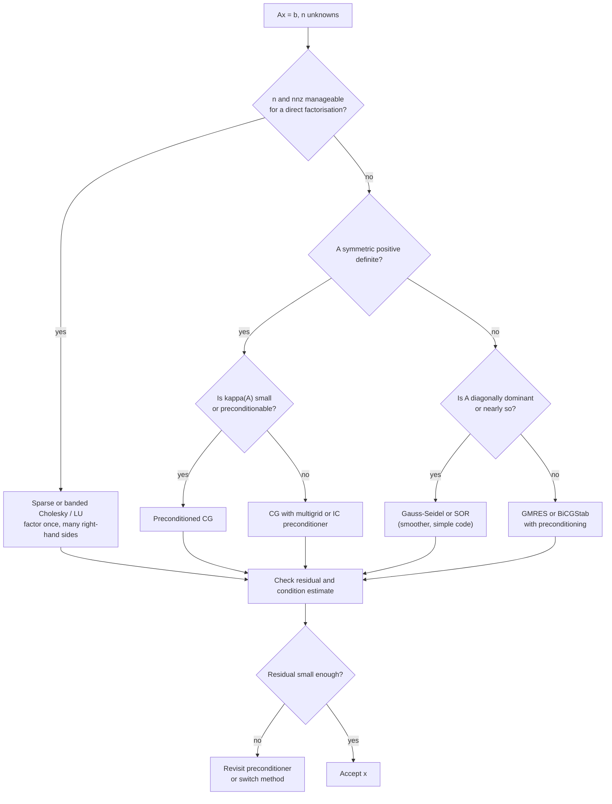

# Iterative Methods for Linear Systems

> [Mathematics](../../README.md) › [Numerical Analysis](../README.md) · Level: Advanced · Prerequisites: [Systems of Linear Equations](../../08-linear-algebra/03-systems-of-linear-equations/README.md), [Matrices](../../08-linear-algebra/02-matrices/README.md), [Eigenvalues and Eigenvectors](../../08-linear-algebra/07-eigenvalues-and-eigenvectors/README.md), [Inner Product Spaces](../../08-linear-algebra/08-inner-product-spaces/README.md), [Floating-Point Arithmetic](../01-floating-point-arithmetic/README.md), [Root Finding](../02-root-finding/README.md) · Estimated time: 480 min

## 1. Introduction

Solving $Ax = b$ is the most common computation in applied mathematics. For a dense $n\times n$ matrix
the textbook answer is Gaussian elimination with partial pivoting, at a cost of about $\tfrac23n^3$
floating-point operations. That answer is correct and, for $n$ up to a few thousand, entirely practical.
It is also, for the problems that matter most in practice, often the wrong algorithm.

The reason is that the matrices of scientific computing are almost always **sparse** and **large**.
Discretising a partial differential equation on a three-dimensional grid with $100$ points per side
produces $n = 10^{6}$ unknowns and a matrix with $7$ nonzeros per row — $7\times10^{6}$ stored numbers
instead of $10^{12}$. Gaussian elimination on such a matrix does not merely cost $\tfrac23n^{3} \approx
6.7\times10^{17}$ operations; it destroys the sparsity, filling the factors with entries that were zero in
$A$. **Iterative methods** avoid this: they touch the matrix only through matrix–vector products, so they
never alter it, they need storage proportional to the nonzeros, and — with luck and a good preconditioner
— they converge in far fewer than $n$ steps.

This chapter develops the theory and practice of iterative solvers.

1. **Why and when.** Sections 7.1–7.4 quantify the failure of direct methods and develop the two tools
   that govern every iterative method: **norms** and the **condition number**, including the derived error
   bound $\lVert\delta x\rVert/\lVert x\rVert \le \kappa(A)\lVert\delta b\rVert/\lVert b\rVert$.
2. **Stationary iterations.** Sections 7.5–7.9 present the classical methods — Jacobi, Gauss–Seidel and
   successive over-relaxation — as **splittings** $A = M - N$, with convergence governed by the spectral
   radius of the iteration matrix. The spectral-radius criterion is proved in both directions, and
   convergence is proved for strictly diagonally dominant matrices.
3. **Krylov methods.** Sections 7.10–7.12 derive the **conjugate gradient method** as minimisation of the
   energy norm over Krylov subspaces, prove that it terminates in at most $n$ steps in exact arithmetic,
   and derive the convergence bound $2\bigl((\sqrt\kappa-1)/(\sqrt\kappa+1)\bigr)^{k}$. Section 7.13
   treats preconditioning, Section 7.14 the idea behind **GMRES** for nonsymmetric problems.
4. **Judgement.** Sections 7.15–7.16 compare iterative methods with LU factorisation, give the cost
   analysis, and apply everything to discretised partial differential equations, where the condition
   number grows like $h^{-2}$ and the choice of method decides whether a computation takes seconds or
   days.

Every numerical claim in this chapter was checked by computation; the tables of iteration counts in
Section 7.16 and the condition numbers in Section 9.4 are measured output, not estimates.

## 2. Prerequisites

**Linear systems, Gaussian elimination, LU factorisation.** The cost model and the comparison in Section
7.15 are statements about elimination. See
[Systems of Linear Equations](../../08-linear-algebra/03-systems-of-linear-equations/README.md).

**Matrices, matrix–vector products, transpose and conjugate transpose.** Every iterative method is a
sequence of matrix–vector products and vector operations. See
[Matrices](../../08-linear-algebra/02-matrices/README.md).

**Eigenvalues, eigenvalues of symmetric matrices, diagonalisation.** Convergence is decided by the
spectrum of the iteration matrix; the Rayleigh quotient and the spectral theorem for symmetric matrices
are used throughout. See
[Eigenvalues and Eigenvectors](../../08-linear-algebra/07-eigenvalues-and-eigenvectors/README.md).

**Inner products, orthogonality, positive definiteness, norms from inner products.** The conjugate
gradient method lives in the geometry of the $A$-inner product and the energy norm. See
[Inner Product Spaces](../../08-linear-algebra/08-inner-product-spaces/README.md).

**Floating-point arithmetic and roundoff.** All bounds in this chapter are exact-arithmetic statements;
how they degrade in floating point, and why "converged" must be measured by a residual, is discussed in
[Floating-Point Arithmetic](../01-floating-point-arithmetic/README.md).

**Fixed-point iteration and contraction mappings.** Stationary iterations are fixed-point iterations, and
the contraction argument is the model for the spectral-radius theorem. See
[Root Finding](../02-root-finding/README.md).

## 3. Learning Objectives

By the end of this tutorial you will be able to: explain when direct factorisation is impractical; compute
vector and matrix norms and the condition number, and derive and apply the error bound for $Ax=b$;
formulate Jacobi, Gauss–Seidel and SOR as splittings, compute their iteration matrices, and decide
convergence from the spectral radius; prove the spectral-radius criterion and the convergence of Jacobi
and Gauss–Seidel for strictly diagonally dominant matrices; choose an over-relaxation parameter and
explain its optimal value for the Poisson model problem; derive the conjugate gradient method from the
Krylov-subspace minimisation principle, prove finite termination, and use the $\sqrt\kappa$ convergence
bound; describe preconditioning and GMRES; and compare iterative and direct methods by cost and storage
for discretised PDEs.

## 4. Intuition

**The wrong tool for the right job.** Direct elimination treats a matrix as an arbitrary array of
numbers. But a matrix from a physical model is not arbitrary: entry $(i,j)$ is nonzero only when unknowns
$i$ and $j$ interact, and each unknown interacts with a handful of neighbours. Elimination has no way of
knowing this, and it pays for it twice — once in work, once in memory. An iterative method does know it:
it only ever asks "given a vector, compute $A$ times it".

**Iteration as successive correction.** Write the equation as a fixed point. If $A = M - N$ with $M$
easy to invert, then $Ax = b$ is equivalent to $x = M^{-1}(Nx + b)$, and the iteration
$x_{k+1} = M^{-1}(Nx_k + b)$ computes a new guess from the old one. Jacobi takes $M$ to be the diagonal of
$A$: each equation is solved for its own unknown using the previous values of all the others. Gauss–Seidel
takes $M$ to be the lower triangle: as soon as a new component is computed, it is used in the following
equations. Each step is cheap, and — if the splitting captures enough of $A$ — the error contracts
geometrically.

**Why the spectral radius and not the norm?** The error after $k$ steps is $B^{k}e_0$. A matrix norm
bounds how much $B$ can stretch a vector, so $\lVert B\rVert < 1$ guarantees contraction. But a contraction
factor slightly above $1$ in one norm may still decay: the true asymptotic rate is the spectral radius
$\rho(B) = \max\lvert\lambda_i\rvert$, because $B^{k}$ grows like $\rho^{k}$ times a polynomial (Jordan
blocks). Section 7.6 makes this precise. The gap between norm and spectral radius is real: the nilpotent
matrix $\begin{pmatrix}0&1\\0&0\end{pmatrix}$ has norm $1$ and spectral radius $0$.

**Krylov: use the matrix, not its inverse.** Suppose one starts with a guess $x_0$ and computes
$r_0 = b - Ax_0$, then $Ar_0$, $A^2r_0$, and so on. These vectors record how the error propagates. The
space they span is the *Krylov subspace*; it is the best set of directions the matrix itself can offer. The
conjugate gradient method chooses, among all corrections in that subspace, the one that minimises the
energy norm of the error. Nothing is factorised; the matrix is touched once per step; and because
$\mathbb{R}^{n}$ has dimension $n$, the process must find the exact answer in at most $n$ steps in exact
arithmetic. In floating point it usually takes fewer, sometimes many more — which is what preconditioning
is for.

**A picture.** Solve $Ax = b$ for a symmetric positive definite $A$ is the same as minimising the
quadratic bowl $\varphi(x) = \tfrac12 x^{\mathsf{T}}Ax - b^{\mathsf{T}}x$. Steepest descent walks downhill
perpendicular to the level sets and zig-zags badly when the bowl is a narrow valley (large condition
number). Conjugate gradients picks directions that are $A$-orthogonal, so each step does not spoil the
progress of earlier ones, and the zig-zag disappears. The shape of the valley is measured by
$\kappa(A)$ — the ratio of the axes of the ellipsoidal level sets.

## 5. Formal Definition

Throughout, $A \in \mathbb{R}^{n\times n}$ is nonsingular, $b \in \mathbb{R}^{n}$, and $x$ denotes the
exact solution of $Ax = b$. We write $\lVert\cdot\rVert$ for a norm on $\mathbb{R}^{n}$, and the same
symbol for the induced matrix norm of Definition 5.6.

**Definition 5.1 (Vector norm).** A *norm* on $\mathbb{R}^{n}$ is a map
$\lVert\cdot\rVert : \mathbb{R}^{n}\to[0,\infty)$ with

$$\lVert x\rVert = 0 \iff x = 0,\qquad \lVert\alpha x\rVert = \lvert\alpha\rvert\,\lVert x\rVert,\qquad
\lVert x+y\rVert\le\lVert x\rVert+\lVert y\rVert .$$

The three standard examples are

$$\lVert x\rVert_1 = \sum_{i=1}^{n}\lvert x_i\rvert,\qquad
\lVert x\rVert_2 = \Bigl(\sum_{i=1}^{n}x_i^{2}\Bigr)^{1/2},\qquad
\lVert x\rVert_\infty = \max_{1\le i\le n}\lvert x_i\rvert .$$

**Definition 5.2 (Induced matrix norm).** For $A\in\mathbb{R}^{m\times n}$,

$$\lVert A\rVert := \max_{x\ne0}\frac{\lVert Ax\rVert}{\lVert x\rVert}
= \max_{\lVert x\rVert = 1}\lVert Ax\rVert .$$

The maximum is attained because the unit sphere is compact. The *Frobenius norm*
$\lVert A\rVert_F = \bigl(\sum_{ij}a_{ij}^{2}\bigr)^{1/2}$ is a matrix norm that is **not** induced by a
vector norm.

**Definition 5.3 (Spectral radius).** For $B\in\mathbb{R}^{n\times n}$ with eigenvalues
$\lambda_1,\dots,\lambda_n$ (over $\mathbb{C}$),

$$\rho(B) := \max_{1\le i\le n}\lvert\lambda_i\rvert .$$

**Definition 5.4 (Condition number).** For a nonsingular $A$ and an induced norm,

$$\kappa(A) := \lVert A\rVert\,\lVert A^{-1}\rVert .$$

When the norm is $\lVert\cdot\rVert_p$ we write $\kappa_p(A)$; $\kappa_2(A)$ is the *spectral condition
number*.

**Definition 5.5 (Splitting and stationary iteration).** A *splitting* of $A$ is a decomposition
$A = M - N$ with $M$ nonsingular. It defines the *stationary iteration*

$$M x_{k+1} = N x_k + b, \qquad\text{i.e.}\qquad x_{k+1} = B x_k + M^{-1}b,
\qquad B := M^{-1}N = I - M^{-1}A .$$

$B$ is the *iteration matrix*. The iteration is *consistent* with $Ax = b$: if $x_k = x$ then
$x_{k+1} = M^{-1}(Nx+b) = M^{-1}(Ax) = x$, so the exact solution is a fixed point.

**Definition 5.6 (Convergence).** The iteration converges if $x_k\to x$ for **every** initial vector $x_0$
and every right-hand side $b$. Equivalently, writing $e_k = x - x_k$ for the error,

$$e_k = B^{k}e_0 \quad\text{and}\quad \text{convergence} \iff B^{k}\to0 \text{ entrywise}.$$

**Definition 5.7 (Krylov subspace).** For $A$ and $r_0 \in \mathbb{R}^{n}$,

$$\mathcal{K}_k(A, r_0) := \operatorname{span}\{r_0, Ar_0, A^{2}r_0,\dots,A^{k-1}r_0\},
\qquad \mathcal{K}_0 := \{0\}.$$

Krylov methods choose $x_k \in x_0 + \mathcal{K}_k(A,r_0)$, so the iterates are determined by $k$
matrix–vector products.

**Definition 5.8 (Energy norm and $A$-conjugacy).** For symmetric positive definite $A$, the *energy norm*
(or $A$-norm) is $\lVert v\rVert_A := (v^{\mathsf{T}}Av)^{1/2}$. Vectors $p,q$ are *$A$-conjugate* (or
$A$-orthogonal) if $p^{\mathsf{T}}Aq = 0$.

**Definition 5.9 (Residual).** The *residual* of an approximate solution $\tilde x$ is
$r = b - A\tilde x$. The error and the residual are related by $A e = r$, so a small residual means a
small error only when $A$ is well conditioned: $\lVert e\rVert\le\lVert A^{-1}\rVert\lVert r\rVert$.

## 6. Mathematical Notation

| Symbol | Read as | Meaning |
|---|---|---|
| $\lVert x\rVert_p$ | "$p$-norm of $x$" | $\bigl(\sum_i\lvert x_i\rvert^{p}\bigr)^{1/p}$; $p = 1,2,\infty$ |
| $\lVert A\rVert$ | "norm of $A$" | induced norm $\max_{\lVert x\rVert=1}\lVert Ax\rVert$ |
| $\lVert A\rVert_F$ | "Frobenius norm" | $\bigl(\sum_{ij}a_{ij}^{2}\bigr)^{1/2}$ |
| $\rho(B)$ | "spectral radius of $B$" | $\max_i\lvert\lambda_i(B)\rvert$ |
| $\kappa(A)$ | "condition number of $A$" | $\lVert A\rVert\lVert A^{-1}\rVert$ |
| $\sigma_{\max},\sigma_{\min}$ | "largest, smallest singular value" | eigenvalues of $(A^{\mathsf{T}}A)^{1/2}$ |
| $A = M - N$ | "splitting of $A$" | $M$ the easily invertible part |
| $B = M^{-1}N$ | "iteration matrix" | governs the error by $e_k = B^{k}e_0$ |
| $D, L, U$ | "diagonal, strictly lower, strictly upper part" | $A = D - L - U$, with $L,U$ the negatives of the off-diagonal triangles |
| $B_J, B_{GS}, B_\omega$ | "Jacobi, Gauss–Seidel, SOR iteration matrix" | $B_J = D^{-1}(L+U)$, etc. |
| $\omega$ | "omega" | relaxation parameter of SOR |
| $\mathcal{K}_k(A,r_0)$ | "Krylov space of dimension $k$" | $\operatorname{span}\{r_0,Ar_0,\dots,A^{k-1}r_0\}$ |
| $r_k$ | "residual at step $k$" | $b - Ax_k$ |
| $e_k$ | "error at step $k$" | $x - x_k$, with $Ae_k = r_k$ |
| $\alpha_k,\beta_k$ | "alpha, beta" | step length and direction-update scalars in CG |
| $p_k$ | "$p$ sub $k$" | search direction in CG |
| $\lVert v\rVert_A$ | "energy norm of $v$" | $(v^{\mathsf{T}}Av)^{1/2}$, for SPD $A$ |
| $\varepsilon_{\text{tol}}$ | "tolerance" | stopping threshold on $\lVert r_k\rVert/\lVert b\rVert$ |
| $\mathrm{fl}(\cdot)$ | "floating-point value of" | computed approximation in finite precision |
| $h$ | "mesh width" | grid spacing of a discretisation |

A convention used throughout: in the splitting $A = D - L - U$, the matrices $L$ and $U$ are the
*negatives* of the strictly lower and strictly upper triangular parts, so that $A = D - L - U$ holds and,
for the matrices of Section 7.16 (positive diagonal, nonpositive off-diagonals), $L$ and $U$ have
nonnegative entries. Thus $B_J = D^{-1}(L+U)$ and $B_{GS} = (D-L)^{-1}U$.

## 7. Core Concepts

### 7.1 Why direct methods can be impractical

Gaussian elimination with partial pivoting on a dense $n\times n$ matrix costs about $\tfrac23n^{3}$
flops and $n^{2}$ storage. Both scale badly:

* $n = 10^{4}$: about $6.7\times10^{11}$ flops and $8\times10^{8}$ bytes for the matrix — a second or
  two on a laptop, and routine.
* $n = 10^{6}$: about $6.7\times10^{17}$ flops and $8\times10^{12}$ bytes — years of work and 8 TB of
  memory. A three-dimensional grid with $100$ points per side already has $n = 10^{6}$.

Worse, elimination **destroys sparsity**. If $A$ has nonzeros only near the diagonal, the factors $L$ and
$U$ generally have far more: the *fill-in*. For a two-dimensional grid with $m$ points per side
($n = m^{2}$), banded elimination has bandwidth $m$ and costs $O(nm^{2}) = O(n^{2})$ flops, and $O(nm) =
O(n^{3/2})$ storage. Nested-dissection ordering reduces the two-dimensional cost to $O(n^{3/2})$ flops and
$O(n\log n)$ storage, and in three dimensions to $O(n^{2})$ flops. Sparse direct solvers are excellent —
but their cost still grows faster than the number of unknowns, and their memory eventually exceeds the
machine.

An iterative method pays $O(\text{nnz})$ per step, where nnz is the number of nonzeros, and never forms a
factor. For the three-dimensional grid above, nnz $= 7n = 7\times10^{6}$ and a matrix–vector product costs
$1.4\times10^{7}$ flops; a hundred iterations cost $1.4\times10^{9}$ flops, seconds rather than years. The
trade-off is that convergence is no longer guaranteed by the algorithm alone: it depends on the matrix,
and that is what the rest of this chapter quantifies.

### 7.2 Vector norms

**Proposition 7.1 (Norm inequalities).** For every $x\in\mathbb{R}^{n}$,

$$\lVert x\rVert_\infty \le \lVert x\rVert_2 \le \lVert x\rVert_1 \le \sqrt n\,\lVert x\rVert_2
\le n\,\lVert x\rVert_\infty, \qquad \lVert x\rVert_2\le\sqrt n\,\lVert x\rVert_\infty .$$

*Proof.* The middle inequality holds because $\sum x_i^{2}\le\bigl(\sum\lvert x_i\rvert\bigr)^{2}$ for
nonnegative terms. For the last, $\lVert x\rVert_2^{2} = \sum x_i^{2}\le n\max_i x_i^{2} =
n\lVert x\rVert_\infty^{2}$. For the first, $\max_i\lvert x_i\rvert^{2}\le\sum_i x_i^{2}$. And
$\lVert x\rVert_1^{2} = \bigl(\sum_i\lvert x_i\rvert\bigr)^{2}\le n\sum_i x_i^{2}$ by Cauchy–Schwarz
applied to the vectors $(\lvert x_i\rvert)$ and $(1,\dots,1)$. $\square$

The constants are sharp: $x = (1,0,\dots,0)$ gives $\lVert x\rVert_1 = \lVert x\rVert_2 =
\lVert x\rVert_\infty$; $x = (1,\dots,1)$ gives $\lVert x\rVert_1 = \sqrt n\lVert x\rVert_2 =
n\lVert x\rVert_\infty$.

**Theorem 7.2 (Equivalence of norms).** On a finite-dimensional space all norms are equivalent: for any
two norms there are constants $c, C > 0$ with $c\lVert x\rVert_a \le \lVert x\rVert_b\le C\lVert x\rVert_a$
for all $x$.

*Proof.* It suffices to compare an arbitrary norm $\lVert\cdot\rVert$ with $\lVert\cdot\rVert_1$. Upper
bound: $\lVert x\rVert\le\sum_i\lvert x_i\rvert\lVert e_i\rVert\le C\lVert x\rVert_1$ with
$C = \max_i\lVert e_i\rVert$. Lower bound: the function $x\mapsto\lVert x\rVert$ is continuous for the
$1$-norm, since $\bigl\lvert\lVert x\rVert-\lVert y\rVert\bigr\rvert\le\lVert x-y\rVert\le C\lVert x-y
\rVert_1$; on the compact set $\{\lVert x\rVert_1 = 1\}$ it attains a positive minimum $c$. Scaling gives
the result. $\square$

The practical content: convergence in one norm is convergence in every norm; only the rate constants
change. Section 7.6 exploits this when it passes from the spectral radius to a convenient norm.

### 7.3 Matrix norms

**Theorem 7.3 (Explicit formulas).** For $A\in\mathbb{R}^{m\times n}$,

$$\lVert A\rVert_1 = \max_{1\le j\le n}\sum_{i=1}^{m}\lvert a_{ij}\rvert \quad(\text{largest column sum}),
\qquad
\lVert A\rVert_\infty = \max_{1\le i\le m}\sum_{j=1}^{n}\lvert a_{ij}\rvert \quad(\text{largest row sum}),$$

and $\lVert A\rVert_2 = \sigma_{\max}(A) = \sqrt{\rho(A^{\mathsf{T}}A)}$.

*Proof.* For the $1$-norm,
$\lVert Ax\rVert_1 = \sum_i\bigl\lvert\sum_j a_{ij}x_j\bigr\rvert\le\sum_j\lvert x_j\rvert\sum_i\lvert a_{ij}
\rvert\le\bigl(\max_j\sum_i\lvert a_{ij}\rvert\bigr)\lVert x\rVert_1$, and equality is attained by
putting all mass of $x$ on a column attaining the maximum. The $\infty$-norm argument is the same with rows
and columns exchanged. For the $2$-norm,
$\lVert Ax\rVert_2^{2} = x^{\mathsf{T}}A^{\mathsf{T}}Ax\le\lambda_{\max}(A^{\mathsf{T}}A)\lVert x
\rVert_2^{2}$ because $A^{\mathsf{T}}A$ is symmetric positive semidefinite and diagonalisable in an
orthonormal basis, and equality holds at a unit eigenvector of $\lambda_{\max}$. $\square$

**Proposition 7.4 (Basic properties).** Induced norms are *submultiplicative* and consistent:

$$\lVert AB\rVert\le\lVert A\rVert\,\lVert B\rVert,\qquad \lVert Ax\rVert\le\lVert A\rVert\,\lVert x\rVert,
\qquad \lVert I\rVert = 1 .$$

Moreover $\lVert A\rVert_2\le\lVert A\rVert_F\le\sqrt n\lVert A\rVert_2$ and
$\lVert A\rVert_2\le\sqrt{\lVert A\rVert_1\lVert A\rVert_\infty}$.

*Proof.* Submultiplicativity follows from $\lVert ABx\rVert\le\lVert A\rVert\lVert Bx\rVert\le
\lVert A\rVert\lVert B\rVert\lVert x\rVert$. For the Frobenius comparison, $\lVert A\rVert_2^{2} =
\sigma_{\max}^{2}$ while $\lVert A\rVert_F^{2} = \sum_i\sigma_i^{2}$, which lies between
$\sigma_{\max}^{2}$ and $n\sigma_{\max}^{2}$. For the last bound,
$\lVert A\rVert_2^{2} = \rho(A^{\mathsf{T}}A)\le\lVert A^{\mathsf{T}}A\rVert_\infty\le
\lVert A^{\mathsf{T}}\rVert_\infty\lVert A\rVert_\infty = \lVert A\rVert_1\lVert A\rVert_\infty$, using
submultiplicativity and the explicit formula for the $\infty$-norm. $\square$

**Proposition 7.5 (Spectral radius versus norm).** For every induced norm and every square matrix,

$$\rho(A)\le\lVert A\rVert .$$

Consequently $A^{k}\to0$ if $\lVert A\rVert < 1$.

*Proof.* Let $\lambda$ be an eigenvalue with eigenvector $x\ne0$. Then
$\lvert\lambda\rvert\lVert x\rVert = \lVert\lambda x\rVert = \lVert Ax\rVert\le\lVert A\rVert\lVert x
\rVert$, and divide by $\lVert x\rVert$. If $\lVert A\rVert < 1$ then
$\lVert A^{k}\rVert\le\lVert A\rVert^{k}\to0$, so $A^{k}\to0$ entrywise. $\square$

The inequality is strict in general: $A = \begin{pmatrix}0&1\\0&0\end{pmatrix}$ has $\rho(A) = 0$ and
$\lVert A\rVert_2 = \lVert A\rVert_\infty = 1$. This example is the reason Section 7.6 needs a subtler
argument than "take a norm".

### 7.4 The condition number and the error bound

The condition number measures how much a relative change in the data can be amplified in the solution.
The following theorem is the fundamental statement.

**Theorem 7.6 (Perturbation of the right-hand side).** Let $Ax = b$ and $A(x+\delta x) = b+\delta b$ with
$A$ nonsingular. Then, for every induced norm,

$$\frac{\lVert\delta x\rVert}{\lVert x\rVert}\le\kappa(A)\frac{\lVert\delta b\rVert}{\lVert b\rVert},
\qquad \kappa(A) = \lVert A\rVert\lVert A^{-1}\rVert .$$

*Proof.* Subtracting the two equations gives $A\,\delta x = \delta b$, hence
$\delta x = A^{-1}\delta b$ and

$$\lVert\delta x\rVert\le\lVert A^{-1}\rVert\,\lVert\delta b\rVert .$$

On the other hand $b = Ax$ gives $\lVert b\rVert\le\lVert A\rVert\lVert x\rVert$, i.e.
$\lVert x\rVert^{-1}\le\lVert A\rVert/\lVert b\rVert$. Multiplying the two inequalities,

$$\frac{\lVert\delta x\rVert}{\lVert x\rVert}\le\lVert A^{-1}\rVert\lVert\delta b\rVert\cdot
\frac{\lVert A\rVert}{\lVert b\rVert} = \kappa(A)\frac{\lVert\delta b\rVert}{\lVert b\rVert} . \qquad\square$$

**Theorem 7.7 (Perturbation of the matrix).** Let $Ax = b$ and $(A+\delta A)(x+\delta x) = b+\delta b$,
with $\kappa(A)\lVert\delta A\rVert/\lVert A\rVert < 1$. Then

$$\frac{\lVert\delta x\rVert}{\lVert x\rVert}\le
\frac{\kappa(A)}{1-\kappa(A)\lVert\delta A\rVert/\lVert A\rVert}
\Bigl(\frac{\lVert\delta A\rVert}{\lVert A\rVert}+\frac{\lVert\delta b\rVert}{\lVert b\rVert}\Bigr).$$

*Proof.* Expand: $A\delta x = \delta b - \delta A\,(x+\delta x)$, so
$\delta x = A^{-1}\delta b - A^{-1}\delta A\,(x+\delta x)$ and

$$\lVert\delta x\rVert\le\lVert A^{-1}\rVert\lVert\delta b\rVert
+\lVert A^{-1}\rVert\lVert\delta A\rVert\bigl(\lVert x\rVert+\lVert\delta x\rVert\bigr).$$

Move the last term to the left:
$\lVert\delta x\rVert\bigl(1-\lVert A^{-1}\rVert\lVert\delta A\rVert\bigr)\le
\lVert A^{-1}\rVert\bigl(\lVert\delta b\rVert+\lVert\delta A\rVert\lVert x\rVert\bigr)$, and divide by
the bracket and by $\lVert x\rVert$, using $\lVert b\rVert\le\lVert A\rVert\lVert x\rVert$ for the term
$\lVert\delta b\rVert$. $\square$

**Proposition 7.8 (Properties).** For nonsingular $A$ and any induced norm: $\kappa(A)\ge1$;
$\kappa(\alpha A) = \kappa(A)$ for scalars $\alpha\ne0$; and in the $2$-norm,
$\kappa_2(A) = \sigma_{\max}/\sigma_{\min}$, which for symmetric positive definite $A$ equals
$\lambda_{\max}/\lambda_{\min}$ and for normal $A$ equals the ratio of extreme eigenvalue moduli.
Moreover $\kappa_2(A^{\mathsf{T}}A) = \kappa_2(A)^{2}$.

*Proof.* $1 = \lVert I\rVert = \lVert AA^{-1}\rVert\le\lVert A\rVert\lVert A^{-1}\rVert$; homogeneity is
immediate. Since $\sigma_i(A^{-1}) = 1/\sigma_{\min\text{-to-}\max}$ in reverse order,
$\kappa_2(A) = \sigma_{\max}(A)/\sigma_{\min}(A)$; for normal $A$ the singular values are the eigenvalue
moduli. Finally $A^{\mathsf{T}}A$ has singular values $\sigma_i^{2}$, so
$\kappa_2(A^{\mathsf{T}}A) = \sigma_{\max}^{2}/\sigma_{\min}^{2}$. $\square$

**Example 7.9 (A small system that loses everything).** Let

$$A = \begin{pmatrix}1&1\\1&1.0001\end{pmatrix},\qquad b = \begin{pmatrix}2\\2.0001\end{pmatrix},
\qquad x = \begin{pmatrix}1\\1\end{pmatrix}.$$

Then $\kappa_\infty(A) = 4.0004\times10^{4}$. Perturbing $b$ by $\delta b = (0,\,10^{-4})$, a relative
change of $\lVert\delta b\rVert_\infty/\lVert b\rVert_\infty = 10^{-4}/2.0001 \approx 5.0\times10^{-5}$,
gives $x+\delta x \approx (0,\,2)$, i.e. $\lVert\delta x\rVert_\infty/\lVert x\rVert_\infty = 1$: a change
in the fifth decimal place of the data destroys the answer. The bound predicts at most
$4.0004\times10^{4}\cdot5.0\times10^{-5}\approx2.0$, and the observed ratio is $1.0$ — the bound holds and
is within a factor of two. The bound is sharp in general: it is approached when $b$ is aligned with the
direction of maximal gain of $A$ and $\delta b$ with the direction of minimal gain.

**Example 7.10 (Hilbert matrices).** The Hilbert matrix $H_n$ with entries $1/(i+j-1)$ is the standard
ill-conditioned test matrix. Computed spectral condition numbers:

| $n$ | 3 | 4 | 5 | 6 | 8 | 10 |
|---|---|---|---|---|---|---|
| $\kappa_2(H_n)$ | $5.24\times10^{2}$ | $1.55\times10^{4}$ | $4.77\times10^{5}$ | $1.50\times10^{7}$ | $1.53\times10^{10}$ | $1.60\times10^{13}$ |

In double precision (unit roundoff $u\approx1.1\times10^{-16}$) the rule of thumb "lose
$\log_{10}\kappa$ digits" predicts about $2$, $4$, $6$, $7$, $10$ and $13$ lost digits respectively — which
is why $H_{12}$ and beyond cannot be inverted reliably in double precision at all.

The rule of thumb is a corollary of Theorem 7.6 applied to the computed solution with $\delta b$ of size
$u\lVert A\rVert\lVert x\rVert$: the relative error is then about $\kappa(A)u$.

### 7.5 Splittings and the error equation

A splitting $A = M - N$ turns $Ax = b$ into the fixed-point equation $x = M^{-1}(Nx + b)$. Subtracting
the iteration from the identity $x = M^{-1}(Nx+b)$ gives the **error equation**

$$e_{k+1} = B e_k, \qquad B = M^{-1}N = I - M^{-1}A.$$

So the error is $e_k = B^{k}e_0$, and everything depends on the powers of one matrix.

**Example 7.11 (The four classical splittings).** With $A = D - L - U$ as in Section 6:

| method | $M$ | $B = M^{-1}N$ | cost per step |
|---|---|---|---|
| Richardson | $\tfrac1\omega I$ | $I - \omega A$ | one matvec |
| Jacobi | $D$ | $D^{-1}(L+U)$ | one matvec, fully parallel |
| Gauss–Seidel | $D-L$ | $(D-L)^{-1}U$ | one triangular solve, sequential |
| SOR | $\tfrac1\omega D - L$ | $(D-\omega L)^{-1}\bigl((1-\omega)D+\omega U\bigr)$ | one triangular solve |

Each is consistent (Definition 5.5): the exact solution is a fixed point, so the iteration can only fail
by not converging, never by converging to something else.

**Lemma 7.12.** For $B\in\mathbb{R}^{n\times n}$, the following are equivalent: (i) $B^{k}\to0$ entrywise;
(ii) $B^{k}x\to0$ for every $x$; (iii) $\rho(B) < 1$.

*Proof.* (iii) $\Rightarrow$ (i): by the Jordan normal form over $\mathbb{C}$, $B = PJP^{-1}$ with $J$ a
direct sum of blocks $\lambda I + N$ with $N$ nilpotent. Then $J^{k}$ has entries
$\binom{k}{j}\lambda^{k-j}$ for $j < $ block size, and $\binom{k}{j}\lambda^{k-j}\to0$ whenever
$\lvert\lambda\rvert < 1$, because the binomial coefficient grows polynomially while $\lvert\lambda\rvert^{k}$
decays geometrically. Hence $J^{k}\to0$ and so $B^{k}\to0$.

(i) $\Rightarrow$ (ii): immediate.

(ii) $\Rightarrow$ (iii): let $\lambda$ be an eigenvalue with eigenvector $v\ne0$. Then
$B^{k}v = \lambda^{k}v\to0$ forces $\lvert\lambda\rvert < 1$; as $\lambda$ was arbitrary,
$\rho(B) < 1$. $\square$

**Lemma 7.13 (Norms arbitrarily close to the spectral radius).** For every $B$ and every $\varepsilon>0$
there is a norm with $\lVert B\rVert\le\rho(B)+\varepsilon$.

*Proof.* By Schur's theorem, $B = QTQ^{*}$ with $Q$ unitary and $T$ upper triangular. For
$\delta>0$ put $D_\delta = \operatorname{diag}(1,\delta,\delta^{2},\dots,\delta^{n-1})$ and define
$\lVert x\rVert := \lVert D_\delta Q^{*}x\rVert_2$. Then

$$\lVert B\rVert = \lVert D_\delta T D_\delta^{-1}\rVert_2,$$

whose entries are $t_{ij}\delta^{i-j}$ for $i\le j$ and $0$ below the diagonal. The diagonal entries are
the eigenvalues, and the off-diagonal ones tend to $0$ as $\delta\to0$; hence for $\delta$ small enough
$\lVert D_\delta TD_\delta^{-1}\rVert_2\le\rho(B)+\varepsilon$. $\square$

### 7.6 The spectral radius criterion

**Theorem 7.14.** The stationary iteration $x_{k+1} = Bx_k + M^{-1}b$ converges for every initial vector
if and only if $\rho(B) < 1$. In that case the asymptotic rate is governed by $\rho(B)$:

$$\lVert e_k\rVert^{1/k}\longrightarrow \rho(B)\quad\text{for generic } e_0,$$

and for every $\varepsilon>0$ there is a norm with $\lVert e_k\rVert\le(\rho(B)+\varepsilon)^{k}
\lVert e_0\rVert$.

*Proof.* ($\Leftarrow$) If $\rho(B) < 1$, choose $\varepsilon>0$ with $\rho(B)+\varepsilon<1$ and the norm
of Lemma 7.13. Then $\lVert e_k\rVert = \lVert B^{k}e_0\rVert\le\lVert B\rVert^{k}\lVert e_0\rVert\le
(\rho+\varepsilon)^{k}\lVert e_0\rVert\to0$ for every $e_0$.

($\Rightarrow$) Suppose $\rho(B)\ge1$ and pick an eigenvalue $\lambda$ with $\lvert\lambda\rvert\ge1$ and
eigenvector $v$. Taking $x_0 = x - v$ (so $e_0 = v$) gives $e_k = \lambda^{k}v$, whose norm is
$\lvert\lambda\rvert^{k}\lVert v\rVert\ge\lVert v\rVert$ for all $k$: the iteration does not converge for
this initial vector. $\square$

Two practical corollaries. First, **any** norm bound $\lVert B\rVert<1$ in **any** induced norm proves
convergence (Proposition 7.5), and this is how the results below are proved; the spectral radius is the
sharp criterion, but a norm is easier to compute. Second, $\rho(B)$ also describes the *rate*: to reduce
the error by $10^{-p}$ one needs about $p/\log_{10}(1/\rho)$ iterations, which is why a spectral radius of
$0.99$ means hundreds of iterations and $0.5$ means a handful.

### 7.7 Jacobi iteration

**Derivation.** Solve the $i$-th equation for $x_i$ and evaluate everything else at the previous iterate:

$$x_i^{(k+1)} = \frac{1}{a_{ii}}\Bigl(b_i - \sum_{j\ne i}a_{ij}x_j^{(k)}\Bigr),
\qquad i = 1,\dots,n.$$

In matrix form $x_{k+1} = D^{-1}\bigl(b + (L+U)x_k\bigr)$, so $M = D$, $N = L+U$ and
$B_J = D^{-1}(L+U) = I - D^{-1}A$. All $n$ components are computed from the *same* old vector, so the
method vectorises perfectly.

**Theorem 7.15 (Jacobi converges for strictly diagonally dominant matrices).** Suppose

$$\lvert a_{ii}\rvert > \sum_{j\ne i}\lvert a_{ij}\rvert \qquad\text{for } i = 1,\dots,n .$$

Then $\rho(B_J)\le\lVert B_J\rVert_\infty = \max_i\frac{1}{\lvert a_{ii}\rvert}\sum_{j\ne i}\lvert
a_{ij}\rvert < 1$, so Jacobi converges for every initial vector.

*Proof.* The entries of $B_J = D^{-1}(L+U)$ are $-a_{ij}/a_{ii}$ for $j\ne i$ and $0$ on the diagonal, so
the $i$-th absolute row sum is exactly $\sum_{j\ne i}\lvert a_{ij}\rvert/\lvert a_{ii}\rvert < 1$. By
Theorem 7.3, $\lVert B_J\rVert_\infty$ is the largest of these, hence $<1$; by Proposition 7.5,
$\rho(B_J)\le\lVert B_J\rVert_\infty<1$; by Theorem 7.14 the iteration converges. $\square$

**Example 7.16 (A small system).** For

$$A = \begin{pmatrix}10&-1&2&0\\-1&11&-1&3\\2&-1&10&-1\\0&3&-1&8\end{pmatrix},
\qquad b = \begin{pmatrix}6\\25\\-11\\15\end{pmatrix},
\qquad x = (1,2,-1,1),$$

the absolute row sums of $B_J$ are $0.3,\ 0.4545,\ 0.4,\ 0.5$, so
$\lVert B_J\rVert_\infty = 0.5$ and Jacobi converges. The computed spectral radius is
$\rho(B_J) = 0.426437$, and ten iterations from $x_0 = 0$ give
$x_{10} = (1.000119,\ 1.999768,\ -0.999828,\ 0.999786)$ with error $2.32\times10^{-4}$ in the sup norm.

**Example 7.17 (The model problem).** For the one-dimensional Poisson matrix
$A = \operatorname{tridiag}(-1,2,-1)$ of order $N$ (Section 7.16), $B_J = \tfrac12
\operatorname{tridiag}(1,0,1)$ has eigenvalues $\cos(k\pi/(N+1))$, $k = 1,\dots,N$, so

$$\rho(B_J) = \cos\frac{\pi}{N+1} = \cos(\pi h), \qquad h = \frac{1}{N+1}.$$

For $N = 8$ this is $\cos(\pi/9) = 0.9396926$, confirmed numerically; the eigenvalues of $A$ itself are
$2-2\cos(k\pi/9) = 0.1206,\ 0.4679,\ 1,\ 1.6527,\ 2.3473,\ 3,\ 3.5321,\ 3.8794$, confirming
$\rho(B_J) = 1 - \lambda_{\min}(A)/2$.

### 7.8 Gauss–Seidel iteration

**Derivation.** Use each new component as soon as it is computed:

$$x_i^{(k+1)} = \frac{1}{a_{ii}}\Bigl(b_i - \sum_{j<i}a_{ij}x_j^{(k+1)} - \sum_{j>i}a_{ij}x_j^{(k)}\Bigr).$$

In matrix form $(D-L)x_{k+1} = b + Ux_k$, so $M = D - L$, $N = U$ and $B_{GS} = (D-L)^{-1}U$. The method
is sequential but needs no extra storage beyond $x$ and $b$; it is the standard smoother in multigrid.

**Theorem 7.18 (Gauss–Seidel converges for strictly diagonally dominant matrices).** Under the hypothesis
of Theorem 7.15, $\rho(B_{GS}) < 1$ and Gauss–Seidel converges for every initial vector.

*Proof.* Let $e_k$ be the error and write $e = e_k$, $e' = e_{k+1}$. From $(D-L)e' = Ue$ we get, for each
$i$,

$$a_{ii}e_i' = \sum_{j<i}a_{ij}e_j' + \sum_{j>i}a_{ij}e_j .$$

Put $\alpha_i = \sum_{j<i}\lvert a_{ij}\rvert$ and $\beta_i = \sum_{j>i}\lvert a_{ij}\rvert$, so that
$\alpha_i+\beta_i = r_i\lvert a_{ii}\rvert$ with $r_i<1$ by hypothesis. Choose $i$ with
$\lvert e_i'\rvert = \lVert e'\rVert_\infty$. Then

$$\lvert a_{ii}\rvert\,\lVert e'\rVert_\infty\le\alpha_i\lVert e'\rVert_\infty+\beta_i\lVert e\rVert_\infty
\;\Longrightarrow\;
\lVert e'\rVert_\infty\le\frac{\beta_i}{\lvert a_{ii}\rvert-\alpha_i}\lVert e\rVert_\infty ,$$

and the factor is $<1$ because $\lvert a_{ii}\rvert>\alpha_i+\beta_i$ gives
$\lvert a_{ii}\rvert-\alpha_i>\beta_i$. Hence with
$q := \max_i \beta_i/(\lvert a_{ii}\rvert-\alpha_i)<1$ we get
$\lVert e_k\rVert_\infty\le q^{k}\lVert e_0\rVert_\infty\to0$. $\square$

**Theorem 7.19 (Gauss–Seidel converges for symmetric positive definite matrices).** If $A$ is symmetric
positive definite, then $\rho(B_{GS})<1$.

*Proof.* Write $A = D - L - L^{\mathsf{T}}$ (symmetry means $U = L^{\mathsf{T}}$) with $D$ positive
diagonal. Put $u_k = e_k - e_{k+1}$; the error equation $(D-L)e_{k+1} = L^{\mathsf{T}}e_k$ gives
$(D-L)u_k = Ae_k$, and $e_{k+1} = e_k - u_k$. Hence

$$\lVert e_k\rVert_A^{2}-\lVert e_{k+1}\rVert_A^{2}
= e_k^{\mathsf{T}}Ae_k-(e_k-u_k)^{\mathsf{T}}A(e_k-u_k)
= 2u_k^{\mathsf{T}}Ae_k-u_k^{\mathsf{T}}Au_k .$$

Substituting $Ae_k = (D-L)u_k$ and $A = D-L-L^{\mathsf{T}}$,

$$2u_k^{\mathsf{T}}(D-L)u_k - u_k^{\mathsf{T}}(D-L-L^{\mathsf{T}})u_k
= u_k^{\mathsf{T}}(D-L)u_k + u_k^{\mathsf{T}}L^{\mathsf{T}}u_k = u_k^{\mathsf{T}}Du_k > 0,$$

because $u_k^{\mathsf{T}}(L-L^{\mathsf{T}})u_k = 0$ (a skew-symmetric quadratic form vanishes). So the
$A$-norm of the error is strictly decreasing unless $u_k = 0$, which happens only if $Ae_k = 0$, i.e.
$e_k = 0$. It follows that $\lVert e_k\rVert_A$ decreases to some $L\ge0$. If $L>0$ then the decrements
$u_k^{\mathsf{T}}Du_k\to0$, so $u_k\to0$ (as $D$ is positive definite), and passing to the limit in
$e_{k+1} = e_k - u_k$ together with the continuity of $B_{GS}$ gives $e_\infty = B_{GS}e_\infty$ for the
limit $e_\infty$. Then $(I - B_{GS})e_\infty = 0$, and $I - B_{GS} = (D-L)^{-1}A$ is invertible, so
$e_\infty = 0$ and $L = 0$. $\square$

**Theorem 7.20 (Rate relation for consistently ordered matrices).** If $A$ is *consistently ordered* — in
particular if $A$ is tridiagonal, or block tridiagonal with the same block structure — then every
eigenvalue $\mu$ of $B_J$ and every eigenvalue $\lambda$ of $B_{GS}$ are related by
$\lambda^{2} = \mu^{2}$, so

$$\rho(B_{GS}) = \rho(B_J)^{2}.$$

*Proof idea.* Consistent ordering means that the graph of the nonzeros can be two-coloured so that every
nonzero off-diagonal entry joins different colours; Jacobi's iteration then alternates between the two
colour classes, and a direct similarity argument (Young's theorem) yields the eigenvalue pairing. For
tridiagonal matrices the pairing can be checked explicitly by determinants. $\square$

Numerically: for the $4\times4$ system of Example 7.16, $\rho(B_J) = 0.426437$ and
$\rho(B_{GS}) = 0.089823 = 0.426437^{2}$ to six digits; for Poisson with $N = 8$,
$\rho(B_J) = 0.9396926$ and $\rho(B_{GS}) = 0.8830222 = \rho(B_J)^{2}$ exactly. Gauss–Seidel is indeed
about twice as fast as Jacobi in iteration count — but each iteration costs a triangular solve, so the
wall-clock gain is smaller.

The converse of Theorem 7.20 is false in general: there are matrices for which Jacobi diverges and
Gauss–Seidel converges. An example with integer entries is

$$A = \begin{pmatrix}2&-1&-1\\-1&2&1\\-1&2&2\end{pmatrix},\qquad
\rho(B_J) = \frac{1+\sqrt{13}}{4} = 1.1514,\qquad \rho(B_{GS}) = \frac12 .$$

Its characteristic polynomials are $(2\lambda-1)(4\lambda^{2}+2\lambda-3)/8$ and
$\lambda(2\lambda-1)(4\lambda-1)/8$ respectively, so the eigenvalues of $B_{GS}$ are $0,\tfrac12,\tfrac14$.
This matrix is *not* symmetric, which is why Theorem 7.20 does not apply.

### 7.9 Successive over-relaxation

Gauss–Seidel tends to move in the right direction but by too little. SOR takes the Gauss–Seidel step and
extrapolates beyond it by a factor $\omega$:

$$x_i^{(k+1)} = (1-\omega)x_i^{(k)} + \frac{\omega}{a_{ii}}
\Bigl(b_i - \sum_{j<i}a_{ij}x_j^{(k+1)} - \sum_{j>i}a_{ij}x_j^{(k)}\Bigr).$$

The matrix form is $M = \tfrac1\omega D - L$, $N = \bigl(\tfrac{1-\omega}{\omega}\bigr)D + U$, and

$$B_\omega = (D-\omega L)^{-1}\bigl((1-\omega)D+\omega U\bigr).$$

$\omega = 1$ is Gauss–Seidel, $0<\omega<1$ is *under-relaxation* (used when Gauss–Seidel oscillates), and
$1<\omega<2$ is *over-relaxation*.

**Theorem 7.21 (Necessary condition).** For every $A$ with nonzero diagonal and every $\omega$,

$$\rho(B_\omega)\ge\lvert 1-\omega\rvert .$$

Hence convergence requires $0<\omega<2$.

*Proof.* $B_\omega = (D-\omega L)^{-1}((1-\omega)D+\omega U)$ and the determinant of a product is the
product of determinants. Since $L$ and $U$ are strictly triangular,
$\det(D-\omega L) = \det D$ and $\det((1-\omega)D+\omega U) = (1-\omega)^{n}\det D$. Hence
$\det B_\omega = (1-\omega)^{n}$, the product of the eigenvalues is $(1-\omega)^{n}$, and the largest
modulus is at least $\lvert1-\omega\rvert$. $\square$

**Theorem 7.22 (Ostrowski–Reich).** If $A$ is symmetric positive definite, then SOR converges for every
$\omega\in(0,2)$ and diverges for $\omega\le0$ or $\omega\ge2$.

*Proof.* Let $u_k = \omega(D-\omega L)^{-1}Ae_k$, so that $e_{k+1} = e_k - u_k$ and
$(D-\omega L)u_k = \omega Ae_k$. Repeating the computation of Theorem 7.19 with this $u_k$,

$$\lVert e_k\rVert_A^{2}-\lVert e_{k+1}\rVert_A^{2}
= \frac{2}{\omega}u_k^{\mathsf{T}}(D-\omega L)u_k - u_k^{\mathsf{T}}Au_k
= \frac{2-\omega}{\omega}u_k^{\mathsf{T}}Du_k ,$$

using $A = D - L - L^{\mathsf{T}}$ and the vanishing of $u_k^{\mathsf{T}}(L-L^{\mathsf{T}})u_k$. For
$0<\omega<2$ the right side is positive unless $u_k = 0$; the argument of Theorem 7.19 then shows
$\lVert e_k\rVert_A\to0$. Necessity is Theorem 7.21. $\square$

**The optimal parameter for the model problem.** When $A$ is consistently ordered and $B_J$ has real
eigenvalues with $\rho = \rho(B_J)<1$, the spectral radius of SOR is minimised at

$$\omega_{\mathrm{opt}} = \frac{2}{1+\sqrt{1-\rho^{2}}},
\qquad \rho(B_{\omega_{\mathrm{opt}}}) = \omega_{\mathrm{opt}}-1 =
\frac{1-\sqrt{1-\rho^{2}}}{1+\sqrt{1-\rho^{2}}} .$$

For the Poisson model problem $\rho = \cos(\pi h)$, so $\sqrt{1-\rho^{2}} = \sin(\pi h)$ and

$$\omega_{\mathrm{opt}} = \frac{2}{1+\sin(\pi h)},\qquad
\rho(B_{\omega_{\mathrm{opt}}}) = \frac{1-\sin(\pi h)}{1+\sin(\pi h)} .$$

Measured values confirm the formulas: for $N = 8$ ($h = 1/9$), $\omega_{\mathrm{opt}} = 1.490291$,
$\rho = 0.490291$ (a numerical scan over $\omega$ returned $1.4910$ and $0.4910$); for $N = 31$
($h = 1/32$), $\omega_{\mathrm{opt}} = 1.821465$, $\rho = 0.821465$; for $N = 63$,
$\omega_{\mathrm{opt}} = 1.906455$, $\rho = 0.906455$. As $h\to0$, $\omega_{\mathrm{opt}}\to2$ and
$\rho\to1-2\pi h$: SOR is a genuine improvement over Gauss–Seidel but it does not cure the $h$-dependence.

### 7.10 Krylov subspaces and the minimisation principle

Krylov methods fix the affine space in which to look for the answer and then choose the best point in it.

**Lemma 7.23 (Residual characterisation of the minimiser).** Let $A$ be symmetric positive definite and
$\varphi(x) = \tfrac12x^{\mathsf{T}}Ax - b^{\mathsf{T}}x$. For an affine subspace $x_0 + \mathcal{S}$ with
$\mathcal{S}$ a linear subspace, the unique minimiser $x_*$ is characterised by

$$r_* := b - Ax_* \ \perp\ \mathcal{S}.$$

*Proof.* For $v\in\mathcal{S}$, $\varphi(x_*+v) = \varphi(x_*) - r_*^{\mathsf{T}}v +
\tfrac12v^{\mathsf{T}}Av$, and $\tfrac12v^{\mathsf{T}}Av>0$ for $v\ne0$. If $r_*\perp\mathcal{S}$ then
$\varphi(x_*+v)>\varphi(x_*)$ for all $v\ne0$: a strict minimum. If $r_*$ has a nonzero component along
some $v\in\mathcal{S}$, then for small $t$ the linear term $-tr_*^{\mathsf{T}}v$ dominates the quadratic
one and $\varphi(x_*+tv)<\varphi(x_*)$: not a minimum. Uniqueness follows from strict convexity. $\square$

Note also that $\varphi(x) = \tfrac12\lVert x - x_*\rVert_A^{2} + \text{const}$, so minimising $\varphi$ is
the same as minimising the energy norm of the error.

**Definition 7.24 (The optimal Krylov iterate).** Given $x_0$, let $r_0 = b - Ax_0$. Define

$$x_k^{\mathrm{opt}} := \operatorname*{arg\,min}_{x\in x_0+\mathcal{K}_k(A,r_0)}
\lVert x - x_*\rVert_A .$$

This is the best possible method that uses $k$ matrix–vector products with the same starting vector. By
Lemma 7.23, $b - Ax_k^{\mathrm{opt}}\perp\mathcal{K}_k(A,r_0)$.

### 7.11 Deriving the conjugate gradient method

The conjugate gradient method computes $x_k^{\mathrm{opt}}$ using *short recurrences*: each new iterate
needs only the previous search direction and the current residual.

**The step.** Suppose $x_{k-1}$ and an $A$-conjugate direction $p_k\ne0$ are given, and move along the
line: $x_k = x_{k-1}+\alpha_kp_k$. Exact line minimisation of $\varphi$ gives

$$\alpha_k = \frac{r_{k-1}^{\mathsf{T}}p_k}{p_k^{\mathsf{T}}Ap_k},$$

and the residual updates as $r_k = r_{k-1}-\alpha_kAp_k$. Since $p_k$ will be built as
$p_k = r_{k-1}+\beta_kp_{k-1}$ with $r_{k-1}\perp p_{k-1}$ (the previous step minimised exactly along
$p_{k-1}$), the numerator equals $r_{k-1}^{\mathsf{T}}r_{k-1}$, so

$$\alpha_k = \frac{r_{k-1}^{\mathsf{T}}r_{k-1}}{p_k^{\mathsf{T}}Ap_k}.$$

**The direction.** Choose $p_{k+1} = r_k+\beta_{k+1}p_k$ and impose
$p_{k+1}^{\mathsf{T}}Ap_k = 0$:

$$\beta_{k+1} = -\frac{r_k^{\mathsf{T}}Ap_k}{p_k^{\mathsf{T}}Ap_k}
= \frac{r_k^{\mathsf{T}}r_k}{r_{k-1}^{\mathsf{T}}r_{k-1}},$$

using $Ap_k = (r_{k-1}-r_k)/\alpha_k$ and $r_k^{\mathsf{T}}r_{k-1} = 0$. The last identity — that
consecutive residuals are orthogonal — is part of Lemma 7.25 below.

```
r0 = b - A x0 ;  p1 = r0 ;  rho0 = r0'r0
for k = 1, 2, ...
    q   = A p_k                     # one matrix-vector product
    a   = rho_{k-1} / (p_k' q)
    x_k = x_{k-1} + a p_k
    r_k = r_{k-1} - a q
    rho_k = r_k'r_k
    if sqrt(rho_k) <= tol * ||b||: stop
    p_{k+1} = r_k + (rho_k/rho_{k-1}) p_k
```

Each iteration costs one matrix–vector product, two vector updates and two inner products: for a dense
matrix $2n^{2}+O(n)$ flops, for a sparse matrix $2\,\mathrm{nnz}+O(n)$. Storage is four vectors.

### 7.12 Termination and convergence of conjugate gradients

**Lemma 7.25 (Conjugacy and orthogonality).** Let $A$ be symmetric positive definite and suppose the
iteration has not terminated, so $r_{k-1}\ne0$ and $\alpha_k$ is well defined. Then for all $j<k$:

$$r_k^{\mathsf{T}}r_j = 0, \qquad p_k^{\mathsf{T}}Ap_j = 0, \qquad
\operatorname{span}\{r_0,\dots,r_{k-1}\} = \operatorname{span}\{p_1,\dots,p_k\} = \mathcal{K}_k(A,r_0).$$

*Proof.* Induction on $k$. For $k = 1$: $r_1^{\mathsf{T}}r_0 = r_0^{\mathsf{T}}r_0-\alpha_1p_1^{\mathsf{T}}Ap_1
= 0$ by the definition of $\alpha_1$, and $p_1 = r_0$ generates $\mathcal{K}_1$.

Assume the claims for all indices up to $k$. First $r_k\in\mathcal{K}_{k+1}$ because
$r_k = r_{k-1}-\alpha_kAp_k$ with $p_k\in\mathcal{K}_k$; and $r_k\perp\mathcal{K}_k$ by the induction
hypothesis, so $r_k\notin\mathcal{K}_k$ when $r_k\ne0$ and the spans have dimension $k+1$ as claimed.

*Orthogonality of residuals.* For $j\le k-2$,
$r_{k+1}^{\mathsf{T}}r_j = r_k^{\mathsf{T}}r_j - \alpha_{k+1}p_{k+1}^{\mathsf{T}}Ar_j$. The first term
vanishes by induction; and $Ar_j\in A\mathcal{K}_{j+1}\subseteq\mathcal{K}_{j+2}\subseteq\mathcal{K}_k$,
on which $p_{k+1}$ is $A$-orthogonal by the induction hypothesis. For $j = k$, use
$r_k = p_{k+1}-\beta_{k+1}p_k$:
$p_{k+1}^{\mathsf{T}}Ar_k = p_{k+1}^{\mathsf{T}}Ap_{k+1} - \beta_{k+1}p_k^{\mathsf{T}}Ap_{k+1}
= p_{k+1}^{\mathsf{T}}Ap_{k+1}$, so
$r_{k+1}^{\mathsf{T}}r_k = \lVert r_k\rVert^{2}-\alpha_{k+1}p_{k+1}^{\mathsf{T}}Ap_{k+1} = 0$ by the
definition of $\alpha_{k+1}$.

*$A$-conjugacy.* For $j\le k-2$, $p_{k+1}^{\mathsf{T}}Ap_j = r_k^{\mathsf{T}}Ap_j +
\beta_{k+1}p_k^{\mathsf{T}}Ap_j$; the second term vanishes by induction, and $Ap_j\in\mathcal{K}_{j+2}
\subseteq\mathcal{K}_k$, on which $r_k$ vanishes. For $j = k$,
$p_{k+1}^{\mathsf{T}}Ap_k = r_k^{\mathsf{T}}Ap_k+\beta_{k+1}p_k^{\mathsf{T}}Ap_k$, and with
$Ap_k = (r_{k-1}-r_k)/\alpha_k$, $r_k^{\mathsf{T}}Ap_k = -r_k^{\mathsf{T}}r_k/\alpha_k$; since
$p_k^{\mathsf{T}}Ap_k = r_{k-1}^{\mathsf{T}}r_{k-1}/\alpha_k$, the expression becomes
$-r_k^{\mathsf{T}}r_k/\alpha_k + (\lVert r_k\rVert^{2}/\lVert r_{k-1}\rVert^{2})
(\lVert r_{k-1}\rVert^{2}/\alpha_k) = 0$. $\square$

**Theorem 7.26 (Finite termination).** In exact arithmetic, conjugate gradients with an $n\times n$
symmetric positive definite matrix produces the exact solution in at most $n$ iterations.

*Proof.* If the method has not terminated after $n$ steps, the $n$ residuals
$r_0,r_1,\dots,r_{n-1}$ are pairwise orthogonal and nonzero, so they form a basis of $\mathbb{R}^{n}$;
but $r_n$ is orthogonal to all of them, hence $r_n = 0$, a contradiction. $\square$

**Theorem 7.27 (Optimality).** The conjugate gradient iterate satisfies
$x_k = x_k^{\mathrm{opt}}$ of Definition 7.24.

*Proof.* By Lemma 7.25, $x_k\in x_0+\mathcal{K}_k$ and $r_k\perp\mathcal{K}_k$. By Lemma 7.23 this
characterises the minimiser of $\varphi$, i.e. of the $A$-norm of the error, over the affine subspace.
$\square$

**Theorem 7.28 (Convergence bound).** With $\kappa = \kappa_2(A)$,

$$\lVert e_k\rVert_A\le 2\Bigl(\frac{\sqrt\kappa-1}{\sqrt\kappa+1}\Bigr)^{k}\lVert e_0\rVert_A .$$

*Proof.* By Theorem 7.27, $\lVert e_k\rVert_A = \min_{p\in\Pi_k,\,p(0)=1}\lVert p(A)e_0\rVert_A$, where
$\Pi_k$ is the set of polynomials of degree $\le k$; the minimum is over all polynomials because the
Krylov subspace contains exactly the vectors $q(A)r_0$ with $\deg q\le k-1$. Diagonalising $A$ in an
orthonormal basis with eigenvalues $\lambda_i\in[\lambda_{\min},\lambda_{\max}]$ gives

$$\lVert p(A)e_0\rVert_A^{2} = \sum_i\lambda_i\lvert p(\lambda_i)\rvert^{2}\lvert(e_0)_i\rvert^{2}
\le\max_{\lambda\in[\lambda_{\min},\lambda_{\max}]}\lvert p(\lambda)\rvert^{2}\lVert e_0\rVert_A^{2}.$$

The Chebyshev polynomial $T_k$ satisfies $\lvert T_k(t)\rvert\le1$ on $[-1,1]$ and grows fastest outside
it; rescaling it to the interval $[\lambda_{\min},\lambda_{\max}]$ gives the polynomial

$$p(\lambda) = \frac{T_k\bigl(\frac{2\lambda-\lambda_{\max}-\lambda_{\min}}
{\lambda_{\max}-\lambda_{\min}}\bigr)}{T_k\bigl(\frac{\lambda_{\max}+\lambda_{\min}}
{\lambda_{\max}-\lambda_{\min}}\bigr)},$$

which has $p(0) = 1$ and maximum modulus on the interval equal to
$1/\lvert T_k((\kappa+1)/(\kappa-1))\rvert\le 2\bigl((\sqrt\kappa-1)/(\sqrt\kappa+1)\bigr)^{k}$ (using
$T_k(t) = \tfrac12\bigl[(t+\sqrt{t^{2}-1})^{k}+(t-\sqrt{t^{2}-1})^{k}\bigr]$ and
$(t+\sqrt{t^{2}-1}) = (\sqrt\kappa+1)/(\sqrt\kappa-1)$ for $t = (\kappa+1)/(\kappa-1)$). $\square$

**How good is the bound?** It is qualitatively right (iterations grow like $\sqrt\kappa$) and
quantitatively pessimistic. For the Poisson matrix with $N = 31$, $\kappa_2(A) = 414.3$, so the bound
predicts about $\tfrac12\sqrt{414}\ln(2/10^{-6}) = 148$ iterations to reach a relative residual $10^{-6}$;
the measured count was $31$, and for $N = 63$ ($\kappa = 1659$) the bound predicts $296$ against a measured
$63$. The bound ignores the distribution of the error among the eigenvectors: when $e_0$ has little
component in the eigenvectors belonging to extreme eigenvalues, convergence is much faster. This is
routinely the case, which is why the bound is used for extrapolation, never for prediction.

### 7.13 Preconditioning

The convergence rate depends on $\kappa$, so the practical fix is to change the matrix: solve

$$M^{-1}Ax = M^{-1}b$$

with $M$ an approximation of $A$ for which systems $Mz = r$ are cheap. If $M = A$ the solution is
immediate; if $M = I$ nothing changes. For symmetric positive definite $A$ one takes $M$ symmetric
positive definite and applies conjugate gradients to the *preconditioned* matrix
$M^{-1/2}AM^{-1/2}$, which is again symmetric positive definite and has condition number
$\kappa(M^{-1/2}AM^{-1/2})$, usually far smaller than $\kappa(A)$.

**The preconditioned conjugate gradient algorithm** keeps $M$ implicit through one extra solve per
iteration:

```
r0 = b - A x0 ; z0 = M^{-1} r0 ; p1 = z0 ; gamma0 = r0'z0
for k = 1, 2, ...
    q     = A p_k
    a     = gamma_{k-1} / (p_k' q)
    x_k   = x_{k-1} + a p_k
    r_k   = r_{k-1} - a q
    z_k   = M^{-1} r_k
    gamma_k = r_k' z_k
    if sqrt(r_k'r_k) <= tol*||b||: stop
    p_{k+1} = z_k + (gamma_k/gamma_{k-1}) p_k
```

The extra cost is one solve with $M$ per iteration. Anything that is cheap and captures the large
eigenvalues of $A$ works: the diagonal (Jacobi), a symmetric Gauss–Seidel sweep (SSOR), an incomplete
Cholesky factorisation, a multigrid cycle, or a domain-decomposition solve.

**Example 7.29 (Diagonal scaling, computed).** Let $n = 40$, $D = \operatorname{diag}(10^{3i/39})$ for
$i = 0,\dots,39$ (entries from $1$ to $1000$), $C = I + \tfrac12uu^{\mathsf{T}}$ with $u$ a random unit
vector, and $A = DCD$. Then $\kappa_2(A) = 1.004\times10^{6}$ but
$\kappa_2(D^{-1}AD^{-1}) = \kappa_2(C) = 1.5$: the diagonal preconditioner removes the scaling entirely.
With a random right-hand side and tolerance $10^{-8}$ on the relative residual, plain CG took $179$
iterations and diagonally preconditioned CG took $7$.

**Example 7.30 (When Jacobi does not help).** For the Poisson matrix of Section 7.16 the diagonal is the
constant $2I$, so $D^{-1}A = A/2$ differs from $A$ only by a scalar; the condition number is unchanged and
the iteration count is identical (measured: $31$ iterations with and without diagonal preconditioning for
$N = 31$). A good preconditioner must capture the *structure* of $A$, not merely its scale. For Poisson
matrices this is what multigrid does: a V-cycle preconditioner reduces the condition number to
$O(1)$ and the iteration count to a handful, independent of $n$.

### 7.14 The GMRES idea

For nonsymmetric $A$ there is no energy norm, and the short recurrences of conjugate gradients break down.
The **generalised minimal residual** method keeps the minimisation idea but minimises the residual in the
$2$-norm over the same Krylov space:

$$x_k = \operatorname*{arg\,min}_{x\in x_0+\mathcal{K}_k(A,r_0)}\lVert b - Ax\rVert_2 .$$

**How it is computed.** The Arnoldi process builds an orthonormal basis $v_1,\dots,v_k$ of
$\mathcal{K}_k(A,r_0)$ with $v_1 = r_0/\lVert r_0\rVert_2$, one matrix–vector product per step:

$$Av_j = \sum_{i=1}^{j}h_{ij}v_i + h_{j+1,j}v_{j+1}, \qquad h_{ij} = v_i^{\mathsf{T}}Av_j .$$

In the basis $V_k = [v_1,\dots,v_k]$ the restriction of $A$ is the $(k+1)\times k$ upper Hessenberg matrix
$H_k = (h_{ij})$, and for $x = x_0 + V_k\bar y$,

$$\lVert b - Ax\rVert_2 = \lVert \beta e_1 - H_k\bar y\rVert_2, \qquad \beta = \lVert r_0\rVert_2 .$$

So the method reduces to a small least-squares problem of size $(k+1)\times k$, solved by Givens
rotations in $O(k^{2})$ work. The residual norms are available at every step without forming $x_k$.

**Costs and caveats.** Each iteration costs one matrix–vector product plus $O(kn)$ work for the
orthogonalisation, and the basis must be stored: memory grows linearly in $k$. In practice GMRES is
*restarted*: run $m$ steps (typically $20$–$50$), form the iterate, restart with the new residual. If
$h_{j+1,j} = 0$ the Krylov space is invariant and the residual is already zero — a "lucky breakdown"
that gives the exact solution.

**Measured behaviour.** For the one-dimensional convection–diffusion matrix of Section 7.16 with $N = 40$
and restarted GMRES($10$), the number of matrix–vector products to reach a relative residual $10^{-6}$
was $380$ for Peclet number $1$, $110$ for Peclet $20$ and $100$ for Peclet $100$. The residual histories
decrease irregularly — GMRES makes no monotone-energy guarantee — and convergence is fastest when the
matrix is strongly nonsymmetric (dominated by convection), which is precisely where conjugate gradients
does not apply.

### 7.15 Comparison with LU and cost analysis

| | direct (LU / Cholesky) | iterative (CG, GMRES, SOR) |
|---|---|---|
| result | exact up to roundoff | approximate, stopped by a tolerance |
| dense cost | $\tfrac23n^{3}$ flops | $2n^{2}$ flops per iteration |
| sparse cost | fill-in; $O(n^{3/2})$–$O(n^{2})$ flops for grids | $2\,\mathrm{nnz}$ per iteration |
| memory | factors, often much more than $A$ | a few vectors, plus $A$ |
| robustness | always works for nonsingular $A$ | needs $\rho(B)<1$, or SPD $A$ for CG |
| several right-hand sides | factor once, $O(n^{2})$ per solve | start over for each $b$ |
| conditioning | error $\approx\kappa u$ | slow if $\kappa$ large; fix by preconditioning |

**A worked cost comparison.** Take the two-dimensional Poisson problem with $m = 100$ interior points per
side, so $n = 10^{4}$ and $\mathrm{nnz}\approx5n = 5\times10^{4}$.

* Dense LU: $\tfrac23n^{3} = 6.7\times10^{11}$ flops, $8\times10^{8}$ bytes. Seconds, but only because
  $n$ is small.
* Banded Cholesky with bandwidth $m = 100$: about $nm^{2} = 10^{8}$ flops and $nm = 10^{6}$ storage.
* Nested-dissection sparse Cholesky: about $O(n^{3/2}) = 10^{6}$ flops — excellent, and the practical
  choice for this size.
* Plain CG: $\kappa_2(A)\approx4(m+1)^{2}/\pi^{2} = 4.1\times10^{3}$, so the bound predicts about
  $\tfrac12\sqrt{4100}\ln(2/\varepsilon)\approx470$ iterations at $\varepsilon = 10^{-6}$; each costs
  $2\,\mathrm{nnz} = 10^{5}$ flops, totalling some $5\times10^{7}$ flops — also modest, and with
  multigrid preconditioning the count drops to tens of iterations.

The honest conclusion is that neither family dominates. Direct methods win when $n$ is moderate, when the
matrix is dense or has a small bandwidth, when many right-hand sides share one matrix, and when the
problem is so ill conditioned that iteration would not converge. Iterative methods win when $n$ is large
and the matrix is sparse, when only a matrix–vector product is available (matrix-free implementations),
and when an approximate solution to a tolerance is all that is needed — as it is inside a Newton
iteration or a time-stepping loop.

### 7.16 Applications to discretised partial differential equations

**The one-dimensional model problem.** Discretise $-u''(x) = f(x)$ on $(0,1)$ with $u(0) = u(1) = 0$ by
central differences on a grid of spacing $h = 1/(N+1)$. Writing $u_j\approx u(jh)$ and
$-(u_{j+1}-2u_j+u_{j-1})/h^{2} = f_j$ gives

$$A = \frac{1}{h^{2}}\operatorname{tridiag}(-1,\,2,\,-1)\in\mathbb{R}^{N\times N},\qquad
\lambda_k(A) = \frac{2-2\cos(k\pi h)}{h^{2}},\quad k = 1,\dots,N .$$

Hence $\lambda_{\min}\approx\pi^{2}$, $\lambda_{\max}\approx4/h^{2}$ and

$$\kappa_2(A)\approx\frac{4}{\pi^{2}h^{2}} = \frac{4(N+1)^{2}}{\pi^{2}} .$$

The condition number grows like $h^{-2}$: refining the grid by a factor of two multiplies the condition
number by four, which is the fundamental difficulty of discretised elliptic problems.

**Measured iteration counts.** With a random right-hand side, tolerance $10^{-6}$ on the relative residual,
$A = \operatorname{tridiag}(-1,2,-1)$ (so $h$ absorbed) and SOR at the theoretical optimal $\omega$:

| $N$ | $\kappa_2$ | Jacobi | Gauss–Seidel | SOR($\omega_{\mathrm{opt}}$) | CG |
|---|---|---|---|---|---|
| 8 | 32.2 | 204 | 98 | 24 | 8 |
| 15 | 103.1 | 658 | 312 | 42 | 15 |
| 31 | 414.3 | 2440 | 1174 | 80 | 31 |
| 63 | 1659.4 | 9282 | 4619 | 157 | 63 |

The pattern is exactly what the theory predicts. Jacobi and Gauss–Seidel need $O(N^{2}) = O(h^{-2})$
iterations because their rates are $1-O(h^{2})$; SOR needs $O(N) = O(h^{-1})$; CG needs $O(N)$ as well
(its rate is governed by $\sqrt\kappa\approx 2/(\pi h)$). In two dimensions the same analysis gives
$\kappa\approx4(m+1)^{2}/\pi^{2}$ for an $m\times m$ grid and $n = m^{2}$ unknowns, so Jacobi and
Gauss–Seidel need $O(n)$ iterations and CG $O(\sqrt n)$.

**Measured two-dimensional counts.** For the five-point Laplacian on an $m\times m$ grid with a constant
right-hand side and tolerance $10^{-6}$: $m = 8$ ($n = 64$, $\kappa_2 = 32.2$) took $10$ CG iterations;
$m = 12$ ($n = 144$, $\kappa_2 = 67.8$) took $18$; $m = 16$ ($n = 256$, $\kappa_2 = 116.5$) took $25$ —
growth proportional to $m = \sqrt n$, as predicted.

**Why multigrid matters.** The reason the condition number grows is that the low-frequency eigenmodes of
the discrete Laplacian are poorly represented on the grid. Jacobi and Gauss–Seidel *smooth* the error —
they kill the high-frequency components quickly and leave the smooth ones — which is why they are ideal
as smoothers inside a multigrid cycle, where the smooth part is transferred to a coarser grid and solved
there. The result is a method whose iteration count is independent of $h$: the optimal $O(n)$ solver for
this class of problems. Section 7.13's remark that a good preconditioner must capture structure is
exactly the statement that the multigrid V-cycle is an excellent preconditioner for $A$.

**Other discretisations.** The same picture holds for finite element stiffness matrices (symmetric
positive definite, condition number $O(h^{-2})$), for convection–diffusion problems (nonsymmetric, where
GMRES or BiCGStab replace CG), and for three-dimensional problems, where the conditioning worsens to
$O(h^{-2})$ with a much larger constant and direct solvers lose decisively.

## 8. Formulas and Properties

**Norms.** $\lVert x\rVert_\infty\le\lVert x\rVert_2\le\lVert x\rVert_1\le\sqrt n\lVert x\rVert_2\le
n\lVert x\rVert_\infty$; $\lVert A\rVert_1$ is the largest column sum, $\lVert A\rVert_\infty$ the largest
row sum, $\lVert A\rVert_2 = \sigma_{\max}(A)$; $\lVert AB\rVert\le\lVert A\rVert\lVert B\rVert$;
$\rho(A)\le\lVert A\rVert$ in every induced norm.

**Condition number.** $\kappa(A) = \lVert A\rVert\lVert A^{-1}\rVert\ge1$,
$\kappa_2(A) = \sigma_{\max}/\sigma_{\min}$, $\kappa_2(A^{\mathsf{T}}A) = \kappa_2(A)^{2}$, and

$$\frac{\lVert\delta x\rVert}{\lVert x\rVert}\le\kappa(A)\frac{\lVert\delta b\rVert}{\lVert b\rVert},
\qquad
\frac{\lVert\delta x\rVert}{\lVert x\rVert}\le\frac{\kappa(A)}{1-\kappa(A)\lVert\delta A\rVert/\lVert A\rVert}
\Bigl(\frac{\lVert\delta A\rVert}{\lVert A\rVert}+\frac{\lVert\delta b\rVert}{\lVert b\rVert}\Bigr).$$

**Convergence.** $x_{k+1} = Bx_k+M^{-1}b$ converges for all $x_0$ iff $\rho(B)<1$; then
$\lVert e_k\rVert^{1/k}\to\rho(B)$. Sufficient test: $\lVert B\rVert<1$ in any induced norm. Iterations to
reduce the error by $10^{-p}$: about $p/\log_{10}(1/\rho(B))$.

**Stationary methods.** With $A = D-L-U$:

$$B_J = D^{-1}(L+U),\qquad B_{GS} = (D-L)^{-1}U,\qquad
B_\omega = (D-\omega L)^{-1}\bigl((1-\omega)D+\omega U\bigr).$$

Strict diagonal dominance implies $\lVert B_J\rVert_\infty<1$ and $\rho(B_{GS})<1$; symmetric positive
definiteness implies $\rho(B_{GS})<1$ and $\rho(B_\omega)<1$ for $0<\omega<2$; consistent ordering gives
$\rho(B_{GS}) = \rho(B_J)^{2}$; and $\rho(B_\omega)\ge\lvert1-\omega\rvert$ always.

**Optimal SOR for the Poisson model problem.**
$\omega_{\mathrm{opt}} = 2/(1+\sin\pi h)$, $\rho(B_{\omega_{\mathrm{opt}}}) = (1-\sin\pi h)/(1+\sin\pi h)$.

**Conjugate gradients.** With $r_k = b-Ax_k$, $\rho_k = r_k^{\mathsf{T}}r_k$,

$$\alpha_k = \frac{\rho_{k-1}}{p_k^{\mathsf{T}}Ap_k},\quad
x_k = x_{k-1}+\alpha_kp_k,\quad r_k = r_{k-1}-\alpha_kAp_k,\quad
\beta_k = \frac{\rho_k}{\rho_{k-1}},\quad p_{k+1} = r_k+\beta_kp_k,$$

with $p_1 = r_0$. In exact arithmetic $x_k$ minimises $\lVert e\rVert_A$ over $x_0+\mathcal{K}_k$, the
residuals are mutually orthogonal, and the method terminates in at most $n$ steps. Error bound:

$$\lVert e_k\rVert_A\le2\Bigl(\frac{\sqrt{\kappa_2}-1}{\sqrt{\kappa_2}+1}\Bigr)^{k}\lVert e_0\rVert_A,
\qquad\text{iterations}\approx\tfrac12\sqrt{\kappa_2}\ln(2/\varepsilon).$$

**Costs.** Dense LU $\tfrac23n^{3}$; banded LU $2nb^{2}$ for bandwidth $b$; one sparse matrix–vector
product $2\,\mathrm{nnz}$; one CG iteration $2\,\mathrm{nnz}+O(n)$.

## 9. Step-by-Step Examples

### Example 9.1 (Easy): norms and a condition number by hand

For $A = \begin{pmatrix}4&1\\1&3\end{pmatrix}$: the largest column sum is $\max(5,4) = 5$ and the largest
row sum is also $5$, so $\lVert A\rVert_1 = \lVert A\rVert_\infty = 5$. Since $A$ is symmetric positive
definite, $\lVert A\rVert_2 = \lambda_{\max} = \tfrac{7+\sqrt{5}}{2} = 4.6180$ and
$A^{-1} = \tfrac{1}{11}\begin{pmatrix}3&-1\\-1&4\end{pmatrix}$ has $\lambda_{\max} =
\tfrac{7+\sqrt{5}}{22} = 0.5611$, so $\kappa_2(A) = 4.6180/0.5611 = 8.2361 = (7+\sqrt5)/(7-\sqrt5)$ ✓.
Check: $\kappa_\infty(A) = 5\cdot\tfrac{1}{11}(4+1) = 25/11 = 2.27$, much smaller than $\kappa_2$; both are
legitimate condition numbers and they measure different things.

### Example 9.2 (Easy): three Jacobi steps on the $4\times4$ system

With $A$, $b$ from Example 7.16 and $x_0 = 0$, the Jacobi iterates are

$$x_1 = (0.6,\ 2.2727,\ -1.1,\ 1.875),\quad
x_2 = (1.0473,\ 1.7159,\ -0.8052,\ 0.8852),\quad
x_3 = (0.9326,\ 2.0533,\ -1.0493,\ 1.1309).$$

Errors in the sup norm: $8.75\times10^{-1}$, $2.84\times10^{-1}$, $1.31\times10^{-1}$. Ratios:
$0.325$, $0.461$ — approaching $\rho(B_J) = 0.4264$ from below and above, as Theorem 7.14 predicts for
the asymptotic rate. The bound $\lVert e_k\rVert\le\lVert B_J\rVert_\infty^{k}\lVert e_0\rVert_\infty =
0.5^{k}\cdot2$ gives $0.25$ at $k=3$: valid but loose, since the actual error is $0.131$ and the norm
$0.5$ overestimates the asymptotic rate $0.4264$.

### Example 9.3 (Medium): Gauss–Seidel on the same system

Gauss–Seidel from $x_0 = 0$ gives

$$x_1 = (0.6,\ 2.3273,\ -0.9873,\ 0.8789),\qquad
x_2 = (1.0302,\ 2.0369,\ -1.0145,\ 0.9843),$$

with sup-norm errors $4.00\times10^{-1}$ and $3.69\times10^{-2}$: one Gauss–Seidel step is already better
than three Jacobi steps. The computed spectral radii are $\rho(B_J) = 0.426437$ and
$\rho(B_{GS}) = 0.089823 = 0.426437^{2}$, confirming Theorem 7.20 for this tridiagonal matrix. After seven
Gauss–Seidel iterations the error is $6.7\times10^{-7}$.

### Example 9.4 (Medium): a condition number in action

For $A = \begin{pmatrix}1&1\\1&1.0001\end{pmatrix}$ and $b = (2,\,2.0001)$ the solution is $x = (1,1)$.
Adding $\delta b = (0,\,10^{-4})$ changes the solution to $x+\delta x\approx(0,\,2)$, so
$\lVert\delta x\rVert_\infty/\lVert x\rVert_\infty = 1$ against
$\lVert\delta b\rVert_\infty/\lVert b\rVert_\infty = 5.0\times10^{-5}$: an amplification of about
$2.0\times10^{4}$. Since $\kappa_\infty(A) = 4.0004\times10^{4}$, Theorem 7.6 is satisfied and the
amplification is within a factor two of the worst case. In double precision this matrix is still solvable,
but the computed answer has only about $\log_{10}(4\times10^{4})\approx4.6$ correct digits.

### Example 9.5 (Medium–hard): conjugate gradients by hand

Solve $A = \begin{pmatrix}4&1\\1&3\end{pmatrix}$, $b = (1,2)$, from $x_0 = 0$.

*Step 1.* $r_0 = (1,2)$, $p_1 = r_0$, $q = Ap_1 = (6,7)$, $p_1^{\mathsf{T}}q = 20$, so
$\alpha_1 = \frac{5}{20} = \frac14$ and $x_1 = (\tfrac14,\tfrac12)$; then
$r_1 = (1,2)-\tfrac14(6,7) = (-\tfrac12,\tfrac14)$ with $\lVert r_1\rVert^{2} = \tfrac{5}{16}$.
Update: $\beta_1 = \frac{5/16}{5} = \frac{1}{16}$, $p_2 = r_1+\tfrac1{16}p_1 = (-\tfrac{7}{16},
\tfrac38)$.

*Step 2.* $q = Ap_2 = (-\tfrac{11}{8},\tfrac{11}{16})$, $p_2^{\mathsf{T}}q = \tfrac{55}{64}$, so
$\alpha_2 = \frac{5/16}{55/64} = \frac{4}{11}$ and

$$x_2 = \Bigl(\tfrac14,\tfrac12\Bigr)+\tfrac{4}{11}\Bigl(-\tfrac{7}{16},\tfrac38\Bigr)
= \Bigl(\tfrac{1}{11},\tfrac{7}{11}\Bigr),$$

which is the exact solution ($4\cdot\tfrac1{11}+\tfrac7{11} = \tfrac{11}{11} = 1$ and
$\tfrac1{11}+3\cdot\tfrac7{11} = \tfrac{22}{11} = 2$) ✓. Two iterations for $n = 2$, as Theorem 7.26
guarantees. Note the residuals: $r_1^{\mathsf{T}}r_0 = -\tfrac12+\tfrac12 = 0$ ✓ and
$p_2^{\mathsf{T}}Ap_1 = (-\tfrac{7}{16},\tfrac38)^{\mathsf{T}}(6,7) = -\tfrac{42}{16}+\tfrac{21}{8} = 0$ ✓.

### Example 9.6 (Hard): choosing $\omega$ for the Poisson problem

For $N = 8$ interior points, $h = 1/9$ and $\rho(B_J) = \cos(\pi/9) = 0.9396926$. Then
$\sqrt{1-\rho^{2}} = \sin(\pi/9) = 0.3420201$ and

$$\omega_{\mathrm{opt}} = \frac{2}{1+0.3420201} = 1.490291,\qquad
\rho(B_{\omega_{\mathrm{opt}}}) = \omega_{\mathrm{opt}}-1 = 0.490291 .$$

Predicted iterations to reduce the residual by $10^{-6}$:
$\ln(10^{-6})/\ln(0.490291) = 19.6$, so about $20$; the measured count with a random right-hand side was
$24$, the difference coming from the transient before the asymptotic rate sets in and from the
residual-versus-error distinction. For comparison, the same criterion needed $98$ Gauss–Seidel and $204$
Jacobi iterations, and $8$ conjugate gradient iterations (exact termination in at most $N = 8$ steps).
A numerical scan of $\rho(B_\omega)$ over $1901$ values of $\omega$ located the minimum at
$\omega = 1.4910$, $\rho = 0.4910$ — agreement to three decimals with the formula.

### Example 9.7 (Hard): GMRES by hand on a $2\times 2$ system

Let $A = \begin{pmatrix}1&1\\0&1\end{pmatrix}$, $b = (1,1)$, $x_0 = 0$. Then $r_0 = b$,
$\beta = \sqrt2$, $v_1 = \frac{1}{\sqrt2}(1,1)$.

*Arnoldi, step 1.* $Av_1 = \frac{1}{\sqrt2}(2,1)$, so
$h_{11} = v_1^{\mathsf{T}}Av_1 = \frac{1}{2}(2+1) = \frac32$, and
$Av_1-h_{11}v_1 = \frac{1}{\sqrt2}(2,1)-\frac{3}{2\sqrt2}(1,1) = \frac{1}{2\sqrt2}(1,-1)$, of norm
$h_{21} = \frac12$, giving $v_2 = \frac{1}{\sqrt2}(1,-1)$.

*Least squares, step 1.* $\min\lVert\sqrt2e_1-\begin{pmatrix}3/2\\1/2\end{pmatrix}\bar y\rVert$ gives
$\bar y = \frac{3/2}{9/4+1/4}\sqrt2 = 0.8485$, so $x_1 = \bar yv_1 = (0.6,0.6)$ and
$\lVert r_1\rVert = 0.4472 = \beta\cdot0.3162$.

*Arnoldi, step 2.* $Av_2 = \frac{1}{\sqrt2}(0,-1)$, so $h_{12} = v_1^{\mathsf{T}}Av_2 = -\frac12$,
$h_{22} = v_2^{\mathsf{T}}Av_2 = \frac12$, and the new residual is
$Av_2-h_{12}v_1-h_{22}v_2 = 0$: a lucky breakdown, $h_{32} = 0$.

*Least squares, step 2.* Solve $\begin{pmatrix}3/2&-1/2\\1/2&1/2\end{pmatrix}\bar y = \sqrt2e_1$:
$\bar y = (\tfrac{\sqrt2}{2},-\tfrac{\sqrt2}{2})$, so
$x_2 = \bar y_1v_1+\bar y_2v_2 = \frac12(1,1)-\frac12(1,-1) = (0,1)$, the exact solution ✓ (one checks
$A(0,1) = (1,1) = b$). Two steps for $n = 2$; the breakdown at step 2 is exactly the statement that
$\mathcal{K}_2$ is $A$-invariant.

## 10. Visual Explanations



| situation | recommended method | reason |
|---|---|---|
| dense $A$, $n\le10^{4}$, many right-hand sides | LU / Cholesky with pivoting | exact, factor once |
| sparse SPD from an elliptic PDE | multigrid-preconditioned CG | $O(n)$ work |
| strongly diagonally dominant, simple code | Gauss–Seidel | guaranteed, storage-free |
| nonsymmetric convection-dominated | GMRES with ILU | residual minimisation |
| only matrix–vector products available | CG / GMRES (matrix-free) | no factorisation needed |
| very ill conditioned, small $n$ | direct with iterative refinement | $\kappa$ too large for iteration |

## 11. Common Mistakes

1. **Concluding divergence from $\lVert B\rVert>1$.** The criterion is $\rho(B)<1$; a norm larger than
   one says nothing (the nilpotent matrix $\begin{pmatrix}0&1\\0&0\end{pmatrix}$ has norm $1$ and radius
   $0$).
2. **Expecting monotone error decrease.** $\rho(B)<1$ is an asymptotic statement. The error can grow for
   several steps before decaying, especially for non-normal $B$. Judge by the asymptotic slope, not the
   first few ratios.
3. **Stopping on $\lVert x_{k+1}-x_k\rVert$ alone.** A stagnating iteration has tiny steps and large error.
   Always monitor the *residual* $\lVert b-Ax_k\rVert/\lVert b\rVert$, and remember
   $\lVert e\rVert\le\lVert A^{-1}\rVert\lVert r\rVert$: a small residual is a small error only if $A$ is
   well conditioned.
4. **Assuming Gauss–Seidel beats Jacobi.** For consistently ordered matrices the rates satisfy
   $\rho_{GS} = \rho_J^{2}$, but not in general: the matrix of Section 7.8 has $\rho_J = 1.1514$ and
   $\rho_{GS} = 0.5$. Also, a Gauss–Seidel step costs a triangular solve and its iterations cannot be
   parallelised.
5. **Using SOR with $\omega\ge2$.** Since $\rho(B_\omega)\ge\lvert1-\omega\rvert$, such a choice diverges
   for every matrix.
6. **Applying conjugate gradients to a nonsymmetric matrix.** The derivation uses
   $\langle v,w\rangle_A$ and the three-term recurrences; with nonsymmetric $A$ the residuals lose
   orthogonality and the method can fail silently. Use GMRES or BiCGStab.
7. **Believing CG ends exactly in $n$ steps in floating point.** The theorem is exact-arithmetic; in
   double precision orthogonality is lost after roughly $\kappa$ iterations and the residual stalls at a
   level proportional to $\kappa u$. Measured for $N = 31$: the exact termination bound is $31$, and the
   method reached $10^{-6}$ at exactly $31$ iterations — but with a much smaller tolerance it stagnates.
8. **Blaming the solver for slow convergence caused by scaling.** Check $\kappa$ first. For instance
   Jacobi preconditioning does nothing for the Poisson matrix (constant diagonal), whereas a diagonal
   scaling reduced the example of Section 7.13 from $179$ to $7$ iterations.
9. **Replacing $A$ by $A^{\mathsf{T}}A$ to "make it symmetric positive definite".** This squares the
   condition number ($\kappa_2(A^{\mathsf{T}}A) = \kappa_2(A)^{2}$) and is almost always a mistake; use
   the normal equations only with great care.

## 12. Applications

**Partial differential equations and finite elements.** Section 7.16 is the core case: elliptic problems
give symmetric positive definite stiffness matrices with $\kappa = O(h^{-2})$, and the solver of choice is
preconditioned CG (often multigrid or an incomplete factorisation). Transient problems add a mass matrix,
$M u_{t}+Ku = f$, and each implicit time step requires the solution of a shifted system
$(M+\Delta tK)u^{n+1} = \text{rhs}$; the shift improves the conditioning, and a direct factorisation of
the shifted matrix can be reused across many time steps.

**PageRank and network analysis.** The PageRank vector solves $(I-\alpha P^{\mathsf{T}})x = (1-\alpha)v$,
where $P$ is a stochastic matrix and $\alpha\approx0.85$. The natural iteration is
$x_{k+1} = \alpha P^{\mathsf{T}}x_k + (1-\alpha)v$, a Richardson-type stationary iteration with iteration
matrix $\alpha P^{\mathsf{T}}$ and spectral radius $\alpha<1$. Convergence is geometric with rate
$\alpha$, so about $\log(10^{-6})/\log(0.85)\approx85$ iterations suffice regardless of the size of the
web — an iterative method whose rate does not depend on $n$.

**Structural mechanics and circuit simulation.** Finite element models of solids produce systems with
$10^{6}$–$10^{8}$ unknowns and highly irregular sparsity. Sparse direct solvers dominate in two dimensions
and for small three-dimensional models; iterative methods with algebraic multigrid dominate for large
three-dimensional problems. Circuit simulation uses sparse LU with pivoting (the matrices are very
nonsymmetric and often ill conditioned), which is a reminder that direct methods remain the right tool in
many industrial settings.

**Optimisation and Newton's method.** Each Newton step for a nonlinear problem $F(x) = 0$ or
$\min f(x)$ requires the solution of a linear system with the Jacobian or Hessian. Inside the outer
iteration the linear system need not be solved accurately — *inexact Newton* methods solve it only to a
tolerance proportional to the current nonlinear residual, which is exactly where iterative solvers shine.

**Image processing and graphics.** Poisson image editing, mesh smoothing and harmonic parameterisation all
require the solution of a Poisson equation on a grid or mesh, and are solved with conjugate gradients
(often with a multigrid or direct sparse preconditioner). The same five-point matrix of Section 7.16
appears in each case.

**Machine learning and statistics.** Gaussian process regression and kernel ridge regression require
solving $(K+\sigma^{2}I)\alpha = y$ with a dense kernel matrix; for $10^{5}$ points this is done by
preconditioned CG with $O(n^{2})$ matrix–vector products rather than by an $O(n^{3})$ factorisation, since
the kernel matrix is only accessible through products.

## 13. Exercises

Thirty-six problems, from norm computations to a proof of the conjugate gradient error bound, are in
[exercises.md](exercises.md), each tagged with the section that supplies the method.

## 14. Solutions

Complete worked solutions with the same numbering are in [solutions.md](solutions.md).

## 15. Summary

* Direct factorisation costs $O(n^{3})$ flops and $O(n^{2})$ storage for dense matrices, destroys sparsity
  through fill-in, and is impractical for the large sparse systems of discretised PDEs.
* Norms: $\lVert A\rVert_1$ and $\lVert A\rVert_\infty$ are maximal column and row sums,
  $\lVert A\rVert_2 = \sigma_{\max}$; all norms on $\mathbb{R}^{n}$ are equivalent;
  $\rho(A)\le\lVert A\rVert$.
* The condition number $\kappa(A) = \lVert A\rVert\lVert A^{-1}\rVert$ bounds the amplification of
  relative data errors: $\lVert\delta x\rVert/\lVert x\rVert\le\kappa\lVert\delta b\rVert/\lVert b\rVert$,
  and about $\log_{10}\kappa$ digits are lost.
* A stationary iteration with matrix $B$ converges for every initial vector iff $\rho(B)<1$; the
  asymptotic error decay is like $\rho(B)^{k}$, and any norm bound $\lVert B\rVert<1$ is a sufficient
  test.
* Jacobi ($M = D$), Gauss–Seidel ($M = D-L$) and SOR ($M = \tfrac1\omega D-L$) are splittings; all converge
  for strictly diagonally dominant matrices (Theorems 7.15, 7.18), Gauss–Seidel and SOR converge for SPD
  matrices, and SOR requires $0<\omega<2$.
* For consistently ordered matrices $\rho(B_{GS}) = \rho(B_J)^{2}$; for Poisson,
  $\rho(B_J) = \cos\pi h$ and $\omega_{\mathrm{opt}} = 2/(1+\sin\pi h)$ with
  $\rho(B_{\omega_{\mathrm{opt}}}) = \omega_{\mathrm{opt}}-1$.
* Conjugate gradients minimises $\lVert e\rVert_A$ over the Krylov space $x_0+\mathcal{K}_k(A,r_0)$ using
  short recurrences, terminates in at most $n$ steps in exact arithmetic, and converges at the rate
  $2((\sqrt\kappa-1)/(\sqrt\kappa+1))^{k}$.
* Preconditioning replaces $A$ by $M^{-1}A$ with $M\approx A$ cheap to solve; it is the difference between
  a usable and an unusable method for large problems.
* GMRES minimises the $2$-norm of the residual over the same Krylov space for nonsymmetric matrices, at
  the cost of storing the Arnoldi basis; in practice it is restarted.
* For discretised elliptic PDEs, $\kappa = O(h^{-2})$, Jacobi and Gauss–Seidel need $O(h^{-2})$
  iterations, CG and SOR need $O(h^{-1})$, and multigrid needs $O(1)$.

## 16. Further Learning

**In this repository.** The underlying linear algebra is developed in
[Systems of Linear Equations](../../08-linear-algebra/03-systems-of-linear-equations/README.md) and
[Eigenvalues and Eigenvectors](../../08-linear-algebra/07-eigenvalues-and-eigenvectors/README.md); the
inner-product geometry behind CG is in
[Inner Product Spaces](../../08-linear-algebra/08-inner-product-spaces/README.md); roundoff and the
meaning of a computed residual are in
[Floating-Point Arithmetic](../01-floating-point-arithmetic/README.md); and the minimisation viewpoint of
Sections 7.10 and 7.11 connects to
[Convex Optimization](../../18-optimization/02-convex-optimization/README.md) and
[Gradient Methods](../../18-optimization/04-gradient-methods/README.md).

**Standard references.**

* Y. Saad, *Iterative Methods for Sparse Linear Systems* — the comprehensive reference for Krylov methods
  and preconditioning.
* G. H. Golub and C. F. Van Loan, *Matrix Computations* — norms, condition numbers, and the error analysis
  of Section 7.4.
* L. N. Trefethen and D. Bau, *Numerical Linear Algebra* — Lectures 30–40 cover the spectral radius
  criterion, CG, GMRES and the convergence bound used here.
* D. M. Young, *Iterative Solution of Large Linear Systems* — the classical theory of SOR, consistent
  ordering and the optimal $\omega$.
* A. Greenbaum, *Iterative Methods for Solving Linear Systems* — convergence theory and the behaviour of
  CG in finite precision.
* W. Briggs, V. Henson and S. McCormick, *A Multigrid Tutorial* — why multigrid makes the iteration count
  independent of $h$.


