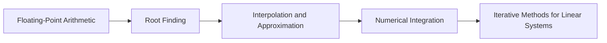

<!-- Generated by tools/build_indexes.py from tools/curriculum.json. Do not edit by hand. -->

# Numerical Analysis

*Mathematics that runs on a computer*

[Mathematics](../README.md) › Numerical Analysis

Floating point, root finding, interpolation, numerical integration and iterative solvers — plus the error analysis that says whether an answer can be trusted.

## At a glance

| | |
|---|---|
| Topics | 5 (0 complete, 0 draft, 5 planned) |
| Estimated study time | ~40 hours |
| Prerequisites | [07-calculus](../07-calculus/README.md), [08-linear-algebra](../08-linear-algebra/README.md) |

## Study order

The numbers are the recommended order. Study a topic only after the ones before it —
the dependency chain below is the shortest safe route through the discipline.

## Topic inventory

| # | Topic | Level | Est. time | Status | Materials |
|---|---|---|---|---|---|
| 1 | Floating-Point Arithmetic | Intermediate | 7 h | Planned | — |
| 2 | Root Finding | Intermediate | 8 h | Planned | — |
| 3 | Interpolation and Approximation | Advanced | 9 h | Planned | — |
| 4 | Numerical Integration | Advanced | 8 h | Planned | — |
| 5 | Iterative Methods for Linear Systems | Advanced | 8 h | Planned | — |

### What each topic covers

- **Floating-Point Arithmetic** — IEEE 754, rounding error, catastrophic cancellation and condition numbers.
- **Root Finding** — Bisection, Newton, secant and fixed-point iteration with convergence orders.
- **Interpolation and Approximation** — Lagrange and Newton forms, splines, least squares and Runge's phenomenon.
- **Numerical Integration** — Trapezoid, Simpson, Gaussian quadrature and error bounds.
- **Iterative Methods for Linear Systems** — Jacobi, Gauss-Seidel, conjugate gradients and condition numbers.

## Related disciplines

- [18-optimization](../18-optimization/README.md)
- [16-differential-equations](../16-differential-equations/README.md)

## Status key

- **Complete** — tutorial, exercises and full solutions exist and the tutorial meets the
  [authoring standard](../CONTRIBUTING.md).
- **Draft** — some material exists but the topic is not finished.
- **Planned** — identified in the curriculum, not written yet.

Overall progress and the full topic inventory live in [ROADMAP.md](../ROADMAP.md).
