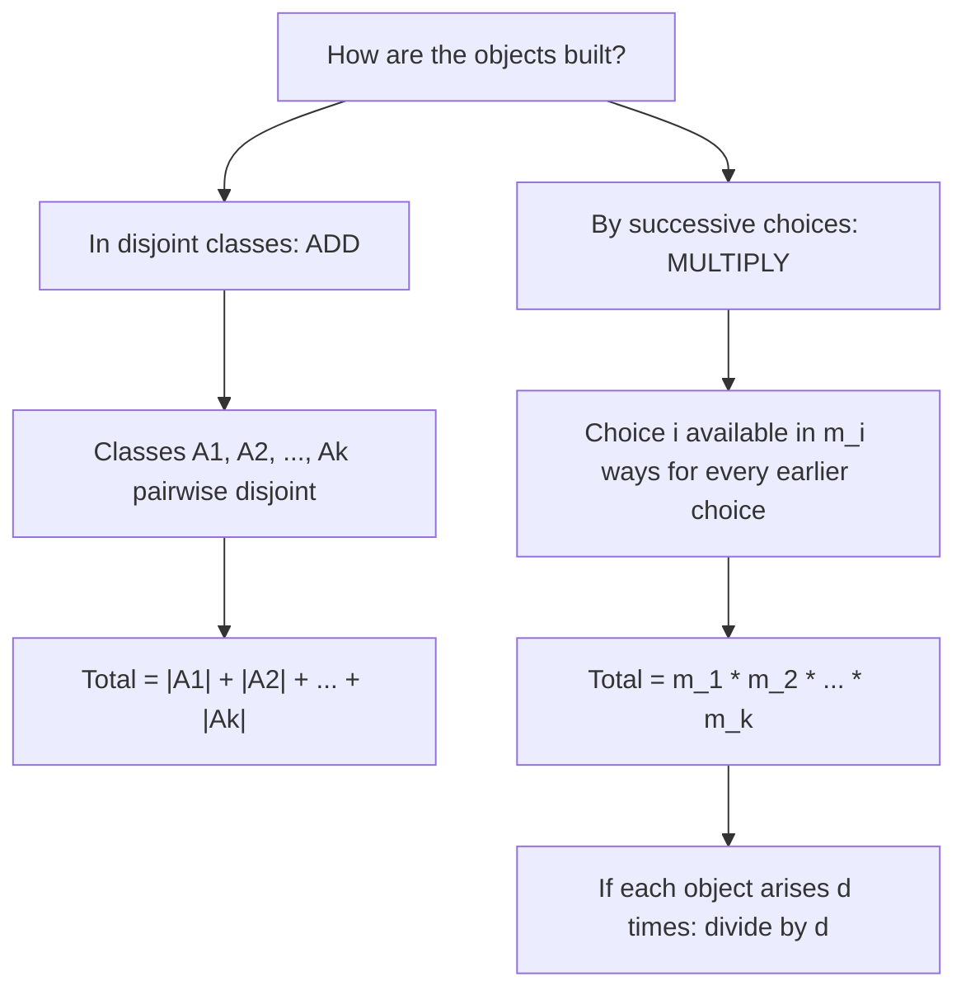
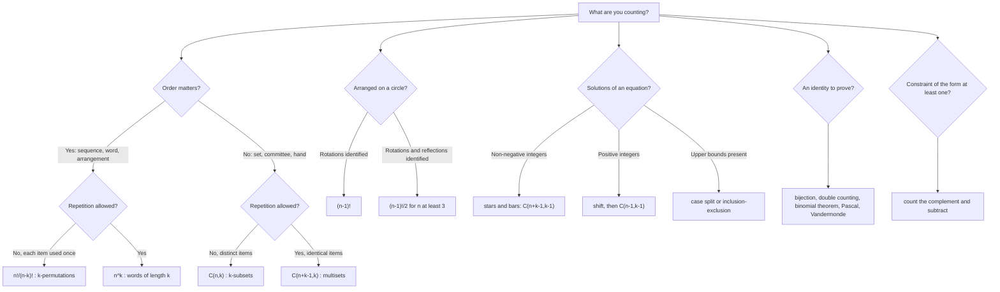

# Counting Principles

> [Mathematics](../../README.md) › [Combinatorics](../README.md) › Counting Principles · Level: Intermediate · Prerequisites: [Set Theory](../../00-foundations/03-set-theory/README.md), [Relations and Functions](../../00-foundations/05-relations-and-functions/README.md), [Proof Techniques](../../00-foundations/04-proof-techniques/README.md), [Mathematical Induction](../../09-discrete-mathematics/01-mathematical-induction/README.md) · Estimated time: 240 min

## 1. Introduction

How many ways are there to deal a five-card poker hand? How many distinct passwords of length eight can a system accept? How many monotone lattice paths run from the bottom-left corner of a grid to the top-right? How many different committees of six can a club of twenty form?

Each question asks for an exact integer. In each case, listing the configurations is out of the question: there are $2\,598\,960$ poker hands and $26^{8} = 208\,827\,064\,576$ eight-letter passwords. Counting is the art of obtaining such integers *without* listing, by recognising the structure of the objects and translating that structure into a formula.

Two facts organise the whole subject.

* If a collection of objects splits into disjoint classes, the total is the sum of the class sizes.
* If an object is built by a sequence of independent choices, the total is the product of the numbers of choices.

Everything else in this tutorial — permutations, combinations, the binomial theorem, stars and bars, Vandermonde's identity — is these two facts applied to a well-chosen description of the objects. That is why the subject is worth studying as a subject and not as a list of formulas to memorise: a formula you can re-derive is one you cannot misapply.

Counting is also a *proof technique*. Many identities that look like algebra are statements about two ways of counting one set, and the combinatorial proof is usually shorter and more informative than the algebraic one. In this tutorial you will meet three such techniques — bijective proofs, double counting, and counting one set in two ways — and you will use them to prove the binomial theorem, Pascal's identity, Vandermonde's identity and several others.

The history runs from Cardano's sixteenth-century analysis of dice games, through the Pascal–Fermat correspondence of 1654 on the *problème des partis* (which produced Pascal's triangle as a computational device), to Euler's eighteenth-century work on partitions. The vocabulary is older still: binomial coefficients were computed for prosody in Indian mathematics in the first millennium, and the triangle appears in Chinese, Persian and Indian sources centuries before Pascal. What is modern is the *attitude*: state the objects precisely, find a bijection, count.

By the end you will be able to look at a counting problem, decide which of a small number of structures it has, and produce both the number and an argument that the number is right. The argument matters more than the number. A count without a proof is a guess written in symbols.

## 2. Prerequisites

This tutorial assumes the following, all of which are taught earlier in the repository.

* **Sets, subsets, cardinality, the power set.** You should know what $\lvert A\rvert$ means for a finite set, that $A \subseteq B$ means every element of $A$ lies in $B$, and that $\mathcal{P}(A)$ is the set of all subsets. Taught in [Set Theory](../../00-foundations/03-set-theory/README.md), Sections 5 and 7.
* **Functions, injections, surjections, bijections.** A function $f : A \to B$ is injective when $f(x) = f(y)$ forces $x = y$; surjective when every element of $B$ is a value; bijective when both. Taught in [Relations and Functions](../../00-foundations/05-relations-and-functions/README.md), Section 7.
* **Direct proof, proof by contradiction, proof by cases, and the logic of quantifiers.** Counting arguments are usually direct, but the proof that a proposed correspondence *is* a bijection is a quantified statement and requires care. Taught in [Logic](../../00-foundations/02-logic/README.md) and [Proof Techniques](../../00-foundations/04-proof-techniques/README.md).
* **Mathematical induction.** Used here for the hockey-stick identity, the double hockey stick and several recurrences. Taught in [Mathematical Induction](../../09-discrete-mathematics/01-mathematical-induction/README.md); its Section 8.1 already contains an induction proof of the binomial theorem, which is reproved here by a different (combinatorial) method.
* **Sum and product notation, and elementary algebra.** $\sum_{k=0}^{n} a_k$, $\prod_{k=1}^{n} a_k$, the expansion of $(x+y)^n$ for small $n$, and manipulation of factorials and fractions. Taught in [Advanced Algebra](../../03-algebra/14-advanced-algebra/README.md), Sections 7.8–7.9.

Two conventions, used throughout and matching [MATHEMATICAL_NOTATION.md](../../MATHEMATICAL_NOTATION.md):

* $\mathbb{N} = \{1,2,3,\dots\}$ and $\mathbb{N}_0 = \{0,1,2,3,\dots\}$. In counting, "$n$ objects" always means a set with exactly $n$ elements, and $n$ may be $0$.
* $[n] := \{1, 2, \dots, n\}$ is the standard $n$-element set, with $[0] = \varnothing$. Statements about an arbitrary $n$-element set are proved for $[n]$, because any two $n$-element sets are in bijection.

A note on scope. The [discipline index](../README.md) lists *Inclusion–Exclusion* as the topic that follows this one. That topic counts unions of *overlapping* sets, and it is where derangements, the surjection formula in full generality and the "at most" form of stars and bars are treated. Here those appear only as short remarks, with formulas stated and verified on small cases, and the reader is referred forward rather than left with an unproved tool. Where the two subjects overlap — for instance in counting surjections — this tutorial sticks to methods it has proved.

## 3. Learning Objectives

By the end of this tutorial you will be able to:

1. State the sum rule and the product rule with their hypotheses — pairwise disjointness, and independence of the number of choices at each step — and give an example in which each hypothesis fails.
2. Count the total functions, injections, surjections and bijections between two finite sets, and explain which of these counts needs inclusion–exclusion.
3. Derive the formulas for $n!$, for the number of $k$-permutations $\frac{n!}{(n-k)!}$, and for $\binom{n}{k}$, from the product rule and the division principle.
4. Count permutations of a multiset (words with repeated letters) and arrangements of distinct objects on a circle, with and without identifying reflections.
5. State and prove the binomial and multinomial theorems, and extract a coefficient from a product of binomials or multinomials.
6. Prove Pascal's identity and Vandermonde's identity, each in two different ways, and use them to evaluate sums.
7. Solve stars-and-bars problems: non-negative and positive solutions of $x_1 + \cdots + x_k = n$, with lower bounds, and recognise when an upper bound forces a different method.
8. Construct bijective proofs, and say precisely what must be checked for a proposed bijection to be valid.
9. Use double counting to prove identities, including the handshake lemma and $\sum_k k\binom{n}{k} = n2^{n-1}$.
10. Choose between the sum rule, the product rule, the division principle, a bijection and double counting for a given problem, and justify the choice.
11. Recognise the standard errors — adding non-disjoint cases, multiplying dependent choices, forgetting symmetry, off-by-one errors in stars and bars — and repair them.
12. Verify any count you produce on a small case before trusting it.

## 4. Intuition

### 4.1 Two rules, and nothing else

Imagine a wardrobe with $3$ shirts and $4$ pairs of trousers. How many outfits? You do not need a formula: each of the $3$ shirts can be worn with each of the $4$ trousers, and no outfit is counted twice, so there are $3 \times 4 = 12$. This is the **product rule**, and it is a statement about a grid: $3$ rows, $4$ columns, $12$ cells.

Now imagine choosing *either* a shirt *or* a hat, from $3$ shirts and $5$ hats. There are $3 + 5 = 8$ possibilities. This is the **sum rule**, and it is a statement about two piles that do not overlap.

Everything else is bookkeeping. A permutation is a product of choices that shrink. A combination is a permutation divided by the number of orders that produce the same set. A multiset permutation is a permutation divided by the symmetries of repeated letters. Stars and bars is the product rule applied to a word made of two symbols. Even the binomial theorem is the product rule applied to $n$ copies of $(x+y)$, one factor at a time.

So the difficulty in combinatorics is never "which formula"; it is "what exactly am I counting, and can I describe each object by a unique recipe?" Once the recipe is unique, the two rules finish the job.

### 4.2 A recipe must be unique

Here is the single most common failure. Suppose a café offers $4$ starters, $6$ mains and $3$ desserts, and you may have a starter *or* not. How many meals? A hasty answer is $4 \cdot 6 \cdot 3 = 72$; the correct answer is $5 \cdot 6 \cdot 3 = 90$, because "no starter" is a fifth option, not the absence of one.

Or: how many ways to choose a committee of $3$ from $10$ people, with one member designated chair? One route gives $10 \cdot \binom{9}{2} = 360$. Another gives $10 \cdot 9 \cdot 8 = 720$, which is wrong — it counts each committee twice, once for each ordering of its two non-chair members, so $720/2 = 360$ agrees only after the correction. Both routes work *once you say what each recipe produces*. The recipe "$10$ choices for the chair, then $9$, then $8$" produces an ordered triple (chair, first member, second member), and each committee-with-chair arises exactly twice.

The lesson: name the objects your recipe produces, and check that each object arises exactly once. This is the same discipline as a well-defined function — domain, codomain, and a check that the rule is single-valued and total.

### 4.3 Counting is not listing

For $n = 52$ and $k = 5$ the count is $2\,598\,960$. For $n = 100$ and $k = 50$ it is about $10^{29}$, more than the number of atoms in a person. Nobody lists these; the formula is the only access. But the formula is only as good as the argument behind it, and small cases are the only practical test: if a formula predicts $210$ for $\binom{10}{4}$, you can check $\binom{10}{4}$ by hand in a few minutes and be sure the *method* is right before applying it to a case you cannot check.

This is why every worked example below ends with a numerical check at a small value, and why the exercises ask for them too.

### 4.4 Two kinds of proof in one subject

There are two flavours of argument in combinatorics, and it pays to distinguish them.

* **Constructive counting**: exhibit a recipe, apply the product and sum rules, obtain a number.
* **Structural counting**: show that the objects you are counting correspond to objects you already know how to count. This is a *bijection*, and it produces an identity rather than a number.

The second is the more powerful and the more elegant. It is also the one that requires proof: you must show the correspondence is a function, is injective and is surjective. Half of this tutorial's proofs are of that form.

## 5. Formal Definition

### 5.1 Finite sets and cardinality

A set $A$ is **finite** when there is a bijection $A \to [n]$ for some $n \in \mathbb{N}_0$. That $n$ is unique — a fact about injections between finite sets, proved in [Set Theory](../../00-foundations/03-set-theory/README.md), Section 7 — and we write $\lvert A\rvert = n$ and call it the **cardinality** of $A$. The empty set has cardinality $0$.

**Definition 5.1.1 (Equinumerous).** Sets $A$ and $B$ are **equinumerous**, written $A \approx B$, when there is a bijection $A \to B$.

The whole of enumerative combinatorics rests on the following observation, which is immediate from the definition: *equinumerous finite sets have the same cardinality*. So to count $A$ it suffices to count any set $B$ you already understand and to exhibit a bijection $A \to B$. This is the licence for bijective proofs (Section 7.12).

### 5.2 The sum rule

**Theorem 5.2.1 (Sum rule).** Let $k \in \mathbb{N}_0$ and let $A_1, \dots, A_k$ be finite sets that are **pairwise disjoint**: $A_i \cap A_j = \varnothing$ whenever $i \ne j$. Then

$$\Bigl\lvert \bigcup_{i=1}^{k} A_i \Bigr\rvert = \sum_{i=1}^{k} \lvert A_i \rvert .$$

*Proof.* By induction on $k$. For $k = 0$ both sides are $0$ and the union is empty; for $k = 1$ the statement is trivial. For the step, put $B = \bigcup_{i=1}^{k-1} A_i$. Because $A_k$ is disjoint from each $A_i$ with $i < k$, it is disjoint from $B$, so $\lvert B \cup A_k\rvert = \lvert B\rvert + \lvert A_k\rvert$: a disjoint union of two finite sets has cardinality the sum of the parts, since bijections $B \to [\lvert B\rvert]$ and $A_k \to [\lvert A_k\rvert]$ concatenate to a bijection $B \cup A_k \to [\lvert B\rvert + \lvert A_k\rvert]$. Now apply the inductive hypothesis to $B$. $\square$

**The hypothesis is not decoration.** For $A_1 = \{1,2\}$ and $A_2 = \{2,3\}$ the sum rule would predict $4$, but $\lvert A_1 \cup A_2\rvert = 3$. The general formula for overlapping sets is inclusion–exclusion, the next topic in this discipline ([discipline index](../README.md)).

### 5.3 The product rule

**Theorem 5.3.1 (Product rule).** For finite sets $A_1, \dots, A_k$,

$$\lvert A_1 \times A_2 \times \cdots \times A_k \rvert = \prod_{i=1}^{k} \lvert A_i \rvert .$$

*Proof.* Induction on $k$. For $k=1$ it is trivial. For $k = 2$: a bijection is given by $(a,b) \mapsto (\text{index of } a,\ \text{index of } b) \in [\lvert A_1\rvert]\times[\lvert A_2\rvert]$, and the latter has $\lvert A_1\rvert\lvert A_2\rvert$ elements because each of the $\lvert A_1\rvert$ first coordinates is paired with each of the $\lvert A_2\rvert$ second coordinates exactly once. The step applies the case $k=2$ to $(A_1\times\cdots\times A_{k-1})\times A_k$. $\square$

**The "sequence of choices" form, and where it needs care.** The product rule is usually applied in this shape: *if an object is built by making choice $1$ in $m_1$ ways, then choice $2$ in $m_2$ ways, and so on, then there are $m_1 m_2 \cdots m_k$ objects.* This is valid only if $m_i$ **does not depend on which earlier choices were made**. When the number of options at step $i$ depends on the earlier choices, the product $\prod m_i$ is either meaningless or counts a different set of objects, and one must either reorder the choices so that the dependent one comes last with a uniform count, or split into cases.

*Example of failure.* Count $3$-element subsets of $[10]$ by "choose the first element ($10$ ways), then the second ($9$), then the third ($8$)". Each subset arises $3! = 6$ times, so the product counts *ordered* triples, not subsets. The repair is the division principle below, not a product rule with shrinking factors.

*Example where reordering works.* How many $4$-digit strings have all digits distinct and the first digit non-zero? Choosing the first digit first gives $9$ options; then $9$, $8$, $7$. Choosing digits in an arbitrary order would make the count at step one depend on whether $0$ had already been used. Choosing in the order that removes the dependence is what makes the product apply: $9\cdot 9\cdot 8\cdot 7 = 4536$.

**Theorem 5.3.2 (Division principle).** Let $S$ be a finite set partitioned into $c$ classes, each of size exactly $d$. Then $\lvert S\rvert = c\,d$, so $c = \lvert S\rvert/d$.

This is the sum rule with all summands equal to $d$. It justifies every "divide by symmetry" step in what follows.

### 5.4 Functions between finite sets

Let $A$, $B$ be finite with $\lvert A\rvert = m$ and $\lvert B\rvert = n$. Recall from [Relations and Functions](../../00-foundations/05-relations-and-functions/README.md):

* $f : A \to B$ is **injective** if $f(a) = f(a') \Rightarrow a = a'$;
* $f$ is **surjective** if for every $b \in B$ there is $a \in A$ with $f(a) = b$;
* $f$ is **bijective** if it is both.

For finite sets of the same size, injective, surjective and bijective are equivalent (Section 7.3 proves this by counting). For sets of different size the counts are forced: if $m > n$ no function is injective, and if $m < n$ no function is surjective.

### 5.5 Permutations, $k$-permutations, combinations

**Definition 5.5.1.** A **permutation** of a finite set $S$ is a bijection $S \to S$. A **$k$-permutation** of $S$ is an injection $[k] \to S$, equivalently a sequence of $k$ distinct elements of $S$ in order. A **$k$-combination** (or **$k$-subset**) of $S$ is a subset of $S$ with exactly $k$ elements.

The distinction is exactly order: a $k$-permutation is a $k$-element subset *together with* an ordering of it, while a $k$-combination forgets the ordering. That single sentence is the derivation of $\binom{n}{k}$ in Section 7.4.

**Definition 5.5.2.** For $n \in \mathbb{N}_0$ define $n! := \prod_{i=1}^{n} i$, with $0! := 1$. For $0 \le k \le n$ define

$$\binom{n}{k} := \frac{n!}{k!\,(n-k)!} .$$

### 5.6 Multisets and multinomial coefficients

**Definition 5.6.1.** A **multiset** on a set $S$ is a function $S \to \mathbb{N}_0$ assigning to each element a multiplicity; we write it as $\{a^{m_a}, b^{m_b}, \dots\}$ where $m_a$ is the multiplicity of $a$. Its **size** is the sum of the multiplicities. Equivalently, a multiset of size $n$ drawn from $r$ types is a solution of $x_1 + \cdots + x_r = n$ in non-negative integers.

**Definition 5.6.2.** For $n = m_1 + \cdots + m_r$ with $m_i \in \mathbb{N}_0$, the **multinomial coefficient** is

$$\binom{n}{m_1, m_2, \dots, m_r} := \frac{n!}{m_1!\, m_2! \cdots m_r!} .$$

When $r = 2$ this is $\binom{n}{m_1}$, so multinomial coefficients generalise binomial coefficients exactly as one would hope.

## 6. Mathematical Notation

| Symbol | Read as | Meaning |
|---|---|---|
| $\lvert A\rvert$ | cardinality of $A$ | number of elements of the finite set $A$ |
| $[n]$ | the set $1$ to $n$ | $\{1,2,\dots,n\}$, with $[0]=\varnothing$ |
| $A \approx B$ | $A$ is equinumerous with $B$ | there is a bijection $A \to B$ |
| $A \sqcup B$ | disjoint union | union of sets known to be disjoint |
| $n!$ | $n$ factorial | $1\cdot 2 \cdots n$, with $0! = 1$ |
| $n^{\underline{k}}$ | $n$ falling factorial $k$ | $n(n-1)\cdots(n-k+1)$, a product of $k$ factors; equals $n!/(n-k)!$ |
| $\binom{n}{k}$ | $n$ choose $k$ | $\dfrac{n!}{k!(n-k)!}$, the number of $k$-subsets of an $n$-set |
| $\binom{n}{m_1,\dots,m_r}$ | multinomial coefficient | $\dfrac{n!}{m_1!\cdots m_r!}$ with $\sum m_i = n$ |
| $\lfloor x\rfloor$, $\lceil x\rceil$ | floor, ceiling | greatest integer $\le x$; least integer $\ge x$ |
| $\sum_{k=0}^{n} a_k$ | sum over $k$ | $a_0 + a_1 + \cdots + a_n$ |
| $\prod_{i=1}^{n} a_i$ | product over $i$ | $a_1 a_2 \cdots a_n$, with the empty product equal to $1$ |
| $S(n,k)$ | Stirling number of the second kind | number of partitions of an $n$-set into exactly $k$ non-empty blocks |
| $\mathbf{1}_A$ | indicator of $A$ | $1$ on $A$, $0$ outside |

Two conventions about reading aloud. "$\binom{n}{k}$" is read "n choose k", never "n over k", which would suggest a fraction. "$n^{\underline{k}}$" is read "n falling k"; it is *not* an exponent, and it is never used here with $k > n$, where the product would contain a factor $0$ or a negative factor.

## 7. Core Concepts

### 7.1 The sum rule and the discipline of disjointness

The sum rule is easy to state and easy to violate. The violation always has the same shape: two cases that overlap, counted twice.

*How many integers in $[100]$ are divisible by $2$ or by $3$?* There are $50$ multiples of $2$ and $33$ multiples of $3$, but $50 + 33 = 83$ is wrong, because the $16$ multiples of $6$ lie in both classes. The correct count is $50 + 33 - 16 = 67$. Alternatively, split into *disjoint* classes: divisible by $6$ ($16$), by $2$ but not $3$ ($34$), by $3$ but not $2$ ($17$); then $16 + 34 + 17 = 67$. Both routes give $67$; the second is a legitimate sum-rule application, the first is inclusion–exclusion.

**The habit.** Before adding, ask: *can an object satisfy two of my cases?* If yes, either refine the cases until they are disjoint, or use inclusion–exclusion (next topic).

A common refinement orders the cases by a canonical parameter. To count $3$-element subsets of $[n]$ by their largest element, take the cases "$m$ is the largest element" for $m = 3, \dots, n$. These are disjoint — each subset has exactly one largest element — and exhaustive. The result is the hockey-stick identity of Section 7.13.

### 7.2 The product rule and independence

The product rule applies to objects described by *independent* coordinates: elements of a Cartesian product, or a sequence of choices in which the number of options at each step does not depend on the earlier choices.

*Good use.* How many subsets does an $n$-element set have? Describe a subset by its indicator string $(b_1,\dots,b_n)$, where $b_i = 1$ means "element $i$ is in". There are $2$ choices for each coordinate, independently, so $2^n$. This is a bijection $\mathcal{P}([n]) \to \{0,1\}^n$ followed by the product rule.

*Bad use.* "Choose a $3$-element subset of $[10]$: $10$ choices, then $9$, then $8$." The product $10\cdot9\cdot8$ is a correct count of injective maps $[3]\to[10]$; it is not the count of subsets, because each subset is produced $3!$ times.

*Repairing dependence by ordering.* To count $5$-card hands whose cards all have distinct ranks and which contain at least one ace, count hands with distinct ranks and subtract those with no ace. A hand with $5$ distinct ranks: choose $5$ ranks ($\binom{13}{5}$) and one suit for each ($4^5$), so $\binom{13}{5}4^5 = 1287\cdot 1024 = 1\,317\,888$. Hands with distinct ranks and no ace: $\binom{12}{5}4^5 = 792\cdot 1024 = 810\,864$. The difference is $507\,024$. Each step is a genuine product of independent choices, and the two cases are disjoint.

### 7.3 Counting functions between finite sets

Let $\lvert A\rvert = m$ and $\lvert B\rvert = n$. Think of a function as a table of $m$ entries, one per element of $A$, each drawn from $B$.

**Theorem 7.3.1 (All functions).** The number of functions $A \to B$ is $n^m$.

*Proof.* A function is determined by the list $(f(a_1),\dots,f(a_m))$, an element of $B^m$. The map $f \mapsto (f(a_1),\dots,f(a_m))$ is a bijection onto $B^m$, which by the product rule has $n^m$ elements. $\square$

**Theorem 7.3.2 (Injections).** For $m \le n$ the number of injective functions $A \to B$ is

$$n(n-1)(n-2)\cdots(n-m+1) = \frac{n!}{(n-m)!} = n^{\underline{m}} .$$

For $m > n$ it is $0$.

*Proof.* Build the list $(f(a_1),\dots,f(a_m))$ step by step. There are $n$ options for $f(a_1)$. Having chosen $i$ distinct values, exactly $n-i$ values remain unused, whatever those $i$ values are — the count depends only on how many have been used, not on which. The product rule therefore applies with factors $n, n-1, \dots, n-m+1$, which is $0$ when $m > n$ because one factor is $0$. $\square$

**Theorem 7.3.3 (Bijections).** If $m = n$, the number of bijections $A \to B$ is $n!$.

*Proof.* An injection $[n]\to[n]$ takes $n$ distinct values in an $n$-element set, hence all of them, so it is a bijection; the count is $n^{\underline{n}} = n!$. For arbitrary $A,B$ of size $n$, fix bijections $A \to [n]$ and $B\to[n]$; conjugating by them gives a bijection between bijections $A\to B$ and bijections $[n]\to[n]$. $\square$

**Theorem 7.3.4 (Surjections).** The number of surjective functions $A \to B$ with $\lvert A\rvert = m$ and $\lvert B\rvert = n \ge 1$ is

$$\sum_{j=0}^{n} (-1)^j \binom{n}{j}(n-j)^m \;=\; n!\,S(m,n).$$

The first form is inclusion–exclusion, proved in the next topic ([discipline index](../README.md)); the second uses Stirling numbers of the second kind. Here is why the two agree, which is worth understanding now: a surjection partitions $A$ into $n$ non-empty fibres, one per element of $B$ — a partition into $n$ non-empty blocks, counted by $S(m,n)$ — and then assigns the blocks to the elements of $B$, in $n!$ ways. *Check.* $m = 5$, $n = 3$: the formula gives $3^5 - 3\cdot 2^5 + 3\cdot 1^5 = 243 - 96 + 3 = 150$, and $S(5,3) = 25$ gives $3!\cdot 25 = 150$. ✓

**The elementary case $n = 2$.** A surjection $[m]\to\{1,2\}$ is a non-constant binary string, so there are $2^m - 2$; for $m = 5$ this is $30$. ✓ This is the only surjection count that needs no inclusion–exclusion, and it is used constantly.

**Corollary: for equal finite sizes, injective, surjective and bijective coincide.** Let $\lvert A\rvert = \lvert B\rvert = n$. An injection $A\to B$ has $n$ distinct images in an $n$-element set, so it is onto. A surjection has $n$ preimages distributed among $n$ targets, so if some target had two preimages another would have none — contradicting surjectivity. This fails for infinite sets ($n \mapsto 2n$ is an injection $\mathbb{N}\to\mathbb{N}$ that is not onto), which is exactly why the finite case needs its own argument.

### 7.4 Permutations and combinations: derivations

**Permutations.** A permutation of an $n$-element set is a bijection to itself, so by Theorem 7.3.3 there are $n!$. Equivalently, arrange the $n$ elements in a row: $n$ choices for the first position, $n-1$ for the second, down to $1$, giving $n!$. *Check.* $[3]$ has the six permutations $123, 132, 213, 231, 312, 321$, and $3! = 6$. ✓

**$k$-permutations.** A $k$-permutation is an injection $[k]\to S$ with $\lvert S\rvert = n$, so by Theorem 7.3.2 there are

$$\frac{n!}{(n-k)!} = n^{\underline{k}} .$$

*Check.* The $3$-permutations of $[5]$ number $5\cdot4\cdot3 = 60$. ✓

**Combinations.** Let $\binom{n}{k}$ denote the number of $k$-subsets of an $n$-set. Every $k$-permutation has a $k$-element *set* of values (its image) and an *ordering* of that set. Grouping the $n^{\underline{k}}$ $k$-permutations by image gives $\binom{n}{k}$ classes, and each class has exactly $k!$ members, because a $k$-element set can be ordered in $k!$ ways. By the division principle,

$$n^{\underline{k}} = k!\,\binom{n}{k}, \qquad\text{hence}\qquad \binom{n}{k} = \frac{n!}{k!\,(n-k)!}.$$

*Check.* $n=5$, $k=3$: $\binom{5}{3} = 120/6 = 20$, and $60$ ordered triples fall into $20$ groups of $3! = 6$. ✓

**Immediate consequences.**

* $\binom{n}{k} = \binom{n}{n-k}$: complementing a $k$-subset inside $[n]$ gives an $(n-k)$-subset, and complementation is its own inverse, hence a bijection (Section 7.12).
* $\binom{n}{0} = \binom{n}{n} = 1$: the only $0$-subset is $\varnothing$, the only $n$-subset is $[n]$.
* The convention $\binom{n}{k} = 0$ for $k<0$ or $k>n$ extends the symbol to all integers $k$ and makes every identity below hold without extra qualification. The factorial formula itself is used only for $0\le k\le n$.

### 7.5 Permutations with repetition and multiset permutations

**Words with repetition allowed.** A **word** of length $k$ over an alphabet of $n$ letters is a function $[k]\to[n]$; by Theorem 7.3.1 there are $n^k$. Order matters and repetition is allowed.

*Check.* The three-letter words over $\{a,b\}$ number $2^3 = 8$: $aaa, aab, aba, abb, baa, bab, bba, bbb$. ✓

**Permutations of a multiset.** Let a multiset have $r$ distinct letters with multiplicities $m_1,\dots,m_r$ and total size $n$. A **distinguishable arrangement** is a word of length $n$ using exactly $m_i$ copies of letter $i$.

**Theorem 7.5.1.** The number of distinguishable arrangements is

$$\binom{n}{m_1,\dots,m_r} = \frac{n!}{m_1!\, m_2!\cdots m_r!}.$$

*Proof.* Temporarily label the $m_i$ copies of letter $i$ as distinct, giving $n$ distinct objects and hence $n!$ orderings. Each distinguishable arrangement arises from exactly $m_1!\,m_2!\cdots m_r!$ of these orderings, because the copies of letter $i$ can be permuted among their own positions in $m_i!$ ways and no other relabelling changes the word. The division principle gives the formula. $\square$

Equivalently — and this is the version to use in practice — choose the positions of letter $1$ in $\binom{n}{m_1}$ ways, then the positions of letter $2$ among the remaining $n-m_1$ in $\binom{n-m_1}{m_2}$ ways, and so on; the product telescopes to $\frac{n!}{m_1!\cdots m_r!}$.

*Check.* The letters of BANANA are $B, A, N, A, N, A$, with multiplicities $3,2,1$, so $6!/(3!\,2!\,1!) = 720/12 = 60$. ✓ A smaller check that can be done by hand: the multiset $\{A,A,B\}$ has $3!/2! = 3$ arrangements, $AAB, ABA, BAA$. ✓

### 7.6 Circular permutations

**Theorem 7.6.1.** The number of ways to arrange $n$ distinct objects around a circle, where arrangements differing only by a rotation are considered the same, is $(n-1)!$.

*Proof.* Arrange the $n$ objects in a row: $n!$ ways. A row determines a circular arrangement, and two rows determine the same circular arrangement exactly when one is a cyclic shift of the other. There are $n$ cyclic shifts of a row of $n$ *distinct* objects and all are different — a shift by $j \ne 0$ moves object $1$ to a different seat. So each circular arrangement arises exactly $n$ times, and the count is $n!/n = (n-1)!$. $\square$

Equivalently: seat one named person anywhere, then arrange the other $n-1$ relative to her.

*Check.* Four people around a table: $3! = 6$. The rows $ABCD$, $BCDA$, $CDAB$, $DABC$ are one seating, and $24/4 = 6$. ✓

**Reflections.** If arrangements differing by a reflection are also identified — a *necklace* rather than a *seating* — then for $n \ge 3$ distinct objects each arrangement is paired with a distinct mirror image, so the count is $(n-1)!/2$. For $n = 1,2$ every arrangement equals its mirror image and the count stays $(n-1)!$. *Check.* Five distinct beads on a necklace: $4!/2 = 12$. ✓

**A warning about repeated objects.** With repeated objects the "divide by $n$" argument fails, because a circular arrangement may be invariant under a non-trivial rotation, and then it has fewer than $n$ distinct rotations. The correct tool is Burnside's lemma: average the number of arrangements fixed by each rotation. For $4$ beads in $2$ colours the fixed counts are $16, 2, 4, 2$ for rotations by $0,1,2,3$ places, so the number of necklaces is $(16+2+4+2)/4 = 6$ — and indeed they are $0000$, $0001$, $0011$, $0101$, $0111$, $1111$. ✓ Any circular problem with repeated objects should either be small enough to enumerate or be handed to Burnside.

### 7.7 The binomial theorem

**Theorem 7.7.1 (Binomial theorem).** For all $x,y$ and all $n\in\mathbb{N}_0$,

$$(x+y)^n = \sum_{k=0}^{n} \binom{n}{k} x^k y^{\,n-k}.$$

*Combinatorial proof.* Write $(x+y)^n$ as the product of $n$ factors $(x+y)(x+y)\cdots(x+y)$. Expanding by distributivity, each term is obtained by choosing $x$ or $y$ from each factor, so each term has the form $x^ky^{n-k}$, where $k$ is the number of factors from which $x$ was chosen. The term $x^ky^{n-k}$ therefore occurs once for each $k$-element subset of the $n$ factors — the ones contributing $x$ — that is $\binom{n}{k}$ times. Collecting like terms gives the formula. $\square$

Compare the induction proof in [Mathematical Induction](../../09-discrete-mathematics/01-mathematical-induction/README.md), Section 8.1, which uses Pascal's identity: the combinatorial proof *explains* Pascal's identity, while the induction merely uses it.

**Corollaries.** Substituting values:

$$\sum_{k=0}^{n}\binom{n}{k} = 2^n \quad (x=y=1), \qquad \sum_{k=0}^{n}(-1)^k\binom{n}{k} = 0 \ \ (n\ge 1,\ x=-1,\ y=1).$$

The first says an $n$-set has $2^n$ subsets, counted by size. The second says that for $n\ge1$ there are equally many subsets of even and of odd size — each $2^{n-1}$. That has a one-line bijective proof (Section 7.12) and is a good example of an identity with several independent proofs.

Differentiating $(1+y)^n = \sum_k \binom{n}{k} y^k$ gives $\sum_k k\binom{n}{k}y^{k-1} = n(1+y)^{n-1}$, hence at $y=1$:

$$\sum_{k=0}^{n} k\binom{n}{k} = n\,2^{n-1}.$$

*Check.* $n = 4$: $0 + 4 + 12 + 12 + 4 = 32 = 4\cdot 8$. ✓ Section 7.13 gives a double-counting proof that uses no calculus.

### 7.8 The multinomial theorem

**Theorem 7.8.1 (Multinomial theorem).** For $r \ge 1$ and $n \in \mathbb{N}_0$,

$$(x_1 + x_2 + \cdots + x_r)^n = \sum_{\substack{m_1,\dots,m_r \in \mathbb{N}_0 \\ m_1+\cdots+m_r = n}} \binom{n}{m_1,\dots,m_r}\, x_1^{m_1} x_2^{m_2}\cdots x_r^{m_r}.$$

*Combinatorial proof.* Expand the product of $n$ factors $(x_1+\cdots+x_r)$. A term of the expansion is determined by choosing, for each of the $n$ factors, one of the $r$ variables. The resulting term is $x_1^{m_1}\cdots x_r^{m_r}$, where $m_i$ is the number of factors from which $x_i$ was chosen; the choice is a function $[n]\to[r]$ with fibre sizes $m_1,\dots,m_r$. The number of such functions is the number of words of length $n$ with $m_i$ occurrences of letter $i$, which is $\binom{n}{m_1,\dots,m_r}$ by Theorem 7.5.1. $\square$

*Check.* The coefficient of $x^2y^3z$ in $(x+y+z)^6$ is $\frac{6!}{2!\,3!\,1!} = 60$. Setting all $x_i = 1$ gives $\sum \binom{n}{m_1,\dots,m_r} = r^n$, which for $n=6$, $r=3$ is $729 = 3^6$; and for $n=2$ one can check by hand: $(x+y+z)^2 = x^2+y^2+z^2+2xy+2xz+2yz$, matching $\binom{2}{2,0,0}=1$ and $\binom{2}{1,1,0}=2$. ✓

### 7.9 Pascal's identity

**Theorem 7.9.1 (Pascal's identity).** For $1 \le k \le n$,

$$\binom{n}{k} = \binom{n-1}{k-1} + \binom{n-1}{k}.$$

*Combinatorial proof.* Let $\lvert S\rvert = n$ and fix $x \in S$. The $k$-subsets of $S$ fall into two classes: those containing $x$ and those not containing $x$; the classes are disjoint and exhaustive. A $k$-subset containing $x$ is $\{x\}\cup T$ with $T$ a $(k-1)$-subset of $S\setminus\{x\}$, giving $\binom{n-1}{k-1}$ of them. A $k$-subset not containing $x$ is a $k$-subset of the $(n-1)$-element set $S\setminus\{x\}$, giving $\binom{n-1}{k}$ of them. The sum rule applies because the classes are disjoint. $\square$

*Algebraic proof.* From the factorial formula,

$$\binom{n-1}{k-1} + \binom{n-1}{k} = \frac{(n-1)!}{(k-1)!(n-k)!} + \frac{(n-1)!}{k!(n-k-1)!},$$

and over the common denominator $k!(n-k)!$ this is

$$\frac{(n-1)!\,k + (n-1)!\,(n-k)}{k!(n-k)!} = \frac{(n-1)!\,n}{k!(n-k)!} = \frac{n!}{k!(n-k)!} = \binom{n}{k}. \qquad \square$$

The two proofs do different jobs: the algebraic one verifies, the combinatorial one explains. Pascal's identity is the recurrence behind Pascal's triangle and behind the induction proof of the binomial theorem.

**Pascal's triangle.** Rows $n = 0,1,2,\dots$ with entries $k = 0,\dots,n$:

| $n$ | entries |
|---|---|
| 0 | 1 |
| 1 | 1, 1 |
| 2 | 1, 2, 1 |
| 3 | 1, 3, 3, 1 |
| 4 | 1, 4, 6, 4, 1 |
| 5 | 1, 5, 10, 10, 5, 1 |
| 6 | 1, 6, 15, 20, 15, 6, 1 |

Row sums: $1, 2, 4, 8, 16, 32, 64$. Alternating row sums from row $1$: all $0$. The middle entry of row $6$ is $20 = \binom{6}{3}$, matching the check in Section 7.4.

### 7.10 Vandermonde's identity

**Theorem 7.10.1 (Vandermonde's identity).** For $m,n,r \in \mathbb{N}_0$,

$$\binom{m+n}{r} = \sum_{k=0}^{r} \binom{m}{k}\binom{n}{r-k}.$$

*Combinatorial proof.* Let $M$ have $m$ elements and $N$ have $n$ elements, with $M\cap N=\varnothing$ — imagine $m$ men and $n$ women. An $r$-subset of $M\cup N$ is determined by how many of its members come from $M$: with $k$ from $M$ and $r-k$ from $N$ there are $\binom{m}{k}\binom{n}{r-k}$ such subsets. The classes indexed by $k = 0,\dots,r$ are disjoint (each subset has exactly one value of $k$) and exhaustive, so the sum rule gives the total, which is also $\binom{m+n}{r}$ because $\lvert M\cup N\rvert = m+n$. $\square$

*Algebraic proof.* Expand $(1+x)^{m+n} = (1+x)^m(1+x)^n$ and compare coefficients of $x^r$. The left contributes $\binom{m+n}{r}$. On the right,

$$(1+x)^m(1+x)^n = \Bigl(\sum_{i=0}^{m}\binom{m}{i}x^i\Bigr)\Bigl(\sum_{j=0}^{n}\binom{n}{j}x^j\Bigr),$$

and the coefficient of $x^r$ is $\sum_{i+j=r}\binom{m}{i}\binom{n}{j}$, the right-hand side of Vandermonde. $\square$

*Check.* $m=5$, $n=4$, $r=3$: the sum is $\binom50\binom43 + \binom51\binom42 + \binom52\binom41 + \binom53\binom40 = 4 + 30 + 40 + 10 = 84$, and $\binom93 = 84$. ✓

**Corollary 7.10.2.** Taking $m = n = r$,

$$\sum_{k=0}^{n}\binom{n}{k}^2 = \binom{2n}{n}.$$

*Check.* $n=4$: $1+16+36+16+1 = 70 = \binom84$. ✓

**Corollary 7.10.3 (Generalised Vandermonde).** For sets of sizes $n_1,\dots,n_p$,

$$\binom{n_1+\cdots+n_p}{r} = \sum_{k_1+\cdots+k_p = r} \binom{n_1}{k_1}\binom{n_2}{k_2}\cdots\binom{n_p}{k_p},$$

proved by induction on $p$ from Theorem 7.10.1, or by comparing coefficients in $\prod_i (1+x)^{n_i}$.

*Check.* $n_1=3$, $n_2=4$, $n_3=5$, $r=4$: the sum is $495$, and $\binom{12}{4} = 495$. ✓

### 7.11 Stars and bars

**Theorem 7.11.1 (Stars and bars).** For $n \in \mathbb{N}_0$ and $k \in \mathbb{N}$, the number of $(x_1,\dots,x_k) \in \mathbb{N}_0^k$ with $x_1+\cdots+x_k = n$ is

$$\binom{n+k-1}{k-1}.$$

*Proof.* Encode a solution as a word of $n$ stars and $k-1$ bars: $x_1$ stars, a bar, $x_2$ stars, a bar, …, a bar, $x_k$ stars. For $k=4$, $n=7$ the solution $(2,0,3,2)$ becomes $\star\star\mid\ \mid\star\star\star\mid\star\star$. The map from solutions to words is a bijection: from a word, read off the block lengths between consecutive bars. A word is determined by the positions of its $k-1$ bars among $n+k-1$ slots, so there are $\binom{n+k-1}{k-1}$ words. $\square$

*Check.* $k=3$, $n=4$: the formula gives $\binom62 = 15$. Counting by $x_1$: $x_1=0$ gives $5$ solutions, then $4, 3, 2, 1$; total $15$. ✓

**Theorem 7.11.2 (Positive solutions).** For $n \ge k \ge 1$ the number of $(x_1,\dots,x_k)\in\mathbb{N}^k$ with $x_1+\cdots+x_k = n$ is

$$\binom{n-1}{k-1}.$$

*Proof.* The substitution $y_i = x_i - 1$ is a bijection between positive solutions of $\sum x_i = n$ and non-negative solutions of $\sum y_i = n-k$. Theorem 7.11.1 with $n-k$ in place of $n$ gives $\binom{(n-k)+k-1}{k-1} = \binom{n-1}{k-1}$. $\square$

**Lower bounds.** If $x_i \ge a_i$ for prescribed $a_i$, substitute $y_i = x_i - a_i$; the count is $\binom{(n-\sum a_i)+k-1}{k-1}$, provided $n \ge \sum a_i$.

**Upper bounds are not covered.** A constraint $x_i \le b_i$ breaks the bijection, because the word of stars and bars no longer has an unconstrained number of slots per block: bars can still be placed anywhere, but some placements now encode forbidden solutions. Those problems need inclusion–exclusion (next topic) or a case split.

### 7.12 Bijective proofs as a technique

A **bijective proof** of $\lvert A\rvert = \lvert B\rvert$ exhibits a bijection $A\to B$. To be a proof, one must verify that the rule is a function (each $a$ gives exactly one $b$), injective (different $a$'s give different $b$'s) and surjective (every $b$ arises). In practice one exhibits the inverse rule, which checks both at once.

**Example 7.12.1 (Subsets and binary strings).** $\lvert\mathcal{P}([n])\rvert = 2^n$: the indicator map $A \mapsto (\mathbf{1}_A(1),\dots,\mathbf{1}_A(n))$ is a bijection onto $\{0,1\}^n$, with inverse "read off the positions of the $1$s".

**Example 7.12.2 (Even and odd subsets).** For $n\ge1$ the number of even-sized subsets of $[n]$ equals the number of odd-sized ones. *Proof.* Map $A\mapsto A\triangle\{1\}$ (toggle membership of $1$). This changes the size by $\pm1$, hence swaps parity, and it is its own inverse, so it is a bijection. $\square$ Each class therefore has $2^{n-1}$ members, which re-proves the alternating sum of Section 7.7 without algebra.

**Example 7.12.3 (Compositions).** A **composition** of $n$ is a way of writing $n$ as an ordered sum of positive integers, so $4$ has the eight compositions $4$, $3+1$, $1+3$, $2+2$, $2+1+1$, $1+2+1$, $1+1+2$, $1+1+1+1$. In general there are $2^{n-1}$: a composition of $n$ corresponds to choosing the subset of the $n-1$ gaps between $n$ unit blocks at which to cut, and the correspondence is a bijection between compositions and subsets of an $(n-1)$-set. $\square$

**Example 7.12.4 (Subsets with no two consecutive elements).** The number of $k$-subsets $\{a_1<\cdots<a_k\}$ of $[n]$ with $a_{i+1}\ge a_i+2$ is $\binom{n-k+1}{k}$. *Proof.* The map $(a_1,\dots,a_k)\mapsto (a_1,\,a_2-1,\,a_3-2,\,\dots,\,a_k-(k-1))$ sends such subsets bijectively to $k$-subsets of $[n-k+1]$: the inequalities $a_{i+1}\ge a_i+2$ become strict increase after subtracting $i-1$, the bounds remain in range, and the inverse map adds $i-1$ back. $\square$ *Check.* $n=10$, $k=4$: $\binom74 = 35$, confirmed by direct enumeration. ✓

### 7.13 Double counting

**The method.** To prove $X = Y$, find a set $S$ and count $\lvert S\rvert$ in two ways. Both counts are correct, so they are equal. Usually one count is a closed formula, the other a sum, and the identity drops out.

**Example 7.13.1 (Handshake lemma).** In any finite simple graph, $\sum_{v}\deg v = 2\lvert E\rvert$. Count the pairs $(v,e)$ where the vertex $v$ is an endpoint of the edge $e$. By vertices: $\sum_v \deg v$. By edges: each edge has exactly two endpoints, so $2\lvert E\rvert$. *Consequence.* The number of vertices of odd degree is even, since the total is even and the even-degree vertices contribute an even amount.

**Example 7.13.2 ($\sum_k k\binom{n}{k} = n2^{n-1}$).** Count pairs $(A,x)$ with $A\subseteq[n]$ and $x\in A$. By subsets: each $A$ contributes $\lvert A\rvert$, giving $\sum_A\lvert A\rvert = \sum_k k\binom{n}{k}$. By elements: each $x$ lies in $2^{n-1}$ subsets, giving $n2^{n-1}$. Hence the identity. $\square$

**Example 7.13.3 (Hockey stick).** For $0\le r\le n$,

$$\sum_{i=r}^{n}\binom{i}{r} = \binom{n+1}{r+1}.$$

*Proof.* Count $(r+1)$-subsets of $[n+1]$ by their largest element. If the largest element is $i+1$ with $r\le i\le n$, the other $r$ elements are chosen from $[i]$, giving $\binom{i}{r}$ possibilities, and these classes are disjoint and exhaustive. $\square$ *Check.* $r=3$, $n=10$: $1+4+10+20+35+56+84+120 = 330 = \binom{11}{4}$. ✓

**Example 7.13.4 (Choosing a subset of a subset).** For $0\le j\le n$,

$$\sum_{k=j}^{n}\binom{n}{k}\binom{k}{j} = \binom{n}{j}2^{\,n-j}.$$

*Proof.* Count pairs $(J,K)$ with $J\subseteq K\subseteq[n]$ and $\lvert J\rvert = j$. By $K$: choose $K$ of size $k$, then $J$ inside it, giving the sum. By $J$: choose $J$ first, then put each of the remaining $n-j$ elements independently in or out of $K$, giving $\binom{n}{j}2^{n-j}$. $\square$ *Check.* $n=4$, $j=3$: $\binom43\binom33 + \binom44\binom43 = 4 + 4 = 8 = \binom43\cdot2^{1}$. ✓

**Example 7.13.5 (Pairs $A\subseteq B$).** The number of pairs of subsets $A\subseteq B\subseteq[n]$ is $3^n$, since each element is in neither, in $B$ only, or in both. Counting instead by $B$ gives $\sum_k\binom{n}{k}2^k = 3^n$, a special case of Vandermonde-like reasoning.

### 7.14 Choosing a method

The decision tree in Section 10.2 is the operational summary. The heuristics behind it:

1. **Decide whether order matters.** "Committee", "hand", "set", "choose" mean no order; "word", "arrangement", "sequence", "password", "seat" mean order.
2. **Decide whether repetition is allowed.** Physical objects are used once; letters, digits and colours may repeat.
3. **Look for a structural description.** "Solutions of an equation" suggests stars and bars; "paths on a grid" suggests a word of steps; "subsets of a subset" suggests double counting.
4. **If the answer must be an identity, look for two counts of one set.** This is faster and more convincing than induction.
5. **If a constraint says "at least", consider the complement; if it says "at most", consider a case split or inclusion–exclusion.**
6. **Check on a small case before believing the formula.** Substitute $n=3$ or $n=4$ and count by hand.

## 8. Formulas and Properties

### 8.1 The standard counts

Let $\lvert A\rvert = m$ and $\lvert B\rvert = n$.

| Objects being counted | Formula | Hypotheses |
|---|---|---|
| Functions $A \to B$ | $n^m$ | none |
| Injective functions $A\to B$ | $\dfrac{n!}{(n-m)!} = n^{\underline{m}}$ | $m \le n$; otherwise $0$ |
| Bijections $A \to B$ | $n!$ | $m = n$; otherwise $0$ |
| Surjective functions $A\to B$ | $\displaystyle\sum_{j=0}^{n}(-1)^j\binom{n}{j}(n-j)^m = n!S(m,n)$ | $m \ge n \ge 1$; otherwise $0$ |
| Permutations of an $n$-set | $n!$ | — |
| $k$-permutations of an $n$-set | $\dfrac{n!}{(n-k)!}$ | $0\le k\le n$ |
| $k$-subsets of an $n$-set | $\dbinom{n}{k}$ | $0\le k\le n$ |
| All subsets of an $n$-set | $2^n$ | — |
| Words of length $k$ over an $n$-letter alphabet | $n^k$ | — |
| Arrangements of a multiset with multiplicities $m_1,\dots,m_r$ | $\dfrac{n!}{m_1!\cdots m_r!}$ | $\sum m_i = n$ |
| Circular arrangements of $n$ distinct objects | $(n-1)!$ | $n \ge 1$ |
| Necklaces of $n$ distinct objects | $(n-1)!/2$ | $n \ge 3$ |
| Non-negative solutions of $x_1+\cdots+x_k=n$ | $\dbinom{n+k-1}{k-1}$ | $k \ge 1$ |
| Positive solutions of $x_1+\cdots+x_k=n$ | $\dbinom{n-1}{k-1}$ | $n \ge k \ge 1$ |
| Compositions of $n$ | $2^{n-1}$ | $n \ge 1$ |
| Pairs $A \subseteq B \subseteq [n]$ | $3^n$ | — |
| Monotone lattice paths from $(0,0)$ to $(p,q)$ | $\dbinom{p+q}{p}$ | $p,q \ge 0$ |

### 8.2 Binomial coefficient identities

All hold for $n \ge 0$ with the convention $\binom{n}{k}=0$ for $k<0$ or $k>n$.

| Identity | Statement | One-line reason |
|---|---|---|
| Symmetry | $\binom{n}{k} = \binom{n}{n-k}$ | complementation is a bijection |
| Factorials | $k!\binom{n}{k} = n^{\underline{k}}$ | orderings of a $k$-subset |
| Pascal | $\binom{n}{k}=\binom{n-1}{k-1}+\binom{n-1}{k}$ | split on one fixed element |
| Row sum | $\sum_k\binom{n}{k} = 2^n$ | count all subsets by size |
| Alternating | $\sum_k(-1)^k\binom{n}{k}=0$ for $n\ge1$ | toggle element $1$ |
| Vandermonde | $\binom{m+n}{r}=\sum_k\binom{m}{k}\binom{n}{r-k}$ | $m$ men, $n$ women |
| Square sum | $\sum_k\binom{n}{k}^2=\binom{2n}{n}$ | Vandermonde with $m=n=r$ |
| Weighted | $\sum_k k\binom{n}{k}=n2^{n-1}$ | pairs (subset, member) |
| Second weighted | $\sum_k k(k-1)\binom{n}{k}=n(n-1)2^{n-2}$ | pairs (subset, ordered pair of members) |
| Sub-subset | $\sum_k\binom{n}{k}\binom{k}{j}=\binom{n}{j}2^{n-j}$ | pairs $J\subseteq K$ |
| Absorption | $\binom{n}{k}\binom{k}{j}=\binom{n}{j}\binom{n-j}{k-j}$ | choose the $j$-set first |
| Hockey stick | $\sum_{i=r}^{n}\binom{i}{r}=\binom{n+1}{r+1}$ | largest element |
| Double hockey | $\sum_{k=0}^{m}\binom{n+k}{k}=\binom{n+m+1}{m}$ | largest element again |

### 8.3 The two theorems, side by side

$$(x+y)^n = \sum_{k=0}^{n}\binom{n}{k}x^k y^{n-k}, \qquad (x_1+\cdots+x_r)^n = \sum_{m_1+\cdots+m_r=n}\binom{n}{m_1,\dots,m_r}x_1^{m_1}\cdots x_r^{m_r}.$$

Setting all $x_i = 1$ in the second gives $\sum \binom{n}{m_1,\dots,m_r} = r^n$, which is the same as counting all functions $[n]\to[r]$ by their fibre sizes. Setting $x=1$, $y=1$ in the first gives the row sum $2^n$.

### 8.4 Hypotheses that are easy to forget

1. The sum rule needs **pairwise disjointness**.
2. The product rule needs the number of choices at each step to be **independent** of earlier choices; otherwise the recipe counts ordered objects, not the objects you want.
3. $\binom{n}{k}$ requires $0\le k\le n$; outside that range the value is $0$, not "undefined".
4. $(n-1)!$ counts circular arrangements of **distinct** objects; with repetitions use Burnside.
5. Stars and bars needs **identical** objects in **distinct** boxes. Distinct objects in distinct boxes give $k^n$, or $k!S(n,k)$ when boxes must be non-empty; identical objects in identical boxes give partition numbers, a different theory.
6. The division principle needs **every** class to have the same size.

## 9. Step-by-Step Examples

### Example 9.1 (Easy): four-digit codes with distinct digits

*How many $4$-digit strings have all digits distinct and no leading zero?*

Choose the first digit: it must be non-zero, so $9$ options ($1$–$9$). The second digit may be anything except the first, so $9$ options (this time including $0$). The third: $8$. The fourth: $7$. The product rule applies because the number of options at each stage depends only on how many digits have already been used:

$$9 \cdot 9 \cdot 8 \cdot 7 = 4536.$$

*Why start with the first digit?* Because the leading-zero restriction concerns one specific position. Choosing that position first makes the number of options uniform ($9$ every time), whereas choosing it last would require case work on whether $0$ had been used. This is the "reorder to remove dependence" strategy of Section 7.2.

*Check.* The same argument in two digits gives $9\cdot 9 = 81$; independently, there are $90$ two-digit numbers and exactly $9$ of them have repeated digits ($11, 22, \dots, 99$), so $90-9 = 81$. ✓

### Example 9.2 (Easy): words with at least one vowel

*How many $5$-letter strings over a $26$-letter alphabet contain at least one vowel?* (Vowels A, E, I, O, U; consonants: $21$ letters.)

Counting directly means summing over which positions are vowels, and those cases overlap. The complement is clean: strings with **no** vowel use only the $21$ consonants, so there are $21^5$. The total is $26^5$. Hence

$$26^5 - 21^5 = 11\,881\,376 - 4\,084\,101 = 7\,797\,275.$$

The classes "at least one vowel" and "no vowel" are disjoint and exhaustive, so the sum rule justifies the subtraction: $\lvert\text{all}\rvert = \lvert\text{at least one}\rvert + \lvert\text{none}\rvert$.

*Check.* The one-letter analogue: $26-21 = 5$, the five vowels. ✓

### Example 9.3 (Medium): anagrams of PROBABILITY

The letters of PROBABILITY are P, R, O, B, A, B, I, L, I, T, Y — eleven letters with B twice and I twice. By Theorem 7.5.1 the number of distinguishable arrangements is

$$\frac{11!}{2!\,2!} = \frac{39\,916\,800}{4} = 9\,979\,200.$$

*Why divide by $2!\,2!$?* Temporarily label the two B's as $B_1, B_2$ and the two I's as $I_1, I_2$; there are then $11!$ arrangements of eleven distinct symbols. Each genuine anagram arises from $2!$ relabellings of the B's and $2!$ of the I's, that is $4$ distinct labelled arrangements, so the division principle gives $11!/4$.

*Check.* The word has $11$ letters of which $9$ are distinct, and $9\,979\,200 < 11! = 39\,916\,800$. A smaller check: the multiset $\{B,B,I\}$ has $3!/2! = 3$ arrangements, $BBI$, $BIB$, $IBB$. ✓

### Example 9.4 (Medium): alternating circular seating

*In how many ways can $5$ men and $5$ women be seated around a circular table so that the sexes alternate?*

Seat the men first: around a circle, $5$ distinct men can be arranged in $(5-1)! = 24$ ways. The five women must occupy the five gaps between consecutive men, one per gap; they are distinct, so they can be placed in the gaps in $5! = 120$ ways. Total:

$$4! \cdot 5! = 24 \cdot 120 = 2880.$$

Every alternating seating arises exactly once: the men's cyclic order accounts for the $24$, and then the assignment of women to the five (now labelled) gaps is a bijection with the $120$ orderings of the women.

*Check.* With $2$ men and $2$ women the formula gives $1!\cdot 2! = 2$. Indeed, fixing $M_1$'s seat, the men's cyclic order is forced, and the two women can be placed in the two gaps in $2$ ways. ✓

*Trap.* A common wrong answer is $\frac{5!\,5!}{5} = 5760$, obtained by seating the men linearly and then dividing once by $5$. The men's circle must be counted as $4!$; once the men are seated, the women fill labelled gaps and no further division is needed. Dividing the women by $5$ as well double-counts.

### Example 9.5 (Medium): stars and bars with lower bounds

*How many $(x_1,\dots,x_5)\in\mathbb{N}_0^5$ satisfy $x_1+\cdots+x_5 = 30$ and $x_i\ge2$ for every $i$?*

Substitute $y_i = x_i - 2 \ge 0$. Then

$$y_1+\cdots+y_5 = 30 - 10 = 20,$$

so by Theorem 7.11.1 the count is

$$\binom{20+5-1}{5-1} = \binom{24}{4} = 10\,626.$$

The substitution is a bijection between the constrained solutions and the unconstrained ones, which is why the standard formula applies after it.

*Check.* A small analogue: $x_1+x_2 = 6$ with both $\ge2$ has $(2,4),(3,3),(4,2)$, three solutions; the formula gives $\binom{(6-4)+2-1}{1} = \binom31 = 3$. ✓

### Example 9.6 (Medium–hard): a committee with at least two of each

*A department has $7$ mathematicians and $6$ physicists. In how many ways can a committee of $5$ be formed containing at least $2$ mathematicians and at least $2$ physicists?*

Split by the number $k$ of mathematicians: $k = 2$ or $k = 3$, since $5-k$ must also be at least $2$.

* $k=2$: $\binom72\binom63 = 21\cdot 20 = 420$.
* $k=3$: $\binom73\binom62 = 35\cdot 15 = 525$.

The total is $420 + 525 = 945$. The cases are disjoint (each committee has a definite number of mathematicians), so the sum rule applies. This is Vandermonde's identity with the sum restricted to two terms.

*Second method (complement).* All committees: $\binom{13}{5} = 1287$. Bad committees have at most one mathematician or at most one physicist. At most one mathematician: $\binom65 + \binom71\binom64 = 6 + 105 = 111$. At most one physicist: $\binom75 + \binom61\binom74 = 21 + 210 = 231$. A $5$-member committee cannot have at most one mathematician *and* at most one physicist, so the two bad classes are disjoint, and $1287 - 111 - 231 = 945$. ✓ Consistent.

### Example 9.7 (Hard): lattice paths that stay below the diagonal

*A monotone path from $(0,0)$ to $(n,n)$ uses only the steps $(1,0)$ and $(0,1)$. How many stay weakly below the diagonal $y = x$ at every point?*

The total number of paths is $\binom{2n}{n}$, since a path is determined by which $n$ of its $2n$ steps are horizontal.

A **bad** path is one that reaches a point with $y = x+1$. Let $A$ be the *first* such point, and reflect the part of the path from the start $(0,0)$ up to $A$ in the line $y = x+1$; the rest of the path is left alone. The start $(0,0)$ moves to $(-1,1)$, while $A$ and everything after it stay put, so the reflected path runs from $(-1,1)$ to $(n,n)$. Such a path has $n+1$ horizontal and $n-1$ vertical steps, hence $\binom{2n}{n+1}$ of them.

To see this is a bijection, start from any monotone path from $(-1,1)$ to $(n,n)$. At the start $y - x = 2$, at the end $y - x = 0$, so the path must meet the line $y = x+1$; let $A'$ be the first point where it does, and reflect the prefix up to $A'$ back. The two operations are inverse to each other, so bad paths are counted by $\binom{2n}{n+1}$.

Hence the number of good paths is

$$\binom{2n}{n} - \binom{2n}{n+1} = \frac{1}{n+1}\binom{2n}{n}.$$

These are the **Catalan numbers**: $C_1=1$, $C_2=2$, $C_3=5$, $C_4=14$, $C_5=42$, $C_6=132$.

*Check.* $n=3$: $\binom63 - \binom64 = 20 - 15 = 5$, and the five good paths are exactly the five ways to parenthesise a product of four factors. $n=4$: $\binom84-\binom85 = 70-56 = 14 = C_4$. ✓

### Example 9.8 (Hard, conceptual): even subsets in three ways

*Prove that for $n\ge1$ exactly half of the $2^n$ subsets of $[n]$ have even cardinality.*

**Method 1 (bijection).** Toggle element $1$: $A\mapsto A\triangle\{1\}$. This changes $\lvert A\rvert$ by $\pm1$, so it maps even to odd and odd to even, and it is an involution, hence a bijection. Two equinumerous classes partitioning a set of size $2^n$ therefore each have $2^{n-1}$ elements.

**Method 2 (binomial theorem).** Let $E = \sum_{k\ \text{even}}\binom{n}{k}$ and $O = \sum_{k\ \text{odd}}\binom{n}{k}$. Then $E+O = 2^n$ (row sum) and $E-O = \sum_k(-1)^k\binom{n}{k} = (1-1)^n = 0$ for $n\ge1$. Solving gives $E = O = 2^{n-1}$.

**Method 3 (recurrence).** Let $e_n, o_n$ be the counts. Each subset of $[n]$ is either a subset of $[n-1]$ or such a subset with $n$ adjoined, and adjoining $n$ flips parity. Hence $e_n = e_{n-1}+o_{n-1} = 2^{n-1}$ and $o_n = o_{n-1}+e_{n-1} = 2^{n-1}$.

*Check.* $n=4$: even subsets number $1+6+1 = 8$ (sizes $0,2,4$) and odd subsets $4+4 = 8$ (sizes $1,3$). ✓

*Moral.* The three proofs have different strengths: the bijection explains, the binomial theorem computes, the recurrence generalises. Recognising which one a problem needs is the skill this tutorial is trying to build.

## 10. Visual Explanations

### 10.1 The two rules as shapes

### 10.2 Decision tree for choosing a counting method

### 10.3 Stars and bars as a word

The ten non-negative solutions of $x_1+x_2+x_3 = 3$ correspond to the ten placements of two bars among five slots:

| Solution | Word |
|---|---|
| $(3,0,0)$ | $\star\star\star\mid\mid$ |
| $(2,1,0)$ | $\star\star\mid\star\mid$ |
| $(2,0,1)$ | $\star\star\mid\mid\star$ |
| $(1,2,0)$ | $\star\mid\star\star\mid$ |
| $(1,1,1)$ | $\star\mid\star\mid\star$ |
| $(1,0,2)$ | $\star\mid\mid\star\star$ |
| $(0,3,0)$ | $\mid\star\star\star\mid$ |
| $(0,2,1)$ | $\mid\star\star\mid\star$ |
| $(0,1,2)$ | $\mid\star\mid\star\star$ |
| $(0,0,3)$ | $\mid\mid\star\star\star$ |

All ten appear, matching $\binom{3+3-1}{3-1} = \binom52 = 10$. ✓

### 10.4 Reading Pascal's triangle as a counting device

Each entry is the sum of the two above it, because a $k$-subset either contains the new element or does not (Theorem 7.9.1). Row $n$ records the distribution of subset sizes, so its sum is $2^n$; the alternating sum is $0$ because toggling an element pairs even subsets with odd ones.

| $n$ | $k=0$ | 1 | 2 | 3 | 4 | 5 | 6 | row sum |
|---|---|---|---|---|---|---|---|---|
| 0 | 1 | | | | | | | 1 |
| 1 | 1 | 1 | | | | | | 2 |
| 2 | 1 | 2 | 1 | | | | | 4 |
| 3 | 1 | 3 | 3 | 1 | | | | 8 |
| 4 | 1 | 4 | 6 | 4 | 1 | | | 16 |
| 5 | 1 | 5 | 10 | 10 | 5 | 1 | | 32 |
| 6 | 1 | 6 | 15 | 20 | 15 | 6 | 1 | 64 |

## 11. Common Mistakes

**11.1 Adding overlapping cases.** "$50$ multiples of $2$ plus $33$ multiples of $3$ is $83$" — but $16$ numbers are counted twice. *Repair:* make the cases disjoint by classifying the exact divisor pattern, or subtract the overlap.

**11.2 Multiplying dependent choices.** "$10$ ways to pick the first member, $9$ the second, $8$ the third, so $720$ committees" — the recipe produces ordered triples. *Repair:* divide by $k!$, or use $\binom{n}{k}$ directly.

**11.3 Forgetting that identical objects are identical.** "Arrange BANANA in $6!$ ways" overcounts by $3!\,2!$. *Repair:* divide by the factorials of the multiplicities, and test the rule on a smaller multiset.

**11.4 Using $(n-1)!$ when objects repeat.** A circular arrangement with a repeated object may be fixed by a rotation, so the orbit-counting argument fails. *Repair:* use Burnside, or enumerate.

**11.5 Off-by-one in stars and bars.** With $k$ variables there are $k-1$ bars, so the answer is $\binom{n+k-1}{k-1}$, not $\binom{n+k}{k}$ and not $\binom{n}{k-1}$. *Repair:* draw the word for $k=2$, $n=1$: one star, one bar, two arrangements.

**11.6 Confusing "at least one" with "exactly one".** Multiplying by the number of positions is valid for "exactly one" only when the other positions exclude the feature. *Repair:* use the complement.

**11.7 Treating a complement as a single case.** "Not all in the same suit" is one condition, but its complement "all in the same suit" for $5$ cards is $4\binom{13}{5} = 5148$, not $4\cdot 13^5$. *Repair:* count the complement with the same care as the original.

**11.8 Confusing identical and distinct objects.** For $5$ objects in $3$ boxes, distinct objects give $3^5 = 243$ arrangements and identical objects give $\binom75 = 21$. *Repair:* ask whether swapping two objects changes the configuration.

**11.9 Dividing by a symmetry that is not free.** Dividing by $3!$ for three groups is valid only when the groups are genuinely indistinguishable; if they differ in size or label, the stabiliser is trivial and no division is needed.

**11.10 Using a formula outside its range.** The factorial formula for $\binom{n}{k}$ needs $0\le k\le n$; $(n-k)!$ with $n-k<0$ is not defined, and the value of $\binom{n}{k}$ there is $0$ by convention, not by the factorial.

**11.11 Not checking a small case.** Nearly every error above is caught by substituting $n=3$ or $n=4$ and counting by hand. This is the single most valuable habit in the subject.

## 12. Applications

**Probability.** A finite probability space assigns $1/\lvert\Omega\rvert$ to each outcome when outcomes are equally likely, so every probability computation begins with a count. Poker probabilities, the birthday problem (see [Probability Foundations](../../10-probability/01-probability-foundations/README.md)) and the binomial distribution all rest on $\binom{n}{k}$. The hypergeometric distribution — the chance that a hand of $k$ cards from a deck with $m$ "special" cards contains exactly $j$ special ones — is $\binom{m}{j}\binom{N-m}{k-j}\big/\binom{N}{k}$, which is Vandermonde's identity in probabilistic dress.

**Algorithms and complexity.** The number of possible inputs of size $n$ bounds the number of distinguishable behaviours of an algorithm. Sorting $n$ items has $n!$ possible inputs, hence requires at least $\log_2(n!)$ comparisons, which by Stirling's formula is about $n\log_2 n - 1.44n$; this is the lower bound behind the $\Omega(n\log n)$ comparison-sorting theorem. Hash tables rely on counting too: with $n$ keys in $m$ slots some slot holds at least $\lceil n/m\rceil$ keys — a pigeonhole argument, the subject of the next-but-one topic ([discipline index](../README.md)).

**Cryptography.** Security is measured by the size of the space of possibilities: $26^8$ for eight lowercase letters, $62^8 \approx 2.18\times10^{14}$ for alphanumerics, $95^{12}$ for twelve printable ASCII characters. Counting is the first tool of any security analysis, and the product rule is the calculation.

**Biology.** The genetic code maps $64 = 4^3$ codons onto $20$ amino acids; the number of DNA sequences of length $n$ is $4^n$; the number of genotypes from $k$ alleles at a locus is $\binom{k+1}{2}$ (homozygotes plus heterozygotes), a multiset count.

**Chemistry.** The number of structural isomers of an alkane with $n$ carbon atoms is the number of unlabelled trees with maximum degree $4$, with values $1,1,1,2,3,5,9,18,35$ for $n = 1,\dots,9$; the general count is a graph-enumeration problem beyond this tutorial. Simpler and squarely within it: the number of ways to place $k$ identical substituents on a benzene ring is a circular count with symmetry, hence a Burnside computation.

**Statistics and experimental design.** Choosing which $k$ of $n$ units receive a treatment is $\binom{n}{k}$. Randomised trials, balanced block designs and combinatorial designs (Latin squares, the Fano plane) are counting structures.

**Information theory.** The number of messages of length $n$ over an alphabet of size $q$ is $q^n$, and a code is a subset of that space. The pigeonhole principle gives the fundamental limit: no injective encoding compresses all $q^n$ messages into fewer than $\log_2(q^n)$ bits. This is why lossless compression cannot beat entropy in the limit.

## 13. Exercises

The problem set is in [exercises.md](exercises.md): 36 problems graded from direct application to competition level, grouped as Beginner (1–12), Intermediate (13–24), Advanced (25–31) and Challenge (32–36). Each exercise names the section of this tutorial that supplies the technique. Attempt every problem in writing before looking at the solutions.

## 14. Solutions

Complete worked solutions — strategy, every significant step, numerical checks — are in [solutions.md](solutions.md), numbered to match [exercises.md](exercises.md).

## 15. Summary

* **Two rules.** Disjoint classes add; independent choices multiply. Everything else is bookkeeping.
* **Unique recipes.** Every object must arise exactly once; if each arises $d$ times, divide by $d$.
* **Functions.** $n^m$ total, $n^{\underline m}$ injective, $n!$ bijective; surjections need inclusion–exclusion or $n!S(m,n)$.
* **Permutations and combinations.** $k!$ orderings turn a $k$-subset into a $k$-permutation, so $\binom{n}{k} = n^{\underline{k}}/k!$.
* **Repetition.** Words $n^k$; multisets $n!/(m_1!\cdots m_r!)$; circular distinct $(n-1)!$; necklaces $(n-1)!/2$.
* **Binomial theorem.** $(x+y)^n = \sum_k\binom{n}{k}x^ky^{n-k}$, proved by choosing $x$ from $k$ of the factors; the coefficients count subsets.
* **Three identities to know cold.** Pascal, Vandermonde, hockey stick — each with a one-sentence combinatorial proof.
* **Stars and bars.** Non-negative solutions $\binom{n+k-1}{k-1}$; positive $\binom{n-1}{k-1}$; upper bounds need a different method.
* **Two proof techniques.** A bijection transfers a count; a double count produces an identity.
* **Verification.** Never trust a count you have not checked at $n=3$ or $n=4$.

## 16. Further Learning

**Next in this discipline.**

* *Inclusion–Exclusion* — the second topic of this discipline, listed in the [discipline index](../README.md): counting unions of overlapping sets, derangements, the full surjection formula, and the "at most" form of stars and bars. Everything flagged above as needing inclusion–exclusion is treated there.
* *Generating Functions*, *Partitions and Compositions*, *Extremal Combinatorics* — the later topics of the discipline, also listed in the [discipline index](../README.md). Generating functions turn counting problems into algebra; partitions count multisets in *identical* boxes, the case this tutorial deliberately avoided.

**Earlier material worth revisiting.**

* [Set Theory](../../00-foundations/03-set-theory/README.md) — cardinality, bijections and the power set, used in Sections 5 and 7.12.
* [Relations and Functions](../../00-foundations/05-relations-and-functions/README.md) — injection, surjection, bijection, and why equinumerosity is an equivalence relation.
* [Mathematical Induction](../../09-discrete-mathematics/01-mathematical-induction/README.md) — Section 8.1 proves the binomial theorem by induction; comparing that proof with Section 7.7 here is instructive.
* [Advanced Algebra](../../03-algebra/14-advanced-algebra/README.md) — sigma and pi notation, and the algebra of factorials and fractions.

**Companion topics elsewhere in the repository.**

* [Probability Foundations](../../10-probability/01-probability-foundations/README.md) — equally likely outcomes and the first uses of $\binom{n}{k}$.
* [Conditional Probability and Independence](../../10-probability/02-conditional-probability-and-independence/README.md) — where the hypergeometric and binomial distributions appear.
* [Graph Theory](../../21-graph-theory/README.md) — the discipline index; the handshake lemma of Section 7.13 is graph theory's first theorem.

**Standard references.**

* Richard P. Stanley, *Enumerative Combinatorics, Volume 1* — the reference for the subject; Chapter 1 is this material in far greater depth.
* Ronald L. Graham, Donald E. Knuth and Oren Patashnik, *Concrete Mathematics* — Chapters 5 and 6 are the best treatment of the identities in Section 8.2.
* Richard A. Brualdi, *Introductory Combinatorics* — the standard undergraduate course, with excellent exercises.
* Miklós Bóna, *A Walk Through Combinatorics* — a modern, example-driven account with many bijective proofs.
* László Lovász, *Combinatorial Problems and Exercises* — hard problems with hints and solutions.
* Arthur T. Benjamin and Jennifer J. Quinn, *Proofs That Really Count* — a whole book of bijective proofs, the natural sequel to Section 7.12.
