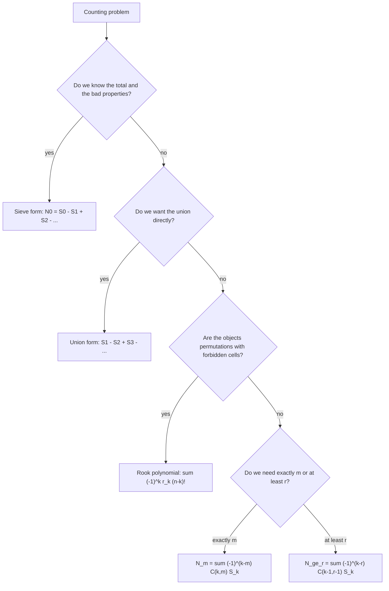
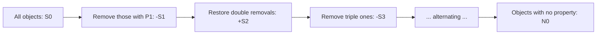

# Inclusion–Exclusion

> [Mathematics](../../README.md) › [Combinatorics](../README.md) › Inclusion–Exclusion · Level: Intermediate · Prerequisites: [Set Theory](../../00-foundations/03-set-theory/README.md), [Proof Techniques](../../00-foundations/04-proof-techniques/README.md), [Counting Principles](../01-counting-principles/README.md), [Mathematical Induction](../../09-discrete-mathematics/01-mathematical-induction/README.md) · Estimated time: 420 min

## 1. Introduction

Count the integers from $1$ to $1000$ that are divisible by $2$, by $3$ or by $5$. There are $500$ multiples of $2$, $333$ of $3$ and $200$ of $5$, but the answer is certainly not $500 + 333 + 200 = 1033$, because numbers such as $6$ and $30$ were counted more than once, and because $1033 > 1000$ is already impossible. The correct answer, $734$, comes from the alternating sum

$$500 + 333 + 200 - 166 - 100 - 66 + 33 = 734,$$

in which every over-count is subtracted and every over-correction is corrected again. That formula is *inclusion–exclusion*: to count a union of overlapping sets, count each set, subtract each pairwise overlap, add back each triple overlap, and continue alternating until the total overlap is reached.

The idea is elementary, but its reach is not. The same alternating sum gives the number of permutations with no fixed point (the *derangements*), the number of surjective functions between finite sets, the number of ways to place objects while avoiding forbidden positions, Euler's totient $\varphi(n)$, the probability that at least one of several events occurs, and a standard proof that the sieve of Eratosthenes really finds all primes. It is the workhorse of enumerative combinatorics: whenever a problem says *at least one*, *none*, *not*, or *avoid*, inclusion–exclusion is usually the fastest route.

The principle is often attributed to Abraham de Moivre, who used it in the 1718 edition of *The Doctrine of Chances* to solve gambling problems, and who stated the general form in 1754. Pierre Rémond de Montmort had already counted derangements in 1708 by the same alternating method, and the related *sieve of Eratosthenes* is ancient. The modern attitude — prove the identity for an arbitrary finite family of sets, then specialise — is what makes the tool reliable.

Two features of this tutorial deserve advance notice.

* **Every formula is proved twice.** The general principle is proved by indicator functions and again by counting each element's contribution. The two proofs teach different lessons: the first is algebraic bookkeeping with $0$s and $1$s, the second is the combinatorial "count each object once" discipline. Both reappear constantly.
* **The alternating sum is a numerical approximation as well as an identity.** Truncating it gives the **Bonferroni inequalities**: any odd number of terms over-estimates the union, any even number under-estimates it, and the error is controlled. This is what makes inclusion–exclusion useful in statistics and in algorithm analysis, where exact counts are impossible but bounds are not.

The tutorial ends with the two generalisations that solve most "exactly $m$" and "at least $r$" problems, and with the rook-polynomial viewpoint that turns many awkward forbidden-position problems into small polynomial computations.

## 2. Prerequisites

This tutorial assumes the following material, all taught earlier in the repository.

* **Sets, subsets, cardinality, unions, intersections, complements, and set difference.** You should be fluent with $A \cap B$, $A \setminus B$, $A^{\complement}$ (complement relative to a fixed universe), indexed families $\bigcup_{i \in I} A_i$, and the meaning of $\lvert A \rvert$. Taught in [Set Theory](../../00-foundations/03-set-theory/README.md), Sections 5–7.
* **Functions, injections, surjections, bijections.** In particular, a function $f : A \to B$ is surjective when every element of $B$ is a value, and a bijection has an inverse. Taught in [Relations and Functions](../../00-foundations/05-relations-and-functions/README.md), Section 7.
* **Direct proof, proof by contradiction, induction, and manipulation of quantified statements.** Inclusion–exclusion is usually proved directly, but the statement "for every finite family" is quantified over $n$, and the induction proofs of Section 8 need care. Taught in [Proof Techniques](../../00-foundations/04-proof-techniques/README.md) and [Mathematical Induction](../../09-discrete-mathematics/01-mathematical-induction/README.md).
* **Counting principles: permutations, $k$-permutations, combinations, the sum and product rules, and the binomial theorem.** In particular $\binom{n}{k} = \frac{n!}{k!(n-k)!}$, $\lvert \mathcal{P}(S)\rvert = 2^{\lvert S\rvert}$, and the number of functions from an $m$-set to an $n$-set is $n^m$. Taught in [Counting Principles](../01-counting-principles/README.md), Sections 7.1–7.7.
* **Divisibility, primes, greatest common divisors and least common multiples.** Used for the sieve and for Euler's totient. Taught in [Divisibility and Primes](../../12-number-theory/01-divisibility-and-primes/README.md), Sections 3–6, and [Congruences](../../12-number-theory/02-congruences/README.md).
* **Elementary probability: sample spaces, events, equally likely outcomes.** Only Section 7.12 and parts of Section 12 need it. Taught in [Probability Foundations](../../10-probability/01-probability-foundations/README.md).
* **The number $e$ and the exponential series.** Used for the asymptotic formula for derangements. Taught in [Sequences and Series in Calculus](../../07-calculus/11-sequences-and-series-in-calculus/README.md).

Two conventions, matching [MATHEMATICAL_NOTATION.md](../../MATHEMATICAL_NOTATION.md):

* $\mathbb{N} = \{1,2,3,\dots\}$ and $\mathbb{N}_0 = \{0,1,2,3,\dots\}$. In counting statements $n$ may be $0$, and $0! = 1$.
* $[n] := \{1,2,\dots,n\}$ with $[0] = \varnothing$. An $n$-element set is always identified with $[n]$ when the labels do not matter, because any two $n$-element sets are in bijection.

## 3. Learning Objectives

After working through this tutorial you will be able to:

1. State the inclusion–exclusion formula for two, three and $n$ finite sets, and justify it with a Venn diagram.
2. Prove the general formula by indicator functions and by the "count each element's contribution" argument.
3. Use the complement (*sieve*) form to count objects avoiding a list of properties.
4. Derive the derangement numbers $D_n$, prove the recurrences $D_n = nD_{n-1} + (-1)^n$ and $D_n = (n-1)(D_{n-1}+D_{n-2})$, and use the estimate $\left\lvert D_n - n!/e \right\rvert < 1/(n+1)$.
5. Count surjections from an $m$-set onto an $n$-set in two ways, and relate the formula to the Stirling numbers of the second kind.
6. Build the rook polynomial of a small *forbidden board* and use it to count permutations avoiding forbidden positions.
7. Derive $\varphi(n) = n\prod_{p \mid n}(1 - 1/p)$ and explain why the sieve of Eratosthenes is inclusion–exclusion in disguise.
8. Apply inclusion–exclusion to probability, and state the Bonferroni inequalities with proof.
9. Count elements lying in exactly $m$ or at least $r$ of a family of sets.
10. Recognise the mistakes that make an inclusion–exclusion computation wrong by a small integer, and check any answer on a small case.

## 4. Intuition

### 4.1 Two rooms with a shared wall

Imagine two rooms $A$ and $B$ in a building, and you must paint every square metre of floor exactly once. If you paint room $A$ (area $\lvert A\rvert$), then paint room $B$ (area $\lvert B \rvert$), you have painted the shared part twice. So you subtract the shared part: area $\lvert A \rvert + \lvert B\rvert - \lvert A\cap B\rvert$.

Now add a third room $C$ that overlaps both. Painting $A$, then $B$, then $C$ paints a floor square once for every room containing it. A square in all three rooms has been painted three times; a square in exactly two rooms has been painted twice; a square in one room exactly once. To convert "number of coats" into "number of squares", subtract the pairwise overlaps. But a square in all three rooms lay in three pairwise overlaps, so subtracting every pairwise overlap removes it three times after it was painted three times — leaving zero. Add the triple overlap back, and it is counted once. The pattern continues: subtract, add, subtract, … for every level of overlap.

### 4.2 The sieve metaphor

A sieve with square holes lets small grains through and keeps large ones. Inclusion–exclusion is a *logical* sieve: start with all objects, remove those having property $P_1$, remove those having $P_2$, put back the ones removed twice (having both $P_1$ and $P_2$), remove the ones put back twice too often (having $P_1, P_2, P_3$), and so on. This is exactly the *sieve of Eratosthenes*, where the properties are "divisible by $2$", "divisible by $3$", "divisible by $5$", …, and the objects kept are the primes.

### 4.3 Why alternating signs are forced

Suppose an element lies in exactly $m$ of the sets. If the formula is a linear combination $\sum_k c_k S_k$ of the "sums of $k$-fold intersections", then that element contributes $\sum_{k=1}^{m} c_k \binom{m}{k}$ to the total. We want the contribution to be $1$ when $m \ge 1$ and $0$ when $m = 0$. The binomial theorem gives

$$\sum_{k=0}^{m} (-1)^{k}\binom{m}{k} = (1-1)^m = 0 \quad (m \ge 1),$$

so taking $c_k = (-1)^{k+1}$ makes the contribution $1 - 0 = 1$. There is no choice about the signs: they are forced by the binomial expansion of $(1-1)^m$. Section 7.5 turns this observation into a complete proof.

### 4.4 What inclusion–exclusion is *not*

It is not a way to count something without understanding it. The terms $S_k$ must be computable, and in most applications the skill lies in choosing the *properties* so that every $k$-fold intersection has the same size, or depends only on $k$. When the intersections are wild, the formula remains true but useless; Section 7.10 shows what to do when they are merely "positional", via rook polynomials.

## 5. Formal Definition

Throughout, $U$ is a finite **universe** and $A_1,\dots,A_n \subseteq U$ are finite sets.

**Definition 5.1** (Index set and intersection over an index set). Let $I \subseteq [n] = \{1,\dots,n\}$. Then

$$\bigcap_{i \in I} A_i := \{\, x : x \in A_i \text{ for every } i \in I \,\}, \qquad \bigcup_{i \in I} A_i := \{\, x : x \in A_i \text{ for at least one } i \in I \,\}.$$

By convention the intersection over the **empty** index set is the whole universe, $\bigcap_{i \in \varnothing} A_i := U$, and the union over the empty index set is $\bigcup_{i\in\varnothing} A_i := \varnothing$.

**Definition 5.2** (Elementary symmetric sums). For $0 \le k \le n$,

$$S_k := \sum_{\substack{I \subseteq [n] \\ \lvert I\rvert = k}} \left\lvert \bigcap_{i \in I} A_i \right\rvert,$$

so that $S_0 = \lvert U \rvert$, $S_1 = \lvert A_1\rvert + \cdots + \lvert A_n\rvert$, and $S_n = \lvert A_1 \cap \cdots \cap A_n\rvert$.

**Definition 5.3** (Membership count). For $x \in U$ define

$$m(x) := \#\{\, i \in [n] : x \in A_i \,\},$$

the number of the sets that contain $x$. Then $x$ belongs to the union exactly when $m(x) \ge 1$.

**Definition 5.4** (Inclusion–exclusion identity). The *inclusion–exclusion identity* for the family $(A_i)_{i=1}^n$ is the assertion

$$\left\lvert \bigcup_{i=1}^{n} A_i \right\rvert = \sum_{\varnothing \ne I \subseteq [n]} (-1)^{\lvert I\rvert + 1} \left\lvert \bigcap_{i \in I} A_i \right\rvert = \sum_{k=1}^{n} (-1)^{k+1} S_k.$$

The equality of the two expressions is just a regrouping of terms by the size of $I$; there are $\binom{n}{k}$ subsets of size $k$.

**Definition 5.5** (The sieve, or complement, form). Suppose every $A_i \subseteq U$ and $\lvert U\rvert < \infty$. The number of elements of $U$ lying in **none** of the $A_i$ is

$$N_0 := \left\lvert U \setminus \bigcup_{i=1}^n A_i \right\rvert = \sum_{k=0}^{n} (-1)^{k} S_k = S_0 - S_1 + S_2 - \cdots + (-1)^n S_n.$$

Definition 5.5 is not a new theorem; it follows from Definition 5.4 by writing $\lvert U \setminus X\rvert = \lvert U\rvert - \lvert X\rvert$ and moving terms. It deserves a separate name because in applications it is the version actually used: we usually know the universe and the bad properties, and we want the objects with none of them.

## 6. Mathematical Notation

| Symbol | Read as | Meaning |
|---|---|---|
| $[n]$ | the set $1$ to $n$ | $\{1,2,\dots,n\}$, with $[0]=\varnothing$ |
| $U$ | the universe | the finite set containing all objects under discussion |
| $A_i$ | $A$ sub $i$ | the $i$-th set of the family |
| $I \subseteq [n]$ | $I$ a subset of $[n]$ | an index set; $I$ names which sets are intersected |
| $\lvert I\rvert$ | size of $I$ | the number of indices in $I$ |
| $\bigcap_{i\in I} A_i$ | intersection over $I$ | elements lying in every $A_i$ with $i \in I$ |
| $\bigcup_{i\in I} A_i$ | union over $I$ | elements lying in at least one such $A_i$ |
| $A^{\complement}$ | complement of $A$ | $U \setminus A$ |
| $A \setminus B$ | $A$ minus $B$ | elements of $A$ not in $B$ |
| $S_k$ | $S$ sub $k$ | sum of the sizes of all $k$-fold intersections |
| $m(x)$ | membership count of $x$ | how many of the $A_i$ contain $x$ |
| $\binom{n}{k}$ | $n$ choose $k$ | $\dfrac{n!}{k!(n-k)!}$, the number of $k$-element subsets of $[n]$ |
| $D_n$ | derangement number | permutations of $[n]$ with no fixed point |
| $\operatorname{Surj}(m,n)$ | number of surjections | onto functions from an $m$-set to an $n$-set |
| $S(m,n)$ | Stirling number | partitions of an $m$-set into $n$ nonempty blocks |
| $\varphi(n)$ | Euler's totient | integers in $[n]$ coprime to $n$ |
| $r_k$ | $r$ sub $k$ | number of ways to place $k$ non-attacking rooks on a board |
| $\Pr(E)$ | probability of $E$ | a number in $[0,1]$ |
| $\mathbf{1}_A$ | indicator of $A$ | the function equal to $1$ on $A$ and $0$ outside |
| $\delta_{ij}$ | Kronecker delta | $1$ if $i=j$, else $0$ |
| $\lvert x\rvert$ | absolute value | distance from $x$ to $0$ |

Read $\sum_{\varnothing \ne I \subseteq [n]}$ aloud as "the sum over all non-empty subsets $I$ of $[n]$". Read $(-1)^{\lvert I\rvert+1}$ as "minus one to the power size of $I$ plus one", which is $+1$ when $\lvert I\rvert$ is odd and $-1$ when $\lvert I\rvert$ is even.

## 7. Core Concepts

### 7.1 Two Sets: the Principle in Miniature

The identity for two sets is

$$\lvert A \cup B\rvert = \lvert A\rvert + \lvert B\rvert - \lvert A \cap B\rvert.$$

*Proof.* The union splits into the disjoint pieces "in $A$ only" and "in $B$", so

$$\lvert A \cup B\rvert = \lvert A \setminus B\rvert + \lvert B\rvert .$$

Also $B$ splits into the disjoint pieces "in $B$ only" and "in both", so $\lvert B\rvert = \lvert B \setminus A\rvert + \lvert A\cap B\rvert$, that is,

$$\lvert B \setminus A\rvert = \lvert B\rvert - \lvert A \cap B\rvert .$$

Substituting the second display into the first gives the identity. $\blacksquare$

The Venn-diagram content is this: the region $A \cap B$ is counted in $\lvert A\rvert$ and again in $\lvert B\rvert$, so it has been counted twice and must be subtracted once. Equivalently, the *indicator* form of the same statement is

$$\mathbf{1}_{A \cup B}(x) = \mathbf{1}_A(x) + \mathbf{1}_B(x) - \mathbf{1}_A(x)\mathbf{1}_B(x),$$

which is checked by testing the four possible membership patterns: if $x$ is in neither set both sides are $0$; if in exactly one, both sides are $1$; if in both, the right side is $1 + 1 - 1 = 1$.

Two useful consequences, both worth remembering:

* $\lvert A \setminus B \rvert = \lvert A\rvert - \lvert A \cap B\rvert$;
* $\lvert A \cup B\rvert = \lvert A\rvert + \lvert B\rvert$ exactly when $A \cap B = \varnothing$.

### 7.2 Three Sets and the Venn-Diagram Justification

For three finite sets,

$$\lvert A \cup B \cup C\rvert = \lvert A\rvert + \lvert B\rvert + \lvert C\rvert - \lvert A\cap B\rvert - \lvert A \cap C\rvert - \lvert B \cap C\rvert + \lvert A \cap B \cap C\rvert .$$

*Proof.* Apply the two-set identity twice. First,

$$\lvert A \cup B \cup C \rvert = \lvert A \cup B\rvert + \lvert C\rvert - \lvert (A \cup B) \cap C\rvert,$$

and by distributivity $(A\cup B)\cap C = (A \cap C) \cup (B \cap C)$, so

$$\lvert (A\cup B)\cap C\rvert = \lvert A\cap C\rvert + \lvert B \cap C\rvert - \lvert (A\cap C)\cap (B\cap C)\rvert = \lvert A\cap C\rvert + \lvert B\cap C\rvert - \lvert A\cap B\cap C\rvert .$$

Substituting $\lvert A\cup B\rvert = \lvert A\rvert + \lvert B\rvert - \lvert A \cap B\rvert$ and the last display into the first gives the identity. $\blacksquare$

The **Venn justification** is a table. The three sets cut the plane into $2^3 = 8$ regions, one for each pattern of membership. In the next table, "yes" means the region lies inside the set.

| Region | in $A$? | in $B$? | in $C$? | counted by $S_1$ | by $S_2$ | by $S_3$ | total $S_1 - S_2 + S_3$ |
|---|---|---|---|---|---|---|---|
| $A\cap B\cap C$ | yes | yes | yes | 3 | 3 | 1 | $3-3+1 = 1$ |
| $A\cap B\cap C^{\complement}$ | yes | yes | no | 2 | 1 | 0 | $2-1 = 1$ |
| $A\cap B^{\complement}\cap C$ | yes | no | yes | 2 | 1 | 0 | $2-1 = 1$ |
| $A^{\complement}\cap B\cap C$ | no | yes | yes | 2 | 1 | 0 | $2-1 = 1$ |
| $A\cap B^{\complement}\cap C^{\complement}$ | yes | no | no | 1 | 0 | 0 | $1$ |
| $A^{\complement}\cap B\cap C^{\complement}$ | no | yes | no | 1 | 0 | 0 | $1$ |
| $A^{\complement}\cap B^{\complement}\cap C$ | no | no | yes | 1 | 0 | 0 | $1$ |
| $A^{\complement}\cap B^{\complement}\cap C^{\complement}$ | no | no | no | 0 | 0 | 0 | $0$ |

Every element of the union is counted exactly once and every element outside the union is counted zero times. This is the entire content of the theorem, and the pattern generalises: an element lying in exactly $m$ of the sets is counted $\binom{m}{k}$ times by $S_k$, so the alternating sum counts it $\sum_{k=1}^{m}(-1)^{k+1}\binom{m}{k} = 1$ times.

A numerical check of the three-set formula: take $A = \{1,2,3,4\}$, $B = \{3,4,5\}$, $C = \{4,5,6\}$. Then $\lvert A\cup B\cup C\rvert = 6$, while $S_1 = 4+3+3 = 10$, $S_2 = \lvert\{3,4\}\rvert + \lvert\{4\}\rvert + \lvert\{4,5\}\rvert = 2+1+2 = 5$, $S_3 = 1$, and $10 - 5 + 1 = 6$. ✓

### 7.3 The General Principle

**Theorem 7.1** (Inclusion–exclusion). Let $A_1, \dots, A_n$ be finite sets, and for $0 \le k \le n$ let

$$S_k = \sum_{\lvert I\rvert = k} \left\lvert \bigcap_{i \in I} A_i \right\rvert , \qquad \text{with } S_0 = \lvert U \rvert .$$

Then

$$\left\lvert \bigcup_{i=1}^{n} A_i \right\rvert = S_1 - S_2 + S_3 - \cdots + (-1)^{n+1} S_n .$$

In ungrouped form, with all intersections taken over non-empty index sets,

$$\left\lvert \bigcup_{i=1}^{n} A_i \right\rvert = \sum_{\varnothing \ne I \subseteq [n]} (-1)^{\lvert I\rvert + 1} \left\lvert \bigcap_{i \in I} A_i \right\rvert .$$

The next two subsections prove the theorem in two independent ways. A reader who accepts one proof may skip the other, but both are worth reading: the indicator proof is the model for all later "algebraic" uses, and the counting proof is the model for all later "each object contributes once" arguments.

### 7.4 Proof by Indicator Functions

Fix a finite universe $U$ containing all the $A_i$. For a subset $B \subseteq U$ the **indicator function** $\mathbf{1}_B : U \to \{0,1\}$ is defined by

$$\mathbf{1}_B(x) = \begin{cases} 1, & x \in B,\\ 0, & x \notin B .\end{cases}$$

Two facts are used constantly:

$$\mathbf{1}_{B \cap C} = \mathbf{1}_B \cdot \mathbf{1}_C, \qquad \sum_{x \in U} \mathbf{1}_B(x) = \lvert B\rvert .$$

*Step 1: pointwise identity.* For a single $x \in U$, the product $\prod_{i=1}^n \left(1 - \mathbf{1}_{A_i}(x)\right)$ equals $1$ when $x$ lies in no $A_i$ (every factor is $1$) and equals $0$ when $x$ lies in at least one $A_i$ (that factor is $0$). Hence it is exactly $1 - \mathbf{1}_{\bigcup_i A_i}(x)$, i.e.

$$\mathbf{1}_{\bigcup_{i=1}^n A_i}(x) = 1 - \prod_{i=1}^n \left(1 - \mathbf{1}_{A_i}(x)\right).$$

*Step 2: expand.* Expanding the product over all subsets $I \subseteq [n]$,

$$\prod_{i=1}^n \left(1 - \mathbf{1}_{A_i}(x)\right) = \sum_{I \subseteq [n]} (-1)^{\lvert I\rvert} \prod_{i \in I} \mathbf{1}_{A_i}(x) = \sum_{I\subseteq[n]} (-1)^{\lvert I\rvert}\,\mathbf{1}_{\bigcap_{i\in I}A_i}(x),$$

because a product of indicators is the indicator of the intersection. Inserting this into Step 1,

$$\mathbf{1}_{\bigcup_i A_i}(x) = 1 - \sum_{I \subseteq [n]} (-1)^{\lvert I\rvert}\mathbf{1}_{\bigcap_{i\in I}A_i}(x) = -\sum_{\varnothing \ne I \subseteq [n]} (-1)^{\lvert I\rvert}\mathbf{1}_{\bigcap_{i\in I}A_i}(x),$$

since the term $I = \varnothing$ contributes $(-1)^0 \mathbf{1}_U(x) = 1$ and cancels the leading $1$.

*Step 3: sum over $x$.* Summing the pointwise identity over all $x \in U$ and using $\sum_x \mathbf{1}_B(x) = \lvert B\rvert$,

$$\left\lvert \bigcup_{i=1}^n A_i\right\rvert = -\sum_{\varnothing\ne I \subseteq [n]} (-1)^{\lvert I\rvert}\left\lvert \bigcap_{i\in I} A_i\right\rvert = \sum_{\varnothing\ne I\subseteq[n]} (-1)^{\lvert I\rvert+1}\left\lvert \bigcap_{i\in I}A_i\right\rvert,$$

which is the theorem. $\blacksquare$

Notice what the proof did *not* use: it never assumed that the sets are "independent", never used the sizes of the individual sets except at the last step, and never required the universe to be anything more than finite. It is a purely algebraic identity between functions.

### 7.5 Proof by Counting Each Element

This proof is the combinatorial skeleton of the previous one.

Let $x \in U$ and let $m = m(x)$ be the number of sets $A_i$ containing $x$.

*How often is $x$ counted by $S_k$?* The element $x$ contributes to $\lvert \bigcap_{i\in I}A_i\rvert$ exactly when $I$ consists only of indices with $x \in A_i$. There are $m$ such indices, hence $\binom{m}{k}$ such index sets of size $k$. Therefore $x$ is counted exactly $\binom{m}{k}$ times by $S_k$.

*Total contribution to the alternating sum.* If $m = 0$, then $x$ contributes $0$ to every $S_k$ with $k \ge 1$, so its total contribution is $0$. If $m \ge 1$, its contribution is

$$\sum_{k=1}^{m} (-1)^{k+1}\binom{m}{k} = -\sum_{k=1}^{m} (-1)^{k}\binom{m}{k} = -\left(\sum_{k=0}^{m} (-1)^{k}\binom{m}{k} - 1\right) = -\left((1-1)^m - 1\right) = 1,$$

where the binomial theorem was used for $\sum_{k=0}^m (-1)^k\binom{m}{k} = (1-1)^m = 0$.

So the alternating sum counts every element of the union exactly once and every element outside it exactly zero times. Hence it equals $\lvert \bigcup_i A_i\rvert$. $\blacksquare$

The same computation gives the whole family of results in Section 7.14 for free: counting $x$ with weight $f(m(x))$ and expanding $f$ in binomial coefficients is the general method.

### 7.6 The Complement Form: Counting What Is Forbidden

Most counting problems are phrased positively ("how many objects have at least one of these properties") but are easiest to solve negatively ("count the objects with none of these properties"). The complement form handles the negative version.

**Corollary 7.2** (Sieve form). Let $A_1,\dots,A_n \subseteq U$ with $\lvert U \rvert = N < \infty$. The number of elements of $U$ that belong to **none** of the $A_i$ is

$$N_0 = \sum_{k=0}^{n} (-1)^k S_k = N - S_1 + S_2 - \cdots + (-1)^n S_n .$$

*Proof.* By Theorem 7.1, $\lvert \bigcup_i A_i\rvert = S_1 - S_2 + \cdots$. Since the $A_i$ all lie in $U$, the complement of the union inside $U$ has size $N - \lvert \bigcup_i A_i\rvert$. Substituting gives $N - S_1 + S_2 - \cdots$, which is the stated alternating sum. $\blacksquare$

**Corollary 7.3** (Number with at least one property). The number of elements of $U$ belonging to at least one $A_i$ is $S_1 - S_2 + S_3 - \cdots$, and the number belonging to none is $N - (S_1 - S_2 + S_3 - \cdots) = \sum_{k\ge0}(-1)^kS_k$.

The practical recipe is:

1. Name the objects (the universe $U$) and count them: this is $S_0 = N$.
2. Name the *bad* properties $P_1,\dots,P_n$, one set $A_i$ per property.
3. Compute $\lvert \bigcap_{i \in I}A_i\rvert$ for a general index set $I$ — usually it depends only on $\lvert I \rvert$.
4. Add and subtract.

A first example shows the pattern; many more follow in Section 9.

**Example 7.4.** How many of the integers $1, 2, \dots, 300$ are divisible by none of $2$, $3$, $5$?

Take $U = [300]$, so $N = 300$. The three bad sets are the multiples of $2$, of $3$, of $5$. A number is divisible by all the primes in $I$ exactly when it is divisible by their product, and there are $\lfloor 300/\prod_{i\in I} p_i\rfloor$ such numbers. Hence

$$\begin{aligned}
N_0 &= 300 - \left(\left\lfloor \tfrac{300}{2}\right\rfloor + \left\lfloor \tfrac{300}{3}\right\rfloor + \left\lfloor \tfrac{300}{5}\right\rfloor\right) + \left(\left\lfloor \tfrac{300}{6}\right\rfloor + \left\lfloor \tfrac{300}{10}\right\rfloor + \left\lfloor \tfrac{300}{15}\right\rfloor\right) - \left\lfloor \tfrac{300}{30}\right\rfloor\\
&= 300 - (150 + 100 + 60) + (50 + 30 + 20) - 10\\
&= 300 - 310 + 100 - 10 = 80 .
\end{aligned}$$

Check on a full period: modulo $30$ there are exactly $\varphi(30) = 8$ residues coprime to $30$, namely $1,7,11,13,17,19,23,29$; since $300 = 10 \cdot 30$, the count is $10 \cdot 8 = 80$. ✓

This check is worth internalising: whenever the bad properties are divisibility by primes, the answer is periodic with period the product of the primes, so it can always be verified against one period.

### 7.7 Derangements

A **derangement** of $[n]$ is a permutation $\sigma$ with $\sigma(i) \ne i$ for every $i$. Write $D_n$ for the number of derangements. The problem is the model of every inclusion–exclusion computation: the universe is easy to count, each forbidden property is easy to count, and every intersection of forbidden properties is easy to count.

**Theorem 7.5** (Derangement formula). For $n \ge 0$,

$$D_n = \sum_{k=0}^{n} (-1)^k \binom{n}{k}(n-k)! = n!\sum_{k=0}^{n} \frac{(-1)^k}{k!}.$$

*Proof.* Let $U$ be the set of all $n!$ permutations of $[n]$, and for $i \in [n]$ let

$$A_i := \{\, \sigma \in U : \sigma(i) = i \,\}$$

be the set of permutations fixing $i$. A derangement is a permutation lying in none of the $A_i$, so $D_n = N_0$ and Corollary 7.2 applies.

For $I \subseteq [n]$ with $\lvert I \rvert = k$, the set $\bigcap_{i \in I} A_i$ consists of the permutations fixing every element of $I$; such a permutation is determined by its action on the remaining $n-k$ elements, which is an arbitrary permutation of them. Hence

$$\left\lvert \bigcap_{i\in I} A_i \right\rvert = (n-k)!, \qquad\text{so}\qquad S_k = \binom{n}{k}(n-k)! .$$

Therefore

$$D_n = \sum_{k=0}^{n}(-1)^k S_k = \sum_{k=0}^{n}(-1)^k\binom{n}{k}(n-k)! = \sum_{k=0}^{n}(-1)^k\frac{n!}{k!} = n!\sum_{k=0}^{n}\frac{(-1)^k}{k!},$$

where $\binom{n}{k}(n-k)! = \frac{n!}{k!(n-k)!}(n-k)! = \frac{n!}{k!}$ was used. $\blacksquare$

The first values are worth memorising, because they serve as checks:

| $n$ | 0 | 1 | 2 | 3 | 4 | 5 | 6 | 7 | 8 |
|---|---|---|---|---|---|---|---|---|---|
| $D_n$ | 1 | 0 | 1 | 2 | 9 | 44 | 265 | 1854 | 14833 |
| $n!$ | 1 | 1 | 2 | 6 | 24 | 120 | 720 | 5040 | 40320 |
| $D_n/n!$ | 1 | 0 | 0.5 | 0.3333 | 0.375 | 0.3667 | 0.3681 | 0.36786 | 0.367882 |

The formula is easiest to remember in the second form: $D_n$ is $n!$ times the $n$-th partial sum of the series for $e^{-1}$.

**Two recurrences.** Both are useful, and both have short proofs.

*Proof of $D_n = nD_{n-1} + (-1)^n$.* Starting from the formula,

$$nD_{n-1} = n\,(n-1)!\sum_{k=0}^{n-1}\frac{(-1)^k}{k!} = n!\sum_{k=0}^{n-1}\frac{(-1)^k}{k!} = D_n - n!\cdot\frac{(-1)^n}{n!} = D_n - (-1)^n,$$

so $D_n = nD_{n-1} + (-1)^n$. $\blacksquare$

*Proof of $D_n = (n-1)(D_{n-1} + D_{n-2})$.* Let $\sigma$ be a derangement of $[n]$ and put $j = \sigma(n)$; then $j \ne n$, so there are $n-1$ choices for $j$. Fix one such $j$ and count.

* *Case 1: $\sigma(j) = n$.* Then $\sigma$ swaps $n$ and $j$, and on the remaining $n-2$ elements it is a derangement of them: $D_{n-2}$ possibilities.
* *Case 2: $\sigma(j) \ne n$.* Let $i = \sigma^{-1}(n)$, so $i \notin \{j,n\}$. Define a map $\tau$ on $[n-1]$ by $\tau(i) = j$ and $\tau(x) = \sigma(x)$ for $x \in [n-1]$, $x \ne i$. For $x \ne i$ we have $\sigma(x) \ne n$ (as $i$ is the unique preimage of $n$) and $\sigma(x) \ne j$ (as $j = \sigma(n)$ is already a value), so $\tau$ is a well-defined permutation of $[n-1]$; and $\tau(x) = \sigma(x) \ne x$ for $x \ne i$, while $\tau(i) = j \ne i$. Thus $\tau$ is a derangement of $[n-1]$. Conversely any derangement $\tau$ of $[n-1]$ arises this way from exactly one $\sigma$: take $i = \tau^{-1}(j)$, set $\sigma(n) = j$, $\sigma(i) = n$, and $\sigma = \tau$ elsewhere. Hence there are $D_{n-1}$ possibilities in Case 2.

Summing over the $n-1$ choices of $j$ gives $D_n = (n-1)(D_{n-1} + D_{n-2})$. $\blacksquare$

Check at $n = 4$: $(4-1)(D_3 + D_2) = 3(2 + 1) = 9 = D_4$. ✓

### 7.8 How Close Is $D_n$ to $n!/e$?

The fraction $D_n/n! = \sum_{k=0}^{n}(-1)^k/k!$ is a partial sum of the exponential series

$$e^{-1} = \sum_{k=0}^{\infty}\frac{(-1)^k}{k!}.$$

The remainder of an alternating series whose terms decrease in absolute value to $0$ is bounded by the first omitted term. Since $1/k!$ decreases for $k \ge 0$, the tail satisfies

$$\left\lvert \sum_{k=n+1}^{\infty}\frac{(-1)^k}{k!}\right\rvert < \frac{1}{(n+1)!}.$$

Therefore

$$\left\lvert \frac{D_n}{n!} - \frac{1}{e}\right\rvert < \frac{1}{(n+1)!}, \qquad\text{and multiplying by } n!, \qquad \left\lvert D_n - \frac{n!}{e}\right\rvert < \frac{1}{n+1}.$$

Two consequences:

* Since $1/(n+1) \le 1/2$ for $n \ge 1$, $D_n$ is the **nearest integer** to $n!/e$ for every $n \ge 1$. For example $D_4 = 9$ and $24/e = 8.8291\ldots$; $D_5 = 44$ and $120/e = 44.1455\ldots$.
* The probability $D_n/n!$ that a random permutation is a derangement converges to $1/e = 0.36787944\ldots$, and the convergence is extremely fast: at $n = 6$ the value is $265/720 = 0.368055\ldots$, already within $2\times 10^{-4}$.

The error bound does not say that the difference decreases monotonically — it alternates in sign, because the remainder of an alternating series has the sign of its first term. At $n = 4$ the partial sum $9/24 = 0.375$ exceeds $1/e$; at $n = 5$, $44/120 = 0.3666\ldots$ is below it.

### 7.9 Counting Surjections

Let $\operatorname{Surj}(m,n)$ be the number of surjective (onto) functions from an $m$-element set $X$ to an $n$-element set $Y$.

**Theorem 7.6** (Surjection formula). For $m, n \ge 1$,

$$\operatorname{Surj}(m,n) = \sum_{k=0}^{n}(-1)^k\binom{n}{k}(n-k)^m .$$

*Proof.* Take $U = Y^{X}$, the set of all functions $X \to Y$, so $\lvert U\rvert = n^m$. For $y \in Y$ let $A_y$ be the set of functions whose image omits $y$. A function is surjective exactly when it lies in no $A_y$. For an index set $I \subseteq Y$ of size $k$, the functions omitting every element of $I$ are precisely the functions $X \to Y \setminus I$, of which there are $(n-k)^m$. Hence $S_k = \binom{n}{k}(n-k)^m$, and the sieve form gives the stated formula. $\blacksquare$

Check the small cases. For $n = 2$ the formula gives $2^m - 2$, which is right: the only non-surjective functions into a two-element set are the two constant functions. For $m = 3$, $n = 3$ it gives $27 - 3\cdot 8 + 3\cdot 1 - 0 = 6$, which is $3!$: every surjection from a $3$-set to a $3$-set is a bijection. For $m = 4$, $n = 2$: $16 - 2 = 14$. ✓

The formula also explains the Stirling numbers of the second kind $S(m,n)$, defined as the number of partitions of an $m$-set into $n$ nonempty blocks. Each surjection partitions its domain into the $n$ nonempty fibres (the preimages of the $n$ points of $Y$), and the fibres can be assigned to the $n$ labels of $Y$ in $n!$ ways. Hence

$$\operatorname{Surj}(m,n) = n!\,S(m,n), \qquad\text{so}\qquad S(m,n) = \frac{1}{n!}\sum_{k=0}^{n}(-1)^k\binom{n}{k}(n-k)^m .$$

Check: $S(4,3) = \frac{1}{6}(81 - 48 + 3) = \frac{36}{6} = 6$, and indeed $S(4,3) = 6$. ✓

### 7.10 Forbidden Positions and Rook Polynomials

Many counting problems say "arrange $n$ objects, but object $i$ may not go in position $j$". The set of *forbidden* positions is a subset $B$ of the $n \times n$ grid $[n]\times[n]$: cell $(i,j)$ belongs to $B$ when object $i$ may not be placed in position $j$. A placement is a permutation $\sigma$ (object $i$ goes to position $\sigma(i)$), and a placement is legal when its graph $\{(i,\sigma(i))\}$ is disjoint from $B$.

A set of cells in $[n]\times[n]$ is **non-attacking** when no two share a row or a column — exactly the condition that they could be occupied simultaneously by rooks that do not attack each other. Define

$$r_k(B) := \#\{\, \text{ways to choose } k \text{ non-attacking cells of } B \,\}, \qquad R_B(x) := \sum_{k \ge 0} r_k(B)\,x^k .$$

The polynomial $R_B$ is the **rook polynomial** of $B$, and $r_0 = 1$ always.

**Theorem 7.7** (Rook theorem). Let $B \subseteq [n]\times[n]$. The number of permutations $\sigma$ of $[n]$ with $(i,\sigma(i)) \notin B$ for all $i$ is

$$N_0(B) = \sum_{k=0}^{n}(-1)^k\, r_k(B)\,(n-k)! .$$

*Proof.* For a cell $b = (i,j) \in B$ let $A_b$ be the set of permutations with $\sigma(i) = j$ — those that *use* the forbidden cell $b$. A legal placement uses no cell of $B$, so the number of legal placements is $N_0$ for the family $(A_b)_{b\in B}$, and Corollary 7.2 applies with universe $U$ = all $n!$ permutations.

For $S \subseteq B$, the intersection $\bigcap_{b\in S}A_b$ consists of permutations using every cell of $S$. If two cells of $S$ share a row, they demand two different values of $\sigma$ at the same point, so the intersection is empty. If two share a column, two different points demand the same value, so again it is empty. Hence the intersection is non-empty only when $S$ is non-attacking, and in that case the $\lvert S\rvert$ cells fix $\lvert S\rvert$ values of $\sigma$ and the remaining $n - \lvert S\rvert$ values are free: the intersection has size $(n-\lvert S\rvert)!$.

Grouping the subsets $S$ of size $k$ by the number $r_k(B)$ of non-attacking ones, $S_k = r_k(B)(n-k)!$, and the sieve form gives the theorem. $\blacksquare$

**Corollary 7.8** (Hit numbers). The number of permutations that use **exactly** $j$ cells of $B$ is

$$N_j(B) = \sum_{k=j}^{n}(-1)^{k-j}\binom{k}{j}\,r_k(B)\,(n-k)! .$$

This is the "exactly $m$" formula of Section 7.14 applied to the family $(A_b)$.

**Example 7.9.** Derangements are the case $B = \{(1,1),(2,2),\dots,(n,n)\}$, the diagonal. A set of $k$ diagonal cells is automatically non-attacking, so $r_k = \binom{n}{k}$ and $R_B(x) = (1+x)^n$; Theorem 7.7 gives $D_n = \sum_k(-1)^k\binom{n}{k}(n-k)!$, recovering Theorem 7.5.

**Example 7.10.** Let $n = 4$ and let $B$ consist of the cells $(1,1),(1,2),(2,2),(3,3),(4,4)$. Then $r_0 = 1$ and $r_1 = 5$ (one per cell). For $r_2$: there are $\binom{5}{2} = 10$ pairs, of which $(1,1)$–$(1,2)$ share row $1$ and $(1,2)$–$(2,2)$ share column $2$, leaving $10 - 2 = 8$. For $r_3$: of the $\binom{5}{3} = 10$ triples, exactly five are non-attacking, namely $\{(1,1),(2,2),(3,3)\}$, $\{(1,1),(2,2),(4,4)\}$, $\{(1,1),(3,3),(4,4)\}$, $\{(2,2),(3,3),(4,4)\}$ and $\{(1,2),(3,3),(4,4)\}$; every other triple contains two cells in row $1$ or two cells in column $2$. And $r_4 = 1$, namely $\{(1,1),(2,2),(3,3),(4,4)\}$. Hence

$$N_0 = 24 - 5\cdot 6 + 8\cdot 2 - 5\cdot 1 + 1\cdot 1 = 24 - 30 + 16 - 5 + 1 = 6 .$$

A brute-force check over all $24$ permutations confirms that exactly $6$ avoid all five forbidden cells. ✓

The practical value of the rook polynomial is that boards often decompose. If $B$ splits into two parts $B_1, B_2$ occupying disjoint sets of rows **and** disjoint sets of columns, then choosing $i$ non-attacking cells in $B_1$ and $k-i$ in $B_2$ is independent, so

$$R_B(x) = R_{B_1}(x)\,R_{B_2}(x).$$

For instance a $2\times 2$ block of forbidden cells has $R(x) = 1 + 4x + 2x^2$, and two such blocks in disjoint rows and columns (a $4\times4$ board) have $R(x) = (1+4x+2x^2)^2 = 1 + 8x + 20x^2 + 16x^3 + 4x^4$.

### 7.11 The Sieve of Eratosthenes and Euler's Totient

**Euler's totient** $\varphi(n)$ is the number of integers $k$ with $1 \le k \le n$ and $\gcd(k,n) = 1$.

**Theorem 7.11** (Totient product formula). Let $n \ge 1$ have distinct prime divisors $p_1,\dots,p_r$. Then

$$\varphi(n) = n\prod_{i=1}^{r}\left(1 - \frac{1}{p_i}\right).$$

*Proof.* Take $U = [n]$ and for each prime $p_i \mid n$ let $A_i$ be the set of multiples of $p_i$ in $[n]$. Then $\lvert A_i\rvert = n/p_i$. More generally, for $I \subseteq [r]$ the intersection $\bigcap_{i\in I}A_i$ consists of the multiples of $\prod_{i\in I}p_i$ in $[n]$, a number $n/\prod_{i\in I}p_i$ — here distinctness of the primes is used, so that the product really is the least common multiple. Thus

$$\varphi(n) = \sum_{I \subseteq [r]}(-1)^{\lvert I\rvert}\frac{n}{\prod_{i\in I}p_i} = n\sum_{I\subseteq[r]}\prod_{i\in I}\left(-\frac{1}{p_i}\right) = n\prod_{i=1}^{r}\left(1-\frac{1}{p_i}\right),$$

because expanding the product $\prod_i (1 - 1/p_i)$ produces exactly the sum over subsets. $\blacksquare$

Check: $360 = 2^3\cdot 3^2 \cdot 5$, so $\varphi(360) = 360\cdot\frac{1}{2}\cdot\frac{2}{3}\cdot\frac{4}{5} = 96$. Direct count confirms $96$ residues coprime to $360$. ✓ Note that only the *distinct* primes matter: the exponents play no role.

**The sieve of Eratosthenes.** To list the primes up to $x$, one writes the numbers $2,\dots,x$ and strikes out the multiples of $2$, then of $3$, then of $5$, and so on. The striking stops at $\sqrt{x}$, because every composite $m \le x$ has a prime factor $\le \sqrt{m} \le \sqrt{x}$. What survives is exactly the number $1$ together with the primes greater than $\sqrt{x}$, and every prime $\le \sqrt{x}$ was itself struck out at some earlier stage.

To count rather than list, define for real $x \ge 1$ and integer $a \ge 0$

$$\Phi(x,a) := \#\{\, m \le x : m \text{ is not divisible by any of } p_1,\dots,p_a \,\},$$

where $p_1,p_2,\dots = 2,3,5,\dots$ are the primes in order. By inclusion–exclusion over the $a$ primes,

$$\Phi(x,a) = \sum_{I\subseteq[a]}(-1)^{\lvert I\rvert}\left\lfloor \frac{x}{\prod_{i\in I}p_i}\right\rfloor .$$

Taking $a = \pi(\sqrt{x})$ so that $p_a \le \sqrt{x} < p_{a+1}$, the survivors up to $x$ are $1$ and the $\pi(x) - a$ primes in $(\sqrt{x}, x]$. Hence $\Phi(x,a) = 1 + \pi(x) - a$, that is **Legendre's formula**

$$\pi(x) = \Phi(x,a) + a - 1, \qquad a = \pi(\sqrt{x}).$$

For $x = 100$ we have $a = 4$ (primes $2,3,5,7$) and

$$\begin{aligned}
\Phi(100,4) &= 100 - (50+33+20+14) + (16+10+7+6+4+2) - (3+2+1+0) + 0\\
&= 100 - 117 + 45 - 6 = 22 ,
\end{aligned}$$

so $\pi(100) = 22 + 4 - 1 = 25$, which is correct. The decisive point is that the $2^4 = 16$ terms replace a check of $99$ numbers: this is the first appearance of the *sieve method* that, refined by Brun and others, dominates analytic number theory.

### 7.12 Inclusion–Exclusion in Probability

Let $(\Omega, \Pr)$ be a finite probability space and $A_1,\dots,A_n$ events. Applying Theorem 7.1 to the sets $A_i$ and dividing by $\lvert\Omega\rvert$ gives

$$\Pr\left(\bigcup_{i=1}^{n}A_i\right) = \sum_{\varnothing\ne I\subseteq[n]}(-1)^{\lvert I\rvert+1}\Pr\left(\bigcap_{i\in I}A_i\right),$$

and the complement form is

$$\Pr\left(\bigcap_{i=1}^{n}A_i^{\complement}\right) = \sum_{I\subseteq[n]}(-1)^{\lvert I\rvert}\Pr\left(\bigcap_{i\in I}A_i\right).$$

The cleanest proof uses indicator functions and linearity of expectation: $\Pr(E) = \mathbb{E}[\mathbf{1}_E]$, and the pointwise identity of Section 7.4 holds at every $\omega \in \Omega$. This version also covers infinite sample spaces, because linearity of expectation does not require finiteness; only the individual probabilities need to exist.

**Example 7.12** (The matching problem). $n$ letters are inserted at random into $n$ addressed envelopes, one letter per envelope. The probability that no letter reaches its own envelope is $D_n/n!$, which tends to $1/e \approx 0.3679$. For $n = 10$ the exact value is $1\,334\,961/3\,628\,800 = 16\,481/44\,800 \approx 0.36787946$. So the chance of a perfect misdelivery is about $36.8\%$ no matter how large $n$ is — a fact that surprises everyone the first time.

**Example 7.13** (The coupon collector). A fair die is rolled $n$ times. The probability that all six faces appear at least once is, by the sieve applied to the six events "face $j$ never appears",

$$\sum_{k=0}^{6}(-1)^k\binom{6}{k}\left(\frac{6-k}{6}\right)^{n}.$$

For $n = 6$ this is $6!/6^6 = 5/324 \approx 0.0154$; for $n = 12$ it is $1\,654\,565/3\,779\,136 \approx 0.4378$. For general $N$ faces the same formula holds with $6$ replaced by $N$.

### 7.13 The Bonferroni Inequalities

Inclusion–exclusion is an exact identity only when all $n$ terms are kept. Its partial sums, however, are *bounds*, and the bounds alternate.

**Theorem 7.14** (Bonferroni). With $S_k$ as in Definition 5.2 and $1 \le t \le n$,

$$\left\lvert\bigcup_{i=1}^{n}A_i\right\rvert \;\le\; S_1 - S_2 + \cdots + S_t \quad (t \text{ odd}), \qquad \left\lvert\bigcup_{i=1}^{n}A_i\right\rvert \;\ge\; S_1 - S_2 + \cdots - S_t \quad (t \text{ even}).$$

*Proof.* An element $x$ with membership count $m = m(x)$ contributes $\binom{m}{k}$ to $S_k$, so its contribution to the partial sum is $P_t(m) := \sum_{k=1}^{t}(-1)^{k+1}\binom{m}{k}$. Note $P_t(0) = 0$. The claim is that $P_t(m) \ge 1$ for odd $t$ and $P_t(m) \le 1$ for even $t$, for every $m \ge 1$; then summing over $x$ and comparing with the exact contribution (which is $1$ for $m\ge1$ and $0$ for $m=0$) yields the result.

The key identity, proved in Section 8.3, is

$$\sum_{k=0}^{t}(-1)^k\binom{m}{k} = (-1)^t\binom{m-1}{t} \qquad (0 \le t \le m),$$

with the convention $\binom{m-1}{t} = 0$ when $t > m-1$. Therefore

$$P_t(m) = 1 - \sum_{k=0}^{t}(-1)^k\binom{m}{k} = 1 - (-1)^t\binom{m-1}{t}.$$

If $t$ is odd, $P_t(m) = 1 + \binom{m-1}{t} \ge 1$; if $t$ is even, $P_t(m) = 1 - \binom{m-1}{t} \le 1$. Summing, an odd $t$ over-counts every element of the universe (including those outside the union, whose contribution is $0$), so the sum exceeds the union; an even $t$ under-counts. $\blacksquare$

The case $t = 1$ is the trivial bound $\lvert A_1 \cup \cdots \cup A_n\rvert \le \lvert A_1\rvert + \cdots + \lvert A_n\rvert$ (Bolzano's inequality for measures), and $t = 2$ is the two-set correction. When $t \ge n$ the partial sum is the full union and the inequalities are equalities.

The probability form of the even case $t = 2$ is often used as *the* Bonferroni inequality. Applied to the complements of events, it gives the union bound

$$\Pr\left(\bigcap_{i=1}^{n}B_i\right) \ge \sum_{i=1}^{n}\Pr(B_i) - (n-1),$$

which is the standard "the intersection of $n$ likely events is likely" estimate.

*Sharpness.* For $n = 5$ events each of probability $0.9$, the bound gives $\Pr(\bigcap B_i) \ge 5(0.9) - 4 = 0.5$. It is sharp: take a probability space with $10$ equally likely atoms $1,\dots,10$ and let $B_i$ be the complement of the single atom $i$, for $i = 1,\dots,5$. Then $\Pr(B_i) = 0.9$ for each $i$, and $\bigcap_{i=1}^{5}B_i$ is the complement of $\{1,2,3,4,5\}$, whose probability is $5/10 = 0.5$. ✓

### 7.14 Exactly $m$, At Least $r$

**Theorem 7.15** (Exactly $m$). For $0 \le m \le n$, the number $N_m$ of elements lying in exactly $m$ of the sets $A_1,\dots,A_n$ is

$$N_m = \sum_{k=m}^{n}(-1)^{k-m}\binom{k}{m}S_k .$$

*Proof.* Sum over elements. An element with $m(x) = j$ contributes $\binom{j}{k}$ to $S_k$, hence

$$\sum_{k=m}^{n}(-1)^{k-m}\binom{k}{m}\binom{j}{k} = \binom{j}{m}\sum_{k=m}^{n}(-1)^{k-m}\binom{j-m}{k-m} = \binom{j}{m}\sum_{i=0}^{j-m}(-1)^{i}\binom{j-m}{i} = \binom{j}{m}(1-1)^{j-m},$$

where $\binom{k}{m}\binom{j}{k} = \binom{j}{m}\binom{j-m}{k-m}$ was used. This last expression is $1$ when $j = m$ (the only surviving term of $(1-1)^{j-m}$ is the one with $j-m = 0$) and $0$ when $j \ne m$ (because then $(1-1)^{j-m} = 0$; for $j < m$ every term vanishes). Summing over elements counts exactly those with $j = m$. $\blacksquare$

**Corollary 7.16** (At least $r$). The number of elements lying in at least $r$ of the sets is

$$N_{\ge r} = \sum_{k=r}^{n}(-1)^{k-r}\binom{k-1}{r-1}S_k .$$

*Proof.* Sum Theorem 7.15 over $m \ge r$ and interchange the order of summation:

$$N_{\ge r} = \sum_{m=r}^{n}\sum_{k=m}^{n}(-1)^{k-m}\binom{k}{m}S_k = \sum_{k=r}^{n}S_k\sum_{m=r}^{k}(-1)^{k-m}\binom{k}{m}.$$

The inner sum equals $(-1)^{k-r}\binom{k-1}{r-1}$ by the partial-sum identity of Section 8.3, since

$$\sum_{m=r}^{k}(-1)^{k-m}\binom{k}{m} = (-1)^{k}\left(-\sum_{m=0}^{r-1}(-1)^{m}\binom{k}{m}\right) = (-1)^{k+1}(-1)^{r-1}\binom{k-1}{r-1} = (-1)^{k-r}\binom{k-1}{r-1}.$$

$\blacksquare$

Check both on the three sets $A = \{1,\dots,10\}$, $B = \{3,4,5,6,11,12\}$, $C = \{5,6,7,13\}$. Here $S_1 = 10+6+4 = 20$; and $A\cap B = \{3,4,5,6\}$, $A\cap C = \{5,6,7\}$, $B\cap C = \{5,6\}$, so $S_2 = 4+3+2 = 9$; and $A\cap B\cap C = \{5,6\}$, so $S_3 = 2$. Then Theorem 7.15 gives $N_1 = S_1 - 2S_2 + 3S_3 = 20 - 18 + 6 = 8$, $N_2 = S_2 - 3S_3 = 9 - 6 = 3$, $N_3 = S_3 = 2$. Direct inspection of the union $\{1,\dots,13\}$: elements in exactly one set are $1,2,8,9,10,11,12,13$ (eight of them), in exactly two are $3,4,7$ (three), in all three are $5,6$ (two). ✓ And $N_{\ge 2} = S_2 - 2S_3 = 9 - 4 = 5$, matching $3 + 2$. ✓

The case $m = 0$ of Theorem 7.15 recovers the sieve: $N_0 = \sum_k(-1)^k\binom{k}{0}S_k = \sum_k(-1)^kS_k$.

## 8. Formulas and Properties

### 8.1 The Master Identities

Let $A_1,\dots,A_n \subseteq U$ be finite, and set $S_k = \sum_{\lvert I\rvert=k}\lvert \bigcap_{i\in I}A_i\rvert$ with $S_0 = \lvert U\rvert$.

| Name | Formula | Hypothesis |
|---|---|---|
| Two sets | $\lvert A\cup B\rvert = \lvert A\rvert+\lvert B\rvert-\lvert A\cap B\rvert$ | none beyond finiteness |
| Three sets | $\lvert A\cup B\cup C\rvert = S_1 - S_2 + S_3$ | none beyond finiteness |
| Union (general) | $\lvert \bigcup_i A_i\rvert = \sum_{k\ge1}(-1)^{k+1}S_k$ | finitely many finite sets |
| Sieve (none) | $N_0 = \sum_{k\ge0}(-1)^kS_k$ | all $A_i \subseteq U$ |
| Exactly $m$ | $N_m = \sum_{k\ge m}(-1)^{k-m}\binom{k}{m}S_k$ | finitely many finite sets |
| At least $r$ | $N_{\ge r} = \sum_{k\ge r}(-1)^{k-r}\binom{k-1}{r-1}S_k$ | finitely many finite sets |
| Derangements | $D_n = n!\sum_{k=0}^{n}(-1)^k/k!$ | $n \ge 0$ |
| Surjections | $\operatorname{Surj}(m,n) = \sum_{k=0}^{n}(-1)^k\binom{n}{k}(n-k)^m$ | $m,n \ge 1$ |
| Rook theorem | $N_0(B) = \sum_k(-1)^k r_k(B)(n-k)!$ | $B \subseteq [n]\times[n]$ |
| Totient | $\varphi(n) = n\prod_{p\mid n}(1-1/p)$ | $n \ge 1$, product over distinct primes |
| Bonferroni | odd partial sums over-estimate, even under-estimate | $1 \le t \le n$ |

### 8.2 Elementary Symmetric Sums and the Generating Polynomial

The numbers $S_k$ are not independent: they are the elementary symmetric functions of the "sizes of intersections", and they have a compact generating function.

**Proposition 8.1.** With $S_k$ as above and $m(x)$ the membership count,

$$\sum_{k=0}^{n} S_k t^k = \sum_{x \in U}(1+t)^{m(x)} .$$

*Proof.* Expanding the right side, $\sum_x \sum_k \binom{m(x)}{k}t^k = \sum_k t^k \sum_x \binom{m(x)}{k}$. And $\sum_x \binom{m(x)}{k}$ counts the pairs $(x, I)$ with $\lvert I\rvert = k$ and $x \in \bigcap_{i\in I}A_i$, which is $\sum_{\lvert I\rvert = k}\lvert \bigcap_{i\in I}A_i\rvert = S_k$. $\blacksquare$

Two specialisations deserve to be recorded.

* $t = 1$: $\sum_k S_k = \sum_x 2^{m(x)}$.
* $t = -1$: $\sum_k (-1)^kS_k = \sum_x (1-1)^{m(x)} = \#\{x : m(x) = 0\} = N_0$.

The second line is a one-line proof of the sieve form, and it is the reason inclusion–exclusion is a special case of a much more general technique: *evaluate a generating function at a clever value*. That theme is developed in [Generating Functions](../04-generating-functions/README.md).

### 8.3 The Alternating Partial Sum of Binomial Coefficients

The Bonferroni inequalities and the "at least $r$" formula both rest on the following identity.

**Proposition 8.2.** For integers $0 \le t \le m$,

$$\sum_{k=0}^{t}(-1)^k\binom{m}{k} = (-1)^t\binom{m-1}{t}.$$

*Proof by induction on $m$.* For $m = 1$: at $t = 0$ both sides are $1$; at $t = 1$ both sides are $1 - 1 = 0 = -\binom{0}{1}$. Suppose the identity holds for $m-1$. Using Pascal's identity $\binom{m}{k} = \binom{m-1}{k} + \binom{m-1}{k-1}$,

$$\begin{aligned}
\sum_{k=0}^{t}(-1)^k\binom{m}{k}
&= \sum_{k=0}^{t}(-1)^k\binom{m-1}{k} + \sum_{k=0}^{t}(-1)^k\binom{m-1}{k-1}\\
&= (-1)^t\binom{m-2}{t} - \sum_{j=0}^{t-1}(-1)^{j}\binom{m-1}{j} && (j = k-1)\\
&= (-1)^t\binom{m-2}{t} - (-1)^{t-1}\binom{m-2}{t-1}\\
&= (-1)^t\left[\binom{m-2}{t} + \binom{m-2}{t-1}\right] = (-1)^t\binom{m-1}{t}. && \blacksquare
\end{aligned}$$

*Generating-function proof.* The partial sums of the coefficients of a polynomial $P(x)$ are the coefficients of $P(x)/(1-x)$: if $P(x) = \sum_k a_kx^k$, then $\frac{P(x)}{1-x} = \sum_t\left(\sum_{k\le t}a_k\right)x^t$. Apply this to $P(x) = (1-x)^m$, whose coefficients are $a_k = (-1)^k\binom{m}{k}$: then $\frac{(1-x)^m}{1-x} = (1-x)^{m-1}$, whose $x^t$ coefficient is $(-1)^t\binom{m-1}{t}$. $\blacksquare$

### 8.4 Binomial Inversion

**Theorem 8.3** (Binomial inversion). Let $(a_n)$ and $(b_n)$ be sequences with

$$a_n = \sum_{k=0}^{n}\binom{n}{k}b_k \qquad (n \ge 0).$$

Then

$$b_n = \sum_{k=0}^{n}(-1)^{n-k}\binom{n}{k}a_k \qquad (n \ge 0).$$

*Proof.* Substitute the first relation into the second:

$$\sum_{k=0}^{n}(-1)^{n-k}\binom{n}{k}a_k = \sum_{k=0}^{n}(-1)^{n-k}\binom{n}{k}\sum_{j=0}^{k}\binom{k}{j}b_j = \sum_{j=0}^{n}b_j\sum_{k=j}^{n}(-1)^{n-k}\binom{n}{k}\binom{k}{j}.$$

Now $\binom{n}{k}\binom{k}{j} = \binom{n}{j}\binom{n-j}{k-j}$, so the inner sum is

$$\binom{n}{j}\sum_{k=j}^{n}(-1)^{n-k}\binom{n-j}{k-j} = \binom{n}{j}\sum_{i=0}^{n-j}(-1)^{n-j-i}\binom{n-j}{i} = \binom{n}{j}(1-1)^{n-j} = \delta_{jn},$$

which equals $1$ when $j=n$ and $0$ otherwise. Hence the whole expression reduces to $b_n$. $\blacksquare$

Binomial inversion is the discrete analogue of the Möbius inversion formula of number theory, and it is exactly what converts the "at least" version of a count into the "exactly" version.

### 8.5 Hypotheses and Edge Cases

* **$n = 0$.** A family with no sets has $\bigcup_{i\in\varnothing}A_i = \varnothing$ and $S_0 = \lvert U\rvert$; the sieve gives $N_0 = S_0 = \lvert U\rvert$, correct since nothing is excluded. The derangement formula at $n = 0$ gives $D_0 = 0!\cdot 1 = 1$: the empty permutation has no fixed point, and there is exactly one of it.
* **Empty intersections.** The convention $\bigcap_{i\in\varnothing}A_i = U$ is what makes $S_0$ meaningful. With $U$ omitted from the notation, read $S_0$ as "the number of objects being classified".
* **Finiteness.** Every statement in this tutorial requires finitely many finite sets. For infinite sets, cardinal arithmetic replaces counting: $\lvert A \cup B\rvert = \lvert A\rvert + \lvert B\rvert - \lvert A\cap B\rvert$ can fail as an equation of infinite cardinals (for example $A = B = \mathbb{N}$ gives $\aleph_0 = \aleph_0 + \aleph_0 - \aleph_0$, which happens to be true, but $\lvert A\rvert + \lvert B\rvert$ is not a well-behaved subtraction). Use measure-theoretic versions instead.
* **Non-coprime moduli.** For divisibility conditions the size of an intersection is $N/\operatorname{lcm}$, not $N/(\text{product})$. Divisibility by $6$ and by $10$ forces divisibility by $30 = \operatorname{lcm}(6,10)$, not by $60$.
* **Floors.** $\lfloor x/p\rfloor$ is the number of multiples of $p$ not exceeding $x$; the count is *not* $x/p$ unless $p \mid x$. When $x$ is a multiple of the product, all floors disappear and the answer takes the clean product form.
* **The alternating sum is not monotone in $t$.** The partial sums oscillate; only the *bounds* in Theorem 7.14 are guaranteed, not monotone convergence in $t$.

## 9. Step-by-Step Examples

### Example 9.1 (Easy): two overlapping language classes

In a club of $40$ students, $26$ study French, $21$ study German and $12$ study both. How many study at least one language, how many study exactly one, and how many study neither?

*At least one.* With $F$ the French speakers and $G$ the German speakers,

$$\lvert F \cup G\rvert = \lvert F\rvert + \lvert G\rvert - \lvert F\cap G\rvert = 26 + 21 - 12 = 35 .$$

*Exactly one.* The students of exactly one language are those of $F \cup G$ but not of $F \cap G$, so $35 - 12 = 23$. Equivalently $\lvert F \setminus G\rvert + \lvert G \setminus F\rvert = (26-12) + (21-12) = 14 + 9 = 23$. ✓

*Neither.* These are the complement of $F\cup G$ in the club: $40 - 35 = 5$.

*Check.* The four regions have sizes $14$ (French only), $9$ (German only), $12$ (both), $5$ (neither), summing to $40$. ✓

### Example 9.2 (Easy): divisible by $2$, $3$ or $5$

How many integers in $[1000]$ are divisible by at least one of $2,3,5$?

The three sets have $500$, $333$ and $200$ elements. The pairwise intersections are the multiples of $6$, $10$ and $15$, with $166$, $100$ and $66$ elements. The triple intersection is the multiples of $30$, with $33$ elements. Hence

$$\lvert A_2 \cup A_3 \cup A_5\rvert = 500+333+200 - (166+100+66) + 33 = 1033 - 332 + 33 = 734 .$$

The complementary count, the numbers divisible by none of $2,3,5$, is $1000 - 734 = 266$. *Period check:* $1000 = 33\cdot 30 + 10$; each block of $30$ consecutive integers contains $\varphi(30) = 8$ integers coprime to $30$, giving $33\cdot 8 = 264$ for the first $990$ integers, and among $991,\dots,1000$ exactly two are coprime to $30$, namely $991$ and $997$; total $264 + 2 = 266$. ✓

### Example 9.3 (Medium): derangements of five objects

Five letters are placed at random into five addressed envelopes. In how many ways can every letter go to a wrong envelope?

By Theorem 7.5 with $n = 5$,

$$D_5 = \sum_{k=0}^{5}(-1)^k\binom{5}{k}(5-k)! = 120 - 5\cdot 24 + 10\cdot 6 - 10\cdot 2 + 5\cdot 1 - 1 .$$

Evaluate term by term: $120 - 120 = 0$, then $0 + 60 = 60$, then $60 - 20 = 40$, then $40 + 5 = 45$, then $45 - 1 = 44$. So $D_5 = 44$.

Check with the recurrence $D_n = nD_{n-1} + (-1)^n$: $D_4 = 9$, so $D_5 = 5\cdot 9 + (-1)^5 = 45 - 1 = 44$. ✓ The probability is $44/120 = 11/30 \approx 0.3667$, close to $1/e \approx 0.3679$ and, as the theory predicts, slightly below it because the last term has sign $-$.

### Example 9.4 (Medium): surjections from a five-set onto a three-set

How many functions from a $5$-element set onto a $3$-element set are there?

By Theorem 7.6,

$$\operatorname{Surj}(5,3) = \sum_{k=0}^{3}(-1)^k\binom{3}{k}(3-k)^5 = 3^5 - 3\cdot 2^5 + 3\cdot 1^5 - 0 = 243 - 96 + 3 = 150 .$$

Cross-check through Stirling numbers: $S(5,3) = 25$ (partitions of a $5$-set into $3$ blocks), and $3! = 6$, so $6\cdot 25 = 150$. ✓

A direct sanity check on a smaller case: the onto functions from a $3$-set to a $2$-set number $2^3 - 2 = 6$, and indeed the only non-onto maps into a $2$-set are the two constant ones.

### Example 9.5 (Medium): a rook board made of two blocks

In how many ways can five people be assigned to five distinct tasks if person $1$ refuses tasks $1,2$; person $2$ refuses tasks $1,2$; person $4$ refuses tasks $4,5$; and person $5$ refuses tasks $4,5$? (Every other assignment is allowed.)

The forbidden board is two disjoint $2\times2$ blocks, one in rows $\{1,2\}$ and columns $\{1,2\}$, the other in rows $\{4,5\}$ and columns $\{4,5\}$. Since the blocks use disjoint rows and disjoint columns, the rook polynomials multiply. A single $2\times2$ block has $r_0 = 1$, $r_1 = 4$ and $r_2 = 2$ (the two ways to place two non-attacking rooks), so its polynomial is $1+4x+2x^2$, and

$$R_B(x) = (1+4x+2x^2)^2 = 1 + 8x + 20x^2 + 16x^3 + 4x^4 .$$

By Theorem 7.7,

$$N_0 = 5! - 8\cdot4! + 20\cdot3! - 16\cdot2! + 4\cdot1! - 0 = 120 - 192 + 120 - 32 + 4 = 20 .$$

A brute-force check over all $120$ bijections confirms $20$. ✓ Note how much bookkeeping the rook polynomial saved: the alternative is inclusion–exclusion over eight individual cells, with $2^8 = 256$ intersections.

### Example 9.6 (Medium–hard): totients and a sieve count

(a) Compute $\varphi(360)$.

The distinct primes dividing $360 = 2^3\cdot3^2\cdot5$ are $2,3,5$, so

$$\varphi(360) = 360\left(1-\frac12\right)\left(1-\frac13\right)\left(1-\frac15\right) = 360\cdot\frac12\cdot\frac23\cdot\frac45 = 360\cdot\frac{8}{30} = 96 .$$

(b) How many integers in $[1000]$ are coprime to $210 = 2\cdot3\cdot5\cdot7$?

By the totient formula, $\varphi(210) = 210\cdot\frac12\cdot\frac23\cdot\frac45\cdot\frac67 = 48$. Since $1000 = 4\cdot210 + 160$, the count is

$$4\cdot 48 + \#\{\,m \le 160 : \gcd(m,210) = 1\,\} = 192 + 36 = 228 .$$

The last figure can be obtained directly by inclusion–exclusion over $2,3,5,7$ up to $160$, or read off from a table of the $48$ residues mod $210$ that are $\le 160$. A direct count of all $1000$ integers confirms $228$. ✓

### Example 9.7 (Hard): the coupon collector with twelve rolls

A fair die is rolled $12$ times. What is the probability that all six faces appear?

Let $A_j$ be the event that face $j$ never appears. By the sieve, with $N = 6^{12}$ equally likely outcomes,

$$\Pr(\text{all six appear}) = \sum_{k=0}^{6}(-1)^k\binom{6}{k}\left(\frac{6-k}{6}\right)^{12}.$$

Compute the terms as fractions over $6^{12} = 2\,176\,782\,336$:

| $k$ | $\binom{6}{k}$ | $(6-k)^{12}$ | contribution |
|---|---|---|---|
| 0 | 1 | $6^{12} = 2\,176\,782\,336$ | $+2\,176\,782\,336$ |
| 1 | 6 | $5^{12} = 244\,140\,625$ | $-1\,464\,843\,750$ |
| 2 | 15 | $4^{12} = 16\,777\,216$ | $+251\,658\,240$ |
| 3 | 20 | $3^{12} = 531\,441$ | $-10\,628\,820$ |
| 4 | 15 | $2^{12} = 4096$ | $+61\,440$ |
| 5 | 6 | $1^{12} = 1$ | $-6$ |
| 6 | 1 | $0^{12} = 0$ | $0$ |

Summing: $2\,176\,782\,336 - 1\,464\,843\,750 = 711\,938\,586$; plus $251\,658\,240$ gives $963\,596\,826$; minus $10\,628\,820$ gives $952\,968\,006$; plus $61\,440$ gives $953\,029\,446$; minus $6$ gives $953\,029\,440$. Hence

$$\Pr = \frac{953\,029\,440}{2\,176\,782\,336} = \frac{1\,654\,565}{3\,779\,136} \approx 0.437816 .$$

Sanity check at $n = 6$: the same computation gives

$$6^6 - 6\cdot5^6 + 15\cdot4^6 - 20\cdot3^6 + 15\cdot2^6 - 6\cdot1^6 = 46\,656 - 93\,750 + 61\,440 - 14\,580 + 960 - 6 = 720,$$

and $720/6^6 = 5/324$, the probability that six rolls produce each face exactly once — plausible, because with six rolls "all six faces" forces a permutation of the faces. ✓

### Example 9.8 (Hard): how accurate is $n!/e$?

Show that $D_{10}$ is the nearest integer to $10!/e$ and find the exact error.

$$D_{10} = 10!\sum_{k=0}^{10}\frac{(-1)^k}{k!} = 1\,334\,961 .$$

The bound of Section 7.8 promises $\lvert D_{10} - 10!/e\rvert < 1/11 = 0.0909\ldots$. With $e = 2.718281828459\ldots$ one computes $10!/e = 1\,334\,960.9161\ldots$, so the error is $0.0839\ldots$, comfortably inside the bound. ✓ Since the error is below $1/2$, $D_{10}$ is indeed the nearest integer to $10!/e$.

Similarly, the number of permutations of $[10]$ with exactly two fixed points is $\binom{10}{2}D_8 = 45\cdot 14\,833 = 667\,485$, so the probability is $667\,485/3\,628\,800 = 2\,119/11\,520 \approx 0.1839410$, and this is already extremely close to $e^{-1}/2 = 0.1839397\ldots$. This is the theme of Exercise 30: fixed-point counts are asymptotically Poisson with parameter $1$.

## 10. Visual Explanations

### 10.1 Choosing a form of the principle

### 10.2 The sieve as a pipeline

### 10.3 Where the numbers come from

| Problem | Universe $S_0$ | Property $i$ | $\left\lvert \bigcap_{i\in I}A_i\right\rvert$ | Answer |
|---|---|---|---|---|
| Divisible by none of $p_1,\dots,p_r$ | $n$ | divisible by $p_i$ | $\lfloor n/\prod_{i\in I}p_i\rfloor$ | $n\prod(1-1/p_i)$ if $p_i$ pairwise coprime and $\prod p_i \mid n$ |
| Derangements | $n!$ | $\sigma(i)=i$ | $(n-\lvert I\rvert)!$ | $D_n = n!\sum(-1)^k/k!$ |
| Surjections | $n^m$ | $i \notin \operatorname{im} f$ | $(n-\lvert I\rvert)^m$ | $\sum(-1)^k\binom{n}{k}(n-k)^m$ |
| Forbidden board | $n!$ | cell $b$ used | $(n-\lvert I\rvert)!$ if non-attacking, else $0$ | $\sum(-1)^k r_k(n-k)!$ |
| Order matters, no fixed point | $n!$ | as derangements | as derangements | same |

The fourth row is the reason rook polynomials exist: the intersections are $(n-\lvert I\rvert)!$ or $0$, and $r_k$ records how many of them are non-zero.

## 11. Common Mistakes

1. **Stopping after subtracting the pairwise terms.** For three sets the triple intersection must be added back. A quick test: if the formula gives a number larger than the universe, or if an element in all three sets is counted zero times, a term is missing.
2. **Using the product instead of the least common multiple.** The numbers divisible by both $6$ and $10$ are the multiples of $\operatorname{lcm}(6,10) = 30$, not of $60$. With non-coprime moduli, $\lfloor N/ab\rfloor$ is wrong.
3. **Applying inclusion–exclusion where the sets are disjoint.** If $A \cap B = \varnothing$ the pairwise term vanishes, and writing it is harmless but suggests a misunderstanding; if the sets are *not* disjoint and the sum rule is used, the error is exactly the overlap.
4. **Confusing "at least one" with "exactly one".** They differ by all higher overlaps: exactly one is $S_1 - 2S_2 + 3S_3 - \cdots$, not $S_1 - S_2 + S_3 - \cdots$.
5. **Treating $n!\sum_{k\le n}(-1)^k/k!$ as equal to $n!/e$.** It is not; the difference is smaller than $1/(n+1)$ and alternates in sign. Writing "$= n!/e$" turns an exact answer into an approximation.
6. **Getting the sign of the error backwards.** The partial sum with an even number of terms *under*-estimates, an odd number over-estimates. For derangements, $D_4/4! = 0.375 > 1/e$ and $D_5/5! = 0.3667 < 1/e$.
7. **Bad rook counts.** Two rooks in the same row or the same column are not allowed; counting subsets of cells without checking rows and columns inflates $r_k$.
8. **Forgetting that empty intersections are the universe.** In the sieve form the sum starts at $k = 0$ with $S_0 = \lvert U\rvert$. Starting at $k = 1$ gives the union, not its complement.
9. **Assuming independence in probability.** $\Pr(A\cap B) = \Pr(A)\Pr(B)$ holds only for independent events; inclusion–exclusion needs no independence at all, and inserting products is a common source of wrong answers.
10. **Failing to check a small case.** Every formula in this tutorial can be checked at $n = 2$ or $n = 3$ by listing. A count that fails at $n = 3$ is wrong at every larger $n$ as well.

## 12. Applications

* **Number theory.** Euler's totient, Legendre's prime-counting formula, the sieve of Eratosthenes, Brun's sieve and the modern combinatorial sieve. The identity $\sum_{d\mid n}\varphi(d) = n$ is proved by sieving the integers $1,\dots,n$ according to $\gcd(k,n)$.
* **Probability and statistics.** The matching problem, occupancy problems (coupon collector, birthday-type questions), the union bound $\Pr(\cup A_i)\le\sum\Pr(A_i)$ and the Bonferroni inequalities, which give simultaneous confidence intervals in multiple-comparison settings.
* **Computer science.** Counting strings that avoid patterns, counting graphs with forbidden subgraphs, the analysis of hashing with linear probing, and the "at least one" queries of relational databases (the *inclusion–exclusion principle* underlies query optimisers' cardinality estimates).
* **Reliability engineering.** The probability that a system of components fails is the probability of a union of component-failure events; inclusion–exclusion gives the first few Bonferroni bounds when the joint failure probabilities are known only approximately.
* **Genomics and stringology.** Counting reads that match at least one of several patterns, and correcting for reads that match several patterns, is an inclusion–exclusion computation over the pattern set.
* **Statistical physics.** The cluster expansion of a gas is an inclusion–exclusion over subsets of particles; the Mayer expansion is the same alternating sum in a continuous setting.
* **Algorithm analysis.** The expected number of distinct values in a sample, and the probability that a random surjection has a given fibre structure, are computed by sieving over the missing values.

## 13. Exercises

The problem set is in [exercises.md](exercises.md): **36 problems**, grouped as $12$ beginner, $12$ intermediate, $8$ advanced and $4$ challenge problems. Each problem names the section of this tutorial that supplies the technique.

The beginner problems are direct applications: two- and three-set unions, divisibility counts, derangement and surjection values, totients. The intermediate problems add one idea each: a recurrence, a rook board, a probability computation, a Bonferroni bound. The advanced problems are proofs — the "exactly $m$" formula, the Bonferroni inequalities, the rook theorem, the Euler product for $\varphi$, the asymptotic fixed-point distribution. The challenge problems ask for the "at least $r$" formula, the successions count, a Stirling recurrence derived from inclusion–exclusion, and a density computation.

Attempt every problem in writing before reading [solutions.md](solutions.md). Check every numerical answer against a small case.

## 14. Solutions

Full worked solutions to all 36 problems are in [solutions.md](solutions.md). Each solution states the strategy, performs every significant algebraic step, verifies the answer on a small case, and flags the pitfalls that the problem was designed to expose.

## 15. Summary

* **Inclusion–exclusion** computes the size of a union from the sizes of all intersections:
  $\lvert \bigcup_i A_i\rvert = S_1 - S_2 + S_3 - \cdots$
* The signs are forced by the binomial theorem: an element lying in $m$ sets contributes $\sum_{k=1}^{m}(-1)^{k+1}\binom{m}{k} = 1$.
* Two proofs: **indicator functions** (algebra with $0$s and $1$s) and **counting each element** (combinatorics). Both generalise.
* The **sieve form** $N_0 = S_0 - S_1 + S_2 - \cdots$ counts objects with none of the bad properties; it is the version used in practice.
* **Derangements:** $D_n = n!\sum_{k=0}^{n}(-1)^k/k!$, with $D_0 = 1$, $D_n = nD_{n-1}+(-1)^n$, $D_n = (n-1)(D_{n-1}+D_{n-2})$, and $\lvert D_n - n!/e\rvert < 1/(n+1)$.
* **Surjections:** $\operatorname{Surj}(m,n) = \sum_k(-1)^k\binom{n}{k}(n-k)^m = n!\,S(m,n)$.
* **Forbidden positions:** the answer is $\sum_k(-1)^k r_k(n-k)!$, where $r_k$ counts non-attacking $k$-rooks on the forbidden board; disjoint boards multiply their rook polynomials.
* **Euler's totient:** $\varphi(n) = n\prod_{p\mid n}(1-1/p)$, and Legendre's formula $\pi(x) = \Phi(x,a)+a-1$ turns the sieve into a prime counter.
* **Probability:** the same identity holds for events, with no independence hypothesis; it yields the matching probability $1/e$ and the coupon-collector probabilities.
* **Bonferroni:** odd partial sums over-estimate, even partial sums under-estimate; the proof is the identity $\sum_{k\le t}(-1)^k\binom{m}{k} = (-1)^t\binom{m-1}{t}$.
* **Exactly $m$** is $N_m = \sum_{k\ge m}(-1)^{k-m}\binom{k}{m}S_k$; **at least $r$** is $N_{\ge r} = \sum_{k\ge r}(-1)^{k-r}\binom{k-1}{r-1}S_k$.

## 16. Further Learning

**Next in this discipline.**

* [Counting Principles](../01-counting-principles/README.md) — the permutations, combinations and bijections that every inclusion–exclusion computation uses.
* [The Pigeonhole Principle](../03-pigeonhole-principle/README.md) — the complementary technique: existence proofs where exact counting is unavailable.
* [Generating Functions](../04-generating-functions/README.md) — where the sieve identity becomes "evaluate the generating polynomial at $t=-1$", and where the derangement and Bell-number series live.
* [Graph Theory](../../21-graph-theory/01-graph-basics/README.md) — where forbidden-position problems reappear as matchings and coverings.

**Adjacent material.**

* [Divisibility and Primes](../../12-number-theory/01-divisibility-and-primes/README.md) and [Congruences](../../12-number-theory/02-congruences/README.md) — the arithmetic behind the sieve and the totient.
* [Probability Foundations](../../10-probability/01-probability-foundations/README.md) and [Conditional Probability and Independence](../../10-probability/02-conditional-probability-and-independence/README.md) — the probabilistic setting, and the independence hypotheses that inclusion–exclusion does not need.
* [Sequences and Series in Calculus](../../07-calculus/11-sequences-and-series-in-calculus/README.md) — the exponential series and the alternating-series error bound.
* [Mathematical Induction](../../09-discrete-mathematics/01-mathematical-induction/README.md) — the induction used in Section 8.3.

**Standard references.**

* Ronald L. Graham, Donald E. Knuth and Oren Patashnik, *Concrete Mathematics*, Chapter 4 ("Number theory") and Chapter 7 ("Generating functions") — inclusion–exclusion is used throughout as a working tool.
* Richard P. Stanley, *Enumerative Combinatorics*, Volume 1, Chapter 2 — the systematic treatment, including rook polynomials and the theory of binomial posets.
* Louis Comtet, *Advanced Combinatorics*, Chapter 4 — the classical account of the sieve, derangements and permutations with restricted positions.
* J. H. van Lint and R. M. Wilson, *A Course in Combinatorics*, Chapters 2 and 3 — sieve methods and their applications.
* Herbert S. Wilf, *generatingfunctionology* — freely available online; the best short book on the next topic.

